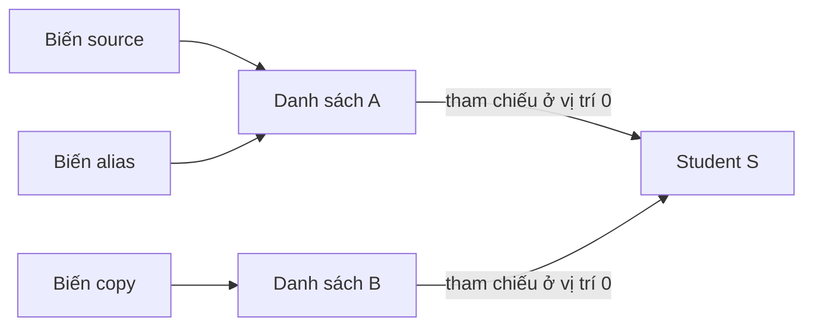

# Bản sao bằng constructor và giới hạn sao chép nông

## 1. Tạo danh sách mới chưa có nghĩa tạo phần tử mới

Khi cần một danh sách để sửa riêng, cách quen thuộc là:

```java
List<Student> copy = new ArrayList<>(source);
```

Đây là biểu thức minh họa với `source` và kiểu `Student` đã tồn tại. Nó tạo một đối tượng `ArrayList` mới chứa các phần tử lấy từ nguồn. Tuy nhiên, nếu phần tử là một đối tượng `Student`, điều được sao chép vào danh sách mới là **tham chiếu đến Student**, không phải tự động tạo một Student khác.

Đó là **sao chép nông (shallow copy)**: cấu trúc chứa bên ngoài được tách ra, còn các đối tượng phần tử vẫn có thể được dùng chung.

Có ba mức cần phân biệt:

| Cách làm | Có danh sách mới? | Có tự tạo đối tượng phần tử mới? |
|---|---|---|
| `List<Student> alias = source;` | Không | Không |
| `List<Student> copy = new ArrayList<>(source);` | Có | Không |
| Duyệt nguồn và sao chép từng Student theo quy tắc của kiểu | Có | Tùy cách sao chép được viết |

Mục tiêu học ở đây là xác định chính xác “độc lập” tới đâu. Nếu chỉ cần thêm/xóa/sắp xếp danh sách mà không làm đổi cấu trúc nguồn, bản sao nông thường phù hợp. Nếu cần thay đổi trạng thái từng Student mà không tác động dữ liệu nguồn, chỉ tạo `ArrayList` mới chưa đủ.

## 2. Constructor nhận Collection làm gì?

Chữ ký API:

```java
public ArrayList(Collection<? extends E> c)
```

Đây là chữ ký minh họa, không phải tệp Java độc lập.

Hàm dựng này tạo một `ArrayList` có các phần tử của collection nguồn theo thứ tự mà nguồn cung cấp khi duyệt. Với nguồn là một `List`, thứ tự danh sách được giữ.

Đoạn minh họa trong một phương thức, cần import `java.util.List` và `java.util.ArrayList`:

```java
List<String> source = List.of("Java", "SQL", "Java");
ArrayList<String> copy = new ArrayList<>(source);

// copy = [Java, SQL, Java]
// copy.size() = 3
```

Các điểm thuộc ý nghĩa thao tác:

- Những phần tử trùng vẫn được giữ; constructor không khử trùng.
- Nguồn không bị xóa hoặc tiêu thụ hết dữ liệu sau khi sao chép.
- Kết quả là `ArrayList` cho phép sửa đổi, dù nguồn là danh sách không sửa được.
- Thứ tự nguồn cung cấp được giữ, nhưng constructor không tự sắp xếp. Nếu nguồn không có cam kết thứ tự duyệt ổn định, bản sao không tự tạo ra một cam kết sắp xếp mới.
- Một collection nguồn bằng `null` gây `NullPointerException`.
- Phần tử `null` bên trong một nguồn hợp lệ được `ArrayList` chấp nhận.

Tham số `Collection<? extends E>` cũng cho phép sao chép phần tử vào một danh sách có kiểu phần tử tổng quát hơn. Ví dụ minh họa:

```java
List<Integer> integers = List.of(1, 2, 3);
ArrayList<Number> numbers = new ArrayList<>(integers);
```

Các phần tử vẫn là những đối tượng `Integer`; chọn kiểu biến `Number` không chuyển chúng thành một loại đối tượng số mới.

Đừng nhầm hai hàm dựng:

| Biểu thức | Kết quả ban đầu |
|---|---|
| `new ArrayList<String>(100)` | Danh sách rỗng, dự phòng capacity ban đầu 100 |
| `new ArrayList<>(source)` | Danh sách chứa các phần tử đang lấy từ nguồn |

Một bên nhận số lượng chỗ dự phòng, một bên nhận collection để sao chép nội dung. [Hàm dựng ArrayList(Collection)](https://docs.oracle.com/en/java/javase/17/docs/api/java.base/java/util/ArrayList.html#%3Cinit%3E(java.util.Collection)).

## 3. Gán tham chiếu và sao chép cấu trúc là hai việc khác nhau

### 3.1. Gán biến không sao chép đối tượng

Đoạn minh họa:

```java
List<String> source = new ArrayList<>(List.of("A", "B"));
List<String> alias = source;

alias.add("C");

// source và alias đều nhìn thấy [A, B, C].
```

Hai biến giữ tham chiếu đến cùng một đối tượng danh sách. Sửa qua biến nào cũng đang sửa cùng cấu trúc đó.

Đổi tên biến thành `backup`, `snapshot` hoặc `copy` không thay đổi ý nghĩa phép gán. Điều quyết định là có tạo một cấu trúc mới hay chỉ chép giá trị tham chiếu.

### 3.2. Constructor tạo cấu trúc chứa độc lập

Đoạn minh họa:

```java
List<String> source = new ArrayList<>(List.of("A", "B"));
List<String> copy = new ArrayList<>(source);

copy.add("C");

// source = [A, B]
// copy = [A, B, C]
```

Sau khi tạo xong, các thao tác thay đổi danh sách này không tự thay đổi cấu trúc của danh sách kia:

- `add`, `remove`, `clear` tác động đến danh sách nhận lời gọi.
- `set(index, newElement)` thay tham chiếu ở vị trí của danh sách nhận lời gọi.
- Sắp xếp lại bản sao thay thứ tự tham chiếu trong bản sao, không sắp xếp lại nguồn.

Cần phân biệt điều đó với việc gọi một phương thức trên đối tượng phần tử, như `copy.get(0).setName(...)`. Lúc này cấu trúc danh sách có thể không thay đổi, nhưng một đối tượng dùng chung đã thay đổi trạng thái.

### 3.3. equals không chứng minh đã sao chép sâu

Ngay sau `new ArrayList<>(source)`, có thể có:

```java
source == copy       // false
source.equals(copy)  // true
```

Đây là hai biểu thức minh họa:

- `==` giữa hai biến danh sách hỏi có phải cùng đối tượng danh sách hay không.
- `List.equals` so sánh dãy phần tử theo thứ tự và quan hệ bằng nhau.

Hai danh sách bằng nhau về nội dung không có nghĩa là cùng đối tượng. Ngược lại, kết quả bằng nhau cũng không chứng minh các phần tử đã được nhân bản; chính các tham chiếu dùng chung có thể khiến phần tử được so sánh bằng nhau.

## 4. Chương trình đầy đủ: alias và bản sao danh sách

Lưu thành `ArrayListConstructorCopyDemo.java`. Chương trình dùng API có trong Java 17:

```java
import java.util.ArrayList;
import java.util.List;

public class ArrayListConstructorCopyDemo {
    public static void main(String[] args) {
        List<String> source = new ArrayList<>(List.of("A", "B"));
        List<String> alias = source;
        List<String> copy = new ArrayList<>(source);

        System.out.println("source == alias: " + (source == alias));
        System.out.println("source == copy: " + (source == copy));
        System.out.println("source.equals(copy): " + source.equals(copy));

        copy.set(0, "X");
        copy.add("C");
        System.out.println("after editing copy, source: " + source);
        System.out.println("after editing copy, copy: " + copy);

        alias.remove(1);
        System.out.println("after editing alias, source: " + source);
        System.out.println("after editing alias, copy: " + copy);

        source.clear();
        System.out.println("after source.clear(), source: " + source);
        System.out.println("after source.clear(), copy: " + copy);

        List<String> fixedSource = List.of("P", "Q");
        ArrayList<String> modifiableCopy = new ArrayList<>(fixedSource);
        modifiableCopy.add("R");
        System.out.println("unmodifiable source: " + fixedSource);
        System.out.println("modifiable copy: " + modifiableCopy);
    }
}
```

Biên dịch và chạy:

```shell
javac --release 17 -encoding UTF-8 ArrayListConstructorCopyDemo.java
java ArrayListConstructorCopyDemo
```

Kết quả chuẩn:

```text
source == alias: true
source == copy: false
source.equals(copy): true
after editing copy, source: [A, B]
after editing copy, copy: [X, B, C]
after editing alias, source: [A]
after editing alias, copy: [X, B, C]
after source.clear(), source: []
after source.clear(), copy: [X, B, C]
unmodifiable source: [P, Q]
modifiable copy: [P, Q, R]
```

Đọc kết quả theo quan hệ sở hữu cấu trúc:

1. `source` và `alias` là cùng danh sách; `copy` là danh sách khác.
2. Thay phần tử và thêm vào `copy` không làm đổi `source`.
3. Xóa qua `alias` làm đổi `source`, vì hai biến vẫn dùng chung cấu trúc.
4. `source.clear()` không xóa nội dung của `copy`.
5. Nguồn từ `List.of` không sửa đổi được, nhưng bản sao `ArrayList` tạo từ nguồn đó vẫn thêm được.

Các phần tử là `String` nên không có thao tác thay đổi nội dung của chính một đối tượng chuỗi. Điều này làm việc dùng chung tham chiếu phần tử ít gây bất ngờ. Nó không biến constructor thành một phép sao chép sâu.

## 5. Giới hạn sao chép nông khi phần tử có thể thay đổi

Giả sử `source` chứa một Student S, rồi tạo một bản sao nông:



Có hai đối tượng danh sách nhưng chỉ một Student S ở vị trí đang xét.

Nếu gọi `copy.get(0).setName("Lan mới")`, Student S đổi tên. Đọc `source.get(0)` cũng thấy tên mới, vì nguồn vẫn trỏ đến cùng Student S.

Nếu gọi `copy.set(0, anotherStudent)`, chỉ ô chứa tham chiếu của bản sao đổi sang đối tượng khác. Nguồn vẫn trỏ đến Student S.

| Thao tác | Đổi cấu trúc/vị trí chứa của bản sao? | Có thể quan sát tác động qua phần tử ở nguồn? |
|---|---|---|
| `copy.add(newStudent)` | Có | Không tự thêm vào nguồn |
| `copy.remove(0)` | Có | Không tự xóa khỏi nguồn |
| `copy.set(0, newStudent)` | Thay tham chiếu tại vị trí bản sao | Không tự thay tham chiếu ở nguồn |
| `copy.get(0).setName(...)` | Không nhất thiết đổi danh sách | Có, nếu đối tượng đó đang được dùng chung |
| `copy.get(0).getSkills().add(...)` | Không đổi danh sách ngoài | Có, nếu danh sách skills bên trong còn dùng chung |

Điểm mấu chốt là đối tượng nào nhận thao tác: bản thân danh sách ngoài, phần tử, hay một đối tượng nằm bên trong phần tử.

Cơ chế này tuân theo quy tắc tham chiếu chung của Java: nhiều biến hoặc ô chứa có thể cùng tham chiếu một đối tượng, và thay đổi trạng thái qua một tham chiếu có thể được quan sát qua tham chiếu khác. [JLS 4.3.1 về đối tượng và tham chiếu](https://docs.oracle.com/javase/specs/jls/se17/html/jls-4.html#jls-4.3.1).

## 6. Danh sách lồng nhau: sao chép lớp ngoài vẫn dùng chung lớp trong

Với `List<List<String>>`, phần tử của danh sách ngoài chính là một đối tượng danh sách khác.

Đoạn minh họa trong một phương thức:

```java
List<List<String>> source = new ArrayList<>();
source.add(new ArrayList<>(List.of("A", "B")));

List<List<String>> outerCopy = new ArrayList<>(source);
outerCopy.get(0).add("C");

// source = [[A, B, C]]
// outerCopy = [[A, B, C]]
```

`outerCopy.get(0)` và `source.get(0)` đang là cùng danh sách con. Việc đã tạo danh sách ngoài mới không tạo danh sách con mới.

Nếu yêu cầu tách cả từng danh sách con, có thể sao chép thêm một lớp:

```java
List<List<String>> rowsCopy = new ArrayList<>(source.size());
for (List<String> row : source) {
    rowsCopy.add(new ArrayList<>(row));
}
```

Đây là đoạn minh họa với `source` đã khai báo. Nó tạo danh sách ngoài mới và mỗi danh sách con mới. Các phần tử `String` vẫn có thể dùng chung vì chuỗi bất biến.

Nhưng nếu kiểu là `List<List<Student>>`, cùng cách làm chỉ tách hai lớp danh sách; các Student vẫn có thể được dùng chung. Số lần viết `new ArrayList` không phải một định nghĩa tổng quát của “sao chép sâu”. Cần đi theo các đối tượng có trạng thái thay đổi được trong mô hình dữ liệu.

Nếu có danh sách con bằng `null`, vòng lặp sao chép ở trên phải có chính sách xử lý riêng. `new ArrayList<>(null)` không biến một hàng `null` thành hàng rỗng; nó gây `NullPointerException`.

## 7. Tách phần tử bằng quy tắc sao chép của kiểu dữ liệu

### 7.1. Tạo Student mới nhưng gán lại trường tham chiếu vẫn có thể chưa đủ

Giả sử Student có:

- Một tên kiểu `String`.
- Một địa chỉ kiểu `Address` có thể đổi thành phố.
- Một danh sách kỹ năng `List<String>`.

Chỉ tạo Student mới rồi gán `newStudent.address = oldStudent.address` vẫn dùng chung Address. Gán `newStudent.skills = oldStudent.skills` vẫn dùng chung danh sách kỹ năng.

Muốn độc lập đối với các thay đổi được yêu cầu, quy tắc sao chép phải tách những đối tượng có thể thay đổi liên quan:

- Tạo Student mới.
- Tạo Address mới.
- Tạo danh sách skills mới.
- Có thể dùng lại các chuỗi vì `String` là bất biến.

Đây là một quy tắc theo mô hình cụ thể, không phải một cơ chế tự động mà constructor của `ArrayList` suy ra được.

### 7.2. Chương trình đầy đủ với constructor sao chép cho phần tử

Lưu thành `MutableElementCopyDemo.java`:

```java
import java.util.ArrayList;
import java.util.List;

public class MutableElementCopyDemo {
    private static final class Address {
        private String city;

        private Address(String city) {
            this.city = city;
        }

        private Address(Address other) {
            this.city = other.city;
        }
    }

    private static final class Student {
        private String name;
        private Address address;
        private List<String> skills;

        private Student(String name, Address address, List<String> skills) {
            this.name = name;
            this.address = address;
            this.skills = skills;
        }

        private Student(Student other) {
            this.name = other.name;
            this.address = new Address(other.address);
            this.skills = new ArrayList<>(other.skills);
        }

        @Override
        public String toString() {
            return name + "@" + address.city + skills;
        }
    }

    private static List<Student> copyStudents(List<Student> source) {
        List<Student> result = new ArrayList<>(source.size());
        for (Student student : source) {
            result.add(new Student(student));
        }
        return result;
    }

    public static void main(String[] args) {
        List<Student> source = new ArrayList<>();
        source.add(new Student("Lan", new Address("Hue"),
                new ArrayList<>(List.of("Java"))));

        List<Student> shallow = new ArrayList<>(source);
        List<Student> independent = copyStudents(source);

        System.out.println("shallow same Student: "
                + (source.get(0) == shallow.get(0)));
        System.out.println("independent same Student: "
                + (source.get(0) == independent.get(0)));
        System.out.println("independent same Address: "
                + (source.get(0).address == independent.get(0).address));
        System.out.println("independent same skills list: "
                + (source.get(0).skills == independent.get(0).skills));

        source.get(0).name = "Lan*";
        source.get(0).address.city = "DaNang";
        source.get(0).skills.add("Spring");
        System.out.println("after source element edits, source: " + source);
        System.out.println("after source element edits, shallow: " + shallow);
        System.out.println("after source element edits, independent: " + independent);

        shallow.set(0, new Student("New", new Address("Hanoi"),
                new ArrayList<>(List.of("SQL"))));
        System.out.println("after shallow.set(), source: " + source);
        System.out.println("after shallow.set(), shallow: " + shallow);
        System.out.println("after shallow.set(), independent: " + independent);
    }
}
```

Biên dịch và chạy:

```shell
javac --release 17 -encoding UTF-8 MutableElementCopyDemo.java
java MutableElementCopyDemo
```

Kết quả chuẩn:

```text
shallow same Student: true
independent same Student: false
independent same Address: false
independent same skills list: false
after source element edits, source: [Lan*@DaNang[Java, Spring]]
after source element edits, shallow: [Lan*@DaNang[Java, Spring]]
after source element edits, independent: [Lan@Hue[Java]]
after shallow.set(), source: [Lan*@DaNang[Java, Spring]]
after shallow.set(), shallow: [New@Hanoi[SQL]]
after shallow.set(), independent: [Lan@Hue[Java]]
```

Trong chương trình:

- `shallow` có danh sách ngoài mới nhưng giữ Student cũ.
- `independent` chứa Student mới được tạo qua `Student(Student other)`.
- Constructor sao chép của Student tiếp tục tạo Address mới và danh sách skills mới.
- Sửa tên, địa chỉ và kỹ năng qua nguồn làm `shallow` thấy thay đổi nhưng không làm đổi bản `independent`.
- `shallow.set(0, ...)` chỉ thay tham chiếu trong bản sao nông, không thay phần tử ở nguồn hoặc bản độc lập.

Tên `Student(Student other)` chỉ là quy ước thiết kế constructor sao chép của lớp. Java không tự bảo đảm rằng mọi constructor nhận cùng kiểu đều sao chép sâu; chính phần thân constructor quyết định các tham chiếu nào được dùng lại và các đối tượng nào được tạo mới.

### 7.3. Giới hạn đã chọn của ví dụ

Ví dụ giả sử Student, Address và danh sách skills không bằng `null`. Nếu dữ liệu cho phép `null`, cần quyết định rõ giữ `null`, dùng giá trị mặc định hay từ chối đầu vào; không để người gọi phải đoán.

Phần tử trong skills là `String`, nên sao chép danh sách skills là đủ để tách các thao tác thêm/xóa/thay chuỗi trong mô hình này. Nếu skills chứa một đối tượng Skill có thể sửa, cần xem tiếp trạng thái của Skill.

Hàm `copyStudents` tạo Student mới cho mỗi vị trí. Nếu hai vị trí nguồn cùng trỏ đến một Student, cách làm này tạo hai Student độc lập ở đích. Điều đó có thể đúng hoặc sai tùy yêu cầu có cần giữ quan hệ dùng chung hay không.

Một đồ thị đối tượng phức tạp có thể có nhiều đường cùng trỏ đến một địa chỉ hoặc có chu kỳ tham chiếu. Khi yêu cầu bảo toàn cấu trúc quan hệ, phải thiết kế quy tắc và cơ chế theo dõi đối tượng đã sao chép; không áp dụng đệ quy mù quáng rồi gọi đó là giải pháp tổng quát.

Không phải mọi tài nguyên đều nên nhân bản như dữ liệu thông thường. Một kết nối, luồng xử lý hoặc đối tượng quản lý tài nguyên cần chính sách riêng. Mục tiêu là sao chép trạng thái dữ liệu cần tách, không tự động tạo lại mọi thứ có thể truy cập được.

## 8. Bất biến, final và các API có tên giống sao chép

### 8.1. Phần tử bất biến có thể được chia sẻ an toàn hơn

Với `List<String>`, `List<Integer>` hoặc các kiểu giá trị bất biến được thiết kế đúng, việc dùng chung đối tượng phần tử thường không tạo ra đường sửa trạng thái của chính đối tượng đó.

Khi gọi `copy.set(0, "new")`, ta thay tham chiếu trong danh sách bản sao. Không có thao tác đổi nội dung của đối tượng chuỗi cũ để nguồn bỗng nhìn thấy một chuỗi khác.

Sao chép sâu một cách máy móc đối với mọi giá trị bất biến thường không đem lại lợi ích tương ứng. Hãy xác định trạng thái nào có thể đổi thay vì chỉ đếm số đối tượng mới.

### 8.2. final không làm phần tử bất biến

Đoạn minh họa:

```java
final List<Student> students = new ArrayList<>(source);
```

`final` ngăn biến `students` được gán sang một danh sách khác. Nó không tự cấm `students.add(...)` hoặc sửa trạng thái của một Student dùng chung.

Một `record` có trường thành phần kiểu danh sách cũng không tự làm danh sách đó thành bất biến hoặc tự sao chép sâu dữ liệu nhận vào. Cần thiết kế việc sao chép và quyền sửa đổi cho các thành phần có thể thay đổi. [JLS về biến final và tham chiếu](https://docs.oracle.com/javase/specs/jls/se17/html/jls-4.html#jls-4.12.4).

### 8.3. So sánh các cách lấy danh sách

| Cách làm | Cấu trúc danh sách đích | Phần tử có tự được sao chép sâu không? |
|---|---|---|
| `alias = source` | Cùng danh sách | Không |
| `new ArrayList<>(source)` | Danh sách mới, sửa được | Không |
| `Collections.unmodifiableList(source)` | View ngăn sửa qua tham chiếu trả về, còn liên hệ nguồn | Không |
| `List.copyOf(source)` | Kết quả không sửa đổi được, không phản ánh việc nguồn thay dãy phần tử về sau | Không |
| `ArrayList.clone()` | Bản sao nông của ArrayList | Không |
| Vòng lặp tạo phần tử mới theo quy tắc miền dữ liệu | Phụ thuộc quy tắc đã viết | Chỉ tới mức quy tắc thực sự xử lý |

`List.copyOf` không chấp nhận phần tử `null` và có thể tái sử dụng một danh sách không sửa đổi được phù hợp; không dựa vào nó để khẳng định luôn có một đối tượng danh sách mới. Nếu phần tử có thể sửa, danh sách không sửa đổi được vẫn có thể quan sát trạng thái phần tử đổi qua nơi khác.

`Collections.unmodifiableList` không phải bản sao dữ liệu. Những thay đổi hợp lệ ở nguồn vẫn có thể được quan sát qua view.

`ArrayList.clone()` cũng là sao chép nông; đổi từ constructor sang clone không khắc phục việc dùng chung phần tử. Với bài toán tạo một danh sách chứa phần tử từ collection, constructor thường diễn đạt trực tiếp mà không cần thao tác với giá trị trả về kiểu `Object` của clone.

Các API có mục đích khác nhau; chọn theo quyền sửa cấu trúc, quan hệ với nguồn, khả năng chứa `null` và mức độc lập phần tử thực sự cần. [List.copyOf](https://docs.oracle.com/en/java/javase/17/docs/api/java.base/java/util/List.html#copyOf(java.util.Collection)), [Collections.unmodifiableList](https://docs.oracle.com/en/java/javase/17/docs/api/java.base/java/util/Collections.html#unmodifiableList(java.util.List)), [ArrayList.clone](https://docs.oracle.com/en/java/javase/17/docs/api/java.base/java/util/ArrayList.html#clone()).

## 9. Sao chép để bảo vệ ranh giới API

Giả sử một lớp nhận danh sách từ bên ngoài:

```java
this.students = new ArrayList<>(incoming);
```

Đây là câu lệnh minh họa trong constructor hoặc phương thức của lớp, với các trường và kiểu đã khai báo.

Sau thao tác này, bên gọi thêm/xóa phần tử trong `incoming` không tự thêm/xóa trong `this.students`. Nhưng nếu vẫn giữ một Student dùng chung, bên gọi có thể sửa Student và trạng thái lớp đang lưu cũng quan sát thấy thay đổi.

Tương tự, một getter trả `new ArrayList<>(this.students)` ngăn bên nhận xóa trực tiếp phần tử trong danh sách nội bộ qua cấu trúc được trả về. Nó không tự ngăn bên nhận sửa từng Student nội bộ được chia sẻ.

Khi thiết kế API, xác định điều cần bảo vệ:

1. Chỉ cần người gọi không thêm/xóa/sắp xếp lại danh sách nội bộ?
2. Cần người gọi không được sửa cả trạng thái phần tử?
3. Cần một bản chụp dữ liệu giá trị để giữ lâu?
4. Có chủ ý cho phép chia sẻ một số đối tượng bất biến hoặc một số quan hệ dùng chung không?

Tùy yêu cầu, có thể dùng bản sao nông, các phần tử bất biến, dữ liệu chuyển giao chỉ gồm giá trị, hoặc một quy tắc sao chép phần tử rõ ràng. Không gắn tên “defensive copy” rồi mặc định đã giải quyết mọi đường thay đổi.

## 10. Chi phí và giới hạn lúc tạo bản sao

Với nguồn có `n` phần tử và chi phí duyệt thông thường, constructor cần lấy các tham chiếu phần tử và chuẩn bị cấu trúc chứa chúng, có chi phí tuyến tính `O(n)` và chỗ chứa thêm tỉ lệ `O(n)`.

Phân tích đó không bao gồm việc nhân bản toàn bộ đồ thị trạng thái của các phần tử, vì constructor không thực hiện việc đó. Nếu tự sao chép sâu, chi phí còn phụ thuộc dữ liệu con, quan hệ dùng chung và quy tắc sao chép.

Bản sao độc lập về cấu trúc cũng không có nghĩa quá trình tạo nó là một bản chụp nguyên tử khi nguồn đang được sửa đồng thời. Cần chính sách đồng bộ hoặc nguồn có quy tắc duyệt phù hợp nếu nhiều luồng truy cập; một lời gọi constructor không tự bảo vệ khỏi mọi thay đổi trong lúc đang lấy dữ liệu.

Ngay cả khi đã sao chép danh sách xong, các phần tử dùng chung vẫn có thể bị nơi khác sửa. Cần xem riêng tính ổn định của dãy tham chiếu và tính ổn định của trạng thái các đối tượng mà dãy đó trỏ tới.

Nếu nguồn là view của một phần danh sách, `new ArrayList<>(view)` tách cấu trúc chứa các phần tử được lấy khỏi quan hệ view. Nhưng nó vẫn giữ các tham chiếu phần tử đó; không được suy ra rằng toàn bộ dữ liệu bên dưới đã trở thành độc lập.

## 11. Lỗi phổ biến và cách kiểm tra đúng mức sao chép

| Hiện tượng hoặc cách hiểu | Nguyên nhân | Cách kiểm tra hoặc sửa |
|---|---|---|
| Sửa `backup` làm danh sách nguồn đổi | Chỉ gán `backup = source` | Kiểm tra `backup == source`; tạo cấu trúc mới nếu cần |
| Đã dùng `new ArrayList` nhưng đổi tên phần tử vẫn ảnh hưởng nguồn | Phần tử dùng chung | Kiểm tra `copy.get(i) == source.get(i)`; tách phần tử có thể sửa nếu yêu cầu |
| Đã tạo Student mới nhưng đổi địa chỉ vẫn ảnh hưởng nguồn | Trường Address còn dùng chung | Kiểm tra từng đối tượng con có trạng thái thay đổi |
| Bản sao danh sách lồng nhau vẫn thêm được vào cùng hàng nguồn | Danh sách con là phần tử dùng chung | Sao chép thêm lớp danh sách con khi cần |
| `equals` trả true nên cho rằng đã sao chép sâu | So sánh nội dung không đo quyền sở hữu | Dùng kiểm tra quan hệ tham chiếu và thử thay đổi theo yêu cầu |
| Đổi sang `List.copyOf` để mong nhân bản Student | Danh sách không sửa được không đồng nghĩa phần tử bất biến | Thiết kế kiểu phần tử hoặc quy tắc sao chép |
| Thêm `final` rồi coi mọi dữ liệu đã bất biến | Chỉ cố định tham chiếu của biến | Phân biệt biến, cấu trúc danh sách và trạng thái phần tử |
| Gọi constructor với nguồn `null` để mong ra danh sách rỗng | Nguồn null không phải collection rỗng | Xác định chính sách null trước khi gọi |
| Sao chép từng vị trí làm mất quan hệ dùng chung cần giữ | Quy tắc tạo phần tử mới không bảo toàn đồ thị | Nêu rõ có cần giữ quan hệ đồng nhất giữa các vị trí hay không |

Một phép kiểm chứng có ý nghĩa nên thử hai nhóm riêng:

- Sửa cấu trúc: thêm, xóa, thay tham chiếu hoặc đổi thứ tự trong bản sao rồi kiểm tra nguồn.
- Sửa phần tử: thay một trường, sửa một danh sách con hoặc một đối tượng con rồi kiểm tra nơi còn tham chiếu.

Nếu yêu cầu chỉ độc lập cấu trúc, nhóm thứ nhất là trọng tâm. Nếu yêu cầu độc lập trạng thái phần tử, phải kiểm tra nhóm thứ hai ở đúng các lớp dữ liệu cần tách.

## 12. Bài tập dự đoán

Xét đoạn minh họa sau trong một phương thức:

```java
List<List<String>> source = new ArrayList<>();
source.add(new ArrayList<>(List.of("A")));

List<List<String>> alias = source;
List<List<String>> copy = new ArrayList<>(source);

copy.add(new ArrayList<>(List.of("B")));
copy.get(0).add("X");
copy.set(0, new ArrayList<>(List.of("Y")));
alias.clear();
```

Dự đoán lần lượt:

1. Ngay sau constructor, `copy == source` là gì?
2. Ngay sau constructor, `copy.get(0) == source.get(0)` là gì?
3. Sau `copy.add(...)`, nguồn có thêm hàng `[B]` không?
4. Sau `copy.get(0).add("X")`, hàng đầu của nguồn có đổi không?
5. Sau `copy.set(0, ...)`, hàng đầu của nguồn có thành `[Y]` không?
6. Sau `alias.clear()`, nguồn và bản sao còn gì?

Đáp án:

1. `false`: đã tạo danh sách ngoài mới.
2. `true`: danh sách con đầu tiên còn dùng chung.
3. Không; nguồn vẫn chỉ có một hàng.
4. Có; cả hai đang giữ cùng hàng đầu, nên nguồn là `[[A, X]]`.
5. Không; nguồn vẫn giữ hàng `[A, X]`, còn vị trí 0 của bản sao trỏ sang hàng `[Y]`.
6. Nguồn thành `[]` vì alias là cùng danh sách; bản sao vẫn `[[Y], [B]]`.

Khi viết `new ArrayList<>(source)`, hãy đọc đúng phạm vi bảo đảm: có một danh sách mới chứa các tham chiếu phần tử được lấy từ nguồn. Muốn độc lập thêm tới đâu, cần xem tiếp từng đối tượng có trạng thái thay đổi được và quy tắc sao chép của chính mô hình dữ liệu.
