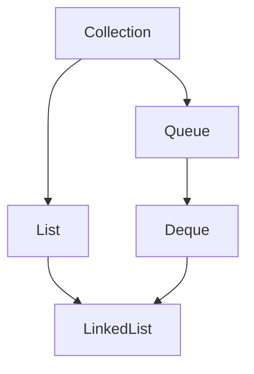

# Vai trò đồng thời của List và Deque trong LinkedList

## 1. Một đối tượng, hai cách mô tả thao tác

`LinkedList<E>` vừa triển khai `List<E>`, vừa triển khai `Deque<E>`. Nó có thể được dùng như một danh sách có thứ tự và chỉ số, đồng thời có thể được dùng như một hàng đợi hai đầu.

Hai vai trò này nói về các **giao diện thao tác trên cùng dữ liệu**, không có nghĩa đối tượng tự tạo hai bản sao hoặc tự bảo đảm an toàn cho nhiều luồng.

- `List` tập trung vào dãy phần tử: vị trí, thêm/chèn, thay thế, tìm kiếm và duyệt theo thứ tự.
- `Deque` tập trung vào hai đầu: thêm, đọc, lấy ra ở đầu trước hoặc đầu sau.
- `Deque` kế thừa `Queue`, nên một LinkedList cũng dùng được qua các thao tác hàng đợi.

Trong Java 17, quan hệ cần nhớ là:



Các mũi tên đi từ giao diện tổng quát đến giao diện/lớp cụ thể hơn. Sơ đồ chỉ thể hiện các quan hệ cần cho bài, không liệt kê toàn bộ cây kế thừa.

`Deque` đọc là “deck”, viết tắt của double-ended queue, tức hàng đợi hai đầu. Nó không phải “dequeue” theo nghĩa một thao tác lấy phần tử ra.

Các chương trình trong bài dùng API có trong Java 17. Từ Java 21, `List` còn có thêm thao tác đầu/cuối qua `SequencedCollection`; điều đó không biến mọi List thành Deque. Các thao tác chỉ số và nhóm `offer/poll/peek/push/pop` vẫn cần được hiểu theo giao diện tương ứng. [LinkedList Java 17](https://docs.oracle.com/en/java/javase/17/docs/api/java.base/java/util/LinkedList.html), [List Java 21](https://docs.oracle.com/en/java/javase/21/docs/api/java.base/java/util/List.html).

## 2. Vì sao cấu trúc LinkedList hỗ trợ được cả hai vai trò?

LinkedList là danh sách liên kết đôi. Mỗi nút giữ phần tử cùng liên kết tới nút trước và nút sau; cấu trúc giữ thông tin về hai đầu.

Hình dung dãy `[A, B, C]`:

```text
đầu trước (head)                         đầu sau (tail)
       |                                      |
       v                                      v
      [A] <------------> [B] <------------> [C]
       0                 1                  2
```

Trong cách nhìn của List, ta gọi chúng là phần tử tại chỉ số 0, 1, 2. Trong cách nhìn của Deque, A ở đầu trước và C ở đầu sau.

Thêm một phần tử ở đầu bằng Deque làm các vị trí List thay đổi tương ứng:

```text
Trước addFirst(X): [A, B, C]
Sau addFirst(X):   [X, A, B, C]

Chỉ số của A: từ 0 thành 1
Chỉ số của C: từ 2 thành 3
```

Không có bước “đồng bộ hai danh sách”; chỉ một dãy nút đã thay đổi. Chỉ số là vị trí hiện tại trong dãy, không phải một nhãn cố định gắn với nút.

Liên kết đôi giúp tới hai đầu trực tiếp, nhưng không tạo ra truy cập ngẫu nhiên theo chỉ số như mảng. Muốn tới một chỉ số ở giữa, LinkedList phải đi theo liên kết từ đầu gần hơn. [Cơ chế truy cập theo chỉ số của LinkedList](https://docs.oracle.com/en/java/javase/17/docs/api/java.base/java/util/LinkedList.html).

## 3. Dùng LinkedList trong vai trò List

Đoạn minh họa bên trong một phương thức, cần import `java.util.List` và `java.util.LinkedList`:

```java
List<String> names = new LinkedList<>();

names.add("An");
names.add("Chi");
names.add(1, "Binh");
names.set(2, "Chau");

// names = [An, Binh, Chau]
// names.get(1) trả Binh.
```

Các đặc điểm List vẫn được giữ:

- Có thứ tự phần tử và vị trí tính từ 0.
- Cho phép phần tử trùng nhau.
- LinkedList cho phép phần tử `null`.
- `get(i)`, `set(i, value)`, `remove(i)` làm việc với vị trí.
- `add(i, value)` chèn trước phần tử hiện tại ở vị trí đó, hoặc chèn cuối nếu `i == size()`.
- Iterator thông thường duyệt theo thứ tự từ đầu tới cuối.

Kiểu biến `List<String>` diễn đạt rằng đoạn mã cần hợp đồng danh sách. Nó không biến LinkedList thành mảng; chi phí truy cập vẫn do đối tượng LinkedList thực hiện.

Đặc biệt, tránh mặc định rằng vòng lặp sau có chi phí tuyến tính trên LinkedList:

```java
for (int i = 0; i < names.size(); i++) {
    System.out.println(names.get(i));
}
```

Đây là đoạn minh họa. Mỗi `get(i)` có thể lại phải đi qua các nút, khiến tổng chi phí có thể là `O(n²)`. Nếu chỉ cần lần lượt xử lý phần tử, duyệt bằng for-each hoặc iterator thường phù hợp hơn.

## 4. Dùng cùng cấu trúc trong vai trò Deque

Deque cho phép chọn rõ đầu thao tác:

| Mục tiêu | Đầu trước, báo lỗi khi không thực hiện được | Đầu trước, trả giá trị đặc biệt | Đầu sau, báo lỗi khi không thực hiện được | Đầu sau, trả giá trị đặc biệt |
|---|---|---|---|---|
| Thêm | `addFirst(e)` | `offerFirst(e)` | `addLast(e)` | `offerLast(e)` |
| Lấy ra và xóa | `removeFirst()` | `pollFirst()` | `removeLast()` | `pollLast()` |
| Đọc, không xóa | `getFirst()` | `peekFirst()` | `getLast()` | `peekLast()` |

Khi rỗng:

- `removeFirst/removeLast/getFirst/getLast` ném `NoSuchElementException`.
- `pollFirst/pollLast/peekFirst/peekLast` trả `null`.

Với thao tác thêm, nhóm `offer` có kiểu kết quả boolean; sự khác nhau với nhóm `add` hữu ích đặc biệt ở triển khai Deque có giới hạn số phần tử. LinkedList không đặt một capacity tối đa cố định như một hàng đợi bị chặn dung lượng. Không suy từ đây rằng mọi triển khai Deque có cùng chính sách thêm hoặc đều cho `null`.

Phân biệt đọc và lấy ra:

```java
Deque<String> tasks = new LinkedList<>();
tasks.addLast("A");
tasks.addLast("B");

String first = tasks.peekFirst(); // A; tasks vẫn [A, B].
String taken = tasks.pollFirst(); // A; tasks thành [B].
```

Đoạn trên minh họa trong phương thức, cần import `java.util.Deque` và `java.util.LinkedList`.

Deque không cung cấp truy cập theo chỉ số. Nếu một biến được khai báo `Deque<String>`, không gọi `get(1)` hoặc `add(1, value)` qua biến đó, dù đối tượng thực tế là LinkedList. [Giao diện Deque](https://docs.oracle.com/en/java/javase/17/docs/api/java.base/java/util/Deque.html).

## 5. FIFO và LIFO là cách chọn đầu thêm/lấy

### 5.1. Dùng như hàng đợi FIFO

FIFO nghĩa là vào trước, ra trước. Trên LinkedList dùng theo hợp đồng Deque, thêm ở cuối và lấy ở đầu:

```text
offerLast(A): [A]
offerLast(B): [A, B]
offerLast(C): [A, B, C]

pollFirst(): trả A; còn [B, C]
pollFirst(): trả B; còn [C]
```

Có thể dùng các tên của Queue:

| Queue | Thao tác tương ứng của Deque |
|---|---|
| `add(e)` | Thêm cuối bằng `addLast(e)` |
| `offer(e)` | `offerLast(e)` |
| `remove()` | `removeFirst()` |
| `poll()` | `pollFirst()` |
| `element()` | `getFirst()` |
| `peek()` | `peekFirst()` |

Ví dụ minh họa:

```java
Queue<String> jobs = new LinkedList<>();
jobs.offer("job-1");
jobs.offer("job-2");

String next = jobs.poll(); // job-1
```

Kiểu biến Queue diễn đạt mục đích một đầu vào/một đầu ra. Bản thân giao diện Queue không có nghĩa mọi triển khai đều dùng FIFO; chẳng hạn có hàng đợi ưu tiên. Ở đây FIFO có được từ quy tắc Queue của Deque/LinkedList: thêm cuối, lấy đầu.

### 5.2. Dùng như ngăn xếp LIFO

LIFO nghĩa là vào sau, ra trước. Với nhóm phương thức ngăn xếp của Deque:

| Phương thức | Ý nghĩa trên Deque |
|---|---|
| `push(e)` | Thêm vào đầu trước, tương ứng `addFirst(e)` |
| `pop()` | Lấy và xóa đầu trước, tương ứng `removeFirst()` |
| `peek()` | Xem đầu trước, trả `null` khi rỗng |

Đoạn minh họa:

```java
Deque<String> history = new LinkedList<>();
history.push("A");
history.push("B");

// history = [B, A]
String latest = history.pop(); // B
```

Đỉnh ngăn xếp ở đầu trước trong quy ước `push/pop` của Deque. Phần tử được đẩy vào sau nằm trước, nên iterator thông thường sau hai lần push duyệt `B` rồi `A`.

Nếu kết hợp `addLast` với `removeLast`, cũng tạo được hành vi vào sau ra trước ở đầu sau. Nhưng khi dùng API có tên `push/pop`, hãy tuân theo quy ước đầu trước của chính các phương thức đó để người đọc không phải đoán.

### 5.3. Không trộn quy ước vô tình

Một cấu trúc có khả năng thêm/lấy ở cả hai đầu không tự chọn thay thuật toán là hàng đợi hay ngăn xếp. Nếu quy trình cần FIFO mà một nhánh lại gọi `push`, nhánh đó đưa phần tử lên đầu, có thể vượt trước các phần tử đã chờ.

Chọn một quy ước rõ cho mỗi luồng xử lý. Các ví dụ trộn nhiều nhóm phương thức trong bài nhằm chứng minh cùng một cấu trúc hỗ trợ các vai trò, không phải gợi ý dùng tùy ý mọi nhóm trong cùng một thuật toán.

## 6. Nhiều kiểu biến vẫn có thể là cùng một đối tượng

Đoạn minh họa:

```java
LinkedList<String> storage = new LinkedList<>();

List<String> asList = storage;
Deque<String> asDeque = storage;
Queue<String> asQueue = storage;
```

Không có bản sao hoặc bộ chuyển đổi dữ liệu được tạo bởi ba phép gán này. Mọi biến đều tham chiếu cùng một LinkedList.

- Thêm đầu qua `asDeque` làm `asList.get(0)` nhìn thấy phần tử mới.
- Chèn giữa qua `asList` làm thứ tự được nhìn qua `asDeque` thay đổi.
- Lấy đầu qua `asQueue` làm size mà cả ba biến quan sát cùng giảm.
- Xóa sạch qua một biến cũng xóa dữ liệu mà các biến còn lại đang nhìn.

Kiểu khai báo quyết định các phương thức mà trình biên dịch cho phép gọi qua biến. Kiểu thực tế quyết định phần triển khai được thực thi sau khi phương thức đã được xác định.

Đừng ép kiểu một List tùy ý thành Deque chỉ vì LinkedList hỗ trợ cả hai. Một `ArrayList` là List nhưng không phải Deque; một `ArrayDeque` là Deque nhưng không phải List. Nếu API cần một vai trò, nhận đúng giao diện đó thay vì giả định mọi triển khai đều có thêm vai trò còn lại.

## 7. Chương trình đầy đủ: List, Deque và Queue trên một LinkedList

Lưu thành `LinkedListRolesDemo.java`. Chương trình dùng API có trong Java 17:

```java
import java.util.Deque;
import java.util.Iterator;
import java.util.LinkedList;
import java.util.List;
import java.util.Queue;
import java.util.StringJoiner;

public class LinkedListRolesDemo {
    public static void main(String[] args) {
        LinkedList<String> storage = new LinkedList<>();
        List<String> asList = storage;
        Deque<String> asDeque = storage;
        Queue<String> asQueue = storage;

        System.out.println("same object: " + (asList == asDeque));

        asList.add("B");
        asList.add("C");
        asList.add(1, "X");
        System.out.println("after List operations: " + storage);

        asDeque.addFirst("A");
        asDeque.addLast("D");
        System.out.println("after Deque operations: " + asList);

        String old = asList.set(2, "Y");
        System.out.println("List.set returned: " + old);
        System.out.println("Deque sees: " + asDeque);

        asQueue.offer("E");
        System.out.println("Queue.peek: " + asQueue.peek());
        System.out.println("Queue.poll: " + asQueue.poll());
        System.out.println("after FIFO step: " + storage);

        System.out.println("Deque.pollLast: " + asDeque.pollLast());
        asDeque.push("TOP");
        System.out.println("after push: " + storage);
        System.out.println("pop: " + asDeque.pop());
        System.out.println("after pop: " + storage);

        System.out.println("forward: " + String.join(",", asList));
        StringJoiner reverse = new StringJoiner(",");
        Iterator<String> iterator = asDeque.descendingIterator();
        while (iterator.hasNext()) {
            reverse.add(iterator.next());
        }
        System.out.println("reverse: " + reverse);
        System.out.println("shared size: " + asList.size()
                + "/" + asDeque.size() + "/" + asQueue.size());
    }
}
```

Biên dịch và chạy:

```shell
javac --release 17 -encoding UTF-8 LinkedListRolesDemo.java
java LinkedListRolesDemo
```

Kết quả chuẩn:

```text
same object: true
after List operations: [B, X, C]
after Deque operations: [A, B, X, C, D]
List.set returned: X
Deque sees: [A, B, Y, C, D]
Queue.peek: A
Queue.poll: A
after FIFO step: [B, Y, C, D, E]
Deque.pollLast: E
after push: [TOP, B, Y, C, D]
pop: TOP
after pop: [B, Y, C, D]
forward: B,Y,C,D
reverse: D,C,Y,B
shared size: 4/4/4
```

Theo dõi sự thống nhất của dữ liệu:

1. Sau thao tác List, dãy là `[B, X, C]`.
2. Thêm ở hai đầu qua Deque tạo `[A, B, X, C, D]`, và biến List nhìn thấy ngay.
3. Thay phần tử chỉ số 2 qua List làm Deque nhìn thấy `Y` thay `X`.
4. Queue thêm `E` ở cuối; peek xem `A` mà không xóa; poll mới xóa `A`.
5. `pollLast` lấy `E` ở cuối.
6. `push("TOP")` đưa phần tử vào đầu; pop lấy đúng phần tử đó ra.
7. Cả ba biến báo size bằng 4 vì cùng một đối tượng.

Duyệt thường đi từ đầu trước tới đầu sau. `descendingIterator` đi ngược, không tự đảo hoặc sao chép danh sách; sau khi duyệt ngược, dãy gốc vẫn `[B, Y, C, D]`.

## 8. Tên remove dễ gây nhầm khi đổi vai trò

LinkedList có các dạng phương thức khác nhau:

| Lời gọi | Ý nghĩa | Kiểu kết quả |
|---|---|---|
| `remove()` | Lấy và xóa đầu trước; lỗi nếu rỗng | Phần tử |
| `remove(int index)` | Xóa phần tử tại chỉ số List | Phần tử |
| `remove(Object value)` | Xóa lần xuất hiện đầu tiên bằng giá trị tìm | `boolean` |
| `removeFirst()`, `removeLast()` | Xóa đầu được chỉ rõ | Phần tử |
| `removeFirstOccurrence(value)`, `removeLastOccurrence(value)` | Tìm và xóa lần xuất hiện đầu/cuối bằng giá trị | `boolean` |

Đặc biệt với số nguyên, kiểu biến nhận lời gọi có thể thay đổi tập overload nhìn thấy.

Đoạn minh họa, mỗi phần dùng một danh sách mới `[1, 20, 30]`:

```java
List<Integer> indexed = new LinkedList<>(List.of(1, 20, 30));
Integer deleted = indexed.remove(1);
// deleted = 20; indexed = [1, 30]

Deque<Integer> ended = new LinkedList<>(List.of(1, 20, 30));
boolean found = ended.remove(1);
// found = true; ended = [20, 30]
```

Qua List, đối số `int` khớp phương thức xóa theo chỉ số. Qua Deque, không có `remove(int)`; số 1 được boxing thành `Integer` và dùng cho `remove(Object)`.

Điều này không có nghĩa đối tượng tự đổi hành vi theo dữ liệu chứa bên trong. Trình biên dịch đã chọn hai phương thức khác nhau dựa trên kiểu biến và đối số tại chỗ gọi.

Nếu cần xóa giá trị 1 qua một biến List, viết rõ `remove(Integer.valueOf(1))`. Nếu cần lấy đầu hàng đợi, dùng `pollFirst/removeFirst` hoặc tên Queue tương ứng. Đừng gắn chung nghĩa “xóa đầu” cho mọi lời gọi có tên `remove`.

Các phương thức `removeFirstOccurrence/removeLastOccurrence` cũng có thể phải tìm qua nhiều phần tử; chữ “First/Last” ở đây nói về lần xuất hiện được chọn, không tự bảo đảm chi phí hằng số như xóa ngay tại một đầu.

## 9. LinkedList cho null nhưng điều đó gây nhập nhằng khi dùng Deque

LinkedList chấp nhận phần tử `null`. Trong khi đó, các phương thức `poll` và `peek` dùng `null` để báo rỗng.

Nếu deque chứa `[null, A]`:

- `peekFirst()` trả `null` nhưng deque chưa rỗng.
- `pollFirst()` trả `null` và thực sự xóa một phần tử; size từ 2 xuống 1.
- Sau khi hết phần tử, `pollFirst()` cũng trả `null`, nhưng lần này không có phần tử nào bị xóa.

Vì vậy, nếu dùng LinkedList theo mô hình hàng đợi với vòng lặp dừng khi poll trả `null`, cần chính sách không đưa phần tử `null` vào hàng đợi.

Đoạn minh họa chỉ phù hợp khi dữ liệu phần tử không có `null` và lượt xử lý được quản lý đúng:

```java
String task;
while ((task = tasks.pollFirst()) != null) {
    System.out.println(task);
}
```

Đây là đoạn thân phương thức với `tasks` kiểu `Deque<String>` đã được khai báo. Nếu cho `null` làm một mục dữ liệu hợp lệ, điều kiện dừng có thể khiến vòng lặp kết thúc trước khi xử lý các phần tử còn lại.

Chọn phương thức báo ngoại lệ không tự cấm lưu `null`: `getFirst` trên một LinkedList không rỗng có phần tử đầu bằng `null` vẫn trả phần tử đó. Cần tách chính sách dữ liệu khỏi cách báo deque rỗng.

Với số nguyên, nhận kết quả có thể là `null` vào biến nguyên thủy còn có thể gây `NullPointerException` do unboxing. Xử lý kết quả trước khi chuyển sang kiểu nguyên thủy khi API cho phép rỗng.

Tài liệu Deque khuyến khích tránh dùng phần tử `null` ngay cả với triển khai cho phép, vì sự trùng nghĩa này. [Deque và giá trị null](https://docs.oracle.com/en/java/javase/17/docs/api/java.base/java/util/Deque.html).

## 10. Chương trình đầy đủ: remove, rỗng và null

Lưu thành `LinkedListRoleBoundariesDemo.java`:

```java
import java.util.Deque;
import java.util.LinkedList;
import java.util.List;
import java.util.NoSuchElementException;

public class LinkedListRoleBoundariesDemo {
    public static void main(String[] args) {
        LinkedList<Integer> indexStorage =
                new LinkedList<>(List.of(1, 20, 30));
        List<Integer> listView = indexStorage;
        Integer removedByIndex = listView.remove(1);
        System.out.println("List.remove(1): " + removedByIndex);
        System.out.println("indexStorage: " + indexStorage);

        LinkedList<Integer> valueStorage =
                new LinkedList<>(List.of(1, 20, 30));
        Deque<Integer> dequeView = valueStorage;
        boolean removedByValue = dequeView.remove(1);
        System.out.println("Deque.remove(1): " + removedByValue);
        System.out.println("valueStorage: " + valueStorage);
        System.out.println("Deque.remove(): " + dequeView.remove());
        System.out.println("after no-argument remove: " + valueStorage);

        Deque<String> nullable = new LinkedList<>();
        nullable.offerLast(null);
        nullable.offerLast("A");
        System.out.println("peekFirst: " + nullable.peekFirst()
                + "; size = " + nullable.size());
        System.out.println("pollFirst: " + nullable.pollFirst()
                + "; size = " + nullable.size());
        System.out.println("pollFirst: " + nullable.pollFirst()
                + "; size = " + nullable.size());
        System.out.println("pollFirst: " + nullable.pollFirst()
                + "; size = " + nullable.size());

        try {
            nullable.removeFirst();
        } catch (NoSuchElementException ex) {
            System.out.println("removeFirst on empty: NoSuchElementException");
        }
        try {
            nullable.getFirst();
        } catch (NoSuchElementException ex) {
            System.out.println("getFirst on empty: NoSuchElementException");
        }
        System.out.println("peekLast on empty: " + nullable.peekLast());
    }
}
```

Biên dịch và chạy:

```shell
javac --release 17 -encoding UTF-8 LinkedListRoleBoundariesDemo.java
java LinkedListRoleBoundariesDemo
```

Kết quả chuẩn:

```text
List.remove(1): 20
indexStorage: [1, 30]
Deque.remove(1): true
valueStorage: [20, 30]
Deque.remove(): 20
after no-argument remove: [30]
peekFirst: null; size = 2
pollFirst: null; size = 1
pollFirst: A; size = 0
pollFirst: null; size = 0
removeFirst on empty: NoSuchElementException
getFirst on empty: NoSuchElementException
peekLast on empty: null
```

Hai nhóm đầu chỉ khác kiểu biến và phương thức được chọn, nhưng xóa hai phần tử khác nhau từ cùng nội dung ban đầu. Sau đó `Deque.remove()` không có đối số lấy phần tử đầu 20.

Nhóm `nullable` cho thấy cùng một giá trị trả về `null` có thể đi kèm size 2, size 1 hoặc size 0 tùy thao tác và thời điểm. Không đọc mỗi giá trị trả về rồi suy ra mọi lần đều là deque rỗng.

Khi deque thật sự rỗng, các phương thức lấy/đọc có dạng báo lỗi được kiểm chứng bằng `NoSuchElementException`; dạng peek/poll trả `null`.

## 11. Chi phí và chọn giao diện đúng với nhu cầu

Hỗ trợ hai giao diện làm LinkedList linh hoạt về thao tác, nhưng không tự làm nó tối ưu cho mọi việc có thể viết bằng List hoặc Deque.

| Nhu cầu thao tác trên LinkedList | Cơ chế chính | Chi phí thường xét |
|---|---|---|
| Xem đầu/cuối qua `getFirst/getLast/peekFirst/peekLast` | Truy cập nút đầu/cuối | `O(1)` |
| Thêm hoặc xóa ngay ở một đầu | Đổi liên kết đầu/cuối | `O(1)` |
| `get(i)`, `set(i, value)` | Đi tới nút theo chỉ số | `O(n)` trong trường hợp xấu |
| Chèn/xóa ở chỉ số giữa | Tìm nút rồi đổi liên kết | `O(n)` trong trường hợp xấu |
| Tìm giá trị hoặc xóa theo lần xuất hiện | Duyệt để tìm phần tử phù hợp | `O(n)` trong trường hợp xấu |
| Duyệt toàn bộ bằng iterator | Đi từng liên kết | `O(n)` |

Tháo/gắn một nút khi đã đến vị trí khác với tìm đến vị trí đó. Không suy từ việc thay liên kết nhanh rằng `add(index, value)` hoặc `remove(index)` luôn `O(1)`.

Nếu thuật toán chủ yếu truy cập theo chỉ số, cần xem xét triển khai List phù hợp với cách truy cập đó. Nếu chủ yếu thêm/lấy ở hai đầu, giao diện Deque diễn đạt trực tiếp hơn. `ArrayDeque` là một triển khai Deque khác để cân nhắc khi không cần vai trò List; nó không cho phần tử `null`.

Chỉ dùng LinkedList vì có thật sự phù hợp với mẫu thao tác và yêu cầu dữ liệu. Việc lớp có cả hai nhóm phương thức không bắt buộc chương trình phải sử dụng cả hai. [ArrayDeque Java 17](https://docs.oracle.com/en/java/javase/17/docs/api/java.base/java/util/ArrayDeque.html).

### 11.1. Chọn kiểu tham số để thể hiện ý định

Các chữ ký minh họa:

```java
void reorder(List<String> items)
void schedule(Queue<String> pending)
void manipulateEnds(Deque<String> items)
```

Đây chỉ là các chữ ký API, không phải mã nguồn đầy đủ.

- Hàm cần thao tác vị trí có thể nhận List.
- Hàm chỉ cần quy tắc hàng đợi có thể nhận Queue.
- Hàm cần chủ động thao tác cả hai đầu có thể nhận Deque.

Khi một đoạn mã cố ý phối hợp thao tác vị trí và hai đầu trên cùng cấu trúc, có thể giữ biến LinkedList cụ thể tại nơi phối hợp. Ranh giới API vẫn nên bộc lộ đúng khả năng cần dùng thay vì buộc mọi người gọi phụ thuộc vào lớp cụ thể.

### 11.2. Kiểu biến không thay hợp đồng equals của đối tượng

Một LinkedList vẫn có cách so sánh nội dung của List dù đang được giữ qua biến Deque. Gán sang kiểu giao diện khác không biến nó thành một đối tượng mới hay tự thay phần triển khai `equals`.

Tuy nhiên, không khái quát cách so sánh nội dung của LinkedList thành mọi triển khai Deque. Deque nói chung không đặt cùng yêu cầu so sánh dãy phần tử như List. Khi viết mã tổng quát cho Deque, kiểm tra hợp đồng của đối tượng thay vì suy từ một triển khai cụ thể.

## 12. Cùng dữ liệu cũng có nghĩa cùng thay đổi cấu trúc

Nếu tạo iterator qua biến List rồi thêm phần tử qua biến Deque, thao tác đó vẫn sửa cùng LinkedList. Iterator không có một phiên bản dữ liệu tách biệt chỉ vì được tạo qua giao diện khác.

Đoạn minh họa một cách dùng có thể làm iterator cũ không còn hợp lệ:

```java
LinkedList<String> storage = new LinkedList<>(List.of("A", "B"));
List<String> asList = storage;
Deque<String> asDeque = storage;

Iterator<String> iterator = asList.iterator();
asDeque.addFirst("X");

// Không tiếp tục coi iterator cũ là một lượt duyệt ổn định.
```

Đoạn này cần import các kiểu tương ứng; nó minh họa quan hệ sửa đổi, không phải chương trình dựa vào một kết quả ngoại lệ cố định.

Cơ chế phát hiện sửa đổi của iterator có thể ném `ConcurrentModificationException`. Điều cần quản lý là vòng đời lượt duyệt và đường sửa đổi trên cùng cấu trúc; không coi hai biến giao diện là hai chủ sở hữu độc lập.

LinkedList cũng không tự đồng bộ hóa. Từ “đồng thời” trong việc triển khai List và Deque nói về việc cùng có hai vai trò API, không phải lời hứa cho nhiều luồng cùng thao tác an toàn. Khi cần truy cập nhiều luồng, phải có chính sách đồng thời phù hợp; đổi kiểu biến không tạo ra chính sách đó.

## 13. Các lỗi thường gặp

| Cách hiểu hoặc lời gọi | Điểm sai | Cách kiểm tra |
|---|---|---|
| Gán LinkedList sang List và Deque để có hai bản sao | Hai biến có thể cùng trỏ một đối tượng | Kiểm tra quan hệ tham chiếu và chủ ý sở hữu dữ liệu |
| Có List nên truy cập chỉ số luôn nhanh như mảng | Chi phí do triển khai LinkedList quyết định | Phân biệt truy cập chỉ số và duyệt tuần tự |
| `peek` lấy phần tử ra | Peek chỉ xem | Dùng poll/remove khi cần xóa khỏi đầu |
| Dùng `push` nhưng mong FIFO như `offerLast` | Push thêm đầu trước | Gắn quy tắc thêm/lấy với hai đầu rõ ràng |
| `remove(1)` luôn xóa số 1 | Qua List nó có thể chọn overload chỉ số | Kiểm tra kiểu biến và kiểu đối số |
| `remove()` giống `remove(0)` về mọi mặt API | Một bên là lấy đầu của Queue/Deque, một bên là xóa vị trí List | Đọc chữ ký, nhất là hành vi khi rỗng |
| Poll trả null nên chắc không còn dữ liệu | LinkedList có thể chứa phần tử null | Có chính sách tránh null khi dùng giá trị đặc biệt báo rỗng |
| Deque nào cũng cho null vì LinkedList cho | Khả năng của từng triển khai khác nhau | Đọc hợp đồng triển khai thực tế |
| Sửa qua Deque không ảnh hưởng iterator tạo qua List | Cùng đối tượng và cùng trạng thái sửa đổi | Quản lý lượt duyệt trên cấu trúc thực |
| Cùng có hai giao diện nghĩa là an toàn cho hai luồng | Không có suy luận đó | Chọn chính sách đồng thời riêng |

## 14. Bài tập dự đoán trên cùng một cấu trúc

Xét đoạn minh họa trong một phương thức:

```java
LinkedList<String> data = new LinkedList<>(List.of("B", "C"));
List<String> list = data;
Deque<String> deque = data;

deque.addFirst("A");
list.add(2, "X");
String seen = deque.peekLast();
String taken = deque.pollFirst();
deque.push("TOP");
String popped = deque.pop();
```

Dự đoán:

1. Dãy sau `addFirst("A")` là gì?
2. Dãy sau `list.add(2, "X")` là gì?
3. `seen` là gì và dãy có đổi không?
4. `taken` là gì và dãy còn gì?
5. `popped` là gì?
6. Cuối cùng `list`, `deque` và `data` có nội dung khác nhau không?

Đáp án:

1. `[A, B, C]`.
2. `[A, B, X, C]`; chèn vào chỉ số 2 hiện tại.
3. `C`; peek không xóa, dãy vẫn `[A, B, X, C]`.
4. `A`; còn `[B, X, C]`.
5. `TOP`; push và pop cùng dùng đầu trước.
6. Không; cả ba cùng nhìn `[B, X, C]` của một LinkedList.

Khi dùng LinkedList, xác định vai trò ngay tại chỗ gọi: vị trí trong dãy của List, đầu/cuối của Deque, hay quy tắc vào/ra của Queue/ngăn xếp. Các cách nhìn đó cùng tác động lên một thứ tự phần tử, nên việc chọn giao diện phải đi cùng ý định thao tác, chi phí và chính sách dữ liệu rõ ràng.
