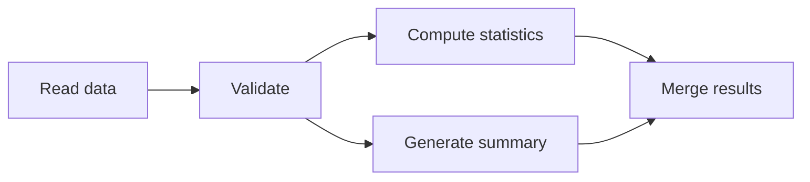

# Breaking Down Tasks by Independence Level in Java Concurrency

## 1. Objectives and Scope

When a large job is broken down into multiple tasks, the first question is not "how many threads should we create?", but rather **which parts of the work can run independently while still producing the correct result?** Good design starts from data dependencies, state, and execution order; the Java API is chosen after those relationships are understood.

After this lesson, you will be able to:
- Distinguish between independent tasks, dependent tasks, and tasks that share resources.
- Split work by data or by function, and identify synchronization points and result aggregation points.
- Use `ExecutorService`, `Callable`, `Future`, and `CompletableFuture` for appropriate dependency patterns.
- Decide on task granularity, concurrency limits, error policies, and how to verify effectiveness.

The scope is **general Java Concurrency**. The examples use Java SE and do not rely on Spring, `@Async`, Spring TaskExecutor, or any Spring-specific mechanism.

## 2. What Does "Independent" Mean?

A **task** is a unit of work with defined inputs, preconditions, and outputs or side effects. Two tasks `A` and `B` are *execution-independent* when their order can be swapped or they can run overlapping in time without compromising correctness. Independence does not necessarily mean they run on two different threads.

There are three levels to distinguish:

| Relationship | Indicators | Organization Strategy |
|---|---|---|
| Completely independent | Read the same immutable data, produce separate results | Can be submitted in parallel; aggregate afterward |
| One-way dependency | B needs the output of A | A must complete before B; represent the relationship as a stage chain |
| Mutating shared state/resources | A and B write to the same variable, file, transaction, or device | Isolate ownership, synchronize access, or redesign to avoid shared writes |

Example of processing 10,000 orders:
- Calculating the total revenue of **disjoint groups of orders** can be multiple independent tasks. Each task returns a partial sum, and the sums are added afterward.
- Generating an invoice from an order validation result is a **dependent** task: a valid validation result must exist first.
- Two tasks incrementing the same regular `total` variable constitute **state contention**. Splitting the data in half does not automatically make shared writes safe.

Three separate dimensions of independence should be examined:

1. **Data:** Do they write to the same location or depend on a result that has not yet been computed?
2. **Resources:** Do they concurrently access a finite connection, file, API quota, rate limit, or device?
3. **Business semantics:** Must the results maintain ordering, atomicity, invariants, or "all succeed or all fail" semantics?

A task reading shared data may be data-independent yet still be constrained by a connection pool. A computation may be technically concurrent yet cannot be reordered if the business requirement is "deduct inventory before confirming the order".

## 3. From Requirements to a Dependency Graph (DAG)

Treat each task as a node; draw an edge `A → B` when B needs the result of A. A valid graph for dependency-based scheduling must be acyclic (a Directed Acyclic Graph, or DAG). Only nodes that do not depend on each other and whose prerequisites are satisfied are candidates for concurrent execution.



Here, C and D **can** run concurrently after B; E only starts once both have produced their results. B should not run concurrently with A if B needs data from A.

Process for analyzing a large task:

1. **Define outputs and invariants:** What does a correct result look like? Are there ordering or consistency constraints?
2. **List the steps actually needed:** Read, validate, compute, write, aggregate; identify the input/output of each step.
3. **Mark dependencies:** Data dependencies, state dependencies, resource dependencies, and business constraints.
4. **Cut at independence boundaries:** Prefer immutable inputs, tasks owning their own data, and local results.
5. **Create join points:** Determine where to wait and merge results, along with error-handling rules.
6. **Estimate cost:** Is the task large enough to justify the scheduling and data-transfer overhead?
7. **Verify:** Compare against a sequential algorithm and test edge cases before optimizing throughput.

**Not every step should be parallelized.** If everything depends on a single chain, adding threads cannot break that logical order. The longest dependency path (critical path) sets a lower bound on completion time, even with many workers.

## 4. Two Common Decomposition Approaches

### 4.1. Data Parallelism

A single operation applied across disjoint partitions of data:

```text
Input data
    ├── Group 1 ──> Task 1 ──> Result 1 ──┐
    ├── Group 2 ──> Task 2 ──> Result 2 ──┼──> Reduce ──> Final result
    └── Group 3 ──> Task 3 ──> Result 3 ──┘
```

Suitable for statistics, image processing, reading multiple independent files, or batch-evaluating records. The `reduce` step must be mathematically sound: integer addition is associative within non-overflow bounds; taking the average of group averages with different group sizes is **incorrect** without including the counts. With floating-point numbers, the order of addition can alter rounding error.

A safe pattern is **map → local result → reduce**: tasks do not mutate a shared accumulator.

### 4.2. Functional Decomposition

Different computation branches share a ready input—for example, from a loaded profile: one task prepares a notification, another computes recommendations. They can start after the same loading step and merge at the end.

Functional decomposition often carries more ordering constraints than data parallelism. Only run two branches concurrently when they do not depend on each other's unguaranteed side effects.

## 5. Java 17 Example: Partitioning Orders and Aggregating Without Shared Mutable State

Each task only reads an immutable list and returns a `Partial`. The main thread collects both results after the tasks complete; there is no `AtomicLong`, lock, or shared accumulator between workers.

Save the following code to `TaskDecompositionDemo.java`:

```java
import java.util.ArrayList;
import java.util.List;
import java.util.concurrent.Callable;
import java.util.concurrent.ExecutorService;
import java.util.concurrent.Executors;
import java.util.concurrent.Future;

public class TaskDecompositionDemo {
    record Order(String id, long cents) {}
    record Partial(long count, long cents) {}

    static Partial summarize(List<Order> batch) {
        long count = 0;
        long cents = 0;
        for (Order order : batch) {
            count++;
            cents += order.cents();
        }
        return new Partial(count, cents);
    }

    public static void main(String[] args) throws Exception {
        List<Order> orders = List.of(
            new Order("A", 10_000),
            new Order("B", 20_000),
            new Order("C", 15_000),
            new Order("D", 5_000)
        );

        int middle = orders.size() / 2;
        List<List<Order>> batches = List.of(
            orders.subList(0, middle),
            orders.subList(middle, orders.size())
        );

        ExecutorService pool = Executors.newFixedThreadPool(2);
        try {
            List<Callable<Partial>> tasks = new ArrayList<>();
            for (List<Order> batch : batches) {
                tasks.add(() -> summarize(batch));
            }

            List<Future<Partial>> futures = pool.invokeAll(tasks);
            long totalCount = 0;
            long totalCents = 0;
            for (Future<Partial> future : futures) {
                Partial result = future.get();
                totalCount += result.count();
                totalCents += result.cents();
            }

            System.out.println("Số đơn: " + totalCount);
            System.out.println("Tổng (cent): " + totalCents);
        } finally {
            pool.shutdown();
        }
    }
}
```

Run with JDK 17 or newer:

```bash
javac TaskDecompositionDemo.java
java TaskDecompositionDemo
```

Exact output:

```text
Số đơn: 4
Tổng (cent): 50000
```

Explanation:
- `List.of(...)` creates an unmodifiable list; the `subList` calls here are read-only views of that data. If using a list that can be modified elsewhere, take a snapshot or establish clear ownership before submitting.
- The two batches do not overlap; `summarize` only uses local variables and returns an immutable `record` result.
- `invokeAll` submits all `Callable`s and waits for them to complete; the returned `Future` list is in the **input task order**, not the worker completion order.
- `future.get()` retrieves the value or throws `ExecutionException` if the task failed. The completed task's result is safely published via the `Future` mechanism.
- `shutdown()` stops accepting new tasks and lets submitted tasks finish; it does not wait indefinitely on its own. In the happy path of this example, `invokeAll` has already waited for the tasks.

This is a design-illustration example and **does not prove that parallel execution is faster**: four records are far too few to justify thread pool overhead. On real data, you must measure batch size and per-task duration. If the sum could overflow `long`, consider `Math.addExact` or `BigInteger` as required.

## 6. Java 17 Example: Dependent First, Independent After with CompletableFuture

In the graph `loadProfile → (buildGreeting, buildLocale) → combine`, the latter two branches share a prerequisite but do not depend on each other. `CompletableFuture` expresses that relationship without manually calling `get()` between steps.

Save as `TaskDependencyDemo.java`:

```java
import java.util.concurrent.CompletableFuture;
import java.util.concurrent.ExecutorService;
import java.util.concurrent.Executors;

public class TaskDependencyDemo {
    record Profile(String id, String locale) {}

    static Profile loadProfile(String id) {
        return new Profile(id, "vi");
    }

    public static void main(String[] args) {
        ExecutorService pool = Executors.newFixedThreadPool(3);
        try {
            CompletableFuture<Profile> loaded =
                CompletableFuture.supplyAsync(() -> loadProfile("u42"), pool);

            CompletableFuture<String> greeting =
                loaded.thenApplyAsync(p -> "Xin chào " + p.id(), pool);

            CompletableFuture<String> locale =
                loaded.thenApplyAsync(p -> "ngôn ngữ=" + p.locale(), pool);

            CompletableFuture<String> combined =
                greeting.thenCombine(locale, (a, b) -> a + "; " + b);

            System.out.println(combined.join());
        } finally {
            pool.shutdown();
        }
    }
}
```

```bash
javac TaskDependencyDemo.java
java TaskDependencyDemo
```

```text
Xin chào u42; ngôn ngữ=vi
```

`thenApplyAsync` only triggers when `loaded` completes normally; the two branches can overlap in execution if the executor has available workers. `thenCombine` waits for results from both. **Independence permits concurrency; it does not guarantee both branches always execute simultaneously.** If one stage fails, dependent stages typically complete exceptionally; `join()` can throw `CompletionException`. When recovery is required, choose `exceptionally`, `handle`, or `whenComplete` according to the result policy rather than silently swallowing errors.

Note: `thenApply` (without `Async`) may run on the thread that completed the previous stage or the thread registering the callback, depending on timing. Do not assume every stage maps to a dedicated thread; choose an explicit executor and measure when you need control over where execution happens.

## 7. Task Granularity: How Much Should You Split?

Parallelization reduces time when useful work is large enough relative to overhead. A qualitative model:

```text
T_parallel ≈ T_work / number of useful workers
             + T_submit + T_queue + T_join
             + T_contention + T_imbalance
```

This is a mental model, not an exact predictive formula: the number of useful workers depends on CPU, I/O, task dependencies, and system load. If a portion of the work is inherently sequential, speedup remains bounded by the sequential portion (Amdahl's law).

Choose task size based on these criteria:
- **Too small:** Millions of tasks for a few additions each cause queue, object, and context-switching overhead to outweigh the actual work.
- **Too large:** Just one or two heavy tasks leave other workers idle and make partial cancellation difficult.
- **Poorly balanced:** One batch holding most of the work stretches the critical path, even if other batches finish early.
- **Costly splitting:** Copying large data, converting formats, or distributing inputs can erase parallel gains.
- **Result dependency:** If the next step must wait for all tasks, the slowest batch dictates the join time.

For uniform work, try starting with a number of batches equal to or a small multiple of the worker count, then measure. For highly variable work, many moderate-sized tasks on a shared executor can balance better; you still need to bound queued tasks and memory. There is no single batch size right for every problem.

## 8. CPU-Bound, I/O-Bound, and Resource Limits

| Task Characteristic | Bottleneck | Guidance |
|---|---|---|
| CPU-bound: hashing, numerical transforms, data parsing | CPU cores and memory bandwidth | Bounded pool; use `Runtime.getRuntime().availableProcessors()` as a benchmark baseline |
| I/O-bound: waiting on network, files, databases | Wait time and external resource limits | Tune in-flight task count based on latency, connection pool, quota, and backend capacity |
| Mixed: read then heavy processing | I/O and CPU at different phases | Can separate stages or use appropriate pools, avoiding letting one stage starve another |

`Executors.newFixedThreadPool(n)` bounds the number of workers, but the work queue can grow very large if submissions outpace processing. Under high load, **backpressure** is needed: limit pending work, process in batches, or configure `ThreadPoolExecutor` with a bounded queue and an explicit rejection policy. Do not add more threads to "fix" a backend that only supports a fixed number of connections.

**Java 21+** offers virtual threads (`Executors.newVirtualThreadPerTaskExecutor()`), which suit many blocking I/O tasks; they reduce the waiting cost of traditional threads, but **do not make heavy CPU computations faster**, do not eliminate connection/quota limits, and still require controlling concurrency. The main examples above use Java 17 for easy compilation across environments.

## 9. Shared Data: Where Seemingly Independent Tasks Become Dangerous

**Bad design example** (illustrative snippet, not a complete program):

```java
long[] total = {0};
tasks.add(() -> {
    total[0] += calculate(batch); // non-atomic read-modify-write
    return null;
});
```

Multiple workers writing to `total[0]` cause a data race and can lose updates. Marking a variable `volatile` also **does not** make `x += value` atomic. The best fix for aggregation problems is for each task to `return` a local result and sum them in a reduce step as in section 5. If shared accumulation is unavoidable, use appropriate synchronization/atomic tools and evaluate contention.

Similar pitfalls:
- Sharing an `ArrayList` or `HashMap` with unsynchronized writes.
- Two tasks mutating the same object or memory region even when their input lists differ.
- Reading and writing a shared file without agreeing on write regions or ordering.
- Relying on `ThreadLocal`, transaction context, or old thread state when switching executors.
- Writing to the same external resource: concurrency in Java does not guarantee that out-of-process business operations are atomic.

A useful design rule: **immutable input → local processing → immutable result → single aggregation point**. If shared state is mandatory, explicitly define who owns it, who reads/writes it, synchronization conditions, and when data is safely published. Avoid treating `sleep()` as synchronization or using log order to prove correctness.

## 10. Errors, Cancellation, Timeouts, and Task Lifecycle

Splitting tasks raises a question: when 1 out of 20 tasks fails, what should the remaining 19 do? Choose a policy upfront:
- **All-or-nothing:** One failing task invalidates the entire result; report the error, cancel unnecessary work, and clean up resources.
- **Best-effort:** Accept partial results, but clearly record failed tasks and completeness; do not equate missing data with zero.
- **Retry:** Only retry when the operation is safe to repeat (idempotent or deduplicated), with bounded attempts and deadlines.

With `ExecutorService`, `Future.get()` can throw `InterruptedException` (waiting thread was interrupted), `ExecutionException` (task failed), or `CancellationException` (cancelled). Use `invokeAll(tasks, timeout, unit)` for a shared deadline; tasks incomplete at the deadline are cancelled, so check `isCancelled()` before retrieving results. `Future.cancel(true)` requests interruption but does not guarantee immediate termination, especially if the task does not cooperate or is calling an API that does not support interruption.

When catching `InterruptedException` without rethrowing, you typically need to restore the flag via `Thread.currentThread().interrupt()` and exit cleanly. Long-running tasks should have appropriate interrupt check points and clean up resources in `finally`/`try-with-resources`. `shutdownNow()` only attempts to interrupt work; it does not guarantee all tasks stop immediately.

Avoid deadlocks caused by **tasks waiting on other tasks in the same overly small pool**. For example, a single-thread pool runs task A; A submits B to that same pool and calls `B.get()` while B has no worker available to run. Express dependencies externally with `CompletableFuture`, avoid blocking joins inside workers, or design an appropriately sized executor and verify liveness.

## 11. Correct First, Fast Second: Testing and Measurement

Start with a sequential version that has clear results, then cross-check parallel results on the same input. For order-sensitive merges or floating-point numbers, define acceptable tolerance and ordering beforehand.

Scenarios to test:
- Empty input, single element, odd number of elements, fewer elements than workers.
- Data with a very heavy batch, a task throwing an exception, timeouts, and interrupts.
- Multiple runs on the same input: verify correctness and determinism of results if the contract requires it.
- Concurrent load from multiple requests and finite resources: pool, queue, heap, connections, quotas.
- Compare against sequential execution on a sufficiently large workload; measure latency (p50/p95), throughput, CPU, allocation, queue time, and wait time.

For serious Java benchmarking, use a tool like JMH after defining the problem and JVM warmup strategy. Use JFR, thread dumps, and profilers to spot lock contention, blocking, or task imbalance. Do not draw speed conclusions from a four-order example or a single run.

## 12. A Short Decision Checklist

Before adding a parallel branch, answer in order:

1. **What does the task produce?** Can inputs and outputs be described independently?
2. **What does it depend on?** If task B waits on A, record an edge in the DAG instead of running them arbitrarily and hoping it works.
3. **Who owns the state?** Can shared writes be replaced with immutable local results?
4. **How is it merged?** Is the reduce operation correct across all partitioning schemes and completion orders?
5. **Where does it run?** CPU-bound, blocking I/O, or mixed; what are the worker counts and resource limits?
6. **What if it fails?** Cancel/timeout/retry/partial result; who releases resources?
7. **Is it actually beneficial?** Measure results and performance against a sequential baseline.

### Practice Exercise

You need to process 1,000 log files: read and count the error lines in each file, then output a summary report. Identify (a) independent task boundaries, (b) how results are returned, (c) the join point, (d) the limit on open files, (e) handling a failed file, and (f) how to cross-check against sequential counting.

A baseline design: each task processes **one file or a group of files**, returning `(file, errorCount)` or an error with context; the reducer aggregates after tasks finish according to the chosen policy. The number of concurrently executing tasks must respect I/O and file descriptor limits. If the report requires filename order, **sort the results at output time** rather than assuming task completion order.

**Technical takeaway:** Task boundaries should be determined by dependency relationships and data ownership first. Java executors schedule execution; the correctness of task decomposition comes from designing inputs, dependencies, synchronization, and result aggregation.
