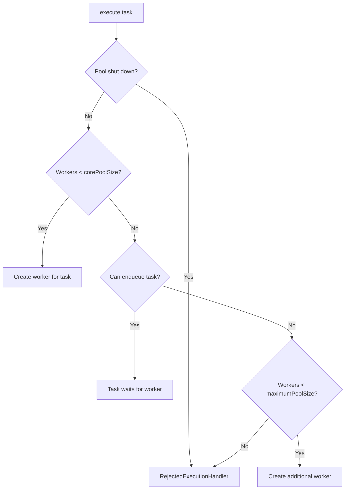

# Queue length, rejection, and overload effects in Java Concurrency

> Scope: Java SE, focusing on `ThreadPoolExecutor`, `BlockingQueue`, and `RejectedExecutionHandler`. Examples use Java 17+. No Spring mechanisms or configurations are used.

## 1. Why does the queue determine performance?

An `Executor` decouples **work-producing** threads (producers) from **work-executing** threads (workers). When work arrives faster than it can be processed, the excess must wait, be rejected, or be handled according to another policy. A queue only absorbs **temporary load spikes**; it does not create additional processing capacity by itself.

Three numbers need to be distinguished:

- **Queue length (`Q`)**: the number of tasks currently **waiting** in the queue, not yet taken by a worker.
- **Active threads (`A`)**: the number of workers currently executing tasks (metrics obtained from the executor are approximate).
- **Queue capacity (`C`)**: the maximum number of tasks that can be held **in the queue**, excluding running tasks. With a practically unbounded queue, there is no small, explicit `C` threshold to protect memory.

For example, if a pool has 4 busy workers and the queue holds 20 tasks: the number of **running** tasks is 4, the number of **waiting** tasks is 20, and the total unfinished work in the pool is approximately 24 (excluding work still on the producer side and in transitional states). Saying “queue length is 24” is counting it wrong.

If a task arrives late because it **waited before running**, increasing the queue can make the final response time **worse** even though the rejection rate drops. Therefore, you must observe queue length, latency, completion rate, and rejection count simultaneously.

## 2. How does `ThreadPoolExecutor.execute()` accept tasks?

For a normally running `ThreadPoolExecutor`, the selection sequence upon calling `execute(task)` is essentially:

1. If the current number of workers is **less than `corePoolSize`**, prioritize creating a worker to handle the task, even if other workers might be idle.
2. If at least `corePoolSize` has been reached, try to **insert the task into `workQueue`**.
3. If it **cannot be inserted into the queue**, try to create an additional worker, up to `maximumPoolSize`.
4. If the task can no longer be accepted (or the pool is shutting down), invoke `RejectedExecutionHandler`.

This is a policy description, not a sequence of separate check-then-modify-state steps. In the implementation, `ThreadPoolExecutor` also **re-checks the state** after inserting the task into the queue to handle races with `shutdown` and worker count. Therefore, you must not take a snapshot of `getQueue().size()` and deduce with certainty that the next `execute()` call will succeed.



### 2.1. Example of how configuration affects `maximumPoolSize`

```java
ThreadPoolExecutor pool = new ThreadPoolExecutor(
        2,                          // corePoolSize
        8,                          // maximumPoolSize
        30, TimeUnit.SECONDS,
        new ArrayBlockingQueue<>(100),
        new ThreadPoolExecutor.AbortPolicy()
);
```

The snippet above only illustrates configuration; you need `import java.util.concurrent.*;` and to close the pool after use. During a load burst:

- First, the pool can create up to 2 workers.
- Then, tasks are prioritized for queuing until the queue accepts no more.
- Only when queuing fails can the pool expand up to 8 workers.
- When both the maximum workers and the queue cannot accept more, `AbortPolicy` rejects the task.

Thus, increasing `maximumPoolSize` from 8 to 16 **does not necessarily** increase the actual number of threads when the queue always accepts tasks. With an **unbounded queue**, `maximumPoolSize` usually has no scaling effect under normal conditions, because the queuing step almost always succeeds.

### 2.2. Choosing a queue based on load characteristics

| Queue | Mechanism | Impact on performance/overload |
| --- | --- | --- |
| `ArrayBlockingQueue<>(C)` | FIFO queue, fixed capacity | Prevents excessive backlog growth; when full, can spawn more threads then reject |
| `LinkedBlockingQueue<>(C)` | FIFO with configurable capacity | Has an explicit bound; memory allocation and contention characteristics differ from array queue |
| `new LinkedBlockingQueue<>()` | Default capacity `Integer.MAX_VALUE` | Practically unbounded in operation; easily accumulates huge backlogs and heap pressure |
| `SynchronousQueue<>()` | Holds no waiting elements; direct handoff | Queue length is always 0; task must meet an available worker or be able to create one, otherwise rejected |
| `PriorityBlockingQueue<>()` | Processes by priority order; practically unbounded by default | Does not control backlog with a small capacity; “oldest” does not mean the oldest-arrived task |

Factories like `Executors.newFixedThreadPool(n)` use a practically unbounded queue. They are convenient when the amount of work is already bounded at the source, but they are not by default an anti-overload solution for a service receiving tasks continuously. Conversely, `Executors.newCachedThreadPool()` can create a very large number of threads during load spikes; a low queue length does not mean low resource consumption.

## 3. What does “increasing queue length” signal?

Let:

- `λ` (lambda): the rate at which tasks are **accepted** into the executor, in tasks/second.
- `μ` (mu): the rate at which tasks are **completed** in the same time interval.
- `ΔQ`: the change in waiting backlog, if the number of running workers is relatively stable.

When `λ > μ` persists, the pending work grows. If the pool can expand workers, `μ` may increase; if the execution limit has been reached, the queue will gradually fill up. With a bounded queue, **rejection** follows; with a very large queue, the application may continue accepting work at the cost of latency and memory.

Approximate illustrative example: a pool has reached a steady capacity of **200 task/s**, while the producer continuously sends **250 task/s**. The backlog grows by about **50 task/s** before rejections occur. An empty queue holding at most 100 tasks can fill up in about **2 seconds** under these simplified conditions. In practice, task size, scheduling, bursts, varying service rates, and statistical jitter make the numbers differ.

**Do not equate the incoming task arrival rate with the task acceptance rate.** Once the executor starts rejecting, `λ_accepted` cannot be inferred solely from `λ_offered`. To explain failure counts, you must measure offered, accepted, completed, and rejected tasks within the same time window.

### 3.1. Relationship with wait time

In a sufficiently stable system, Little's Law for the queue portion alone:

```text
Lq ≈ λthroughput × Wq
```

Where:

- `Lq`: **average number of waiting** tasks.
- `λthroughput`: average throughput actually passing through the system/queue, in tasks/second.
- `Wq`: **average queue wait** time, in seconds.

For example, `λthroughput = 200 task/s` and `Wq = 0.1 s` gives `Lq ≈ 20` tasks. This is a statistical relationship in a stable system, **not** a promise that every task waits 100 ms when the queue has 20 elements. Do not mechanically apply steady-state formulas when the backlog is growing unboundedly, when tasks are being dropped, or when arrival rates fluctuate wildly.

A pragmatic design first defines the **acceptable queue latency**, analyzes throughput, chooses an initial capacity, and validates under realistic load. Increasing capacity just to “bring rejections to 0” can cause old tasks to lose their value before they ever run.

## 4. Where does rejection happen?

`ThreadPoolExecutor` rejects tasks in two main groups of situations:

1. **Saturation:** the pool cannot add more workers and the queue cannot accept more tasks.
2. **Shutdown:** the executor no longer accepts new work; tasks can be rejected **even if the queue is empty**.

The rejected item is passed to `RejectedExecutionHandler.rejectedExecution(Runnable, ThreadPoolExecutor)`. There is no rule that every handler throws `RejectedExecutionException`: the handler decides whether to **throw an error, run the task on the caller, or discard the task**.

### 4.1. Four built-in policies

| Policy | When pool is full and running | When shut down | Points to note |
| --- | --- | --- | --- |
| `AbortPolicy` (default) | Throws `RejectedExecutionException` | Throws `RejectedExecutionException` | Provides a clear error signal so the caller can decide to shed load/retry |
| `CallerRunsPolicy` | Runs the task **directly on the thread calling `execute`** | Discards the task | Slows down the producer if submitting synchronously; can block sensitive threads |
| `DiscardPolicy` | Silently discards the task | Silently discards the task | Easily loses work without being recorded |
| `DiscardOldestPolicy` | Drops the head element of the queue and retries `execute` | Discards the new task | Can lose older work; with a priority queue, the head element is the highest-priority one |

**Prefer `AbortPolicy` or a custom policy with explicit error reporting** when the outcome of each task matters. `CallerRunsPolicy` is useful when the producer thread can afford the time to execute the task and needs slowdown feedback, but it is unsuitable if the calling thread holds locks, holds scarce resources, is an event loop, or has a short deadline. `DiscardPolicy` is only appropriate if losing tasks is an intentional business decision, accompanied by clear telemetry.

With `DiscardOldestPolicy`, the task removed from the queue does not automatically receive a failure exception/callback. In particular, when using `submit()`, tasks are typically wrapped in a `FutureTask`. If silently discarded, a `Future` may **never complete**, causing `get()` to wait indefinitely. The same issue applies to `DiscardPolicy`. If dropping is mandatory, you must proactively resolve the completion/cancellation state for the caller.

### 4.2. “Caller runs” is not an extra worker

When `CallerRunsPolicy` is triggered, the overflow work can run on the **task-submitting thread**, outside the pool's worker configuration. This slows down `execute`, creating slowdown feedback, while potentially shifting latency onto the caller. The pool's `getActiveCount()` metric does not include work being run on the caller under this policy.

Do not conclude “no rejection = no overload”: `CallerRunsPolicy` can stall the application's input processing while the pool is already full; `DiscardPolicy` can lose tasks without incrementing an exception counter.

## 5. Runnable example: one worker, one-slot queue, third task

The example intentionally holds the worker while it processes the first task, ensuring the second task sits in the queue. It then submits the third task when both the worker and the queue are busy. The program compares `AbortPolicy` and `CallerRunsPolicy` without relying on `Thread.sleep()`.

Save to **`QueueOverloadDemo.java`**:

```java
import java.util.concurrent.ArrayBlockingQueue;
import java.util.concurrent.CountDownLatch;
import java.util.concurrent.RejectedExecutionException;
import java.util.concurrent.RejectedExecutionHandler;
import java.util.concurrent.ThreadPoolExecutor;
import java.util.concurrent.TimeUnit;
import java.util.concurrent.atomic.AtomicBoolean;
import java.util.concurrent.atomic.AtomicInteger;

public class QueueOverloadDemo {
    record Result(int queued, boolean rejected, boolean callerRan, int completed) {}

    static Result trial(RejectedExecutionHandler policy)
            throws InterruptedException {
        CountDownLatch firstStarted = new CountDownLatch(1);
        CountDownLatch releaseFirst = new CountDownLatch(1);
        AtomicInteger completed = new AtomicInteger();
        AtomicBoolean callerRan = new AtomicBoolean(false);
        Thread submittingThread = Thread.currentThread();

        ThreadPoolExecutor executor = new ThreadPoolExecutor(
                1, 1, 0L, TimeUnit.MILLISECONDS,
                new ArrayBlockingQueue<>(1), policy);

        boolean rejected = false;
        int queued = -1;
        try {
            executor.execute(() -> {
                firstStarted.countDown();
                try {
                    releaseFirst.await();
                    completed.incrementAndGet();
                } catch (InterruptedException ex) {
                    Thread.currentThread().interrupt();
                }
            });

            if (!firstStarted.await(10, TimeUnit.SECONDS)) {
                throw new IllegalStateException("Worker did not start");
            }

            executor.execute(completed::incrementAndGet);
            queued = executor.getQueue().size(); // 1: the first worker is being held

            try {
                executor.execute(() -> {
                    callerRan.set(Thread.currentThread() == submittingThread);
                    completed.incrementAndGet();
                });
            } catch (RejectedExecutionException ex) {
                rejected = true;
            }
        } finally {
            releaseFirst.countDown();
            executor.shutdown();
        }

        if (!executor.awaitTermination(10, TimeUnit.SECONDS)) {
            executor.shutdownNow();
            throw new IllegalStateException("Worker did not terminate");
        }

        return new Result(queued, rejected, callerRan.get(), completed.get());
    }

    static void print(String name, Result r) {
        System.out.printf("%s: queued=%d, rejected=%s, callerRan=%s, completed=%d%n",
                name, r.queued(), r.rejected(), r.callerRan(), r.completed());
    }

    public static void main(String[] args) throws InterruptedException {
        print("AbortPolicy", trial(new ThreadPoolExecutor.AbortPolicy()));
        print("CallerRunsPolicy", trial(new ThreadPoolExecutor.CallerRunsPolicy()));
    }
}
```

Run with JDK 17+:

```bash
javac QueueOverloadDemo.java
java QueueOverloadDemo
```

Expected stdout:

```text
AbortPolicy: queued=1, rejected=true, callerRan=false, completed=2
CallerRunsPolicy: queued=1, rejected=false, callerRan=true, completed=3
```

**Why is the result deterministic?**

- `firstStarted.await()` ensures the worker has entered the first task; `releaseFirst` holds the worker there until after the third task is submitted.
- The pool has at most **1 worker** and `ArrayBlockingQueue<>(1)` has exactly **1 waiting slot**. When the second task is submitted, it is guaranteed to be queued; `queued = 1` is read before releasing the worker.
- The third task hits a full queue. `AbortPolicy` throws an exception and the third task does not run, so `completed = 2`.
- With `CallerRunsPolicy`, the third task runs synchronously on the `main` thread calling `execute`, so `callerRan = true` and ultimately `completed = 3`.
- `AtomicInteger` and `AtomicBoolean` protect data written by multiple threads. `awaitTermination` waits for the worker to finish before printing, avoiding premature result inspection. `finally` releases the worker and initiates shutdown even if an error occurs.

The program is a controlled demonstration; in real applications you should not hold workers with a `CountDownLatch` to throttle throughput. The latch here only helps clearly test the full-queue scenario.

## 6. Overload effects: why do long queues cause more errors?

A common amplification chain:

```text
Incoming load > processing capacity
    ↓
Queue length grows, queue wait increases
    ↓
Tasks start too late, caller times out or results lose value
    ↓
Caller retries → adds duplicate work
    ↓
CPU / memory / I/O contention increases
    ↓
Useful throughput may drop, queue stays full
    ↓
More rejections, timeouts, and cascading failures
```

Several important details:

- **Queueing hides saturation:** the application keeps accepting tasks while wait time steadily increases. “Accepted” does not mean the task completes on time.
- **Retry storm:** clients see a timeout and resend while the old task is still running or queued. The system may do the same work twice.
- **Memory pressure:** each `Runnable` can hold closures, references to payloads, buffers, or context. Many waiting tasks can keep large objects alive longer and increase GC activity.
- **Thread contention:** increasing `maximumPoolSize` can help up to a threshold, but too many workers can contend for CPU, heap locks, connections, and I/O resources, degrading performance.
- **Head-of-line blocking:** a slow task ahead of short tasks in FIFO forces subsequent tasks to wait longer. Separate queues for different types of work can help isolate them.
- **Cascading failure:** a shared pool for tasks of varying priorities can become completely occupied, affecting essential work as well.

There is no single capacity or pool size that fits every workload. Determining factors include task duration distribution (not just the average), bursts, blocking ratio, CPU/I/O capacity, RAM, deadlines, and overload policies.

## 7. Designing intentional overload control

### 7.1. Bound both running and waiting work

A bounded pool typically has three cooperating parts:

1. A worker count bounded according to resource consumption capacity.
2. A queue with an explicit capacity, sufficient to absorb reasonable bursts.
3. A rejection policy defining the response to the producer when the pool can no longer accept work.

This is a form of **load shedding**: rejecting some tasks early to protect the latency and completion ability of tasks already accepted. If the business cannot afford to lose tasks, you need durable storage, reprocessing, or a reliable queuing architecture; `ThreadPoolExecutor` and in-memory queues do **not** provide persistence on their own.

### 7.2. Do not block blindly when the queue is full

A custom handler like “just call `executor.getQueue().put(task)` to wait until space opens up” can cause deadlocks or indefinite hangs if the caller holds a lock the worker needs, if the caller is the lifecycle-controlling thread, or if the pool is shutting down. A safe blocking policy must consider timeouts, interrupts, shutdown, lock ordering, and failure reporting; the default API does not turn infinite waiting into automatic end-to-end backpressure.

If using a `Semaphore` at the **entry point**, you can limit outstanding work before submission: acquire a permit with a timeout, submit the task, release the permit when the task actually finishes or is rejected; be careful to release the permit **exactly once** and handle cases where the task is cancelled/never runs. The semaphore protects the overall work budget, the queue holds waiting tasks, and the rejection handler is the path when the budget/pool runs out of space.

### 7.3. When a task is already useless, drop it early in a controlled way

If a task has a deadline, check the remaining time before running or before an expensive I/O step. When expired, record the timeout/cancellation result and release resources. Do not treat `Thread.interrupt()` as a guarantee that every I/O operation will stop immediately; behavior depends on the task and the API being used.

For independent and important jobs, you may need bounded retries with exponential backoff and jitter, idempotency keys, or deduplication mechanisms. Retries must have a **budget**; retrying immediately after a saturation rejection usually worsens overload.

## 8. Observing performance: don't just look at `getQueue().size()`

| Observation | API / measurement method | What does it answer? |
| --- | --- | --- |
| Current queue length | `executor.getQueue().size()` | How many tasks are waiting at the sampling moment? |
| Running workers | `executor.getActiveCount()` | How busy is the pool? |
| Current and peak worker count | `getPoolSize()`, `getLargestPoolSize()` | How has the pool scaled? |
| Completed task count | `getCompletedTaskCount()` | What is the trend of processed tasks? |
| Scheduled task count | `getTaskCount()` | What is the trend of tasks scheduled for execution? |
| Rejection count | Counter in handler or where `RejectedExecutionException` is caught | How many tasks were rejected by the pool under the active policy? |
| Queue wait | Record `System.nanoTime()` at submission and when the task starts | How long do tasks have to wait? |
| Execution time / total latency | Measure start and end, plus queue wait | Busy because of waiting or because of long execution? |
| Timeout, cancellation, drop | Instrument business paths | How much work is lost or wasted? |

`ThreadPoolExecutor` statistics methods are for **approximate monitoring**, not atomic control conditions. `getQueue().size()` changes right after reading; `getTaskCount()`, `getCompletedTaskCount()`, and `getActiveCount()` may not form a consistent snapshot across measurements. Collect periodically, analyze trends, and track percentiles (p50, p95, p99) of wait/execution times.

An explicit rejection-counting handler can be written as follows (illustrative snippet, excluding a `main` program):

```java
AtomicLong rejectedCount = new AtomicLong();

RejectedExecutionHandler countingAbort = (task, executor) -> {
    rejectedCount.incrementAndGet();
    throw new RejectedExecutionException("Executor saturated or shut down");
};
```

Requires `import java.util.concurrent.RejectedExecutionException;`, `import java.util.concurrent.RejectedExecutionHandler;`, and `import java.util.concurrent.atomic.AtomicLong;`. The counter in the handler counts **all rejections**, including those due to shutdown. If you need to separate reasons, you can observe `executor.isShutdown()` when the handler is called, though this is still a snapshot that can race with state changes, not an absolute race-free classification.

If the application calls `submit()`, a rejection exception is thrown during submission with `AbortPolicy`. If the task was accepted but *the work itself* throws an exception, that error may be stored in the `Future` and surface when calling `get()` as an `ExecutionException` (with `submit`). **Rejection before running** and **failure inside the task** are two different types of metrics.

## 9. Common mistakes

**Mistake 1: “The longer the queue, the fewer the errors.”** A long queue only delays handling overload. For work with deadlines, reducing rejections by enlarging the queue can increase timeouts and stale backlogs.

**Mistake 2: “Setting max threads = 100 means there will be 100 workers under high load.”** With queue-first behavior after `corePoolSize`, the pool usually queues tasks before expanding to maximum. With a very large queue, it may never scale workers as expected.

**Mistake 3: “Queue size = 0 proves there is no overload.”** `SynchronousQueue` never holds waiting tasks; the pool can still saturate and reject heavily. With `CallerRunsPolicy`, tasks may be running on callers outside the active worker count.

**Mistake 4: “`execute()` not throwing an error means the task is guaranteed to run.”** `DiscardPolicy` and some other handlers can drop the task and return normally. The actual acceptance contract depends on the rejection policy.

**Mistake 5: “Using `if (queue.size() < capacity) execute(task)` will avoid rejection.”** Between the check and submission, other threads can fill the queue, and worker count or shutdown state can change. Handle the outcome of the `execute()` call itself.

**Mistake 6: “Adding threads always shrinks the queue.”** CPU-bound tasks can suffer context switching/contended locks when there are too many threads; I/O-bound tasks are constrained by connection pools/downstream services. Optimization must be based on load profiles and actual bottlenecks.

**Mistake 7: “Retrying immediately on rejection will soon succeed.”** When the pool is already saturated, immediate retries add more input pressure. Only retry with a finite budget, backoff/jitter, respect for deadlines, and idempotency requirements.

**Mistake 8: “Shutdown means the queue has been drained.”** `shutdown()` stops accepting new tasks and lets accepted tasks finish, but **does not wait**; you need `awaitTermination()`. `shutdownNow()` attempts to stop running tasks and returns the list of unstarted tasks, but does not guarantee all running tasks will stop.

## 10. Choosing initial configuration and testing

Before increasing capacity, measure actual load, task size, service time, deadlines, and limiting resources. A practical workflow:

1. **Define targets:** useful throughput, total p95/p99 latency, queue wait budget, acceptable timeout rate, and acceptable rejection rate.
2. **Choose worker count:** measure CPU utilization/IO wait/lock contention, rather than mechanically fixing it to core count.
3. **Choose bounded queue:** prefer a size large enough for short bursts, without causing tasks to wait past their deadline; estimate using `Lq ≈ throughput × Wq` and then validate.
4. **Choose rejection policy:** have a clear feedback path that can record failed tasks; if using caller-runs, measure producer latency as well.
5. **Load test:** ramp up to saturation and sustain high load long enough to observe queue/timeout/GC behavior; include burst and slow-task scenarios.
6. **Measure simultaneously:** offered, accepted, completed, rejected, queue length, queue wait, execution latency, memory/GC, CPU, and downstream saturation.
7. **Test recovery:** when load drops, does the backlog drain quickly, are expired tasks properly discarded, and does the system recover from overload without restarting?

A good test must prove **business outcomes**: which tasks were accepted, which were rejected, which finished, and whether the caller was notified. Tests that only assert `getQueue().size()` at a random moment are usually unreliable; use latches/active coordination like in the example to construct deterministic scenarios.

## 11. Summary

- `queue length` measures **waiting** work, not total active workers.
- `ThreadPoolExecutor` prioritizes **core workers → queue → workers up to maximum → rejection**; the queue type determines when the pool expands.
- A bounded queue turns unbounded backlog into a **visible overload threshold**, but must be paired with a rejection policy and caller feedback.
- `AbortPolicy` signals errors clearly; `CallerRunsPolicy` slows down the producer; the two discard policies can lose work silently.
- Long queues increase queue wait, retain memory, and can trigger timeouts/retry storms; **optimize for work completed on time**, not queue length in isolation.

Official Java SE documentation:
- [ThreadPoolExecutor — Java SE 21](https://docs.oracle.com/en/java/javase/21/docs/api/java.base/java/util/concurrent/ThreadPoolExecutor.html)
- [ThreadPoolExecutor.CallerRunsPolicy — Java SE 21](https://docs.oracle.com/en/java/javase/21/docs/api/java.base/java/util/concurrent/ThreadPoolExecutor.CallerRunsPolicy.html)
- [ThreadPoolExecutor.DiscardPolicy — Java SE 21](https://docs.oracle.com/en/java/javase/21/docs/api/java.base/java/util/concurrent/ThreadPoolExecutor.DiscardPolicy.html)
- [ThreadPoolExecutor.DiscardOldestPolicy — Java SE 21](https://docs.oracle.com/en/java/javase/21/docs/api/java.base/java/util/concurrent/ThreadPoolExecutor.DiscardOldestPolicy.html)
- [Executors — Java SE 21](https://docs.oracle.com/en/java/javase/21/docs/api/java.base/java/util/concurrent/Executors.html)
