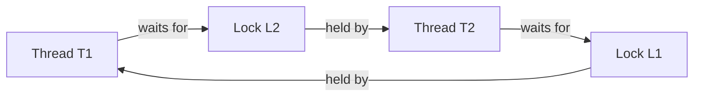

# Thread Dumps and Identifying RUNNABLE/BLOCKED/WAITING in Java Concurrency

## 1. Objectives and Context

A thread dump is a point-in-time snapshot of the state and call stack of threads. When a Java program hangs, responds slowly, shows abnormal CPU usage, deadlocks, or an executor stops processing tasks, a thread dump helps answer: **which thread is doing what, what condition is it waiting on, and which threads are blocking one another?**

In Java, the three most commonly misunderstood states are:

- **RUNNABLE:** the thread is executing in the JVM or is ready to run; this alone is not enough to conclude it is consuming CPU.
- **BLOCKED:** the thread is waiting to acquire an **intrinsic monitor** to enter a `synchronized` block or method.
- **WAITING:** the thread is waiting indefinitely according to a Java coordination mechanism, such as `Object.wait()`, `Thread.join()`, `LockSupport.park()`, or many cases of `Future.get()`/latch.

This lesson covers **general Java Concurrency**: using Java SE, the JVM, and JDK tools; it does not depend on a specific concurrency framework. The goal is not only to read state labels, but also to **correlate stacks, locks, wait durations, and multiple snapshots** to reach well-founded conclusions.

After this lesson, you will be able to:
1. Collect a thread dump for the right PID using JDK tools and recognize the limitations of a snapshot.
2. Read thread names, `tid`/`nid`, Java states, stack frames, held/awaited monitors, and ownable synchronizers.
3. Distinguish between compute-bound RUNNABLE, native I/O RUNNABLE, monitor BLOCKED, coordination WAITING, and timeout/sleep TIMED_WAITING.
4. Identify signs of deadlock, lock contention, thread pool starvation, and tasks waiting without being notified.
5. Correlate thread dumps with per-thread CPU, JFR, and application metrics; avoid drawing false conclusions from a single `java.lang.Thread.State` line.

## 2. What Does a Thread Dump Contain?

A typical thread dump lists multiple JVM threads (including application threads, pool threads, and internal threads), along with several of the following fields, depending on the JDK version and how the dump is captured:

- **Thread name**, e.g., `"worker-3"` or `"http-client-io"`; set by the application or library, and may not be unique.
- **Java/JVM identifiers**, e.g., `#27`, `tid=...`. Do not confuse the Java thread ID, the internal `tid` address, and the native OS thread ID.
- **`nid=0x...`** in some HotSpot formats, which is the native thread ID usually represented in hexadecimal; useful for correlating with OS per-thread CPU usage.
- **`java.lang.Thread.State: ...`**: the Java thread state at the moment the snapshot was taken.
- **Call stack**: the sequence of methods from the current execution/wait point back to the caller; usually the most informative part.
- **Monitor/synchronizer**: e.g., `- waiting to lock <...>`, `- locked <...>`, `- parking to wait for <...>`, and the `Locked ownable synchronizers` section when supported by the tool.

Abbreviated illustrative example (addresses, IDs, and source line numbers are hypothetical; output is not identical across all JDKs):

```text
"demo-blocked" #22 prio=5 tid=0x... nid=0x...
   java.lang.Thread.State: BLOCKED (on object monitor)
    at example.TaskCoordinator.enter(TaskCoordinator.java:42)
    - waiting to lock <0x0000000000000100> (a java.lang.Object)

"demo-owner" #21 prio=5 tid=0x... nid=0x...
   java.lang.Thread.State: WAITING (parking)
    at jdk.internal.misc.Unsafe.park(Native Method)
    at java.util.concurrent.locks.LockSupport.park(LockSupport.java:...)
    at example.TaskCoordinator.hold(TaskCoordinator.java:28)
    - locked <0x0000000000000100> (a java.lang.Object)
```

Key point: the `demo-owner` thread **is WAITING while still holding the monitor** `<0x...0100>`. The `demo-blocked` thread is blocked trying to enter the same monitor. Therefore, **WAITING does not mean the thread has released all locks**; only `Object.wait()` releases the monitor of the specific object being waited on, whereas waiting on a latch or parking inside a `synchronized` block can still hold that monitor.

A thread dump does not by itself tell you:
- How long a thread has been in this state (without prior/subsequent samples or separate metrics).
- How much CPU percentage a RUNNABLE thread is consuming.
- Since when a socket call has been waiting on the network, backend, connection pool, or timeout.
- Why a deadlock or lost-signal bug occurred if you only look at a single snapshot without event ordering.

**Distinguishing tools:** a thread dump is a snapshot of threads/stacks; a heap dump is a snapshot of objects in memory; a CPU profile/JFR observes behavior over time. They answer different questions.

## 3. Collecting Dumps Properly

### 3.1. Identifying the Right JVM/PID

With a full JDK:

```bash
jcmd -l
```

The list typically includes the PID and main class/JAR information (availability depends on permissions and the JVM). Use the **actual PID of the problematic process**, rather than guessing from thread names. Inside containers, consider the PID namespace and where the command is run: the PID visible inside the container may differ from the PID on the host.

### 3.2. Capturing Stacks and Monitor Information

```bash
jcmd <PID> Thread.print -l > dump-01.txt
```

Replace `<PID>` with the numeric PID. `Thread.print` is the HotSpot JVM command for printing thread stacks; `-l` requests additional information about `java.util.concurrent` ownable synchronizers when supported. This is a good choice for **platform threads** on HotSpot, especially when investigating `synchronized` and `ReentrantLock`.

You can use `jstack -l <PID>` when the JDK/tools are appropriate, but prefer `jcmd` if available. On Windows, you can still run `jcmd` in the terminal; the `>` operator redirects output to a file. Diagnostic commands depend on the JDK version/vendor, attach permissions, and JVM state; do not treat an attach failure as evidence that the application has no threads.

If the JVM cannot be attached to due to permissions, attach configuration, container isolation, or a nearly unresponsive process, find a dump collection method compatible with your runtime environment. Do not blindly apply one command to every JVM.

### 3.3. Taking Multiple Snapshots Instead of One

Example on Linux/macOS, capturing 3 snapshots 3 seconds apart:

```bash
jcmd <PID> Thread.print -l > dump-01.txt
sleep 3
jcmd <PID> Thread.print -l > dump-02.txt
sleep 3
jcmd <PID> Thread.print -l > dump-03.txt
```

On Windows/PowerShell, you can re-run the command with a new file name after each interval. In practice, choose the sampling interval based on the latency you are investigating: a 200 ms request requires a different measurement approach than a job stuck for minutes.

Compare **the same thread** across snapshots:
- Stack unchanged at monitor entry, same lock ID, owner not making progress → likely prolonged contention.
- Stack stuck at `Future.get()` or a latch, and the awaited task is not running → investigate dependencies/pool.
- RUNNABLE stack changing along an algorithm with high per-thread CPU → evidence of active CPU work.
- Idle thread in `park()` inside an executor with an empty queue → usually normal state.

Record the timestamp, JDK version, PID, load, and request count in the same window so you do not mix up processes or execution phases.

## 4. Understanding the Six `java.lang.Thread.State` Values

These are **Java states**, not a 1:1 mirror of Linux/Windows scheduler states.

| State | Meaning | Example | What NOT to Infer |
|---|---|---|---|
| `NEW` | `Thread` object created, `start()` not yet called | `new Thread(task)` | Does not mean an OS thread is running |
| `RUNNABLE` | Executing in the JVM or ready to execute under the Java model | Computation, loops, JNI/native I/O | Not guaranteed to be consuming CPU |
| `BLOCKED` | Waiting to acquire an intrinsic monitor | Waiting to enter `synchronized(lock)` | Not every kind of blocking/I/O |
| `WAITING` | Waiting indefinitely for another thread's action/condition | `join()`, `Object.wait()`, `CountDownLatch.await()`, `park()` | Does not mean the application is hung |
| `TIMED_WAITING` | Waiting with a timeout or sleeping | `sleep(1000)`, `wait(1000)`, `join(1000)`, timed `park` | Does not mean a request has timed out |
| `TERMINATED` | Thread has finished `run()` | Worker completed | Thread may no longer appear in the dump |

Key points to remember:

**`RUNNABLE` is not synonymous with "CPU busy".** A platform thread inside a native socket read can appear as RUNNABLE even though it spends most of its time waiting on I/O. Conversely, a continuously computing thread is usually RUNNABLE, but you must check CPU time or a profiler to verify.

**`BLOCKED` has a narrow meaning:** in `Thread.State`, it specifically means waiting to acquire an object's intrinsic monitor (or re-entering the monitor after `Object.wait`). Waiting on a `ReentrantLock` typically uses `AbstractQueuedSynchronizer`/park and appears as WAITING or TIMED_WAITING, even though colloquially we call it "blocked on a lock".

**`WAITING` is a coordination state, not an error by itself.** A thread pool worker can sit in WAITING on its queue when there is no work. A `CountDownLatch.await()` can be normal while tasks are still running, or a bug if no branch ever calls `countDown()`.

**`TIMED_WAITING` does not guarantee the thread will resume immediately upon timeout.** A sleep may finish later than expected due to scheduling; a timed wait may wake up early and still need to recheck its condition. In condition-based code, waiting should typically happen inside a loop checking a predicate.

## 5. RUNNABLE: Computing, Spinning, or in Native I/O?

Seeing many RUNNABLE threads often leads readers to conclude "CPU is overloaded". That is only a hypothesis.

### 5.1. Legitimate CPU-Bound Work

A task performing arithmetic, data parsing, encryption, compression, data structure construction, or sorting can stay RUNNABLE while executing. If per-thread CPU increases and JFR/`async-profiler` samples cluster in these methods, that indicates the code is genuinely using CPU.

Abbreviated stack example:

```text
"compute-worker" ...
   java.lang.Thread.State: RUNNABLE
    at example.Transform.hashPayload(Transform.java:91)
    at example.Transform.process(Transform.java:43)
```

Further questions to ask: Is actual CPU per core maxed out? Is the workload sufficiently independent? Does the worker count exceed useful CPU cores or increase contention/GC?

### 5.2. Busy-Spin or Non-Progressing Loops

Flawed design example (illustrative snippet, not a complete program):

```java
while (!ready) {
    // Empty loop; if ready lacks proper visibility semantics,
    // the worker may also never observe the update.
}
```

A thread can burn an entire core while making no progress. If inter-thread communication uses a flag, proper visibility rules are required (`volatile`, synchronization, atomics, or coordination primitives). `Thread.onSpinWait()` can be used in very short intentional spin loops, but it does **not** replace visibility, timeouts, or an efficient blocking mechanism. For unpredictable wait times, `LockSupport`, latches, conditions, or blocking queues are usually more appropriate.

### 5.3. RUNNABLE in Socket/File/Native Code

A thread whose stack includes `SocketDispatcher.read`, `FileDispatcherImpl.read`, native code, or JNI may be reported by the JVM as RUNNABLE. The thread may have transitioned into native I/O and be consuming negligible CPU. Correlate with per-thread CPU, socket/file operation durations, JFR, and backend measurements.

**Avoid concluding "RUNNABLE = CPU bug" solely from a high count.** Thread names and stack locations determine the next hypothesis to test.

## 6. BLOCKED: Who Is Waiting on the Monitor, and Who Holds It?

In Java, `synchronized` uses an object's monitor. Thread B trying to enter `synchronized(lock)` while Thread A already holds the monitor will be in `BLOCKED`. Illustrative snippet:

```java
synchronized (sharedLock) {
    performWork();
}
```

If `performWork()` takes a long time, performs I/O, sleeps, or waits on a latch while holding the lock, other threads needing `sharedLock` cannot enter.

Common trace:

```text
"worker-B" ...
   java.lang.Thread.State: BLOCKED (on object monitor)
    at example.SharedStore.update(SharedStore.java:34)
    - waiting to lock <0x0000000000001234> (a java.lang.Object)

"worker-A" ...
   java.lang.Thread.State: TIMED_WAITING (sleeping)
    at java.lang.Thread.sleep(Native Method)
    at example.SharedStore.update(SharedStore.java:30)
    - locked <0x0000000000001234> (a java.lang.Object)
```

**How to read this:** The same ID `<0x...1234>` links waiter B to owner A. However, A is TIMED_WAITING, not BLOCKED. Therefore, when investigating contention, you must find the **owner**, not just count BLOCKED threads.

Distinguish three issues:
- **Normal contention:** many tasks access a very short critical section; transient BLOCKED states occur, but throughput remains healthy.
- **Lock convoy/bottleneck:** many threads wait on the same monitor, and the owner holds it too long or acquires it too frequently; tail latency and throughput suffer.
- **Deadlock:** a cycle of waiting exists, e.g., A holds L1 and waits for L2, while B holds L2 and waits for L1; neither can progress without external intervention.

The fix is usually not "add more threads": reduce work inside the locked region, avoid calling I/O or blocking waits while holding a monitor (unless proven safe), limit shared mutable state, and use data partitioning or appropriate concurrent data structures. Do not replace `synchronized` with another lock type just to turn the BLOCKED label into WAITING.

## 7. WAITING: What Condition Is Being Awaited?

`WAITING` describes a thread that cannot proceed until another actor changes a condition or wakes it up.

### 7.1. `Object.wait()`

```java
synchronized (guard) {
    while (!conditionMet()) {
        guard.wait();
    }
}
```

This is an **illustrative pattern**; `guard` and `conditionMet()` must be implemented, as this is not a standalone Java program. `wait()` is called while the thread holds `guard`'s monitor, and it then **releases that monitor** while waiting. Once woken up, the thread must reacquire the monitor and recheck the condition.

The `while` loop is necessary because of spurious wakeups, the fact that a notification does not guarantee the predicate is true, or another thread consuming the resource first. Modify the predicate and call `notifyAll()`/`notify()` under the same synchronization discipline to avoid lost notifications.

### 7.2. `LockSupport.park()`, `Condition.await()`, Latches, Futures

Many APIs in `java.util.concurrent` are built on parking:
- `CountDownLatch.await()`: waits for the counter to reach 0.
- `Semaphore.acquire()`: waits for a permit.
- `Future.get()`: waits for a task result; exact state depends on the implementation.
- `Condition.await()`: waits on a condition, typically releasing the associated lock per the API contract.
- `Thread.join()`: waits for another thread to terminate.
- `BlockingQueue.take()`: waits for an item to become available.

You may see a stack like:

```text
"batch-result-waiter" ...
   java.lang.Thread.State: WAITING (parking)
    at jdk.internal.misc.Unsafe.park(Native Method)
    at java.util.concurrent.locks.LockSupport.park(LockSupport.java:...)
    at java.util.concurrent.CountDownLatch.await(CountDownLatch.java:...)
    at example.BatchJob.awaitChildren(BatchJob.java:...)
```

Questions to ask: **who is responsible for fulfilling the condition?** Which task must call `countDown()`? Which Future is being awaited? Does the result-producing thread have an available worker in its executor? Is there an exception path that prevents `countDown` from being called? A long WAITING state is normal if the entire system is idle; it is abnormal if a request has a 1-second deadline while the task waits for 5 minutes.

### 7.3. WAITING While Still Holding Another Lock

`Object.wait()` only releases the monitor of the object being waited on; it does **not** release any other monitors the thread holds. `CountDownLatch.await()` and `LockSupport.park()` do not automatically release an enclosing `synchronized` monitor. This can turn an apparently harmless WAITING thread into a bottleneck blocking dozens of BLOCKED threads.

## 8. Runnable Java 17 Example: Generating RUNNABLE, BLOCKED, WAITING, and TIMED_WAITING

This program intentionally creates these states within an **approximately 20-second window** so you can capture a thread dump. The threads have descriptive names:

- `demo-cpu`: runs a computation loop, typically RUNNABLE and consuming CPU.
- `demo-monitor-owner`: holds `MONITOR` while waiting on a latch, so typically WAITING.
- `demo-monitor-contender`: tries to acquire `MONITOR`, so BLOCKED while the owner holds it.
- `demo-latch-waiter`: waits on an independent latch, WAITING.
- `demo-sleeper`: performs a timed sleep, TIMED_WAITING.

Save the entire code as **`ThreadStateDumpDemo.java`**:

```java
import java.util.concurrent.CountDownLatch;

public class ThreadStateDumpDemo {
    private static final Object MONITOR = new Object();
    private static final CountDownLatch OWNER_READY = new CountDownLatch(1);
    private static final CountDownLatch RELEASE = new CountDownLatch(1);
    private static volatile boolean runCpu = true;
    private static volatile long sink;

    private static Thread start(String name, Runnable task) {
        Thread thread = new Thread(task, name);
        thread.start();
        return thread;
    }

    private static void awaitRelease() {
        try {
            RELEASE.await();
        } catch (InterruptedException ex) {
            Thread.currentThread().interrupt();
        }
    }

    public static void main(String[] args) throws InterruptedException {
        Thread owner = start("demo-monitor-owner", () -> {
            synchronized (MONITOR) {
                OWNER_READY.countDown();
                awaitRelease();
            }
        });

        OWNER_READY.await();

        Thread contender = start("demo-monitor-contender", () -> {
            synchronized (MONITOR) {
                System.out.println("Contender acquired monitor.");
            }
        });

        Thread waiter = start("demo-latch-waiter",
                              ThreadStateDumpDemo::awaitRelease);

        Thread sleeper = start("demo-sleeper", () -> {
            try {
                Thread.sleep(25_000);
            } catch (InterruptedException ex) {
                Thread.currentThread().interrupt();
            }
        });

        Thread cpu = start("demo-cpu", () -> {
            long counter = 0;
            while (runCpu) {
                counter++;
            }
            sink = counter;
        });

        System.out.println("PID: " + ProcessHandle.current().pid());
        System.out.println("Capture a dump within 20 seconds.");

        try {
            Thread.sleep(20_000);
        } finally {
            RELEASE.countDown();
            runCpu = false;
        }

        owner.join();
        contender.join();
        waiter.join();
        sleeper.join();
        cpu.join();
        System.out.println("Demo complete.");
    }
}
```

Compile and run (JDK 17+):

```bash
javac ThreadStateDumpDemo.java
java ThreadStateDumpDemo
```

Within the first 20 seconds, use a **second terminal**:

```bash
jcmd <PID> Thread.print -l > thread-state-demo.txt
```

Use the PID printed by the program. Output like the following is the expected console output, though **the PID value changes on each run**; the exact timing of `Contender acquired monitor.` may vary with scheduling:

```text
PID: <actual PID>
Capture a dump within 20 seconds.
Contender acquired monitor.
Demo complete.
```

Because `MONITOR` is held by the owner before the contender starts, while the latch is not yet released the contender is typically BLOCKED. The owner can be WAITING even while still holding the monitor. This demonstrates that **thread state and monitor ownership are two separate pieces of information**.

Things to keep in mind when verifying:
- Dumps taken right at startup or after the 20 seconds elapse may look different; this is a concurrency snapshot, not invariant output.
- The `demo-cpu` thread intentionally consumes CPU for observation in a test environment. Do not put such a loop in production code.
- `demo-sleeper` sleeps for 25 seconds and may remain TIMED_WAITING after the latch is released; exact observed state depends on dump timing.
- If the JVM exits before you observe it, the PID will no longer exist. Re-run the demo and capture within the window printed to the console.
- To prove a `RUNNABLE` thread is actually using CPU, measure OS thread CPU time or use a profiler; thread names and states in a dump are only part of the evidence.

## 9. From Dump to Lock Owner → Waiter Relationships

For `synchronized`:
1. Find all `java.lang.Thread.State: BLOCKED` lines.
2. Read the **first stack frame belonging to application code** to identify where monitor acquisition is attempted.
3. Note the ID in `- waiting to lock <...>`.
4. Search the dump for the same ID in `- locked <...>` or ownership data if provided by the tool.
5. Inspect what the owner is doing and how many snapshots it has remained at the same spot.
6. Draw the dependency chain: `thread B → lock L → thread A → another condition/thread`.

Example:

```text
T1 --waits for--> monitor M1 --owned by--> T2
T2 --waits for--> monitor M2 --owned by--> T3
T3 --waits for--> network response
```

This is a **blocking chain**, though not necessarily a deadlock: T3 may complete its network response and allow T2/T1 to proceed. If the chain loops back to T1 itself with no release path, it is a cycle indicating a potential deadlock.

For `ReentrantLock`, `ReentrantReadWriteLock`, or `AbstractQueuedSynchronizer`-based synchronizers, check `Locked ownable synchronizers` and ownership details if available. Condition, semaphore, and latch scenarios do not always have a simple lock owner; trace the permit-granting, future-completion, or signaling logic instead.

Do not infer ownership merely because two threads show the same method name, as different object instances can execute the same class code. Lock identity and stack context matter more than method names.

## 10. Differences Between Deadlock, Contention, and Starvation

### 10.1. Deadlock: A Wait Cycle That Cannot Unwind

For example, T1 acquires L1 first and wants L2; T2 acquires L2 first and wants L1:



In a thread dump, you can spot a `waiting to lock` ↔ `locked` cycle. On HotSpot, `Thread.print` or related tools may emit a Java-level deadlock detection section; **do not** rely solely on the presence or absence of that notice, as support and detection scope vary by JDK, lock type, and observable data.

Java provides `ThreadMXBean.findDeadlockedThreads()` to detect certain deadlocks involving object monitors or ownable synchronizers (in supported environments). It does not replace checking for deadlocks in native code, external resources, or business-level wait cycles over the network.

Architectural solutions: enforce a **consistent lock acquisition order**, avoid holding locks across external calls, shrink critical sections, use `tryLock`/timeouts where appropriate, and ensure locks are released in `finally`.

### 10.2. Contention: Locks Still Progress, but Slow Down the Whole System

Many threads can frequently be BLOCKED on the same monitor without deadlocking. Owners hold the lock briefly so everyone eventually gets a turn, but throughput is capped by the serialized section. Track lock wait times via JFR (`jdk.JavaMonitorEnter`) or a profiler, looking at p95/p99 and the number of waiting threads.

If increasing workers from 8 to 64 increases BLOCKED counts while throughput stays flat, you have likely increased contention rather than adding useful parallelism.

### 10.3. Thread Pool Starvation: Tasks Need to Run, but No Worker Is Free

Suppose an executor has 2 workers. Tasks A and B occupy both; each submits subtasks A1/B1 to the **same executor** and calls `Future.get()` to wait for the result. A1/B1 sit in the queue with no free worker to run them, so A and B remain WAITING forever even though CPU may be near 0%.

This is a **task/executor-level dependency deadlock/starvation**, which may not form a Java monitor cycle for traditional deadlock detectors to flag.

Symptoms:
- Workers are WAITING/parked in `Future.get`, `CompletableFuture.join`, or a latch.
- Queued tasks remain unexecuted; active worker count is at its limit.
- No thread is using significant CPU and no thread is completing the awaited condition.

Remediation: express dependencies via composition (`CompletableFuture`), avoid blocking waits on the same bounded pool, assign appropriate executors for different stages, and use bounded queues/backpressure. Do not just "make the pool bigger" while ignoring unsafe dependency structures.

## 11. Interpreting Executor WAITING: Normal or Abnormal?

Example of a stack that is **usually normal when the system is idle**:

```text
ThreadPoolExecutor.getTask(...)
LinkedBlockingQueue.take(...)
LockSupport.park(...)
```

The worker is waiting for a new task. In an application designed to wait for incoming requests, prolonged WAITING can be completely expected.

Distinguishing questions:
- Does the executor queue have backlogged tasks?
- How are submitted/completed task counts and submit-to-start latency changing?
- Is the `worker` waiting for **a task in the queue** or waiting for **another task's Future**?
- Are requests actually stuck, or have all tasks completed?
- Did an error cause the signal-producing task to be cancelled or throw an exception?

**Do not restart or wake threads unnecessarily just because a dump shows WAITING.** HTTP client libraries, timers, GC threads, and executors commonly have many workers in WAITING/TIMED_WAITING during normal operation.

## 12. Correlating with CPU and JVM Recordings

Thread dumps are powerful for ownership and waiting stacks, but must be combined with time-series data:

### 12.1. On Linux: Which OS Thread Is Actually Using CPU?

```bash
top -H -p <PID>
pidstat -t -u -p <PID> 1
```

`top -H` and `pidstat -t` show CPU usage per OS thread. In some HotSpot/Linux dumps, the hexadecimal `nid` corresponds to the native TID displayed by the OS in decimal. Convert bases and compare close to the dump timestamp; PID/TIDs can change as threads are created/destroyed, so do not reuse old results after an application restart.

For example, convert decimal 12345 to hex using Java/JS/shell when needed; do not derive `nid` from Java `Thread.getId()` as they are different concepts.

If a thread is continuously RUNNABLE while per-thread CPU is near 0, investigate native I/O waits, scheduling delays, or other resources before assuming a busy loop. If CPU is near a full core and JFR execution samples repeat in a computation method, the CPU hotspot hypothesis is stronger.

### 12.2. JFR: Events and Time-Based Sampling

Example of starting a JFR recording on a JVM with JDK support:

```bash
jcmd <PID> JFR.start name=thread-analysis settings=profile duration=60s filename=threads.jfr
```

Once the recording finishes, open `threads.jfr` in JDK Mission Control or use the appropriate `jfr` tool. Execution conditions and file write permissions must be valid on the target JVM. Inspect:
- `jdk.ExecutionSample`, CPU/thread load: CPU-consuming methods.
- `jdk.JavaMonitorEnter`: monitor contention exceeding the recording threshold.
- `jdk.ThreadPark`: park events and wait context.
- `jdk.SocketRead`, `jdk.FileRead`: I/O latency when events are enabled/meet the threshold.
- GC/heap events if pauses or allocation pressure are suspected.

**Absence of an event does not prove the activity did not happen.** Sampling, thresholds, and recording settings can miss short-lived operations. JFR is a complementary source, not a replacement for lock ownership models and source-code root-cause analysis.

### 12.3. ThreadMXBean for Structured Information

`java.lang.management.ThreadMXBean` lets you query `ThreadInfo`, awaited locks, lock owners, and detect some Java-level deadlocks. The following is an **illustrative snippet inside a program with managed JMX access**:

```java
ThreadMXBean bean = ManagementFactory.getThreadMXBean();
ThreadInfo[] infos = bean.dumpAllThreads(true, true);
for (ThreadInfo info : infos) {
    System.out.println(
        info.getThreadName() + " " + info.getThreadState()
        + " lock=" + info.getLockName()
        + " owner=" + info.getLockOwnerName()
    );
}
```

The snippet above requires `import java.lang.management.*;` and placement inside an appropriate class/method; it is not a standalone program. Monitor/synchronizer reading capabilities and related support depend on the JVM. Use monitoring calls deliberately, as dumping all threads typically carries non-trivial overhead.

## 13. Virtual Threads (Java 21+) and Limitations of Traditional Thread Dumps

Java 21 introduced virtual threads as a finalized feature. A virtual thread can park/unmount when encountering supported blocking operations, freeing its carrier platform thread for other work. Therefore:
- You cannot take the count of WAITING virtual threads and conclude the same number of OS threads are blocked.
- A RUNNABLE carrier does not prove a specific virtual thread is consuming CPU.
- Traditional platform-thread-oriented tools/thread dumps may not fully display all virtual threads or their relationships.
- For environments using virtual threads, use **the virtual-thread dump/recording mechanisms supported by your specific JDK** and appropriate JFR events; check command syntax with `jcmd <PID> help` rather than assuming the same options across all JDKs.
- A blocking operation that does not release its carrier (pinning under the relevant JDK's conditions) can reduce scalability; check symptoms via JFR and carrier limits instead of attributing it to deadlock from state names alone.

The `ThreadStateDumpDemo` sample above uses **platform threads** so that observing monitors and RUNNABLE/BLOCKED/WAITING is straightforward and runnable on JDK 17.

## 14. Symptom-Driven Diagnostic Workflows

### Scenario A — 100% CPU, Dropping Throughput

1. Capture per-OS-thread CPU and 3 closely spaced thread dumps.
2. Find RUNNABLE threads whose TID/NID matches the CPU-consuming OS threads; inspect their stacks over time.
3. If multiple samples land in a compute loop, hot method, or retry-spin, confirm with a profiler/JFR.
4. Check CPU count/container quotas, allocations, and GC; adding workers may worsen contention.
5. Change code/resources based on measurements, then re-measure throughput and latency.

**Do not draw conclusions from a single RUNNABLE thread:** it may be doing legitimate work or be inside a native call.

### Scenario B — Low CPU, Requests Not Returning

1. Identify request/task-handling threads by name or correlation metadata (if available).
2. If `BLOCKED`: find the lock ID, owner, and what the owner is doing; compare across multiple dumps.
3. If `WAITING`: identify the Future/latch/condition/queue; find which producer or task must complete.
4. If in native socket/file I/O: correlate client/server latency, timeouts, connection pools, and JFR I/O events.
5. If workers are waiting on one another in a small pool: inspect the dependency graph and queue.
6. Check deadlines, errors/retries, and resource release points.

**Low CPU does not prove "no incident":** a system stalled by a deadlock typically uses very little CPU.

### Scenario C — Many Threads BLOCKED on the Same Monitor

1. Group by lock identity `<0x...>`, not just method name.
2. Find the owner in each snapshot; is it doing I/O or waiting on a latch while holding the lock?
3. Check the number of contenders and `JavaMonitorEnter` durations; distinguish a brief contention spike from a sustained bottleneck.
4. Check for a lock-order cycle; even without a cycle, it can still be a severe bottleneck.
5. Shrink the critical section, split state, or restructure the task execution.

### Scenario D — Workers En Masse in WAITING

First inspect queue depth, active tasks, completed tasks, and overall system state. A legitimately idle executor and an executor wedged on `Future.get()` can both show WAITING; **the stack and pending task count are what distinguish them**.

## 15. Common Interpretation Mistakes

| Misconception | Why It Is Inaccurate | How to Verify Properly |
|---|---|---|
| "RUNNABLE definitely uses CPU" | RUNNABLE can be in native/blocking I/O; the OS scheduler may not be granting CPU | Per-thread CPU and JFR execution samples |
| "BLOCKED means waiting on disk/network" | Java BLOCKED only means waiting on an intrinsic monitor | Stack, `waiting to lock`, owner |
| "WAITING means deadlock" | Idle workers or tasks waiting on valid conditions are also WAITING | Check producer, queue, deadlines, progress |
| "TIMED_WAITING is always harmless" | Can be sleeping while holding a monitor or using an overly long timeout | Check `locked` entries and stack location |
| "An owner cannot be WAITING" | A thread can park/wait on a latch inside `synchronized` while still holding the monitor | Match `- locked` with waiters' `- waiting to lock` |
| "Waiting on ReentrantLock must show BLOCKED" | AQS/park usually appears as WAITING/TIMED_WAITING | AQS stack and ownable synchronizers |
| "One snapshot proves a deadlock" | Transient contention can look like a hang | Take multiple snapshots, look for a wait cycle |
| "No deadlock report means nothing is stuck" | Task-level starvation, native waits, or external waits may go unreported | Queues, dependency graph, JFR, OS tools |
| "Many WAITING threads means the pool lacks threads" | Many workers may simply be idle waiting for work | Active/queued/completed metrics |
| "A thread dump is a CPU profiler" | A dump does not measure CPU/wall time over an interval | JFR/profiler + OS thread CPU |
| "`tid`, `nid`, and Java ID are the same" | They belong to different identifier layers | Check output format and map to OS TID |
| "Increasing the pool fixes all WAITING" | Can worsen contention or queue buildup | Identify wait condition and resource limits |

## 16. Production Investigation Checklist

Before concluding, verify:

1. **Right process and time:** PID, JDK version, container namespace, capture time, request volume, and symptoms.
2. **Multiple snapshots:** enough samples to see progress or stagnation, not just one snapshot.
3. **Right thread role:** name and stack confirm it handles the relevant work, not an idle background thread.
4. **Clear lock/condition:** if BLOCKED, identify the lock owner; if WAITING, identify who must signal or complete the task.
5. **CPU/I/O evidence:** OS per-thread CPU, JFR, socket/file latency, or backend/queue metrics corroborate the hypothesis.
6. **No level confusion:** Java `Thread.State.BLOCKED` differs from Linux D-state; CPU iowait differs from Java thread waiting; Java thread ID differs from OS TID.
7. **Impact scope checked:** latency, throughput, timeouts, queues, quotas, GC, resource caps, and downstream services.
8. **Verified changes:** before/after baselines under comparable load; avoid speculative optimization.

Dumps may contain thread names, paths, stacks, or internal environment details. Collect what is needed to investigate, but restrict read permissions and redact sensitive data before sharing externally. Generating dumps also has overhead; avoid frequent continuous dumping on heavily loaded JVMs without assessing the impact.

## 17. Practice Exercises and Self-Check

**Exercise 1 — State the true status from the stack.** One thread shows `java.lang.Thread.State: BLOCKED` and `- waiting to lock <0xABC>`. Another thread is in `WAITING (parking)` with `- locked <0xABC>`. Which thread is blocking which? Can you immediately conclude a deadlock?

Hint: the BLOCKED thread is waiting for the monitor held by the WAITING thread. This is lock contention; you cannot confirm a deadlock yet without knowing who the WAITING thread is waiting on and whether a cycle exists.

**Exercise 2 — Distinguish idle from starvation.** Two snapshots both show 8 workers in WAITING. Case A: the task queue is empty, and submitted equals completed. Case B: the queue has 200 tasks, and all 8 workers are in `Future.get()`. Which case warrants investigation and why?

Hint: Case A is likely normal idle state; Case B suggests dependency/pool starvation despite low CPU.

**Exercise 3 — RUNNABLE with near-zero CPU.** A client thread has its stack in a native socket read, Java state RUNNABLE, per-thread CPU near 0, and rising backend latency. How should you classify the initial cause?

Hint: evidence points toward a network/backend wait, not CPU saturation by default. Gather JFR socket events, timeouts, and downstream metrics.

**Exercise 4 — Run the sample program.** Compile `ThreadStateDumpDemo.java` and take two dumps before the 20 seconds expire; locate `demo-monitor-owner`, `demo-monitor-contender`, `demo-latch-waiter`, `demo-cpu`, and `demo-sleeper`. Note for each thread: state, stack, held/awaited locks, and what information is still missing to draw a full conclusion.

Hint: seeing the owner WAITING while the contender is BLOCKED is the main goal. Actual snapshots depend on timing; re-run if you miss the observation window.

**Exercise 5 — Address a design risk.** A task calls `remoteCall()` inside `synchronized(shared)`. Many threads are BLOCKED, CPU is low, and p99 latency increases. Propose two fixes and the effects you need to verify.

Hint: reduce or eliminate I/O under the monitor, switch to local/immutable state or finer-grained locking; preserve invariants and measure contention, throughput, and latency after the change.

## 18. Technical Summary

A thread dump is strong evidence when read as a **work and dependency graph**:

- **RUNNABLE →** identify the work being performed; correlate with CPU and native I/O instead of assuming CPU saturation.
- **BLOCKED →** identify the intrinsic monitor, its owner, and why the owner is holding the lock.
- **WAITING/TIMED_WAITING →** identify the wait condition, producer, deadline, and signaling responsibility; distinguish normal idle from starvation.
- **Multiple dumps + CPU/JFR/metrics →** prove lack of progress, wait duration, and bottleneck scope before changing executors or locks.

**Thread state is a clue, not a conclusion.** A reliable diagnosis must connect *which thread → is waiting for what → who/what condition allows it to proceed → why that has not happened yet*, and then verify through observation over time.
