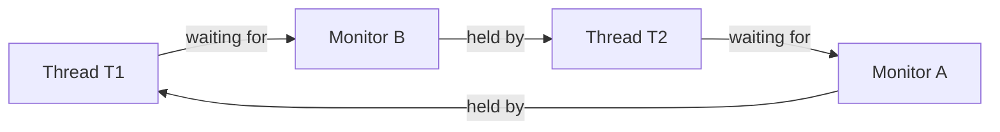
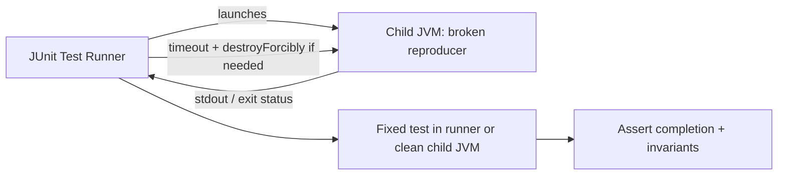

# Writing a Test to Reproduce Deadlock and Fixing Lock Ordering in Java

## 1. The Practical Problem and Completion Criteria

Suppose a Java application transfers balances between two accounts in memory. Each account has its own monitor; to transfer money safely, the operation must simultaneously hold the locks of both the source and destination accounts. If two threads perform `A → B` and `B → A` but **acquire locks in opposite orders**, a deadlock can occur: T1 holds lock A and waits for B, while T2 holds lock B and waits for A. Neither thread can proceed.

This practical exercise requires **writing a test that genuinely reproduces the deadlock**, collecting evidence, fixing it with a consistent lock ordering, and then writing regression tests to ensure both transfer directions complete and the total balance remains unchanged. The scope is **pure Java SE Concurrency**, without using Spring or framework-specific mechanisms.

**Expected deliverables:**
1. Create a scenario where two threads own two monitors in opposite orders, actively controlling the execution schedule with `CountDownLatch`.
2. The test detects the deadlock using `ThreadMXBean.findMonitorDeadlockedThreads()` within a clear timeout, rather than hanging the test indefinitely.
3. Fix `transfer` so that all threads always acquire locks in **a global order**.
4. The post-fix test runs multiple times from both directions concurrently, verifying completion within the timeout, no exceptions, and preservation of balance invariants.
5. Distinguish between a "test that reproduces deadlock" and a "test that verifies correct code": the broken version is checked to **have a deadlock**, while the fixed version is checked to **complete with correct data**.

The example below runs on **JDK 17+**, using the standard library and a single Java file; JUnit is not required to run the exercise. Following the exercise, there are instructions on converting it into a safe CI/JUnit test.

## 2. When Does Deadlock Occur?

The four conditions commonly cited in the resource deadlock model (Coffman) are:

1. **Mutual exclusion:** a resource cannot be owned by two threads simultaneously, such as an object's intrinsic monitor.
2. **Hold and wait:** a thread holds one resource while waiting for another.
3. **No preemption:** a resource cannot be arbitrarily preempted from the thread holding it; an intrinsic monitor cannot be forcibly released by another thread.
4. **Circular wait:** a waiting cycle exists: `T1 → L2 → T2 → L1 → T1`.

Example with `synchronized`:

```java
// Thread T1
synchronized (accountA) {
    synchronized (accountB) {
        // transfer A → B
    }
}

// Thread T2
synchronized (accountB) {
    synchronized (accountA) {
        // transfer B → A
    }
}
```

This is an **illustrative snippet**, not a standalone program. There is nothing wrong with the `synchronized` syntax in each thread; the bug lies in the **inconsistent order of acquiring multiple locks**. If T1 already holds A and T2 already holds B, both wait for the remaining lock and cannot make progress.



**Not every `BLOCKED` state is a deadlock.** A thread merely waiting briefly for a monitor held by another thread is lock contention. Deadlock requires a dependency cycle with no path forward under the current mechanism. It must also be distinguished from **starvation** (a task waits too long because it is not served) and **livelock** (threads remain active but make no progress on their work).

## 3. Why Are Concurrency Tests Often Hard to Reproduce?

If you run two transfer operations once and hope the scheduler aligns "at the right moment," a deadlock might happen on one machine and not appear on another. Inserting `Thread.sleep()` increases the probability of a certain interleaving, but **provides no guarantee** of execution order; the test can be flaky.

To test a specific interleaving, we use `CountDownLatch(2)` as a rendezvous point:

1. T1 acquires monitor A, decrementing the latch from 2 to 1.
2. T2 acquires monitor B, decrementing the latch from 1 to 0.
3. Both may proceed to acquire the second monitor **only after** the latch reaches 0.
4. T1 tries B, T2 tries A; the waiting cycle emerges.

The latch is used **only to reproduce the bug in the broken version**. In the fixed version, do not place a barrier requiring both threads to enter the locked region together: if both need the same first lock, a barrier inside the locked region can **cause a false hang** because the second thread cannot reach the barrier.

A reliable test needs:
- **Controlled execution scheduling** for the failure scenario.
- **A timeout** on the test thread, so the CI process does not wait forever.
- **Observing a real deadlock** via MXBean instead of just measuring "ran too long."
- **State isolation:** deadlocked threads must not hold locks used in the fixed-version test.
- **Invariant assertions** after the fixed version finishes; merely "not hanging" is not enough.

## 4. Complete Java 17 Code: Reproduce, Detect, Fix, and Regression Test

Save the entire following program to **`DeadlockLockOrderingTest.java`**. There is only one `public class`; the other classes and methods reside inside it.

```java
import java.lang.management.ManagementFactory;
import java.lang.management.ThreadMXBean;
import java.util.concurrent.CountDownLatch;
import java.util.concurrent.TimeUnit;
import java.util.concurrent.atomic.AtomicReference;

public class DeadlockLockOrderingTest {
    static final class Account {
        final int id;        // Unique, immutable ID in the system.
        long balance;        // Read/write only while holding the proper monitor.

        Account(int id, long balance) {
            if (balance < 0) {
                throw new IllegalArgumentException("Negative balance");
            }
            this.id = id;
            this.balance = balance;
        }
    }

    private static void require(boolean condition, String message) {
        if (!condition) {
            throw new AssertionError(message);
        }
    }

    // Call only when holding both monitors of from and to.
    private static void applyTransfer(Account from, Account to, long amount) {
        if (amount <= 0) {
            throw new IllegalArgumentException("Amount must be positive");
        }
        if (from.balance < amount) {
            throw new IllegalStateException("Insufficient balance");
        }
        from.balance -= amount;
        to.balance += amount;
    }

    // BROKEN VERSION: locks source first, destination second.
    // The barrier intentionally forces both threads to acquire their first lock before proceeding.
    private static void brokenTransfer(
            Account from,
            Account to,
            long amount,
            CountDownLatch bothFirstLocksHeld) {
        synchronized (from) {
            bothFirstLocksHeld.countDown();
            try {
                bothFirstLocksHeld.await();
            } catch (InterruptedException ex) {
                Thread.currentThread().interrupt();
                return;
            }

            synchronized (to) {
                applyTransfer(from, to, amount);
            }
        }
    }

    // FIXED VERSION: always locks the account with the smaller ID first.
    private static void orderedTransfer(
            Account from, Account to, long amount) {
        if (from == to) {
            return; // Same account: no transfer occurs.
        }
        if (from.id == to.id) {
            throw new IllegalArgumentException(
                "Different accounts must have unique IDs");
        }

        Account first = from.id < to.id ? from : to;
        Account second = from.id < to.id ? to : from;

        synchronized (first) {
            synchronized (second) {
                applyTransfer(from, to, amount);
            }
        }
    }

    private static Thread daemon(String name, Runnable task) {
        Thread thread = new Thread(task, name);
        // Only for the test that intentionally creates a deadlock; do not keep the JVM alive forever.
        thread.setDaemon(true);
        return thread;
    }

    private static boolean bothMonitorDeadlocked(
            ThreadMXBean bean, Thread first, Thread second) {
        long[] deadlockedIds = bean.findMonitorDeadlockedThreads();
        if (deadlockedIds == null) {
            return false;
        }

        boolean foundFirst = false;
        boolean foundSecond = false;
        for (long id : deadlockedIds) {
            if (id == first.getId()) {
                foundFirst = true;
            }
            if (id == second.getId()) {
                foundSecond = true;
            }
        }
        return foundFirst && foundSecond;
    }

    private static void testBrokenCodeProducesDeadlock()
            throws InterruptedException {
        Account a = new Account(1, 100_000);
        Account b = new Account(2, 100_000);
        CountDownLatch firstLocksHeld = new CountDownLatch(2);

        Thread t1 = daemon("broken-A-to-B",
            () -> brokenTransfer(a, b, 1, firstLocksHeld));
        Thread t2 = daemon("broken-B-to-A",
            () -> brokenTransfer(b, a, 1, firstLocksHeld));

        t1.start();
        t2.start();

        ThreadMXBean bean = ManagementFactory.getThreadMXBean();
        long deadline = System.nanoTime() + TimeUnit.SECONDS.toNanos(5);
        boolean detected = false;

        while (System.nanoTime() < deadline) {
            if (bothMonitorDeadlocked(bean, t1, t2)) {
                detected = true;
                break;
            }
            Thread.sleep(20);
        }

        require(detected,
            "Expected monitor deadlock was not detected in 5 seconds");
        System.out.println("BROKEN: monitor deadlock detected");
    }

    private static void repeatOrdered(
            Account from,
            Account to,
            CountDownLatch start,
            AtomicReference<Throwable> failure) {
        try {
            start.await();
            for (int i = 0; i < 1_000; i++) {
                orderedTransfer(from, to, 1);
            }
        } catch (InterruptedException ex) {
            Thread.currentThread().interrupt();
            failure.compareAndSet(null, ex);
        } catch (Throwable ex) {
            failure.compareAndSet(null, ex);
        }
    }

    private static void testOrderedCodeCompletes()
            throws InterruptedException {
        // Use NEW accounts: the broken version still holds monitors on daemon threads.
        Account a = new Account(1, 100_000);
        Account b = new Account(2, 100_000);
        CountDownLatch start = new CountDownLatch(1);
        AtomicReference<Throwable> failure = new AtomicReference<>();

        Thread t1 = daemon("fixed-A-to-B",
            () -> repeatOrdered(a, b, start, failure));
        Thread t2 = daemon("fixed-B-to-A",
            () -> repeatOrdered(b, a, start, failure));

        t1.start();
        t2.start();
        start.countDown();

        t1.join(10_000);
        t2.join(10_000);

        require(!t1.isAlive() && !t2.isAlive(),
            "Ordered transfers did not finish within the timeout");
        if (failure.get() != null) {
            throw new AssertionError("A worker failed", failure.get());
        }

        // join() has completed: the main thread can safely inspect the results.
        require(a.balance == 100_000, "Unexpected A balance");
        require(b.balance == 100_000, "Unexpected B balance");
        require(a.balance + b.balance == 200_000,
            "Total balance changed");

        System.out.println("FIXED: completed 2,000 transfers");
        System.out.println(
            "FIXED: A=" + a.balance + ", B=" + b.balance
            + ", total=" + (a.balance + b.balance));
    }

    public static void main(String[] args) throws Exception {
        testBrokenCodeProducesDeadlock();
        testOrderedCodeCompletes();
    }
}
```

### 4.1. Compiling and Running

Use a terminal with JDK 17 or newer:

```bash
javac DeadlockLockOrderingTest.java
java DeadlockLockOrderingTest
```

On HotSpot/OpenJDK with monitor deadlock detection support, the expected output is:

```text
BROKEN: monitor deadlock detected
FIXED: completed 2,000 transfers
FIXED: A=100000, B=100000, total=200000
```

If a test condition fails, the program throws an `AssertionError` with the reason. The initial balance of each account is 100,000; each direction transfers 1 unit 1,000 times, so the total is 200,000 and the final balance of each account remains 100,000.

**Intentional limitation:** The two `broken-...` threads are **genuinely** deadlocked and remain alive until the JVM exits. They are marked as daemon threads so the exercise finishes; daemon status **does not break the deadlock and does not release the monitors**. The two accounts in the fixed version are new objects, so they are not blocked by the stuck daemon threads. When migrating to a long-lived test suite, **run the deadlock-producing part in a separate child JVM** and terminate the child JVM after the timeout, rather than leaving deadlocked threads inside the test runner.

### 4.2. What the Test Proves

**Broken test:** passes only if **both** created Java threads appear in the `findMonitorDeadlockedThreads()` result. Checking specifically by `getId()` prevents mistaking an unrelated deadlock in the JVM for the exercise's deadlock. This is a test for **bug reproduction and detection**.

**Fixed test:** two threads start together after a start gate outside the locked region, each transferring 1,000 times in opposite directions. The test waits up to 10 seconds per thread and then checks that both finished, no exceptions occurred, and the balances are correct. This is a test for **completion + data correctness**.

**Why not just check for the absence of deadlock?** An implementation that skips all transfers would not deadlock, yet would violate the requirements. Therefore, you must verify the number of processed operations and output values; the example above asserts the invariants, while printing "completed 2,000 transfers" relies on both workers finishing the loop without throwing. You can extend this with a transaction counter if step-by-step proof is needed.

**Why is a timeout not enough?** A task slowed down by CPU/throttling/GC can exceed a too-short timeout without deadlocking. The test has a timeout so CI does not hang, while `findMonitorDeadlockedThreads()` provides concrete evidence of a monitor wait cycle.

## 5. Reading Deadlock Evidence via a Thread Dump

While the program is running the broken version, you can add a `Thread.sleep` in `main` after detecting the deadlock to leave time for `jcmd`, or run a sub-test with an explicit wait window. Do not add sleep to the lock-acquisition coordination logic as a replacement for the latch.

On HotSpot with a full JDK:

```bash
jcmd -l
jcmd <PID> Thread.print -l > deadlock-dump.txt
```

Replace `<PID>` with the actual PID. Signs from the two test threads (monitor addresses, source lines, `tid`, `nid` will vary):

```text
"broken-A-to-B" ...
   java.lang.Thread.State: BLOCKED (on object monitor)
    at DeadlockLockOrderingTest.brokenTransfer(...)
    - waiting to lock <0x...B> (an Account)
    - locked <0x...A> (an Account)

"broken-B-to-A" ...
   java.lang.Thread.State: BLOCKED (on object monitor)
    at DeadlockLockOrderingTest.brokenTransfer(...)
    - waiting to lock <0x...A> (an Account)
    - locked <0x...B> (an Account)
```

The lines above are an **illustrative summary**, not a verbatim copy from a single run. Each thread is `BLOCKED` trying to enter the second monitor while still holding the first. Connecting the lock IDs:

```text
T1 holds A → waits for B
T2 holds B → waits for A
=> T1 → B → T2 → A → T1 (cycle)
```

HotSpot may print a "Found one Java-level deadlock" section or deadlock details at the end of the dump; the formatting depends on the JDK version. In test code we do not parse text dumps because output formats can vary; instead we use `ThreadMXBean` for structured monitor deadlock detection.

**Note:** Java's `Thread.State.BLOCKED` applies to **intrinsic monitors**. With `ReentrantLock`, waiting threads are often in `WAITING`/`TIMED_WAITING` via `LockSupport.park()`, and you may need `findDeadlockedThreads()` along with JVM ownable synchronizer support. `findMonitorDeadlockedThreads()` fits this `synchronized` example directly.

## 6. Why Does Lock Ordering Fix the Cycle?

In `orderedTransfer`, regardless of whether transferring `A → B` or `B → A`, the code determines:

```java
Account first  = from.id < to.id ? from : to;
Account second = from.id < to.id ? to : from;

synchronized (first) {
    synchronized (second) {
        // Update balances according to the business direction from → to.
    }
}
```

This is an excerpt from the full program in section 4. With `A.id = 1`, `B.id = 2`:
- T1 transfers A→B: acquires A then B.
- T2 transfers B→A: **still** acquires A then B.

If T1 already holds A, T2 must **wait immediately at A**; T2 cannot hold B yet to form a cycle. When T1 finishes and releases the locks in reverse order upon exiting the nested `synchronized` blocks, T2 gets its turn to execute. The from/to update order remains `from.balance -= amount`, `to.balance += amount` — lock order **does not** change business semantics.

From a graph perspective: if all lock-acquisition paths always go from **smaller ID to larger ID**, every edge "holding a smaller lock and waiting for a larger lock" points in an increasing direction. A cycle would require IDs to increase indefinitely and then return to the initial smaller ID, which is impossible in a finite set of locks with a consistent total order.

### 6.1. Conditions for Lock Ordering to Be Truly Safe

1. **Locks have a global, stable order:** use immutable, unique identifiers or a tie-breaker mechanism that guarantees a total order.
2. **All call sites follow the same rule:** another code path that still locks B before A can reintroduce deadlock.
3. **Use the right monitor objects:** objects representing the same resource must be managed consistently; two distinct `Account` instances with the same ID must not be implicitly treated as one.
4. **Data integrity:** all balance reads/writes must be protected according to the ownership rule, not just the transfer method.
5. **Do not hold locks during long I/O or blocking operations:** even if cycles between two monitors are eliminated, lock convoys and latency can still be severe.

The example chooses an immutable `Account.id` and throws an error if two distinct objects share the same ID. If using `System.identityHashCode()` for ordering, **hash values can collide**; you must define a tie-breaker lock rather than assuming collisions never occur. The simplest approach in this domain is a unique, stable ID.

**Self-transfer:** when `from == to`, the example skips changes as a no-op. In a real system, you still need to decide whether to validate `amount` and define audit/event logging for self-transfers. That is a business choice, not a general deadlock prevention rule.

## 7. Why Must Invariants Be Preserved, Not Just Hangs Avoided?

Suppose the invariant is `A.balance + B.balance == constant` when there are only two accounts in the system and transfers neither create nor destroy money. Two separate steps:

```java
from.balance -= amount;
to.balance += amount;
```

must be observed as **one logical transaction** under the same set of monitors. If the code only locked `from` while debiting, then released the lock before crediting `to`, another thread could observe an intermediate state and make wrong decisions. Lock ordering allows protecting both accounts without creating a waiting cycle between them.

After `Thread.join()` completes, the Java Memory Model guarantees that the worker's actions **happen-before** the thread calling `join` returns successfully; therefore the test can safely read `balance` after both joins complete. In a continuously running system, code that reads balances concurrently also needs synchronization/visibility per its contract—you cannot cite `join` in tests to omit locks in production threads.

In the test, each account starts at 100,000 and there are 1,000 transfers in each direction with amount 1. Neither account runs out of balance in any valid schedule, because an account is debited by at most 1,000 units before receiving from the reverse direction; thus the invariant can always hold. If business data allows overdraft attempts, errors or rollbacks must be handled inside the critical section.

### 7.1. The "Correct Total but Broken Logic" Trap

If both workers skipped every transfer, the total would still be right and the final balance would still be 100,000 on each side. For stronger verification, you can count successful transfers inside lock-protected code or check an independent transaction event log. In the demo program, the loop and absence of exceptions confirm both workers called `orderedTransfer` 1,000 times; when refactoring real code, add an assertion on the count of successful operations.

Similarly, a correct total balance does not prove there were no temporary negative balances; business logic must check on every transfer inside the critical section if a non-negative invariant applies.

## 8. What Cases Should Regression Tests Cover?

| Case | Input / Schedule | Expectation |
|---|---|---|
| Bug reproducer | A→B and B→A, barrier after each acquires its first monitor | MXBean detects both threads in a monitor deadlock |
| Opposite-direction fix | Two threads transfer A→B / B→A from a start gate | Both complete within timeout, no deadlock, no exceptions |
| Repeated load | Each worker transfers 1,000 times, amount 1 | Final and total balances are correct, no lost updates |
| Insufficient funds | `from.balance < amount` | Throws error, no partial update |
| Same-reference account | `from == to` | Per contract: no-op or valid error; no deadlock |
| Duplicate ID on distinct objects | `from != to`, `from.id == to.id` | Rejected because identifier ordering is not guaranteed |
| Multiple accounts | Three or more accounts, contending transfer pairs | Same global order for all locks, no lock-order cycle |
| Worker failure | Exception in task | Main/test captures the error; thread exceptions are not ignored |
| Timeout / resource cleanup | Task does not finish before deadline | Test fails clearly, child JVM is safely terminated |

**Timeouts serve two different purposes:** in the broken version, the deadline is the wait limit for detection; in the fixed version, the deadline limits completion time to catch hangs or abnormal slowness. Both must be generous enough for the CI environment. A timeout failure **does not by itself prove deadlock** without a thread dump/MXBean check and load context.

Do not abuse thousands of `Thread.sleep` calls or spawn an excessive number of threads to "test for races": large counts slow down tests and can still miss the target interleaving. Actively coordinating order in the broken test makes reproduction deterministic.

## 9. Converting the Exercise into a Safe JUnit/CI Test

A test fixture that creates a real monitor deadlock cannot rely on ordinary `Thread.interrupt()` to break out of waiting to enter a `synchronized` monitor. Using daemon threads lets the console demo exit, but **it is not a good isolation strategy for a test runner** because deadlocked daemons still retain objects/stacks and live until the JVM shuts down.

A robust CI test architecture:



**Recommended implementation:**
1. Place the bug reproducer in a `main` method of a child process or a separate test configured to fork a JVM.
2. The child JVM's `main` starts the two threads and polls the MXBean; if detected, it prints a machine-readable marker such as `DEADLOCK_DETECTED` and exits with a predefined code (or lets the runner check the marker and stop the child JVM).
3. The parent test uses `ProcessBuilder` and `Process.waitFor(timeout, TimeUnit.SECONDS)`; if not finished, it calls `destroy()` and then `destroyForcibly()` if needed, ensuring stdout/stderr streams are consumed to avoid hanging on a full pipe.
4. The parent test asserts the deadlock-detected marker, exit code, and diagnostic info. **Do not treat "child JVM timed out" as the sole proof.**
5. The fixed test runs in a clean JVM: two workers start from a barrier outside the locks; `join(timeout)`, assert `!isAlive()`, no exceptions, and all invariants.
6. On test failure, save thread dumps/JFR/logs for debugging rather than just printing a generic `assertTimeout`.

If using JUnit 5, test names should reflect the contract, such as `brokenOppositeLockOrder_isDetectedAsDeadlock()` and `orderedTransfers_finishAndPreserveBalances()`. For the fixed version, use assertion APIs like `assertFalse(thread.isAlive())`, `assertEquals(expected, value)`, or `assertAll(...)`, but **do not rely on `assertTimeoutPreemptively` to forcibly abort a monitor deadlock**: interruption cannot break it. This is integration guidance; the code in section 4 is a standalone, runnable version requiring no extra dependencies.

**A technical note:** the broken test polls `findMonitorDeadlockedThreads()` every 20 ms, which has small overhead. In production, avoid polling MXBean at high frequency indefinitely; use incident-driven diagnostics or an evaluated polling interval.

## 10. Alternative Strategies and When to Choose Them

### 10.1. A Single Global Lock

The simplest approach is `synchronized(globalLock)` for all transfers. It avoids wait cycles across multiple account locks, but also **serializes all transactions**, even transfers between unrelated accounts. This may suit very small systems, but does not utilize concurrency well under heavy load.

### 10.2. Global Ordering by Resource Key

As in the example: only operations that actually share accounts are serialized. Transfers A↔B contend on just those two monitors; transfers C↔D can run in parallel. The key requirement is that all call paths obey the lock order.

### 10.3. `ReentrantLock.tryLock()` with a Deadline

Another strategy is attempting to acquire the second lock for a limited time and releasing the first if unsuccessful. It can prevent indefinite waiting if retry/backoff is designed properly, but easily introduces **livelock**, starvation, and complex interruption handling. `tryLock` does not automatically fix the problem if code holds a lock and then waits indefinitely elsewhere.

### 10.4. Avoiding Holding Multiple Locks Simultaneously

You can replace this with immutable snapshots, message passing/actors, partitioned ownership, or transaction protocols; in return, you must handle atomicity and consistency according to the domain. For money transfers, removing nested locks without an equivalent transaction or coordination mechanism opens the door to races and lost updates.

**Technical conclusion:** lock ordering is a particularly effective technique when multiple operations must simultaneously hold locks on multiple objects with stable identities; it does not replace requirements for invariants, fairness, timeouts, or keeping critical sections small.

## 11. Common Mistakes When Writing Deadlock Tests

### Mistake 1: "Running concurrently a few times is enough"

Two threads might happen to run sequentially and never hit the timing that creates a wait cycle. Randomly passing tests hide bugs. Use a latch/barrier to control interleaving in the **reproduction test**, and add a repeated load test for the fix.

### Mistake 2: Using `Thread.sleep()` to guarantee execution order

`sleep` only delays the current thread; it does not guarantee that another thread has acquired a monitor or reached the desired point. Use an explicit handshake (`CountDownLatch`, `Phaser`) when the goal is controlling thread interaction.

### Mistake 3: Placing a barrier inside the lock in the fixed test as well

If both threads follow lock ordering, the second thread must wait for the first lock and thus cannot reach the barrier. The test deadlocks on its own coordinator, proving nothing about the fix. Only use `CountDownLatch(2)` **after acquiring two different monitors** in the bug reproducer; the start gate for the fixed version stays **outside the locks**.

### Mistake 4: Trying to interrupt a thread waiting on an intrinsic monitor

`Thread.interrupt()` does not make waiting to enter `synchronized` interruptible. Do not use `Thread.stop()` (deprecated and unsafe) to break a deadlock. Isolate the reproducer in a child JVM and terminate that process after collecting evidence.

### Mistake 5: Only asserting `!isAlive()`

A thread could die from an exception or compute wrong data. In tests, capture worker exceptions and verify completion status, total balance, individual account balances, and related invariants.

### Mistake 6: Ordering by non-unique IDs

If two distinct objects have the same ID, `<` comparison does not establish a total order between them. The example rejects this case; real systems must guarantee uniqueness or use a valid tie-breaker.

### Mistake 7: Fixing only one transfer direction

If T1 switches to A→B while T2 still acquires B→A, the wait cycle still exists. **Every** code path acquiring the relevant locks must follow one consistent rule, including transfers, batch adjustments, reconciliation, and multi-account balance checks.

### Mistake 8: Hanging tests losing logs

Never let CI wait forever. Set a deadline, capture a dump during the hang window, and use a child JVM so other tests are unaffected. When using `ProcessBuilder`, consume stdout/stderr properly to avoid blocking on a full buffer.

## 12. Step-by-Step Self-Practice Workflow

To build a solid understanding of the root cause, practice in this order:

1. **Run the code in section 4 as-is.** Verify the `BROKEN` and `FIXED` output lines; check the active JDK with `java -version`.
2. **Remove the barrier in `brokenTransfer`** and run it multiple times. Observe that the deadlock may not appear, demonstrating scheduling unpredictability.
3. **Keep the barrier, flip the monitor acquisition order for one branch**, and re-read the wait graph. Understand exactly which lock is held.
4. **Read `orderedTransfer`:** even when `from` and `to` swap positions, the `first`/`second` order stays the same.
5. **Add balance invariant tests:** try large amounts, test insufficient balance, same-account transfers, and duplicate IDs.
6. **Extend to three accounts:** run A↔B, B↔C, C↔A transfers, ensuring locks are always acquired in ascending ID order.
7. **Use JFR/thread dumps** under long lock-wait scenarios to distinguish contention from deadlock.
8. **Migrate to CI** with process isolation for the reproducer, keeping the fixed test with a deadline and full assertions.

### Extension Exercise: Three Locks and Multi-Account Invariants

Suppose a business operation updates A, B, and C simultaneously. Write a helper that accepts a collection of accounts, checks for unique IDs, **sorts by ascending ID**, acquires the monitors in that order, and performs the atomic update. Avoid writing arbitrary numbers of nested `synchronized` blocks manually; you can design a corresponding lock structure or use `ReentrantLock` with sequential acquisition and `finally` release in reverse order, as long as the locking policy is consistent.

Invariants to test:
- Total value before and after (for internal transfers only) is equal.
- No negative account balances when business rules forbid overdrafts.
- All workers complete within the deadline.
- No lost exceptions or skipped tasks.
- Correct results across multiple valid schedules.

Do not rely solely on tests to prove the complete absence of deadlock across all call paths; combine **code review for global lock order**, invariant analysis, and runtime observation.

## 13. Checklist When Reviewing a Deadlock Fix

| Question | Passing Sign |
|---|---|
| Does the reproducer establish a wait cycle? | Two threads hold two different monitors; MXBean detects the exact IDs |
| Is there a time limit? | The test cannot hang `main`/CI indefinitely |
| Is the failure test isolated? | Child JVM or short-lived daemon demo; locked objects are not reused |
| Is lock acquisition order global? | All paths acquiring two account locks sort by immutable ID |
| Are equal IDs handled? | Self-transfer is clearly defined; distinct objects with the same ID are rejected or tie-broken |
| Is the critical section properly scoped? | Debit and credit both occur while holding both monitors |
| Do workers complete? | `join`/deadline + thread state check |
| Do workers fail loudly? | Exceptions are surfaced to the test for assertion, not just printed as stack traces |
| Are results correct? | Balance invariants and completed operation counts are verified |
| Are diagnostics sufficient? | Thread dump/lock IDs and metrics are available when a test fails |

## 14. Self-Check Questions

**Q1.** If T1 holds A and waits for B, while T2 holds B but is in `Thread.sleep(500)` and will then release B, is there a deadlock?

*Answer:* Not enough to conclude deadlock. T2 can still make progress after sleeping and release B; this may be contention causing a delay. Only if T2 also waits for A while holding B does a wait cycle form.

**Q2.** If all transfers acquire monitors in ascending ID order, can a deadlock still occur between those two account monitors?

*Answer:* No circular wait cycle can form **from acquiring these monitors alone** when all call paths follow the rule, IDs form a stable total order, and no other locks violate the policy. However, threads can still block on I/O, latches, or locks from other parts of the system.

**Q3.** Why is `findMonitorDeadlockedThreads()` suitable for the `synchronized` example but insufficient for all programs?

*Answer:* It detects deadlocks on object monitors. Ownable synchronizers like `ReentrantLock` may require `findDeadlockedThreads()`; logical deadlocks via `Future`, network, or external non-JVM resources are not necessarily detected by this API.

**Q4.** Two fixed workers finish within 10 seconds with no exceptions and the total balance is correct. What else should be checked?

*Answer:* Individual account balances, the number of operations executed, that no intermediate state violated invariants, and whether other call paths follow the same lock order. An implementation that executes no transactions would still preserve the total balance.

**Q5.** Why are daemon threads not a fix for deadlock?

*Answer:* Daemon status only affects whether the JVM can exit once all non-daemon threads finish. The deadlock, held monitors, and stuck work still persist until the process terminates.

## 15. Key Takeaways

A good deadlock test has **two distinct phases**: (1) actively reproduce the wait cycle using a controlled schedule and detect it structurally; (2) fix the lock acquisition rule, then verify task completion and data correctness under concurrency. In this example, the root cause is two transfers acquiring account monitors in source→destination order, and the fix is acquiring them in **ascending ID order regardless of transfer direction**.

What matters in Java Concurrency is not making tests "not hang" by adding threads or extending timeouts, but **eliminating the circular wait condition with a consistent lock ownership rule** and proving correctness through tests and business invariants.
