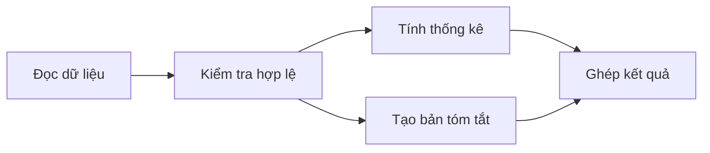

# Chia nhỏ task theo mức độ độc lập trong Java Concurrency

## 1. Mục tiêu và phạm vi

Khi một công việc lớn được chia thành nhiều task, câu hỏi đầu tiên không phải là “tạo bao nhiêu thread?”, mà là **những phần việc nào có thể chạy độc lập mà vẫn tạo ra kết quả đúng?** Thiết kế tốt bắt đầu từ quan hệ phụ thuộc dữ liệu, trạng thái và thứ tự thực hiện; API Java được chọn sau khi đã hiểu các quan hệ đó.

Sau bài này, bạn có thể:
- Phân biệt task độc lập, task phụ thuộc và task dùng chung tài nguyên.
- Tách công việc theo dữ liệu hoặc chức năng, xác định điểm đồng bộ và điểm tổng hợp kết quả.
- Dùng `ExecutorService`, `Callable`, `Future` và `CompletableFuture` cho những kiểu phụ thuộc phù hợp.
- Quyết định độ hạt task, giới hạn đồng thời, chính sách lỗi và cách kiểm chứng hiệu quả.

Phạm vi là **Java Concurrency nói chung**. Ví dụ dùng Java SE và không dựa vào Spring, `@Async`, Spring TaskExecutor hoặc bất kỳ cơ chế Spring riêng nào.

## 2. “Độc lập” nghĩa là gì?

Một **task** là đơn vị công việc có đầu vào, điều kiện bắt đầu và kết quả hoặc tác động xác định. Hai task `A` và `B` *độc lập về thực thi* khi có thể đổi thứ tự hoặc chạy chồng thời gian mà không làm sai tính đúng đắn. Độc lập không nhất thiết có nghĩa là chúng chạy trên hai thread khác nhau.

Có ba mức cần phân biệt:

| Quan hệ | Dấu hiệu | Cách tổ chức |
|---|---|---|
| Độc lập hoàn toàn | Cùng đọc dữ liệu bất biến, tạo các kết quả riêng | Có thể submit song song; tổng hợp sau |
| Phụ thuộc một chiều | B cần đầu ra của A | A phải hoàn thành trước B; biểu diễn quan hệ bằng chuỗi stage |
| Cùng thay đổi trạng thái/tài nguyên | A và B ghi chung biến, file, transaction hoặc thiết bị | Cô lập sở hữu, đồng bộ truy cập hoặc thiết kế lại để tránh ghi chung |

Ví dụ xử lý 10.000 đơn hàng:
- Tính tổng doanh thu của **những nhóm đơn không giao nhau** có thể là nhiều task độc lập. Mỗi task trả về một tổng cục bộ, sau đó cộng các tổng.
- Tạo hóa đơn từ kết quả kiểm tra đơn hàng là task **phụ thuộc**: phải có kết quả kiểm tra hợp lệ trước.
- Hai task cùng tăng một biến `total` thông thường là **tranh chấp trạng thái**. Dữ liệu bị chia đôi không tự làm thao tác ghi chung trở nên an toàn.

Cần xem xét ba chiều độc lập riêng biệt:

1. **Dữ liệu:** Có ghi vào cùng vị trí hay phụ thuộc kết quả chưa được tính không?
2. **Tài nguyên:** Có cùng truy cập connection, file, quota API, rate limit hoặc thiết bị hữu hạn không?
3. **Ý nghĩa nghiệp vụ:** Kết quả có cần duy trì thứ tự, tính nguyên tử, bất biến (invariant) hoặc “tất cả thành công hoặc tất cả thất bại” không?

Một task đọc dữ liệu chung có thể độc lập về dữ liệu nhưng vẫn bị giới hạn bởi connection pool. Một phép tính có thể chạy đồng thời về kỹ thuật nhưng không được đổi thứ tự nếu yêu cầu nghiệp vụ là “trừ tồn kho rồi mới xác nhận đơn”.

## 3. Từ yêu cầu đến đồ thị phụ thuộc (DAG)

Xem mỗi task là một nút; vẽ cạnh `A → B` khi B cần kết quả của A. Đồ thị hợp lệ để lập lịch theo phụ thuộc phải không có chu trình (DAG). Những nút không phụ thuộc nhau và đã có đủ tiền đề mới là ứng viên chạy đồng thời.



Ở đây C và D **có thể** chạy đồng thời sau B; E chỉ bắt đầu khi cả hai có kết quả. Không nên chạy B đồng thời với A nếu B cần dữ liệu từ A.

Quy trình phân tích một task lớn:

1. **Xác định đầu ra và bất biến:** Kết quả đúng trông như thế nào? Có ràng buộc thứ tự hay tính nhất quán nào?
2. **Liệt kê bước thật sự cần thiết:** Đọc, kiểm tra, tính toán, ghi, tổng hợp; xác định input/output của từng bước.
3. **Đánh dấu phụ thuộc:** Phụ thuộc dữ liệu, phụ thuộc trạng thái, phụ thuộc tài nguyên và ràng buộc nghiệp vụ.
4. **Cắt tại ranh giới độc lập:** Ưu tiên input bất biến, task sở hữu dữ liệu của mình và kết quả cục bộ.
5. **Tạo điểm kết hợp (join):** Xác định chỗ chờ và ghép kết quả, quy tắc xử lý lỗi.
6. **Ước lượng chi phí:** Task có đủ lớn để việc lập lịch và truyền dữ liệu đáng giá không?
7. **Kiểm chứng:** So với thuật toán tuần tự và thử trường hợp biên trước khi tối ưu throughput.

**Không phải mọi bước đều nên song song hóa.** Nếu tất cả đều phụ thuộc trên một chuỗi, thêm thread không phá được thứ tự logic đó. Đường phụ thuộc dài nhất (critical path) đặt cận dưới cho thời gian hoàn thành, ngay cả khi có rất nhiều worker.

## 4. Hai cách chia phổ biến

### 4.1. Phân rã theo dữ liệu (data parallelism)

Một phép xử lý áp dụng lên các phần dữ liệu tách biệt:

```text
Dữ liệu đầu vào
    ├── Nhóm 1 ──> Task 1 ──> Kết quả 1 ──┐
    ├── Nhóm 2 ──> Task 2 ──> Kết quả 2 ──┼──> Reduce ──> Kết quả cuối
    └── Nhóm 3 ──> Task 3 ──> Kết quả 3 ──┘
```

Phù hợp với thống kê, xử lý ảnh, đọc nhiều file độc lập hoặc đánh giá hàng loạt bản ghi. Phần `reduce` cần đúng về toán học: cộng số nguyên là phép kết hợp được trong phạm vi không tràn số; lấy trung bình các trung bình của nhóm có kích thước khác nhau là **sai** nếu không kèm số lượng. Với số thực, thứ tự cộng có thể làm thay đổi sai số làm tròn.

Một mô hình an toàn là **map → local result → reduce**: các task không thay đổi bộ cộng dồn chung.

### 4.2. Phân rã theo chức năng (functional decomposition)

Những nhánh tính toán khác nhau dùng chung đầu vào đã sẵn sàng, ví dụ từ hồ sơ đã tải: một task chuẩn bị thông báo, một task tính thông tin gợi ý. Chúng có thể bắt đầu sau cùng một bước tải và ghép lại ở cuối.

Phân rã theo chức năng thường chứa nhiều ràng buộc thứ tự hơn phân rã theo dữ liệu. Chỉ chạy hai nhánh đồng thời khi chúng không phụ thuộc vào tác động phụ chưa được bảo đảm của nhau.

## 5. Ví dụ Java 17: chia nhóm đơn hàng, tổng hợp không chia sẻ biến ghi

Mỗi task chỉ đọc danh sách bất biến và trả về một `Partial`. Thread chính lấy hai kết quả sau khi task hoàn thành; không có `AtomicLong`, khóa hay bộ cộng dồn chung giữa worker.

Lưu mã sau vào `TaskDecompositionDemo.java`:

```java
import java.util.ArrayList;
import java.util.List;
import java.util.concurrent.Callable;
import java.util.concurrent.ExecutorService;
import java.util.concurrent.Executors;
import java.util.concurrent.Future;

public class TaskDecompositionDemo {
    record Order(String id, long cents) {}
    record Partial(long count, long cents) {}

    static Partial summarize(List<Order> batch) {
        long count = 0;
        long cents = 0;
        for (Order order : batch) {
            count++;
            cents += order.cents();
        }
        return new Partial(count, cents);
    }

    public static void main(String[] args) throws Exception {
        List<Order> orders = List.of(
            new Order("A", 10_000),
            new Order("B", 20_000),
            new Order("C", 15_000),
            new Order("D", 5_000)
        );

        int middle = orders.size() / 2;
        List<List<Order>> batches = List.of(
            orders.subList(0, middle),
            orders.subList(middle, orders.size())
        );

        ExecutorService pool = Executors.newFixedThreadPool(2);
        try {
            List<Callable<Partial>> tasks = new ArrayList<>();
            for (List<Order> batch : batches) {
                tasks.add(() -> summarize(batch));
            }

            List<Future<Partial>> futures = pool.invokeAll(tasks);
            long totalCount = 0;
            long totalCents = 0;
            for (Future<Partial> future : futures) {
                Partial result = future.get();
                totalCount += result.count();
                totalCents += result.cents();
            }

            System.out.println("Số đơn: " + totalCount);
            System.out.println("Tổng (cent): " + totalCents);
        } finally {
            pool.shutdown();
        }
    }
}
```

Chạy bằng JDK 17 hoặc mới hơn:

```bash
javac TaskDecompositionDemo.java
java TaskDecompositionDemo
```

Kết quả chính xác:

```text
Số đơn: 4
Tổng (cent): 50000
```

Giải thích:
- `List.of(...)` tạo danh sách không hỗ trợ thay đổi phần tử; các `subList` ở đây là các view chỉ đọc của dữ liệu đó. Nếu dùng danh sách có thể sửa từ nơi khác, hãy chụp snapshot hoặc thiết lập quyền sở hữu rõ ràng trước khi submit.
- Hai batch không chồng lấn; `summarize` chỉ sử dụng biến cục bộ và trả kết quả bất biến dạng `record`.
- `invokeAll` submit mọi `Callable` và đợi chúng hoàn thành; danh sách `Future` trả về theo **thứ tự task đầu vào**, không phải thứ tự worker hoàn thành.
- `future.get()` nhận giá trị hoặc ném `ExecutionException` nếu task lỗi. Kết quả của task đã hoàn thành được công bố an toàn qua cơ chế `Future`.
- `shutdown()` ngừng nhận task mới và cho task đã submit tiếp tục hoàn thành; nó không tự đợi vô hạn. Ở luồng thành công của ví dụ, `invokeAll` đã đợi các task.

Đây là ví dụ minh họa thiết kế, **không chứng minh chạy song song nhanh hơn**: bốn bản ghi quá ít để đáng chi phí thread pool. Trên dữ liệu thật, cần đo kích thước batch và thời gian mỗi task. Nếu cộng tổng có thể vượt `long`, cân nhắc `Math.addExact` hoặc `BigInteger` theo yêu cầu.

## 6. Ví dụ Java 17: phụ thuộc trước, độc lập sau với CompletableFuture

Trong đồ thị `loadProfile → (buildGreeting, buildLocale) → combine`, hai nhánh sau có chung tiền đề nhưng không phụ thuộc lẫn nhau. `CompletableFuture` biểu diễn quan hệ đó mà không cần tự gọi `get()` giữa các bước.

Lưu thành `TaskDependencyDemo.java`:

```java
import java.util.concurrent.CompletableFuture;
import java.util.concurrent.ExecutorService;
import java.util.concurrent.Executors;

public class TaskDependencyDemo {
    record Profile(String id, String locale) {}

    static Profile loadProfile(String id) {
        return new Profile(id, "vi");
    }

    public static void main(String[] args) {
        ExecutorService pool = Executors.newFixedThreadPool(3);
        try {
            CompletableFuture<Profile> loaded =
                CompletableFuture.supplyAsync(() -> loadProfile("u42"), pool);

            CompletableFuture<String> greeting =
                loaded.thenApplyAsync(p -> "Xin chào " + p.id(), pool);

            CompletableFuture<String> locale =
                loaded.thenApplyAsync(p -> "ngôn ngữ=" + p.locale(), pool);

            CompletableFuture<String> combined =
                greeting.thenCombine(locale, (a, b) -> a + "; " + b);

            System.out.println(combined.join());
        } finally {
            pool.shutdown();
        }
    }
}
```

```bash
javac TaskDependencyDemo.java
java TaskDependencyDemo
```

```text
Xin chào u42; ngôn ngữ=vi
```

`thenApplyAsync` chỉ kích hoạt khi `loaded` hoàn thành bình thường; hai nhánh có thể chạy chồng nhau nếu executor có worker sẵn sàng. `thenCombine` chờ kết quả từ cả hai. **Độc lập cho phép đồng thời; không bảo đảm hai nhánh luôn được thực thi cùng lúc.** Nếu một stage thất bại, stage phụ thuộc thường hoàn thành ngoại lệ; `join()` có thể ném `CompletionException`. Khi có yêu cầu phục hồi, lựa chọn `exceptionally`, `handle` hoặc `whenComplete` theo chính sách kết quả, không âm thầm bỏ lỗi.

Lưu ý: `thenApply` (không có `Async`) có thể chạy ở thread hoàn thành stage trước hoặc thread đăng ký callback, tùy thời điểm. Không mặc định rằng mọi stage tương ứng một thread riêng; chọn explicit executor và đo khi cần kiểm soát nơi thực thi.

## 7. Độ hạt task: chia bao nhiêu là vừa?

Song song hóa giúp giảm thời gian khi lượng công việc hữu ích đủ lớn so với overhead. Một mô hình định tính:

```text
T_parallel ≈ T_work / số worker hữu dụng
             + T_submit + T_queue + T_join
             + T_contention + T_imbalance
```

Đây là mô hình tư duy, không phải công thức dự báo chính xác: số worker hữu dụng phụ thuộc CPU, I/O, phụ thuộc task và tải hệ thống. Nếu một phần công việc buộc tuần tự, tốc độ tăng vẫn bị giới hạn bởi phần tuần tự (định luật Amdahl).

Chọn kích thước task theo các tiêu chí:
- **Quá nhỏ:** Hàng triệu task cho vài phép cộng mỗi task khiến chi phí queue, đối tượng và chuyển ngữ cảnh lấn át công việc.
- **Quá lớn:** Chỉ một hai task nặng khiến worker khác nhàn rỗi và khó hủy một phần.
- **Cân bằng kém:** Một batch chứa phần lớn công việc sẽ kéo dài critical path, dù các batch khác kết thúc sớm.
- **Chia tốn chi phí:** Copy dữ liệu lớn, chuyển đổi format hoặc phân phối input có thể xóa lợi ích song song.
- **Phụ thuộc kết quả:** Nếu bước kế tiếp phải đợi mọi task, batch chậm nhất quyết định thời điểm join.

Với công việc đồng nhất, thử bắt đầu bằng số batch tương đương hoặc gấp vài lần số worker rồi đo. Với công việc biến thiên mạnh, nhiều task vừa phải trên một executor dùng chung có thể cân bằng tốt hơn; vẫn phải kiểm soát số task chờ và bộ nhớ. Không có kích thước batch đúng cho mọi bài.

## 8. CPU-bound, I/O-bound và giới hạn tài nguyên

| Tính chất task | Điểm nghẽn | Định hướng |
|---|---|---|
| CPU-bound: tính hash, biến đổi số học, phân tích dữ liệu | Core CPU và băng thông bộ nhớ | Pool hữu hạn; lấy `Runtime.getRuntime().availableProcessors()` làm mốc đo thử |
| I/O-bound: chờ mạng, file, database | Thời gian chờ và giới hạn tài nguyên ngoài | Điều chỉnh số task in-flight theo latency, connection pool, quota và khả năng backend |
| Mixed: đọc rồi xử lý nặng | I/O và CPU ở các thời điểm khác nhau | Có thể tách stage hoặc dùng pool phù hợp, tránh để một stage làm đói stage khác |

`Executors.newFixedThreadPool(n)` giới hạn số worker nhưng hàng đợi công việc có thể tăng rất lớn nếu submit nhanh hơn xử lý. Trong hệ thống tải cao, cần **backpressure**: hạn chế lượng công việc đang chờ, chia theo lô, hoặc cấu hình `ThreadPoolExecutor` với hàng đợi hữu hạn và chính sách từ chối rõ ràng. Đừng dùng thêm thread để “sửa” việc backend chỉ chịu được số kết nối cố định.

**Java 21+** có virtual threads (`Executors.newVirtualThreadPerTaskExecutor()`) phù hợp nhiều tác vụ blocking I/O; chúng giảm chi phí chờ của thread kiểu truyền thống nhưng **không khiến phép tính CPU nặng nhanh hơn**, không loại bỏ giới hạn connection/quota, và vẫn cần kiểm soát số thao tác đồng thời. Ví dụ chính ở trên dùng Java 17 để dễ biên dịch ở nhiều môi trường.

## 9. Dữ liệu chia sẻ: điểm làm task tưởng độc lập trở nên nguy hiểm

**Ví dụ sai về thiết kế** (đoạn minh họa, không phải chương trình hoàn chỉnh):

```java
long[] total = {0};
tasks.add(() -> {
    total[0] += calculate(batch); // read-modify-write không nguyên tử
    return null;
});
```

Nhiều worker ghi `total[0]` gây race và có thể mất cập nhật. Dùng `volatile` cho một biến cũng **không** làm phép `x += value` trở thành nguyên tử. Sửa phù hợp nhất cho bài toán tổng hợp là để mỗi task `return` kết quả cục bộ và cộng ở bước reduce như ví dụ 5. Nếu buộc cộng dồn chung, cần công cụ đồng bộ/atomic thích hợp và đánh giá contention.

Những bẫy tương tự:
- Dùng chung `ArrayList`, `HashMap` có ghi mà không đồng bộ.
- Hai task sửa cùng object hoặc vùng nhớ dù danh sách input khác nhau.
- Đọc rồi ghi file chung mà không thỏa thuận vùng ghi/thứ tự.
- Phụ thuộc vào `ThreadLocal`, transaction context hoặc trạng thái thread cũ khi đổi executor.
- Viết vào cùng tài nguyên bên ngoài: đồng thời trên Java không bảo đảm thao tác nghiệp vụ ngoài tiến trình là nguyên tử.

Quy tắc thiết kế hữu ích: **immutable input → xử lý cục bộ → immutable result → một nơi tổng hợp**. Nếu bắt buộc chia sẻ trạng thái, định nghĩa cụ thể ai sở hữu, ai đọc/ghi, điều kiện đồng bộ và lúc nào dữ liệu được công bố an toàn. Tránh coi `sleep()` là cách đồng bộ hoặc dùng thứ tự log để chứng minh tính đúng đắn.

## 10. Lỗi, hủy, timeout và vòng đời task

Chia nhỏ task làm phát sinh câu hỏi: khi 1 trong 20 task thất bại, 19 task còn lại phải làm gì? Hãy chọn chính sách ngay từ đầu:
- **All-or-nothing:** Một task lỗi khiến kết quả toàn bộ không hợp lệ; báo lỗi, hủy công việc không còn cần thiết và dọn tài nguyên.
- **Best-effort:** Chấp nhận một phần kết quả nhưng ghi rõ task thất bại và độ đầy đủ; không đánh đồng dữ liệu thiếu với số 0.
- **Retry:** Chỉ retry khi thao tác an toàn để thực hiện lại (idempotent hoặc có cơ chế khử trùng lặp), với số lần và thời hạn hữu hạn.

Với `ExecutorService`, `Future.get()` có thể ném `InterruptedException` (thread chờ bị interrupt), `ExecutionException` (task lỗi) hoặc `CancellationException` (bị hủy). Dùng `invokeAll(tasks, timeout, unit)` để có hạn chót chung; những task chưa hoàn thành tại hạn chót bị hủy, nên phải kiểm tra `isCancelled()` trước khi lấy kết quả. `Future.cancel(true)` yêu cầu interrupt nhưng không bảo đảm dừng ngay, đặc biệt nếu task không hợp tác hoặc đang gọi API không hỗ trợ interrupt.

Khi bắt `InterruptedException` mà không ném tiếp, thường cần phục hồi cờ bằng `Thread.currentThread().interrupt()` và thoát đúng cách. Các task chạy lâu nên có điểm kiểm tra interrupt thích hợp và dọn tài nguyên trong `finally`/`try-with-resources`. `shutdownNow()` chỉ cố gắng ngắt công việc; không bảo đảm mọi task dừng tức thì.

Tránh deadlock do **task chờ task khác trên cùng pool quá nhỏ**. Ví dụ pool một thread chạy task A; A submit B vào chính pool đó rồi `B.get()` trong khi B chưa có worker để chạy. Hãy biểu diễn phụ thuộc ở bên ngoài bằng `CompletableFuture`, tránh blocking join trong worker, hoặc thiết kế executor đủ phù hợp và kiểm chứng liveness.

## 11. Đúng trước, nhanh sau: kiểm thử và đo lường

Bắt đầu bằng phiên bản tuần tự có kết quả rõ ràng, sau đó đối chiếu kết quả song song trên cùng input. Với phép gộp có thứ tự hoặc số thực, phải xác định sai số và thứ tự chấp nhận được trước.

Những tình huống cần thử:
- Input rỗng, một phần tử, số phần tử lẻ, số phần tử ít hơn số worker.
- Dữ liệu có batch rất nặng, một task ném exception, timeout và interrupt.
- Nhiều lần chạy cùng input: kiểm tra tính đúng và tính quyết định của kết quả nếu hợp đồng yêu cầu.
- Tải đồng thời từ nhiều request và tài nguyên hữu hạn: pool, queue, heap, connection, quota.
- So với tuần tự bằng workload đủ lớn; đo latency (p50/p95), throughput, CPU, allocation, queue time và thời gian chờ.

Nếu benchmark Java nghiêm túc, dùng công cụ như JMH sau khi xác định bài toán và cách làm ấm JVM. Dùng JFR, thread dump và profiler để tìm tình trạng đợi khóa, blocking hoặc mất cân bằng task. Đừng kết luận nhanh/chậm dựa trên ví dụ bốn đơn hàng hoặc một lần chạy.

## 12. Một quy trình quyết định ngắn

Trước khi thêm một nhánh song song, trả lời lần lượt:

1. **Task tạo ra gì?** Đầu vào và đầu ra có thể mô tả độc lập không?
2. **Phụ thuộc vào đâu?** Nếu task B đợi A, ghi một cạnh trong DAG thay vì chạy ngẫu nhiên rồi hy vọng đúng.
3. **Ai sở hữu trạng thái?** Có thể thay ghi chung bằng kết quả cục bộ bất biến không?
4. **Ghép thế nào?** Phép reduce có đúng với mọi cách chia và thứ tự hoàn thành không?
5. **Chạy ở đâu?** CPU-bound, blocking I/O hay mixed; worker và giới hạn tài nguyên là bao nhiêu?
6. **Nếu lỗi thì sao?** Hủy/timeout/retry/partial result; ai giải phóng tài nguyên?
7. **Có lợi thật không?** Đo kết quả và hiệu năng so với baseline tuần tự.

### Bài tập áp dụng

Bạn cần xử lý 1.000 file log: đọc và đếm số dòng lỗi trong từng file, rồi xuất một báo cáo tổng. Hãy xác định (a) ranh giới task độc lập, (b) cách trả kết quả, (c) chỗ join, (d) giới hạn số file đang mở, (e) xử lý một file lỗi, và (f) cách đối chiếu với phép đếm tuần tự.

Một thiết kế cơ sở: mỗi task xử lý **một file hoặc một nhóm file**, trả `(file, errorCount)` hoặc lỗi có ngữ cảnh; reducer tổng hợp sau khi các task kết thúc theo chính sách đã chọn. Số task thực thi đồng thời cần tôn trọng giới hạn I/O/file descriptor. Nếu báo cáo đòi thứ tự tên file, **sắp xếp kết quả lúc xuất** thay vì giả định thứ tự task hoàn thành.

**Kết luận kỹ thuật:** Ranh giới task nên được xác định bởi quan hệ phụ thuộc và quyền sở hữu dữ liệu trước. Java executor giúp lập lịch thực thi; tính đúng của việc chia task đến từ thiết kế đầu vào, phụ thuộc, đồng bộ và cách ghép kết quả.
