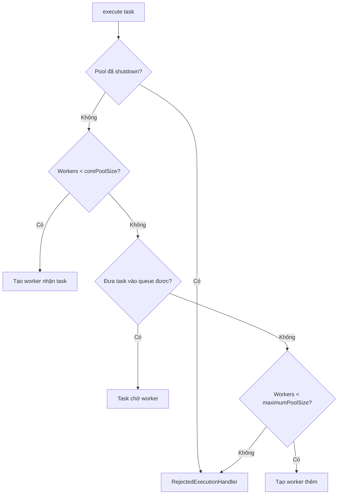

# Queue length, rejection và hiệu ứng quá tải trong Java Concurrency

> Phạm vi: Java SE, trọng tâm `ThreadPoolExecutor`, `BlockingQueue` và `RejectedExecutionHandler`. Ví dụ dùng Java 17+. Không sử dụng cơ chế hay cấu hình của Spring.

## 1. Vì sao hàng đợi quyết định hiệu năng?

Một `Executor` giúp tách luồng **tạo công việc** (producer) khỏi luồng **thực thi** (worker). Khi công việc đến nhanh hơn khả năng xử lý, phần chênh lệch phải được chờ, từ chối hoặc xử lý theo một chính sách khác. Hàng đợi chỉ hấp thụ **đợt tăng tải tạm thời**; bản thân nó không tạo thêm năng lực xử lý.

Ba con số cần phân biệt:

- **Queue length (`Q`)**: số tác vụ đang **chờ** trong hàng đợi, chưa được worker lấy ra.
- **Active threads (`A`)**: số worker đang thực thi tác vụ (số liệu lấy từ executor là giá trị gần đúng).
- **Queue capacity (`C`)**: số tác vụ tối đa được chứa **trong hàng đợi**, không tính tác vụ đang chạy. Với queue không giới hạn thực tế, không có ngưỡng `C` nhỏ, rõ ràng để bảo vệ bộ nhớ.

Ví dụ pool có 4 worker đang bận và queue chứa 20 tác vụ: số tác vụ **đang chạy** là 4, số **đang chờ** là 20, tổng công việc chưa hoàn tất trong pool xấp xỉ 24 (chưa tính công việc đang ở producer và các trạng thái chuyển tiếp). Nói “queue length bằng 24” là đếm sai.

Nếu một tác vụ đến chậm vì **đợi trước khi chạy**, tăng queue có thể khiến thời gian phản hồi cuối cùng **tệ hơn** dù tỷ lệ bị từ chối giảm. Vì thế phải quan sát đồng thời hàng đợi, độ trễ, tốc độ hoàn thành và số lần từ chối.

## 2. `ThreadPoolExecutor.execute()` nhận tác vụ thế nào?

Đối với một `ThreadPoolExecutor` đang hoạt động bình thường, trình tự lựa chọn khi có `execute(task)` về cơ bản là:

1. Nếu số worker hiện có **nhỏ hơn `corePoolSize`**, ưu tiên tạo worker để xử lý task, kể cả khi worker khác có thể đang nhàn rỗi.
2. Nếu đã đạt ít nhất `corePoolSize`, thử **đưa task vào `workQueue`**.
3. Nếu **không đưa được vào queue**, thử tạo worker thêm, tối đa đến `maximumPoolSize`.
4. Nếu không thể nhận task nữa (hoặc pool đang shutdown), gọi `RejectedExecutionHandler`.

Đây là mô tả chính sách, không phải một chuỗi kiểm tra rồi sửa trạng thái tách rời. Trong implementation, `ThreadPoolExecutor` còn **kiểm tra lại trạng thái** sau khi đưa task vào queue nhằm xử lý race với `shutdown` và worker count. Vì vậy, không được lấy một snapshot `getQueue().size()` rồi suy luận chắc chắn rằng lần gọi `execute()` kế tiếp sẽ thành công.



### 2.1. Ví dụ cách cấu hình ảnh hưởng `maximumPoolSize`

```java
ThreadPoolExecutor pool = new ThreadPoolExecutor(
        2,                          // corePoolSize
        8,                          // maximumPoolSize
        30, TimeUnit.SECONDS,
        new ArrayBlockingQueue<>(100),
        new ThreadPoolExecutor.AbortPolicy()
);
```

Đoạn trên chỉ minh họa cấu hình; cần `import java.util.concurrent.*;` và đóng pool sau sử dụng. Trong một đợt tải:

- Đầu tiên pool có thể tạo đến 2 worker.
- Sau đó task được ưu tiên xếp hàng cho đến khi queue không nhận thêm.
- Chỉ khi việc xếp hàng thất bại, pool mới có thể mở rộng đến 8 worker.
- Khi cả các worker tối đa và queue đều không nhận thêm, `AbortPolicy` từ chối task.

Do đó, tăng `maximumPoolSize` từ 8 lên 16 **chưa chắc** tăng số thread thực tế khi queue luôn nhận task. Với **queue không giới hạn**, `maximumPoolSize` thường không có tác dụng mở rộng trong điều kiện thông thường, bởi bước xếp hàng gần như luôn thành công.

### 2.2. Chọn queue theo đặc tính tải

| Queue | Cơ chế | Ảnh hưởng đến hiệu năng/quá tải |
| --- | --- | --- |
| `ArrayBlockingQueue<>(C)` | Queue FIFO, capacity cố định | Chặn tăng backlog quá mức; khi đầy có thể mở thêm thread rồi reject |
| `LinkedBlockingQueue<>(C)` | FIFO với capacity cấu hình | Có giới hạn rõ ràng; mức phân bổ bộ nhớ và đặc tính contention khác array queue |
| `new LinkedBlockingQueue<>()` | Capacity mặc định `Integer.MAX_VALUE` | Gần như không giới hạn về mặt vận hành; dễ tích backlog rất lớn và áp lực heap |
| `SynchronousQueue<>()` | Không chứa phần tử chờ; handoff trực tiếp | Queue length luôn 0; task cần gặp worker sẵn sàng hoặc có khả năng tạo worker, nếu không sẽ reject |
| `PriorityBlockingQueue<>()` | Xử lý theo thứ tự ưu tiên; mặc định không giới hạn thực tế | Không kiểm soát backlog bằng một capacity nhỏ; “oldest” không đồng nghĩa task cũ nhất |

Các factory như `Executors.newFixedThreadPool(n)` sử dụng queue không giới hạn thực tế. Chúng thuận tiện khi lượng công việc đã bị chặn ở nguồn, nhưng không mặc định là giải pháp chống overload cho một dịch vụ nhận task liên tục. Ngược lại, `Executors.newCachedThreadPool()` có thể tạo số thread rất lớn khi tải dồn; queue length thấp không đồng nghĩa tiêu thụ tài nguyên thấp.

## 3. “Queue length tăng” báo hiệu điều gì?

Gọi:

- `λ` (lambda): tốc độ task được **chấp nhận** vào executor, đơn vị task/giây.
- `μ` (mu): tốc độ task được **hoàn tất** trong cùng khoảng thời gian.
- `ΔQ`: mức thay đổi backlog chờ, nếu số worker đang chạy tương đối ổn định.

Khi `λ > μ` kéo dài, công việc tồn tăng. Nếu pool có thể mở rộng worker, `μ` có thể tăng; nếu đã chạm giới hạn thực thi, queue sẽ dần đầy. Khi queue có giới hạn, sau đó xuất hiện **rejection**; khi queue rất lớn, ứng dụng có thể tiếp tục chấp nhận công việc nhưng phải trả bằng độ trễ và bộ nhớ.

Ví dụ minh họa gần đúng: một pool đã đạt năng lực ổn định **200 task/s**, còn producer liên tục đưa đến **250 task/s**. Backlog tăng khoảng **50 task/s** khi chưa bị từ chối. Một queue trống chứa tối đa 100 task có thể lấp đầy khoảng **2 giây** trong điều kiện giản lược này. Ngoài thực tế, kích thước task, lịch thực thi, burst, tốc độ service thay đổi và độ trễ thống kê khiến con số khác đi.

**Đừng đánh đồng tốc độ nhận task đầu vào với tốc độ chấp nhận task.** Khi executor bắt đầu reject, `λ_accepted` không thể suy ra chỉ từ `λ_offered`. Muốn giải thích số lượng thất bại, phải đo cả số task gửi đến, nhận vào, hoàn tất và từ chối trong cùng cửa sổ thời gian.

### 3.1. Mối liên hệ với thời gian chờ

Ở hệ thống đủ ổn định, định luật Little cho riêng phần queue:

```text
Lq ≈ λthroughput × Wq
```

Trong đó:

- `Lq`: số task **chờ trung bình**.
- `λthroughput`: throughput trung bình thực sự đi qua hệ thống/queue, tính bằng task/giây.
- `Wq`: thời gian **chờ trong queue trung bình**, tính bằng giây.

Ví dụ `λthroughput = 200 task/s` và `Wq = 0,1 s` thì `Lq ≈ 20` task. Đây là quan hệ thống kê trong hệ thống ổn định, **không** phải lời hứa task nào cũng chờ 100 ms khi queue có 20 phần tử. Không áp dụng máy móc công thức ổn định khi backlog đang tăng vô hạn, khi task bị drop hoặc khi lượng đến thay đổi dữ dội.

Một thiết kế thực dụng xác định trước **độ trễ queue chấp nhận được**, phân tích throughput, chọn capacity khởi đầu và kiểm nghiệm với tải thực tế. Việc tăng capacity chỉ để “rejection về 0” có thể làm task cũ hết giá trị trước khi được chạy.

## 4. Rejection xảy ra ở đâu?

`ThreadPoolExecutor` từ chối task trong hai nhóm tình huống chính:

1. **Saturation:** pool không thể bổ sung worker và queue không thể nhận thêm task.
2. **Shutdown:** executor không còn chấp nhận công việc mới; task có thể bị reject **dù queue trống**.

Phần tử bị từ chối được đưa tới `RejectedExecutionHandler.rejectedExecution(Runnable, ThreadPoolExecutor)`. Không có quy tắc rằng mọi handler đều ném `RejectedExecutionException`: handler quyết định **ném lỗi, chạy task ở caller, hoặc bỏ task**.

### 4.1. Bốn chính sách có sẵn

| Chính sách | Khi pool đầy và đang chạy | Khi shutdown | Điểm cần chú ý |
| --- | --- | --- | --- |
| `AbortPolicy` (mặc định) | Ném `RejectedExecutionException` | Ném `RejectedExecutionException` | Có tín hiệu lỗi rõ ràng để caller quyết định giảm tải/retry |
| `CallerRunsPolicy` | Chạy task **ngay trên thread gọi `execute`** | Bỏ task | Làm producer chậm lại nếu submit đồng bộ; có thể chặn thread nhạy cảm |
| `DiscardPolicy` | Im lặng bỏ task | Im lặng bỏ task | Dễ mất công việc không được ghi nhận |
| `DiscardOldestPolicy` | Bỏ phần tử ở đầu queue rồi thử `execute` lại | Bỏ task mới | Có thể làm thất lạc công việc cũ; với queue ưu tiên, phần tử đầu là phần tử có ưu tiên cao |

**Ưu tiên `AbortPolicy` hoặc policy tùy biến có báo lỗi rõ** khi kết quả của mỗi task quan trọng. `CallerRunsPolicy` hữu ích khi thread producer có thể dành thời gian thực thi task và cần feedback giảm tốc, nhưng không phù hợp nếu thread gọi đang giữ lock, giữ tài nguyên khan hiếm, là event loop hay có deadline ngắn. `DiscardPolicy` chỉ thích hợp nếu mất task là quyết định nghiệp vụ có chủ đích, đồng thời có telemetry rõ ràng.

Với `DiscardOldestPolicy`, task bị lấy khỏi queue không tự nhận một exception/callback thất bại. Đặc biệt, khi dùng `submit()`, các task thường được bao trong `FutureTask`. Nếu bị bỏ lặng lẽ, một `Future` có thể **không bao giờ hoàn tất**, khiến `get()` chờ vô hạn. Vấn đề tương tự áp dụng cho `DiscardPolicy`. Nếu bắt buộc drop, phải chủ động giải quyết trạng thái hoàn tất/hủy cho caller.

### 4.2. “Caller runs” không phải worker tăng thêm

Khi `CallerRunsPolicy` được kích hoạt, phần công việc thứ ba có thể chạy tại **thread gửi task**, vượt ra ngoài cấu hình worker của pool. Điều này làm `execute` chậm lại, tạo phản hồi giảm tốc, đồng thời có thể đẩy độ trễ sang caller. Số liệu `getActiveCount()` của pool không bao gồm công việc đang được chạy tại caller theo chính sách này.

Không kết luận “không rejection = không overload”: `CallerRunsPolicy` có thể làm ứng dụng ngưng xử lý đầu vào trong khi pool đã đầy; `DiscardPolicy` có thể làm mất task mà không tăng bộ đếm exception.

## 5. Ví dụ chạy được: một worker, queue một chỗ, task thứ ba

Ví dụ cố ý giữ worker đang xử lý task đầu tiên, khiến task thứ hai chắc chắn nằm trong queue. Sau đó submit task thứ ba khi cả worker và queue đều bận. Chương trình so sánh `AbortPolicy` và `CallerRunsPolicy` mà không dựa vào `Thread.sleep()`.

Lưu vào **`QueueOverloadDemo.java`**:

```java
import java.util.concurrent.ArrayBlockingQueue;
import java.util.concurrent.CountDownLatch;
import java.util.concurrent.RejectedExecutionException;
import java.util.concurrent.RejectedExecutionHandler;
import java.util.concurrent.ThreadPoolExecutor;
import java.util.concurrent.TimeUnit;
import java.util.concurrent.atomic.AtomicBoolean;
import java.util.concurrent.atomic.AtomicInteger;

public class QueueOverloadDemo {
    record Result(int queued, boolean rejected, boolean callerRan, int completed) {}

    static Result trial(RejectedExecutionHandler policy)
            throws InterruptedException {
        CountDownLatch firstStarted = new CountDownLatch(1);
        CountDownLatch releaseFirst = new CountDownLatch(1);
        AtomicInteger completed = new AtomicInteger();
        AtomicBoolean callerRan = new AtomicBoolean(false);
        Thread submittingThread = Thread.currentThread();

        ThreadPoolExecutor executor = new ThreadPoolExecutor(
                1, 1, 0L, TimeUnit.MILLISECONDS,
                new ArrayBlockingQueue<>(1), policy);

        boolean rejected = false;
        int queued = -1;
        try {
            executor.execute(() -> {
                firstStarted.countDown();
                try {
                    releaseFirst.await();
                    completed.incrementAndGet();
                } catch (InterruptedException ex) {
                    Thread.currentThread().interrupt();
                }
            });

            if (!firstStarted.await(10, TimeUnit.SECONDS)) {
                throw new IllegalStateException("Worker did not start");
            }

            executor.execute(completed::incrementAndGet);
            queued = executor.getQueue().size(); // 1: worker đầu tiên đang bị giữ

            try {
                executor.execute(() -> {
                    callerRan.set(Thread.currentThread() == submittingThread);
                    completed.incrementAndGet();
                });
            } catch (RejectedExecutionException ex) {
                rejected = true;
            }
        } finally {
            releaseFirst.countDown();
            executor.shutdown();
        }

        if (!executor.awaitTermination(10, TimeUnit.SECONDS)) {
            executor.shutdownNow();
            throw new IllegalStateException("Worker did not terminate");
        }

        return new Result(queued, rejected, callerRan.get(), completed.get());
    }

    static void print(String name, Result r) {
        System.out.printf("%s: queued=%d, rejected=%s, callerRan=%s, completed=%d%n",
                name, r.queued(), r.rejected(), r.callerRan(), r.completed());
    }

    public static void main(String[] args) throws InterruptedException {
        print("AbortPolicy", trial(new ThreadPoolExecutor.AbortPolicy()));
        print("CallerRunsPolicy", trial(new ThreadPoolExecutor.CallerRunsPolicy()));
    }
}
```

Chạy với JDK 17+:

```bash
javac QueueOverloadDemo.java
java QueueOverloadDemo
```

Stdout kỳ vọng:

```text
AbortPolicy: queued=1, rejected=true, callerRan=false, completed=2
CallerRunsPolicy: queued=1, rejected=false, callerRan=true, completed=3
```

**Vì sao kết quả có tính quyết định?**

- `firstStarted.await()` bảo đảm worker đã vào task thứ nhất; `releaseFirst` giữ worker ở đó đến khi gửi xong task thứ ba.
- Pool có đúng **1 worker tối đa** và `ArrayBlockingQueue<>(1)` có đúng **1 vị trí chờ**. Khi submit task thứ hai, nó chắc chắn xếp hàng; `queued = 1` được đọc trước khi mở khóa worker.
- Task thứ ba gặp queue đầy. `AbortPolicy` ném exception và task thứ ba không được chạy, nên `completed = 2`.
- Với `CallerRunsPolicy`, task thứ ba chạy đồng bộ trong thread `main` đang gọi `execute`, nên `callerRan = true` và cuối cùng `completed = 3`.
- `AtomicInteger` và `AtomicBoolean` bảo vệ dữ liệu ghi bởi nhiều thread. `awaitTermination` chờ worker hoàn tất trước khi in, tránh kiểm tra kết quả quá sớm. `finally` giải phóng worker và bắt đầu shutdown kể cả khi có lỗi.

Chương trình là minh họa có kiểm soát; trong ứng dụng thật không nên giữ worker bằng `CountDownLatch` để điều tiết throughput. Latch ở đây chỉ giúp kiểm tra rõ tình huống queue đầy.

## 6. Hiệu ứng quá tải: vì sao queue dài gây ra nhiều lỗi hơn?

Một chuỗi khuếch đại phổ biến:

```text
Tải đến > năng lực xử lý
    ↓
Queue length tăng, queue wait tăng
    ↓
Task bắt đầu quá muộn, caller timeout hoặc kết quả hết giá trị
    ↓
Caller retry → thêm công việc trùng lặp
    ↓
CPU / memory / I/O contention tăng
    ↓
Throughput hữu ích có thể giảm, queue tiếp tục đầy
    ↓
Rejection, timeout và lỗi dây chuyền nhiều hơn
```

Một số chi tiết quan trọng:

- **Queueing làm ẩn saturation:** ứng dụng tiếp tục nhận task nhưng thời gian chờ tăng dần. “Accepted” chưa có nghĩa task hoàn thành đúng hạn.
- **Retry storm:** client thấy timeout rồi gửi lại khi tác vụ cũ vẫn đang chạy hoặc đang xếp hàng. Hệ thống có thể làm hai lần cùng một việc.
- **Memory pressure:** mỗi `Runnable` có thể giữ closure, tham chiếu đến payload, buffer hoặc ngữ cảnh. Nhiều task chờ có thể giữ các đối tượng lớn sống lâu và làm GC hoạt động nhiều hơn.
- **Thread contention:** tăng `maximumPoolSize` có thể giúp đến một ngưỡng, nhưng quá nhiều worker có thể cạnh tranh CPU, heap lock, connection và tài nguyên I/O, làm hiệu năng xấu đi.
- **Head-of-line blocking:** tác vụ chậm đứng trước tác vụ ngắn trong FIFO khiến tác vụ sau chờ lâu. Queue riêng cho loại việc khác nhau có thể giúp cách ly.
- **Cascading failure:** một pool dùng chung cho các tác vụ có độ ưu tiên khác nhau có thể bị chiếm hoàn toàn, khiến những công việc thiết yếu cũng bị ảnh hưởng.

Không có một giá trị capacity hay pool size đúng cho mọi tải. Các yếu tố quyết định gồm phân bố thời gian task (không chỉ trung bình), burst, blocking ratio, năng lực CPU/I/O, RAM, deadline và chính sách khi quá tải.

## 7. Thiết kế overload control có chủ đích

### 7.1. Giới hạn cả số chạy lẫn số chờ

Một pool bounded thường có ba bộ phận phối hợp:

1. Số worker giới hạn theo khả năng tiêu thụ tài nguyên.
2. Queue có capacity rõ ràng, đủ hấp thụ burst hợp lý.
3. Rejection policy xác định phản hồi cho producer khi pool không còn nhận việc.

Đây là dạng **load shedding**: từ chối sớm một số task để bảo vệ độ trễ và khả năng hoàn tất của những task đã được nhận. Nếu nghiệp vụ không được mất task, cần cơ chế lưu trữ bền vững, xử lý lại hoặc kiến trúc xếp hàng đáng tin cậy; `ThreadPoolExecutor` và queue trong RAM **không** tự cung cấp persistence.

### 7.2. Không chặn một cách mù quáng khi queue đầy

Một handler tự viết như “cứ gọi `executor.getQueue().put(task)` để chờ đến khi có chỗ” có thể gây deadlock hoặc treo thời hạn nếu caller đang giữ lock mà worker cần, caller chính là thread điều khiển vòng đời, hoặc pool đang shutdown. Một blocking policy an toàn cần xem xét timeout, interrupt, shutdown, lock ordering và cơ chế báo thất bại; API mặc định không biến việc chờ vô hạn thành backpressure end-to-end tự động.

Nếu dùng `Semaphore` ở **đầu vào**, có thể giới hạn số việc outstanding trước khi submit: lấy permit có timeout, nộp task, nhả permit khi task thực sự xong hoặc bị từ chối; cẩn thận nhả permit **đúng một lần** và xử lý trường hợp task bị hủy/chưa bao giờ chạy. Semaphore bảo vệ ngân sách công việc tổng thể, queue giữ task chờ, còn rejection handler là đường xử lý khi ngân sách/pool hết chỗ.

### 7.3. Khi task đã vô ích, bỏ sớm có kiểm soát

Nếu task có deadline, cần kiểm tra thời gian còn lại trước khi chạy hoặc trước bước I/O đắt tiền. Khi đã quá hạn, ghi nhận kết quả timeout/cancel và giải phóng tài nguyên. Không dùng `Thread.interrupt()` như bảo đảm mọi phép I/O sẽ dừng ngay; hành vi phụ thuộc tác vụ và API đang sử dụng.

Với job độc lập và quan trọng, có thể cần retry hữu hạn kèm exponential backoff và jitter, idempotency key hoặc cơ chế chống thực hiện trùng. Retry phải có **ngân sách**; retry ngay lập tức sau một rejection do saturation thường làm quá tải nặng hơn.

## 8. Quan sát hiệu năng: đừng chỉ nhìn `getQueue().size()`

| Quan sát | API / cách đo | Nó trả lời điều gì? |
| --- | --- | --- |
| Queue length hiện tại | `executor.getQueue().size()` | Có bao nhiêu task đang chờ ở lúc lấy mẫu? |
| Worker đang chạy | `executor.getActiveCount()` | Pool đang bận đến mức nào? |
| Số worker hiện tại và cực đại từng có | `getPoolSize()`, `getLargestPoolSize()` | Pool đã mở rộng thế nào? |
| Số task đã hoàn tất | `getCompletedTaskCount()` | Xu hướng xử lý được bao nhiêu task? |
| Số task đã được lên lịch | `getTaskCount()` | Xu hướng số task được lập lịch cho thực thi? |
| Rejection count | Bộ đếm tại handler hoặc nơi bắt `RejectedExecutionException` | Có bao nhiêu task bị pool không nhận theo policy đang dùng? |
| Queue wait | Ghi `System.nanoTime()` khi submit và khi task bắt đầu | Task phải chờ bao lâu? |
| Execution time / total latency | Đo lúc bắt đầu và kết thúc, cộng với queue wait | Bận vì đợi hay vì chạy lâu? |
| Timeout, cancellation, drop | Instrument các đường nghiệp vụ | Công việc bị mất hoặc vô ích bao nhiêu? |

Các phương thức thống kê của `ThreadPoolExecutor` dùng cho **monitoring gần đúng**, không phải điều kiện điều khiển phải nguyên tử. `getQueue().size()` thay đổi ngay sau khi đọc; `getTaskCount()`, `getCompletedTaskCount()` và `getActiveCount()` có thể không tạo thành một snapshot nhất quán giữa các phép đo. Thu thập theo chu kỳ, phân tích xu hướng và percentiles (p50, p95, p99) của thời gian chờ/thực thi.

Một handler đếm rejection rõ ràng có thể viết như sau (đoạn minh họa, chưa bao gồm chương trình `main`):

```java
AtomicLong rejectedCount = new AtomicLong();

RejectedExecutionHandler countingAbort = (task, executor) -> {
    rejectedCount.incrementAndGet();
    throw new RejectedExecutionException("Executor saturated or shut down");
};
```

Cần `import java.util.concurrent.RejectedExecutionException;`, `import java.util.concurrent.RejectedExecutionHandler;` và `import java.util.concurrent.atomic.AtomicLong;`. Bộ đếm ở handler đếm **mọi lần rejection**, gồm cả do shutdown. Nếu cần tách lý do, có thể quan sát `executor.isShutdown()` ở thời điểm gọi handler, nhưng đây vẫn là snapshot có thể đua với thay đổi trạng thái, không phải phân loại race-free tuyệt đối.

Nếu ứng dụng gọi `submit()`, exception rejection được ném trong lúc submit với `AbortPolicy`. Nếu task đã được nhận nhưng *bản thân công việc* ném exception, lỗi ấy có thể nằm trong `Future` và lộ ra khi gọi `get()` dưới dạng `ExecutionException` (với `submit`). **Rejection trước khi chạy** và **failure trong task** là hai loại metric khác nhau.

## 9. Các sai lầm phổ biến

**Sai lầm 1: “Queue càng dài thì càng ít lỗi.”** Queue dài chỉ trì hoãn việc xử lý overload. Với công việc có deadline, giảm rejection bằng cách tăng queue có thể làm tăng timeout và backlog cũ.

**Sai lầm 2: “Đã đặt max threads = 100 nên sẽ có 100 workers khi tải cao.”** Với cơ chế queue-first sau `corePoolSize`, pool thường xếp task vào queue trước khi mở rộng đến maximum. Với queue rất lớn, có thể chưa bao giờ tăng worker như mong đợi.

**Sai lầm 3: “Queue size = 0 chứng tỏ không quá tải.”** `SynchronousQueue` luôn không giữ task chờ; pool vẫn có thể bão hòa và từ chối hàng loạt. Với `CallerRunsPolicy`, task có thể đang chạy ở caller ngoài thống kê active worker.

**Sai lầm 4: “`execute()` không ném lỗi là task chắc chắn chạy.”** `DiscardPolicy` và một số handler khác có thể bỏ task và trả về bình thường. Hợp đồng chấp nhận thực sự phụ thuộc rejection policy.

**Sai lầm 5: “Dùng `if (queue.size() < capacity) execute(task)` sẽ tránh reject.”** Giữa check và submit, nhiều thread khác có thể lấp queue, worker count và shutdown thay đổi. Hãy xử lý kết quả của chính lời gọi `execute()`.

**Sai lầm 6: “Tăng thread luôn giảm queue.”** Tác vụ CPU-bound có thể bị context switching/contended lock khi thread quá nhiều; tác vụ I/O-bound lại bị giới hạn bởi connection pool/downstream. Tối ưu phải dựa trên hồ sơ tải và điểm nghẽn thực.

**Sai lầm 7: “Retry ngay khi reject sẽ sớm thành công.”** Khi pool đã bão hòa, retry đồng loạt tạo thêm input pressure. Chỉ retry hữu hạn, có backoff/jitter, tôn trọng deadline và yêu cầu idempotency.

**Sai lầm 8: “Shutdown là drain xong queue.”** `shutdown()` ngừng nhận task mới và cho task đã nhận hoàn thành, nhưng **không chờ**; cần `awaitTermination()`. `shutdownNow()` cố ngừng các tác vụ đang chạy và trả về danh sách task chưa bắt đầu, nhưng không đảm bảo mọi task đang chạy sẽ dừng.

## 10. Cách chọn cấu hình ban đầu và kiểm thử

Trước khi tăng capacity, hãy đo tải thực tế, kích thước task, service time, deadline và tài nguyên giới hạn. Một quy trình thực hành:

1. **Xác định mục tiêu:** throughput hữu ích, độ trễ tổng p95/p99, queue wait budget, tỷ lệ timeout và tỷ lệ reject chấp nhận được.
2. **Chọn worker count:** đo CPU utilization/IO wait/lock contention, không ấn định theo số lõi một cách máy móc.
3. **Chọn queue bounded:** ưu tiên kích thước đủ cho burst ngắn, nhưng không khiến task phải chờ qua deadline; ước lượng bằng `Lq ≈ throughput × Wq` rồi kiểm nghiệm.
4. **Chọn rejection policy:** có đường phản hồi rõ ràng, ghi nhận được task thất bại; nếu dùng caller-runs, đo cả latency của producer.
5. **Load test:** tăng dần đến saturation và giữ tải cao đủ lâu để thấy queue/timeout/GC; thêm burst và slow-task scenario.
6. **Đo cùng thời gian:** offered, accepted, completed, rejected, queue length, queue wait, execution latency, memory/GC, CPU và downstream saturation.
7. **Kiểm tra phục hồi:** khi tải giảm, backlog có giảm nhanh, task đã quá hạn có được loại đúng, hệ thống có thoát overload mà không cần restart?

Một test tốt phải minh chứng **kết quả nghiệp vụ**: task nào được chấp nhận, task nào bị từ chối, task nào kết thúc, và liệu caller có được thông báo. Test chỉ assert `getQueue().size()` tại thời điểm ngẫu nhiên thường không đủ tin cậy; dùng latch/phối hợp chủ động như ví dụ để dựng tình huống xác định.

## 11. Tổng kết kiến thức

- `queue length` đo công việc **đang chờ**, không bao gồm toàn bộ active workers.
- `ThreadPoolExecutor` ưu tiên **core worker → queue → worker đến maximum → rejection**; loại queue quyết định lúc nào pool mở rộng.
- Một queue bounded biến backlog vô hạn thành **ngưỡng quá tải hữu hình**, nhưng phải phối hợp chính sách từ chối và phản hồi cho caller.
- `AbortPolicy` báo lỗi rõ; `CallerRunsPolicy` làm chậm producer; hai chính sách discard có thể làm mất việc âm thầm.
- Queue dài làm tăng queue wait, giữ bộ nhớ và có thể kích hoạt timeout/retry storm; **tối ưu theo công việc hoàn tất đúng hạn**, không theo queue length riêng lẻ.

Tài liệu Java SE chính thức:
- [ThreadPoolExecutor — Java SE 21](https://docs.oracle.com/en/java/javase/21/docs/api/java.base/java/util/concurrent/ThreadPoolExecutor.html)
- [ThreadPoolExecutor.CallerRunsPolicy — Java SE 21](https://docs.oracle.com/en/java/javase/21/docs/api/java.base/java/util/concurrent/ThreadPoolExecutor.CallerRunsPolicy.html)
- [ThreadPoolExecutor.DiscardPolicy — Java SE 21](https://docs.oracle.com/en/java/javase/21/docs/api/java.base/java/util/concurrent/ThreadPoolExecutor.DiscardPolicy.html)
- [ThreadPoolExecutor.DiscardOldestPolicy — Java SE 21](https://docs.oracle.com/en/java/javase/21/docs/api/java.base/java/util/concurrent/ThreadPoolExecutor.DiscardOldestPolicy.html)
- [Executors — Java SE 21](https://docs.oracle.com/en/java/javase/21/docs/api/java.base/java/util/concurrent/Executors.html)
