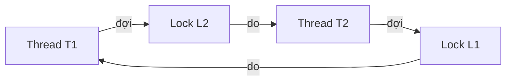

# Thread dump và nhận diện RUNNABLE/BLOCKED/WAITING trong Java Concurrency

## 1. Mục tiêu và bối cảnh

Thread dump là ảnh chụp trạng thái và call stack của các thread tại một thời điểm. Khi chương trình Java bị treo, phản hồi chậm, CPU bất thường, xuất hiện deadlock hoặc một executor không xử lý tiếp task, thread dump giúp trả lời: **thread nào đang làm gì, nó đang chờ điều kiện nào, và những thread nào đang cản trở nhau?**

Trong Java, ba trạng thái hay bị hiểu nhầm nhất là:

- **RUNNABLE:** thread đang chạy trong JVM hoặc có thể sẵn sàng chạy; chưa đủ để khẳng định nó đang tiêu CPU.
- **BLOCKED:** thread đang chờ giành một **intrinsic monitor** để vào đoạn `synchronized`.
- **WAITING:** thread đang chờ không có thời hạn xác định theo cơ chế Java, như `Object.wait()`, `Thread.join()`, `LockSupport.park()`, hoặc nhiều trường hợp `Future.get()`/latch.

Bài này thuộc **Java Concurrency nói chung**: dùng Java SE, JVM và công cụ JDK; không phụ thuộc vào framework concurrency cụ thể. Mục tiêu không chỉ đọc nhãn trạng thái mà còn **đối chiếu stack, khóa, thời gian chờ và nhiều lần chụp** để kết luận có căn cứ.

Sau bài học, bạn có thể:
1. Thu thập thread dump đúng PID với công cụ JDK và nhận diện giới hạn của snapshot.
2. Đọc tên thread, `tid`/`nid`, trạng thái Java, stack frame, monitor đang giữ/chờ và ownable synchronizer.
3. Phân biệt RUNNABLE tính toán, RUNNABLE đang ở native I/O, BLOCKED vì monitor, WAITING vì coordination và TIMED_WAITING vì timeout/sleep.
4. Nhận diện dấu hiệu deadlock, lock contention, thread pool starvation và task chờ không được đánh thức.
5. Đối chiếu thread dump với CPU per-thread, JFR và metric ứng dụng; tránh kết luận sai từ một dòng `java.lang.Thread.State`.

## 2. Thread dump chứa những gì?

Một thread dump thông thường hiển thị nhiều thread của JVM (bao gồm các thread ứng dụng, pool và thread nội bộ), cùng một số trường sau, tùy bản JDK và cách lấy dump:

- **Tên thread**, ví dụ `"worker-3"` hoặc `"http-client-io"`; tên do ứng dụng/thu viện đặt, có thể không duy nhất.
- **Định danh Java/JVM**, ví dụ `#27`, `tid=...`. Không nhầm Java thread ID, địa chỉ nội bộ `tid`, và native OS thread ID.
- **`nid=0x...`** trên một số định dạng HotSpot, là native thread ID thường biểu diễn ở dạng hex; giúp đối chiếu với CPU per-thread của hệ điều hành.
- **`java.lang.Thread.State: ...`**: trạng thái Java ở thời điểm chụp.
- **Call stack**: chuỗi phương thức từ vị trí đang thực thi/chờ trở về caller; thường là phần giải thích quan trọng nhất.
- **Monitor/synchronizer**: ví dụ `- waiting to lock <...>`, `- locked <...>`, `- parking to wait for <...>`, và phần `Locked ownable synchronizers` khi công cụ hỗ trợ.

Ví dụ minh họa rút gọn (các địa chỉ, ID, dòng nguồn là giả định; không phải đầu ra cố định trên mọi JDK):

```text
"demo-blocked" #22 prio=5 tid=0x... nid=0x...
   java.lang.Thread.State: BLOCKED (on object monitor)
    at example.TaskCoordinator.enter(TaskCoordinator.java:42)
    - waiting to lock <0x0000000000000100> (a java.lang.Object)

"demo-owner" #21 prio=5 tid=0x... nid=0x...
   java.lang.Thread.State: WAITING (parking)
    at jdk.internal.misc.Unsafe.park(Native Method)
    at java.util.concurrent.locks.LockSupport.park(LockSupport.java:...)
    at example.TaskCoordinator.hold(TaskCoordinator.java:28)
    - locked <0x0000000000000100> (a java.lang.Object)
```

Điểm quan trọng: thread `demo-owner` **đang WAITING nhưng vẫn giữ monitor** `<0x...0100>`. Thread `demo-blocked` bị cản khi muốn vào cùng monitor. Vì thế **WAITING không có nghĩa là thread đã nhả mọi khóa**; chỉ có `Object.wait()` nhả monitor của chính đối tượng mà nó wait, còn việc đợi latch/park ở trong đoạn `synchronized` có thể giữ monitor đó.

Thread dump không tự cho biết:
- Thread đã ở trạng thái này bao lâu (nếu không có mẫu trước/sau hoặc metric riêng).
- Một thread RUNNABLE đang dùng bao nhiêu phần trăm CPU.
- Một socket call đang đợi mạng, backend, connection pool hay timeout từ thời điểm nào.
- Vì sao có deadlock hoặc logic lost-signal nếu chỉ nhìn một snapshot mà không xem thứ tự sự kiện.

**Phân biệt công cụ:** thread dump là ảnh chụp thread/stack; heap dump là snapshot đối tượng trong bộ nhớ; CPU profile/JFR là quan sát theo thời gian. Chúng trả lời các câu hỏi khác nhau.

## 3. Thu thập dump đúng cách

### 3.1. Xác định đúng JVM/PID

Với JDK đầy đủ:

```bash
jcmd -l
```

Danh sách thường gồm PID và thông tin main class/JAR (tính sẵn có tùy quyền và JVM). Dùng PID **thực của tiến trình đang có vấn đề**, không suy từ tên thread. Trong container, phải xét PID namespace và nơi chạy lệnh: PID nhìn thấy bên trong container có thể khác PID trên host.

### 3.2. Chụp stack và thông tin monitor

```bash
jcmd <PID> Thread.print -l > dump-01.txt
```

Thay `<PID>` bằng PID số. `Thread.print` là lệnh chụp stack của JVM HotSpot; `-l` yêu cầu thêm thông tin về `java.util.concurrent` ownable synchronizers khi được hỗ trợ. Đây là lựa chọn tốt cho **platform threads** trên HotSpot, đặc biệt khi điều tra `synchronized` và `ReentrantLock`.

Có thể dùng `jstack -l <PID>` khi JDK/công cụ phù hợp, nhưng nên ưu tiên `jcmd` nếu nó có sẵn. Trên Windows, vẫn có thể chạy `jcmd` trong terminal; ký hiệu `>` chuyển đầu ra vào tệp. Lệnh chẩn đoán phụ thuộc phiên bản/nhà cung cấp JDK, quyền attach và trạng thái JVM; không xem lỗi attach là bằng chứng ứng dụng không có thread.

Nếu JVM không thể attach do quyền, cấu hình attach, container hoặc tiến trình gần như không phản hồi, phải tìm phương thức lấy dump tương thích với môi trường vận hành. Không cố áp dụng tùy tiện một lệnh cho mọi JVM.

### 3.3. Lấy nhiều snapshot thay vì một lần

Ví dụ trên Linux/macOS, thu 3 snapshot cách nhau 3 giây:

```bash
jcmd <PID> Thread.print -l > dump-01.txt
sleep 3
jcmd <PID> Thread.print -l > dump-02.txt
sleep 3
jcmd <PID> Thread.print -l > dump-03.txt
```

Trên Windows/PowerShell có thể chạy lại lệnh với tên file mới sau mỗi khoảng cách thời gian. Thực tế chọn khoảng lấy mẫu theo latency cần điều tra: request 200 ms cần cách đo khác job đứng hàng phút.

So sánh **cùng thread** qua các lần chụp:
- Stack không đổi ở monitor enter, cùng lock ID, owner không tiến triển → có khả năng contention kéo dài.
- Stack ở `Future.get()` hoặc latch chờ mãi, task được chờ không chạy → điều tra dependency/pool.
- Stack RUNNABLE thay đổi theo thuật toán và CPU per-thread cao → có bằng chứng đang làm công việc CPU.
- Thread nhàn rỗi đang `park()` trong executor, queue rỗng → thường là trạng thái bình thường.

Lưu thời điểm, phiên bản JDK, PID, tải và số request trong cùng cửa sổ để không nhầm tiến trình hoặc giai đoạn chạy.

## 4. Hiểu chuẩn sáu trạng thái `java.lang.Thread.State`

Đây là **trạng thái Java**, không phải bản sao 1:1 của trạng thái scheduler Linux/Windows.

| Trạng thái | Ý nghĩa | Ví dụ | Điều KHÔNG được suy ra |
|---|---|---|---|
| `NEW` | Đã tạo đối tượng `Thread`, chưa gọi `start()` | `new Thread(task)` | Không phải đã có OS thread đang chạy |
| `RUNNABLE` | Đang thực thi trong JVM hoặc sẵn sàng thực thi theo mô hình Java | Tính toán, vòng lặp, JNI/native I/O | Không chắc đang chiếm CPU |
| `BLOCKED` | Đang đợi lấy intrinsic monitor | Chờ vào `synchronized(lock)` | Không phải mọi loại block/I/O |
| `WAITING` | Chờ vô thời hạn cho hành động của thread/điều kiện khác | `join()`, `Object.wait()`, `CountDownLatch.await()`, `park()` | Không chắc ứng dụng bị treo |
| `TIMED_WAITING` | Chờ có hạn hoặc sleep | `sleep(1000)`, `wait(1000)`, `join(1000)`, timed `park` | Không chắc request đã timeout |
| `TERMINATED` | Thread đã kết thúc `run()` | Worker hoàn thành | Thread có thể không còn xuất hiện trong dump |

Những điểm cần nhớ:

**`RUNNABLE` không đồng nhất với “CPU busy”.** Một platform thread đang ở native socket read có thể hiển thị RUNNABLE dù phần lớn thời gian đang đợi I/O. Ngược lại thread tính toán liên tục thường RUNNABLE, nhưng phải xem CPU time hoặc profiler để xác minh.

**`BLOCKED` có nghĩa hẹp:** trong `Thread.State`, đó là đợi lấy monitor nội tại của một object (hoặc vào lại monitor sau `Object.wait`). Chờ một `ReentrantLock` thường dùng `AbstractQueuedSynchronizer`/park và xuất hiện như WAITING hoặc TIMED_WAITING, dù về mặt đời thường ta gọi nó là “blocked on a lock”.

**`WAITING` là điều kiện phối hợp, không tự là lỗi.** Thread pool worker có thể đứng WAITING trong queue lúc hết việc. Một `CountDownLatch.await()` có thể là đúng khi còn task chưa xong hoặc là lỗi nếu không có nhánh nào từng gọi `countDown()`.

**`TIMED_WAITING` không bảo đảm hệ thống sẽ tiếp tục ngay khi timeout.** Một đoạn sleep có thể kết thúc muộn hơn dự kiến do scheduler; timed wait có thể được đánh thức sớm hoặc lại phải kiểm tra điều kiện. Trong code dùng condition, thường phải chờ trong vòng lặp kiểm tra predicate.

## 5. RUNNABLE: tính toán, spin hay đang trong native I/O?

Nhìn thấy rất nhiều RUNNABLE thường khiến người đọc kết luận “CPU quá tải”. Đó chỉ là giả thuyết.

### 5.1. CPU-bound hợp lý

Một task làm việc số học, parse dữ liệu, mã hóa, nén, tạo cấu trúc dữ liệu hoặc sắp xếp có thể luôn RUNNABLE trong khi chạy. Nếu CPU per-thread tăng và các mẫu JFR/`async-profiler` tập trung vào những phương thức này, đó là dấu hiệu code đang dùng CPU thật.

Ví dụ stack rút gọn:

```text
"compute-worker" ...
   java.lang.Thread.State: RUNNABLE
    at example.Transform.hashPayload(Transform.java:91)
    at example.Transform.process(Transform.java:43)
```

Cần hỏi thêm: CPU thực trên từng core có đạt trần không? Workload có đủ độc lập không? Số worker có vượt CPU hữu dụng hay làm tăng contention/GC?

### 5.2. Busy-spin hoặc vòng lặp không tiến triển

Ví dụ sai về thiết kế (đoạn minh họa, không phải chương trình đầy đủ):

```java
while (!ready) {
    // Lặp rỗng; nếu ready không có cơ chế visibility đúng,
    // worker còn có thể không bao giờ quan sát được cập nhật.
}
```

Một thread có thể tiêu một core trong lúc không tạo tiến triển. Nếu giao tiếp giữa thread dùng cờ, cần quy tắc visibility thích hợp (`volatile`, synchronization, atomic, primitive phối hợp). Có thể dùng `Thread.onSpinWait()` trong spin có chủ đích rất ngắn, nhưng nó **không** thay thế visibility, timeout hay một cơ chế block hiệu quả. Với thời gian chờ không đoán trước, `LockSupport`, latch, condition hoặc blocking queue thường phù hợp hơn.

### 5.3. RUNNABLE trong socket/file/native

Một thread đang ở stack có `SocketDispatcher.read`, `FileDispatcherImpl.read`, mã native hoặc JNI có thể được JVM hiển thị RUNNABLE. Có thể thread đã chuyển sang native I/O và không tiêu CPU đáng kể. Đối chiếu CPU per-thread, thời gian socket/file operation, JFR và đo backend.

**Tránh suy luận “RUNNABLE = lỗi CPU” chỉ vì số lượng nhiều.** Tên thread và vị trí stack quyết định giả thuyết kiểm tra tiếp.

## 6. BLOCKED: ai đang chờ monitor, ai đang giữ?

Trong Java, `synchronized` dùng monitor của object. Thread B muốn vào vùng `synchronized(lock)` khi A đã giữ monitor sẽ ở `BLOCKED`. Đoạn code minh họa:

```java
synchronized (sharedLock) {
    performWork();
}
```

Nếu `performWork()` kéo dài, làm I/O, sleep hoặc chờ latch trong khi vẫn giữ khóa, những thread cần `sharedLock` sẽ không vào được.

Dấu vết thường gặp:

```text
"worker-B" ...
   java.lang.Thread.State: BLOCKED (on object monitor)
    at example.SharedStore.update(SharedStore.java:34)
    - waiting to lock <0x0000000000001234> (a java.lang.Object)

"worker-A" ...
   java.lang.Thread.State: TIMED_WAITING (sleeping)
    at java.lang.Thread.sleep(Native Method)
    at example.SharedStore.update(SharedStore.java:30)
    - locked <0x0000000000001234> (a java.lang.Object)
```

**Cách đọc:** Cùng ID `<0x...1234>` nối người chờ B với chủ sở hữu A. Nhưng A là TIMED_WAITING, không phải BLOCKED. Vì vậy khi nghiên cứu contention, phải tìm **owner**, không chỉ đếm số thread BLOCKED.

Phân biệt ba vấn đề:
- **Contention bình thường:** nhiều task cùng truy cập vùng bảo vệ rất ngắn; có BLOCKED thoáng qua nhưng throughput vẫn tốt.
- **Lock convoy/bottleneck:** rất nhiều thread chờ cùng monitor, owner giữ quá lâu hoặc thường xuyên lặp lại; tail latency và throughput bị ảnh hưởng.
- **Deadlock:** có chu trình chờ, ví dụ A giữ L1 đợi L2, B giữ L2 đợi L1; cả hai không tiến triển nếu không có cơ chế giải phóng.

Cách sửa thường không phải “tăng thread”: giảm công việc trong vùng khóa, không gọi I/O hoặc blocking wait khi giữ monitor (trừ khi đã chứng minh an toàn), hạn chế shared mutable state, dùng data partitioning hoặc cấu trúc concurrent phù hợp. Không đổi `synchronized` thành một loại lock khác chỉ để biến nhãn BLOCKED thành WAITING.

## 7. WAITING: đang đợi điều kiện nào?

`WAITING` mô tả một thread chưa thể tiến lên cho tới khi có tác nhân khác thay đổi điều kiện hoặc đánh thức nó.

### 7.1. `Object.wait()`

```java
synchronized (guard) {
    while (!conditionMet()) {
        guard.wait();
    }
}
```

Đây là **mẫu minh họa**; `guard` và `conditionMet()` phải có implementation, không phải chương trình Java độc lập. `wait()` được gọi khi thread giữ monitor của `guard`, sau đó **giải phóng monitor đó** trong lúc chờ. Khi được đánh thức, thread phải giành lại monitor rồi kiểm tra điều kiện lần nữa.

Vòng `while` cần thiết vì có thể bị spurious wakeup, notify không đồng nghĩa predicate đã đúng, hoặc thread khác đã lấy tài nguyên trước. Phải sửa predicate và gọi `notifyAll()`/`notify()` dưới cùng kỷ luật synchronization để tránh lost notification.

### 7.2. `LockSupport.park()`, `Condition.await()`, latch, Future

Nhiều API trong `java.util.concurrent` xây dựng trên cơ chế park:
- `CountDownLatch.await()`: đợi bộ đếm về 0.
- `Semaphore.acquire()`: đợi permit.
- `Future.get()`: đợi task có kết quả; trạng thái cụ thể phụ thuộc implementation.
- `Condition.await()`: chờ condition, thường nhả lock gắn với condition theo hợp đồng API.
- `Thread.join()`: đợi thread khác kết thúc.
- `BlockingQueue.take()`: đợi có item.

Có thể thấy stack như:

```text
"batch-result-waiter" ...
   java.lang.Thread.State: WAITING (parking)
    at jdk.internal.misc.Unsafe.park(Native Method)
    at java.util.concurrent.locks.LockSupport.park(LockSupport.java:...)
    at java.util.concurrent.CountDownLatch.await(CountDownLatch.java:...)
    at example.BatchJob.awaitChildren(BatchJob.java:...)
```

Cần hỏi: **ai có trách nhiệm hoàn tất điều kiện?** Task nào phải gọi `countDown()`? Future nào đang chờ? Thread tạo kết quả có được executor cấp worker không? Có đường exception khiến lời gọi `countDown` không diễn ra? Một WAITING dài là bình thường nếu toàn bộ hệ thống đang idle; bất thường nếu một request có deadline 1 giây mà task đợi 5 phút.

### 7.3. WAITING nhưng vẫn nắm một lock khác

`Object.wait()` chỉ nhả monitor của object dùng để wait; nó **không** nhả mọi monitor khác thread đang giữ. `CountDownLatch.await()` và `LockSupport.park()` không tự nhả một monitor `synchronized` bên ngoài. Điều này có thể biến một WAITING tưởng vô hại thành điểm chặn hàng chục BLOCKED threads.

## 8. Ví dụ Java 17 có thể chạy: tạo đủ RUNNABLE, BLOCKED, WAITING và TIMED_WAITING

Đoạn chương trình này cố tình tạo các trạng thái trong **cửa sổ khoảng 20 giây** để bạn chụp thread dump. Các thread có tên rõ ràng:

- `demo-cpu`: chạy vòng lặp tính toán, thường RUNNABLE và dùng CPU.
- `demo-monitor-owner`: giữ `MONITOR`, đồng thời đợi latch nên thường WAITING.
- `demo-monitor-contender`: muốn lấy `MONITOR`, nên BLOCKED khi owner còn giữ.
- `demo-latch-waiter`: đợi latch độc lập, WAITING.
- `demo-sleeper`: ngủ có hạn, TIMED_WAITING.

Lưu toàn bộ thành **`ThreadStateDumpDemo.java`**:

```java
import java.util.concurrent.CountDownLatch;

public class ThreadStateDumpDemo {
    private static final Object MONITOR = new Object();
    private static final CountDownLatch OWNER_READY = new CountDownLatch(1);
    private static final CountDownLatch RELEASE = new CountDownLatch(1);
    private static volatile boolean runCpu = true;
    private static volatile long sink;

    private static Thread start(String name, Runnable task) {
        Thread thread = new Thread(task, name);
        thread.start();
        return thread;
    }

    private static void awaitRelease() {
        try {
            RELEASE.await();
        } catch (InterruptedException ex) {
            Thread.currentThread().interrupt();
        }
    }

    public static void main(String[] args) throws InterruptedException {
        Thread owner = start("demo-monitor-owner", () -> {
            synchronized (MONITOR) {
                OWNER_READY.countDown();
                awaitRelease();
            }
        });

        OWNER_READY.await();

        Thread contender = start("demo-monitor-contender", () -> {
            synchronized (MONITOR) {
                System.out.println("Contender acquired monitor.");
            }
        });

        Thread waiter = start("demo-latch-waiter",
                              ThreadStateDumpDemo::awaitRelease);

        Thread sleeper = start("demo-sleeper", () -> {
            try {
                Thread.sleep(25_000);
            } catch (InterruptedException ex) {
                Thread.currentThread().interrupt();
            }
        });

        Thread cpu = start("demo-cpu", () -> {
            long counter = 0;
            while (runCpu) {
                counter++;
            }
            sink = counter;
        });

        System.out.println("PID: " + ProcessHandle.current().pid());
        System.out.println("Capture a dump within 20 seconds.");

        try {
            Thread.sleep(20_000);
        } finally {
            RELEASE.countDown();
            runCpu = false;
        }

        owner.join();
        contender.join();
        waiter.join();
        sleeper.join();
        cpu.join();
        System.out.println("Demo complete.");
    }
}
```

Biên dịch và chạy (JDK 17+):

```bash
javac ThreadStateDumpDemo.java
java ThreadStateDumpDemo
```

Trong 20 giây đầu, dùng **terminal thứ hai**:

```bash
jcmd <PID> Thread.print -l > thread-state-demo.txt
```

Dùng PID mà chương trình vừa in. Dữ liệu dạng sau là đầu ra console dự kiến, nhưng **giá trị PID thay đổi mỗi lần chạy**; thời điểm dòng `Contender acquired monitor.` xuất hiện có thể trễ theo scheduling:

```text
PID: <PID thực tế>
Capture a dump within 20 seconds.
Contender acquired monitor.
Demo complete.
```

Vì `MONITOR` được owner giữ trước khi contender bắt đầu, lúc chưa nhả latch contender thường ở BLOCKED. Owner có thể đang WAITING dù vẫn giữ monitor. Điều này chứng minh rằng **trạng thái thread và việc sở hữu monitor là hai thông tin riêng biệt**.

Những điều cần cân nhắc khi kiểm chứng:
- Dump lấy ngay lúc khởi động hoặc sau khi hết 20 giây có thể cho kết quả khác; đây là concurrency snapshot, không phải output bất biến.
- Thread `demo-cpu` cố ý tiêu CPU; nó phục vụ quan sát trong môi trường thử nghiệm. Không đưa vòng lặp này vào chương trình sản xuất.
- `demo-sleeper` ngủ 25 giây và có thể tiếp tục TIMED_WAITING khi latch đã được mở; trạng thái cụ thể phụ thuộc thời điểm dump.
- Nếu JVM bị dừng trước thời điểm quan sát, PID sẽ không còn tồn tại. Chạy lại demo rồi chụp trong cửa sổ ghi trên console.
- Nếu muốn chứng minh `RUNNABLE` thật sự dùng CPU, phải đo CPU time của OS thread hoặc dùng profiler; tên và trạng thái trong dump chỉ là một phần bằng chứng.

## 9. Từ dump tới quan hệ lock owner → waiter

Đối với `synchronized`:
1. Tìm mọi dòng `java.lang.Thread.State: BLOCKED`.
2. Đọc **stack frame đầu tiên thuộc code ứng dụng** để xác định nơi muốn lấy monitor.
3. Ghi ID tại `- waiting to lock <...>`.
4. Tìm cùng ID trong dump tại `- locked <...>` hoặc dữ liệu ownership nếu công cụ cung cấp.
5. Xem owner đang làm gì và nó đã ở cùng chỗ trong bao nhiêu lần chụp.
6. Vẽ chuỗi phụ thuộc: `thread B → lock L → thread A → điều kiện/thread khác`.

Ví dụ:

```text
T1 --waits for--> monitor M1 --owned by--> T2
T2 --waits for--> monitor M2 --owned by--> T3
T3 --waits for--> network response
```

Đây là một **chuỗi tắc nghẽn**, nhưng chưa chắc là deadlock: T3 có thể hoàn tất network response rồi cho T2/T1 tiến lên. Nếu chuỗi quay lại chính T1 mà không có nhánh giải phóng, đó là một chu trình có khả năng deadlock.

Với `ReentrantLock`, `ReentrantReadWriteLock` hoặc synchronizer dựa trên `AbstractQueuedSynchronizer`, nhìn `Locked ownable synchronizers` và thông tin sở hữu nếu có. Các tình huống condition, semaphore, latch không nhất thiết có lock owner đơn giản; phải lần theo logic cấp permit, hoàn tất future hoặc phát tín hiệu.

Đừng suy owner từ việc hai thread cùng có phương thức tên giống nhau, vì nhiều object khác nhau có thể dùng cùng một lớp code. Lock identity và stack context quan trọng hơn tên phương thức.

## 10. Deadlock, contention và starvation khác nhau

### 10.1. Deadlock: vòng chờ không thể tự tháo

Ví dụ T1 lấy L1 trước rồi muốn L2; T2 lấy L2 trước rồi muốn L1:



Trong thread dump, có thể nhận diện vòng `waiting to lock` ↔ `locked`. Trên HotSpot, lệnh `Thread.print` hoặc công cụ liên quan có thể đưa ra phần phát hiện deadlock Java-level; **không** nên dựa duy nhất vào việc có/không có thông báo đó, vì hỗ trợ và phạm vi phát hiện tùy JDK, loại lock và dữ liệu có thể quan sát.

Java có `ThreadMXBean.findDeadlockedThreads()` để tìm một số deadlock liên quan object monitor hoặc ownable synchronizer (trong môi trường hỗ trợ). Nó không thay thế kiểm tra deadlock trên native code, tài nguyên ngoài tiến trình hoặc chu trình chờ nghiệp vụ qua network.

Giải pháp kiến trúc: quy định **thứ tự lấy lock nhất quán**, tránh giữ lock khi gọi bên ngoài, giảm vùng critical section, dùng `tryLock`/timeout khi phù hợp và bảo đảm nhả lock trong `finally`.

### 10.2. Contention: lock vẫn tiến triển nhưng làm chậm toàn hệ thống

Nhiều thread có thể thường xuyên BLOCKED ở cùng monitor mà không deadlock. Owner giữ ngắn, lần lượt ai cũng vào được, nhưng throughput bị giới hạn bởi đoạn tuần tự. Theo dõi thời gian chờ lock qua JFR (`jdk.JavaMonitorEnter`) hoặc profiler, xem p95/p99 và số lượng thread chờ.

Nếu tăng worker từ 8 lên 64 làm số BLOCKED tăng nhưng throughput không đổi, khả năng cao bạn đã tăng mức tranh chấp chứ không tạo thêm song song hữu ích.

### 10.3. Thread pool starvation: task cần chạy nhưng không có worker rảnh

Giả sử executor có 2 worker. Task A và B đã chiếm cả hai; mỗi task lại submit A1/B1 vào **cùng executor** rồi gọi `Future.get()` đợi kết quả. A1/B1 nằm trong queue, không có worker nào rảnh để chạy, nên A/B WAITING mãi dù CPU có thể gần 0%.

Đây là một **dependency deadlock/starvation ở tầng task/executor**, có thể không tạo chu trình Java monitor để công cụ phát hiện deadlock truyền thống báo lỗi.

Dấu hiệu:
- Các worker đang WAITING/park trong `Future.get`, `CompletableFuture.join` hoặc latch.
- Queue task chưa thực thi; số worker đang hoạt động chạm giới hạn.
- Không có thread nào tiêu CPU đáng kể và không có thread nào hoàn tất điều kiện chờ.

Hướng sửa: biểu diễn quan hệ phụ thuộc bằng composition (`CompletableFuture`), tránh blocking wait trên cùng pool hữu hạn, xác định executor thích hợp cho các stage và dùng bounded queue/backpressure. Đừng chỉ tăng pool “cho đủ” mà bỏ qua cấu trúc phụ thuộc không an toàn.

## 11. Đọc WAITING của executor: bình thường hay bất thường?

Ví dụ những stack **thường bình thường khi hệ thống idle**:

```text
ThreadPoolExecutor.getTask(...)
LinkedBlockingQueue.take(...)
LockSupport.park(...)
```

Worker đang đợi task mới. Trong ứng dụng được thiết kế để chờ yêu cầu, trạng thái WAITING kéo dài có thể hoàn toàn đúng.

Các câu hỏi phân biệt:
- Executor queue có task tồn đọng không?
- Số task submitted/completed và thời gian submit-to-start thay đổi ra sao?
- `worker` đang chờ **queue có task** hay đang chờ **Future của task khác**?
- Có request thực sự đang kẹt hay tất cả tác vụ đã hoàn thành?
- Có lỗi khiến task sản xuất tín hiệu bị hủy/exception không?

**Không khởi động hoặc đánh thức thread vô cớ chỉ vì dump có WAITING.** Một thư viện HTTP client, timer, thread GC và executor có thể có nhiều worker ở WAITING/TIMED_WAITING trong trạng thái vận hành bình thường.

## 12. Đối chiếu với CPU và JVM recording

Thread dump hữu ích khi có quan hệ sở hữu và stack chờ, nhưng phải phối hợp dữ liệu theo thời gian:

### 12.1. Trên Linux: OS thread nào thực sự tiêu CPU?

```bash
top -H -p <PID>
pidstat -t -u -p <PID> 1
```

`top -H` và `pidstat -t` giúp quan sát CPU theo OS thread. Trong một số dump HotSpot/Linux, `nid` dạng hex tương ứng với native TID mà hệ điều hành hiển thị dạng thập phân. Chuyển đổi cơ số rồi so sánh gần thời điểm dump; PID/TID có thể thay đổi khi thread sinh/hủy, nên không dùng kết quả cũ sau khi ứng dụng restart.

Ví dụ chuyển số thập phân 12345 thành hex bằng Java/JS/shell khi cần; không suy `nid` từ Java `Thread.getId()` vì chúng là khái niệm khác nhau.

Nếu thread RUNNABLE liên tục nhưng per-thread CPU gần 0, ưu tiên tìm native I/O wait, scheduling delay hoặc tài nguyên khác trước khi kết luận đó là busy loop. Nếu CPU gần một core và JFR execution samples lặp ở hàm tính toán, giả thuyết CPU hotspot mạnh hơn.

### 12.2. JFR: sự kiện và sampling theo thời gian

Ví dụ bắt đầu một bản ghi JFR trên JVM có JDK hỗ trợ:

```bash
jcmd <PID> JFR.start name=thread-analysis settings=profile duration=60s filename=threads.jfr
```

Sau khi recording hoàn thành, mở `threads.jfr` bằng JDK Mission Control hoặc dùng công cụ `jfr` phù hợp. Điều kiện chạy và quyền ghi tệp phải đúng trên JVM đích. Đọc:
- `jdk.ExecutionSample`, CPU/thread load: phương thức tiêu CPU.
- `jdk.JavaMonitorEnter`: tranh chấp monitor có thời lượng đủ để được ghi.
- `jdk.ThreadPark`: các lần park và bối cảnh chờ.
- `jdk.SocketRead`, `jdk.FileRead`: độ trễ I/O khi sự kiện được bật/đạt threshold.
- Các sự kiện GC/heap nếu nghi ngờ pause hoặc allocation pressure.

**Không thấy event không chứng minh hoạt động không xảy ra.** Sampling, threshold và cấu hình recording có thể bỏ qua những hoạt động ngắn. JFR là nguồn bổ sung, không phải thay thế mô hình sở hữu lock và nguyên nhân từ mã nguồn.

### 12.3. ThreadMXBean cho thông tin có cấu trúc

`java.lang.management.ThreadMXBean` cho phép truy vấn `ThreadInfo`, lock đang chờ, lock owner và phát hiện một số Java-level deadlock. Ví dụ sau là **đoạn minh họa bên trong chương trình có quản lý quyền truy cập JMX**:

```java
ThreadMXBean bean = ManagementFactory.getThreadMXBean();
ThreadInfo[] infos = bean.dumpAllThreads(true, true);
for (ThreadInfo info : infos) {
    System.out.println(
        info.getThreadName() + " " + info.getThreadState()
        + " lock=" + info.getLockName()
        + " owner=" + info.getLockOwnerName()
    );
}
```

Đoạn trên cần `import java.lang.management.*;` và vị trí gọi trong một class/method phù hợp; không phải chương trình standalone. Khả năng đọc monitor/synchronizer và hỗ trợ liên quan phụ thuộc JVM. Tác vụ giám sát nên dùng có chủ đích vì dump toàn bộ thread thường có chi phí không nhỏ.

## 13. Virtual threads (Java 21+) và giới hạn của thread dump truyền thống

Java 21 giới thiệu virtual threads như tính năng ổn định. Một virtual thread có thể park/unmount khi gặp thao tác blocking được hỗ trợ, trong khi carrier platform thread được sử dụng cho công việc khác. Vì vậy:
- Không thể lấy số virtual thread WAITING rồi kết luận có cùng số OS thread bị block.
- Một carrier đang RUNNABLE không chứng minh một virtual thread cụ thể đang tiêu CPU.
- Công cụ/thread dump kiểu platform-thread truyền thống có thể không hiển thị đầy đủ mọi virtual thread hoặc quan hệ của chúng.
- Với môi trường dùng virtual threads, hãy dùng **cơ chế virtual-thread dump/recording được JDK cụ thể hỗ trợ** và JFR phù hợp; kiểm tra cú pháp lệnh qua `jcmd <PID> help` thay vì áp dụng cùng một lựa chọn cho mọi JDK.
- Một đoạn blocking không giải phóng carrier (pinning ở các điều kiện của JDK liên quan) có thể làm giảm khả năng mở rộng; kiểm tra triệu chứng qua JFR và giới hạn carrier, thay vì quy nó thành deadlock chỉ từ tên trạng thái.

Mẫu `ThreadStateDumpDemo` ở trên dùng **platform threads** để việc quan sát monitor và RUNNABLE/BLOCKED/WAITING đơn giản, có thể chạy trên JDK 17.

## 14. Quy trình chẩn đoán theo triệu chứng

### Tình huống A — CPU 100%, throughput giảm

1. Lấy CPU theo OS thread và 3 thread dumps gần nhau.
2. Tìm thread RUNNABLE có TID/NID trùng thread tiêu CPU; xem stack theo thời gian.
3. Nếu nhiều mẫu dồn vào vòng lặp tính toán, hot method hoặc retry-spin, dùng profiler/JFR để xác nhận.
4. Kiểm tra số CPU/quota container, allocation và GC; tăng worker có thể khiến contention tệ hơn.
5. Thay đổi code/tài nguyên theo kết quả đo, đo lại throughput và latency.

**Không kết luận từ một RUNNABLE duy nhất**: nó có thể đang chạy đúng phần việc hoặc đang ở native call.

### Tình huống B — CPU thấp, request không trả kết quả

1. Xác định thread xử lý request/task theo tên hoặc correlation metadata (nếu có).
2. Nếu `BLOCKED`: tìm lock ID, owner, điều owner đang làm; đối chiếu nhiều dump.
3. Nếu `WAITING`: xác định Future/latch/condition/queue; tìm producer hoặc task nào phải hoàn tất.
4. Nếu ở native socket/file I/O: đối chiếu latency client/server, timeout, connection pool và JFR I/O.
5. Nếu các worker đang chờ nhau trên pool nhỏ: rà dependency graph và queue.
6. Theo dõi deadline, error/retry và điểm giải phóng tài nguyên.

**CPU thấp không chứng minh “không có sự cố”**: một hệ thống đứng vì deadlock thường rất ít dùng CPU.

### Tình huống C — nhiều BLOCKED trên cùng monitor

1. Gom theo lock identity `<0x...>`, không chỉ theo tên phương thức.
2. Tìm owner ở mỗi snapshot; nó có làm I/O/chờ latch khi giữ lock không?
3. Xem số lượng contender và thời gian `JavaMonitorEnter`; phân biệt một đợt contention ngắn với bottleneck kéo dài.
4. Xác định có chu trình lock-order không; nếu không có chu trình, vẫn có thể là bottleneck nghiêm trọng.
5. Giảm critical section, tách trạng thái hoặc thay cách tổ chức tác vụ.

### Tình huống D — worker WAITING hàng loạt

Đầu tiên xem queue, active tasks, completed tasks và trạng thái toàn hệ thống. Một executor idle hợp lệ và một executor kẹt vì `Future.get()` có thể đều có WAITING; **stack và số task chờ là dấu phân biệt**.

## 15. Những lỗi diễn giải thường gặp

| Nhận định sai | Vì sao không chính xác | Cách kiểm tra đúng |
|---|---|---|
| “RUNNABLE chắc chắn dùng CPU” | RUNNABLE có thể ở native/blocking I/O; scheduler chưa chắc đang cấp CPU | CPU per-thread và JFR execution samples |
| “BLOCKED là chờ disk/network” | Java BLOCKED chỉ chờ intrinsic monitor | Stack, `waiting to lock`, owner |
| “WAITING là deadlock” | Worker idle hoặc task chờ điều kiện đúng cũng WAITING | Kiểm tra producer, queue, deadline, tiến triển |
| “TIMED_WAITING luôn vô hại” | Có thể sleep giữ monitor hoặc timeout quá dài | Xem `locked` và vị trí stack |
| “Owner không thể WAITING” | Thread có thể park/latch trong `synchronized` mà vẫn giữ monitor | Đối chiếu `- locked` với waiter `- waiting to lock` |
| “ReentrantLock chờ thì phải BLOCKED” | AQS/park thường xuất hiện WAITING/TIMED_WAITING | Stack AQS và ownable synchronizers |
| “Một snapshot chứng minh deadlock” | Contention tạm thời có thể trông như treo | Chụp nhiều lần, tìm chu trình chờ |
| “Không có deadlock report nghĩa là không kẹt” | Starvation/task-level/native/external waits có thể không được phát hiện | Queue, dependency graph, JFR, OS |
| “Số WAITING lớn nghĩa là pool thiếu thread” | Nhiều worker chỉ đang chờ việc bình thường | Active/queued/completed metrics |
| “Thread dump là CPU profiler” | Dump không đo CPU/wall time theo thời gian | JFR/profiler + OS thread CPU |
| “`tid`, `nid`, Java ID là một” | Các lớp định danh khác nhau | Kiểm tra output format và đối chiếu OS TID |
| “Tăng pool giải quyết mọi WAITING” | Có thể làm nặng thêm contention hoặc queue | Xác định điều kiện chờ và giới hạn tài nguyên |

## 16. Checklist điều tra trong môi trường thật

Trước khi kết luận, tự xác nhận:

1. **Đúng tiến trình và thời điểm:** PID, JDK, container namespace, thời gian chụp, số lượng request và triệu chứng.
2. **Nhiều lần chụp:** dump có đủ mẫu để thấy tiến triển hoặc điểm đứng yên, không chỉ một snapshot.
3. **Thread đúng vai trò:** tên và stack xác nhận đó là worker xử lý việc liên quan, không phải thread nền idle.
4. **Lock/condition rõ ràng:** nếu BLOCKED thì biết lock owner; nếu WAITING thì biết ai phải phát tín hiệu hoặc hoàn thành task.
5. **CPU/I/O có bằng chứng:** OS per-thread CPU, JFR, latency socket/file hoặc metrics backend/queue đủ để kiểm chứng giả thuyết.
6. **Không nhầm cấp độ:** Java `Thread.State.BLOCKED` khác Linux D-state; iowait CPU khác waiting của Java thread; Java thread ID khác OS TID.
7. **Đã kiểm tra phạm vi tác động:** latency, throughput, timeout, queue, quota, GC, resource caps và downstream.
8. **Thay đổi được kiểm chứng:** có baseline trước/sau dưới cùng loại tải, tránh tối ưu bằng suy đoán.

Các dump có thể chứa tên thread, đường dẫn, stack hoặc thông tin môi trường nội bộ. Thu thập đủ để điều tra nhưng giới hạn quyền đọc và lược bỏ dữ liệu nhạy cảm khi chia sẻ ra ngoài. Tạo dump cũng có overhead; tránh chụp liên tục với tần suất cao trên JVM tải lớn nếu chưa đánh giá tác động.

## 17. Bài tập thực hành và cách tự kiểm tra

**Bài 1 — Nêu trạng thái thật từ stack.** Một thread có `java.lang.Thread.State: BLOCKED` và `- waiting to lock <0xABC>`. Thread khác ở `WAITING (parking)` nhưng có `- locked <0xABC>`. Thread nào cản thread nào? Có thể kết luận deadlock ngay không?

Gợi ý: thread BLOCKED đợi monitor mà WAITING thread đang giữ. Đây là lock contention; chưa đủ xác nhận deadlock nếu chưa biết WAITING thread đang đợi ai và có chu trình không.

**Bài 2 — Nhận diện idle hay starvation.** Hai ảnh chụp đều cho thấy 8 worker ở WAITING. Trường hợp A: task queue rỗng, submitted bằng completed. Trường hợp B: queue có 200 task, cả 8 worker trong `Future.get()`. Trường hợp nào đáng điều tra và vì sao?

Gợi ý: A là trạng thái idle có thể bình thường; B nghi ngờ dependency/pool starvation dù CPU thấp.

**Bài 3 — RUNNABLE nhưng CPU gần 0.** Thread của client có stack ở native socket read, Java state RUNNABLE, per-thread CPU gần 0 và backend latency tăng. Phân loại nguyên nhân ban đầu như thế nào?

Gợi ý: có bằng chứng nghiêng về network/backend wait, không mặc định CPU saturation. Cần thêm JFR socket event, timeout và metrics downstream.

**Bài 4 — Chạy chương trình mẫu.** Biên dịch `ThreadStateDumpDemo.java`, lấy hai dump khi chưa hết 20 giây; tìm `demo-monitor-owner`, `demo-monitor-contender`, `demo-latch-waiter`, `demo-cpu`, `demo-sleeper`. Ghi mỗi thread: trạng thái, stack, lock sở hữu/chờ, và thông tin nào vẫn chưa đủ để kết luận.

Gợi ý: nhìn thấy owner WAITING trong lúc contender BLOCKED là mục tiêu chính. Thực tế snapshot phụ thuộc timing; chạy lại nếu lỡ cửa sổ quan sát.

**Bài 5 — Xử lý rủi ro thiết kế.** Một task gọi `remoteCall()` trong `synchronized(shared)`. Nhiều thread BLOCKED, CPU thấp và p99 tăng. Nêu hai hướng sửa và tác động cần xác minh.

Gợi ý: giảm/loại bỏ I/O dưới monitor, chuyển sang local immutable state hay lock nhỏ hơn; phải bảo toàn invariant và đo contention, throughput, latency sau sửa.

## 18. Tổng kết kỹ thuật

Thread dump là bằng chứng mạnh khi bạn đọc nó như một **đồ thị công việc và phụ thuộc**:

- **RUNNABLE →** tìm tác vụ đang thực hiện; đối chiếu CPU và native I/O, tránh mặc định CPU bão hòa.
- **BLOCKED →** tìm intrinsic monitor, owner và lý do owner giữ lock.
- **WAITING/TIMED_WAITING →** tìm điều kiện chờ, producer, deadline và trách nhiệm phát tín hiệu; nhận diện idle bình thường hay starvation.
- **Nhiều dump + CPU/JFR/metrics →** chứng minh việc không tiến triển, thời gian chờ và phạm vi bottleneck trước khi thay đổi executor/lock.

**Trạng thái là đầu mối, không phải kết luận.** Chẩn đoán đáng tin cậy phải nối được *thread nào → chờ điều gì → ai/điều kiện nào cho phép tiếp tục → vì sao nó chưa xảy ra*, rồi kiểm chứng bằng quan sát qua thời gian.
