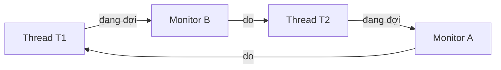
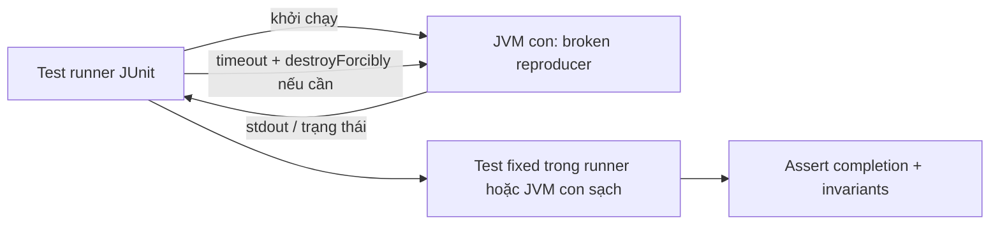

# Viết test tái hiện deadlock rồi sửa lock ordering trong Java

## 1. Bài toán thực tế và tiêu chí hoàn thành

Giả sử ứng dụng Java chuyển số dư giữa hai tài khoản trong bộ nhớ. Mỗi tài khoản có một monitor riêng; để chuyển tiền an toàn, thao tác cần giữ đồng thời khóa của tài khoản nguồn và đích. Nếu hai thread thực hiện `A → B` và `B → A` nhưng **lấy khóa theo thứ tự ngược nhau**, có thể xảy ra deadlock: T1 giữ khóa A và đợi B, trong khi T2 giữ khóa B và đợi A. Không thread nào có thể tiếp tục.

Bài thực hành này yêu cầu **viết test thực sự tái hiện được deadlock**, thu thập bằng chứng, sửa bằng một thứ tự khóa nhất quán (lock ordering), rồi viết kiểm thử hồi quy để bảo đảm cả hai chiều chuyển đều hoàn tất và tổng số dư không thay đổi. Phạm vi là **Java Concurrency thuần Java SE**, không dùng Spring hoặc cơ chế riêng của framework.

**Kết quả cần đạt:**
1. Tạo tình huống hai thread sở hữu hai monitor theo thứ tự đảo nhau, chủ động điều khiển lịch chạy bằng `CountDownLatch`.
2. Test nhận diện deadlock bằng `ThreadMXBean.findMonitorDeadlockedThreads()` trong thời hạn rõ ràng, thay vì treo test vô thời hạn.
3. Sửa `transfer` để mọi thread luôn lấy khóa theo **một thứ tự toàn cục**.
4. Test sau sửa chạy nhiều lần từ hai hướng đồng thời, xác nhận hoàn thành trong timeout, không có exception và giữ bất biến số dư.
5. Phân biệt “test tái hiện được deadlock” với “test xác nhận code đúng”: bản lỗi được kiểm tra **có deadlock**, còn bản sửa được kiểm tra **hoàn tất và đúng dữ liệu**.

Ví dụ bên dưới chạy trên **JDK 17+**, sử dụng thư viện tiêu chuẩn và một file Java; không cần JUnit để chạy bài thực hành. Sau phần thực hành có hướng dẫn chuyển thành test CI/JUnit an toàn.

## 2. Deadlock xảy ra khi nào?

Bốn điều kiện thường được nhắc tới trong mô hình deadlock tài nguyên (Coffman) là:

1. **Mutual exclusion:** tài nguyên không thể được hai thread sở hữu đồng thời, ví dụ intrinsic monitor của một object.
2. **Hold and wait:** một thread giữ tài nguyên này trong khi chờ tài nguyên khác.
3. **No preemption:** tài nguyên không thể tự bị thu hồi một cách tùy ý khỏi thread đang giữ; intrinsic monitor không bị thread khác cưỡng chế nhả.
4. **Circular wait:** tồn tại chu trình đợi: `T1 → L2 → T2 → L1 → T1`.

Ví dụ với `synchronized`:

```java
// Thread T1
synchronized (accountA) {
    synchronized (accountB) {
        // chuyển A → B
    }
}

// Thread T2
synchronized (accountB) {
    synchronized (accountA) {
        // chuyển B → A
    }
}
```

Đây là **đoạn minh họa**, chưa phải chương trình độc lập. Không có gì sai về cú pháp `synchronized` ở mỗi thread; lỗi nằm ở **thứ tự lấy nhiều khóa không thống nhất**. Nếu T1 đã giữ A và T2 đã giữ B, cả hai cùng chờ khóa còn lại và không thể tiến lên.



**Không phải mọi `BLOCKED` là deadlock.** Một thread chỉ đợi monitor đang được thread khác giữ trong thời gian ngắn là lock contention. Deadlock đòi hỏi chu trình phụ thuộc không có đường tiến triển theo cơ chế hiện tại. Cũng cần phân biệt với **starvation** (task chờ quá lâu vì không được phục vụ) và **livelock** (thread vẫn hoạt động nhưng không hoàn thành công việc).

## 3. Vì sao test concurrency thường khó tái hiện lỗi?

Nếu chạy hai thao tác chuyển một lần rồi hy vọng scheduler sắp xếp “đúng lúc”, deadlock có thể xảy ra trên máy này nhưng không xuất hiện trên máy khác. Chèn `Thread.sleep()` làm tăng xác suất một interleaving nào đó, nhưng **không tạo ra bảo đảm** về thứ tự chạy; test có thể flaky.

Để kiểm thử một interleaving cụ thể, ta dùng `CountDownLatch(2)` như điểm hẹn:

1. T1 lấy monitor A, giảm latch từ 2 xuống 1.
2. T2 lấy monitor B, giảm latch từ 1 xuống 0.
3. Cả hai chỉ được tiến đến lệnh lấy monitor thứ hai **sau khi** latch bằng 0.
4. T1 thử B, T2 thử A; chu trình chờ xuất hiện.

Latch được sử dụng **chỉ để tái hiện lỗi ở phiên bản broken**. Trong phiên bản đã sửa, không đặt barrier yêu cầu hai thread cùng đi vào giữa vùng đã khóa: nếu cả hai cùng cần một khóa đầu tiên giống nhau, barrier bên trong vùng khóa có thể **tự gây treo giả** vì thread thứ hai không thể tới barrier.

Một kiểm thử đáng tin cậy cần:
- **Lịch chạy có kiểm soát** cho kịch bản lỗi.
- **Timeout** ở thread kiểm thử, không để tiến trình CI chờ mãi.
- **Quan sát deadlock thật** qua MXBean thay vì chỉ đo “chạy quá lâu”.
- **Cô lập trạng thái**: những thread bị deadlock không được giữ các khóa dùng trong test bản sửa.
- **Khẳng định bất biến** sau khi bản sửa chạy xong; chỉ “không treo” là chưa đủ.

## 4. Mã Java 17 hoàn chỉnh: tái hiện, phát hiện, sửa và kiểm tra hồi quy

Lưu toàn bộ chương trình sau vào **`DeadlockLockOrderingTest.java`**. Chỉ có một `public class`; các class và phương thức khác nằm bên trong nó.

```java
import java.lang.management.ManagementFactory;
import java.lang.management.ThreadMXBean;
import java.util.concurrent.CountDownLatch;
import java.util.concurrent.TimeUnit;
import java.util.concurrent.atomic.AtomicReference;

public class DeadlockLockOrderingTest {
    static final class Account {
        final int id;        // ID duy nhất, không thay đổi trong hệ thống.
        long balance;        // Chỉ đọc/ghi khi giữ đúng monitor.

        Account(int id, long balance) {
            if (balance < 0) {
                throw new IllegalArgumentException("Negative balance");
            }
            this.id = id;
            this.balance = balance;
        }
    }

    private static void require(boolean condition, String message) {
        if (!condition) {
            throw new AssertionError(message);
        }
    }

    // Chỉ gọi khi đã giữ cả hai monitor của from và to.
    private static void applyTransfer(Account from, Account to, long amount) {
        if (amount <= 0) {
            throw new IllegalArgumentException("Amount must be positive");
        }
        if (from.balance < amount) {
            throw new IllegalStateException("Insufficient balance");
        }
        from.balance -= amount;
        to.balance += amount;
    }

    // PHIÊN BẢN CÓ LỖI: khóa nguồn trước, đích sau.
    // Barrier cố tình ép hai thread lấy khóa đầu tiên trước khi đi tiếp.
    private static void brokenTransfer(
            Account from,
            Account to,
            long amount,
            CountDownLatch bothFirstLocksHeld) {
        synchronized (from) {
            bothFirstLocksHeld.countDown();
            try {
                bothFirstLocksHeld.await();
            } catch (InterruptedException ex) {
                Thread.currentThread().interrupt();
                return;
            }

            synchronized (to) {
                applyTransfer(from, to, amount);
            }
        }
    }

    // PHIÊN BẢN SỬA: luôn khóa account có ID nhỏ hơn trước.
    private static void orderedTransfer(
            Account from, Account to, long amount) {
        if (from == to) {
            return; // Cùng tài khoản: không phát sinh chuyển tiền.
        }
        if (from.id == to.id) {
            throw new IllegalArgumentException(
                "Different accounts must have unique IDs");
        }

        Account first = from.id < to.id ? from : to;
        Account second = from.id < to.id ? to : from;

        synchronized (first) {
            synchronized (second) {
                applyTransfer(from, to, amount);
            }
        }
    }

    private static Thread daemon(String name, Runnable task) {
        Thread thread = new Thread(task, name);
        // Chỉ dành cho test cố tình tạo deadlock; không muốn giữ JVM sống mãi.
        thread.setDaemon(true);
        return thread;
    }

    private static boolean bothMonitorDeadlocked(
            ThreadMXBean bean, Thread first, Thread second) {
        long[] deadlockedIds = bean.findMonitorDeadlockedThreads();
        if (deadlockedIds == null) {
            return false;
        }

        boolean foundFirst = false;
        boolean foundSecond = false;
        for (long id : deadlockedIds) {
            if (id == first.getId()) {
                foundFirst = true;
            }
            if (id == second.getId()) {
                foundSecond = true;
            }
        }
        return foundFirst && foundSecond;
    }

    private static void testBrokenCodeProducesDeadlock()
            throws InterruptedException {
        Account a = new Account(1, 100_000);
        Account b = new Account(2, 100_000);
        CountDownLatch firstLocksHeld = new CountDownLatch(2);

        Thread t1 = daemon("broken-A-to-B",
            () -> brokenTransfer(a, b, 1, firstLocksHeld));
        Thread t2 = daemon("broken-B-to-A",
            () -> brokenTransfer(b, a, 1, firstLocksHeld));

        t1.start();
        t2.start();

        ThreadMXBean bean = ManagementFactory.getThreadMXBean();
        long deadline = System.nanoTime() + TimeUnit.SECONDS.toNanos(5);
        boolean detected = false;

        while (System.nanoTime() < deadline) {
            if (bothMonitorDeadlocked(bean, t1, t2)) {
                detected = true;
                break;
            }
            Thread.sleep(20);
        }

        require(detected,
            "Expected monitor deadlock was not detected in 5 seconds");
        System.out.println("BROKEN: monitor deadlock detected");
    }

    private static void repeatOrdered(
            Account from,
            Account to,
            CountDownLatch start,
            AtomicReference<Throwable> failure) {
        try {
            start.await();
            for (int i = 0; i < 1_000; i++) {
                orderedTransfer(from, to, 1);
            }
        } catch (InterruptedException ex) {
            Thread.currentThread().interrupt();
            failure.compareAndSet(null, ex);
        } catch (Throwable ex) {
            failure.compareAndSet(null, ex);
        }
    }

    private static void testOrderedCodeCompletes()
            throws InterruptedException {
        // Dùng tài khoản MỚI: bản broken vẫn giữ monitor ở thread daemon.
        Account a = new Account(1, 100_000);
        Account b = new Account(2, 100_000);
        CountDownLatch start = new CountDownLatch(1);
        AtomicReference<Throwable> failure = new AtomicReference<>();

        Thread t1 = daemon("fixed-A-to-B",
            () -> repeatOrdered(a, b, start, failure));
        Thread t2 = daemon("fixed-B-to-A",
            () -> repeatOrdered(b, a, start, failure));

        t1.start();
        t2.start();
        start.countDown();

        t1.join(10_000);
        t2.join(10_000);

        require(!t1.isAlive() && !t2.isAlive(),
            "Ordered transfers did not finish within the timeout");
        if (failure.get() != null) {
            throw new AssertionError("A worker failed", failure.get());
        }

        // join() đã hoàn tất: thread chính có thể kiểm tra kết quả an toàn.
        require(a.balance == 100_000, "Unexpected A balance");
        require(b.balance == 100_000, "Unexpected B balance");
        require(a.balance + b.balance == 200_000,
            "Total balance changed");

        System.out.println("FIXED: completed 2,000 transfers");
        System.out.println(
            "FIXED: A=" + a.balance + ", B=" + b.balance
            + ", total=" + (a.balance + b.balance));
    }

    public static void main(String[] args) throws Exception {
        testBrokenCodeProducesDeadlock();
        testOrderedCodeCompletes();
    }
}
```

### 4.1. Biên dịch và chạy

Dùng terminal đang có JDK 17 hoặc mới hơn:

```bash
javac DeadlockLockOrderingTest.java
java DeadlockLockOrderingTest
```

Trên HotSpot/OpenJDK hỗ trợ phát hiện monitor deadlock, đầu ra mong đợi:

```text
BROKEN: monitor deadlock detected
FIXED: completed 2,000 transfers
FIXED: A=100000, B=100000, total=200000
```

Nếu điều kiện test không đạt, chương trình ném `AssertionError` với lý do. Số dư ban đầu mỗi tài khoản là 100.000; mỗi chiều chuyển 1 đơn vị, 1.000 lần, nên tổng 200.000 và số dư cuối mỗi tài khoản vẫn là 100.000.

**Giới hạn có chủ ý:** Hai thread `broken-...` bị deadlock **thật** và tồn tại tới khi JVM kết thúc. Chúng được đánh dấu daemon để bài thực hành kết thúc; daemon **không phá deadlock và không giải phóng monitor**. Hai tài khoản của bản sửa là object mới, nên không bị các daemon đã chết kẹt giữ khóa. Khi chuyển sang test suite lâu sống, **chạy phần tạo deadlock trong một JVM con riêng** và hủy JVM con sau thời hạn, không để lại thread deadlock trong test runner.

### 4.2. Điều test đã chứng minh

**Test broken:** chỉ pass nếu **cả hai** Java thread đã tạo xuất hiện trong kết quả `findMonitorDeadlockedThreads()`. Việc kiểm tra đích danh `getId()` ngăn nhầm một deadlock không liên quan trong JVM với deadlock của bài tập. Đây là test về **tái hiện và phát hiện lỗi**.

**Test fixed:** hai thread cùng bắt đầu sau một start gate ở ngoài vùng khóa, mỗi thread chuyển 1.000 lần theo hai hướng ngược nhau. Test đợi tối đa 10 giây mỗi thread rồi kiểm tra cả hai kết thúc, không có exception và số dư đúng. Đây là test về **hoàn thành + tính đúng dữ liệu**.

**Tại sao không chỉ kiểm tra không có deadlock?** Một implementation bỏ tất cả thao tác chuyển có thể không deadlock nhưng sai yêu cầu. Vì vậy cần kiểm tra số lần xử lý và giá trị đầu ra; ví dụ trên xác nhận các bất biến, còn việc in “completed 2,000 transfers” dựa trên việc hai worker đi hết vòng lặp mà không ném lỗi. Có thể mở rộng thành bộ đếm giao dịch nếu cần chứng minh chi tiết từng bước.

**Tại sao timeout không đủ?** Task bị chậm do CPU/throttling/GC có thể vượt một timeout quá ngắn mà không deadlock. Test có timeout để CI không treo, trong khi `findMonitorDeadlockedThreads()` mang đến bằng chứng cụ thể về chu trình chờ monitor.

## 5. Đọc chứng cứ deadlock bằng thread dump

Khi chương trình đang chạy phiên bản broken, bạn có thể thêm một lệnh `Thread.sleep` trong main sau khi phát hiện deadlock để có thời gian dùng `jcmd`, hoặc chạy test con có thời gian chờ rõ ràng. Không thêm sleep vào logic điều phối lấy lock để thay thế latch.

Trên HotSpot với JDK đầy đủ:

```bash
jcmd -l
jcmd <PID> Thread.print -l > deadlock-dump.txt
```

Thay `<PID>` bằng PID thực. Dấu hiệu từ hai thread test (địa chỉ monitor, dòng nguồn, `tid`, `nid` sẽ thay đổi):

```text
"broken-A-to-B" ...
   java.lang.Thread.State: BLOCKED (on object monitor)
    at DeadlockLockOrderingTest.brokenTransfer(...)
    - waiting to lock <0x...B> (an Account)
    - locked <0x...A> (an Account)

"broken-B-to-A" ...
   java.lang.Thread.State: BLOCKED (on object monitor)
    at DeadlockLockOrderingTest.brokenTransfer(...)
    - waiting to lock <0x...A> (an Account)
    - locked <0x...B> (an Account)
```

Các dòng trên là **bản rút gọn minh họa**, không phải kết quả copy nguyên vẹn từ một lần chạy. Một thread đang BLOCKED khi muốn vào monitor thứ hai, vẫn giữ monitor thứ nhất. Khi nối các lock ID lại:

```text
T1 giữ A → đợi B
T2 giữ B → đợi A
=> T1 → B → T2 → A → T1 (chu trình)
```

HotSpot có thể in phần “Found one Java-level deadlock” hoặc thông tin deadlock ở cuối dump; cách trình bày phụ thuộc phiên bản JDK. Trong mã kiểm thử ta không parse text dump vì định dạng output có thể khác nhau, mà dùng `ThreadMXBean` để phát hiện monitor deadlock có cấu trúc.

**Lưu ý:** Java `Thread.State.BLOCKED` dùng cho **intrinsic monitor**. Với `ReentrantLock`, nhiều thao tác chờ nằm ở `WAITING`/`TIMED_WAITING` qua `LockSupport.park()`, và có thể cần `findDeadlockedThreads()` cùng hỗ trợ ownable synchronizer của JVM. `findMonitorDeadlockedThreads()` phù hợp trực tiếp cho ví dụ `synchronized` này.

## 6. Vì sao lock ordering sửa được chu trình?

Trong `orderedTransfer`, bất kể chuyển `A → B` hay `B → A`, code đều xác định:

```java
Account first  = from.id < to.id ? from : to;
Account second = from.id < to.id ? to : from;

synchronized (first) {
    synchronized (second) {
        // Cập nhật số dư theo hướng nghiệp vụ from → to.
    }
}
```

Đây là đoạn trích từ chương trình đầy đủ ở mục 4. Với A.id = 1, B.id = 2:
- T1 chuyển A→B: lấy A rồi B.
- T2 chuyển B→A: **vẫn** lấy A rồi B.

Nếu T1 đã giữ A, T2 phải **đợi ngay tại A**; T2 chưa thể giữ B để tạo chu trình. Khi T1 hoàn thành và nhả khóa theo thứ tự ngược lúc ra khỏi nested `synchronized`, T2 có cơ hội thực hiện. Thứ tự cập nhật từ/đến vẫn là `from.balance -= amount`, `to.balance += amount` — thứ tự lock **không** đổi ý nghĩa nghiệp vụ.

Một cách nhìn theo đồ thị: nếu tất cả đường lấy khóa luôn từ **ID nhỏ đến ID lớn**, mọi cạnh “đang giữ lock nhỏ và chờ lock lớn” đi theo chiều tăng. Chu trình sẽ đòi ID tăng mãi rồi quay về ID nhỏ ban đầu, điều không thể xảy ra trong tập hữu hạn các khóa với thứ tự toàn phần nhất quán.

### 6.1. Điều kiện để thứ tự khóa thật sự an toàn

1. **Khóa có thứ tự toàn cục và ổn định:** dùng khóa định danh bất biến, duy nhất hoặc cơ chế tie-break bảo đảm thứ tự toàn phần.
2. **Mọi call site tuân cùng quy tắc:** một code path khác vẫn khóa B trước A có thể tạo deadlock trở lại.
3. **Dùng đúng object monitor:** đối tượng đại diện cho cùng tài nguyên phải được quản lý nhất quán; hai `Account` khác nhau cùng ID không được ngầm coi là một.
4. **Tính toàn vẹn dữ liệu:** mọi thao tác đọc/ghi số dư cần được bảo vệ theo quy tắc sở hữu, không chỉ phương thức chuyển tiền.
5. **Không giữ khóa khi thực hiện I/O/blocking dài:** dù loại bỏ chu trình giữa hai monitor, lock convoy và latency vẫn có thể nghiêm trọng.

Ví dụ chọn `Account.id` bất biến, và ném lỗi khi hai object khác nhau có cùng ID. Nếu dùng `System.identityHashCode()` làm thứ tự, **giá trị hash có thể trùng**; phải định nghĩa tie-break lock thay vì mặc định không bao giờ có collision. Đơn giản nhất trong domain này là ID duy nhất và ổn định.

**Self-transfer:** với `from == to`, ví dụ bỏ qua thay đổi như một thao tác không có hiệu ứng. Với hệ thống thực tế, vẫn phải quyết định kiểm tra amount và định nghĩa sự kiện/audit cho self-transfer. Đây là lựa chọn nghiệp vụ, không phải quy tắc chung của deadlock prevention.

## 7. Tại sao phải bảo toàn invariant, không chỉ tránh treo?

Giả sử invariant là `A.balance + B.balance == constant` khi chỉ có hai tài khoản trong hệ thống và chuyển tiền không sinh/phá tiền. Hai bước riêng:

```java
from.balance -= amount;
to.balance += amount;
```

phải được quan sát như **một giao dịch logic** dưới cùng tập monitor. Nếu code chỉ khóa `from` khi trừ, rồi nhả khóa trước khi cộng vào `to`, thread khác có thể thấy trạng thái trung gian và quyết định sai. Lock ordering cho phép bảo vệ cả hai tài khoản mà không tạo chu trình chờ giữa chúng.

Sau `Thread.join()` hoàn tất, Java Memory Model bảo đảm các action của worker **happen-before** thread gọi `join` thành công trở lại; vì vậy test có thể đọc `balance` sau hai lệnh join hoàn tất. Trong hệ thống chạy liên tục, code đọc số dư đồng thời cũng cần synchronization/visibility theo hợp đồng, không được viện dẫn test `join` để bỏ khóa ở luồng production.

Trong bài test, mỗi tài khoản bắt đầu 100.000 và có 1.000 lần chuyển mỗi chiều với amount 1. Không account nào cạn số dư ở các lịch chạy hợp lệ, vì tài khoản bị rút nhiều nhất 1.000 đơn vị trước khi nhận chiều ngược; vì vậy invariant luôn có thể thỏa. Nếu dữ liệu nghiệp vụ cho phép chuyển vượt số dư, phải xác định lỗi hoặc rollback tại vùng critical section.

### 7.1. Bẫy “total đúng nhưng logic sai”

Nếu cả hai worker bỏ qua mọi lệnh chuyển thì tổng vẫn đúng và số dư cuối vẫn 100.000 mỗi bên. Để kiểm tra mạnh hơn, có thể đếm số transfer thành công trong lock-protected code hoặc kiểm tra log sự kiện giao dịch độc lập. Trong chương trình demo, vòng lặp và việc không có exception xác nhận cả hai worker đã gọi `orderedTransfer` đủ 1.000 lần; nếu refactor code thực, nên thêm assertion về số thao tác thành công.

Tương tự, tổng số dư đúng chưa chứng minh không có số dư âm tạm thời; nghiệp vụ cần kiểm tra tại mỗi lần chuyển trong critical section nếu có invariant không âm.

## 8. Kiểm thử hồi quy nên thiết kế thành những trường hợp nào?

| Trường hợp | Input/lịch chạy | Kỳ vọng |
|---|---|---|
| Reproducer lỗi | A→B và B→A, barrier sau khi mỗi bên lấy monitor đầu tiên | MXBean nhận diện cả hai thread trong monitor deadlock |
| Fix đối chiều | Hai thread chuyển A→B/B→A từ start gate | Cả hai hoàn tất trong hạn, không deadlock, không exception |
| Tải lặp | Mỗi worker chuyển 1.000 lần, amount 1 | Kết quả và tổng số dư đúng, không có lost update |
| Không đủ tiền | `from.balance < amount` | Ném lỗi, không cập nhật từng phần |
| Tài khoản trùng tham chiếu | `from == to` | Theo contract: no-op hoặc lỗi hợp lệ; không deadlock |
| ID trùng trên hai object khác nhau | `from != to`, `from.id == to.id` | Từ chối do không bảo đảm thứ tự định danh |
| Nhiều tài khoản | Ba hoặc nhiều account, các cặp chuyển cạnh tranh | Cùng global order cho mọi khóa, không tạo vòng lock-order |
| Worker lỗi | Exception trong tác vụ | Main/test nắm được lỗi; không bỏ qua exception thread |
| Timeout/đóng tài nguyên | Task không hoàn tất trước deadline | Test fail rõ ràng, JVM con được dừng an toàn |

**Timeout có hai mục đích khác nhau:** trong bản broken, deadline là giới hạn thời gian chờ phát hiện; trong bản fixed, deadline giới hạn thời gian hoàn tất để phát hiện treo hoặc chậm bất thường. Cả hai phải đủ rộng so với môi trường CI. Timeout fail **không tự chứng minh deadlock** nếu không có thêm thread dump/MXBean và thông tin tải.

Không lạm dụng hàng nghìn lần `Thread.sleep` hoặc tạo số thread cực lớn để “test race”: số lượng lớn làm test chậm và vẫn có thể bỏ lỡ interleaving cần kiểm tra. Chủ động điều phối thứ tự ở test broken giúp tái hiện có tính quyết định hơn.

## 9. Chuyển bài thực hành thành test JUnit/CI an toàn

Một test fixture tạo deadlock monitor thật không thể nhờ `Thread.interrupt()` thông thường mà phá được chờ nhập monitor `synchronized`. Daemon hóa giúp demo console thoát nhưng **không phải phương án cách ly tốt cho test runner** vì daemon deadlocked vẫn giữ object/stack và sống đến hết JVM.

Một kiến trúc test CI bền vững:



**Cách triển khai đề xuất:**
1. Đặt reproducer lỗi trong một `main` của tiến trình con hoặc test riêng chạy với cấu hình fork JVM.
2. Main của JVM con khởi chạy hai thread và polling MXBean; nếu phát hiện, in marker máy đọc được như `DEADLOCK_DETECTED` rồi exit với mã định trước (hoặc để runner kiểm tra marker và dừng JVM con).
3. Test cha sử dụng `ProcessBuilder` và `Process.waitFor(timeout, TimeUnit.SECONDS)`; nếu chưa hoàn thành, dùng `destroy()` rồi `destroyForcibly()` khi cần và bảo đảm xử lý stream stdout/stderr để tránh treo vì pipe đầy.
4. Test cha assert marker phát hiện deadlock, mã exit và thông tin diagnostic. **Không coi “JVM con đã timeout” là bằng chứng duy nhất**.
5. Test fixed chạy trong JVM sạch: hai worker khởi động từ barrier bên ngoài lock; `join(timeout)`, assert `!isAlive()`, exception và các invariant.
6. Khi test failure, lưu thread dump/JFR/log cho việc debug thay vì chỉ in `assertTimeout` chung chung.

Nếu dùng JUnit 5, tên test nên phản ánh contract, chẳng hạn `brokenOppositeLockOrder_isDetectedAsDeadlock()` và `orderedTransfers_finishAndPreserveBalances()`. Với bản fixed, dùng assertion API như `assertFalse(thread.isAlive())`, `assertEquals(expected, value)` hoặc `assertAll(...)`, nhưng **không dựa vào `assertTimeoutPreemptively` để cưỡng chế thoát một monitor deadlock**: interruption không phá được nó. Đây là hướng dẫn tích hợp; mã mục 4 là bản standalone, runnable không cần thêm dependency.

**Một lưu ý kỹ thuật:** test broken đang chạy `findMonitorDeadlockedThreads()` theo chu kỳ 20 ms, có overhead nhỏ. Trong production không nên polling MXBean dày như vậy vô thời hạn; dùng chẩn đoán theo sự cố hoặc tần suất đã được đánh giá.

## 10. Những chiến lược khác và khi nào nên chọn

### 10.1. Một khóa bao toàn cục

Đơn giản nhất là `synchronized(globalLock)` cho mọi transfer. Nó tránh vòng chờ nhiều account lock, nhưng cũng **tuần tự hóa mọi giao dịch**, kể cả chuyển giữa những account không liên quan. Có thể phù hợp hệ thống rất nhỏ, nhưng không tận dụng tốt concurrency ở tải lớn.

### 10.2. Global ordering theo khóa tài nguyên

Như ví dụ: chỉ serial hóa các thao tác thực sự dùng chung account. Chuyển A↔B tranh chấp đúng hai monitor; chuyển C↔D có thể chạy song song. Điều kiện quan trọng là thứ tự khóa được mọi đường gọi tuân thủ.

### 10.3. `ReentrantLock.tryLock()` có deadline

Một chiến lược khác là thử lấy khóa thứ hai trong một thời gian rồi nhả khóa thứ nhất khi không thành công. Nó có thể tránh việc chờ vĩnh viễn nếu thiết kế retry/backoff đúng, nhưng dễ sinh **livelock**, starvation và khó xử lý interruption. `tryLock` không tự sửa lỗi nếu code giữ lock rồi tiếp tục chờ vô hạn ở nơi khác.

### 10.4. Không giữ nhiều lock cùng lúc

Có thể thay bằng immutable snapshot, message passing/actor, ownership theo partition hoặc giao thức giao dịch; đổi lại phải xử lý tính nguyên tử và consistency theo domain. Với chuyển tiền, việc bỏ nested locks mà không có cơ chế transaction hoặc coordination tương đương sẽ mở ra race/lost update.

**Kết luận kỹ thuật:** lock ordering là một biện pháp đặc biệt hiệu quả khi nhiều operation phải giữ cùng lúc các khóa của nhiều object có định danh ổn định; nó không thay thế mọi yêu cầu về invariant, fairness, timeout hoặc tối ưu vùng critical section.

## 11. Sai lầm phổ biến khi viết test deadlock

### Sai lầm 1: “Chạy đồng thời vài lần là đủ”

Hai thread có thể tình cờ chạy tuần tự và không bao giờ chạm vào thời điểm tạo vòng chờ. Test pass ngẫu nhiên làm che giấu lỗi. Dùng latch/barrier để kiểm soát interleaving ở **test tái hiện**, và thêm bài test tải lặp cho bản sửa.

### Sai lầm 2: Dùng `Thread.sleep()` để đảm bảo lịch chạy

`sleep` chỉ trì hoãn thread hiện tại, không bảo đảm thread khác đã lấy monitor hoặc tới điểm mong muốn. Cần handshake rõ ràng (`CountDownLatch`, `Phaser`) khi mục tiêu là kiểm soát tương tác giữa thread.

### Sai lầm 3: Đặt barrier bên trong lock ở cả test fixed

Nếu cả hai thread theo đúng lock ordering, thread thứ hai phải chờ lock đầu tiên, nên không tới barrier được. Test tự kẹt vì bộ điều phối, không chứng minh code sửa sai. Chỉ dùng `CountDownLatch(2)` **sau khi lấy hai monitor khác nhau** ở reproducer lỗi; start gate của bản sửa nằm **bên ngoài khóa**.

### Sai lầm 4: Cố gắng interrupt thread đang chờ intrinsic monitor

`Thread.interrupt()` không làm chờ nhập `synchronized` trở nên interruptible. Đừng dùng `Thread.stop()` (đã deprecated, không an toàn) để phá deadlock. Cô lập reproducer trong JVM con và kết thúc tiến trình đó sau khi thu bằng chứng.

### Sai lầm 5: Chỉ assert `!isAlive()`

Thread có thể chết vì exception hoặc dữ liệu bị tính sai. Trong test hãy bắt exception worker, kiểm tra trạng thái hoàn tất, tổng số dư, giá trị từng account và các invariant liên quan.

### Sai lầm 6: Sắp xếp bằng ID không duy nhất

Nếu hai object khác nhau có cùng ID, phép so sánh `<` không tạo thứ tự toàn phần giữa chúng. Ví dụ từ chối trường hợp này; hệ thống thật cần bảo đảm tính duy nhất hoặc tie-break hợp lệ.

### Sai lầm 7: Chỉ sửa một hướng chuyển

T1 đã đổi sang A→B nhưng T2 vẫn lấy B→A thì vòng chờ vẫn tồn tại. **Mọi** code path lấy các khóa liên quan phải tuân một quy tắc thống nhất, kể cả transfer, batch adjustment, reconciliation và kiểm tra tổng nhiều tài khoản.

### Sai lầm 8: Test treo làm mất log

Không được để CI chờ mãi. Cần deadline, thu dump trong cửa sổ đang treo và dùng JVM con để không ảnh hưởng test khác. Khi dùng `ProcessBuilder`, phải tiêu thụ stdout/stderr phù hợp để tránh block do buffer đầy.

## 12. Quy trình tự làm từng bước

Để học chắc nguyên nhân, nên thực hành theo thứ tự:

1. **Chạy code mục 4 nguyên trạng.** Xác nhận hai dòng `BROKEN` và `FIXED`; kiểm tra JDK thực đang dùng với `java -version`.
2. **Bỏ barrier ở brokenTransfer** rồi chạy nhiều lần. Quan sát deadlock có thể không xuất hiện, chứng minh tính khó đoán của lịch chạy.
3. **Giữ barrier, đổi thứ tự lấy monitor ngược cho một nhánh** và đọc lại đồ thị chờ. Hiểu chính xác khóa nào được giữ.
4. **Đọc `orderedTransfer`**: dù `from` và `to` đảo vị trí, thứ tự `first`/`second` vẫn như cũ.
5. **Thêm test số dư bất biến**: thử amount lớn, test insufficient balance, test cùng tài khoản và ID trùng.
6. **Mở rộng thành ba tài khoản**: chạy các chuyển A↔B, B↔C, C↔A, bảo đảm luôn khóa theo ID tăng.
7. **Dùng JFR/thread dump** ở tình huống chờ khóa dài, phân biệt contention với deadlock.
8. **Chuyển sang CI** với process isolation cho reproducer, giữ test fixed có deadline và assert đầy đủ.

### Bài tập mở rộng: ba khóa và invariant nhiều tài khoản

Giả sử một nghiệp vụ cập nhật đồng thời A, B, C. Viết helper nhận một tập tài khoản, kiểm tra ID duy nhất, **sắp xếp theo ID tăng**, lấy các monitor theo thứ tự đó rồi thực hiện cập nhật nguyên tử. Không nên tự tạo nested `synchronized` bằng số lượng bất kỳ một cách khó kiểm soát; có thể thiết kế cấu trúc lock tương ứng hoặc dùng `ReentrantLock` với acquisition tuần tự và `finally` nhả theo thứ tự ngược, miễn là chính sách khóa nhất quán.

Các bất biến cần test:
- Tổng giá trị trước và sau (nếu chỉ chuyển nội bộ) bằng nhau.
- Không có tài khoản âm khi nghiệp vụ cấm âm.
- Mọi worker đều hoàn tất trong deadline.
- Không có exception bị mất hoặc tác vụ bị bỏ qua.
- Kết quả đúng qua nhiều lịch chạy hợp lệ.

Không chỉ dựa vào test để chứng minh hoàn toàn không deadlock trong mọi đường gọi; cần **code review về global lock order**, phân tích bất biến và quan sát khi chạy.

## 13. Checklist khi review một bản sửa deadlock

| Câu hỏi | Dấu hiệu đạt |
|---|---|
| Reproducer xác định được vòng chờ? | Hai thread giữ hai monitor khác nhau, MXBean phát hiện đúng ID |
| Có giới hạn thời gian? | Test không thể treo main/CI vô hạn |
| Test lỗi được cách ly? | JVM con hoặc demo daemon có vòng đời ngắn, không dùng lại object đã bị giữ khóa |
| Thứ tự lấy lock toàn cục? | Mọi đường lấy hai account locks đều sắp theo ID bất biến |
| Có trường hợp ID bằng nhau? | Self-transfer xác định rõ; object khác cùng ID bị từ chối hoặc tie-break |
| Critical section có đúng phạm vi? | Trừ và cộng số dư nằm bên trong cả hai monitor |
| Worker có hoàn tất? | `join`/deadline + kiểm tra trạng thái thread |
| Worker có thất bại? | Exception được đưa về test để assert, không chỉ in stack trace |
| Kết quả đúng? | Bất biến số dư và số thao tác hoàn thành được kiểm tra |
| Chẩn đoán đủ? | Có thread dump/lock IDs và số liệu khi test fail |

## 14. Câu hỏi tự kiểm tra

**Câu 1.** Nếu T1 giữ A, chờ B, còn T2 giữ B nhưng đang `Thread.sleep(500)` rồi sẽ nhả B, có deadlock không?

*Đáp án:* Chưa đủ để kết luận deadlock. T2 vẫn có thể tiến lên sau sleep và nhả B; đây có thể là contention gây chậm. Nếu T2 tiếp tục chờ A khi vẫn giữ B, mới tạo vòng chờ.

**Câu 2.** Nếu mọi transfer đều lấy monitor theo ID tăng, có thể có deadlock giữa hai account monitors đó nữa không?

*Đáp án:* Không có chu trình circular wait **chỉ từ việc lấy các monitor này** khi mọi đường gọi đều tuân quy tắc, ID tạo thứ tự toàn phần ổn định và không có khóa khác phá chính sách. Tuy nhiên vẫn có thể kẹt vì chờ I/O, latch hoặc khóa từ phần khác của hệ thống.

**Câu 3.** Vì sao `findMonitorDeadlockedThreads()` phù hợp với ví dụ `synchronized` nhưng chưa đủ cho mọi chương trình?

*Đáp án:* Nó dò deadlock trên object monitors. Các loại ownable synchronizer như `ReentrantLock` có thể cần `findDeadlockedThreads()`; deadlock logic qua Future, network hoặc tài nguyên ngoài JVM không nhất thiết được API nhận diện.

**Câu 4.** Hai worker fixed kết thúc trong 10 giây, không có exception, tổng số dư đúng. Cần kiểm tra gì nữa?

*Đáp án:* Số dư từng tài khoản, số thao tác được thực hiện, không có trạng thái trung gian vi phạm invariant và các đường gọi khác có tuân cùng thứ tự lock hay không. Một implementation không thực hiện giao dịch vẫn có thể giữ tổng số dư đúng.

**Câu 5.** Vì sao daemon thread không phải cách sửa deadlock?

*Đáp án:* Daemon chỉ ảnh hưởng điều kiện JVM có thể thoát khi các non-daemon thread đã kết thúc. Deadlock, monitor đang giữ và công việc bị mắc kẹt vẫn tồn tại cho tới khi tiến trình dừng.

## 15. Ghi nhớ

Một bài kiểm thử deadlock tốt có **hai pha khác mục đích**: (1) chủ động tái hiện vòng chờ bằng lịch chạy kiểm soát và phát hiện nó có cấu trúc; (2) sửa quy tắc lấy lock, sau đó xác minh task hoàn tất và dữ liệu đúng dưới concurrency. Trong ví dụ này, nguyên nhân là hai chuyển khoản lấy account monitor theo thứ tự nguồn→đích, còn cách sửa là lấy theo **ID tăng bất kể hướng chuyển**.

Điều quan trọng trong Java Concurrency không phải là làm cho test “không treo” bằng cách tăng thread hay kéo dài timeout, mà là **loại bỏ điều kiện circular wait bằng một quy tắc sở hữu khóa nhất quán** rồi chứng minh tính đúng bằng kiểm thử và bất biến nghiệp vụ.
