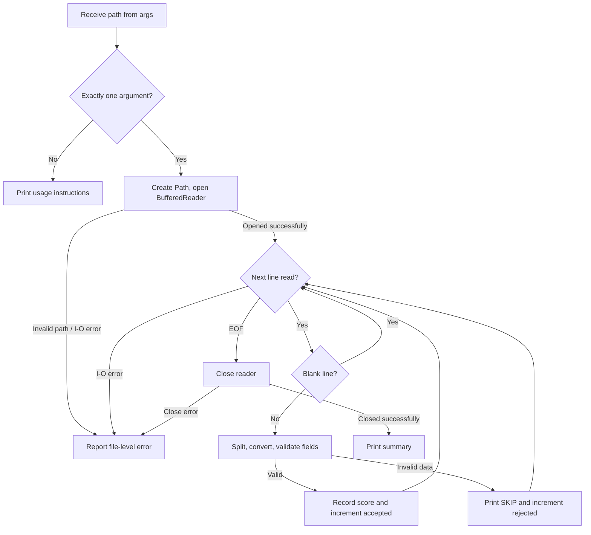

# An End-to-End Example: Reading and Processing Input Data with Java Exceptions

> Scope: Java Core – Exception, Overview section. The example uses Java 17 or later and depends only on the Java SE standard library.

## 1. The Problem and Expected Outcome

An application needs to read a text file containing student scores. Each line has exactly two fields, separated by a comma:

```text
ten,diem
```

For example, `An,85` means student `An` has a score of `85`. Valid scores are integers from `0` to `100`. A malformed line **must not cause the entire file's results to be lost**; the application skips the invalid line, reports the reason, and continues processing. Conversely, if the file does not exist or an I/O error occurs while reading, the program must report a file-level error because there is no longer any basis to confirm that the data has been read completely.

We will build the program `InputProcessingDemo.java` to carry out the entire flow:

1. Accept the file path via a command-line argument.
2. Open the file as UTF-8 using `Files.newBufferedReader` and `try-with-resources`.
3. Read line by line; skip completely blank lines.
4. Validate the two fields `name,score`, parse the score into an `int`, and check the `0..100` range.
5. Keep valid lines; report invalid lines while continuing execution.
6. Print the number of accepted lines, the number of rejected lines, and the average score of **the valid lines**.
7. Distinguish between program usage errors, data format errors, and file reading errors.

**Two error boundaries to understand:** A malformed data line is a local error, and reading can continue. An `IOException` while opening, reading, or closing a resource is an error at the level of the entire read operation; it must be allowed to propagate to the orchestration layer or be handled there.

## 2. Viewing the Entire Flow Before Writing Code



The diagram describes **the error policy that the application actively chooses**—not all exceptions have the same handling rules. In particular, you should not use a catch-all `catch (Exception e)` that treats programming bugs and data errors the same way.

## 3. Fixed Input Data for Reference

Create a file named `grades.csv` in the same directory used to run the program, saved as UTF-8:

```text
An,85
Binh,abc
Chi,105
,72
Dung,90
Mai, 70
```

This is a **simple format with two comma-separated fields**, not a full RFC 4180 CSV reader. This exercise does not support commas inside names, quoted fields, or multi-line fields. In production where standard CSV is required, use an appropriate CSV parser.

Expected results after processing:

| Line | Data | Result |
| --- | --- | --- |
| 1 | `An,85` | Valid, add `85` |
| 2 | `Binh,abc` | Invalid: score is not an integer |
| 3 | `Chi,105` | Invalid: score is outside `0..100` |
| 4 | `,72` | Invalid: missing name |
| 5 | `Dung,90` | Valid, add `90` |
| 6 | `Mai, 70` | Valid after trimming whitespace around the score |

Total valid score: `85 + 90 + 70 = 245`. Average: `245 / 3 = 81.666...`, displayed to two decimal places as `81.67`.

## 4. Complete, Runnable Java 17 Source Code

Create the file **`InputProcessingDemo.java`**; the file name must match the `public` class name. The program below uses one main class with two nested types, requiring no external libraries.

```java
import java.io.BufferedReader;
import java.io.IOException;
import java.nio.charset.StandardCharsets;
import java.nio.file.Files;
import java.nio.file.InvalidPathException;
import java.nio.file.NoSuchFileException;
import java.nio.file.Path;
import java.util.Locale;

public class InputProcessingDemo {

    // A record is only created after validation succeeds.
    private record Grade(String name, int score) {}

    // Checked exception dedicated to invalid data on a single line.
    private static final class InvalidRecordException extends Exception {
        InvalidRecordException(String message) {
            super(message);
        }

        InvalidRecordException(String message, Throwable cause) {
            super(message, cause);
        }
    }

    public static void main(String[] args) {
        if (args.length != 1) {
            System.err.println("Usage: java InputProcessingDemo <file>");
            return;
        }

        try {
            processFile(Path.of(args[0]));
        } catch (InvalidPathException ex) {
            System.err.println("ERROR: invalid file path");
        } catch (NoSuchFileException ex) {
            System.err.println("ERROR: input file not found");
        } catch (IOException ex) {
            System.err.println("ERROR: failed to read input ("
                    + ex.getClass().getSimpleName() + ")");
        }
    }

    private static void processFile(Path path) throws IOException {
        int accepted = 0;
        int rejected = 0;
        int sum = 0;

        // Open, read, and close the file properly, even when an IOException occurs.
        try (BufferedReader reader =
                     Files.newBufferedReader(path, StandardCharsets.UTF_8)) {

            String line;
            int lineNumber = 0;

            while ((line = reader.readLine()) != null) {
                lineNumber++;

                // Convention: blank lines do not count as rejected records.
                if (line.isBlank()) {
                    continue;
                }

                try {
                    Grade grade = parseRecord(line);

                    accepted++;
                    sum += grade.score();
                    System.out.printf(
                            Locale.ROOT,
                            "ACCEPT line %d: %s=%d%n",
                            lineNumber, grade.name(), grade.score());

                } catch (InvalidRecordException ex) {
                    // Data errors are isolated to the exact line being processed.
                    rejected++;
                    System.out.printf(
                            Locale.ROOT,
                            "SKIP line %d: %s%n",
                            lineNumber, ex.getMessage());
                }
            }
        }

        // Only reaches here if both reading and closing the reader succeeded.
        double average = accepted == 0 ? 0.0 : sum / (double) accepted;
        System.out.printf(
                Locale.ROOT,
                "SUMMARY accepted=%d rejected=%d average=%.2f%n",
                accepted, rejected, average);
    }

    private static Grade parseRecord(String raw)
            throws InvalidRecordException {

        // -1 keeps empty fields: both "An," and ",85" produce 2 parts.
        String[] fields = raw.split(",", -1);
        if (fields.length != 2) {
            throw new InvalidRecordException("expected name,score");
        }

        String name = fields[0].trim();
        if (name.isEmpty()) {
            throw new InvalidRecordException("name is empty");
        }

        String scoreText = fields[1].trim();
        final int score;

        try {
            score = Integer.parseInt(scoreText);
        } catch (NumberFormatException ex) {
            // Wrap the conversion error while preserving the original cause.
            throw new InvalidRecordException(
                    "score is not an integer", ex);
        }

        if (score < 0 || score > 100) {
            throw new InvalidRecordException(
                    "score must be between 0 and 100");
        }

        return new Grade(name, score);
    }
}
```

### Running the Program

Open a terminal in the directory containing both `InputProcessingDemo.java` and `grades.csv`. Select JDK 17 or newer:

```bash
java -version
javac -version
javac -encoding UTF-8 InputProcessingDemo.java
java InputProcessingDemo grades.csv
```

Depending on the terminal, `java -version` may write the version to stderr. With the `grades.csv` content above, the stdout of the final command is **exactly**:

```text
ACCEPT line 1: An=85
SKIP line 2: score is not an integer
SKIP line 3: score must be between 0 and 100
SKIP line 4: name is empty
ACCEPT line 5: Dung=90
ACCEPT line 6: Mai=70
SUMMARY accepted=3 rejected=3 average=81.67
```

Running with a non-existent path, such as `java InputProcessingDemo missing-file.csv`, causes the program to report `ERROR: input file not found` to **stderr**. Running without arguments reports usage instructions to stderr. The exact output for other system errors depends on the actual `IOException` type, so you should not hardcode OS-specific messages in tests.

**Note on encoding:** `javac -encoding UTF-8` only specifies how to read the **source code**. `StandardCharsets.UTF_8` in `Files.newBufferedReader` specifies how to decode the **data file**. These are two independent responsibilities.

## 5. Dissecting the Exception Mechanism at Each Stage

### 5.1. Caller Layer: Arguments, Path, and File

`args.length != 1` is checked before accessing `args[0]`. If you forget to check, you may get an `ArrayIndexOutOfBoundsException` — a `RuntimeException` caused by a program logic bug, not a data error in the file.

`Path.of(args[0])` can throw `InvalidPathException`, which is an unchecked exception (a subclass of `IllegalArgumentException`). This example catches invalid path errors separately to provide an appropriate message.

`Files.newBufferedReader(path, StandardCharsets.UTF_8)` can throw a checked `IOException` when opening the file. If the file does not exist, the common case is `NoSuchFileException` (a subclass of `IOException`). Therefore, `catch (NoSuchFileException ex)` must come **before** `catch (IOException ex)`.

Example error flow:

```text
main
  └─ processFile(Path)
       └─ Files.newBufferedReader(...)
            └─ NoSuchFileException
       ↑ no matching catch in processFile
  └─ catch (NoSuchFileException) → stderr
```

Declaring `processFile(Path path) throws IOException` expresses a contract: the method can let I/O errors propagate to the caller. The `main` layer decides how to present them to the user. It is unnecessary and unwise to scatter `try/catch IOException` around every `readLine()` call if the application's policy is to stop when the read stream fails.

### 5.2. Reading Layer: `try-with-resources` and `readLine()`

The statement:

```java
try (BufferedReader reader =
             Files.newBufferedReader(path, StandardCharsets.UTF_8)) {
    // read data
}
```

automatically calls `reader.close()` when exiting the block, even if the block body throws an exception. `BufferedReader` implements `Closeable`, which is also an `AutoCloseable`; `close()` can throw `IOException`. Thus, **closing the resource** is also part of the I/O operation that must be handled.

If both the block body and `close()` throw exceptions, `try-with-resources` prioritizes keeping the exception from the block body and attaches the exception thrown during closing to the primary exception's `getSuppressed()` list. This is the **suppressed exception** mechanism, distinct from **cause** when you manually wrap one error inside another exception. In production, logs should preserve stack traces as well as suppressed and cause exceptions so important information is not lost.

`BufferedReader.readLine()` returns a string when a line is read, returns `null` upon reaching the normal end of file (EOF), and can throw `IOException` if a read error occurs. **EOF is not an exception**, so the loop uses `!= null` instead of relying on an error as a termination signal.

`lineNumber` increments for every actual line read, including blank lines. This allows errors to be matched accurately against the original file. The convention in this lesson: blank lines are skipped and not counted as errors; if business requirements treat blank lines as invalid, change this check policy.

### 5.3. Parsing Layer: From Unchecked to Contextual Checked Exception

`Integer.parseInt(scoreText)` throws `NumberFormatException` when the string does not represent a decimal `int`; it is a subclass of `IllegalArgumentException` and `RuntimeException`, so declaring `throws` is not required.

In this problem, an invalid score string is an **expected business data scenario that can occur**. We convert it into a custom `InvalidRecordException extends Exception` (checked) and preserve the cause:

```java
try {
    score = Integer.parseInt(scoreText);
} catch (NumberFormatException ex) {
    throw new InvalidRecordException(
            "score is not an integer", ex);
}
```

When the line `Binh,abc` is processed:

1. `Integer.parseInt("abc")` throws `NumberFormatException`.
2. `parseRecord` catches the conversion error and creates an `InvalidRecordException` with a friendlier message and a cause pointing to the original `NumberFormatException`.
3. `processFile` catches `InvalidRecordException` at the **single-line** scope, prints `SKIP`, and continues.
4. The next line is still read normally.

You can inspect the root cause using `ex.getCause()` where `InvalidRecordException` is handled, for example:

```java
Throwable cause = ex.getCause();
if (cause != null) {
    // Technical logging here; no need to expose details to the data entry user.
}
```

The snippet above is just **illustrative code inside a catch branch**, not a standalone program. Only wrap an exception when the new type helps the caller handle it under a meaningful contract. For very small applications, you can also catch `NumberFormatException` directly at the line-processing point; the custom class is used here to unify input error types.

### 5.4. Data Type Errors vs. Value Range Errors

The line `Binh,abc` cannot be converted to an `int`. The line `Chi,105` converts successfully, but does not fall within the valid score range `0..100`. Therefore, both steps are required:

```java
int score = Integer.parseInt(scoreText); // integer syntax check
if (score < 0 || score > 100) {          // business rule check
    throw new InvalidRecordException(
            "score must be between 0 and 100");
}
```

This is an **illustrative snippet** showing the two validation layers, not a standalone runnable program, and assumes `scoreText` and `InvalidRecordException` are already defined. If you only relied on `NumberFormatException`, the program would mistakenly accept `105` as valid. Conversely, `-5` is a syntactically valid integer, but not a valid score.

`split(",", -1)` helps detect empty fields and incorrect field counts: `"An,"` produces two parts where the score is empty, `",85"` produces an empty name, and `"An,85,extra"` produces three parts and is rejected. `trim()` removes simple leading/trailing whitespace from fields; for Unicode and complex data formats, a clear normalization policy must be defined.

### 5.5. Error Handling Boundaries Decide Whether the Application Can Continue

| Scenario | Exception/Signal | Where Handled | Behavior |
| --- | --- | --- | --- |
| Missing argument | Condition check, no exception thrown | `main` | Print usage |
| Invalid path | `InvalidPathException` (unchecked) | `main` | Report invalid path |
| File does not exist | `NoSuchFileException` (checked, subclass of `IOException`) | `main` | Report file not found, stop |
| Error reading or closing file | `IOException` (checked) | `main` | Report I/O error, stop |
| Not exactly two fields | `InvalidRecordException` (custom checked) | Per-line loop | Log SKIP, continue |
| Cannot parse score | `NumberFormatException` (unchecked) → `InvalidRecordException` | `parseRecord` → loop | Preserve cause, log SKIP, continue |
| Score outside `0..100` or missing name | `InvalidRecordException` | Per-line loop | Log SKIP, continue |
| Normal end of file | `readLine() == null` | Loop | Exit, close, summarize |

Catch exceptions at **the layer that has enough information to make a decision**. `parseRecord` knows the record structure, but should not print logs itself or decide to skip the line. `processFile` knows how to count and continue; `main` knows an application invoked from the terminal needs path or I/O error messages.

## 6. How to Test Edge Cases

After verifying the main example, you can change the contents of `grades.csv` step by step to observe each branch yourself. The table below accurately describes the contract of the code written.

| Line in File | Expected Result | Explanation |
| --- | --- | --- |
| `An,0` | `ACCEPT`, score `0` | Valid lower bound |
| `An,100` | `ACCEPT`, score `100` | Valid upper bound |
| `An,-1` | `SKIP`: outside `0..100` | Parses as integer, but out of range |
| `An,101` | `SKIP`: outside `0..100` | Out of range |
| `An,12.5` | `SKIP`: not an integer | `parseInt` does not handle floating-point numbers |
| `An,` | `SKIP`: not an integer | Empty score field |
| `,72` | `SKIP`: missing name | Name is empty after `trim()` |
| `An` | `SKIP`: expected `name,score` | Only one field |
| `An,85,extra` | `SKIP`: expected `name,score` | Has three fields |
| ` An , 85 ` | `ACCEPT`, name `An` and score `85` | Leading/trailing field whitespace trimmed |
| Blank line or spaces only | Ignored, counters not incremented | Convention in this example |

If all lines are rejected or the file contains only blank lines, the program computes an average of `0.00` to avoid division by zero. In real business logic, you need to distinguish "no valid data" from "an actual average score of 0"; an alternative design could display `N/A` when `accepted == 0`.

### Test Suite by Layer of Responsibility

- **Parser:** pass fields with wrong types, out-of-range values, and wrong column counts; verify `InvalidRecordException` has an appropriate message. For `abc`, verify `getCause() instanceof NumberFormatException`.
- **Reader:** empty file, file with CRLF/LF, multi-line file, non-existent or unreadable file. Verify no resource leaks and accurate line counting.
- **Orchestration:** invalid data on one line does not block subsequent lines; I/O errors are not turned into `SKIP`.
- **Output:** sample run produces exactly three `ACCEPT`, three `SKIP`, and average `81.67`; stderr is separated from stdout on errors.
- **Environment:** run with the target JDK version, paths containing spaces (passed in shell quotes), and actual UTF-8 files.

Do not write tests that rely on the full text of the OS's `IOException.getMessage()`, as messages can vary across Windows, Linux, JDK versions, or system locales. Testing exception types and handling decisions is more resilient.

## 7. What Needs to Change When Moving from an Exercise to a Real Application

### 7.1. Distinguishing Expected Errors from Programming Bugs

The exercise intentionally uses a checked `InvalidRecordException` for per-line data errors. This **does not mean** every data validation in every project must define a custom checked exception. An API can return a `Success/Failure` parse result, a list of validation errors, or use unchecked exceptions at an appropriate boundary. What matters is the handling contract: should it skip, retry, ask the user to fix it, or halt everything?

Do not write:

```java
try {
    // read everything
} catch (Exception ex) {
    // ignore
}
```

The example above only illustrates **how not to handle exceptions**. It can swallow a `NullPointerException` caused by a bug and lose I/O error information. You should also not catch `Throwable` to "keep running at all costs," as that will catch serious `Error`s as well.

### 7.2. Do Not Print Sensitive Information from Input Data

In the example, the name string is printed because the sample data is non-sensitive. For personal data, passwords, access tokens, or financial records, do not log the raw line. Log the error code, line number, and a suitably masked identifier; log technical details only to a controlled channel. When notifying users, prefer clear business messages over stack traces.

### 7.3. Memory, Arithmetic, and Format Limits

`BufferedReader` lets you iterate through a file sequentially without loading the entire file into a `List`. However, an extremely long line still consumes significant memory. For untrusted input, enforce file size, line length, and record count limits according to the contract. The example uses an `int sum` variable, which is sufficient for small files; if the record count can be very large, use `long` or guard against overflow, since `int` addition can overflow silently without throwing an exception.

If real CSV support is required, a file such as `"Nguyen, Van A",85` must be parsed according to quoting rules, unlike `split(",")`. Never silently claim the exercise's parser supports all CSV variants.

### 7.4. Only Print Summary When the Operation Succeeds

In the sample, computing and printing `SUMMARY` is placed **after** the `try-with-resources` block. If reading or closing the file fails, not printing the summary prevents users from mistakenly thinking all data was processed. Some `ACCEPT` lines may have been printed before the I/O error occurred; those are partial results and **do not** mean the import completed.

In a real application writing to a database, consider transaction handling: whether to commit each successful line, roll back the entire file, or use checkpointed batches. This example only aggregates in memory and prints to the console, without durability or transactional atomicity.

### 7.5. Returning Exit Codes and Observing Errors

The example uses `return` in `main` and prints to stderr for error cases to keep the code short and readable. Programs invoked by scripts usually need a non-zero exit code on failure, so an appropriate exit code/runner mechanism can be added. Do not assume every `ERROR` line on stderr automatically causes the process to exit with a non-zero status.

`printStackTrace()` or a logger can be helpful for diagnostics, but to avoid exposing data and cluttering the console, the sample program only prints the file error type. In a real system, log the full exception with its cause and suppressed exceptions at the layer authorized to handle it.

## 8. Common Mistakes and How to Fix Them

1. **Only calling `Integer.parseInt` and letting `NumberFormatException` escape.** With a "skip invalid lines" policy, isolate it in the loop or convert it into a contextual data result/exception.
2. **Catching `IOException` inside each iteration and looping infinitely.** Once the read stream has failed, do not assume the next `readLine()` can recover; decide whether to stop, retry conditionally, or propagate to the responsible layer.
3. **Forgetting to close the reader.** Use `try-with-resources` instead of relying on GC or writing a manual `finally` block for the common case.
4. **Using a broad `catch (Exception)` and just calling `continue`.** Programming bugs, parse errors, and I/O errors require different policies.
5. **Wrapping an exception without passing the cause.** When wrapping `NumberFormatException`, pass `ex` to the constructor accepting `Throwable cause` to preserve the technical trail.
6. **Confusing `null` from `readLine()` with an exception.** `null` is normal EOF; `IOException` is an actual error.
7. **Using default `split(",")` and dropping trailing empty fields.** The `-1` argument preserves empty fields so column counts are checked accurately.
8. **Only checking that parsing succeeds without checking the range.** `105` parses fine, but is not a valid score.
9. **Treating comma-splitting as standard CSV.** This parser does not handle quoted fields, embedded commas/newlines, or other CSV rules.
10. **Printing `SUMMARY` in `finally` and treating it as complete.** A read error can occur after several lines have already been processed; clearly indicate that the operation did not finish.
11. **Reading the entire file with `Files.readAllLines` when unnecessary.** For large data, sequential processing keeps memory bounded better.
12. **Treating every exception as something to catch and keep running.** Only recover when the state remains valid and there is a clear handling rule.

## 9. Self-Assessment After the Lesson

**Question 1.** Why is `NoSuchFileException` caught before `IOException`?

Because it is a subclass of `IOException`. If `catch (IOException)` were placed first, the `catch (NoSuchFileException)` branch below it would be unreachable and the compiler would report an error.

**Question 2.** Why does entering `Binh,abc` still allow reading the line `Chi,105`?

The number-conversion exception is converted to `InvalidRecordException` and caught **inside the per-line loop**. The catch branch only records the rejected line, and then the loop continues.

**Question 3.** Why don't `IllegalArgumentException` or `NumberFormatException` have to be declared with `throws`, whereas `IOException` may have to be?

The first two inherit from `RuntimeException`, so they are unchecked. `IOException` is a checked exception; code that can throw it must catch or declare it according to the language's exception-checking rules.

**Question 4.** If `close()` also throws an error while an `IOException` from `readLine()` is already being handled, which error takes priority?

With `try-with-resources`, the exception from the block body is kept as the primary exception; the error from closing the resource is attached to the primary exception's suppressed list. Inspect it via `getSuppressed()` when investigating.

**Question 5.** Can `split(",", -1)` be harmlessly changed to `split(",")`?

No. Default `split(",")` discards trailing empty fields. For a format requiring exactly two fields, that can make it harder to detect a missing score and report the exact error reason.

**Question 6.** Why is the summary printed after closing the resource?

Because an I/O operation can fail during reading or closing. Printing the summary after the block avoids reporting "completed" when an unhandled I/O error occurred.

**Question 7.** If scores are later entered as `85.5`, is simply changing `parseInt` to `parseDouble` enough?

No. You must update the data type contract, range checks, calculation formulas, output formatting, and tests. You also need to define a policy for special values such as `NaN` or infinity if using floating-point numbers; `parseDouble` can parse those forms.

## 10. Official Java Documentation for Further Reading

- [Java 17 API – BufferedReader.readLine](https://docs.oracle.com/en/java/javase/17/docs/api/java.base/java/io/BufferedReader.html#readLine()) — reading lines, EOF, and `IOException`.
- [Java 17 API – Files.newBufferedReader](https://docs.oracle.com/en/java/javase/17/docs/api/java.base/java/nio/file/Files.html#newBufferedReader(java.nio.file.Path,java.nio.charset.Charset)) — reading files with a charset and I/O exceptions.
- [Java 17 API – Integer.parseInt](https://docs.oracle.com/en/java/javase/17/docs/api/java.base/java/lang/Integer.html#parseInt(java.lang.String)) — number conversion and `NumberFormatException`.
- [Java 17 API – Throwable](https://docs.oracle.com/en/java/javase/17/docs/api/java.base/java/lang/Throwable.html) — `getCause()`, `getSuppressed()`, and stack traces.
- [Java Language Specification 17, §11 Exceptions](https://docs.oracle.com/javase/specs/jls/se17/html/jls-11.html) — checked/unchecked hierarchy and exception analysis.
- [Java Language Specification 17, §14.20.3 try-with-resources](https://docs.oracle.com/javase/specs/jls/se17/html/jls-14.html#jls-14.20.3) — resource-closing rules and suppressed exceptions.

Completing this lesson means you can trace where each exception is thrown, where it is caught, and what handling policy applies across the chain **receive input → read → parse → validate → summarize → close resource**; write a runnable example on Java 17, test valid/invalid lines, and explain why the program continues or stops in each scenario.