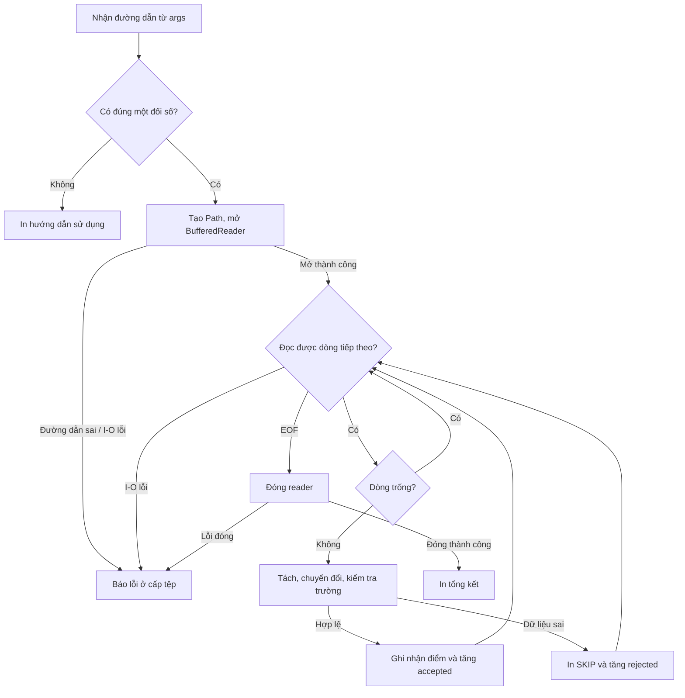

# Một ví dụ xuyên suốt: đọc và xử lý dữ liệu đầu vào bằng Java Exception

> Phạm vi: Java Core – Exception, phần Tổng quan. Ví dụ sử dụng Java 17 trở lên và chỉ phụ thuộc thư viện chuẩn Java SE.

## 1. Bài toán và kết quả cần đạt

Một ứng dụng cần đọc tệp văn bản chứa điểm của học viên. Mỗi dòng có đúng hai trường, ngăn bằng dấu phẩy:

```text
ten,diem
```

Ví dụ `An,85` nghĩa là học viên `An` có điểm `85`. Điểm hợp lệ là số nguyên từ `0` đến `100`. Một dòng sai định dạng **không được khiến toàn bộ tệp mất kết quả**; ứng dụng bỏ qua dòng sai, báo lý do và xử lý tiếp. Ngược lại, nếu tệp không tồn tại hoặc đang đọc mà có sự cố I/O, chương trình phải báo lỗi ở cấp tệp vì không còn cơ sở khẳng định dữ liệu đã đọc đầy đủ.

Ta sẽ xây dựng chương trình `InputProcessingDemo.java` thực hiện trọn luồng:

1. Nhận đường dẫn tệp qua đối số dòng lệnh.
2. Mở tệp dưới dạng UTF-8 với `Files.newBufferedReader` và `try-with-resources`.
3. Đọc từng dòng; bỏ qua dòng trắng hoàn toàn.
4. Kiểm tra hai trường `tên,điểm`, chuyển điểm thành `int`, kiểm tra miền `0..100`.
5. Giữ các dòng hợp lệ; báo các dòng không hợp lệ mà vẫn tiếp tục.
6. In số dòng được chấp nhận, số dòng bị loại và điểm trung bình của **các dòng hợp lệ**.
7. Phân biệt lỗi dùng chương trình, lỗi định dạng dữ liệu và lỗi đọc tệp.

**Hai ranh giới lỗi cần hiểu:** Một dòng dữ liệu sai là lỗi cục bộ, có thể tiếp tục đọc. Một `IOException` trong lúc mở/đọc/đóng tài nguyên là lỗi ở cấp toàn bộ thao tác đọc; cần để nó đi đến tầng điều phối hoặc xử lý ở đó.

## 2. Nhìn toàn bộ luồng trước khi viết mã



Sơ đồ mô tả **chính sách lỗi mà ứng dụng chủ động chọn**, không phải mọi ngoại lệ đều có quy tắc xử lý giống nhau. Đặc biệt, không nên dùng một `catch (Exception e)` bao hết để coi lỗi lập trình và lỗi dữ liệu là ngang nhau.

## 3. Dữ liệu đầu vào cố định để đối chiếu

Tạo tệp `grades.csv` trong cùng thư mục sẽ dùng để chạy chương trình, lưu với UTF-8:

```text
An,85
Binh,abc
Chi,105
,72
Dung,90
Mai, 70
```

Đây là **định dạng đơn giản có hai trường phân cách bằng dấu phẩy**, không phải trình đọc CSV đầy đủ theo RFC 4180. Bài tập không hỗ trợ dấu phẩy trong tên, dấu ngoặc kép bao trường hay nhiều dòng trong một trường. Trong sản phẩm cần CSV chuẩn, hãy sử dụng parser CSV phù hợp.

Dự kiến sau khi xử lý:

| Dòng | Dữ liệu | Kết quả |
| --- | --- | --- |
| 1 | `An,85` | Hợp lệ, cộng `85` |
| 2 | `Binh,abc` | Sai: điểm không phải số nguyên |
| 3 | `Chi,105` | Sai: điểm nằm ngoài `0..100` |
| 4 | `,72` | Sai: thiếu tên |
| 5 | `Dung,90` | Hợp lệ, cộng `90` |
| 6 | `Mai, 70` | Hợp lệ sau khi bỏ khoảng trắng quanh điểm |

Tổng điểm hợp lệ: `85 + 90 + 70 = 245`. Trung bình: `245 / 3 = 81,666...`, hiển thị hai chữ số sau dấu thập phân là `81.67`.

## 4. Mã nguồn Java 17 hoàn chỉnh, có thể chạy ngay

Tạo tệp **`InputProcessingDemo.java`**; tên tệp phải khớp tên lớp `public`. Chương trình dưới đây dùng một lớp chính cùng hai kiểu lồng bên trong, không cần thư viện ngoài.

```java
import java.io.BufferedReader;
import java.io.IOException;
import java.nio.charset.StandardCharsets;
import java.nio.file.Files;
import java.nio.file.InvalidPathException;
import java.nio.file.NoSuchFileException;
import java.nio.file.Path;
import java.util.Locale;

public class InputProcessingDemo {

    // Một bản ghi chỉ xuất hiện sau khi đã kiểm tra hợp lệ.
    private record Grade(String name, int score) {}

    // Ngoại lệ checked dành riêng cho dữ liệu sai ở một dòng.
    private static final class InvalidRecordException extends Exception {
        InvalidRecordException(String message) {
            super(message);
        }

        InvalidRecordException(String message, Throwable cause) {
            super(message, cause);
        }
    }

    public static void main(String[] args) {
        if (args.length != 1) {
            System.err.println("Usage: java InputProcessingDemo <file>");
            return;
        }

        try {
            processFile(Path.of(args[0]));
        } catch (InvalidPathException ex) {
            System.err.println("ERROR: invalid file path");
        } catch (NoSuchFileException ex) {
            System.err.println("ERROR: input file not found");
        } catch (IOException ex) {
            System.err.println("ERROR: failed to read input ("
                    + ex.getClass().getSimpleName() + ")");
        }
    }

    private static void processFile(Path path) throws IOException {
        int accepted = 0;
        int rejected = 0;
        int sum = 0;

        // Mở, đọc và đóng tệp đúng cách, kể cả khi phát sinh IOException.
        try (BufferedReader reader =
                     Files.newBufferedReader(path, StandardCharsets.UTF_8)) {

            String line;
            int lineNumber = 0;

            while ((line = reader.readLine()) != null) {
                lineNumber++;

                // Quy ước: dòng trắng không tính là bản ghi bị loại.
                if (line.isBlank()) {
                    continue;
                }

                try {
                    Grade grade = parseRecord(line);

                    accepted++;
                    sum += grade.score();
                    System.out.printf(
                            Locale.ROOT,
                            "ACCEPT line %d: %s=%d%n",
                            lineNumber, grade.name(), grade.score());

                } catch (InvalidRecordException ex) {
                    // Lỗi dữ liệu được cô lập ở đúng dòng đang xử lý.
                    rejected++;
                    System.out.printf(
                            Locale.ROOT,
                            "SKIP line %d: %s%n",
                            lineNumber, ex.getMessage());
                }
            }
        }

        // Chỉ đến đây nếu cả quá trình đọc và đóng reader thành công.
        double average = accepted == 0 ? 0.0 : sum / (double) accepted;
        System.out.printf(
                Locale.ROOT,
                "SUMMARY accepted=%d rejected=%d average=%.2f%n",
                accepted, rejected, average);
    }

    private static Grade parseRecord(String raw)
            throws InvalidRecordException {

        // -1 giữ cả trường rỗng: "An," hoặc ",85" đều có 2 phần.
        String[] fields = raw.split(",", -1);
        if (fields.length != 2) {
            throw new InvalidRecordException("expected name,score");
        }

        String name = fields[0].trim();
        if (name.isEmpty()) {
            throw new InvalidRecordException("name is empty");
        }

        String scoreText = fields[1].trim();
        final int score;

        try {
            score = Integer.parseInt(scoreText);
        } catch (NumberFormatException ex) {
            // Bọc lỗi chuyển kiểu nhưng giữ nguyên nguyên nhân ban đầu.
            throw new InvalidRecordException(
                    "score is not an integer", ex);
        }

        if (score < 0 || score > 100) {
            throw new InvalidRecordException(
                    "score must be between 0 and 100");
        }

        return new Grade(name, score);
    }
}
```

### Chạy chương trình

Mở terminal tại thư mục chứa hai tệp `InputProcessingDemo.java` và `grades.csv`. Chọn JDK 17 hoặc mới hơn:

```bash
java -version
javac -version
javac -encoding UTF-8 InputProcessingDemo.java
java InputProcessingDemo grades.csv
```

Tùy terminal, `java -version` có thể ghi phiên bản ra stderr. Với nội dung `grades.csv` ở trên, stdout của lệnh chạy cuối **chính xác** là:

```text
ACCEPT line 1: An=85
SKIP line 2: score is not an integer
SKIP line 3: score must be between 0 and 100
SKIP line 4: name is empty
ACCEPT line 5: Dung=90
ACCEPT line 6: Mai=70
SUMMARY accepted=3 rejected=3 average=81.67
```

Chạy với đường dẫn không tồn tại, chẳng hạn `java InputProcessingDemo missing-file.csv`, thì chương trình báo `ERROR: input file not found` ra **stderr**. Lệnh không có đối số báo cách sử dụng ra stderr. Đầu ra cụ thể cho các lỗi hệ thống khác tùy loại `IOException` thực tế, nên không nên cố định thông điệp hệ điều hành trong test.

**Lưu ý về mã hóa:** `javac -encoding UTF-8` chỉ chỉ định cách đọc **mã nguồn**. `StandardCharsets.UTF_8` trong `Files.newBufferedReader` quy định cách giải mã **tệp dữ liệu**. Đây là hai trách nhiệm độc lập.

## 5. Mổ xẻ cơ chế Exception ở từng chặng

### 5.1. Tầng lời gọi: đối số, đường dẫn và tệp

`args.length != 1` được kiểm tra trước khi truy cập `args[0]`. Nếu quên kiểm tra, có thể nhận `ArrayIndexOutOfBoundsException` — một `RuntimeException` do lỗi logic của chương trình, không phải lỗi dữ liệu trong tệp.

`Path.of(args[0])` có thể ném `InvalidPathException`, là unchecked exception (kế thừa `IllegalArgumentException`). Mẫu này bắt riêng lỗi đường dẫn không hợp lệ để đưa ra thông điệp phù hợp.

`Files.newBufferedReader(path, StandardCharsets.UTF_8)` có thể ném checked `IOException` khi mở tệp. Nếu tệp không tồn tại, trường hợp thông dụng là `NoSuchFileException` (một lớp con của `IOException`). Vì vậy `catch (NoSuchFileException ex)` phải đứng **trước** `catch (IOException ex)`.

Ví dụ luồng lỗi:

```text
main
  └─ processFile(Path)
       └─ Files.newBufferedReader(...)
            └─ NoSuchFileException
       ↑ không có catch phù hợp trong processFile
  └─ catch (NoSuchFileException) → stderr
```

Khai báo `processFile(Path path) throws IOException` thể hiện hợp đồng: phương thức có thể để lỗi I/O lan lên người gọi. Tầng `main` quyết định cách trình bày cho người sử dụng. Không cần và không nên rải `try/catch IOException` quanh từng lần `readLine()` nếu chính sách của ứng dụng là dừng khi luồng đọc hỏng.

### 5.2. Tầng đọc: `try-with-resources` và `readLine()`

Câu lệnh:

```java
try (BufferedReader reader =
             Files.newBufferedReader(path, StandardCharsets.UTF_8)) {
    // đọc dữ liệu
}
```

tự gọi `reader.close()` khi thoát khối, kể cả khi thân khối ném ngoại lệ. `BufferedReader` triển khai `Closeable`, cũng là `AutoCloseable`; `close()` có thể ném `IOException`. Vì thế việc **đóng tài nguyên** cũng là một phần của thao tác I/O cần xử lý.

Nếu cả thân khối và `close()` cùng ném ngoại lệ, `try-with-resources` ưu tiên giữ ngoại lệ từ thân khối và lưu ngoại lệ phát sinh khi đóng vào danh sách `getSuppressed()` của ngoại lệ chính. Đây là cơ chế **suppressed exception**, khác với **cause** khi ta tự bọc một lỗi vào ngoại lệ khác. Trong sản phẩm, log nên giữ stack trace và suppressed/cause để không mất thông tin quan trọng.

`BufferedReader.readLine()` trả về một chuỗi khi đọc được dòng; trả về `null` khi đến cuối tệp (EOF) bình thường; và có thể ném `IOException` nếu đọc lỗi. **EOF không phải một ngoại lệ**, nên vòng lặp sử dụng `!= null` thay vì lấy lỗi làm tín hiệu kết thúc.

Số thứ tự `lineNumber` tăng cho mỗi dòng thực đọc, kể cả dòng trắng. Nhờ vậy lỗi có thể được đối chiếu chính xác với tệp gốc. Quy ước trong bài: dòng trắng được bỏ qua, không tính là lỗi; nếu nghiệp vụ yêu cầu dòng trắng là sai, thay chính sách kiểm tra này.

### 5.3. Tầng phân tích dữ liệu: từ unchecked sang checked exception có ngữ cảnh

`Integer.parseInt(scoreText)` ném `NumberFormatException` khi chuỗi không biểu diễn được `int` thập phân; nó là lớp con của `IllegalArgumentException` và `RuntimeException` nên không bắt buộc phải khai báo `throws`.

Trong bài toán này, một chuỗi điểm sai là **trường hợp dữ liệu nghiệp vụ dự kiến có thể xảy ra**. Ta đổi nó thành ngoại lệ riêng `InvalidRecordException extends Exception` (checked) và giữ cause:

```java
try {
    score = Integer.parseInt(scoreText);
} catch (NumberFormatException ex) {
    throw new InvalidRecordException(
            "score is not an integer", ex);
}
```

Khi dòng `Binh,abc` đi qua:

1. `Integer.parseInt("abc")` ném `NumberFormatException`.
2. `parseRecord` bắt lỗi chuyển kiểu và tạo `InvalidRecordException`, message thân thiện hơn và cause trỏ về `NumberFormatException` gốc.
3. `processFile` bắt `InvalidRecordException` ở phạm vi **một dòng**, in `SKIP` rồi đi tiếp.
4. Dòng kế tiếp vẫn được đọc bình thường.

Có thể kiểm tra nguyên nhân gốc bằng `ex.getCause()` ở nơi xử lý `InvalidRecordException`, ví dụ:

```java
Throwable cause = ex.getCause();
if (cause != null) {
    // Log kỹ thuật tại đây; không cần lộ chi tiết cho người nhập dữ liệu.
}
```

Đoạn trên chỉ là **mã minh họa bên trong nhánh catch**, không phải một chương trình riêng. Chỉ bọc ngoại lệ khi kiểu mới giúp người gọi xử lý theo một hợp đồng có ý nghĩa. Với ứng dụng rất nhỏ, cũng có thể bắt trực tiếp `NumberFormatException` tại điểm xử lý dòng; lớp riêng ở đây được dùng để thống nhất các loại lỗi đầu vào.

### 5.4. Sai kiểu dữ liệu khác sai miền giá trị

Dòng `Binh,abc` không thể đổi thành `int`. Dòng `Chi,105` đổi thành công, nhưng không thuộc miền điểm hợp lệ `0..100`. Vì vậy phải có cả hai bước:

```java
int score = Integer.parseInt(scoreText); // kiểm tra cú pháp số nguyên
if (score < 0 || score > 100) {          // kiểm tra quy tắc nghiệp vụ
    throw new InvalidRecordException(
            "score must be between 0 and 100");
}
```

Đây là **đoạn minh họa** về hai tầng kiểm tra, không phải chương trình chạy độc lập và giả định `scoreText` cùng `InvalidRecordException` đã được định nghĩa. Nếu chỉ dựa vào `NumberFormatException`, chương trình sẽ nhận nhầm điểm `105` là hợp lệ. Ngược lại, `-5` là một số nguyên hợp lệ về cú pháp nhưng không phải điểm hợp lệ.

`split(",", -1)` giúp phát hiện trường rỗng và số lượng trường không đúng: `"An,"` tạo hai phần trong đó điểm rỗng, `",85"` tạo tên rỗng, `"An,85,extra"` tạo ba phần và bị từ chối. `trim()` bỏ khoảng trắng đơn giản ở đầu/cuối trường; với Unicode và định dạng dữ liệu phức tạp cần xác định chính sách chuẩn hóa rõ ràng.

### 5.5. Ranh giới xử lý lỗi quyết định ứng dụng có thể tiếp tục hay không

| Tình huống | Ngoại lệ/tín hiệu | Nơi xử lý | Hành vi |
| --- | --- | --- | --- |
| Thiếu đối số | Kiểm tra điều kiện, không ném exception | `main` | In hướng dẫn |
| Đường dẫn không hợp lệ | `InvalidPathException` (unchecked) | `main` | Báo đường dẫn sai |
| Tệp không tồn tại | `NoSuchFileException` (checked, thuộc `IOException`) | `main` | Báo không thấy tệp, dừng |
| Lỗi đọc hoặc đóng tệp | `IOException` (checked) | `main` | Báo lỗi I/O, dừng |
| Không đúng hai trường | `InvalidRecordException` (checked tự định nghĩa) | Vòng lặp từng dòng | Ghi SKIP, tiếp tục |
| Không đổi được điểm | `NumberFormatException` (unchecked) → `InvalidRecordException` | `parseRecord` → vòng lặp | Giữ cause, ghi SKIP, tiếp tục |
| Điểm ngoài `0..100` hoặc thiếu tên | `InvalidRecordException` | Vòng lặp từng dòng | Ghi SKIP, tiếp tục |
| Hết tệp bình thường | `readLine() == null` | Vòng lặp | Thoát, đóng, tổng kết |

Bắt ngoại lệ ở **tầng có đủ thông tin ra quyết định**. `parseRecord` biết cấu trúc bản ghi, nhưng không nên tự in log hoặc quyết định bỏ qua dòng. `processFile` biết cách đếm và tiếp tục; `main` biết ứng dụng gọi từ terminal cần thông báo lỗi đường dẫn hay I/O.

## 6. Cách chạy thử các trường hợp biên

Sau khi xác nhận ví dụ chính, có thể đổi nội dung `grades.csv` lần lượt để tự quan sát các nhánh. Bảng sau mô tả đúng hợp đồng của mã đã viết.

| Dòng trong tệp | Kết quả dự kiến | Giải thích |
| --- | --- | --- |
| `An,0` | `ACCEPT`, điểm `0` | Ranh dưới hợp lệ |
| `An,100` | `ACCEPT`, điểm `100` | Ranh trên hợp lệ |
| `An,-1` | `SKIP`: ngoài `0..100` | Chuyển thành số được nhưng sai miền |
| `An,101` | `SKIP`: ngoài `0..100` | Sai miền |
| `An,12.5` | `SKIP`: không là số nguyên | `parseInt` không xử lý số thực |
| `An,` | `SKIP`: không là số nguyên | Trường điểm rỗng |
| `,72` | `SKIP`: thiếu tên | Tên rỗng sau `trim()` |
| `An` | `SKIP`: cần `name,score` | Chỉ có một trường |
| `An,85,extra` | `SKIP`: cần `name,score` | Có ba trường |
| ` An , 85 ` | `ACCEPT`, tên `An` và điểm `85` | Bỏ khoảng trắng đầu/cuối trường |
| Dòng trống hoặc chỉ dấu cách | Bỏ qua, không tăng bộ đếm | Quy ước trong ví dụ |

Nếu toàn bộ các dòng đều bị loại hoặc chỉ gồm dòng trắng, chương trình tính trung bình `0.00` để tránh phép chia cho 0. Trong nghiệp vụ thật, cần phân biệt "không có dữ liệu hợp lệ" với "điểm trung bình thực bằng 0"; một thiết kế khác có thể hiển thị `N/A` khi `accepted == 0`.

### Tập kiểm thử theo lớp trách nhiệm

- **Parser:** nhập các trường sai kiểu, sai miền và sai số cột; kiểm tra `InvalidRecordException` có message phù hợp. Với `abc`, kiểm tra `getCause() instanceof NumberFormatException`.
- **Reader:** tệp rỗng, tệp có CRLF/LF, tệp nhiều dòng, tệp không tồn tại hoặc không đọc được. Kiểm tra không mất tài nguyên và bộ đếm dòng đúng.
- **Điều phối:** dữ liệu sai trong một dòng không chặn dòng sau; lỗi I/O không bị biến thành `SKIP`.
- **Đầu ra:** kết quả mẫu có đúng ba `ACCEPT`, ba `SKIP` và trung bình `81.67`; stderr tách với stdout trong trường hợp lỗi.
- **Môi trường:** chạy với phiên bản JDK đích, đường dẫn chứa dấu cách (truyền trong dấu nháy của shell) và UTF-8 thực tế.

Không nên viết kiểm thử dựa trên toàn bộ văn bản từ `IOException.getMessage()` của hệ điều hành vì thông điệp có thể khác giữa Windows, Linux, bản JDK hoặc ngôn ngữ hệ thống. Kiểm tra kiểu lỗi và quyết định xử lý sẽ bền vững hơn.

## 7. Những chỗ cần đổi khi chuyển từ bài tập sang ứng dụng thật

### 7.1. Phân biệt lỗi kỳ vọng và lỗi lập trình

Bài tập chủ ý dùng checked `InvalidRecordException` cho lỗi dữ liệu từng dòng. Điều này **không có nghĩa** mọi kiểm tra dữ liệu trong mọi dự án phải viết custom checked exception. Một API có thể trả về kết quả phân tích dạng `Success/Failure`, một danh sách lỗi validation, hoặc dùng unchecked exception ở ranh giới thích hợp. Điều quan trọng là hợp đồng xử lý: có bỏ qua, thử lại, yêu cầu người dùng sửa, hay dừng toàn bộ?

Không nên viết:

```java
try {
    // đọc tất cả
} catch (Exception ex) {
    // bỏ qua
}
```

Ví dụ trên chỉ minh họa **cách không nên xử lý**. Nó có thể nuốt `NullPointerException` do bug và làm mất thông tin I/O. Cũng không nên bắt `Throwable` để "chạy tiếp bằng mọi giá", vì sẽ bắt cả nhiều `Error` nghiêm trọng.

### 7.2. Không in thông tin nhạy cảm từ dữ liệu đầu vào

Trong ví dụ, chuỗi tên được in vì dữ liệu mẫu không nhạy cảm. Với thông tin cá nhân, mật khẩu, access token hoặc bản ghi tài chính, không log nguyên dòng. Ghi mã lỗi, số dòng và định danh đã được che phù hợp; log chi tiết kỹ thuật chỉ tại kênh có kiểm soát. Nếu cần thông báo cho người dùng, ưu tiên message nghiệp vụ rõ ràng thay cho stack trace.

### 7.3. Giới hạn bộ nhớ, số học và định dạng

`BufferedReader` cho phép duyệt tệp tuần tự mà không phải tải toàn bộ tệp vào một `List`. Tuy nhiên, một dòng cực dài vẫn tiêu thụ bộ nhớ đáng kể. Với input không tin cậy, nên áp dụng giới hạn dung lượng tệp, chiều dài dòng và số bản ghi theo hợp đồng. Ví dụ dùng biến `int sum` đủ với tệp nhỏ; nếu số bản ghi có thể rất lớn, dùng `long` hoặc kiểm soát tràn số vì phép cộng `int` có thể overflow mà không tự ném exception.

Nếu yêu cầu CSV thực sự, một tệp như `"Nguyen, Van A",85` phải được parse đúng theo quy tắc quoting, khác hẳn `split(",")`. Không âm thầm tuyên bố parser của bài hỗ trợ mọi dạng CSV.

### 7.4. Chỉ in tổng kết khi thao tác thành công

Trong mẫu, phần tính và in `SUMMARY` đặt **sau** khối `try-with-resources`. Nếu đọc hoặc đóng tệp thất bại, chương trình không in tổng kết có thể khiến người dùng hiểu nhầm rằng đã xử lý toàn bộ dữ liệu. Có thể đã có một số dòng `ACCEPT` được in trước khi I/O lỗi; đó là kết quả tạm thời, **không** đồng nghĩa nhập dữ liệu hoàn tất.

Với ứng dụng thật ghi vào cơ sở dữ liệu, cần cân nhắc xử lý giao dịch: có commit từng dòng thành công, rollback toàn tệp hay dùng batch có checkpoint. Ví dụ này chỉ tổng hợp trong bộ nhớ và in console, chưa có tính bền vững hay tính nguyên tử của giao dịch.

### 7.5. Trả mã thoát và quan sát lỗi

Ví dụ sử dụng `return` trong `main` và in stderr cho các ca lỗi để giữ code ngắn, dễ đọc. Chương trình do script gọi thường cần mã thoát khác 0 khi lỗi, có thể bổ sung cơ chế exit code/runner phù hợp. Không nên suy ra mọi dòng `ERROR` ở stderr đương nhiên làm tiến trình exit khác 0.

`printStackTrace()` hoặc logger có thể hữu ích trong chẩn đoán, nhưng để tránh lộ dữ liệu và nhiễu console, chương trình mẫu chỉ in loại lỗi tệp. Trong hệ thống thật, ghi log exception kèm cause/suppressed đầy đủ ở nơi có thẩm quyền xử lý.

## 8. Những lỗi phổ biến và cách sửa

1. **Chỉ dùng `Integer.parseInt` rồi để `NumberFormatException` thoát ra ngoài.** Với chính sách "bỏ qua dòng sai", phải cô lập tại vòng lặp hoặc chuyển thành kết quả/ngoại lệ dữ liệu có ngữ cảnh.
2. **Bắt `IOException` trong từng vòng nhưng vẫn lặp vô hạn.** Khi luồng đọc đã lỗi, không giả định `readLine()` tiếp theo có thể khôi phục; cần quyết định dừng, thử lại có điều kiện hoặc chuyển tới tầng chịu trách nhiệm.
3. **Quên đóng reader.** Dùng `try-with-resources` thay vì dựa vào GC hay viết `finally` thủ công cho trường hợp thông thường.
4. **Dùng `catch (Exception)` rộng và chỉ `continue`.** Lỗi lập trình, lỗi parse và lỗi I/O cần chính sách khác nhau.
5. **Đổi ngoại lệ nhưng không truyền cause.** Khi bọc `NumberFormatException`, truyền `ex` cho constructor nhận `Throwable cause` để giữ dấu vết kỹ thuật.
6. **Nhầm `null` từ `readLine()` với ngoại lệ.** `null` là EOF bình thường; `IOException` là lỗi thực sự.
7. **Dùng `split(",")` mặc định và bỏ qua trường rỗng cuối.** Tham số `-1` giữ trường rỗng để kiểm tra đúng số cột.
8. **Chỉ kiểm tra parse thành công mà không kiểm tra miền.** `105` parse được, nhưng không phải điểm hợp lệ.
9. **Dùng dấu phẩy như CSV chuẩn.** Parser này không xử lý quoted field, embedded comma/newline và những quy tắc khác của CSV.
10. **In `SUMMARY` trong `finally` rồi coi là hoàn tất.** Một lỗi đọc có thể xảy ra sau vài dòng đã xử lý; cần biểu thị rõ thao tác chưa hoàn thành.
11. **Đọc cả tệp bằng `Files.readAllLines` khi không cần.** Với dữ liệu lớn, xử lý tuần tự giúp giới hạn bộ nhớ tốt hơn.
12. **Xem exception như mọi lỗi cần bắt để chạy tiếp.** Chỉ nên phục hồi khi trạng thái còn hợp lệ và có quy tắc xử lý rõ ràng.

## 9. Tự đánh giá sau bài học

**Câu 1.** Vì sao `NoSuchFileException` được catch trước `IOException`?

Vì nó là lớp con của `IOException`. Nếu đặt `catch (IOException)` trước, nhánh `catch (NoSuchFileException)` bên dưới không thể tới được và compiler báo lỗi.

**Câu 2.** Vì sao nhập `Binh,abc` vẫn cho phép đọc dòng `Chi,105`?

Ngoại lệ chuyển số được đổi sang `InvalidRecordException` và được bắt **bên trong vòng lặp cho từng dòng**. Nhánh catch chỉ ghi nhận dòng bị loại, sau đó vòng lặp tiếp tục.

**Câu 3.** Tại sao `IllegalArgumentException` hoặc `NumberFormatException` không phải khai báo `throws`, còn `IOException` thì có thể phải?

Hai kiểu đầu nằm dưới `RuntimeException`, nên là unchecked. `IOException` là checked exception; mã có thể ném nó phải bắt hoặc khai báo theo quy tắc phân tích của ngôn ngữ.

**Câu 4.** Nếu `close()` cũng ném lỗi khi đang xử lý `IOException` từ `readLine()`, lỗi nào được ưu tiên?

Với `try-with-resources`, ngoại lệ trong thân khối được giữ làm primary; lỗi đóng tài nguyên được gắn vào danh sách suppressed của primary. Quan sát qua `getSuppressed()` khi cần điều tra.

**Câu 5.** Có thể đổi `split(",", -1)` thành `split(",")` một cách vô hại không?

Không. `split(",")` mặc định bỏ các trường rỗng ở cuối. Với định dạng cần đúng hai trường, điều đó có thể làm khó việc xác định thiếu điểm và lý do lỗi chính xác.

**Câu 6.** Tại sao tổng kết in sau khi đóng tài nguyên?

Vì một thao tác I/O có thể thất bại lúc đọc hoặc đóng. In tổng kết sau khối giúp tránh thông báo "đã hoàn thành" khi còn lỗi I/O chưa được xử lý.

**Câu 7.** Nếu sau này điểm được nhập dưới dạng `85.5`, chỉ đổi `parseInt` sang `parseDouble` có đủ không?

Chưa. Phải cập nhật hợp đồng kiểu dữ liệu, kiểm tra miền, công thức tính, định dạng output và test. Cần định nghĩa cả chính sách giá trị đặc biệt như `NaN` hoặc vô cực nếu dùng số thực; `parseDouble` có thể đọc những dạng đó.

## 10. Tài liệu Java chuẩn để đọc tiếp

- [Java 17 API – BufferedReader.readLine](https://docs.oracle.com/en/java/javase/17/docs/api/java.base/java/io/BufferedReader.html#readLine()) — đọc dòng, EOF và `IOException`.
- [Java 17 API – Files.newBufferedReader](https://docs.oracle.com/en/java/javase/17/docs/api/java.base/java/nio/file/Files.html#newBufferedReader(java.nio.file.Path,java.nio.charset.Charset)) — đọc tệp theo charset và ngoại lệ I/O.
- [Java 17 API – Integer.parseInt](https://docs.oracle.com/en/java/javase/17/docs/api/java.base/java/lang/Integer.html#parseInt(java.lang.String)) — cách chuyển số và `NumberFormatException`.
- [Java 17 API – Throwable](https://docs.oracle.com/en/java/javase/17/docs/api/java.base/java/lang/Throwable.html) — `getCause()`, `getSuppressed()` và stack trace.
- [Java Language Specification 17, §11 Exceptions](https://docs.oracle.com/javase/specs/jls/se17/html/jls-11.html) — hệ checked/unchecked và phân tích ngoại lệ.
- [Java Language Specification 17, §14.20.3 try-with-resources](https://docs.oracle.com/javase/specs/jls/se17/html/jls-14.html#jls-14.20.3) — quy tắc đóng tài nguyên và suppressed exception.

Hoàn thành bài này nghĩa là bạn có thể tự vẽ được nơi phát sinh, nơi bắt và chính sách xử lý của từng ngoại lệ trong chuỗi **nhận input → đọc → phân tích → kiểm tra → tổng hợp → đóng tài nguyên**; viết được ví dụ chạy trên Java 17, kiểm tra các dòng hợp lệ/sai và giải thích vì sao chương trình tiếp tục hay dừng trong từng tình huống.