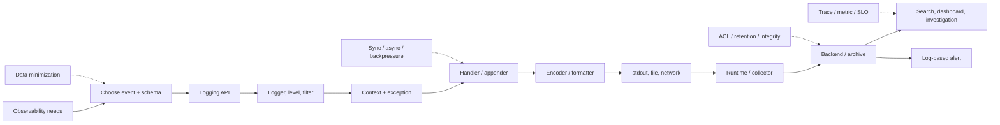
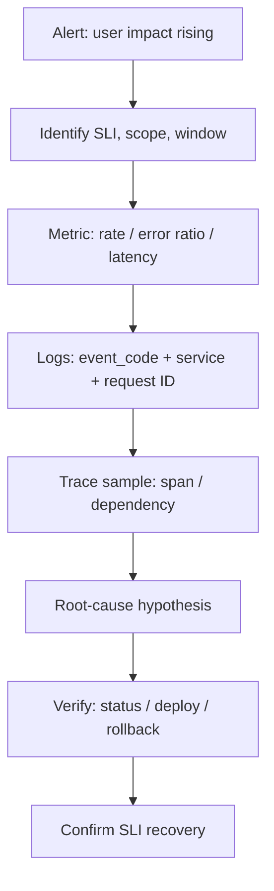
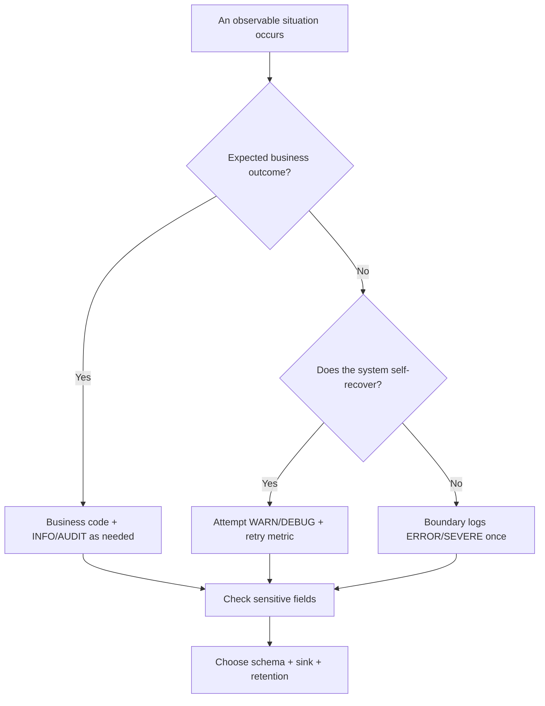

# Java Logging Concept Map: From Log Event to Observability

## 1. Purpose and How to Read the Map

Logging is part of the observability system for a Java application, but **logging is not just calling `System.out.println` or `logger.error`**. To design it properly, you need to understand the links in the chain: **event to record → logging API → logger/level/filter/context → appender/handler/encoder → stdout/file/network → collector → storage → query/investigation/alerting**, while also defining boundaries for security, cost, and durability.

This lesson is a **summary concept map**. Instead of learning classes and frameworks as isolated pieces, be able to answer four questions for every scenario:

1. **What to log?** Which business/technical event, does it need to be logged, and which metadata should be included?
2. **Who decides to log?** How do the logging API, logger tree, levels, filters, and context work?
3. **Where to write?** Which encoder, handler/appender, sync/async mode, stdout, file, collector, and backend?
4. **What is the output used for?** Error investigation, trace correlation, metric aggregation, alerting, auditing, and meeting retention and privacy requirements?

One key point to remember throughout: **a log event is not synonymous with a business transaction**, and a successful logging API call **does not by itself prove that the data has been durably stored in the final backend**.

### Overall Diagram



The diagram illustrates a **logical flow**; it does not mean every system must have every box or that an encoder is always a separate object sitting behind an appender. For example, in Logback, an encoder is typically configured **inside the appender**; JUL uses a `Handler` together with a `Formatter`; a managed platform may combine the collector and backend.

## 2. Mind Map: Six Branches to Master

```text
JAVA LOGGING
|
+-- (1) PURPOSE
|   +-- Diagnostic / troubleshooting
|   +-- Operational events / access
|   +-- Security detection
|   +-- Audit evidence: separate contract
|
+-- (2) EVENT
|   +-- Event code, severity, timestamp
|   +-- Logger name, operation, outcome
|   +-- Request ID / trace ID / span ID
|   +-- Throwable + cause / stack trace
|   +-- Privacy: no raw secrets
|
+-- (3) IN-JVM MECHANISM
|   +-- API: JUL, SLF4J, Log4j 2 API
|   +-- Backend: JUL, Logback, Log4j 2 Core...
|   +-- Logger hierarchy, level, filter
|   +-- MDC / ThreadContext / context propagation
|   +-- Handler / appender / formatter / encoder
|   +-- Sync, async, queue / backpressure
|
+-- (4) PATH AND STORAGE
|   +-- Console stdout / stderr
|   +-- Rolling file / syslog / network
|   +-- Container runtime / node
|   +-- Collector / buffer / retry
|   +-- Central backend / archive / retention
|
+-- (5) OBSERVABILITY
|   +-- Log: what happened
|   +-- Metric: frequency / rate / latency
|   +-- Trace: request path
|   +-- Alert: when action is needed
|   +-- SLI / SLO / error budget
|
+-- (6) GOVERNANCE & QUALITY
    +-- Schema and cardinality
    +-- Privacy, masking, redaction
    +-- Access control, audit, retention
    +-- Duplicates, loss, sampling
    +-- Performance, cost, testing
```

This map also serves as a **diagnostic framework**: when logs are missing, check branches (3) and (4); when tracking down an error, go from (5) to (2); when logs leak tokens or cost too much, examine branch (6) and return to (1).

## 3. Branch 1 — Purpose: Why Create an Event?

Every log event should have a **consumer** and a **decision it supports**. Not every processing step needs an INFO line.

| Event type | Question to answer | Examples | Assurance level to consider |
| --- | --- | --- | --- |
| Diagnostic | Why did code take this branch? | Dependency timeout, parse failed | Can often be filtered/sampled in a controlled way |
| Operational | What is the system doing? | Worker started, job completed | Should include event code and correlation |
| Access | Which request was processed? | Route, status, duration | Avoid bodies/queries containing sensitive data |
| Security | Is there behavior to detect? | Auth failure, unusual permission change | Restricted read access, no credential exposure |
| Audit | Who did what and what was the final outcome? | Permission change, committed transaction | May require separate transaction, integrity, and retention |

**A common mistake:** using `ERROR` logs as an audit ledger. A log pipeline can drop events when a queue is full, during restarts, or when a collector is lost; it is not necessarily transactional with the database. If a business contract requires **the business change and the audit record to coexist**, consider an audit row/outbox in the same transaction and a separately governed audit store.

### 3.1. Event or State?

- **Event:** `order_created` indicates that an action occurred according to the emitter's contract.
- **State:** `order.status=CREATED` in the database represents the current state.
- **Metric:** `orders_created_total` is an aggregated counter.
- **Trace span:** represents an operation over time, with start/end/attributes.
- **Alert:** a condition requiring action, such as an excessively high order error rate.

Do not infer durable state solely from `logger.info("created")` if the log is written **before commit**. If the JVM crashes after commit but before logging, the business state exists while the log may be missing.

### 3.2. Initial Rules for Choosing a Log Level

| Conceptual level | When it is useful | Caveat |
| --- | --- | --- |
| ERROR / JUL SEVERE | Final operation failed, unrecoverable error at a boundary | Do not re-log the full stack trace at every layer |
| WARN / JUL WARNING | Retry, degraded mode, handled anomaly | A successful retry is not necessarily an operation failure |
| INFO | Valuable lifecycle/operational milestone | Avoid overly dense logging on the hot request path |
| DEBUG / JUL FINE | Diagnostic details when needed | Not automatically safe regarding PII |
| TRACE / JUL FINER/FINEST | Very detailed execution path | Expensive, easily causes log storms and payload leaks |

This table is only a **conceptual model**, not an absolute mapping between JUL and other backends. Level policies must consider the **impact, frequency, and recoverability** of the event.

## 4. Branch 2 — Anatomy of a Log Event

A good log is usually a **structured event**, not an ambiguous string:

```json
{
  "timestamp": "2026-11-10T02:45:00Z",
  "level": "WARN",
  "service": "checkout-api",
  "logger": "checkout.payment",
  "event": "dependency_retry",
  "operation": "authorize_payment",
  "request_id": "req-42",
  "trace_id": "trace-demo-7",
  "dependency": "payment-gateway",
  "error_code": "UPSTREAM_TIMEOUT",
  "attempt": 2,
  "outcome": "RETRYING"
}
```

This is an **illustrative JSON example**, not production data or output from the Java demo below. Each field answers a specific question:

| Field | Role | Notes |
| --- | --- | --- |
| `timestamp` | When the application created the event | Choose consistent UTC/offset; may differ from ingest time |
| `level` | Importance level of the log | Do not use as data classification |
| `service` / `logger` | Emission source | Stable names, do not embed user input |
| `event` | Event type | Stable, queryable enum/code |
| `operation` | Logical operation | Use route/operation name, not raw URL |
| `request_id` | Correlate logs within one request | Validate length/characters; not a credential |
| `trace_id` / `span_id` | Correlate with trace | Taken from standardized trace context |
| `dependency` | Affected component | Use an alias, not a JDBC URL containing a password |
| `error_code` | Cause classification | Do not use raw exception messages as labels |
| `attempt` | Attempt number | Must know the counting scope and source |
| `outcome` | Status at the time of logging | RETRYING is different from final FAILED |
| `schema_version` | Schema contract if used | Useful during parser migrations |

**Reliability depends on when the log is written:** `event=order_applied` should be emitted after appropriate transaction confirmation, though it still does not guarantee the logger has durably persisted it. Do not print `ACK_CONFIRMED` in a message consumer if you have only **called the ack API** without evidence of broker confirmation.

### 4.1. Log Injection and Free-Form Data

If `userInput` contains newlines or strings that look like another log entry, concatenating it directly into the message can forge records or break parsers. Use an encoder with standard escaping, field allowlists, length limits, and data types. Do not build JSON via manual string concatenation for untrusted data.

### 4.2. Exceptions in Events

A `Throwable` has a type, message, cause chain, stack trace, and potentially suppressed exceptions. There are two competing needs:
- You need the stack trace to locate where it originated.
- The message/cause may contain URLs, SQL bind values, tokens, or user data.

Decide **where and when** a full throwable may be logged based on classification and sink. Do not print stack traces to clients; do not just use `e.getMessage()` and drop the `cause` when wrapping.

Example of translating an exception while preserving the cause:

```java
// Integration snippet; StorageException is a project-defined custom exception.
try {
    repository.store(order);
} catch (java.io.IOException cause) {
    throw new StorageException("STORAGE_UNAVAILABLE", cause);
}
```

The custom constructor must call `super(message, cause)`. This snippet **does not compile standalone** because `repository`, `order`, and `StorageException` belong to the real application.

## 5. Branch 3 — API, Facade, and Backend: Three Names That Are Not Synonymous

Java has multiple logging layers. You need to know **which API business code calls** and **which backend actually processes the event**.

| Technology | Typical role | Where encountered |
| --- | --- | --- |
| **JUL (`java.util.logging`)** | Built-in JDK logging API and handler/formatter | Plain Java apps / JDK libraries |
| **SLF4J** | Facade/API so applications do not depend directly on a backend | Java/Spring apps and libraries |
| **Logback Classic/Core** | Logging backend, logger hierarchy, appenders/encoders | Many systems using SLF4J |
| **Log4j 2 API/Core** | API and implementation, layouts/appenders | Systems using Log4j 2 |
| **Bridges/adapters** | Route calls between APIs or to the chosen backend | Applications with many libraries |
| **OpenTelemetry logging instrumentation** | Enrich/collect telemetry depending on implementation | Observability across multiple services |

**SLF4J is not itself a storage system or an appender.** If business code calls `LoggerFactory.getLogger(...)`, where the event goes depends on the active provider/backend.

**JUL is not synonymous with SLF4J**: JUL has its own `Logger` and `Handler`. You can route JUL to another backend via a properly configured bridge, but you must not create bridge loops back and forth.

**Log4j 2 is not synonymous with Log4j 1.x.** When reading config samples, confirm which API/backend and version they target. Do not mix snippets by guesswork.

### 5.1. API/Backend Relationship

```text
Application code
    |
    +--> SLF4J API --> chosen provider --> Logback OR compatible backend
    |
    +--> JUL API --> JUL handlers (or appropriate bridge)
    |
    +--> Log4j 2 API --> Log4j 2 Core / appropriate provider
                                     |
                                     v
                             Appenders / sinks
```

**Distinguish runtime dependencies:** a library using SLF4J can be embedded into an application using Logback or another provider. Do not add multiple providers at once and hope all logs merge automatically; check startup warnings and where records actually go.

### 5.2. Logger Hierarchy and Additivity

Inside a backend, there is a logger tree, for example:

```text
ROOT
  |
  +-- com.example
         |
         +-- com.example.orders
         |
         +-- com.example.billing
```

An event from `com.example.orders` can pass through that logger's appenders and **propagate up to ancestor/root loggers** according to policy. If the same console appender is attached to both the child logger and root with additivity enabled, a single event can be emitted **twice**. Do not fix duplicates by disabling all logs at the source; check the **logger tree, additivity, appender refs, and collector pipeline**.

In JUL, `Logger.setUseParentHandlers(false)` plays a similar role in preventing events from being sent to parent handlers. In Logback, there is `additivity="false"` on the logger; other backends have their own names/configuration syntax.

### 5.3. Level Filtering Happens Before and at the Sink

Simplified path:

```text
logger call
   |
   +--> logger disabled / filter DENY --> no record to sink
   |
   v
LogRecord / event created
   |
   +--> handler/appender level/filter DENY --> not emitted there
   |
   v
formatter / encoder
   |
   v
destination
```

A handler that only accepts WARN and above will not emit INFO even if the logger allows INFO. Conversely, setting the handler to ALL does not help if the logger already dropped the event at the start.

## 6. Context: MDC, ThreadContext, and Correlation

Log information should help link events belonging to the same request/job/message:
- `request_id`: identifies a request at the boundary.
- `trace_id`/`span_id`: links with distributed tracing.
- `job_id`/`execution_id`: identifies a scheduler run.
- `event_id`: logical event in a messaging system.
- `consumer`, `delivery_attempt`: distinguishes delivery attempts.
- `service`/`environment`/`version`: identifies the emission source.

With SLF4J/Logback, **MDC** typically stores thread-bound context; Log4j 2 has `ThreadContext`. Understand that **`ThreadLocal` does not automatically propagate across executor threads, reactive chains, or async callbacks**. If the framework supports context propagation, use the recommended API and clean up/restore context in the proper scope.

Integration example (requires SLF4J, not plain JDK Java):

```java
// Illustrative snippet only; logger and requestId are already created.
try {
    org.slf4j.MDC.put("requestId", safeRequestId);
    logger.info("event=order_created result=SUCCESS");
} finally {
    org.slf4j.MDC.remove("requestId");
}
```

In practice, if context already existed from an outer scope, you should **restore the previous value** rather than always removing it blindly. Do not put passwords, raw Authorization headers, session cookies, or entire DTOs into MDC.

### 6.1. Distinguishing IDs

```text
trace_id:        One distributed trace may have multiple operations
request_id:      One request may produce multiple log events
event_id:        One logical message may be delivered multiple times
delivery_id:     Identifies a single delivery depending on the broker
log_event_id:    A specific log record if emitted by the app/pipeline
business_key:    Identifies a business action for idempotency
```

Do not use `request_id` as a deduplication key for all logs; one request has many valid events. Do not use `trace_id` as a business idempotency key; a trace can contain multiple valid operations.

## 7. Branch 4 — Handler, Appender, Encoder, and Storage Destinations

### 7.1. JUL `Handler` and `Formatter`

JUL has the following components:
- `Logger` receives method calls and applies level/filter.
- `LogRecord` carries level, message, logger name, and timestamp/context at the JDK API level.
- `Handler` is responsible for publishing the record to a destination.
- `Formatter` produces the text representation.
- `ConsoleHandler` writes to **`System.err`** by default, not stdout.
- `FileHandler` writes to files according to its pattern/config.

Note: `java.util.logging` has differences in timestamp/context compared to SLF4J/Logback; do not transfer API names between the two stacks without verifying.

### 7.2. Logback/Log4j 2

- **Console appender:** writes to stdout/stderr according to the configured target.
- **File/RollingFile appender:** writes to files; requires permissions, quota, rotation, retention, and a collector.
- **Network appender:** sends to a sink from the JVM; requires TLS, auth, retry, backpressure, and timeouts.
- **Async appender/logger:** buffers events; can reduce normal-path latency, but a full queue can still drop or block.
- **Encoder/layout:** formats text/JSON; does not automatically mask secrets when unsafe data is passed in.

### 7.3. Log Path in Containers

```text
Java ConsoleAppender
        |
       stdout
        |
Docker / CRI runtime
        |
Node log file / logging driver
        |
Collector / DaemonSet
        |
Central store/index
        |
Dashboard / alert / archive
```

`docker logs` and `kubectl logs` can help view current output, **not permanent storage**. Pod/container deletion, kubelet rotation, or a down collector can lose the ability to query older logs if there is no central backend. If an app writes to a file without a tailing agent, `kubectl logs` does not automatically read that file.

### 7.4. Destination Selection Matrix

| Need | Reasonable starting point | Limits to verify |
| --- | --- | --- |
| CLI / local dev | Console | Formatting, color/TTY, no secret logging |
| Java service in container | JSON stdout → collector → backend | Runtime, rotation, no-data, drops |
| JVM on VM | Rolling file → file agent | Disk quota, rotation, checkpointing |
| Background job/CI | Console + retention if needed | Job/run ID, artifact retention |
| High-volume debugging | Filter/sampling + bounded pipeline | Do not lose mandatory events |
| Security investigation | Restricted dataset | IAM, access audit, export limits |
| Mandatory audit | Transactional outbox/protected store | Atomicity, replay, idempotency |
| SLO alerting | Metric/SLI engine; logs for investigation | No-data, alert route, runbook |

There is no single always-correct choice. "Stdout" is where the JVM emits bytes, not necessarily the **final destination**; a "central backend" is where you can query, though it may receive data through multiple paths.

## 8. Branch 5 — Logging and Observability

Logs, metrics, traces, and alerts serve different roles:

| Signal | Question | Example |
| --- | --- | --- |
| **Log** | Which event occurred? | `event=db_timeout requestId=req-42` |
| **Metric** | Rate, count, latency, and trend? | `http_requests_total`, duration histogram |
| **Trace** | Which services/spans did the request traverse? | API → order → payment |
| **Alert** | Which condition has enough impact to require response? | Error ratio exceeds SLO window |
| **Audit** | Who did what, with durable evidence? | Permission changed by actor |

**Logs do not replace metrics.** Counting raw `ERROR` lines can be wrong because one request may have multiple attempts, multiple exception layers, or collector retries. **Metrics do not replace logs.** A rising error rate tells you an incident is happening, while logs/traces point to the specific request and dependency.

### 8.1. From Alert Back to Logs



This is an **illustrative** investigation workflow; it does not mean an alert always comes from a metric or that a trace sample always exists. For security incidents, a high-urgency event may trigger a separate rule.

### 8.2. SLI, SLO, and Error Budget

If the availability SLO target is 99.9% over a period, the allowed failure ratio is `1 − 0.999 = 0.001`. If the current error ratio is 2%, the *burn rate* relative to the allowed error budget is `0.02 / 0.001 = 20` times within that window.

**These numbers are illustrative only.** An SLI must define the numerator/denominator accurately: eligible requests, bad requests, and status/operation semantics. A WARNING log from a retry does not mean the final request failed. Do not automatically page on every `logger.error`; alerts need windows, thresholds, minimum volume, owners, deduplication, runbooks, and a no-data policy.

### 8.3. Cardinality: IDs in Logs, Stable Groups in Metrics

`request_id`, `user_id`, or `event_id` have nearly unbounded values: useful in logs and traces, but usually **unsuitable as metric labels** or alert group keys. Metric labels should use service, operation/route template, result/error category, and environment with a controlled set of values.

## 9. Branch 6 — Privacy, Security, and Cost

A logging map that omits **where data leaks happen** is incomplete.

### 9.1. Data Minimization at the Source

Do not put into logs by default:
- Passwords, API keys, private keys, access/refresh tokens.
- Authorization/Cookie headers, signed URLs/queries containing secrets.
- Raw request/response bodies, form uploads, payment data.
- SQL bind values/connection strings with credentials.
- Unnecessary PII or sensitive info via DTO `toString()`.
- Unreviewed raw exception messages/causes.

**Masking differs from redaction differs from not logging:** masking replaces part of a value, redaction removes/destroys sensitive values, and not putting the value into the log in the first place is usually safer. A simple hash of an email can still be inferred or linked across datasets; it does not automatically make PII harmless.

### 9.2. Leak Sources Outside the JVM

Logs can travel to stdout/node files, collector spools, central indexes, ZIP exports, backups, alert emails/chats, and incident tickets. Masking in a dashboard **does not erase data already written** to earlier hops.

Control access by **identity × action × dataset × classification × time**:
- Collectors have `INGEST` to the right destination; they do not have SEARCH/EXPORT by default.
- On-call engineers read the appropriate service/environment.
- Bulk export and delete have separate permissions, approval/audit.
- Restricted/audit logs have separate ACLs/retention.
- JIT/break-glass access when needed, time-bound and post-audited.
- Do not allow admins to easily delete access audits about themselves.

### 9.3. Cost and Log Storms

A large log event written repeatedly can increase CPU/heap/GC, disk, network, and indexing costs. During an outage, increased retries can **generate more logs than when the system is healthy**, creating an amplification effect. Mitigations:
1. Choose **event codes and metadata** instead of raw payloads.
2. Log a throwable once at the boundary that owns the outcome.
3. Separate attempt-level and operation-level failures.
4. Use DEBUG/TRACE with limits and disable them by policy.
5. Measure throughput, queue depth, dropped records, formatter latency, and collector lag.
6. Preserve mandatory audit logs via dedicated architecture rather than blind sampling.

## 10. Selection Process: From Scenario to Sub-Diagram

Use this table as a **quick decision map**.

| When you encounter | Start at concept | Follow-up questions |
| --- | --- | --- |
| INFO not appearing | Logger level / appender filter | Was the event blocked at the logger or the handler? |
| JVM prints two identical lines | Additivity / multiple handlers | One callback or two deliveries? |
| Docker has logs, backend does not | Runtime → collector → backend | Parser, rotation, queue, IAM, time range? |
| Backend has duplicate logs | Fan-out / collector retry | Multiple agents or lost ACKs? |
| Request timeout causes many ERRORs | Logging boundary / retry | One failure or multiple attempts? |
| Cannot correlate logs across services | Correlation / MDC / trace | Is context propagated across async boundaries? |
| Token leaked via exception | Throwable / data minimization | Which sinks already received the raw message? |
| Latency rises when DEBUG is enabled | Formatter / I/O / sync-async | How are queue, disk, network, and GC loaded? |
| Alert on every failed request | SLI / metric / window | Impact ratio and minimum traffic? |
| Logs lost when Pod is deleted | Container rotation / central retention | Did the backend ship and retain the logs? |
| Need transaction audit | Durable outbox / transaction | Is there evidence tied to the business commit? |
| Users can view out-of-scope logs | Backend IAM / Kubernetes RBAC | Is there an API/backup bypass path? |

### 10.1. Level Selection Decision Branch



Not every business outcome is just INFO: security/audit actions may require logging under a separate policy. The diagram helps you **ask questions before picking a level**; it does not replace an actual error taxonomy.

### 10.2. Destination Selection Decision Branch

```text
Log for diagnostics?
    Yes -> Containerized service?
               Yes -> structured stdout -> runtime -> collector -> backend
               No -> console or rolling file -> agent -> backend
    No -> Mandatory audit record?
               Yes -> transactional audit/outbox + protected storage
               No -> check purpose, data class, SLA, and retention
```

Do not turn this choice into a rigid rule like "audit must never be written to console": you can **emit an allowed diagnostic record** alongside durable audit, but the two records have different responsibilities and must avoid leaks/double counting.

## 11. Standalone Java 17 Example: Observing the Entire Pipeline in the JVM

The demo below uses **JUL built into JDK 17**, requiring no external libraries. The program illustrates:
- A named logger, level INFO, and one `Handler`.
- The handler receives `LogRecord`s and stores formatted lines; it does **not** print via a parent handler.
- One successful request; one recovered dependency retry; one final failed request.
- A business counter `failedOperations` **independent** of the log line count, to distinguish metrics from logs.
- Log messages use only fake event codes/IDs, with no raw secrets.

Create `JavaLoggingConceptMapDemo.java`:

```java
import java.util.ArrayList;
import java.util.List;
import java.util.concurrent.atomic.AtomicInteger;
import java.util.logging.Handler;
import java.util.logging.Level;
import java.util.logging.LogRecord;
import java.util.logging.Logger;

public final class JavaLoggingConceptMapDemo {
    private static final class CaptureHandler extends Handler {
        private final List<String> lines = new ArrayList<>();

        CaptureHandler() {
            setLevel(Level.ALL);
        }

        @Override
        public void publish(LogRecord record) {
            if (isLoggable(record)) {
                lines.add(record.getLevel().getName()
                        + " " + record.getMessage());
            }
        }

        @Override
        public void flush() {
            // Store in memory only for the demo.
        }

        @Override
        public void close() {
            flush();
        }

        List<String> lines() {
            return List.copyOf(lines);
        }
    }

    public static void main(String[] args) {
        Logger logger =
                Logger.getLogger("lesson.logging.concept.map");
        logger.setLevel(Level.INFO);
        logger.setUseParentHandlers(false);

        CaptureHandler capture = new CaptureHandler();
        logger.addHandler(capture);
        AtomicInteger failedOperations = new AtomicInteger();

        try {
            logger.info("event=order_created requestId=req-42"
                    + " outcome=SUCCESS");
            logger.warning("event=dependency_retry requestId=req-43"
                    + " attempt=1");
            logger.info("event=order_completed requestId=req-43"
                    + " outcome=RECOVERED");

            // Simulate a final operation failure (classified).
            failedOperations.incrementAndGet();
            logger.severe("event=order_failed requestId=req-44"
                    + " code=DEPENDENCY_UNAVAILABLE");

            for (String line : capture.lines()) {
                System.out.println(line);
            }
            System.out.println("capturedRecords="
                    + capture.lines().size());
            System.out.println("failedOperations="
                    + failedOperations.get());
        } finally {
            logger.removeHandler(capture);
            capture.close();
        }
    }
}
```

Compile and run with **JDK 17 or newer**:

```bash
javac JavaLoggingConceptMapDemo.java
java JavaLoggingConceptMapDemo
```

**Exact stdout** when run in a fresh JVM with no other code affecting the demo logger:

```text
INFO event=order_created requestId=req-42 outcome=SUCCESS
WARNING event=dependency_retry requestId=req-43 attempt=1
INFO event=order_completed requestId=req-43 outcome=RECOVERED
SEVERE event=order_failed requestId=req-44 code=DEPENDENCY_UNAVAILABLE
capturedRecords=4
failedOperations=1
```

**Explanation:**
1. The JUL `Logger` receives four API calls. Level INFO allows INFO, WARNING, and SEVERE.
2. `CaptureHandler` is an **in-memory sink** that retains four `LogRecord`s as text; it does not write to files, network, or a backend.
3. `setUseParentHandlers(false)` prevents records from propagating through the JUL parent/root ConsoleHandler and printing extra output to stderr, so the output has no extra timestamps or formatting.
4. `logger.warning(...)` for the retry attempt **does not increment** `failedOperations` because request `req-43` recovered successfully.
5. `logger.severe(...)` represents the final operation failure in the simulation; the `failedOperations` counter is incremented once by business logic, **not derived from the count of WARNING/SEVERE records**.
6. `capturedRecords=4` and `failedOperations=1` directly illustrate the relationship of **many logs but few business failures**.
7. The `requestId` context is fake and written directly in the message, not via MDC. There is no real tracing or log export via a collector.
8. `CaptureHandler` uses an `ArrayList` not guarded for concurrent writes; it only illustrates synchronous processing, not a multi-threaded production handler.

**Limitations:** the fixed stdout result applies only to the demo program. It does not prove that the final logging pipeline has exactly-once/durability guarantees, and it does not automatically send alerts. In production, use a logging backend with an appropriate encoder, asynchronous policy, and health metrics.

## 12. Real-World Configuration Example: Mapping from Code to Appender

With **SLF4J + Logback**, application code calls the API:

```java
// Integration snippet, not standalone: logger is an SLF4J Logger.
logger.info("event=order_created orderId={} result={}",
        safeOrderId, "SUCCESS");
```

Path: SLF4J API → Logback provider/backend → logger level/filter → ConsoleAppender/encoder → stdout. An illustrative `logback.xml`:

```xml
<configuration>
  <appender name="STDOUT"
            class="ch.qos.logback.core.ConsoleAppender">
    <target>System.out</target>
    <encoder>
      <pattern>%d{yyyy-MM-dd'T'HH:mm:ss.SSSXXX} %-5level logger=%logger{36} traceId=%X{traceId:-} %msg%n</pattern>
    </encoder>
  </appender>
  <root level="INFO">
    <appender-ref ref="STDOUT"/>
  </root>
</configuration>
```

This is an integration configuration requiring compatible Logback dependencies and environment. `%msg` can contain dangerous data if code passes raw DTOs; the pattern encoder in this example also produces **text**, not JSON.

### 12.1. Separate Routing by Logger Name

If a child logger needs a separate destination, such as `com.example.security`, configure an additional appender in a controlled way and decide on **additivity**. With `additivity="false"`, events on the child logger do not propagate to root. That can prevent duplicates or prevent restricted events from leaking to stdout, but it can also **lose logs** at the root sink if the design does not account for everything.

Do not attach two ConsoleAppenders with the same name/target on both the child logger and root and then jump to the conclusion that the broker delivered the message twice.

### 12.2. Log4j 2 Console and JUL Console Differ

```xml
<Configuration status="WARN">
  <Appenders>
    <Console name="Stdout" target="SYSTEM_OUT">
      <PatternLayout pattern="%d{ISO8601} %-5level %c - %msg%n"/>
    </Console>
  </Appenders>
  <Loggers>
    <Root level="info">
      <AppenderRef ref="Stdout"/>
    </Root>
  </Loggers>
</Configuration>
```

This snippet is **illustrative Log4j 2 XML**, not to be used as `logback.xml`. JUL `ConsoleHandler` writes to stderr by default; to make JUL write to stdout, you must use a custom-configured handler/adapter. The name `Console` is not enough to infer the target.

## 13. Exception Map: Identify Errors, Log Exactly Once

An exception traveling from repository through service to HTTP handler could be logged at all three layers:

```text
Repository throws IOException
          |
Service wraps TechnicalFault(cause)
          |
HTTP handler maps response
          |
One coherent technical_error event
          |
Metrics counter + safe client error_id
```

**One error, one stack trace at the appropriate boundary** is usually clearer than many repeated ERROR logs. However, distinct events such as `retry_scheduled`, `circuit_opened`, and `operation_failed` can still be logged at different points in time.

Recognize the categories:
- **Validation/business rejection:** an expected outcome, not an outage by default.
- **Transient dependency failure:** can be retried after confirming the operation is idempotent/safe.
- **Permanent configuration failure:** not solved by infinite retries.
- **Unexpected bug:** needs the root cause and a stable error code.
- **Cancellation/interruption:** do not swallow `InterruptedException`; restore the interrupt if not rethrowing per contract.

**Do not log before DB commit that a business operation succeeded.** If a timeout occurs after sending the write request, the outcome may be ambiguous (committed but reply lost), so retries must have idempotency/reconciliation.

## 14. Message Delivery Map: One Event, Multiple Deliveries

In queue or stream processing:

```text
Logical event: evt-100
    |
    +--> Delivery attempt 1 --> business applied --> ACK lost
    |
    +--> Delivery attempt 2 --> duplicate detected --> skip effect
```

Two `message_received` lines for the same event ID can be a **valid redelivery**. Distinguish between:
- Duplicate logical event due to producer republishing.
- Redelivery of the same event after timeout/ack failure.
- Double emission due to logger/additivity.
- Duplicate backend documents due to collector retry/fan-out.

An idempotent consumer needs the right domain/consumer scope key, durable unique constraint, and appropriate transaction; do not rely solely on an in-memory `Set` or log line counts. `event_id` is different from `delivery_attempt`, Kafka offset, RabbitMQ delivery tag, and SQS receipt handle. Do not use a value with local semantics as a system-wide business identity.

## 15. Testing: Proving Both Logic and Transport Path

### 15.1. Unit Tests in the JVM

- Verify logger level/filter behavior is correct.
- Capture handler/appender output in tests and assert event code, level, and correlation.
- Ensure a single exception is not unintentionally logged across multiple layers.
- Use **fake canary secrets** to detect accidental logging in messages, arguments, throwables, MDC, and structured keys.
- Test missing/null context, Unicode, newlines, and log injection.
- Do not depend on timestamps/thread IDs when there is no mechanism to fix them.

### 15.2. Integration Tests

- Verify that Logback/Log4j 2/JUL configuration actually loads properly.
- Ensure there are no multiple SLF4J providers or bridge loops.
- Ensure root and child loggers do not duplicate events.
- Verify stdout/stderr/files are collected according to the intended pipeline.
- Verify JSON/stack traces/multiline and CRI partials are parsed correctly.
- Verify inquiry results with trace/request IDs have the right scope.

### 15.3. Failure-Injection Tests on Staging

| Scenario | Outcome to understand |
| --- | --- |
| Collector network disconnect | Retry/buffer/drop per policy; no silent loss outside contract |
| Appender queue full | Business latency/drop behavior and metrics |
| File rotation | Agent checkpoints properly, no unintended data loss |
| Pod restart / SIGKILL | Flush limits and retention |
| Duplicate collector | Whether fan-out/duplicate ingest is detected |
| Backend returns 429 | Backoff, queue/disk quota, and behavior when full |
| Service dies silently | Health/no-data alert detects it even with no ERRORs |
| Audit commit before publish | Outbox/durable event still exists |
| Restricted permission denied | No API/export/archive bypass |
| Trace context across executor | No mixing of request IDs between tasks |

**Do not cause a production outage to "test the logger".** Use staging/test rules and approved fake canaries.

## 16. Quick Reference Table: One Problem, One Concept Group

| Symptom | Concept to open | Wrong reflex to avoid |
| --- | --- | --- |
| INFO not emitted | Logger/handler level, filter | Enabling TRACE system-wide |
| Duplicate logs in console | Additivity, parent handlers | Deleting logs by request ID |
| Backend has duplicate records | Collector checkpoint/retry | Concluding business processed twice |
| Java has logs but K8s doesn't show them | stdout/stderr vs file | Assuming `kubectl logs` reads every file |
| Logs cannot be queried | Collector, parser, IAM, time range | Re-logging raw payloads to find them |
| ERRORs rise but requests succeed | Retry/attempt vs final outcome | Paging on every stack trace |
| Alert pages continuously | SLI, window, grouping, min volume | Lowering log levels to hide the issue |
| Stack trace leaks token | Data minimization, sinks | Only masking in the dashboard |
| Log data lost after crash | Buffer, flush, rotation, durability | Treating log API call as committed |
| File fills disk | Rotation/quota/cost | Letting the appender write unboundedly |
| Slowdown when logging | Sync I/O, encoder, backpressure | Believing async never blocks |
| Wrong request ID in thread pool | MDC propagation/cleanup | Believing ThreadLocal propagates automatically |
| People outside team read logs | Backend RBAC, K8s `pods/log` | Only hiding UI controls |
| Audit not found | Transaction/outbox, integrity | Using stdout as default ledger |

## 17. Misconceptions to Eliminate

1. **"SLF4J is where logs are stored."** False: SLF4J is an API/facade; the provider/backend and appenders determine the path.
2. **"ERROR always writes to stderr."** False: the target depends on backend/config; JUL ConsoleHandler defaults to stderr.
3. **"Calling `logger.info` means the log is already in the backend."** False: there is buffering, collection, retry, quota, rotation, and retention.
4. **"Many ERROR lines mean many business failures."** False: retries, nested logging, and duplicate ingestion can inflate the count.
5. **"Having a trace ID means no logs are needed."** False: traces and logs complement each other; sampling can drop traces.
6. **"JSON logs are automatically safe."** False: syntactically valid JSON can still contain tokens and PII.
7. **"MDC automatically crosses all async threads."** False: context propagation and cleanup are required.
8. **"Disabling additivity always fixes duplicate logs."** False: it can cut off the path to another audit/sink.
9. **"Async loggers have no performance impact."** False: queue full/drop/block, encoding/GC, and shutdown still have an impact.
10. **"stdout is an audit store."** False: stdout does not inherently provide transactional integrity/durability.
11. **"No ERROR logs means the application is healthy."** False: the service or collector may have stopped emitting.
12. **"Masking a few characters makes it anonymous."** False: values can still be linked or re-identified.
13. **"Request ID is an idempotency key."** False: one request can contain multiple operations and events.
14. **"An ALERT OPEN log guarantees on-call was paged."** False: notification delivery/routing must be verified separately.

## 18. Summary Exercises

**Question 1.** The application calls `logger.info`, but no logs appear in the console. Where do you check first?

**Answer:** confirm the code path executed, logger level/filter, appender/handler config, additivity, and the actual backend/provider; then check stdout/stderr/files.

**Question 2.** One request has two identical ERROR stack traces from the repository and the controller. Can you conclude there were two incidents?

**Answer:** no. It may be a single exception logged at multiple layers. Identify the logging boundary and use the cause chain/correlation.

**Question 3.** Docker shows one record, while the backend shows two documents. What should you inspect?

**Answer:** collectors reading multiple sources, agent duplication, replay after lost ACK, event identity mapping, and source metadata. Do not just change logger code.

**Question 4.** A payment committed, but the app crashed before the logger emitted the audit event. How do you avoid losing evidence?

**Answer:** design an audit row/outbox in the same transaction as the business change when feasible, with publisher retries and downstream idempotency. Do not use the console logger as a transaction coordinator.

**Question 5.** SLF4J MDC has `requestId`, but an async callback logs a different request's ID. What is the cause?

**Answer:** MDC/ThreadLocal was not propagated/restored per scope, or stale data remained on the thread pool. Proper context propagation and cleanup are needed.

**Question 6.** Why did `warning` in the demo not increment `failedOperations`?

**Answer:** the warning described a **retry attempt**, and the operation recovered. The outcome counter only increments when simulating the final failure.

**Question 7.** Is counting total ERROR logs enough to report a 99.9% SLO?

**Answer:** no. An SLI needs a denominator of eligible requests and a numerator of bad outcomes; a single request can have many logs or no logs.

**Question 8.** A developer has `get pods/log` permission across the entire production namespace. Can they read only a single service?

**Answer:** not necessarily; a namespace-wide role can allow reading multiple pods. You must check effective RBAC and use backend dataset-level authorization if a narrower scope is needed.

## 19. End-of-Lesson Checklist

- [ ] Know **why** each event is logged: diagnostic, operational, security, or audit.
- [ ] Have an event schema: code, level, service, timestamp, operation, outcome, and correlation as needed.
- [ ] Distinguish logging API/facade from backend; know the actual provider on the classpath.
- [ ] Understand logger hierarchy, filters, and additivity/parent handlers.
- [ ] Choose handler/appender/encoder and stdout/file/network destination suited to the runtime.
- [ ] Know the path to collector/backend, including buffer/retry/rotate/drop points.
- [ ] Do not treat log volume as request failure count; use metrics with proper semantics.
- [ ] Combine logs/metrics/traces/alerts according to diagnostic and response needs.
- [ ] Do not log unnecessary secrets/PII; protect read/export permissions and retention.
- [ ] Separate mandatory audit from best-effort logging when transaction/integrity requires it.
- [ ] Test levels, duplicates, async propagation, crash/restart, no-data, and fake canaries.
- [ ] Have an owner/runbook for the logging pipeline, backend, IAM, rotation, and cost.

## 20. Conclusion: One-Line Mental Model

**Java Logging = meaningful events + safe context + in-JVM filtering/routing + observable transport path + appropriate storage + ability to diagnose and make decisions.**

Whenever you encounter any logging issue, locate it on the map: **event → API/logger → filter/context → handler/encoder → destination → collector → backend → observability**, while checking **privacy, reliability, and cost** at every stage. That model helps distinguish application bugs from pipeline bugs, duplicate logs from duplicate business operations, and diagnostic logs from audit evidence with durability obligations.