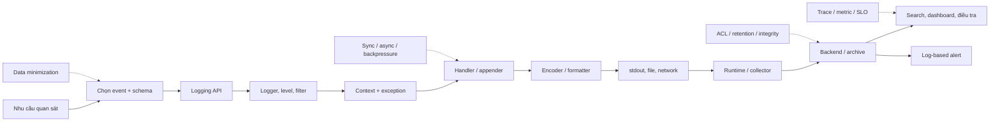
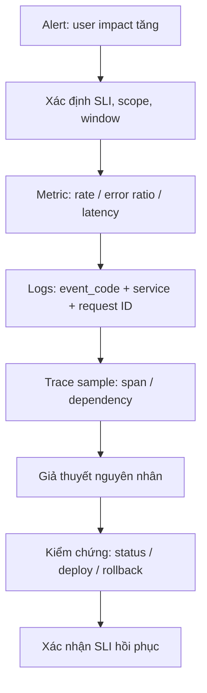
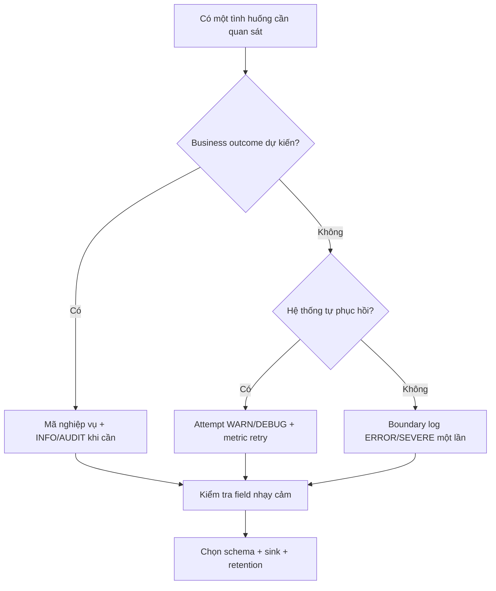

# Bản đồ khái niệm Java Logging: từ log event đến observability

## 1. Mục đích và cách đọc bản đồ

Logging là một phần của hệ thống quan sát ứng dụng Java, nhưng **logging không chỉ là gọi `System.out.println` hay `logger.error`**. Để thiết kế đúng, cần hiểu các mắt xích: **sự kiện cần ghi → logging API → logger/level/filter/context → appender/handler/encoder → stdout/file/network → collector → kho lưu → truy vấn/điều tra/cảnh báo**, đồng thời xác định giới hạn về bảo mật, chi phí và độ bền.

Bài này là **bản đồ khái niệm tổng kết**. Thay vì học các lớp và framework như những mảnh rời rạc, hãy trả lời được bốn câu hỏi cho mỗi tình huống:

1. **Ghi cái gì?** Sự kiện nghiệp vụ/kỹ thuật nào, có cần log không, chọn metadata nào?
2. **Ai quyết định ghi?** Logging API, logger tree, level, filter và context hoạt động ra sao?
3. **Ghi đến đâu?** Encoder, handler/appender, đồng bộ/bất đồng bộ, stdout, file, collector, backend nào?
4. **Dùng kết quả để làm gì?** Điều tra lỗi, liên kết trace, tổng hợp metric, tạo alert, audit, đáp ứng retention và quyền riêng tư?

Một điểm cần nhớ xuyên suốt: **log event không đồng nghĩa business transaction**, và việc gọi API logging thành công **không tự chứng minh dữ liệu đã được lưu bền vững ở backend cuối**.

### Sơ đồ tổng thể



Sơ đồ diễn tả **luồng logic**, không có nghĩa mọi hệ thống bắt buộc có đủ mọi hộp hoặc encoder luôn là một đối tượng nằm sau appender. Ví dụ trong Logback, encoder thường được cấu hình **bên trong appender**; JUL dùng `Handler` cùng `Formatter`; một nền tảng managed có thể gộp collector và backend.

## 2. Mind map: sáu nhánh cần nắm

```text
JAVA LOGGING
|
+-- (1) MỤC ĐÍCH
|   +-- Diagnostic / troubleshooting
|   +-- Operational events / access
|   +-- Security detection
|   +-- Audit evidence: contract riêng
|
+-- (2) SỰ KIỆN
|   +-- Event code, severity, timestamp
|   +-- Logger name, operation, outcome
|   +-- Request ID / trace ID / span ID
|   +-- Throwable + cause / stack trace
|   +-- Quyền riêng tư: không raw secret
|
+-- (3) CƠ CHẾ TRONG JVM
|   +-- API: JUL, SLF4J, Log4j 2 API
|   +-- Backend: JUL, Logback, Log4j 2 Core...
|   +-- Logger hierarchy, level, filter
|   +-- MDC / ThreadContext / context propagation
|   +-- Handler / appender / formatter / encoder
|   +-- Sync, async, queue / backpressure
|
+-- (4) ĐƯỜNG ĐI VÀ LƯU TRỮ
|   +-- Console stdout / stderr
|   +-- Rolling file / syslog / network
|   +-- Container runtime / node
|   +-- Collector / buffer / retry
|   +-- Central backend / archive / retention
|
+-- (5) OBSERVABILITY
|   +-- Log: chuyện gì xảy ra
|   +-- Metric: tần suất / tỷ lệ / độ trễ
|   +-- Trace: đường đi của request
|   +-- Alert: khi nào cần hành động
|   +-- SLI / SLO / error budget
|
+-- (6) QUẢN TRỊ & CHẤT LƯỢNG
    +-- Schema và cardinality
    +-- Privacy, masking, redaction
    +-- Access control, audit, retention
    +-- Duplicates, loss, sampling
    +-- Performance, cost, testing
```

Bản đồ này cũng là **khung chẩn đoán**: khi thiếu log, kiểm tra nhánh (3) và (4); khi tìm một lỗi, đi từ (5) sang (2); khi log làm lộ token hoặc tốn nhiều tiền, xét nhánh (6) và quay về (1).

## 3. Nhánh 1 — Mục đích: vì sao tạo event?

Mỗi log event nên có **người tiêu thụ thông tin** và **quyết định mà nó hỗ trợ**. Không phải mọi bước xử lý đều cần một dòng INFO.

| Loại event | Câu hỏi cần trả lời | Ví dụ | Mức bảo đảm cần cân nhắc |
| --- | --- | --- | --- |
| Diagnostic | Vì sao code đi vào nhánh này? | Dependency timeout, parse failed | Thường có thể filter/sampling có kiểm soát |
| Operational | Hệ thống đang làm gì? | Worker started, job completed | Nên có event code và correlation |
| Access | Request nào được xử lý? | Route, status, duration | Tránh body/query chứa dữ liệu nhạy cảm |
| Security | Có hành vi cần phát hiện? | Auth failure, unusual permission change | Quyền đọc hạn chế, không lộ credential |
| Audit | Ai đã làm gì và kết quả cuối? | Thay quyền, giao dịch được commit | Có thể cần transaction, integrity, retention riêng |

**Một lỗi phổ biến:** dùng `ERROR` logs làm audit ledger. Log pipeline có thể drop khi queue đầy, restart hoặc mất collector; không nhất thiết có transaction với database. Nếu business contract đòi **business change và audit record cùng tồn tại**, hãy cân nhắc audit row/outbox trong cùng transaction và một kho audit được quản trị riêng.

### 3.1. Event hay state?

- **Event:** `order_created` cho biết một hành động đã xảy ra theo contract của nơi ghi.
- **State:** `order.status=CREATED` trong database thể hiện trạng thái hiện tại.
- **Metric:** `orders_created_total` là bộ đếm tổng hợp.
- **Trace span:** biểu diễn một thao tác trong thời gian, có start/end/attributes.
- **Alert:** điều kiện cần xử lý, ví dụ tốc độ lỗi đơn hàng quá cao.

Đừng suy trạng thái bền vững chỉ từ `logger.info("created")` nếu log được ghi **trước commit**. Nếu JVM crash sau commit nhưng trước khi log, business state vẫn tồn tại mà log có thể thiếu.

### 3.2. Quy tắc chọn log level ban đầu

| Level khái niệm | Khi nào hữu ích | Cảnh báo |
| --- | --- | --- |
| ERROR / JUL SEVERE | Operation cuối thất bại, lỗi không khôi phục tại boundary | Không log lại nguyên stack trace ở mọi layer |
| WARN / JUL WARNING | Retry, degraded mode, bất thường đã được xử lý | Một retry thành công chưa chắc là operation failure |
| INFO | Mốc vòng đời/operational event có giá trị | Tránh log quá dày trong đường request nóng |
| DEBUG / JUL FINE | Chi tiết chẩn đoán khi cần | Không tự động an toàn về PII |
| TRACE / JUL FINER/FINEST | Đường thực thi rất chi tiết | Đắt, dễ thành log storm và lộ payload |

Bảng chỉ là **mô hình khái niệm**, không phải phép ánh xạ tuyệt đối giữa JUL và các backend khác. Chính sách level cần xét **tác động, tần suất và khả năng phục hồi** của sự kiện.

## 4. Nhánh 2 — Anatomy của một log event

Một log tốt thường là **sự kiện có cấu trúc**, không phải chuỗi mơ hồ:

```json
{
  "timestamp": "2026-11-10T02:45:00Z",
  "level": "WARN",
  "service": "checkout-api",
  "logger": "checkout.payment",
  "event": "dependency_retry",
  "operation": "authorize_payment",
  "request_id": "req-42",
  "trace_id": "trace-demo-7",
  "dependency": "payment-gateway",
  "error_code": "UPSTREAM_TIMEOUT",
  "attempt": 2,
  "outcome": "RETRYING"
}
```

Đây là **ví dụ JSON minh họa**, không phải dữ liệu từ production hay output của demo Java bên dưới. Từng field trả lời một câu hỏi:

| Field | Vai trò | Lưu ý |
| --- | --- | --- |
| `timestamp` | Khi ứng dụng tạo event | Chọn UTC/offset nhất quán; có thể khác ingest time |
| `level` | Mức quan trọng của log | Không dùng làm data classification |
| `service` / `logger` | Nguồn phát | Tên ổn định, không nhúng user input |
| `event` | Loại sự kiện | Enum/code ổn định, query được |
| `operation` | Thao tác logic | Dùng tên route/operation, không raw URL |
| `request_id` | Liên kết log trong một request | Validate độ dài/ký tự; không phải credential |
| `trace_id` / `span_id` | Liên kết với trace | Lấy từ trace context đã được chuẩn hóa |
| `dependency` | Thành phần bị ảnh hưởng | Dùng alias, không JDBC URL chứa password |
| `error_code` | Phân loại nguyên nhân | Không lấy raw exception message làm label |
| `attempt` | Lần thử | Phải biết phạm vi đếm và nguồn |
| `outcome` | Trạng thái tại mốc ghi | RETRYING khác FAILED cuối cùng |
| `schema_version` | Hợp đồng schema nếu dùng | Hữu ích khi chuyển đổi parser |

**Độ tin cậy phụ thuộc thời điểm ghi:** `event=order_applied` nên được phát sau khi có xác nhận transaction phù hợp, nhưng vẫn không bảo đảm logger đã lưu bền. Đừng in `ACK_CONFIRMED` trong message consumer nếu mới **gọi API ack** mà chưa có bằng chứng broker xác nhận.

### 4.1. Log injection và dữ liệu tự do

Nếu `userInput` chứa dấu xuống dòng hoặc chuỗi trông như một log khác, nối trực tiếp vào message có thể tạo record giả hoặc phá parser. Dùng encoder có escaping chuẩn, field allowlist, giới hạn độ dài và kiểu dữ liệu. Không tạo JSON bằng nối chuỗi thủ công cho dữ liệu không đáng tin.

### 4.2. Exception trong event

Một `Throwable` có type, message, cause chain, stack trace và có thể có suppressed exceptions. Có hai nhu cầu đối nghịch:
- Cần stack trace để tìm nơi phát sinh.
- Message/cause có thể chứa URL, SQL bind values, token hoặc dữ liệu người dùng.

Quyết định **nơi và lúc nào** được log throwable đầy đủ dựa trên classification và sink. Đừng in stack trace cho client; đừng chỉ dùng `e.getMessage()` rồi bỏ mất `cause` khi wrap.

Ví dụ chuyển exception mà vẫn giữ nguyên nhân:

```java
// Mảnh tích hợp; StorageException là custom exception dự án tự định nghĩa.
try {
    repository.store(order);
} catch (java.io.IOException cause) {
    throw new StorageException("STORAGE_UNAVAILABLE", cause);
}
```

Custom constructor phải dùng `super(message, cause)`. Mảnh này **không độc lập biên dịch** vì `repository`, `order` và `StorageException` thuộc ứng dụng thực.

## 5. Nhánh 3 — API, facade và backend: ba cái tên không đồng nghĩa

Java có nhiều lớp logging. Cần biết **business code gọi API nào** và **backend thực tế xử lý event**.

| Công nghệ | Vai trò điển hình | Khi nào gặp |
| --- | --- | --- |
| **JUL (`java.util.logging`)** | Logging API và handler/formatter có sẵn trong JDK | Ứng dụng Java thuần/JDK libraries |
| **SLF4J** | Facade/API để ứng dụng không phụ thuộc trực tiếp backend | Java/Spring apps và libraries |
| **Logback Classic/Core** | Logging backend, logger hierarchy, appenders/encoders | Nhiều hệ thống sử dụng SLF4J |
| **Log4j 2 API/Core** | API và implementation, layouts/appenders | Hệ thống dùng Log4j 2 |
| **Bridges/adapters** | Chuyển calls giữa APIs hoặc về backend được chọn | Ứng dụng nhiều libraries |
| **OpenTelemetry logging instrumentation** | Bổ sung/thu thập telemetry theo triển khai cụ thể | Observability trên nhiều services |

**SLF4J không phải tự thân một kho lưu hay một appender.** Nếu business code gọi `LoggerFactory.getLogger(...)`, event đi đâu còn tùy provider/backend đang hoạt động.

**JUL không đồng nghĩa SLF4J**: JUL có `Logger` và `Handler` riêng. Có thể định tuyến JUL sang một backend khác qua bridge được cấu hình đúng, nhưng không được tạo vòng bridge qua lại.

**Log4j 2 không đồng nghĩa Log4j 1.x.** Khi đọc mẫu config, cần xác nhận đó là API/backend và phiên bản nào. Không trộn snippets theo suy đoán.

### 5.1. Quan hệ API/backend

```text
Application code
    |
    +--> SLF4J API --> chosen provider --> Logback OR compatible backend
    |
    +--> JUL API --> JUL handlers (hoặc bridge phù hợp)
    |
    +--> Log4j 2 API --> Log4j 2 Core / provider phù hợp
                                     |
                                     v
                             Appenders / sinks
```

**Phân biệt dependency runtime:** một library dùng SLF4J có thể được nhúng vào ứng dụng dùng Logback hoặc một provider khác. Không thêm nhiều providers cùng lúc rồi hy vọng mọi log tự hợp nhất; kiểm tra warning khi startup và thực tế record được đưa tới đâu.

### 5.2. Logger hierarchy và additivity

Trong backend có logger tree, ví dụ:

```text
ROOT
  |
  +-- com.example
         |
         +-- com.example.orders
         |
         +-- com.example.billing
```

Một event từ `com.example.orders` có thể đi qua appenders của logger đó và **propagate lên ancestor/root** theo chính sách. Nếu cùng console appender được gắn ở logger con lẫn root và additivity bật, một event có thể được xuất **hai lần**. Đừng chữa duplicate bằng cách tắt mọi log ở source; hãy kiểm tra **logger tree, additivity, appender refs và collector pipeline**.

Trong JUL, `Logger.setUseParentHandlers(false)` có vai trò tương tự về việc ngăn event gửi tới parent handlers. Trong Logback, có `additivity="false"` ở logger; backend khác có tên/cách cấu hình riêng.

### 5.3. Lọc level xảy ra trước và tại sink

Đường đi đơn giản:

```text
logger call
   |
   +--> logger disabled / filter DENY --> no record to sink
   |
   v
LogRecord / event created
   |
   +--> handler/appender level/filter DENY --> not emitted there
   |
   v
formatter / encoder
   |
   v
destination
```

Một handler chỉ nhận WARN trở lên sẽ không xuất INFO ngay cả khi logger cho phép INFO. Ngược lại, đặt handler ở ALL không giúp nếu logger đã loại event ngay từ đầu.

## 6. Context: MDC, ThreadContext và correlation

Thông tin log phải giúp ghép các event của cùng một request/job/message:
- `request_id`: định danh request tại boundary.
- `trace_id`/`span_id`: ghép với distributed tracing.
- `job_id`/`execution_id`: định danh lần chạy scheduler.
- `event_id`: logical event trong hệ thống message.
- `consumer`, `delivery_attempt`: phân biệt các lần delivery.
- `service`/`environment`/`version`: xác định nơi phát.

Với SLF4J/Logback, **MDC** thường lưu context gắn với thread; Log4j 2 có `ThreadContext`. Cần hiểu rằng **`ThreadLocal` không tự lan truyền qua executor thread, reactive chain hoặc async callback**. Nếu framework hỗ trợ context propagation, sử dụng API được khuyến nghị và dọn/khôi phục context đúng scope.

Ví dụ tích hợp (cần SLF4J, không phải Java thuần JDK):

```java
// Chỉ là mảnh minh họa; logger và requestId đã được tạo.
try {
    org.slf4j.MDC.put("requestId", safeRequestId);
    logger.info("event=order_created result=SUCCESS");
} finally {
    org.slf4j.MDC.remove("requestId");
}
```

Trong thực tế nếu context đã tồn tại từ outer scope, cần **restore giá trị cũ** thay vì luôn remove một cách mù quáng. Không đặt password, raw Authorization header, session cookie hoặc toàn bộ DTO vào MDC.

### 6.1. Phân biệt ID

```text
trace_id:        Một distributed trace có thể có nhiều operations
request_id:      Một request có thể tạo nhiều log events
event_id:        Một message logic có thể được delivery nhiều lần
delivery_id:     Nhận diện một lần giao tùy broker
log_event_id:    Một bản ghi log cụ thể nếu ứng dụng/pipeline có phát
business_key:    Định danh hành động nghiệp vụ dùng cho idempotency
```

Không dùng `request_id` làm khóa xóa trùng tất cả log; một request có nhiều event hợp lệ. Không dùng `trace_id` làm idempotency key cho nghiệp vụ; trace có thể chứa nhiều operations hợp lệ.

## 7. Nhánh 4 — Handler, appender, encoder và nơi lưu

### 7.1. JUL `Handler` và `Formatter`

JUL có các thành phần:
- `Logger` nhận method call và áp level/filter.
- `LogRecord` mang level, message, logger name, timestamp/context ở mức JDK API.
- `Handler` chịu trách nhiệm xuất record đến đích.
- `Formatter` tạo biểu diễn text.
- `ConsoleHandler` mặc định ghi **`System.err`**, không phải stdout.
- `FileHandler` ghi file theo pattern/config riêng.

Lưu ý: java.util.logging có những khác biệt về timestamp/context so với SLF4J/Logback; đừng chuyển tên API giữa hai stack mà không kiểm chứng.

### 7.2. Logback/Log4j 2

- **Console appender:** xuất stdout/stderr theo target được cấu hình.
- **File/RollingFile appender:** ghi file, cần quyền, quota, rotation, retention và collector.
- **Network appender:** gửi tới sink từ JVM, cần TLS, auth, retry, backpressure và timeout.
- **Async appender/logger:** đệm event; có thể giảm độ trễ bình thường nhưng queue đầy vẫn có thể drop/block.
- **Encoder/layout:** format text/JSON; không tự mask secret khi dữ liệu truyền vào không an toàn.

### 7.3. Đường log trong container

```text
Java ConsoleAppender
        |
       stdout
        |
Docker / CRI runtime
        |
Node log file / logging driver
        |
Collector / DaemonSet
        |
Central store/index
        |
Dashboard / alert / archive
```

`docker logs` và `kubectl logs` có thể giúp xem output hiện có, **không phải lưu trữ vĩnh viễn**. Pod/container bị xóa, kubelet rotation hoặc collector down có thể làm mất khả năng truy vấn log cũ nếu không có backend tập trung. Nếu app ghi file mà không có agent tail, `kubectl logs` không tự đọc file đó.

### 7.4. Ma trận chọn đích

| Nhu cầu | Điểm khởi đầu hợp lý | Giới hạn cần kiểm chứng |
| --- | --- | --- |
| CLI / local dev | Console | Định dạng, màu/TTY, không log bí mật |
| Java service trong container | JSON stdout → collector → backend | Runtime, rotation, no-data, drop |
| JVM trên VM | Rolling file → file agent | Disk quota, rotation, checkpoint |
| Background job/CI | Console + retention nếu cần | Job/run ID, artifact retention |
| Debug lưu lượng lớn | Filter/sampling + pipeline bounded | Không mất event bắt buộc |
| Security investigation | Restricted dataset | IAM, access audit, export limits |
| Audit bắt buộc | Transactional outbox/protected store | Atomicity, replay, idempotency |
| SLO alerting | Metric/SLI engine; log để điều tra | No-data, alert route, runbook |

Không có một lựa chọn duy nhất luôn đúng. “Stdout” là nơi JVM phát bytes, chưa chắc là **đích cuối**; “central backend” là nơi có thể truy vấn, nhưng có thể nhận dữ liệu qua nhiều đường.

## 8. Nhánh 5 — Logging và observability

Log, metric, trace và alert có vai trò khác nhau:

| Tín hiệu | Câu hỏi | Ví dụ |
| --- | --- | --- |
| **Log** | Event nào đã xảy ra? | `event=db_timeout requestId=req-42` |
| **Metric** | Tỷ lệ, số lượng, độ trễ và xu hướng? | `http_requests_total`, duration histogram |
| **Trace** | Request đi qua các services/spans nào? | API → order → payment |
| **Alert** | Điều kiện nào đủ tác động để cần phản ứng? | Error ratio vượt SLO window |
| **Audit** | Ai làm gì, có bằng chứng bền vững không? | Permission changed by actor |

**Log không thay metric.** Đếm raw `ERROR` có thể sai vì một request có nhiều attempts, nhiều exception layers hoặc collector retry. **Metric không thay log.** Tỷ lệ lỗi tăng cho biết có sự cố, nhưng log/trace mới chỉ ra request và dependency cụ thể.

### 8.1. Từ alert trở về log



Đây là quy trình điều tra **minh họa**, không có nghĩa một alert luôn đến từ metric hay trace sample luôn tồn tại. Với security incident, một event có tính khẩn cấp cao có thể kích hoạt rule riêng.

### 8.2. SLI, SLO và error budget

Nếu mục tiêu availability SLO là 99,9% trong một kỳ, phần không đạt được cho phép về tỷ lệ là `1 − 0.999 = 0.001`. Nếu error ratio đang là 2%, *burn rate* so với mức lỗi cho phép là `0.02 / 0.001 = 20` lần trong cửa sổ đó.

**Các con số chỉ minh họa.** SLI phải xác định numerator/denominator đúng: eligible requests, bad requests, status/operation semantics. Một log WARNING do retry không đồng nghĩa request cuối đã thất bại. Đừng tự tạo alert page cho từng `logger.error`; alert cần window, threshold, volume, owner, dedup, runbook và no-data policy.

### 8.3. Cardinality: ID ở log, nhóm ổn định ở metric

`request_id`, `user_id` hoặc `event_id` có giá trị gần như vô hạn: hữu ích trong log và trace nhưng thường **không phù hợp làm metric labels** hoặc alert group keys. Metric labels nên dùng service, operation/route template, result/error category và environment với tập giá trị được kiểm soát.

## 9. Nhánh 6 — Privacy, security và chi phí

Một bản đồ logging thiếu **nơi rò rỉ dữ liệu** là bản đồ không hoàn chỉnh.

### 9.1. Data minimization tại nguồn

Không đưa vào log mặc định:
- Password, API key, private key, access/refresh token.
- Authorization/Cookie headers, signed URL/query chứa secret.
- Raw request/response body, form uploads, dữ liệu thanh toán.
- SQL bind values/connection string có credential.
- PII không cần thiết hoặc thông tin nhạy cảm qua `toString()` của DTO.
- Raw exception message/cause chưa được review.

**Masking khác redaction khác không log:** mask thay một phần giá trị, redact loại/hủy giá trị nhạy cảm, còn không đưa giá trị vào log từ đầu thường an toàn hơn. Một hash đơn giản của email vẫn có thể bị suy ra hoặc liên kết qua datasets; không tự động biến PII thành vô hại.

### 9.2. Nguồn rò rỉ nằm ngoài JVM

Log có thể đi tới stdout/node file, collector spool, central index, export ZIP, backup, alert email/chat và incident ticket. Mask ở dashboard **không xóa được dữ liệu đã ghi** vào các chặng trước.

Kiểm soát theo **identity × action × dataset × classification × time**:
- Collector có `INGEST` đúng đích; không mặc định có SEARCH/EXPORT.
- On-call đọc đúng service/environment.
- Bulk export và delete có permission, approval/audit riêng.
- Restricted/audit logs có ACL/retention riêng.
- JIT/break-glass khi cần, có thời hạn và hậu kiểm.
- Không cho admin dễ dàng xóa access audit về chính họ.

### 9.3. Chi phí và log storm

Một log event kích thước lớn được ghi nhiều lần có thể tăng CPU/heap/GC, disk, network và phí index. Trong outage, retries tăng có thể **sinh nhiều log hơn khi hệ thống khỏe**, tạo hiệu ứng khuếch đại. Các giải pháp:
1. Chọn **event code và metadata** thay vì raw payload.
2. Log throwable một lần tại boundary sở hữu kết quả.
3. Tách attempt-level và operation-level failure.
4. Dùng DEBUG/TRACE có giới hạn và tắt theo policy.
5. Đo throughput, queue depth, dropped records, formatter latency, collector lag.
6. Bảo toàn log audit bắt buộc bằng kiến trúc riêng, không sampling mù quáng.

## 10. Quy trình lựa chọn: từ tình huống đến sơ đồ con

Dùng bảng này như một **bản đồ quyết định nhanh**.

| Khi gặp tình huống | Bắt đầu ở khái niệm | Cần hỏi tiếp |
| --- | --- | --- |
| Không thấy INFO | Logger level / appender filter | Event bị chặn ở logger hay handler? |
| JVM in hai dòng giống hệt | Additivity / nhiều handlers | Một callback hay hai deliveries? |
| Docker có log, backend không có | Runtime → collector → backend | Parser, rotation, queue, IAM, time range? |
| Backend có log trùng | Fan-out / collector retry | Có nhiều agents hoặc mất ACK không? |
| Request timeout gây nhiều ERROR | Logging boundary / retry | Một lỗi hay nhiều attempts? |
| Không liên kết logs giữa services | Correlation / MDC / trace | Context có truyền qua async boundary? |
| Lộ token qua exception | Throwable / data minimization | Các sink đã nhận raw message ở đâu? |
| Latency tăng khi bật DEBUG | Formatter / I/O / sync-async | Queue, disk, network, GC chịu tải thế nào? |
| Alert mỗi request lỗi | SLI / metric / window | Tỷ lệ tác động và minimum traffic? |
| Log mất khi Pod bị xóa | Container rotation / central retention | Backend đã ship và giữ log chưa? |
| Cần audit giao dịch | Durable outbox / transaction | Có chứng cứ cùng business commit không? |
| Người xem được log ngoài phạm vi | Backend IAM / Kubernetes RBAC | Có đường API/backup bypass không? |

### 10.1. Nhánh quyết định chọn level



Không phải mọi business outcome đều chỉ INFO: hành động bảo mật/audit có thể cần logging theo chính sách riêng. Sơ đồ giúp **đặt câu hỏi trước khi chọn level**, không thay một error taxonomy thực tế.

### 10.2. Nhánh quyết định chọn đích

```text
Log để chẩn đoán?
    Có -> Service container?
              Có -> structured stdout -> runtime -> collector -> backend
              Không -> console hoặc rolling file -> agent -> backend
    Không -> Bản ghi audit bắt buộc?
              Có -> transactional audit/outbox + protected storage
              Không -> xem mục đích, data class, SLA và retention
```

Đừng tự biến lựa chọn này thành quy định “audit không bao giờ được ghi console”: có thể **phát bản diagnostic được phép** song song với audit bền vững, nhưng hai bản có trách nhiệm khác nhau và phải tránh rò rỉ/double counting.

## 11. Ví dụ Java 17 độc lập: quan sát cả pipeline trong JVM

Đoạn demo dưới đây dùng **JUL có sẵn trong JDK 17**, không cần thư viện bên ngoài. Chương trình minh họa:
- Logger tên riêng, level INFO và một `Handler`.
- Handler nhận `LogRecord`, lưu các dòng đã định dạng; **không** in bằng parent handler.
- Một request thành công; một dependency retry được khôi phục; một request thất bại cuối.
- Một bộ đếm nghiệp vụ `failedOperations` **độc lập** với số dòng log, nhằm phân biệt metrics và logs.
- Thông điệp log chỉ dùng event codes/IDs giả, không có raw secret.

Tạo file `JavaLoggingConceptMapDemo.java`:

```java
import java.util.ArrayList;
import java.util.List;
import java.util.concurrent.atomic.AtomicInteger;
import java.util.logging.Handler;
import java.util.logging.Level;
import java.util.logging.LogRecord;
import java.util.logging.Logger;

public final class JavaLoggingConceptMapDemo {
    private static final class CaptureHandler extends Handler {
        private final List<String> lines = new ArrayList<>();

        CaptureHandler() {
            setLevel(Level.ALL);
        }

        @Override
        public void publish(LogRecord record) {
            if (isLoggable(record)) {
                lines.add(record.getLevel().getName()
                        + " " + record.getMessage());
            }
        }

        @Override
        public void flush() {
            // Chỉ lưu vào bộ nhớ cho demo.
        }

        @Override
        public void close() {
            flush();
        }

        List<String> lines() {
            return List.copyOf(lines);
        }
    }

    public static void main(String[] args) {
        Logger logger =
                Logger.getLogger("lesson.logging.concept.map");
        logger.setLevel(Level.INFO);
        logger.setUseParentHandlers(false);

        CaptureHandler capture = new CaptureHandler();
        logger.addHandler(capture);
        AtomicInteger failedOperations = new AtomicInteger();

        try {
            logger.info("event=order_created requestId=req-42"
                    + " outcome=SUCCESS");
            logger.warning("event=dependency_retry requestId=req-43"
                    + " attempt=1");
            logger.info("event=order_completed requestId=req-43"
                    + " outcome=RECOVERED");

            // Mô phỏng lỗi cuối thao tác (đã phân loại).
            failedOperations.incrementAndGet();
            logger.severe("event=order_failed requestId=req-44"
                    + " code=DEPENDENCY_UNAVAILABLE");

            for (String line : capture.lines()) {
                System.out.println(line);
            }
            System.out.println("capturedRecords="
                    + capture.lines().size());
            System.out.println("failedOperations="
                    + failedOperations.get());
        } finally {
            logger.removeHandler(capture);
            capture.close();
        }
    }
}
```

Biên dịch và chạy với **JDK 17 hoặc mới hơn**:

```bash
javac JavaLoggingConceptMapDemo.java
java JavaLoggingConceptMapDemo
```

**Stdout chính xác** khi chạy trong JVM mới, không có code khác tác động vào logger demo:

```text
INFO event=order_created requestId=req-42 outcome=SUCCESS
WARNING event=dependency_retry requestId=req-43 attempt=1
INFO event=order_completed requestId=req-43 outcome=RECOVERED
SEVERE event=order_failed requestId=req-44 code=DEPENDENCY_UNAVAILABLE
capturedRecords=4
failedOperations=1
```

**Giải thích:**
1. JUL `Logger` nhận bốn API calls. Level INFO cho phép INFO, WARNING và SEVERE.
2. `CaptureHandler` là **đích trong bộ nhớ**, giữ lại bốn `LogRecord` ở dạng text; nó không ghi file, network hay backend.
3. `setUseParentHandlers(false)` ngăn record bị propagate qua JUL parent/root ConsoleHandler và xuất thêm stderr, nên output không có timestamp hay format khác.
4. `logger.warning(...)` cho attempt retry **không tăng** `failedOperations` vì request `req-43` đã phục hồi thành công.
5. `logger.severe(...)` biểu diễn operation cuối thất bại trong mô phỏng; counter `failedOperations` tăng một lần do business logic, **không lấy từ số record WARNING/SEVERE**.
6. `capturedRecords=4` và `failedOperations=1` minh họa trực tiếp mối quan hệ **nhiều logs nhưng ít business failures**.
7. Context `requestId` là giả và viết trực tiếp trong message, không phải MDC. Không có tracing thật hoặc log export qua collector.
8. `CaptureHandler` dùng `ArrayList` không được bảo vệ cho concurrent writes; chỉ minh họa xử lý đồng bộ, không phải handler production đa luồng.

**Giới hạn:** kết quả stdout cố định chỉ cho chương trình demo. Nó không chứng minh logging pipeline cuối cùng có exactly-once/durability và không tự động gửi alert. Trong production, nên dùng logging backend có encoder, asynchronous policy và health metrics phù hợp.

## 12. Ví dụ cấu hình thực tế: Map từ code sang appender

Với **SLF4J + Logback**, mã gọi API:

```java
// Mảnh tích hợp, không độc lập: logger là SLF4J Logger.
logger.info("event=order_created orderId={} result={}",
        safeOrderId, "SUCCESS");
```

Đường đi: API SLF4J → provider/backend Logback → logger level/filter → ConsoleAppender/encoder → stdout. Một `logback.xml` minh họa:

```xml
<configuration>
  <appender name="STDOUT"
            class="ch.qos.logback.core.ConsoleAppender">
    <target>System.out</target>
    <encoder>
      <pattern>%d{yyyy-MM-dd'T'HH:mm:ss.SSSXXX} %-5level logger=%logger{36} traceId=%X{traceId:-} %msg%n</pattern>
    </encoder>
  </appender>
  <root level="INFO">
    <appender-ref ref="STDOUT"/>
  </root>
</configuration>
```

Đây là cấu hình tích hợp, yêu cầu dependency và môi trường Logback tương thích. `%msg` có thể chứa dữ liệu nguy hiểm nếu code đưa raw DTO vào; pattern encoder ở ví dụ cũng tạo **text**, không phải JSON.

### 12.1. Routing riêng theo logger name

Nếu một logger con cần đích riêng, ví dụ `com.example.security`, cấu hình thêm appender có kiểm soát và quyết định **additivity**. Với `additivity="false"`, event ở logger con không propagate lên root. Điều đó có thể ngăn duplicate hoặc ngăn restricted event rò ra stdout, nhưng cũng có thể **làm mất log** ở sink root nếu thiết kế không xét hết.

Không gắn hai ConsoleAppender cùng tên/target ở cả logger con và root rồi vội kết luận broker giao message hai lần.

### 12.2. Log4j 2 Console và JUL Console khác nhau

```xml
<Configuration status="WARN">
  <Appenders>
    <Console name="Stdout" target="SYSTEM_OUT">
      <PatternLayout pattern="%d{ISO8601} %-5level %c - %msg%n"/>
    </Console>
  </Appenders>
  <Loggers>
    <Root level="info">
      <AppenderRef ref="Stdout"/>
    </Root>
  </Loggers>
</Configuration>
```

Đoạn này là **Log4j 2 XML minh họa**, không được dùng như `logback.xml`. JUL `ConsoleHandler` mặc định ghi stderr; muốn JUL ghi stdout phải dùng handler/adapter cấu hình riêng. Tên `Console` không đủ để suy ra target.

## 13. Bản đồ exception: nhận diện lỗi, ghi đúng một lần

Một exception đi từ repository qua service tới HTTP handler có thể bị ghi ở cả ba tầng:

```text
Repository throws IOException
          |
Service wraps TechnicalFault(cause)
          |
HTTP handler maps response
          |
One coherent technical_error event
          |
Metrics counter + safe client error_id
```

**Một lỗi, một stack trace ở boundary thích hợp** thường rõ hơn nhiều log ERROR lặp. Nhưng các event khác nhau như `retry_scheduled`, `circuit_opened` và `operation_failed` vẫn có thể được ghi ở các thời điểm khác nhau.

Nhận biết:
- **Validation/business rejection:** kết quả có thể dự kiến, không mặc định là outage.
- **Transient dependency failure:** có thể retry sau khi xác định operation idempotent/an toàn.
- **Permanent configuration failure:** không giải quyết bằng retry vô hạn.
- **Unexpected bug:** cần root cause và một error code ổn định.
- **Cancellation/interruption:** không nuốt `InterruptedException`; restore interrupt nếu không rethrow theo contract.

**Không log trước DB commit rằng business operation đã thành công**. Nếu timeout sau khi gửi yêu cầu ghi, kết quả có thể ambiguous (đã commit nhưng mất reply), nên retry phải có idempotency/reconcile.

## 14. Bản đồ message delivery: một event, nhiều lần nhận

Trong queue hoặc stream processing:

```text
Logical event: evt-100
    |
    +--> Delivery attempt 1 --> business applied --> ACK lost
    |
    +--> Delivery attempt 2 --> duplicate detected --> skip effect
```

Hai dòng `message_received` cho cùng event ID có thể là **redelivery hợp lệ**. Cần phân biệt:
- Duplicate logical event do producer publish lại.
- Redelivery cùng event sau timeout/ack failure.
- Double emission do logger/additivity.
- Duplicate backend documents do collector retry/fan-out.

Một idempotent consumer cần khóa đúng domain/consumer scope, durable unique constraint và transaction phù hợp; không chỉ dựa vào in-memory `Set` hoặc số dòng log. `event_id` khác `delivery_attempt`, Kafka offset, RabbitMQ delivery tag và SQS receipt handle. Không lấy một giá trị có semantics cục bộ làm business identity toàn hệ thống.

## 15. Kiểm thử: chứng minh cả logic và đường vận chuyển

### 15.1. Unit tests tại JVM

- Xác minh logger level/filter đúng.
- Capture handler/appender test và assert event code, level, correlation.
- Đảm bảo một exception không bị log ở nhiều layer ngoài chủ đích.
- Dùng **canary secret giả** để phát hiện vô tình log trong message, arguments, throwable, MDC và structured keys.
- Kiểm thử missing/null context, Unicode, newline và log injection.
- Không phụ thuộc timestamp/thread ID khi không có cơ chế cố định chúng.

### 15.2. Integration tests

- Xác minh cấu hình Logback/Log4j 2/JUL thực sự nạp đúng.
- Không có nhiều SLF4J providers hoặc vòng bridge.
- Root và child loggers không nhân đôi event.
- stdout/stderr/file được thu theo pipeline mong muốn.
- JSON/stack trace/multiline và CRI partial được parse đúng.
- Kết quả inquiry với trace/request ID đúng scope.

### 15.3. Failure-injection tests trên staging

| Tình huống | Kết quả cần hiểu |
| --- | --- |
| Collector ngắt mạng | Retry/buffer/drop theo policy; không silent loss ngoài contract |
| Appender queue đầy | Business latency/drop behavior và metric |
| File rotation | Agent checkpoint đúng, không mất dữ liệu không mong muốn |
| Pod restart / SIGKILL | Giới hạn flush và retention |
| Duplicate collector | Có phát hiện fan-out/trùng ingest |
| Backend reject 429 | Backoff, queue/disk quota và hành vi khi đầy |
| Service chết im lặng | Health/no-data alert phát hiện dù không có ERROR |
| Audit commit trước publish | Outbox/durable event vẫn tồn tại |
| Quyền restricted bị từ chối | API/export/archive không bypass |
| Trace context qua executor | Không lẫn request IDs giữa tasks |

**Không gây outage production để “test logger”.** Sử dụng staging/test rule và canary giả đã được phép.

## 16. Bảng tra cứu nhanh: một vấn đề, một nhóm khái niệm

| Dấu hiệu | Khái niệm cần mở | Phản xạ sai cần tránh |
| --- | --- | --- |
| INFO không xuất | Logger/handler level, filter | Bật TRACE toàn hệ thống |
| Log trùng ở console | Additivity, parent handlers | Xóa log theo request ID |
| Backend có record trùng | Collector checkpoint/retry | Kết luận business xử lý hai lần |
| Java có log nhưng K8s không thấy | stdout/stderr vs file | Cho rằng `kubectl logs` đọc mọi file |
| Logs không truy vấn được | Collector, parser, IAM, time range | Ghi lại raw payload để tìm |
| ERROR tăng nhưng request vẫn thành công | Retry/attempt vs final outcome | Page mỗi stack trace |
| Alert page liên tục | SLI, window, grouping, min volume | Giảm level để che vấn đề |
| Stack trace lộ token | Data minimization, sinks | Chỉ mask ở dashboard |
| Dữ liệu log mất sau crash | Buffer, flush, rotation, durability | Gọi log API là đã commit |
| File đầy disk | Rotation/quota/cost | Cho appender viết vô hạn |
| Chậm khi logging | Sync I/O, encoder, backpressure | Tin async luôn không block |
| Sai request ID ở thread pool | MDC propagation/cleanup | Tin ThreadLocal tự được truyền |
| Người ngoài team đọc logs | Backend RBAC, K8s `pods/log` | Chỉ ẩn UI controls |
| Audit không tìm thấy | Transaction/outbox, integrity | Dùng stdout làm ledger mặc định |

## 17. Những ngộ nhận cần loại bỏ

1. **“SLF4J là nơi lưu log.”** Sai: SLF4J là API/facade; provider/backend và appenders quyết định đường đi.
2. **“ERROR luôn ghi stderr.”** Sai: target phụ thuộc backend/config; JUL ConsoleHandler mặc định stderr.
3. **“Gọi `logger.info` là log đã ở backend.”** Sai: có buffering, collector, retry, quota, rotation và retention.
4. **“Nhiều dòng ERROR là nhiều business failures.”** Sai: retry, nested log và duplicate ingestion có thể làm số đếm tăng.
5. **“Có trace ID tức không cần log.”** Sai: trace và log bổ sung nhau; sampling có thể bỏ trace.
6. **“JSON log sẽ tự an toàn.”** Sai: JSON đúng cú pháp vẫn có thể chứa token và PII.
7. **“MDC tự đi qua mọi async thread.”** Sai: cần context propagation và cleanup.
8. **“Tắt additivity luôn chữa log trùng.”** Sai: có thể làm mất đường đến audit/sink khác.
9. **“Async logger không ảnh hưởng hiệu năng.”** Sai: queue full/drop/block, encode/GC và shutdown vẫn ảnh hưởng.
10. **“stdout là audit store.”** Sai: stdout không tự có transactional integrity/durability.
11. **“Không có log ERROR nghĩa ứng dụng khỏe.”** Sai: service/collector có thể ngừng phát.
12. **“Mask vài ký tự là vô danh.”** Sai: giá trị vẫn có thể liên kết/tái nhận diện.
13. **“Request ID là khóa idempotency.”** Sai: một request có thể chứa nhiều operations và events.
14. **“Một ALERT OPEN log chắc đã page on-call.”** Sai: notification delivery/routing cần được xác nhận riêng.

## 18. Bài tập tổng hợp

**Câu 1.** Ứng dụng gọi `logger.info` nhưng không có log tại console. Kiểm tra ở đâu trước?

**Đáp án:** xác nhận code path đã chạy, logger level/filter, appender/handler config, additivity và backend/provider thực tế; sau đó kiểm tra stdout/stderr/file.

**Câu 2.** Một request có hai ERROR stack traces giống nhau từ repository và controller. Có thể kết luận hai sự cố không?

**Đáp án:** không. Có thể chỉ một exception được log ở nhiều tầng. Cần xác định logging boundary và dùng cause chain/correlation.

**Câu 3.** Docker thấy một record, backend thấy hai documents. Nên xem gì?

**Đáp án:** collector đọc nhiều nguồn, agent duplication, replay sau mất ACK, mapping event identity và source metadata. Không chỉ sửa code logger.

**Câu 4.** Một payment đã commit nhưng app crash trước khi logger xuất audit event. Làm sao tránh mất chứng cứ?

**Đáp án:** thiết kế audit row/outbox trong cùng transaction với business change khi khả thi, publisher retry và idempotency downstream. Không dùng logger console như transaction coordinator.

**Câu 5.** SLF4J MDC có `requestId` nhưng callback async log request khác. Nguyên nhân?

**Đáp án:** MDC/ThreadLocal không được propagate/restore theo scope hoặc còn dữ liệu stale trên thread pool. Cần context propagation và cleanup đúng.

**Câu 6.** Tại sao `warning` trong demo không làm `failedOperations` tăng?

**Đáp án:** warning mô tả một **retry attempt**, operation đã phục hồi. Bộ đếm outcome chỉ tăng khi mô phỏng failure cuối.

**Câu 7.** Đếm tổng ERROR logs để báo SLO 99,9% có đủ không?

**Đáp án:** không. SLI cần denominator eligible requests và numerator bad outcomes; một request có thể có nhiều log hoặc không có log.

**Câu 8.** Một developer có quyền `get pods/log` trên cả namespace production. Có thể đọc đúng một service không?

**Đáp án:** chưa chắc; role namespace có thể cho đọc nhiều pods. Phải kiểm tra hiệu lực RBAC và dùng backend dataset-level authorization nếu cần scope hẹp hơn.

## 19. Checklist ghi nhớ cuối bài

- [ ] Biết **vì sao** ghi từng event: diagnostic, operational, security hay audit.
- [ ] Có event schema: code, level, service, timestamp, operation, outcome và correlation khi cần.
- [ ] Phân biệt logging API/facade và backend; biết provider thực tế trên classpath.
- [ ] Hiểu logger hierarchy, filters và additivity/parent handlers.
- [ ] Chọn handler/appender/encoder và đích stdout/file/network phù hợp runtime.
- [ ] Biết đường đi tới collector/backend, các mốc buffer/retry/rotate/drop.
- [ ] Không lấy log volume làm request failure count; dùng metric đúng semantics.
- [ ] Kết hợp logs/metrics/traces/alerts theo nhu cầu chẩn đoán và phản ứng.
- [ ] Không ghi secret/PII không cần thiết; bảo vệ quyền read/export và retention.
- [ ] Tách audit bắt buộc khỏi best-effort logging khi transaction/integrity yêu cầu.
- [ ] Test level, duplicates, async propagation, crash/restart, no-data và canary giả.
- [ ] Có owner/runbook cho logging pipeline, backend, IAM, rotation và chi phí.

## 20. Kết luận: mô hình tư duy một dòng

**Java Logging = sự kiện có ý nghĩa + ngữ cảnh an toàn + cơ chế lọc/định tuyến trong JVM + đường vận chuyển được quan sát + nơi lưu phù hợp + khả năng dùng để chẩn đoán/ra quyết định.**

Khi gặp bất kỳ vấn đề logging nào, hãy định vị nó trong bản đồ: **event → API/logger → filter/context → handler/encoder → destination → collector → backend → observability**, đồng thời kiểm tra **privacy, reliability và cost** ở từng chặng. Mô hình đó giúp phân biệt lỗi ứng dụng với lỗi pipeline, log trùng với business operation trùng, và log chẩn đoán với chứng cứ audit có nghĩa vụ bền vững.