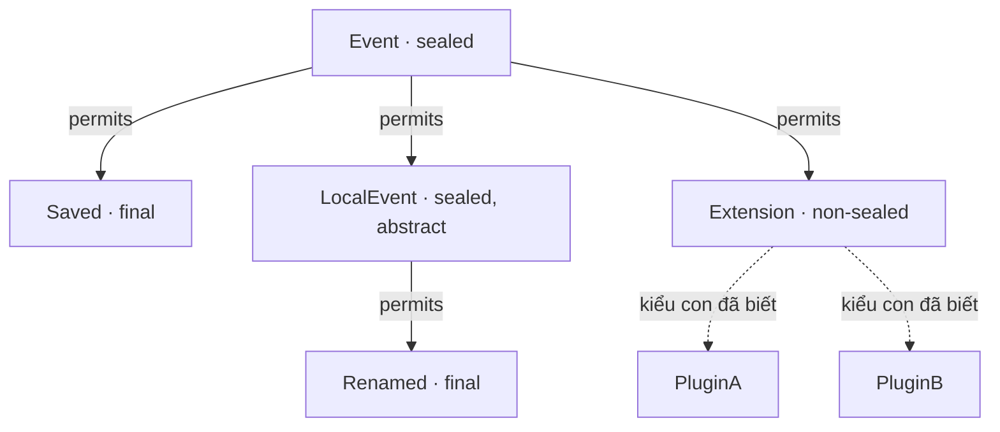

# Metadata `permits` khác gì mọi kiểu con đang tồn tại?

`getPermittedSubclasses()` thường bị hiểu nhầm là cách “lấy tất cả kiểu con” của một lớp hoặc interface. Thực ra, nó đọc một phần metadata của **phân cấp sealed**: các kiểu con **trực tiếp được cho phép** của kiểu đang xét.

Đó là câu hỏi khác với “có những hậu duệ nào”, “JVM đã nạp những lớp nào” hoặc “đang có những đối tượng nào”. Phân biệt các câu hỏi này giúp công cụ phân tích kiểu, ánh xạ dữ liệu hoặc xử lý plugin tránh kết luận rằng một danh sách đã đầy đủ khi nó chưa đủ căn cứ.

Các API sealed trong bài có từ Java 17. Ví dụ chạy bằng Java 17 trở lên, không cần tính năng preview.

## 1. Bốn tập thông tin không nên gộp lại

| Câu hỏi | Phạm vi thông tin |
| --- | --- |
| Gốc sealed cho phép những kiểu con trực tiếp nào? | Metadata `permits` của chính gốc |
| Những kiểu nào là hậu duệ trực tiếp hoặc gián tiếp? | Quan hệ kiểu trên một phạm vi kiểu cần xác định |
| JVM hiện đã nạp những lớp nào? | Trạng thái nạp lớp tại thời điểm quan sát |
| Những đối tượng nào đang được giữ hoặc đang sống? | Trạng thái đối tượng; không phải danh sách khai báo kiểu |

Một lớp có thể là hậu duệ gián tiếp nhưng không nằm trong danh sách trực tiếp của gốc. Một kiểu được cho phép cũng không cần có đối tượng được tạo ra mới xuất hiện trong metadata.

`Class.isAssignableFrom(candidate)` kiểm tra quan hệ với **một ứng viên đã có**. Nó không tự tìm hay liệt kê tất cả ứng viên trong môi trường.

## 2. Ý nghĩa của metadata sealed

Trong Java, `sealed` giới hạn các kiểu con trực tiếp. Với một interface sealed, các mục được cho phép có thể là lớp triển khai hoặc interface con. Quy tắc này thuộc [phân cấp sealed của lớp](https://docs.oracle.com/javase/specs/jls/se21/html/jls-8.html#jls-8.1.6) và [interface](https://docs.oracle.com/javase/specs/jls/se21/html/jls-9.html#jls-9.1.4).

Ở mức tệp `.class`, thuộc tính [`PermittedSubclasses`](https://docs.oracle.com/javase/specs/jvms/se21/html/jvms-4.html#jvms-4.7.31) ghi các kiểu được phép trực tiếp mở rộng hoặc triển khai kiểu hiện tại. Nó không phải một bộ đăng ký đối tượng, cũng không lưu toàn bộ cây hậu duệ.

Tên của API có chữ `Subclasses`, nhưng khi dùng với interface, kết quả vẫn có thể chứa interface con. Một mục trong kết quả cũng có thể là lớp trừu tượng; không được coi mọi mục là lớp có thể khởi tạo.

### Không nhất thiết phải có chữ `permits` trong mã nguồn

Khi các điều kiện ngôn ngữ cho phép, trình biên dịch suy ra tập kiểu con được cho phép từ cùng đơn vị biên dịch. Vì vậy, một khai báo không viết tường minh mệnh đề `permits` vẫn có metadata sealed.

Reflection đọc cấu trúc kiểu đã biên dịch; nó không đang tìm chuỗi chữ `permits` trong tệp nguồn.

## 3. Phân cấp dùng trong thí nghiệm



Các đường `permits` là quan hệ metadata trực tiếp. Hai đường nét đứt minh họa kiểu con của nhánh mở mà chương trình đã biết qua cách khác; chúng không được lấy từ `Extension.getPermittedSubclasses()`.

## 4. Ví dụ Java 17+ chạy độc lập

Lưu toàn bộ vào **`SealedPermitsDemo.java`**:

```java
import java.lang.reflect.Modifier;
import java.util.Arrays;
import java.util.HashSet;
import java.util.List;
import java.util.Set;

public class SealedPermitsDemo {
    public sealed interface Event permits Saved, LocalEvent, Extension {
    }

    public record Saved(String id) implements Event {
    }

    public abstract static sealed class LocalEvent implements Event
            permits Renamed {
    }

    public static final class Renamed extends LocalEvent {
    }

    public non-sealed interface Extension extends Event {
    }

    public static final class PluginA implements Extension {
    }

    public static final class PluginB implements Extension {
    }

    public sealed interface Inferred {
    }

    public static final class InferredLeaf implements Inferred {
    }

    private static String names(Class<?>[] types) {
        return Arrays.stream(types)
                .map(Class::getSimpleName)
                .sorted()
                .toList()
                .toString();
    }

    private static String permittedNames(Class<?> type) {
        Class<?>[] permitted = type.getPermittedSubclasses();
        return permitted == null ? "null" : names(permitted);
    }

    private static boolean isDirectPermitted(Class<?> parent, Class<?> candidate) {
        Class<?>[] permitted = parent.getPermittedSubclasses();
        return permitted != null
                && Arrays.asList(permitted).contains(candidate);
    }

    private static void collectByPermits(Class<?> type, Set<Class<?>> visited) {
        if (!visited.add(type)) {
            return;
        }
        Class<?>[] permitted = type.getPermittedSubclasses();
        if (permitted != null) {
            for (Class<?> child : permitted) {
                collectByPermits(child, visited);
            }
        }
    }

    public static void main(String[] args) {
        System.out.println("Event permits = " + permittedNames(Event.class));
        System.out.println("LocalEvent permits = " + permittedNames(LocalEvent.class));
        System.out.println("Extension isSealed = " + Extension.class.isSealed());
        System.out.println("Extension permits = " + permittedNames(Extension.class));
        System.out.println("Saved isFinal = "
                + Modifier.isFinal(Saved.class.getModifiers()));
        System.out.println("Saved permits = " + permittedNames(Saved.class));

        System.out.println("Renamed fits Event = "
                + Event.class.isAssignableFrom(Renamed.class));
        System.out.println("Renamed directly permitted by Event = "
                + isDirectPermitted(Event.class, Renamed.class));
        System.out.println("PluginA fits Event = "
                + Event.class.isAssignableFrom(PluginA.class));
        System.out.println("PluginA directly permitted by Event = "
                + isDirectPermitted(Event.class, PluginA.class));

        Set<Class<?>> reached = new HashSet<>();
        collectByPermits(Event.class, reached);
        reached.remove(Event.class);
        System.out.println("Reached through permits = "
                + names(reached.toArray(Class<?>[]::new)));

        Class<?>[] candidates = {
                Saved.class, LocalEvent.class, Renamed.class,
                Extension.class, PluginA.class, PluginB.class, String.class
        };
        System.out.println("Matching supplied candidates = "
                + Arrays.stream(candidates)
                        .filter(Event.class::isAssignableFrom)
                        .map(Class::getSimpleName)
                        .sorted()
                        .toList());

        List<Event> objects = List.of(new Saved("S1"), new PluginA());
        System.out.println("Types in supplied objects = "
                + objects.stream().map(Object::getClass)
                        .map(Class::getSimpleName)
                        .distinct()
                        .sorted()
                        .toList());
        System.out.println("Event permits after creating objects = "
                + permittedNames(Event.class));
        System.out.println("Inferred permits = "
                + permittedNames(Inferred.class));
        System.out.println("Object permits = " + permittedNames(Object.class));
    }
}
```

Biên dịch và chạy:

```bash
javac -encoding UTF-8 --release 17 -Xlint:all -Werror SealedPermitsDemo.java
java SealedPermitsDemo
```

Kết quả:

```text
Event permits = [Extension, LocalEvent, Saved]
LocalEvent permits = [Renamed]
Extension isSealed = false
Extension permits = null
Saved isFinal = true
Saved permits = null
Renamed fits Event = true
Renamed directly permitted by Event = false
PluginA fits Event = true
PluginA directly permitted by Event = false
Reached through permits = [Extension, LocalEvent, Renamed, Saved]
Matching supplied candidates = [Extension, LocalEvent, PluginA, PluginB, Renamed, Saved]
Types in supplied objects = [PluginA, Saved]
Event permits after creating objects = [Extension, LocalEvent, Saved]
Inferred permits = [InferredLeaf]
Object permits = null
```

Hàm `names()` và các đoạn in danh sách chủ động sắp xếp tên. Chương trình không dựa vào thứ tự trả về của mảng để quyết định quan hệ kiểu.

## 5. Trực tiếp không có nghĩa là toàn bộ hậu duệ

`Event` trực tiếp cho phép `Saved`, `LocalEvent`, `Extension`. `Renamed` lại được `LocalEvent` trực tiếp cho phép.

Vì thế, hai kết quả sau không mâu thuẫn:

- `Event.class.isAssignableFrom(Renamed.class)` là `true`: `Renamed` có quan hệ kiểu phù hợp với `Event` qua `LocalEvent`.
- `Renamed` không nằm trong danh sách trực tiếp của `Event`.

Muốn đi sâu trong phần sealed, cần truy vấn tiếp từng kiểu con sealed. Hàm `collectByPermits` thực hiện bước đó và tìm thêm `Renamed`.

Tuy nhiên, kết quả `[Extension, LocalEvent, Renamed, Saved]` chỉ là những nút đi tới được bằng các cạnh metadata mà hàm đã duyệt. Nó không phải chứng minh rằng không còn kiểu con nào khác trong toàn bộ phân cấp.

Tập `visited` dùng `Class<?>` để tránh xử lý lặp nếu cùng một kiểu được tiếp cận qua nhiều nhánh interface. Mã in tên ngắn chỉ để dễ đọc; công cụ thực tế không nên nhận diện kiểu chỉ bằng `getSimpleName()`.

## 6. `non-sealed` là ranh giới mở

`Extension` được phép trực tiếp mở rộng `Event`, nhưng bản thân nó là `non-sealed`. Do đó, các lớp có thể triển khai `Extension` theo các quy tắc thông thường về truy cập và quan hệ kiểu.

`PluginA` và `PluginB` là những ví dụ hợp lệ của nhánh đó. Chúng phù hợp với `Event`, nhưng không cần xuất hiện trong `Event.permits` vì không trực tiếp triển khai `Event`.

`Extension.class.getPermittedSubclasses()` cho `null`. Điều này có nghĩa **`Extension` không phải kiểu sealed**, không có nghĩa **`Extension` không có lớp triển khai**.

Trong cùng thí nghiệm, `Saved` là record `final`, cũng cho kết quả `null`. Nhưng `Saved` không có kiểu con hợp lệ, trong khi `Extension` là một nhánh mở. Vì vậy, chỉ nhìn `null` không đủ để kết luận phân cấp đã kết thúc theo cùng một nghĩa.

Ngay cả `Object.class.getPermittedSubclasses()` cũng cho `null`, dù rõ ràng có rất nhiều lớp kế thừa `Object`.

### Khi nào có thể xem cây kiểu là đóng?

Bạn có thể phân tích một phân cấp theo các nhánh sealed và final khi đã xác minh metadata và các kiểu cần thiết được cung cấp đầy đủ. Nếu gặp nhánh `non-sealed`, việc chỉ duyệt `permits` không đủ để liệt kê hết các hậu duệ của nhánh đó.

Cũng đừng chỉ thu các lá `final` rồi gọi đó là “mọi lớp có thể có đối tượng”. Một lớp sealed vẫn có thể là lớp cụ thể, không trừu tượng; việc nó có kiểu con không cấm tạo đối tượng của chính lớp đó. `LocalEvent` trong thí nghiệm được khai báo trừu tượng một cách tường minh.

## 7. Tập ứng viên và tập đối tượng là những nguồn khác

### Lọc những ứng viên đã cung cấp

Chương trình có một mảng `candidates` được viết rõ trong mã. Lọc nó bằng `Event.class::isAssignableFrom` tìm thấy cả `PluginA` và `PluginB`.

Đây là **lọc một tập đã biết**, không phải tự phát hiện mọi kiểu con trong JVM. Nếu không cung cấp một lớp trong tập ứng viên, bộ lọc không tự tìm ra nó.

Kết quả còn chứa `Extension` và `LocalEvent`, vì quan hệ kiểu áp dụng cho cả interface con và lớp trừu tượng. Muốn danh sách các lớp cụ thể có thể tạo đối tượng, cần đặt thêm tiêu chí; muốn biết constructor phù hợp, còn cần kiểm tra điều kiện khác nữa.

### Quan sát những đối tượng trong một danh sách

Mảng metadata của `Event` có ba nhánh trực tiếp, nhưng danh sách `objects` chỉ chứa một `Saved` và một `PluginA`. Kết quả `[PluginA, Saved]` mô tả các lớp của **những đối tượng trong chính danh sách đó**.

Nó không mô tả mọi đối tượng đang sống trong toàn JVM, cũng không mô tả mọi kiểu hợp lệ. Tạo thêm hoặc bớt đối tượng trong danh sách không sửa metadata sealed của `Event`.

Trong ứng dụng, danh sách đăng ký plugin, dữ liệu cấu hình hoặc một phạm vi tệp lớp được quét có thể cung cấp tập ứng viên. Mỗi nguồn có phạm vi và quy tắc riêng; không tự biến kết quả của nó thành một khẳng định toàn cục.

## 8. Việc lấy `Class` và giới hạn tính đầy đủ

[Hợp đồng `getPermittedSubclasses()`](https://docs.oracle.com/en/java/javase/21/docs/api/java.base/java/lang/Class.html#getPermittedSubclasses()) nêu rằng API cố lấy `Class` cho các mục được ghi trong metadata bằng bộ nạp định nghĩa kiểu hiện tại. Mục không lấy được `Class` bị bỏ qua, không có trong mảng kết quả. Thứ tự phần tử không được bảo đảm; kiểu không sealed trả `null`, còn kiểu sealed trả mảng khác `null`, có thể rỗng.

Điều đó có hai hệ quả cần ghi rõ trong công cụ:

- Kết quả không phải ảnh chụp thụ động của danh sách lớp đã được nạp trước khi gọi; API có hoạt động lấy các đối tượng `Class` cần thiết.
- Không nên dùng riêng độ dài mảng để khẳng định rằng mọi mục dự kiến trong bộ dữ liệu triển khai đều đã được giải quyết thành công.

Nếu công cụ phải chứng minh danh sách đầy đủ so với metadata trong tệp lớp hoặc với bộ phát hành, cần đối chiếu thêm nguồn tương ứng và việc phân giải kiểu. Không lặng lẽ coi một mục vắng mặt là bằng chứng rằng kiểu đó chưa từng được cho phép.

Trong thí nghiệm, các tệp lớp đều được cung cấp đầy đủ cùng nhau, nên các kết quả cụ thể có thể được đối chiếu với mã nguồn. Bài không giả định rằng mọi môi trường plugin hay bộ nạp tùy biến đều có cùng điều kiện đó.

### Khác với danh sách lớp đã nạp

Trong bối cảnh có Java agent, [`Instrumentation.getAllLoadedClasses()`](https://docs.oracle.com/en/java/javase/21/docs/api/java.instrument/java/lang/instrument/Instrumentation.html#getAllLoadedClasses()) cung cấp các lớp hiện đã được nạp trong JVM tại thời điểm quan sát. Đó vẫn là một nguồn dữ liệu khác: có thể lọc các lớp đó theo quan hệ kiểu, nhưng không suy ra những lớp chưa nạp hoặc những đối tượng đang sống từ danh sách ấy.

Việc thiết lập agent là chủ đề riêng; ví dụ trong bài không dùng agent và không tuyên bố đo thời điểm JVM nạp từng lớp.

## 9. Cách chọn câu hỏi đúng khi thiết kế công cụ

| Nhu cầu | Cách tiếp cận phù hợp |
| --- | --- |
| Hiển thị nhánh trực tiếp của một kiểu sealed | `getPermittedSubclasses()` và diễn giải đúng phạm vi |
| Duyệt phần phân cấp còn đóng bằng sealed | Truy vấn tiếp từng nhánh, ghi nhận các ranh giới mở và giới hạn phân giải kiểu |
| Kiểm tra một ứng viên có thể dùng ở vị trí kiểu gốc không | `isAssignableFrom` trên đúng hai đối tượng `Class` |
| Liệt kê plugin ứng dụng chấp nhận | Nguồn đăng ký hoặc khám phá plugin có phạm vi được định nghĩa |
| Phân tích các lớp đã nạp | Nguồn quan sát nạp lớp thích hợp, không dùng metadata `permits` thay thế |
| Đếm đối tượng ứng dụng đang quản lý | Dữ liệu quản lý đối tượng hoặc công cụ quan sát phù hợp với yêu cầu |

Chỉ dựa vào metadata sealed để chấp nhận hoặc từ chối mọi đối tượng cũng có thể sai ở nhánh mở. Ví dụ, một chính sách cho phép mọi giá trị của `Event` cần hiểu rằng `PluginA` hợp lệ dù không nằm trong danh sách trực tiếp của gốc.

Ngược lại, nếu ứng dụng chỉ cho phép đúng một tập lớp được đăng ký, đó là một chính sách riêng của ứng dụng. Không đồng nhất nó với quy tắc kế thừa hợp lệ của Java.

## 10. Lỗi thường gặp và tự kiểm tra

| Suy luận sai | Điều cần phân biệt |
| --- | --- |
| Danh sách `permits` là mọi hậu duệ | Trực tiếp so với gián tiếp |
| Duyệt đệ quy là luôn đầy đủ | Nhánh đóng so với nhánh `non-sealed` |
| `null` nghĩa là không có kiểu con | Không sealed so với không thể có kiểu con |
| Mỗi mục là lớp tạo đối tượng được | Interface, lớp trừu tượng và lớp cụ thể |
| Kiểu được liệt kê phải có instance | Metadata kiểu so với trạng thái đối tượng |
| Kết quả là danh sách lớp đã nạp trước lời gọi | Quy trình lấy `Class` so với quan sát nạp lớp |
| Không viết mệnh đề `permits` thì không có metadata | Khai báo tường minh so với tập được trình biên dịch suy ra |
| Lọc một mảng ứng viên tìm ra mọi lớp trong môi trường | Phạm vi ứng viên được cung cấp |

Tự kiểm chứng bằng các thay đổi nhỏ:

1. Thêm một lớp `PluginC implements Extension`: có phải sửa danh sách trực tiếp của `Event` không?
2. Thêm một hậu duệ final mới cho `LocalEvent`: kết quả nào thay đổi ở gốc và ở nhánh?
3. Không tạo `Saved` trong danh sách `objects`: vì sao metadata của `Event` vẫn có `Saved`?
4. Nếu chỉ lấy các lớp final trong kết quả duyệt, có đủ để mô tả mọi kiểu con hay mọi lớp có thể tạo đối tượng không?
5. Khi bộ triển khai thiếu một tệp lớp được ghi trong metadata, vì sao không nên coi mảng trả về là bản sao đầy đủ của danh sách trong tệp `.class`?

Hãy diễn giải đúng phạm vi: **`permits` mô tả quyền tạo quan hệ kiểu trực tiếp của sealed; mọi hậu duệ, các lớp đã nạp và các đối tượng đang tồn tại là những câu hỏi khác.**
