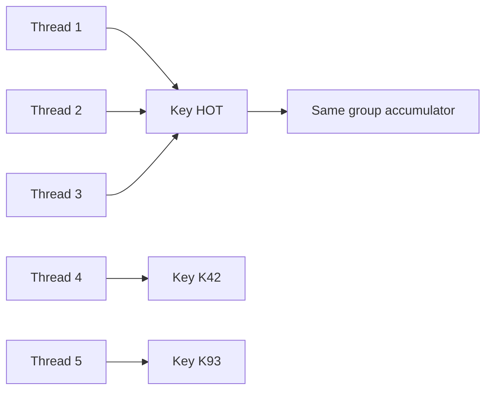

# Checking Key Contention, Correctness, and Synchronization Overhead

## Context and Goals

When using the **Java Stream API** to aggregate data with `parallelStream()`, choosing a *concurrent collector* like `groupingByConcurrent()` or `toConcurrentMap()` can reduce the work of merging intermediate results. In return, multiple threads may update a single data structure concurrently, causing contention on keys or on each group's accumulator. A collection operation that runs correctly can still be slower than the sequential version.

This lesson belongs to the **Concurrent Collection** chapter, focusing on three questions:

1. **Correctness:** Was every element counted exactly once? Does the result depend on processing order or thread scheduling?
2. **Contention:** Which threads update the same key, accumulator value, or synchronization point concurrently?
3. **Overhead:** Do waiting time, atomic operations, merging, allocation, and scheduling exceed the benefit of parallel processing?

The goal is to know how to verify with reference data, generate workloads with different key distributions, measure properly with the right tools, and choose a collection strategy suited to the problem's characteristics. Examples use Java 17 or newer (because of `record`) and do not require group output ordering.

## 1. What a Concurrent Collector Actually Guarantees

A collector describes how to **create an accumulation container**, **incorporate elements**, **combine containers**, and **finish the result**. `Collector.Characteristics` flags affect how Stream can execute:

| Characteristic | Meaning for Parallel Execution |
| --- | --- |
| `CONCURRENT` | The collector's accumulator allows multiple threads to call it concurrently on the same result container per the collector's contract. |
| `UNORDERED` | The result does not guarantee preserving element *encounter order*. |
| `IDENTITY_FINISH` | The finisher function can be the identity function; there is no separate result type conversion step. |

`groupingByConcurrent(classifier, downstream)` returns a `ConcurrentMap` and is a **concurrent, unordered** collector. Meanwhile, regular `groupingBy(...)` does not carry the `CONCURRENT` characteristic, even when used with `parallelStream()`.

Crucially: **a concurrent collector does not mean every output component is safe for arbitrary concurrent mutation**. For example, `groupingByConcurrent(Txn::region, toList())` can collect accurately during the terminal operation because the collector coordinates downstream updates, yet the resulting `List`s are not guaranteed to be concurrently modifiable after `collect()` completes. Element order inside each list is not guaranteed either.

`groupingByConcurrent(key, counting())` or `groupingByConcurrent(key, summingLong(...))` is still valid, even though `counting()` or `summingLong()` itself is not a `CONCURRENT` downstream: the outer collector is responsible for coordinating updates. Common OpenJDK implementations may synchronize on each key's container when the downstream is not concurrent; that is an **implementation detail**, not a promise that Java always uses a specific lock type.

Distinguish three approaches:

| Approach | How It Collects | Common Overhead |
| --- | --- | --- |
| `stream().collect(groupingBy(...))` | One thread aggregates sequentially | Does not use multiple cores, but low coordination overhead. |
| `parallelStream().collect(groupingBy(...))` | Branches build separate results then use combiner to merge | Creating multiple maps, merging groups, and allocation during merge. |
| `parallelStream().collect(groupingByConcurrent(...))` | Multiple threads can contribute together to the result map | Key/cell update contention on hot keys, memory and concurrent coordination cost. |

No single approach is fastest in every scenario. Nor does `parallelStream()` guarantee automatically using more threads than the system has available.

## 2. Where Does Contention Appear?

Suppose one million transactions are grouped by sales region. If 90% of transactions carry the key `"HOT"`, most updates converge on a single group. If transactions are evenly spread across thousands of keys, threads have opportunities to update different groups.



There are multiple layers of cost:

- **Map contention:** creating new keys, `computeIfAbsent()`, `merge()`, or updating the same slot may require coordination via CAS, `ConcurrentHashMap` mechanics, and sometimes internal locking.
- **Downstream contention:** many transactions with the same key must update that key's accumulator. If the downstream does not support concurrent updates, the collector must ensure no data race occurs during accumulation.
- **Memory sharing:** even without contending on a monitor, cache coherence and atomic updates consume resources; adjacent counters can also experience *false sharing*.
- **Other overhead:** task splitting, work stealing between threads, map/buffer allocation, GC, and merging steps can outweigh the actual computation work.

Therefore, **the number of distinct keys** and **per-key frequency distribution** often matter more than element count alone. A key accounting for 90% of data can become a bottleneck even when there are thousands of keys in total.

## 3. Correct Collection Example with the Java Stream API

Consider a transaction type with id, region, and amount (allowing negative values to represent refunds). The task is to compute totals by region. The sequential version serves as an *oracle* to verify the parallel approaches.

```java
import java.util.ArrayList;
import java.util.List;
import java.util.Map;
import java.util.concurrent.ConcurrentMap;
import java.util.stream.Collectors;

public class ConcurrentCollectorAudit {
    record Txn(long id, String region, int amount) {}

    static List<Txn> data(int size, int groups, boolean skew) {
        List<Txn> result = new ArrayList<>(size);
        for (int i = 0; i < size; i++) {
            String region = skew && i % 10 != 0
                    ? "HOT"
                    : "K" + (i % groups);
            result.add(new Txn(i, region, i % 7 - 3));
        }
        return result;
    }

    static Map<String, Long> sequential(List<Txn> txns) {
        return txns.stream().collect(Collectors.groupingBy(
                Txn::region,
                Collectors.summingLong(Txn::amount)));
    }

    static Map<String, Long> parallelWithMerge(List<Txn> txns) {
        return txns.parallelStream().collect(Collectors.groupingBy(
                Txn::region,
                Collectors.summingLong(Txn::amount)));
    }

    static ConcurrentMap<String, Long> parallelConcurrent(List<Txn> txns) {
        return txns.parallelStream().unordered().collect(
                Collectors.groupingByConcurrent(
                        Txn::region,
                        Collectors.summingLong(Txn::amount)));
    }

    static void verify(List<Txn> txns) {
        Map<String, Long> expected = sequential(txns);

        for (int attempt = 0; attempt < 20; attempt++) {
            Map<String, Long> merged = parallelWithMerge(txns);
            Map<String, Long> concurrent = parallelConcurrent(txns);
            if (!expected.equals(merged) || !expected.equals(concurrent)) {
                throw new AssertionError("Wrong regional sum at attempt " + attempt);
            }
        }

        Map<String, Long> counts = txns.parallelStream().collect(
                Collectors.groupingByConcurrent(
                        Txn::region, Collectors.counting()));
        long counted = counts.values().stream()
                .mapToLong(Long::longValue).sum();
        if (counted != txns.size()) {
            throw new AssertionError("Missing or duplicate transactions");
        }

        long inputTotal = txns.stream().mapToLong(Txn::amount).sum();
        long outputTotal = parallelConcurrent(txns).values().stream()
                .mapToLong(Long::longValue).sum();
        if (inputTotal != outputTotal) {
            throw new AssertionError("Global total mismatch");
        }
    }

    public static void main(String[] args) {
        verify(data(200_000, 1_000, false));
        verify(data(200_000, 1_000, true));
        verify(List.of());
        System.out.println("All checks passed");
    }
}
```

Save as `ConcurrentCollectorAudit.java`, compile with `javac ConcurrentCollectorAudit.java`, and run with `java ConcurrentCollectorAudit` on JDK 17+. Repeating the collection increases the chance of catching flaky bugs under contention; **20 successful runs is not absolute proof that a custom collector is thread-safe**.

Here `long` addition is associative and commutative within the chosen data range, so comparing via `Map.equals()` makes sense. For floating-point numbers, different addition orders can produce tiny rounding differences; in that case use an appropriate error tolerance rather than expecting bit-for-bit equality by default. If a reduction depends on order, you cannot arbitrarily switch to an `UNORDERED` collector.

Calling `.unordered()` intentionally expresses that the result does not depend on encounter order. `groupingByConcurrent()` already makes no ordering guarantee; calling `.unordered()` does not fix classifier or mapper functions that have side effects.

## 4. Correctness Bugs Easily Mistaken for Performance Issues

### Sharing an Unsafe Structure

The following code is **wrong** because multiple threads update a `HashMap` without synchronization:

```java
Map<String, Long> totals = new java.util.HashMap<>();
txns.parallelStream().forEach(txn ->
        totals.merge(txn.region(), (long) txn.amount(), Long::sum));
// Do not use this pattern in real programs.
```

Switching to `ConcurrentHashMap` only protects map operations; it **does not automatically make every mutable value inside the map thread-safe**. For instance, `computeIfAbsent(key, k -> new ArrayList<>()).add(x)` can still cause a data race because multiple threads call `add()` on the same `ArrayList`.

Two safe alternatives matching the aggregation need are:

```java
// Collector coordinates the entire accumulation process:
Map<String, Long> totals1 = txns.parallelStream().collect(
        Collectors.groupingByConcurrent(
                Txn::region, Collectors.summingLong(Txn::amount)));

// ConcurrentMap merge is a per-key update operation:
ConcurrentMap<String, Long> totals2 = txns.parallelStream().collect(
        Collectors.toConcurrentMap(
                Txn::region, txn -> (long) txn.amount(), Long::sum));
```

The merge function `Long::sum` does not mutate external state and fits addition. When using `toConcurrentMap()`, pass a valid merge function if two elements can share a key; the form without a merge function fails on duplicate keys.

### Falsely Declaring a Collector Concurrent

When writing `Collector.of(...)`, only declare `Collector.Characteristics.CONCURRENT` if **the accumulator itself** is genuinely safe when called concurrently by multiple threads on the same accumulation object. Having the supplier create a regular `ArrayList` or `HashMap` and attaching `CONCURRENT` does not magically make them safe. Some runs might happen to yield the right output, with no guarantee.

### Checking Too Few Invariants

Comparing only the global total can miss misassigned keys: two wrong groups with offsetting errors still pass the check. When verifying results, combine:

1. Comparing **every key and value** against the sequential reference.
2. Checking the sum of group element counts equals input size for counting operations.
3. Checking total amount or total weight of inputs and outputs if the transformation preserves that quantity.
4. Running **empty, single-key, many-key, skewed, and duplicate-key** cases repeatedly across varying workload sizes.

`classifier` and `mapper` must have no contending side effects and must not rely on mutable state changing across calls. For map-grouping collectors, avoid `null` keys since standard collectors may reject `null` classification results. Do not modify the source collection while a stream traverses it if the source does not permit it.

## 5. Measuring Synchronization Overhead Reproducibly

Do not declare an approach faster from a single `System.nanoTime()` measurement in `main()`: results are easily skewed by JIT compilation, common pool initialization, GC, and background processes. For Java, **JMH** is the right choice to compare throughput or average time across collection methods.

The benchmark class example below requires JMH in the build configuration; place it in `CollectorBenchmark.java`. Each benchmark method returns its result so JMH can consume it, while data creation is placed outside the measured region.

```java
import java.util.List;
import java.util.Map;
import java.util.concurrent.ConcurrentMap;
import java.util.concurrent.TimeUnit;
import java.util.stream.Collectors;
import java.util.stream.IntStream;
import org.openjdk.jmh.annotations.*;

@State(Scope.Benchmark)
@BenchmarkMode(Mode.AverageTime)
@OutputTimeUnit(TimeUnit.MILLISECONDS)
@Warmup(iterations = 3)
@Measurement(iterations = 5)
@Fork(2)
@Threads(1) // Measure one benchmark invocation; uses parallelStream inside.
public class CollectorBenchmark {
    record Txn(String region, long amount) {}

    @Param({"8", "1024"})
    public int groups;

    @Param({"false", "true"})
    public boolean skew;

    private List<Txn> txns;

    @Setup(Level.Trial)
    public void setup() {
        txns = IntStream.range(0, 1_000_000)
                .mapToObj(i -> new Txn(
                        skew && i % 10 != 0 ? "HOT" : "K" + (i % groups),
                        i % 7 - 3))
                .toList();
    }

    @Benchmark
    public Map<String, Long> sequential() {
        return txns.stream().collect(Collectors.groupingBy(
                Txn::region, Collectors.summingLong(Txn::amount)));
    }

    @Benchmark
    public Map<String, Long> parallelWithMerge() {
        return txns.parallelStream().collect(Collectors.groupingBy(
                Txn::region, Collectors.summingLong(Txn::amount)));
    }

    @Benchmark
    public ConcurrentMap<String, Long> parallelConcurrent() {
        return txns.parallelStream().unordered().collect(
                Collectors.groupingByConcurrent(
                        Txn::region, Collectors.summingLong(Txn::amount)));
    }
}
```

Control variables to record in a report: JDK version, CPU core count and machine load, data size, key count, hot-key ratio, common pool parallelism, heap configuration, and GC. Do not run multiple parallel stream benchmarks simultaneously and treat them as isolated algorithm measurements: they compete for CPU and the common pool.

Beyond elapsed time, inspect **allocation/GC rate** (such as JMH `-prof gc`) and use Java Flight Recorder or a profiler to trace wait points. Events like `jdk.JavaMonitorEnter` can help locate monitor contention; however, not all CAS cost or cache contention appears as a monitor wait. A thread dump showing many `BLOCKED` threads at the same spot is a clue worth investigating, but does not replace CPU and allocation profiling.

A useful way to interpret results:

| Observation | Hypothesis to Test | Experiment Direction |
| --- | --- | --- |
| Many keys, large data; `groupingByConcurrent` performs better | Fewer collisions across groups, avoids part of map merging | Increase/decrease key count while keeping element count fixed. |
| One key or most data hits one key; concurrent is slow | Updates on the same downstream must coordinate | Reduce skew or try an accumulator that distributes updates. |
| Parallel `groupingBy` is slow with high allocation | Creating many temporary maps and merging is costly | Measure allocation and group count as parallelism increases. |
| Both parallel versions are slow on small data | Task splitting, scheduling, and collector overhead outweigh work | Sweep input sizes; compare against sequential baseline. |
| High timing variance | JIT, GC, OS scheduling, CPU contention, or unstable test environment | Increase forks/measurements, reduce background processes, check GC/JFR. |

These are **hypotheses**, not pre-guaranteed benchmark outcomes. When element count or processing functions change, the ranking from fastest to slowest can also shift.

## 6. When a Hot Key Is Truly the Bottleneck: LongAdder

For **counting or summing integers per key** without needing a consistent snapshot while threads are still writing, `LongAdder` is often an option to reduce contention on the same counter. The example below uses `ConcurrentHashMap` and `LongAdder` as a direct parallel-update approach:

```java
import java.util.concurrent.ConcurrentHashMap;
import java.util.concurrent.atomic.LongAdder;

ConcurrentHashMap<String, LongAdder> accumulators =
        new ConcurrentHashMap<>();

txns.parallelStream().forEach(txn ->
        accumulators.computeIfAbsent(txn.region(), key -> new LongAdder())
                .add(txn.amount()));

// Read results only after the terminal operation has completed.
Map<String, Long> snapshot = accumulators.entrySet().stream()
        .collect(Collectors.toMap(
                Map.Entry::getKey,
                entry -> entry.getValue().sum()));
```

`LongAdder` stripes updates across multiple internal cells when needed; in return, it carries extra memory cost and calling `sum()` **while updates are still happening** does not yield an atomic snapshot. Once all work has completed, `sum()` is appropriate for obtaining the final total. If you need ordering or cross-key consistent state mid-update, you must design a different coordination mechanism.

Do not assume `LongAdder` is always faster than `groupingByConcurrent(..., summingLong(...))`: benefits depend on contention level, key count, per-element processing time, and counter creation cost. Meanwhile, the `forEach` usage here involves shared state controlled via concurrent structures; when fine-grained control is unnecessary, standard collectors are usually easier to read and verify.

## 7. Verification and Decision Workflow

For a concurrent collection pipeline in a real application, you can follow this sequence:

1. **Validate the operation:** determine whether encounter order may be dropped; the merge function must fit parallel splitting and merging. For order-dependent computations, choose an algorithm that respects order.
2. **Establish an oracle:** compute sequential results from the same data; compare every key, total count, and business invariants. Use tolerance comparisons when needed for floating-point values.
3. **Design benchmark workloads:** few keys/many keys, hot key/uniform distribution, small/large load, cheap/expensive per-element work. Hold data constant when comparing algorithms.
4. **Measure with JMH:** warm-up, multiple iterations and forks, publish the test environment. Observe both latency and allocation/GC.
5. **Confirm bottlenecks with profiling:** inspect synchronization points, CPU utilization, and map creation/merging; avoid jumping to conclusions from low CPU or a single stack trace.
6. **Try appropriate options:** sequential `groupingBy`, parallel `groupingBy`, `groupingByConcurrent`, `toConcurrentMap`, or counters like `LongAdder`; re-run correctness checks after every change.

A cost model to guide thinking is:

\[
T_{\text{execution}} \approx T_{\text{traversal/processing}} + T_{\text{coordination}} + T_{\text{merge}} + T_{\text{allocation/GC}} + T_{\text{scheduling}}
\]

This is only a way to **categorize cost sources**, not an exact time prediction formula: components can overlap. When threads pile onto the same group, increasing parallelism can cause coordination cost to grow faster than the benefit of splitting work.

## 8. Practice Exercises

Use the two datasets in `ConcurrentCollectorAudit`: `data(200_000, 1_000, false)` and `data(200_000, 1_000, true)`. First run the correctness check, then move to a JMH benchmark at larger sizes.

- **Exercise 1 — Skewed data:** change the `HOT` key ratio from 90% to 50% and 99%. Record the timings of the three collection approaches. Explain in terms of update density on the same group, without assuming every machine yields identical results.
- **Exercise 2 — Key count:** keep total transaction count fixed, try `groups = 1`, `8`, `1_024`, `65_536`. Compare timing, actual number of groups produced, and allocation.
- **Exercise 3 — Intentional bug:** read the shared `HashMap` snippet in section 4, identify the data race and why a few trial runs might still print the right total. Replace it with one of the two collectors learned; never use the buggy version in applications.
- **Exercise 4 — Structure selection:** with one very hot key, compare `groupingByConcurrent(..., summingLong(...))` and the `LongAdder` approach; verify results with the oracle before comparing speeds.

When reporting, include at least a table showing **input size, key count, hot-key ratio, algorithm, measured time, allocation/GC, and correctness check result**. A good conclusion states both measurement conditions and generalization limits: *a concurrent collector is a tool guaranteeing concurrent accumulation per contract, whereas performance gains must be proven on concrete data distributions and hardware*.
