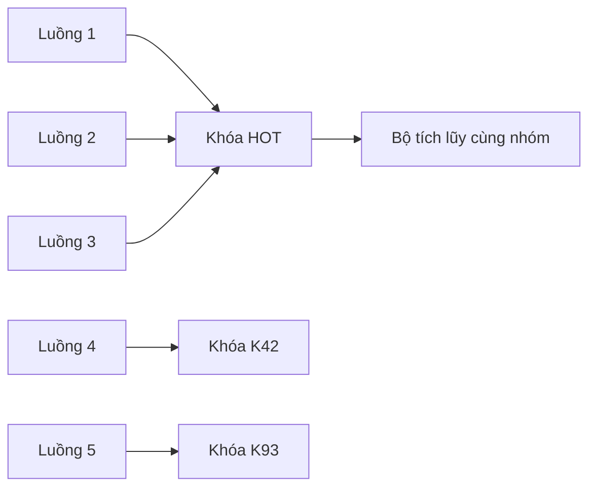

# Kiểm tra tranh chấp khóa, tính đúng và chi phí đồng bộ

## Bối cảnh và mục tiêu

Khi dùng **Java Stream API** để tổng hợp dữ liệu bằng `parallelStream()`, việc chọn một *concurrent collector* như `groupingByConcurrent()` hoặc `toConcurrentMap()` có thể giảm công việc hợp nhất kết quả trung gian. Đổi lại, nhiều luồng có thể cùng cập nhật một cấu trúc dữ liệu, phát sinh tranh chấp tại khóa hoặc tại bộ tích lũy của từng nhóm. Một phép thu thập chạy đúng vẫn có thể chậm hơn phiên bản tuần tự.

Bài học thuộc chương **Thu thập đồng thời**, tập trung vào ba câu hỏi:

1. **Tính đúng:** Mỗi phần tử đã được tính đủ một lần chưa? Kết quả có phụ thuộc thứ tự xử lý hoặc lịch chạy của các luồng không?
2. **Tranh chấp:** Những luồng nào cùng cập nhật một khóa, một giá trị tích lũy hoặc một điểm đồng bộ?
3. **Chi phí:** Thời gian chờ, thao tác nguyên tử, hợp nhất, cấp phát và lập lịch có lớn hơn lợi ích xử lý song song không?

Đích đến là biết kiểm chứng bằng dữ liệu tham chiếu, tạo tải có phân bố khóa khác nhau, đo đúng bằng công cụ phù hợp và chọn phương án thu thập theo đặc tính bài toán. Các ví dụ dùng Java 17 trở lên (do có `record`) và không yêu cầu thứ tự đầu ra của nhóm.

## 1. Những gì concurrent collector thực sự bảo đảm

Một collector mô tả cách **tạo vùng tích lũy**, **nạp phần tử**, **kết hợp vùng tích lũy** và **hoàn tất kết quả**. Các `Collector.Characteristics` ảnh hưởng đến cách Stream có thể thực thi:

| Đặc tính | Ý nghĩa đối với thực thi song song |
| --- | --- |
| `CONCURRENT` | Hàm tích lũy của collector cho phép nhiều luồng gọi đồng thời trên cùng một vùng kết quả theo hợp đồng của collector. |
| `UNORDERED` | Kết quả không cam kết giữ thứ tự gặp phần tử (*encounter order*). |
| `IDENTITY_FINISH` | Hàm hoàn tất có thể là phép đồng nhất; không có bước đổi kiểu kết quả riêng biệt. |

`groupingByConcurrent(classifier, downstream)` trả về `ConcurrentMap` và là collector **concurrent, unordered**. Trong khi đó, `groupingBy(...)` thông thường không mang đặc tính `CONCURRENT`, dù được dùng với `parallelStream()`.

Điều quan trọng: **collector concurrent không có nghĩa mọi thành phần đầu ra đều an toàn cho việc sửa đồng thời tùy ý**. Ví dụ, `groupingByConcurrent(Txn::region, toList())` có thể thu thập đúng trong terminal operation vì collector phối hợp cập nhật downstream, nhưng các `List` nhận được không được bảo đảm là danh sách có thể sửa đồng thời sau khi `collect()` kết thúc. Thứ tự phần tử trong từng danh sách cũng không được bảo đảm.

`groupingByConcurrent(key, counting())` hoặc `groupingByConcurrent(key, summingLong(...))` vẫn hợp lệ, dù chính `counting()` hay `summingLong()` không phải downstream `CONCURRENT`: collector bên ngoài chịu trách nhiệm phối hợp cập nhật. Các bản triển khai OpenJDK thông dụng có thể đồng bộ ở bộ chứa của từng khóa khi downstream không concurrent; đó là **chi tiết triển khai**, không phải lời hứa rằng Java luôn dùng một kiểu khóa cụ thể.

Hãy phân biệt ba phương án:

| Phương án | Cách thu thập | Chi phí dễ xuất hiện |
| --- | --- | --- |
| `stream().collect(groupingBy(...))` | Một luồng tổng hợp tuần tự | Không tận dụng xử lý nhiều lõi, nhưng ít chi phí điều phối. |
| `parallelStream().collect(groupingBy(...))` | Các nhánh tạo kết quả riêng rồi dùng combiner để hợp nhất | Tạo nhiều map, ghép nhóm và cấp phát khi merge. |
| `parallelStream().collect(groupingByConcurrent(...))` | Nhiều luồng có thể cùng đóng góp vào map kết quả | Tranh chấp khóa/ô cập nhật ở khóa nóng, chi phí bộ nhớ và điều phối đồng thời. |

Không có phương án nào nhanh nhất trong mọi trường hợp. `parallelStream()` cũng không bảo đảm tự động dùng nhiều luồng hơn mức hệ thống hiện có.

## 2. Tranh chấp xuất hiện ở đâu?

Giả sử một triệu giao dịch được nhóm theo vùng bán hàng. Nếu 90% giao dịch cùng mang khóa `"HOT"`, phần lớn các thao tác cập nhật dồn vào một nhóm. Nếu giao dịch được phân đều cho hàng nghìn khóa, các luồng có cơ hội cập nhật những nhóm khác nhau.



Có nhiều tầng chi phí khác nhau:

- **Tranh chấp ở map:** tạo khóa mới, `computeIfAbsent()`, `merge()` hoặc cập nhật cùng vị trí có thể cần phối hợp qua CAS, cơ chế của `ConcurrentHashMap` và đôi khi khóa nội bộ.
- **Tranh chấp ở downstream:** nhiều giao dịch cùng khóa phải cập nhật bộ tích lũy của khóa đó. Nếu downstream không hỗ trợ cập nhật đồng thời, collector phải bảo đảm không xảy ra data race khi tích lũy.
- **Chia sẻ bộ nhớ:** dù không tranh một monitor, cache coherence và cập nhật nguyên tử vẫn tiêu tốn tài nguyên; các bộ đếm nằm gần nhau còn có thể gặp *false sharing*.
- **Chi phí khác:** chia tác vụ, chuyển việc giữa luồng, cấp phát map/buffer, GC và bước hợp nhất có thể lớn so với thao tác tính toán thực tế.

Vì vậy, **số khóa phân biệt** và **phân bố tần suất từng khóa** thường quan trọng hơn chỉ riêng số phần tử. Một khóa chiếm 90% dữ liệu có thể trở thành nút thắt dù tổng cộng có hàng nghìn khóa.

## 3. Ví dụ thu thập đúng bằng Java Stream API

Xét một loại giao dịch có mã, vùng và số tiền (cho phép âm để biểu diễn hoàn tiền). Bài toán là tính tổng theo vùng. Bản tuần tự làm *oracle* để đối chiếu với các phương án song song.

```java
import java.util.ArrayList;
import java.util.List;
import java.util.Map;
import java.util.concurrent.ConcurrentMap;
import java.util.stream.Collectors;

public class ConcurrentCollectorAudit {
    record Txn(long id, String region, int amount) {}

    static List<Txn> data(int size, int groups, boolean skew) {
        List<Txn> result = new ArrayList<>(size);
        for (int i = 0; i < size; i++) {
            String region = skew && i % 10 != 0
                    ? "HOT"
                    : "K" + (i % groups);
            result.add(new Txn(i, region, i % 7 - 3));
        }
        return result;
    }

    static Map<String, Long> sequential(List<Txn> txns) {
        return txns.stream().collect(Collectors.groupingBy(
                Txn::region,
                Collectors.summingLong(Txn::amount)));
    }

    static Map<String, Long> parallelWithMerge(List<Txn> txns) {
        return txns.parallelStream().collect(Collectors.groupingBy(
                Txn::region,
                Collectors.summingLong(Txn::amount)));
    }

    static ConcurrentMap<String, Long> parallelConcurrent(List<Txn> txns) {
        return txns.parallelStream().unordered().collect(
                Collectors.groupingByConcurrent(
                        Txn::region,
                        Collectors.summingLong(Txn::amount)));
    }

    static void verify(List<Txn> txns) {
        Map<String, Long> expected = sequential(txns);

        for (int attempt = 0; attempt < 20; attempt++) {
            Map<String, Long> merged = parallelWithMerge(txns);
            Map<String, Long> concurrent = parallelConcurrent(txns);
            if (!expected.equals(merged) || !expected.equals(concurrent)) {
                throw new AssertionError("Sai tổng theo vùng ở lần " + attempt);
            }
        }

        Map<String, Long> counts = txns.parallelStream().collect(
                Collectors.groupingByConcurrent(
                        Txn::region, Collectors.counting()));
        long counted = counts.values().stream()
                .mapToLong(Long::longValue).sum();
        if (counted != txns.size()) {
            throw new AssertionError("Thiếu hoặc lặp giao dịch");
        }

        long inputTotal = txns.stream().mapToLong(Txn::amount).sum();
        long outputTotal = parallelConcurrent(txns).values().stream()
                .mapToLong(Long::longValue).sum();
        if (inputTotal != outputTotal) {
            throw new AssertionError("Tổng toàn cục không khớp");
        }
    }

    public static void main(String[] args) {
        verify(data(200_000, 1_000, false));
        verify(data(200_000, 1_000, true));
        verify(List.of());
        System.out.println("Các phép kiểm tra đều đạt");
    }
}
```

Lưu dưới tên `ConcurrentCollectorAudit.java`, biên dịch bằng `javac ConcurrentCollectorAudit.java` và chạy bằng `java ConcurrentCollectorAudit` với JDK 17+. Việc lặp lại phép thu thập giúp tăng cơ hội bắt lỗi không ổn định khi có tranh chấp; **20 lần thành công không phải là chứng minh tuyệt đối rằng một collector tự viết là thread-safe**.

Ở đây phép cộng `long` có tính kết hợp và giao hoán trong miền dữ liệu được chọn, nên so sánh bằng `Map.equals()` có ý nghĩa. Với số thực dấu phẩy động, thứ tự cộng khác nhau có thể tạo sai khác nhỏ do làm tròn; lúc đó cần tiêu chí sai số phù hợp, không mặc định yêu cầu bằng nhau bit-for-bit. Nếu phép giảm phụ thuộc thứ tự, không thể tùy tiện chuyển sang collector `UNORDERED`.

Phép `.unordered()` là chủ ý thể hiện kết quả không phụ thuộc encounter order. `groupingByConcurrent()` vốn đã không cam kết thứ tự; gọi `.unordered()` không tự sửa được các hàm classifier hoặc mapper có side effect.

## 4. Những lỗi tính đúng dễ bị nhầm với lỗi hiệu năng

### Chia sẻ cấu trúc không an toàn

Đoạn mã sau **sai** vì nhiều luồng cùng cập nhật `HashMap` mà không có đồng bộ:

```java
Map<String, Long> totals = new java.util.HashMap<>();
txns.parallelStream().forEach(txn ->
        totals.merge(txn.region(), (long) txn.amount(), Long::sum));
// Không dùng mẫu này trong chương trình thật.
```

Đổi thành `ConcurrentHashMap` chỉ bảo vệ các thao tác của map; điều đó **không tự biến mọi giá trị mutable trong map thành thread-safe**. Ví dụ, mẫu `computeIfAbsent(key, k -> new ArrayList<>()).add(x)` vẫn có thể gây data race vì nhiều luồng gọi `add()` trên cùng `ArrayList`.

Hai thay thế an toàn theo đúng nhu cầu tổng hợp là:

```java
// Collector điều phối toàn bộ quá trình tích lũy:
Map<String, Long> totals1 = txns.parallelStream().collect(
        Collectors.groupingByConcurrent(
                Txn::region, Collectors.summingLong(Txn::amount)));

// Merge của ConcurrentMap là thao tác cập nhật theo khóa:
ConcurrentMap<String, Long> totals2 = txns.parallelStream().collect(
        Collectors.toConcurrentMap(
                Txn::region, txn -> (long) txn.amount(), Long::sum));
```

Hàm gộp `Long::sum` không làm thay đổi trạng thái bên ngoài và phù hợp với phép cộng. Khi dùng `toConcurrentMap()`, cần truyền hàm merge hợp lệ nếu có khả năng hai phần tử trùng khóa; dạng không có merge function sẽ báo lỗi với khóa trùng.

### Tự công bố collector concurrent sai sự thật

Khi viết `Collector.of(...)`, chỉ khai báo `Collector.Characteristics.CONCURRENT` nếu **chính accumulator** thật sự an toàn khi nhiều luồng gọi đồng thời trên cùng đối tượng tích lũy. Việc supplier tạo `ArrayList` hay `HashMap` thông thường rồi gắn cờ `CONCURRENT` không khiến chúng tự trở nên an toàn. Một số lần chạy có thể cho kết quả đúng ngẫu nhiên, nhưng không có bảo đảm.

### Kiểm tra quá ít bất biến

Chỉ so tổng toàn cục có thể bỏ sót việc ghi nhầm khóa: hai nhóm sai nhưng có tổng bù trừ vẫn vượt qua phép kiểm tra. Khi kiểm chứng kết quả, nên kết hợp:

1. So sánh **từng khóa và giá trị** với bản tham chiếu tuần tự.
2. Kiểm tra tổng số phần tử trong các nhóm bằng kích thước đầu vào đối với phép đếm.
3. Kiểm tra tổng tiền hoặc tổng trọng số của đầu vào và đầu ra nếu phép biến đổi bảo toàn đại lượng đó.
4. Chạy các ca **rỗng, một khóa, nhiều khóa, phân bố lệch và trùng khóa**, lặp lại với các kích thước tải khác nhau.

`classifier` và `mapper` phải không có side effect gây tranh chấp và không được dựa trên trạng thái mutable thay đổi giữa các lần gọi. Với các collector nhóm theo map, hãy tránh khóa `null` vì các collector chuẩn có thể từ chối kết quả phân loại `null`. Không sửa collection nguồn trong lúc stream đang duyệt nếu nguồn không cho phép.

## 5. Đo chi phí đồng bộ theo phương pháp có thể lặp lại

Không kết luận phương án nhanh hơn chỉ từ một lần đo `System.nanoTime()` trong `main()`: kết quả dễ bị ảnh hưởng bởi JIT, khởi tạo common pool, GC và tiến trình khác. Với Java, **JMH** là lựa chọn phù hợp để so sánh throughput hoặc thời gian trung bình giữa các cách collect.

Ví dụ lớp benchmark dưới đây cần JMH trong cấu hình build; đặt vào file `CollectorBenchmark.java`. Mỗi phép đo đều trả về kết quả để JMH có thể tiêu thụ, còn việc tạo dữ liệu đặt ngoài vùng đo.

```java
import java.util.List;
import java.util.Map;
import java.util.concurrent.ConcurrentMap;
import java.util.concurrent.TimeUnit;
import java.util.stream.Collectors;
import java.util.stream.IntStream;
import org.openjdk.jmh.annotations.*;

@State(Scope.Benchmark)
@BenchmarkMode(Mode.AverageTime)
@OutputTimeUnit(TimeUnit.MILLISECONDS)
@Warmup(iterations = 3)
@Measurement(iterations = 5)
@Fork(2)
@Threads(1) // Đo một lần gọi benchmark; bên trong có parallelStream.
public class CollectorBenchmark {
    record Txn(String region, long amount) {}

    @Param({"8", "1024"})
    public int groups;

    @Param({"false", "true"})
    public boolean skew;

    private List<Txn> txns;

    @Setup(Level.Trial)
    public void setup() {
        txns = IntStream.range(0, 1_000_000)
                .mapToObj(i -> new Txn(
                        skew && i % 10 != 0 ? "HOT" : "K" + (i % groups),
                        i % 7 - 3))
                .toList();
    }

    @Benchmark
    public Map<String, Long> sequential() {
        return txns.stream().collect(Collectors.groupingBy(
                Txn::region, Collectors.summingLong(Txn::amount)));
    }

    @Benchmark
    public Map<String, Long> parallelWithMerge() {
        return txns.parallelStream().collect(Collectors.groupingBy(
                Txn::region, Collectors.summingLong(Txn::amount)));
    }

    @Benchmark
    public ConcurrentMap<String, Long> parallelConcurrent() {
        return txns.parallelStream().unordered().collect(
                Collectors.groupingByConcurrent(
                        Txn::region, Collectors.summingLong(Txn::amount)));
    }
}
```

Các biến kiểm soát cần ghi trong báo cáo: phiên bản JDK, số lõi CPU và mức tải máy, kích thước dữ liệu, số khóa, tỷ lệ khóa nóng, mức song song của common pool, cấu hình heap và GC. Đừng chạy nhiều benchmark stream song song cùng lúc rồi coi như đo riêng từng thuật toán: chúng có thể tranh CPU và common pool với nhau.

Ngoài thời gian, cần quan sát **mức cấp phát/GC** (chẳng hạn JMH `-prof gc`) và dùng Java Flight Recorder hoặc profiler để truy dấu các điểm chờ. Sự kiện như `jdk.JavaMonitorEnter` có thể hỗ trợ tìm tranh chấp trên monitor; tuy nhiên, không phải mọi chi phí CAS hay cache contention đều xuất hiện dưới dạng một lần chờ monitor. Thread dump với nhiều luồng `BLOCKED` tại cùng vị trí là dấu hiệu cần điều tra, nhưng không thay cho đo CPU và allocation.

Một cách đọc kết quả có ích:

| Quan sát | Giả thuyết cần kiểm tra | Hướng thử nghiệm |
| --- | --- | --- |
| Nhiều khóa, dữ liệu lớn; `groupingByConcurrent` tốt hơn | Ít va chạm giữa các nhóm, tránh một phần merge | Tăng/giảm số khóa, giữ số phần tử cố định. |
| Một khóa hoặc phần lớn dữ liệu dồn một khóa; concurrent chậm | Các cập nhật cùng downstream phải phối hợp | Thử giảm độ lệch hoặc dùng bộ tích lũy có khả năng phân tán cập nhật. |
| `groupingBy` song song chậm và allocation lớn | Tạo nhiều map tạm và hợp nhất tốn kém | Đo allocation và số nhóm khi tăng mức song song. |
| Cả hai bản song song chậm với dữ liệu nhỏ | Chi phí chia tác vụ, lịch chạy và collector lấn át công việc | Dịch chuyển kích thước đầu vào; đối chiếu bản tuần tự. |
| Thời gian dao động lớn | JIT, GC, lịch OS, cạnh tranh CPU hoặc môi trường đo không ổn định | Tăng số fork/measurement, giảm tiến trình nền, xem GC/JFR. |

Đây là các **giả thuyết**, không phải kết quả benchmark được bảo đảm trước. Khi số phần tử hoặc hàm xử lý thay đổi, thứ tự nhanh/chậm cũng có thể đổi.

## 6. Khi khóa nóng thực sự là nút thắt: LongAdder

Đối với **đếm hoặc cộng số nguyên theo khóa** và không cần đọc một snapshot nhất quán trong lúc các luồng đang ghi, `LongAdder` thường là một lựa chọn để giảm tranh chấp trên cùng bộ đếm. Ví dụ sau dùng `ConcurrentHashMap` và `LongAdder` như phương án cập nhật song song trực tiếp:

```java
import java.util.concurrent.ConcurrentHashMap;
import java.util.concurrent.atomic.LongAdder;

ConcurrentHashMap<String, LongAdder> accumulators =
        new ConcurrentHashMap<>();

txns.parallelStream().forEach(txn ->
        accumulators.computeIfAbsent(txn.region(), key -> new LongAdder())
                .add(txn.amount()));

// Chỉ đọc kết quả sau khi terminal operation đã hoàn thành.
Map<String, Long> snapshot = accumulators.entrySet().stream()
        .collect(Collectors.toMap(
                Map.Entry::getKey,
                entry -> entry.getValue().sum()));
```

`LongAdder` phân tán cập nhật thành nhiều ô nội bộ khi cần; đổi lại, nó có thêm chi phí bộ nhớ và việc gọi `sum()` **trong lúc vẫn có cập nhật** không cho một snapshot nguyên tử. Khi mọi công việc đã hoàn tất, phép `sum()` thích hợp để lấy tổng cuối cùng. Nếu cần thứ tự hoặc trạng thái nhất quán xuyên nhiều khóa ngay trong lúc cập nhật, phải thiết kế cơ chế phối hợp khác.

Đừng mặc định `LongAdder` luôn nhanh hơn `groupingByConcurrent(..., summingLong(...))`: lợi ích phụ thuộc mức tranh chấp, số khóa, thời gian xử lý mỗi phần tử và chi phí tạo bộ đếm. Đồng thời, cách dùng `forEach` ở đây có trạng thái dùng chung được kiểm soát bằng các cấu trúc concurrent; khi không cần kiểm soát chi tiết, collector chuẩn thường dễ đọc và dễ kiểm chứng hơn.

## 7. Quy trình kiểm tra và ra quyết định

Với một pipeline thu thập đồng thời trong ứng dụng thực tế, có thể làm theo trình tự:

1. **Xác nhận phép toán:** xác định có được phép bỏ encounter order hay không; hàm gộp phải phù hợp với cách chia/ghép song song. Với phép tính phụ thuộc thứ tự, chọn thuật toán tôn trọng thứ tự.
2. **Lập oracle:** tính kết quả tuần tự từ cùng dữ liệu; so sánh từng khóa, tổng đếm và những bất biến nghiệp vụ. Dùng phép so sánh sai số khi cần đối với số thực.
3. **Thiết kế tải đối chứng:** ít khóa/nhiều khóa, khóa nóng/phân bố đều, tải nhỏ/lớn, xử lý mỗi phần tử rẻ/đắt. Giữ dữ liệu cố định khi so sánh giữa thuật toán.
4. **Đo với JMH:** warmup, nhiều iteration và fork, công khai môi trường đo. Quan sát cả thời gian lẫn allocation/GC.
5. **Xác nhận nút thắt bằng profile:** xem điểm đồng bộ, mức sử dụng CPU và thao tác tạo/merge map; tránh suy kết luận từ CPU thấp hoặc một stack trace duy nhất.
6. **Thử phương án phù hợp:** `groupingBy` tuần tự, `groupingBy` song song, `groupingByConcurrent`, `toConcurrentMap`, hoặc bộ đếm như `LongAdder`; sau mỗi thay đổi cần chạy lại kiểm tra tính đúng.

Một mô hình chi phí để định hướng suy nghĩ là:

\[
T_{\text{thực thi}} \approx T_{\text{duyệt/xử lý}} + T_{\text{phối hợp}} + T_{\text{hợp nhất}} + T_{\text{cấp phát/GC}} + T_{\text{lập lịch}}
\]

Đây chỉ là cách **phân loại nguồn chi phí**, không phải công thức dự đoán chính xác thời gian: các thành phần có thể chạy chồng lấp. Khi các luồng bị dồn về cùng nhóm, tăng độ song song có thể làm phần phối hợp tăng nhanh hơn lợi ích chia nhỏ công việc.

## 8. Bài tập thực hành

Sử dụng hai bộ dữ liệu trong `ConcurrentCollectorAudit`: `data(200_000, 1_000, false)` và `data(200_000, 1_000, true)`. Trước tiên chạy kiểm tra tính đúng, rồi chuyển sang benchmark JMH ở kích thước lớn hơn.

- **Bài 1 — Dữ liệu lệch:** sửa tỷ lệ khóa `HOT` từ 90% thành 50% và 99%. Ghi lại thời gian của ba phương án thu thập. Giải thích bằng mật độ cập nhật vào cùng nhóm, không suy diễn rằng mọi máy cho cùng kết quả.
- **Bài 2 — Số lượng khóa:** giữ nguyên tổng số giao dịch, thử `groups = 1`, `8`, `1_024`, `65_536`. So sánh thời gian, số nhóm thật sự sinh ra và allocation.
- **Bài 3 — Lỗi chủ động:** đọc đoạn `HashMap` dùng chung ở mục 4, xác định data race và lý do một vài lần thử vẫn có thể in ra tổng đúng. Thay bằng một trong hai collector đã học; không sử dụng bản lỗi trong ứng dụng.
- **Bài 4 — Chọn cấu trúc:** với một khóa rất nóng, so sánh `groupingByConcurrent(..., summingLong(...))` và phương án `LongAdder`; kiểm tra kết quả bằng oracle trước khi so tốc độ.

Khi báo cáo, ít nhất hãy trình bày bảng gồm **kích thước đầu vào, số khóa, tỷ lệ khóa nóng, thuật toán, thời gian đo, allocation/GC và kết quả kiểm tra tính đúng**. Một kết luận tốt nêu cả điều kiện đo lẫn giới hạn suy rộng: *concurrent collector là công cụ bảo đảm cách tích lũy đồng thời theo hợp đồng, còn lợi ích hiệu năng phải được chứng minh trên phân bố dữ liệu và phần cứng cụ thể*.
