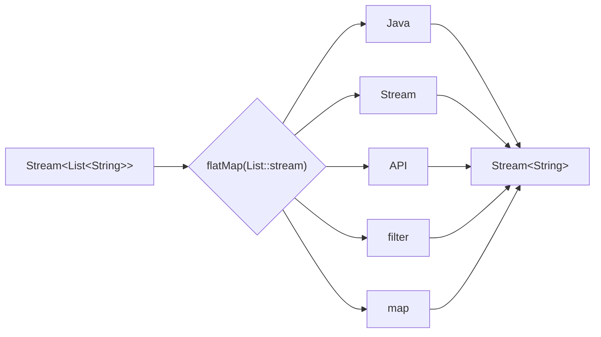

# Làm phẳng cấu trúc lồng nhau bằng `flatMap`

## 1. Vấn đề: một phần tử chứa nhiều phần tử khác

Trong Java Stream API, dữ liệu thường không nằm trên cùng một tầng. Một đơn hàng chứa nhiều dòng hàng, một phòng ban chứa nhiều nhân viên, một bài viết chứa nhiều thẻ, hoặc một `List` chứa những `List` khác. Khi cần xử lý **từng phần tử bên trong** như một dãy chung, ta cần phép toán **làm phẳng** (*flatten*).

Ví dụ, dữ liệu ban đầu có hai tầng:

```text
[
  ["Java", "Stream"],
  ["API"],
  [],
  ["filter", "map"]
]
```

Kết quả mong muốn chỉ còn một tầng:

```text
["Java", "Stream", "API", "filter", "map"]
```

Phương thức `flatMap` kết hợp hai việc:

1. **Map:** chuyển mỗi phần tử nguồn thành một stream chứa không, một hoặc nhiều phần tử kết quả.
2. **Flatten:** nối các phần tử từ những stream con vào một stream kết quả chung.

Đây là một **intermediate operation** của Stream API. Tương tự `filter` và `map`, `flatMap` được thực thi lười (*lazy*); việc duyệt dữ liệu chỉ xảy ra khi một terminal operation như `toList`, `count`, `findFirst`, `reduce` hay `collect` yêu cầu kết quả.

Mục tiêu của bài:

- Phân biệt `map` và `flatMap` qua kiểu dữ liệu và sơ đồ luồng.
- Đọc chữ ký generic `flatMap` trên `Stream<T>`.
- Làm phẳng `List<List<T>>`, object có collection con và cấu trúc nhiều cấp.
- Kết hợp `filter`, `distinct`, `map`, `groupingBy`, `reduce` với `flatMap`.
- Biểu diễn quan hệ một-nhiều, không-một-nhiều và các phần tử tùy chọn.
- Hiểu tính lười, thứ tự, đóng stream con, các giới hạn của xử lý song song và các lựa chọn thay thế.

## 2. `map` và `flatMap` khác nhau ở đâu?

### 2.1. `map` giữ lại một lớp cấu trúc

Giả sử có danh sách gồm nhiều danh sách từ khóa:

```java
import java.util.List;
import java.util.stream.Stream;

List<List<String>> groups = List.of(
    List.of("Java", "Stream"),
    List.of("API"),
    List.of(),
    List.of("filter", "map")
);

Stream<Stream<String>> nested = groups.stream()
    .map(List::stream);
```

Đầu vào của `map` là `List<String>`; hàm `List::stream` trả `Stream<String>`. Vì `map` tạo **một kết quả cho mỗi phần tử đầu vào**, nên kiểu kết quả là **`Stream<Stream<String>>`**: ta vẫn còn các stream con.

Ngay cả khi dùng `map` để tạo một danh sách khác, cấu trúc vẫn lồng nhau:

```java
List<List<String>> upperGroups = groups.stream()
    .map(group -> group.stream()
        .map(String::toUpperCase)
        .toList())
    .toList();

System.out.println(upperGroups);
// [[JAVA, STREAM], [API], [], [FILTER, MAP]]
```

`map` đúng khi ta **muốn giữ cấu trúc nhóm**, chẳng hạn mỗi nhóm vẫn là một phần tử riêng của kết quả.

### 2.2. `flatMap` bỏ một lớp lồng nhau

```java
List<String> flat = groups.stream()
    .flatMap(List::stream)
    .toList();

System.out.println(flat);
// [Java, Stream, API, filter, map]
```

Sơ đồ luồng:



Danh sách rỗng sinh ra stream con rỗng, vì vậy không đóng góp phần tử nào. `flatMap` không tự xóa các giá trị trùng nhau, không tự sắp xếp và không tự kiểm tra phần tử hợp lệ. Các việc đó cần các phép toán khác như `distinct`, `sorted` hoặc `filter`.

| Đặc điểm | `map` | `flatMap` |
| --- | --- | --- |
| Đầu ra của hàm ánh xạ | Một giá trị kiểu `R` | Một `Stream<R>` |
| Số phần tử đầu ra cho mỗi phần tử được xử lý | Đúng một giá trị, kể cả giá trị đó là `null` | 0, 1 hoặc nhiều phần tử |
| Kiểu kết quả khi biến `List<T>` thành stream con | `Stream<Stream<T>>` | `Stream<T>` |
| Khi nên chọn | Giữ các nhóm hoặc chuyển đổi từng giá trị | Cần duyệt/phân tích các phần tử nằm trong nhóm |
| Ví dụ | Đơn hàng → số dòng hàng của đơn | Đơn hàng → mọi dòng hàng của tất cả đơn |

**Quy tắc đọc kiểu:** nếu dùng `map` mà kết quả có dạng `Stream<Stream<R>>`, nhưng yêu cầu nghiệp vụ là `Stream<R>`, `flatMap` thường là lựa chọn phù hợp.

## 3. Giải mã chữ ký `flatMap`

Chữ ký trong `java.util.stream.Stream<T>`:

```java
<R> Stream<R> flatMap(
    Function<? super T, ? extends Stream<? extends R>> mapper
)
```

Các thành phần:

- `T`: kiểu phần tử của stream nguồn.
- `R`: kiểu phần tử kết quả sau khi làm phẳng.
- `Function<? super T, ...>`: mapper chấp nhận phần tử nguồn kiểu `T` (hoặc qua kiểu cha tương thích).
- `? extends Stream<? extends R>`: mapper trả một stream chứa những phần tử có thể dùng như `R`.
- `Stream<R>`: tất cả phần tử phát ra từ các stream con được kết hợp vào một stream đầu ra.

Hãy theo dõi kiểu ở ba bước:

```java
List<List<Integer>> matrix = List.of(
    List.of(1, 2),
    List.of(3, 4)
);

// Bước 1: Stream<List<Integer>>
var outer = matrix.stream();

// Bước 2: List<Integer> -> Stream<Integer>
// Bước 3: Stream<Integer>
var flattened = outer.flatMap(List::stream);

System.out.println(flattened.toList()); // [1, 2, 3, 4]
```

Trong ví dụ, `T = List<Integer>` và `R = Integer`. Phương thức `List::stream` phù hợp vì nhận một `List<Integer>` và trả `Stream<Integer>`.

Lưu ý: biến `outer` và `flattened` tham gia **cùng một pipeline**, không được có hai terminal operation tiêu thụ lại chúng. Khi cần lấy hai kết quả độc lập, hãy tạo hai stream mới từ `matrix`.

## 4. Ba dạng ánh xạ thường gặp

### 4.1. Một phần tử thành nhiều phần tử

Tách câu thành từ:

```java
List<String> sentences = List.of(
    "Java Stream API",
    "filter map flatMap"
);

List<String> words = sentences.stream()
    .flatMap(sentence ->
        java.util.Arrays.stream(sentence.split("\\s+")))
    .toList();

System.out.println(words);
// [Java, Stream, API, filter, map, flatMap]
```

`String.split("\\s+")` trả `String[]`; `Arrays.stream(...)` biến mảng thành `Stream<String>` để `flatMap` nối các từ. Với dữ liệu thực tế có câu rỗng hoặc chỉ có khoảng trắng, nên chuẩn hóa và lọc trước, vì `split` có quy tắc riêng cho chuỗi rỗng.

```java
List<String> normalizedWords = sentences.stream()
    .map(String::strip)
    .filter(s -> !s.isEmpty())
    .flatMap(s -> java.util.Arrays.stream(s.split("\\s+")))
    .map(s -> s.toLowerCase(java.util.Locale.ROOT))
    .distinct()
    .toList();
```

### 4.2. Một phần tử thành không hoặc một phần tử

`Optional<T>` biểu diễn một giá trị có thể vắng mặt. Từ JDK 9, `Optional.stream()` chuyển `Optional.empty()` thành stream rỗng và `Optional.of(value)` thành stream có một phần tử.

```java
import java.util.List;
import java.util.Optional;

List<Optional<String>> inputs = List.of(
    Optional.of("Java"),
    Optional.empty(),
    Optional.of("Stream")
);

List<String> present = inputs.stream()
    .flatMap(Optional::stream)
    .toList();

System.out.println(present); // [Java, Stream]
```

Đây là cách rõ ràng để loại bỏ những giá trị **vắng mặt theo hợp đồng nghiệp vụ**. Không nên biến lỗi dữ liệu nghiêm trọng thành `Optional.empty()` rồi âm thầm bỏ qua.

### 4.3. Một phần tử thành không, một hoặc nhiều phần tử

`flatMap` có thể biến một bản ghi thành stream con dựa trên chính bản ghi ấy:

```java
record TagGroup(String topic, List<String> tags) {}

List<TagGroup> groups = List.of(
    new TagGroup("Java", List.of("stream", "api")),
    new TagGroup("Kotlin", List.of()),
    new TagGroup("SQL", List.of("query"))
);

List<String> tags = groups.stream()
    .flatMap(group -> group.tags().stream())
    .toList();

System.out.println(tags); // [stream, api, query]
```

Nhóm Kotlin không có thẻ nên tạo stream con rỗng; những nhóm khác tạo số phần tử bằng kích thước danh sách thẻ. Ví dụ dùng `record` yêu cầu JDK 16 trở lên.

## 5. Ví dụ thực tế: đơn hàng chứa các dòng hàng

Giả sử mỗi đơn hàng có danh sách các mặt hàng. Cần tìm tất cả dòng hàng được bán, thống kê số lượng theo mã hàng và tính tổng số tiền. Dùng `flatMap` sẽ làm phẳng quan hệ **một đơn hàng → nhiều dòng hàng**.

Ví dụ hoàn chỉnh, có thể biên dịch và chạy trên **JDK 17 trở lên**:

```java
import java.util.List;
import java.util.Map;
import java.util.Objects;
import java.util.stream.Collectors;

public class FlattenOrdersDemo {

    record LineItem(String sku, int quantity, long unitPriceVnd) {
        LineItem {
            Objects.requireNonNull(sku, "sku");
            if (sku.isBlank() || quantity < 0 || unitPriceVnd < 0) {
                throw new IllegalArgumentException("Dữ liệu dòng hàng không hợp lệ");
            }
        }

        long amountVnd() {
            return Math.multiplyExact((long) quantity, unitPriceVnd);
        }
    }

    record Order(String id, List<LineItem> items) {
        Order {
            Objects.requireNonNull(id, "id");
            items = List.copyOf(Objects.requireNonNull(items, "items"));
        }
    }

    public static void main(String[] args) {
        List<Order> orders = List.of(
            new Order("O-1", List.of(
                new LineItem("PEN", 2, 1_000),
                new LineItem("BOOK", 1, 5_000)
            )),
            new Order("O-2", List.of(
                new LineItem("PEN", 1, 1_000)
            )),
            new Order("O-3", List.of()) // Đơn không có dòng hàng
        );

        // Mỗi Order -> Stream<LineItem> -> một Stream<LineItem> chung.
        List<LineItem> allItems = orders.stream()
            .flatMap(order -> order.items().stream())
            .toList();
        System.out.println(allItems.size()); // 3

        // Tổng số lượng từng SKU.
        Map<String, Integer> quantityBySku = orders.stream()
            .flatMap(order -> order.items().stream())
            .collect(Collectors.groupingBy(
                LineItem::sku,
                Collectors.summingInt(LineItem::quantity)
            ));
        System.out.println(quantityBySku.get("PEN"));  // 3
        System.out.println(quantityBySku.get("BOOK")); // 1

        // Tổng thành tiền (đơn vị: VND).
        long revenueVnd = orders.stream()
            .flatMap(order -> order.items().stream())
            .mapToLong(LineItem::amountVnd)
            .sum();
        System.out.println(revenueVnd); // 8_000
    }
}
```

Theo dõi kiểu trong dòng tính doanh thu:

| Biểu thức | Kiểu kết quả | Vai trò |
| --- | --- | --- |
| `orders.stream()` | `Stream<Order>` | Nguồn dữ liệu |
| `.flatMap(order -> order.items().stream())` | `Stream<LineItem>` | Bỏ tầng đơn hàng |
| `.mapToLong(LineItem::amountVnd)` | `LongStream` | Đổi dòng hàng thành tiền nguyên thủy |
| `.sum()` | `long` | Terminal operation tính tổng |

Đây là ví dụ về cách ghép `flatMap` với các phép toán khác: `groupingBy` tổng hợp theo mã, `mapToLong` tránh boxing khi tính toán, và `sum` trả tổng. Mỗi terminal operation tiêu thụ một stream nên ví dụ **tạo lại stream từ `orders`** cho từng kết quả.

**Giới hạn về số học:** `Math.multiplyExact` phát hiện tràn số khi tính thành tiền của một dòng. `LongStream.sum()` và `Collectors.summingInt` không tự bảo vệ khỏi tràn số. Nếu nghiệp vụ có giá trị hoặc số lượng lớn, cần xác định miền dữ liệu hợp lệ hay dùng `BigDecimal`/`BigInteger` và quy tắc tính tổng thích hợp.

## 6. Làm phẳng nhiều hơn hai tầng

`flatMap` **bỏ một tầng lồng nhau mỗi lần dùng**. Với cấu trúc ba tầng `List<List<List<Integer>>>`:

```java
List<List<List<Integer>>> cubes = List.of(
    List.of(List.of(1, 2), List.of(3)),
    List.of(List.of(4, 5))
);

// Mỗi lớp List trong cùng một dòng xử lý phải được bóc riêng.
List<Integer> numbers = cubes.stream()
    .flatMap(List::stream) // Stream<List<Integer>>
    .flatMap(List::stream) // Stream<Integer>
    .toList();

System.out.println(numbers); // [1, 2, 3, 4, 5]
```

Nếu dừng sau `flatMap` đầu tiên, kiểu kết quả là `Stream<List<Integer>>`, nghĩa là các danh sách số vẫn còn lồng trong stream. Việc đọc kiểu sau **từng bước** giúp nhận ra nên thêm bao nhiêu cấp làm phẳng.

Với mô hình object, nguyên lý tương tự:

```java
record Team(String name, List<String> members) {}
record Department(String name, List<Team> teams) {}

List<Department> departments = List.of(
    new Department("Engineering", List.of(
        new Team("Backend", List.of("An", "Bình")),
        new Team("Frontend", List.of("Chi"))
    )),
    new Department("Support", List.of())
);

List<String> members = departments.stream()
    .flatMap(department -> department.teams().stream())
    .flatMap(team -> team.members().stream())
    .toList();

System.out.println(members); // [An, Bình, Chi]
```

Ở đây ta chuyển lần lượt:

```text
Stream<Department>
  -> Stream<Team>
  -> Stream<String>
  -> List<String>
```

Để giữ **ngữ cảnh cha** như tên phòng ban đi cùng thành viên, hãy đưa cả thông tin cha vào stream kết quả; nếu chỉ trả `String` tên thành viên, thông tin cha đã mất.

```java
record Membership(String department, String team, String member) {}

List<Membership> memberships = departments.stream()
    .flatMap(department ->
        department.teams().stream()
            .flatMap(team -> team.members().stream()
                .map(member -> new Membership(
                    department.name(), team.name(), member
                )))
    )
    .toList();
```

Lúc này mỗi bản ghi `Membership` vẫn biết người đó thuộc phòng ban và nhóm nào. Cần cân nhắc lưu ngữ cảnh đúng cấp trước khi làm phẳng quá sâu.

## 7. Kết hợp `flatMap` với `filter`, `map`, `distinct` và `collect`

Không có một thứ tự duy nhất cho mọi pipeline. Hãy đặt phép toán theo **kiểu dữ liệu mà điều kiện cần đọc** và giữ ngữ nghĩa đầu ra.

Ví dụ: lấy tất cả mã mặt hàng bắt đầu bằng `"P"` từ các đơn còn ít nhất một dòng hàng:

```java
List<String> skus = orders.stream()
    .filter(order -> !order.items().isEmpty()) // Predicate<Order>
    .flatMap(order -> order.items().stream())  // Stream<LineItem>
    .map(LineItem::sku)                        // Stream<String>
    .filter(sku -> sku.startsWith("P"))        // Predicate<String>
    .distinct()                               // SKU không trùng
    .sorted()                                 // Thứ tự từ điển
    .toList();

System.out.println(skus); // [PEN]
```

Ở ví dụ này, lọc đơn hàng rỗng trước `flatMap` là tùy chọn vì stream con rỗng vốn không tạo phần tử. Tuy nhiên, lọc trước có ý nghĩa khi điều kiện chọn **cha** là quan trọng, ví dụ `order.status() == PAID`. Lọc sau `flatMap` phù hợp với điều kiện trên **dòng hàng** như SKU hay số lượng.

Một ví dụ kết hợp `flatMap` với `groupingBy` và downstream collector đã có ở mục 5. Có thể ghép thêm `Collectors.mapping` để thu các giá trị con:

```java
Map<String, List<Integer>> quantitiesBySku = orders.stream()
    .flatMap(order -> order.items().stream())
    .collect(Collectors.groupingBy(
        LineItem::sku,
        Collectors.mapping(
            LineItem::quantity,
            Collectors.toList()
        )
    ));

System.out.println(quantitiesBySku.get("PEN")); // [2, 1]
```

**Phân biệt `flatMap` và `Collectors.flatMapping`:** `Stream.flatMap` làm phẳng **toàn bộ stream tại một bước trung gian**. `Collectors.flatMapping` (JDK 9+) là **downstream collector**, thường được dùng trong `groupingBy` khi cần làm phẳng riêng bên trong từng nhóm rồi thu thập kết quả.

## 8. Giá trị rỗng, `null` và chính sách dữ liệu

### 8.1. Collection rỗng

Khi mapper trả một stream rỗng, nó không đóng góp phần tử:

```java
List<List<String>> data = List.of(
    List.of(),
    List.of("Java"),
    List.of()
);

System.out.println(data.stream()
    .flatMap(List::stream)
    .toList()); // [Java]
```

### 8.2. Collection bằng `null`

Khác với collection rỗng, collection `null` làm `list.stream()` ném `NullPointerException`. Nếu nghiệp vụ xác định `null` tương đương “không có phần tử”, hãy thể hiện lựa chọn đó:

```java
record Group(String id, List<String> values) {}

List<Group> groups = List.of(
    new Group("A", List.of("x", "y")),
    new Group("B", null)
);

List<String> allValues = groups.stream()
    .flatMap(group -> group.values() == null
        ? java.util.stream.Stream.<String>empty()
        : group.values().stream())
    .toList();

System.out.println(allValues); // [x, y]
```

Tuy nhiên, nếu `values == null` là dữ liệu **không hợp lệ**, nên báo lỗi tại lúc tạo `Group` hoặc lúc nhập dữ liệu. Không tùy tiện biến lỗi thành dữ liệu trống, vì có thể gây thiếu phần tử trong thống kê.

Theo hợp đồng Javadoc, nếu mapper của `flatMap` **trả chính tham chiếu stream bằng `null`**, `flatMap` sẽ coi kết quả đó như stream rỗng; dù vậy, cách rõ ràng và dễ kiểm thử hơn là trả `Stream.empty()` thay vì cố ý trả `null`.

### 8.3. Phần tử bên trong bằng `null`

Nếu nguồn con có phần tử `null` (ví dụ từ `ArrayList`), việc làm phẳng không tự loại các phần tử đó. Lựa chọn chính sách rõ ràng:

```java
import java.util.ArrayList;
import java.util.Objects;

List<String> mutableGroup = new ArrayList<>();
mutableGroup.add("Java");
mutableGroup.add(null);
mutableGroup.add("Stream");

List<String> safe = java.util.stream.Stream.of(mutableGroup)
    .flatMap(List::stream)
    .filter(Objects::nonNull)
    .toList();

System.out.println(safe); // [Java, Stream]
```

`List.of(...)` không cho phép phần tử `null`; đó là lý do ví dụ dùng `ArrayList` để minh họa dữ liệu nguồn có thể chứa `null`.

## 9. Tính lười, thứ tự và vòng đời stream con

### 9.1. Lười thực thi và short-circuit

`flatMap` không lập tức duyệt hết các nhóm. Nó xây dựng pipeline và xử lý dữ liệu khi terminal operation yêu cầu.

```java
List<List<Integer>> batches = List.of(
    List.of(1, 2, 3),
    List.of(4, 5, 6)
);

List<Integer> firstTwo = batches.stream()
    .flatMap(List::stream)
    .limit(2)
    .toList();

System.out.println(firstTwo); // [1, 2]
```

`limit(2)` có thể dừng pipeline sớm nên không nhất thiết phải xử lý tất cả phần tử bên trong mọi nhóm. Tuy nhiên, không nên dùng tác dụng phụ để khẳng định **chính xác** mapper được gọi bao nhiêu lần; chiến lược tối ưu, chi tiết triển khai và chế độ song song có thể thay đổi số lần quan sát được.

### 9.2. Encounter order

Với nguồn `List` và các `List` con có thứ tự, một pipeline tuần tự như ví dụ đầu bài giữ thứ tự: từng nhóm theo thứ tự nguồn, từng phần tử theo thứ tự trong nhóm. Ngược lại, `HashSet` hoặc một stream được đánh dấu `unordered()` không cung cấp bảo đảm tương tự.

Ví dụ:

```java
List<String> ordered = List.of(
    List.of("A", "B"),
    List.of("C")
).stream()
 .flatMap(List::stream)
 .toList();

System.out.println(ordered); // [A, B, C]
```

`toList()` giữ encounter order **nếu stream có encounter order**. Trong xử lý song song, thời điểm thực thi có thể xen kẽ, nhưng `toList` vẫn giữ encounter order tương ứng khi nguồn có thứ tự. `forEach` không đảm bảo thứ tự khi dùng parallel; khi cần thứ tự, đọc hợp đồng `forEachOrdered` và cân nhắc chi phí của nó.

### 9.3. Đóng stream con

Một chi tiết quan trọng trong Javadoc: **mỗi stream con do mapper của `flatMap` tạo ra sẽ được đóng sau khi nội dung của nó được đưa vào stream kết quả**. Với các stream chỉ dựa trên `List`/mảng, việc đóng thường không đáng chú ý. Với stream mở từ file hoặc I/O, vòng đời cần được quản lý cẩn thận.

Ví dụ đọc nhiều tệp văn bản trong một thư mục:

```java
import java.io.IOException;
import java.io.UncheckedIOException;
import java.nio.charset.StandardCharsets;
import java.nio.file.Files;
import java.nio.file.Path;
import java.util.stream.Stream;

static long countNonEmptyLines(Path directory) throws IOException {
    // Files.list trả stream nắm tài nguyên thư mục, cần đóng.
    try (Stream<Path> paths = Files.list(directory)) {
        return paths
            .filter(Files::isRegularFile)
            .flatMap(path -> {
                try {
                    return Files.lines(path, StandardCharsets.UTF_8);
                } catch (IOException ex) {
                    throw new UncheckedIOException(ex);
                }
            })
            .filter(line -> !line.isBlank())
            .count();
    }
}
```

Ở đây:

- `Files.list` tạo stream nguồn có tài nguyên, được đóng bởi `try-with-resources`.
- `Files.lines` tạo stream con cho từng file; `flatMap` chịu trách nhiệm đóng stream con sau khi sử dụng.
- `UncheckedIOException` giúp chuyển lỗi I/O dạng checked thành dạng unchecked trong lambda; bên gọi phải quyết định có bắt, ghi nhận hoặc chuyển tiếp lỗi hay không.
- Với ứng dụng thực tế, cần xác định file nào được đọc (loại tệp, thư mục con, quyền truy cập) và thứ tự có quan trọng không; việc liệt kê thư mục không đảm bảo thứ tự.

Việc đóng stream không làm mất mọi rủi ro I/O; đọc file có thể phát sinh lỗi khi duyệt, nên đường đi lỗi cũng cần được kiểm thử. Nếu yêu cầu chỉ xử lý một lượng dữ liệu nhỏ, đọc trước và làm phẳng collection trong bộ nhớ có thể đơn giản hơn.

## 10. `flatMap`, các biến thể primitive và `mapMulti`

### 10.1. `flatMapToInt`, `flatMapToLong`, `flatMapToDouble`

Khi kết quả sau khi làm phẳng là dữ liệu số nguyên thủy, có thể dùng các biến thể chuyên biệt để tránh boxing không cần thiết:

```java
List<int[]> samples = List.of(
    new int[] {1, 2},
    new int[] {3, 4}
);

int sum = samples.stream()
    .flatMapToInt(java.util.Arrays::stream)
    .sum();

System.out.println(sum); // 10
```

`flatMapToInt` trả `IntStream`, `flatMapToLong` trả `LongStream`, và `flatMapToDouble` trả `DoubleStream`. Chúng có các terminal operation như `sum`, `average`, `summaryStatistics` phù hợp với kiểu nguyên thủy.

Đối chiếu kiểu:

| Phương thức | Mapper trả về | Kết quả |
| --- | --- | --- |
| `flatMap` | `Stream<? extends R>` | `Stream<R>` |
| `flatMapToInt` | `IntStream` | `IntStream` |
| `flatMapToLong` | `LongStream` | `LongStream` |
| `flatMapToDouble` | `DoubleStream` | `DoubleStream` |

### 10.2. Khi nào cân nhắc `mapMulti`?

`Stream.mapMulti` được bổ sung trong **JDK 16**. Thay vì tạo một `Stream<R>` riêng cho mỗi phần tử, mapper nhận thêm một `Consumer<R>` để **phát** 0, 1 hoặc nhiều kết quả:

```java
import java.util.List;

List<List<String>> wordsByGroup = List.of(
    List.of("Java", "Stream"),
    List.of(),
    List.of("API")
);

List<String> allWords = wordsByGroup.stream()
    .<String>mapMulti((group, downstream) ->
        group.forEach(downstream))
    .toList();

System.out.println(allWords); // [Java, Stream, API]
```

`mapMulti` có thể hữu ích khi số phần tử phát ra từ mỗi đầu vào ít và ta muốn tránh tạo nhiều stream con, hoặc khi thao tác phát đầu ra khó biểu diễn bằng một stream tạm. Tuy nhiên, Javadoc nêu **implementation mặc định** của `mapMulti` có thể dùng `flatMap` bên trong, nên không được giả định luôn nhanh hơn; hãy đo trên môi trường và dữ liệu thực.

Nếu cần trạng thái có chủ đích như chia cửa sổ hoặc biến đổi theo chuỗi phần tử liên tiếp, có thể tìm hiểu **Stream Gatherers** (API chính thức từ **JDK 24**) thay vì ép mọi bài toán vào `flatMap`. `flatMap` phục vụ quan hệ một phần tử thành nhiều phần tử độc lập; các phép biến đổi phụ thuộc trạng thái lịch sử cần hợp đồng rõ hơn.

## 11. Các lỗi thiết kế và chi phí thường gặp

### 11.1. Gọi nhầm `map`

```java
// Kết quả là Stream<Stream<String>>, chưa làm phẳng.
var wrong = groups.stream().map(List::stream);

// Kết quả là Stream<String>.
var correct = groups.stream().flatMap(List::stream);
```

Không nhất thiết `map` là sai: nếu mục tiêu giữ từng nhóm để tính riêng, `map` có thể đúng. Hãy đối chiếu kiểu mong muốn với kiểu thực tế.

### 11.2. Tự gom vào danh sách mutable từ lambda

```java
// Tránh: tích lũy bằng trạng thái mutable từ bên ngoài.
List<String> shared = new java.util.ArrayList<>();
groups.stream().forEach(group -> shared.addAll(group));

// Diễn đạt trực tiếp, không cần trạng thái dùng chung.
List<String> flat = groups.stream()
    .flatMap(List::stream)
    .toList();
```

Việc sửa `shared` từ lambda có thể gây race condition khi dùng `parallelStream`. Lambda truyền vào `flatMap` nên **non-interfering** (không can thiệp nguồn) và **stateless** (không phụ thuộc trạng thái thay đổi giữa các lần gọi).

### 11.3. Quên rằng mỗi đầu vào có thể tạo rất nhiều kết quả

Nếu có `N` nhóm, mỗi nhóm chứa `M` phần tử, sau làm phẳng có thể có xấp xỉ `N × M` phần tử. Khi thu tất cả bằng `toList()`, bộ nhớ phải chứa các phần tử kết quả và có thể rất lớn. Chỉ cần một số kết quả đầu tiên thì `limit` có thể tiết kiệm công việc trên stream có thứ tự, nhưng giới hạn sau khi làm phẳng khác giới hạn trước khi làm phẳng:

```java
List<List<Integer>> nested = List.of(
    List.of(1, 2, 3),
    List.of(4, 5)
);

var limitGroups = nested.stream()
    .limit(1)
    .flatMap(List::stream)
    .toList(); // [1, 2, 3]: một nhóm đầu tiên

var limitElements = nested.stream()
    .flatMap(List::stream)
    .limit(1)
    .toList(); // [1]: một phần tử đầu tiên
```

Thứ tự đặt `filter` và `limit` cũng thay đổi tập dữ liệu được xét, nên cần mô tả rõ quy tắc nghiệp vụ.

### 11.4. Dữ liệu nested bị thay đổi trong lúc duyệt

`flatMap` không sao chép snapshot đầu vào. Nếu luồng khác thay đổi danh sách con trong lúc pipeline đang duyệt (và cấu trúc không hỗ trợ thao tác đồng thời phù hợp), kết quả có thể sai hoặc phát sinh `ConcurrentModificationException`. Nên dùng mô hình dữ liệu bất biến, snapshot phù hợp hoặc cơ chế đồng bộ rõ ràng.

### 11.5. Kỳ vọng `parallel()` chắc chắn nhanh hơn

```java
List<String> all = groups.parallelStream()
    .flatMap(List::stream)
    .toList();
```

Với một số ít nhóm nhỏ, chi phí phân chia và gộp kết quả có thể lớn hơn lợi ích song song. Hiệu năng còn phụ thuộc độ cân bằng kích thước các nhóm và encounter order. Khi mapper có side effect hoặc nguồn mutable, song song dễ làm lỗi khó tái hiện hơn. Hãy đo đạc trước khi tối ưu và dùng mapper thuần, không dựa vào thứ tự thực thi của các luồng.

### 11.6. Xây pipeline lồng quá sâu

```java
// Đúng về ý nghĩa nhưng khó đọc nếu nghiệp vụ dài:
var result = departments.stream()
    .flatMap(d -> d.teams().stream()
        .flatMap(t -> t.members().stream()
            .map(m -> new Membership(d.name(), t.name(), m))))
    .toList();
```

Khi biểu thức lớn, cân nhắc tách mapper thành phương thức có tên hoặc định nghĩa record trung gian chứa ngữ cảnh. Cách đó cũng tạo điểm kiểm thử độc lập và giúp tránh mắc lỗi kiểu generic ở nhiều tầng.

## 12. Thực hành và tự kiểm tra

### Bài 1: chuyển từ `map` sang `flatMap`

Đầu vào:

```java
List<List<String>> courses = List.of(
    List.of("filter", "map"),
    List.of("flatMap", "collect")
);
```

**Yêu cầu:** viết pipeline tạo `List<String>` gồm bốn tên thao tác. Giải thích tại sao `courses.stream().map(List::stream)` không cho đúng kiểu đầu ra.

Gợi ý lời giải:

```java
List<String> operations = courses.stream()
    .flatMap(List::stream)
    .toList();
// [filter, map, flatMap, collect]
```

### Bài 2: lọc dữ liệu sau khi làm phẳng

Cho các nhóm số:

```java
List<List<Integer>> groupsOfNumbers = List.of(
    List.of(1, 2, 3),
    List.of(4, 5, 6),
    List.of()
);
```

**Yêu cầu:** lấy tất cả số chẵn, không trùng, sắp xếp tăng dần; kết quả dự kiến `[2, 4, 6]`. Viết pipeline:

```java
List<Integer> even = groupsOfNumbers.stream()
    .flatMap(List::stream)
    .filter(n -> n % 2 == 0)
    .distinct()
    .sorted()
    .toList();
```

### Bài 3: thống kê trên danh sách đơn hàng

Từ `List<Order>` ở mục 5, tính số dòng hàng có `quantity > 1`, tổng số lượng bút `PEN` và tổng số mã hàng khác nhau. Xác định tại bước nào stream có kiểu `Stream<Order>`, `Stream<LineItem>` hoặc `Stream<String>`.

Một đáp án tham khảo:

```java
long linesWithMultipleUnits = orders.stream()
    .flatMap(order -> order.items().stream())
    .filter(item -> item.quantity() > 1)
    .count(); // 1

int penQuantity = orders.stream()
    .flatMap(order -> order.items().stream())
    .filter(item -> item.sku().equals("PEN"))
    .mapToInt(LineItem::quantity)
    .sum(); // 3

long distinctSkus = orders.stream()
    .flatMap(order -> order.items().stream())
    .map(LineItem::sku)
    .distinct()
    .count(); // 2
```

### Bài 4: lỗi về nguồn rỗng và `null`

So sánh hành vi của ba mapper sau khi `group.values()` có thể bằng `null`:

```java
group -> group.values().stream()
group -> group.values() == null
    ? java.util.stream.Stream.empty()
    : group.values().stream()
group -> java.util.stream.Stream.ofNullable(group.values())
    .flatMap(List::stream)
```

**Yêu cầu:** giải thích trường hợp nào ném `NullPointerException`, trường hợp nào coi `null` là không có phần tử, và tại sao chính sách xử lý dữ liệu phải được xác định ở ranh giới nghiệp vụ. `Stream.ofNullable` có từ JDK 9.

### Bài 5: thứ tự và tài nguyên

Giải thích sự khác nhau giữa:

```java
groups.stream().limit(2).flatMap(List::stream).toList()
groups.stream().flatMap(List::stream).limit(2).toList()
```

Sau đó, viết hàm đọc các dòng từ nhiều file bằng `Files.lines`; xác định stream nào cần `try-with-resources` và stream con nào do `flatMap` đóng. Nếu dùng `parallel()`, nêu lý do vì sao không thể dựa vào thứ tự xử lý và vì sao phải đo hiệu năng trên dữ liệu thực.

## 13. Bảng ghi nhớ

| Câu hỏi | Hướng xử lý |
| --- | --- |
| Kết quả có kiểu `Stream<Stream<T>>` nhưng cần `Stream<T>`? | Dùng `flatMap` thay cho `map` |
| Danh sách có nhiều tầng lồng nhau? | Dùng `flatMap` theo từng tầng cần bỏ |
| Một bản ghi có thể không sinh kết quả? | Mapper trả `Stream.empty()`; `Optional.stream()` khi phù hợp |
| Có thể có `null`? | Làm rõ hợp đồng dữ liệu; kiểm tra collection null và phần tử null khác nhau |
| Cần giữ thông tin từ object cha? | Đưa ngữ cảnh cha vào object kết quả trước khi mất quan hệ |
| Cần tính tổng/thống kê dữ liệu số? | Sau làm phẳng, dùng `mapToInt`/`mapToLong` và phép toán kết thúc phù hợp |
| Cần chia nhóm và gom nhiều giá trị con? | Kết hợp `flatMap`, `groupingBy` hoặc downstream `Collectors.flatMapping` |
| Mapper tạo stream con chứa I/O? | Đọc hợp đồng đóng stream con của `flatMap`; đóng stream nguồn quản lý tài nguyên bằng `try-with-resources` |
| Muốn xử lý song song? | Mapper không can thiệp và không trạng thái; kiểm tra nguồn, thứ tự và đo hiệu năng |
| Không muốn tạo stream con cho mỗi phần tử? | Cân nhắc `mapMulti` từ JDK 16 và đo hiệu quả thực tế |

`flatMap` là phép biến đổi quan trọng khi xử lý dữ liệu khai báo bằng Java Stream API: từ nhiều nhóm dữ liệu tạo một luồng phần tử thống nhất để tiếp tục lọc, ánh xạ, giảm gọn hoặc thu thập. Giá trị của nó nằm ở việc diễn đạt rõ **một-nhiều** trong pipeline, song tính chính xác còn phụ thuộc kiểu dữ liệu, chính sách dữ liệu rỗng, encounter order, tài nguyên và hàm mapper không tạo side effect.
