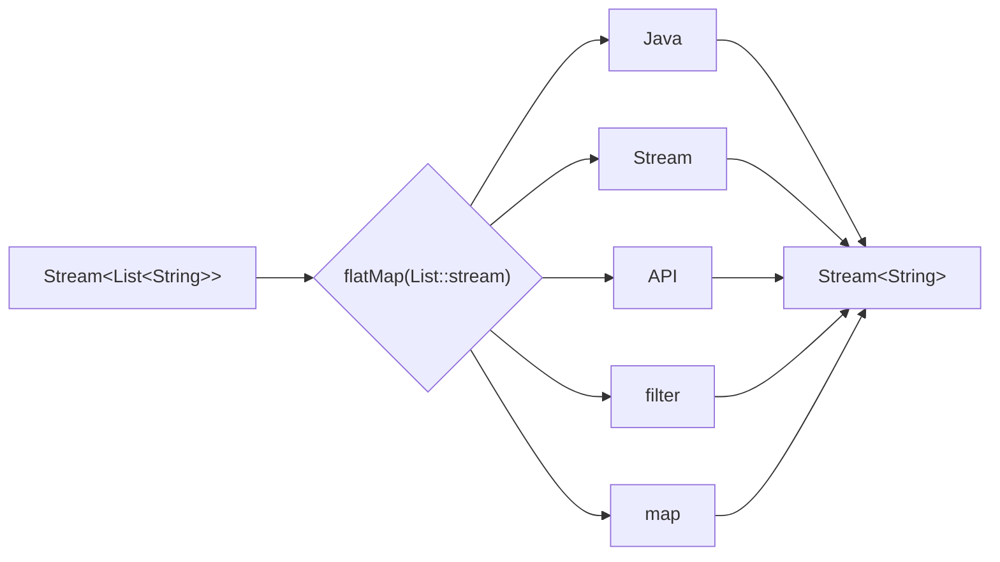

# Flattening Nested Structures with `flatMap`

## 1. The Problem: One Element Containing Multiple Elements

In the Java Stream API, data often does not reside on a single level. An order contains multiple line items, a department contains multiple employees, an article contains multiple tags, or a `List` contains other `List`s. When you need to process **each inner element** as a single unified sequence, you need a **flattening** (*flatten*) operation.

For example, the initial data has two levels:

```text
[
  ["Java", "Stream"],
  ["API"],
  [],
  ["filter", "map"]
]
```

The desired result has only one level:

```text
["Java", "Stream", "API", "filter", "map"]
```

The `flatMap` method combines two actions:

1. **Map:** transforms each source element into a stream containing zero, one, or more result elements.
2. **Flatten:** concatenates the elements from those inner streams into a single shared result stream.

This is an **intermediate operation** of the Stream API. Similar to `filter` and `map`, `flatMap` is executed lazily (*lazy*); data traversal only occurs when a terminal operation such as `toList`, `count`, `findFirst`, `reduce`, or `collect` requests results.

Lesson objectives:

- Distinguish `map` and `flatMap` via data types and flow diagrams.
- Read the generic signature of `flatMap` on `Stream<T>`.
- Flatten `List<List<T>>`, objects with nested collections, and multi-level structures.
- Combine `filter`, `distinct`, `map`, `groupingBy`, and `reduce` with `flatMap`.
- Represent one-to-many, zero-to-one-to-many, and optional element relationships.
- Understand laziness, ordering, inner stream closing, limits of parallel processing, and alternatives.

## 2. How Do `map` and `flatMap` Differ?

### 2.1. `map` Retains One Layer of Structure

Suppose you have a list containing multiple lists of keywords:

```java
import java.util.List;
import java.util.stream.Stream;

List<List<String>> groups = List.of(
    List.of("Java", "Stream"),
    List.of("API"),
    List.of(),
    List.of("filter", "map")
);

Stream<Stream<String>> nested = groups.stream()
    .map(List::stream);
```

The input to `map` is `List<String>`; the function `List::stream` returns `Stream<String>`. Because `map` produces **one result per input element**, the resulting type is **`Stream<Stream<String>>`**: we still have nested streams.

Even when using `map` to create another list, the structure remains nested:

```java
List<List<String>> upperGroups = groups.stream()
    .map(group -> group.stream()
        .map(String::toUpperCase)
        .toList())
    .toList();

System.out.println(upperGroups);
// [[JAVA, STREAM], [API], [], [FILTER, MAP]]
```

`map` is right when you **want to preserve group structure**, such as when each group remains a separate element of the result.

### 2.2. `flatMap` Removes One Layer of Nesting

```java
List<String> flat = groups.stream()
    .flatMap(List::stream)
    .toList();

System.out.println(flat);
// [Java, Stream, API, filter, map]
```

Flow diagram:



An empty list produces an empty sub-stream, so it contributes no elements. `flatMap` does not automatically remove duplicate values, sort, or validate elements. Those tasks require other operations such as `distinct`, `sorted`, or `filter`.

| Characteristic | `map` | `flatMap` |
| --- | --- | --- |
| Output of mapping function | A single value of type `R` | A `Stream<R>` |
| Number of output elements per processed element | Exactly one value, even if that value is `null` | 0, 1, or more elements |
| Result type when turning `List<T>` into a sub-stream | `Stream<Stream<T>>` | `Stream<T>` |
| When to choose | Keep groups or transform individual values | Need to traverse/analyze elements inside groups |
| Example | Order → number of line items in the order | Order → all line items across all orders |

**Type-reading rule:** if using `map` results in `Stream<Stream<R>>`, yet the business requirement calls for `Stream<R>`, `flatMap` is usually the right choice.

## 3. Decoding the `flatMap` Signature

Signature in `java.util.stream.Stream<T>`:

```java
<R> Stream<R> flatMap(
    Function<? super T, ? extends Stream<? extends R>> mapper
)
```

Components:

- `T`: element type of the source stream.
- `R`: result element type after flattening.
- `Function<? super T, ...>`: mapper accepts a source element of type `T` (or via a compatible supertype).
- `? extends Stream<? extends R>`: mapper returns a stream containing elements usable as `R`.
- `Stream<R>`: all elements emitted from sub-streams are combined into a single output stream.

Follow the types across three steps:

```java
List<List<Integer>> matrix = List.of(
    List.of(1, 2),
    List.of(3, 4)
);

// Step 1: Stream<List<Integer>>
var outer = matrix.stream();

// Step 2: List<Integer> -> Stream<Integer>
// Step 3: Stream<Integer>
var flattened = outer.flatMap(List::stream);

System.out.println(flattened.toList()); // [1, 2, 3, 4]
```

In the example, `T = List<Integer>` and `R = Integer`. `List::stream` fits because it accepts a `List<Integer>` and returns `Stream<Integer>`.

Note: `outer` and `flattened` participate in the **same pipeline**; you cannot have two terminal operations consume them again. When you need two independent results, create two fresh streams from `matrix`.

## 4. Three Common Mapping Patterns

### 4.1. One Element to Many Elements

Splitting sentences into words:

```java
List<String> sentences = List.of(
    "Java Stream API",
    "filter map flatMap"
);

List<String> words = sentences.stream()
    .flatMap(sentence ->
        java.util.Arrays.stream(sentence.split("\\s+")))
    .toList();

System.out.println(words);
// [Java, Stream, API, filter, map, flatMap]
```

`String.split("\\s+")` returns `String[]`; `Arrays.stream(...)` turns the array into `Stream<String>` so `flatMap` concatenates the words. With real-world data that may have empty or whitespace-only sentences, normalize and filter first, because `split` has special rules for empty strings.

```java
List<String> normalizedWords = sentences.stream()
    .map(String::strip)
    .filter(s -> !s.isEmpty())
    .flatMap(s -> java.util.Arrays.stream(s.split("\\s+")))
    .map(s -> s.toLowerCase(java.util.Locale.ROOT))
    .distinct()
    .toList();
```

### 4.2. One Element to Zero or One Element

`Optional<T>` represents a value that may be absent. Since JDK 9, `Optional.stream()` turns `Optional.empty()` into an empty stream and `Optional.of(value)` into a single-element stream.

```java
import java.util.List;
import java.util.Optional;

List<Optional<String>> inputs = List.of(
    Optional.of("Java"),
    Optional.empty(),
    Optional.of("Stream")
);

List<String> present = inputs.stream()
    .flatMap(Optional::stream)
    .toList();

System.out.println(present); // [Java, Stream]
```

This is a clean way to drop values that are **absent by business contract**. Do not turn critical data errors into `Optional.empty()` and silently ignore them.

### 4.3. One Element to Zero, One, or Many Elements

`flatMap` can turn a record into a sub-stream based on that record itself:

```java
record TagGroup(String topic, List<String> tags) {}

List<TagGroup> groups = List.of(
    new TagGroup("Java", List.of("stream", "api")),
    new TagGroup("Kotlin", List.of()),
    new TagGroup("SQL", List.of("query"))
);

List<String> tags = groups.stream()
    .flatMap(group -> group.tags().stream())
    .toList();

System.out.println(tags); // [stream, api, query]
```

The Kotlin group has no tags so it produces an empty sub-stream; the other groups produce as many elements as the size of their tag lists. The example uses `record`, requiring JDK 16 or later.

## 5. Real-World Example: Orders Containing Line Items

Suppose each order has a list of line items. We need to find all sold line items, aggregate quantity by SKU, and calculate total revenue. Using `flatMap` flattens the **one order → many line items** relationship.

Complete example, compilable and runnable on **JDK 17 or later**:

```java
import java.util.List;
import java.util.Map;
import java.util.Objects;
import java.util.stream.Collectors;

public class FlattenOrdersDemo {

    record LineItem(String sku, int quantity, long unitPriceVnd) {
        LineItem {
            Objects.requireNonNull(sku, "sku");
            if (sku.isBlank() || quantity < 0 || unitPriceVnd < 0) {
                throw new IllegalArgumentException("Dữ liệu dòng hàng không hợp lệ");
            }
        }

        long amountVnd() {
            return Math.multiplyExact((long) quantity, unitPriceVnd);
        }
    }

    record Order(String id, List<LineItem> items) {
        Order {
            Objects.requireNonNull(id, "id");
            items = List.copyOf(Objects.requireNonNull(items, "items"));
        }
    }

    public static void main(String[] args) {
        List<Order> orders = List.of(
            new Order("O-1", List.of(
                new LineItem("PEN", 2, 1_000),
                new LineItem("BOOK", 1, 5_000)
            )),
            new Order("O-2", List.of(
                new LineItem("PEN", 1, 1_000)
            )),
            new Order("O-3", List.of()) // Order with no line items
        );

        // Each Order -> Stream<LineItem> -> one unified Stream<LineItem>.
        List<LineItem> allItems = orders.stream()
            .flatMap(order -> order.items().stream())
            .toList();
        System.out.println(allItems.size()); // 3

        // Total quantity per SKU.
        Map<String, Integer> quantityBySku = orders.stream()
            .flatMap(order -> order.items().stream())
            .collect(Collectors.groupingBy(
                LineItem::sku,
                Collectors.summingInt(LineItem::quantity)
            ));
        System.out.println(quantityBySku.get("PEN"));  // 3
        System.out.println(quantityBySku.get("BOOK")); // 1

        // Total revenue (unit: VND).
        long revenueVnd = orders.stream()
            .flatMap(order -> order.items().stream())
            .mapToLong(LineItem::amountVnd)
            .sum();
        System.out.println(revenueVnd); // 8_000
    }
}
```

Type tracking in the revenue calculation pipeline:

| Expression | Result type | Role |
| --- | --- | --- |
| `orders.stream()` | `Stream<Order>` | Data source |
| `.flatMap(order -> order.items().stream())` | `Stream<LineItem>` | Remove the order layer |
| `.mapToLong(LineItem::amountVnd)` | `LongStream` | Convert line items to primitive amounts |
| `.sum()` | `long` | Terminal operation computing the sum |

This is an example of combining `flatMap` with other operations: `groupingBy` aggregates by code, `mapToLong` avoids boxing during calculations, and `sum` returns the total. Each terminal operation consumes a stream, so the example **creates a fresh stream from `orders`** for each result.

**Arithmetic limits:** `Math.multiplyExact` detects overflow when computing a line item's amount. `LongStream.sum()` and `Collectors.summingInt` do not automatically guard against overflow. If the business domain involves large prices or quantities, define valid data bounds or use `BigDecimal`/`BigInteger` with appropriate summation rules.

## 6. Flattening More Than Two Levels

`flatMap` **removes one nesting level per use**. For a three-level structure `List<List<List<Integer>>>`:

```java
List<List<List<Integer>>> cubes = List.of(
    List.of(List.of(1, 2), List.of(3)),
    List.of(List.of(4, 5))
);

// Each List layer in the same pipeline must be unwrapped separately.
List<Integer> numbers = cubes.stream()
    .flatMap(List::stream) // Stream<List<Integer>>
    .flatMap(List::stream) // Stream<Integer>
    .toList();

System.out.println(numbers); // [1, 2, 3, 4, 5]
```

If you stop after the first `flatMap`, the result type is `Stream<List<Integer>>`, meaning the number lists are still nested inside the stream. Checking the type after **each step** helps identify how many flattening levels to add.

For object models, the same principle applies:

```java
record Team(String name, List<String> members) {}
record Department(String name, List<Team> teams) {}

List<Department> departments = List.of(
    new Department("Engineering", List.of(
        new Team("Backend", List.of("An", "Bình")),
        new Team("Frontend", List.of("Chi"))
    )),
    new Department("Support", List.of())
);

List<String> members = departments.stream()
    .flatMap(department -> department.teams().stream())
    .flatMap(team -> team.members().stream())
    .toList();

System.out.println(members); // [An, Bình, Chi]
```

Here we transition step by step:

```text
Stream<Department>
  -> Stream<Team>
  -> Stream<String>
  -> List<String>
```

To retain **parent context** such as the department name alongside each member, include the parent information in the result stream; if you only return the member name `String`, the parent information is lost.

```java
record Membership(String department, String team, String member) {}

List<Membership> memberships = departments.stream()
    .flatMap(department ->
        department.teams().stream()
            .flatMap(team -> team.members().stream()
                .map(member -> new Membership(
                    department.name(), team.name(), member
                )))
    )
    .toList();
```

Now each `Membership` record still knows which department and team that person belongs to. Consider capturing context at the right level before flattening too deeply.

## 7. Combining `flatMap` with `filter`, `map`, `distinct`, and `collect`

There is no single fixed order for every pipeline. Place operations according to the **data type the condition needs to read** while preserving output semantics.

Example: get all item codes starting with `"P"` from orders that have at least one line item:

```java
List<String> skus = orders.stream()
    .filter(order -> !order.items().isEmpty()) // Predicate<Order>
    .flatMap(order -> order.items().stream())  // Stream<LineItem>
    .map(LineItem::sku)                        // Stream<String>
    .filter(sku -> sku.startsWith("P"))        // Predicate<String>
    .distinct()                               // Unique SKUs
    .sorted()                                 // Lexicographical order
    .toList();

System.out.println(skus); // [PEN]
```

In this example, filtering out empty orders before `flatMap` is optional because an empty sub-stream naturally produces no elements. However, filtering beforehand matters when a **parent** selection condition is significant, such as `order.status() == PAID`. Filtering after `flatMap` suits conditions on **line items** such as SKU or quantity.

An example combining `flatMap` with `groupingBy` and a downstream collector appeared in Section 5. You can also pair `Collectors.mapping` to collect child values:

```java
Map<String, List<Integer>> quantitiesBySku = orders.stream()
    .flatMap(order -> order.items().stream())
    .collect(Collectors.groupingBy(
        LineItem::sku,
        Collectors.mapping(
            LineItem::quantity,
            Collectors.toList()
        )
    ));

System.out.println(quantitiesBySku.get("PEN")); // [2, 1]
```

**Distinguishing `flatMap` and `Collectors.flatMapping`:** `Stream.flatMap` flattens the **entire stream at an intermediate step**. `Collectors.flatMapping` (JDK 9+) is a **downstream collector**, commonly used inside `groupingBy` when you need to flatten separately within each group before collecting results.

## 8. Empty Values, `null`, and Data Policies

### 8.1. Empty Collections

When the mapper returns an empty stream, it contributes no elements:

```java
List<List<String>> data = List.of(
    List.of(),
    List.of("Java"),
    List.of()
);

System.out.println(data.stream()
    .flatMap(List::stream)
    .toList()); // [Java]
```

### 8.2. `null` Collections

Unlike an empty collection, a `null` collection causes `list.stream()` to throw `NullPointerException`. If the business rules define `null` as equivalent to "no elements", express that choice explicitly:

```java
record Group(String id, List<String> values) {}

List<Group> groups = List.of(
    new Group("A", List.of("x", "y")),
    new Group("B", null)
);

List<String> allValues = groups.stream()
    .flatMap(group -> group.values() == null
        ? java.util.stream.Stream.<String>empty()
        : group.values().stream())
    .toList();

System.out.println(allValues); // [x, y]
```

However, if `values == null` is **invalid** data, report an error when constructing `Group` or during data ingestion. Do not arbitrarily convert errors into empty data, as this can cause missing elements in statistics.

According to the Javadoc contract, if `flatMap`'s mapper **returns a `null` stream reference itself**, `flatMap` treats that result as an empty stream; even so, the clearer and more testable approach is to return `Stream.empty()` rather than intentionally returning `null`.

### 8.3. Inner `null` Elements

If a child source contains `null` elements (for example from an `ArrayList`), flattening does not automatically remove them. Choose an explicit policy:

```java
import java.util.ArrayList;
import java.util.Objects;

List<String> mutableGroup = new ArrayList<>();
mutableGroup.add("Java");
mutableGroup.add(null);
mutableGroup.add("Stream");

List<String> safe = java.util.stream.Stream.of(mutableGroup)
    .flatMap(List::stream)
    .filter(Objects::nonNull)
    .toList();

System.out.println(safe); // [Java, Stream]
```

`List.of(...)` does not allow `null` elements; that is why the example uses `ArrayList` to illustrate source data that may contain `null`.

## 9. Laziness, Ordering, and Sub-Stream Lifecycle

### 9.1. Lazy Execution and Short-Circuiting

`flatMap` does not immediately traverse all groups. It builds the pipeline and processes data when the terminal operation demands it.

```java
List<List<Integer>> batches = List.of(
    List.of(1, 2, 3),
    List.of(4, 5, 6)
);

List<Integer> firstTwo = batches.stream()
    .flatMap(List::stream)
    .limit(2)
    .toList();

System.out.println(firstTwo); // [1, 2]
```

`limit(2)` can stop the pipeline early, so it does not necessarily have to process every element inside all groups. However, do not use side effects to assert **exactly** how many times the mapper is called; optimization strategies, implementation details, and parallel mode can change the observed count.

### 9.2. Encounter Order

With an ordered `List` source and ordered child `List`s, a sequential pipeline like the introductory example preserves order: each group in source order, and each element in its group's order. Conversely, a `HashSet` or a stream marked `unordered()` provides no such guarantee.

Example:

```java
List<String> ordered = List.of(
    List.of("A", "B"),
    List.of("C")
).stream()
 .flatMap(List::stream)
 .toList();

System.out.println(ordered); // [A, B, C]
```

`toList()` preserves encounter order **if the stream has an encounter order**. In parallel processing, execution timing may interleave, yet `toList` still preserves the corresponding encounter order when the source is ordered. `forEach` does not guarantee order under parallel execution; when order is needed, read the `forEachOrdered` contract and consider its cost.

### 9.3. Closing Sub-Streams

An important detail in the Javadoc: **each sub-stream created by `flatMap`'s mapper is closed after its contents have been placed into the result stream**. For streams backed solely by a `List`/array, closing is usually unnoticeable. For streams opened from files or I/O, lifecycle management requires care.

Example reading multiple text files in a directory:

```java
import java.io.IOException;
import java.io.UncheckedIOException;
import java.nio.charset.StandardCharsets;
import java.nio.file.Files;
import java.nio.file.Path;
import java.util.stream.Stream;

static long countNonEmptyLines(Path directory) throws IOException {
    // Files.list returns a stream holding directory resources; must be closed.
    try (Stream<Path> paths = Files.list(directory)) {
        return paths
            .filter(Files::isRegularFile)
            .flatMap(path -> {
                try {
                    return Files.lines(path, StandardCharsets.UTF_8);
                } catch (IOException ex) {
                    throw new UncheckedIOException(ex);
                }
            })
            .filter(line -> !line.isBlank())
            .count();
    }
}
```

Here:

- `Files.list` creates the resource-backed source stream, closed by `try-with-resources`.
- `Files.lines` creates a sub-stream per file; `flatMap` is responsible for closing each sub-stream after use.
- `UncheckedIOException` wraps checked I/O errors into unchecked form inside the lambda; the caller must decide whether to catch, log, or propagate the error.
- In real applications, specify which files are read (file types, subdirectories, permissions) and whether order matters; directory listing does not guarantee order.

Closing streams does not eliminate all I/O risks; reading files can raise errors during traversal, so error paths must also be tested. If the requirement only processes a small amount of data, reading first and flattening collections in memory can be simpler.

## 10. `flatMap`, Primitive Variants, and `mapMulti`

### 10.1. `flatMapToInt`, `flatMapToLong`, `flatMapToDouble`

When the flattened results are primitive numeric data, specialized variants can avoid unnecessary boxing:

```java
List<int[]> samples = List.of(
    new int[] {1, 2},
    new int[] {3, 4}
);

int sum = samples.stream()
    .flatMapToInt(java.util.Arrays::stream)
    .sum();

System.out.println(sum); // 10
```

`flatMapToInt` returns `IntStream`, `flatMapToLong` returns `LongStream`, and `flatMapToDouble` returns `DoubleStream`. They provide terminal operations like `sum`, `average`, and `summaryStatistics` tailored to primitive types.

Type comparison:

| Method | Mapper returns | Result |
| --- | --- | --- |
| `flatMap` | `Stream<? extends R>` | `Stream<R>` |
| `flatMapToInt` | `IntStream` | `IntStream` |
| `flatMapToLong` | `LongStream` | `LongStream` |
| `flatMapToDouble` | `DoubleStream` | `DoubleStream` |

### 10.2. When to Consider `mapMulti`?

`Stream.mapMulti` was added in **JDK 16**. Instead of creating a separate `Stream<R>` for each element, the mapper receives an extra `Consumer<R>` to **emit** 0, 1, or more results:

```java
import java.util.List;

List<List<String>> wordsByGroup = List.of(
    List.of("Java", "Stream"),
    List.of(),
    List.of("API")
);

List<String> allWords = wordsByGroup.stream()
    .<String>mapMulti((group, downstream) ->
        group.forEach(downstream))
    .toList();

System.out.println(allWords); // [Java, Stream, API]
```

`mapMulti` can be useful when few elements are emitted per input and you want to avoid creating many sub-streams, or when emitting output is awkward to express as a temporary stream. However, the Javadoc notes that the **default implementation** of `mapMulti` may use `flatMap` internally, so do not assume it is always faster; measure on your actual environment and data.

If intentional state is needed—such as windowing or transformations over consecutive element sequences—look into **Stream Gatherers** (an official API since **JDK 24**) rather than forcing every problem into `flatMap`. `flatMap` serves independent one-to-many element relationships; transformations depending on historical state need a clearer contract.

## 11. Common Design Mistakes and Costs

### 11.1. Mistakenly Calling `map`

```java
// Result is Stream<Stream<String>>, not yet flattened.
var wrong = groups.stream().map(List::stream);

// Result is Stream<String>.
var correct = groups.stream().flatMap(List::stream);
```

`map` is not necessarily wrong: if the goal is to keep each group to compute separately, `map` may be right. Always compare the desired type with the actual type.

### 11.2. Accumulating into a Mutable List from a Lambda

```java
// Avoid: accumulating via external mutable state.
List<String> shared = new java.util.ArrayList<>();
groups.stream().forEach(group -> shared.addAll(group));

// Express directly without shared state.
List<String> flat = groups.stream()
    .flatMap(List::stream)
    .toList();
```

Mutating `shared` from a lambda can cause race conditions with `parallelStream`. Lambdas passed to `flatMap` should be **non-interfering** (not modifying the source) and **stateless** (not depending on state that changes between invocations).

### 11.3. Forgetting That Each Input Can Produce Many Outputs

If there are `N` groups, each containing `M` elements, flattening yields roughly `N × M` elements. Collecting everything with `toList()` requires memory to hold all resulting elements, which can be very large. If only the first few results are needed, `limit` can save work on an ordered stream, though limiting after flattening differs from limiting before flattening:

```java
List<List<Integer>> nested = List.of(
    List.of(1, 2, 3),
    List.of(4, 5)
);

var limitGroups = nested.stream()
    .limit(1)
    .flatMap(List::stream)
    .toList(); // [1, 2, 3]: the first group

var limitElements = nested.stream()
    .flatMap(List::stream)
    .limit(1)
    .toList(); // [1]: the first element
```

The relative placement of `filter` and `limit` also changes the dataset under consideration, so specify business rules clearly.

### 11.4. Nested Data Mutated During Traversal

`flatMap` does not copy an input snapshot. If another thread modifies a child list while the pipeline is traversing it (and the structure does not support appropriate concurrent access), results may be wrong or throw `ConcurrentModificationException`. Use immutable data models, appropriate snapshots, or explicit synchronization.

### 11.5. Expecting `parallel()` to Definitely Be Faster

```java
List<String> all = groups.parallelStream()
    .flatMap(List::stream)
    .toList();
```

With a few small groups, splitting and merging overhead can outweigh parallel gains. Performance also depends on group size balance and encounter order. When a mapper has side effects or mutable sources, parallelism makes bugs harder to reproduce. Measure before optimizing, and use pure mappers that do not rely on thread execution order.

### 11.6. Building Overly Deep Nested Pipelines

```java
// Semantically right, but hard to read when business logic grows:
var result = departments.stream()
    .flatMap(d -> d.teams().stream()
        .flatMap(t -> t.members().stream()
            .map(m -> new Membership(d.name(), t.name(), m))))
    .toList();
```

When expressions grow large, consider extracting mappers into named methods or defining intermediate records to hold context. That also creates independent test seams and helps avoid multi-level generic type errors.

## 12. Practice and Self-Check

### Exercise 1: Switching from `map` to `flatMap`

Input:

```java
List<List<String>> courses = List.of(
    List.of("filter", "map"),
    List.of("flatMap", "collect")
);
```

**Requirement:** write a pipeline creating a `List<String>` of the four operation names. Explain why `courses.stream().map(List::stream)` does not produce the right output type.

Suggested solution:

```java
List<String> operations = courses.stream()
    .flatMap(List::stream)
    .toList();
// [filter, map, flatMap, collect]
```

### Exercise 2: Filtering Data After Flattening

Given groups of numbers:

```java
List<List<Integer>> groupsOfNumbers = List.of(
    List.of(1, 2, 3),
    List.of(4, 5, 6),
    List.of()
);
```

**Requirement:** get all even numbers, deduplicated, sorted ascending; expected result `[2, 4, 6]`. Write the pipeline:

```java
List<Integer> even = groupsOfNumbers.stream()
    .flatMap(List::stream)
    .filter(n -> n % 2 == 0)
    .distinct()
    .sorted()
    .toList();
```

### Exercise 3: Statistics on an Order List

From `List<Order>` in Section 5, compute the number of line items with `quantity > 1`, the total quantity of `PEN` items, and the count of distinct SKUs. Identify at which step the stream has type `Stream<Order>`, `Stream<LineItem>`, or `Stream<String>`.

A reference answer:

```java
long linesWithMultipleUnits = orders.stream()
    .flatMap(order -> order.items().stream())
    .filter(item -> item.quantity() > 1)
    .count(); // 1

int penQuantity = orders.stream()
    .flatMap(order -> order.items().stream())
    .filter(item -> item.sku().equals("PEN"))
    .mapToInt(LineItem::quantity)
    .sum(); // 3

long distinctSkus = orders.stream()
    .flatMap(order -> order.items().stream())
    .map(LineItem::sku)
    .distinct()
    .count(); // 2
```

### Exercise 4: Empty Sources and `null` Pitfalls

Compare the behavior of the following three mappers when `group.values()` may be `null`:

```java
group -> group.values().stream()
group -> group.values() == null
    ? java.util.stream.Stream.empty()
    : group.values().stream()
group -> java.util.stream.Stream.ofNullable(group.values())
    .flatMap(List::stream)
```

**Requirement:** explain which case throws `NullPointerException`, which cases treat `null` as having no elements, and why data-handling policy must be defined at the business boundary. `Stream.ofNullable` has been available since JDK 9.

### Exercise 5: Ordering and Resources

Explain the difference between:

```java
groups.stream().limit(2).flatMap(List::stream).toList()
groups.stream().flatMap(List::stream).limit(2).toList()
```

Then, write a function that reads lines from multiple files using `Files.lines`; identify which stream requires `try-with-resources` and which sub-streams are closed by `flatMap`. If using `parallel()`, state why you cannot rely on processing order and why you must measure performance on real data.

## 13. Cheat Sheet

| Question | Approach |
| --- | --- |
| Result has type `Stream<Stream<T>>` but `Stream<T>` is needed? | Use `flatMap` instead of `map` |
| List has multiple nested levels? | Use `flatMap` once per layer to unwrap |
| A record may produce no results? | Mapper returns `Stream.empty()`; `Optional.stream()` when appropriate |
| `null` may be present? | Clarify data contract; handle null collections and null elements separately |
| Need to keep info from parent object? | Include parent context in the result object before the link is lost |
| Need sums/statistics on numeric data? | After flattening, use `mapToInt`/`mapToLong` and an appropriate terminal operation |
| Need to group and collect multiple child values? | Combine `flatMap`, `groupingBy`, or downstream `Collectors.flatMapping` |
| Mapper creates I/O-backed sub-streams? | Check `flatMap`'s sub-stream closing contract; close resource-holding source stream with `try-with-resources` |
| Want parallel processing? | Keep mapper non-interfering and stateless; verify source, order, and benchmark performance |
| Want to avoid creating sub-streams per element? | Consider `mapMulti` from JDK 16 and measure real impact |

`flatMap` is a key transformation in declarative data processing with the Java Stream API: turning multiple data groups into a unified stream of elements for further filtering, mapping, reduction, or collection. Its value lies in clearly expressing **one-to-many** relationships in a pipeline, while correctness also depends on data types, empty-data policies, encounter order, resources, and side-effect-free mapper functions.
