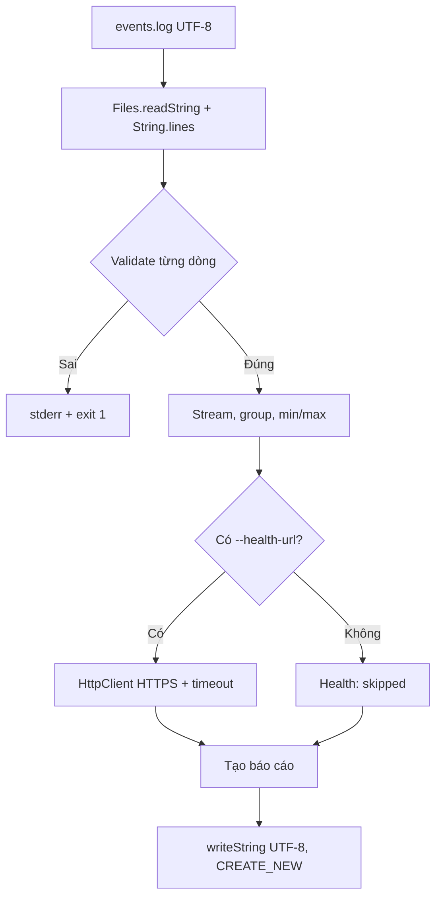

# Bài tổng hợp trên JDK được hỗ trợ với kiến thức Java 11 còn áp dụng

## 1. Bài toán và kết quả cần đạt

Xây dựng tiện ích dòng lệnh `OpsAudit` bằng **một tệp nguồn Java** để đọc nhật ký vận hành UTF-8, kiểm tra cấu trúc bản ghi, thống kê mức độ sự kiện, xuất báo cáo xác định và **tùy chọn** kiểm tra trạng thái một HTTPS endpoint bằng `HttpClient`. Bài thực hành hoạt động đầy đủ **ngoại tuyến** nếu không truyền URL, nên có thể kiểm thử lặp lại mà không phụ thuộc dịch vụ công cộng.

Điểm quan trọng của nhan đề: **Java 11 là mốc API/ngôn ngữ được thực hành; môi trường chạy nên là JDK đang được nhà cung cấp hỗ trợ và vá bảo mật.** Tính đến tháng 11/2026, có thể chọn **JDK 25 LTS**, hoặc **JDK 21 LTS** nếu tổ chức đang được nhà cung cấp cập nhật nhánh này. Hãy xác minh bản cập nhật cụ thể, chính sách hỗ trợ, giấy phép và `JAVA_HOME`/`PATH` của môi trường triển khai. Một bản phát hành có số phiên bản cao nhưng đã hết vòng đời cập nhật không phù hợp yêu cầu vận hành.

Nguồn kiểm tra: [Eclipse Temurin Support](https://adoptium.net/support/), [Oracle Java SE Support Roadmap](https://www.oracle.com/java/technologies/java-se-support-roadmap.html). Chu kỳ hỗ trợ tùy nhà cung cấp và có thể thay đổi.

**Đầu ra:** `OpsAudit.java`, `events.log`, `report.txt`; dùng `javac --release 11` để xác thực mã chỉ gọi tính năng/API có trong Java 11, sau đó chạy trên JDK LTS đang cập nhật. Không yêu cầu dependency ngoài Java SE.

## 2. Đặc tả dữ liệu, tính đúng và lỗi

Mỗi dòng bản ghi của `events.log` có dạng:

```text
<ISO-8601-UTC>|<LEVEL>|<SERVICE>|<MESSAGE>
```

Ví dụ:

```text
2026-11-07T08:02:00Z|ERROR|api|Hết hạn chờ | retry
```

Quy tắc: thời gian phải parse được bằng `Instant.parse`; level thuộc `INFO`, `WARN`, `ERROR` (không phân biệt hoa/thường với `Locale.ROOT`); service và message không rỗng. Dấu `|` nằm trong message được giữ bằng `split("\\|", 4)`. Đây là định dạng nhật ký tối giản phục vụ bài học, **không phải trình phân tích CSV/JSON tổng quát** có quoting/escaping/multiline.

Bỏ dòng trống và dòng chú thích bắt đầu bằng `#` sau khi `strip()`. Khi gặp bản ghi sai, dừng, báo **số dòng gốc** ra `stderr`, trả mã thoát 1 và không tạo báo cáo. Tính số sự kiện mỗi level, nhóm theo service theo thứ tự tên, xác định mốc thời gian sớm nhất/muộn nhất. Nếu dữ liệu sau lọc trống, cũng báo lỗi.

Đường dẫn báo cáo phải **chưa tồn tại**; ghi bằng UTF-8 và `CREATE_NEW`. Nếu nhận `--health-url <URL>`, chỉ chấp nhận URI HTTPS tin cậy, có timeout và không tự theo redirect. In mã HTTP vào báo cáo, không coi bất kỳ mã nào là bằng chứng chắc chắn ứng dụng khỏe mạnh.



## 3. Những kiến thức Java 11 vẫn có giá trị

| Thành phần | Lý do sử dụng | Lưu ý |
| --- | --- | --- |
| `Path.of`, `Files.readString`, `Files.writeString` | Đường dẫn và I/O văn bản có charset | Chỉ định `StandardCharsets.UTF_8`; `readString` giữ nội dung trong RAM, phù hợp tệp nhỏ/vừa. |
| `String.lines()` | Đọc dòng không phụ thuộc kiểu CRLF/LF/CR | Bỏ terminator của dòng; không giữ định dạng byte đầu vào. |
| `String.strip()`, `String.isBlank()` | Loại khoảng trắng biên, phát hiện trường trống | Dựa vào `Character.isWhitespace`, không bao hàm mọi ký tự Unicode space (ví dụ NBSP). |
| `String.repeat(int)` | Gạch phân tách báo cáo | Cần đầu vào số lần không âm. |
| `Optional.isEmpty()` | Xử lý trường hợp không tìm thấy thời gian đầu tiên | Đừng gọi `get()` trên Optional rỗng. |
| `java.net.http.HttpClient` | HTTPS client chuẩn, timeout và xử lý status | Đặt cả connect/request timeout; không dựa vào URL không tin cậy. |
| `Stream`, `Collectors.groupingBy`, `TreeMap` | Thống kê và xuất kết quả ổn định | Stream xuất hiện từ Java 8, **vẫn hữu ích** nhưng không phải tính năng mới của Java 11. |
| `Instant`, `List.copyOf` | Thời gian theo trục UTC và snapshot bất biến | Đều có trước Java 11; dùng lại cho ứng dụng Java mới là hoàn toàn phù hợp. |
| `javac --release 11` | Kiểm soát source/API/bytecode của mốc Java 11 | Không thay thế cập nhật bảo mật ở JDK chạy ứng dụng. |

Mã cốt lõi **không dùng** `record` (Java 16), text blocks (Java 15), switch expression (Java 14) hoặc `Stream.toList()` (Java 16), vì mục tiêu là biên dịch `--release 11`. Đối với dự án chỉ chạy trên JDK mới, có thể nâng mốc ngôn ngữ một cách chủ động nếu đó là yêu cầu sản phẩm.

## 4. Mã nguồn hoàn chỉnh: `OpsAudit.java`

Lưu nguyên văn dưới đây vào tệp `OpsAudit.java` bằng UTF-8.

```java
import java.io.IOException;
import java.net.URI;
import java.net.http.HttpClient;
import java.net.http.HttpRequest;
import java.net.http.HttpResponse;
import java.nio.charset.StandardCharsets;
import java.nio.file.Files;
import java.nio.file.Path;
import java.nio.file.StandardOpenOption;
import java.time.Duration;
import java.time.Instant;
import java.time.format.DateTimeParseException;
import java.util.ArrayList;
import java.util.Comparator;
import java.util.List;
import java.util.Locale;
import java.util.Map;
import java.util.Optional;
import java.util.TreeMap;
import java.util.stream.Collectors;

public final class OpsAudit {
    private enum Level {
        INFO, WARN, ERROR
    }

    // Lớp bất biến theo quy ước, tương thích Java 11.
    private static final class Entry {
        final Instant time;
        final Level level;
        final String service;
        final String message;

        Entry(Instant time, Level level, String service, String message) {
            this.time = time;
            this.level = level;
            this.service = service;
            this.message = message;
        }
    }

    private OpsAudit() {
    }

    public static void main(String[] args) {
        boolean valid = args.length == 2
                || (args.length == 4 && "--health-url".equals(args[2]));
        if (!valid) {
            System.err.println(
                    "Usage: java OpsAudit <events.log> <report.txt> "
                    + "[--health-url https://host/path]");
            System.exit(2);
            return;
        }

        Path input = Path.of(args[0]);
        Path output = Path.of(args[1]);

        try {
            List<Entry> entries = loadEntries(input);
            String health = args.length == 4
                    ? checkHttps(args[3])
                    : "skipped";

            String report = buildReport(entries, health);
            Files.writeString(
                    output,
                    report,
                    StandardCharsets.UTF_8,
                    StandardOpenOption.CREATE_NEW,
                    StandardOpenOption.WRITE);

            System.out.println("Saved: " + output);
            System.out.println("Records: " + entries.size());
        } catch (InterruptedException e) {
            Thread.currentThread().interrupt();
            System.err.println("Interrupted while checking HTTPS");
            System.exit(1);
        } catch (IOException | IllegalArgumentException e) {
            System.err.println("Error: " + e.getMessage());
            System.exit(1);
        }
    }

    private static List<Entry> loadEntries(Path input) throws IOException {
        // Phù hợp tệp nhỏ/vừa; tránh dùng cho log hàng GB.
        List<String> lines = Files.readString(input, StandardCharsets.UTF_8)
                .lines()
                .collect(Collectors.toList());

        List<Entry> entries = new ArrayList<>();
        for (int i = 0; i < lines.size(); i++) {
            String line = lines.get(i).strip();
            if (line.isBlank() || line.startsWith("#")) {
                continue;
            }
            entries.add(parseEntry(line, i + 1));
        }
        return List.copyOf(entries);
    }

    private static Entry parseEntry(String line, int lineNumber) {
        String[] fields = line.split("\\|", 4);
        if (fields.length != 4) {
            throw new IllegalArgumentException(
                    "Line " + lineNumber + ": expected 4 fields");
        }

        for (int i = 0; i < fields.length; i++) {
            fields[i] = fields[i].strip();
            if (fields[i].isBlank()) {
                throw new IllegalArgumentException(
                        "Line " + lineNumber + ": blank field " + (i + 1));
            }
        }

        Instant time;
        try {
            time = Instant.parse(fields[0]);
        } catch (DateTimeParseException e) {
            throw new IllegalArgumentException(
                    "Line " + lineNumber + ": invalid ISO-8601 instant");
        }

        Level level;
        try {
            level = Level.valueOf(fields[1].toUpperCase(Locale.ROOT));
        } catch (IllegalArgumentException e) {
            throw new IllegalArgumentException(
                    "Line " + lineNumber + ": level must be INFO/WARN/ERROR");
        }

        return new Entry(time, level, fields[2], fields[3]);
    }

    private static String checkHttps(String rawUrl)
            throws IOException, InterruptedException {
        URI url = URI.create(rawUrl);
        if (!"https".equalsIgnoreCase(url.getScheme())
                || url.getHost() == null
                || url.getUserInfo() != null) {
            throw new IllegalArgumentException(
                    "Health URL must be a trusted HTTPS URL");
        }

        HttpClient client = HttpClient.newBuilder()
                .connectTimeout(Duration.ofSeconds(3))
                .followRedirects(HttpClient.Redirect.NEVER)
                .build();

        HttpRequest request = HttpRequest.newBuilder(url)
                .timeout(Duration.ofSeconds(5))
                .GET()
                .build();

        // Chỉ cần status; không tải body về bộ nhớ.
        int status = client.send(
                request, HttpResponse.BodyHandlers.discarding()).statusCode();
        return "HTTP " + status;
    }

    private static String buildReport(List<Entry> entries, String health) {
        Optional<Instant> first = entries.stream()
                .map(e -> e.time)
                .min(Comparator.naturalOrder());

        if (first.isEmpty()) {
            throw new IllegalArgumentException(
                    "Input has no usable log records");
        }

        Instant last = entries.stream()
                .map(e -> e.time)
                .max(Comparator.naturalOrder())
                .orElseThrow();

        Map<String, Long> byService = entries.stream()
                .collect(Collectors.groupingBy(
                        e -> e.service,
                        TreeMap::new,
                        Collectors.counting()));

        StringBuilder report = new StringBuilder();
        report.append("LOG AUDIT\n");
        report.append("=".repeat(9)).append('\n');
        report.append("Records: ").append(entries.size()).append('\n');
        report.append("From: ").append(first.get()).append('\n');
        report.append("To: ").append(last).append('\n');
        report.append("Levels:\n");

        for (Level level : Level.values()) {
            long count = entries.stream()
                    .filter(e -> e.level == level)
                    .count();
            report.append(level).append(": ").append(count).append('\n');
        }

        report.append("Services:\n");
        byService.forEach((service, count) ->
                report.append(service).append(": ").append(count).append('\n'));
        report.append("Health: ").append(health).append('\n');
        return report.toString();
    }
}
```

### Đọc hiểu triển khai

- `Files.readString(input, UTF_8)` giúp kết quả độc lập charset hệ điều hành; `String.lines()` xử lý CR, LF, CRLF và loại terminator. Vòng lặp vẫn giữ số dòng vật lý để báo lỗi chính xác khi có chú thích hoặc dòng trắng.
- `split("\\|", 4)` chỉ chia tối đa ba dấu phân cách đầu tiên; message được phép chứa `|`. Các trường được `strip`, nhưng không tự động sửa dữ liệu nhập sai.
- `Instant` biểu diễn một thời điểm cụ thể trên trục UTC. Đừng thay bằng `LocalDateTime` không có offset rồi tự suy diễn múi giờ khi log có hậu tố `Z`.
- `List.copyOf` giữ snapshot bất biến qua giao diện `List`; `TreeMap` đưa thứ tự service về dạng ổn định. `Optional.isEmpty` làm rõ xử lý input rỗng trước khi dùng `get()`.
- `HttpClient` dùng GET qua HTTPS, **không tự theo redirect**, có cả timeout kết nối và timeout của request. `BodyHandlers.discarding()` chỉ nhận status, tránh giữ response body lớn. Chỉ kiểm tra địa chỉ do người vận hành tin cậy cung cấp; **không nhận URL tùy ý từ nguồn không tin cậy** trong một dịch vụ máy chủ.
- `Health: HTTP 404` hay `Health: HTTP 503` thể hiện phản hồi thực tế, không mặc định “healthy”. Nếu nghiệp vụ cần đánh giá 2xx/3xx/4xx/5xx, định nghĩa chính sách riêng trước khi biến nó thành mã lỗi.
- `CREATE_NEW` ngăn ghi đè một file đã tồn tại; nó **không** đảm bảo atomic write toàn bộ nội dung khi gặp mất điện hoặc hết dung lượng. Tác vụ cần độ bền dữ liệu cao phải dùng file tạm, xác minh, rồi move/rename phù hợp hệ thống file.
- Exit code **2** khi sai tham số, **1** khi file/parse/HTTP lỗi, và 0 khi hoàn thành. `InterruptedException` được xử lý bằng cách phục hồi interrupt flag trước khi thoát.

## 5. Biên dịch, chạy và đóng gói bằng JDK được hỗ trợ

Trước tiên kiểm tra JDK thực sự đang chạy:

```bash
java -version
javac -version
```

Cập nhật nhánh JDK 25 LTS (hoặc 21 LTS do vendor duy trì) lên bản vá thích hợp. Với mã của bài, thực hiện:

```bash
javac --release 11 OpsAudit.java
java OpsAudit events.log report.txt
```

`javac --release 11` xác nhận mã không vô tình phụ thuộc API/ngôn ngữ sau Java 11. Chạy trên bản JDK **vẫn nhận bản vá** là một việc khác: kiểm soát bản phân phối và runtime ở máy chạy ứng dụng.

Java 11 cũng hỗ trợ chạy trực tiếp source file; dùng một đường dẫn báo cáo khác:

```bash
java OpsAudit.java events.log report-direct.txt
```

Source-file mode trên JDK mới biên dịch theo môi trường hiện tại; vì vậy vẫn chạy `javac --release 11` riêng nếu cần hợp đồng tương thích Java 11.

Đóng gói JAR chạy được (tùy chọn):

```bash
mkdir out
javac --release 11 -d out OpsAudit.java
jar --create --file ops-audit.jar --main-class OpsAudit -C out .
java -jar ops-audit.jar events.log report-jar.txt
```

Mỗi lệnh phải dùng đường dẫn báo cáo **chưa tồn tại** vì `CREATE_NEW` không ghi đè.

## 6. Dữ liệu mẫu và output chính xác

Tạo `events.log` bằng UTF-8 với nội dung:

```text
# Sự kiện ứng dụng
2026-11-07T08:00:00Z|INFO|api|Khởi động
2026-11-07T08:01:00Z|WARN|worker|Thử lại
2026-11-07T08:02:00Z|ERROR|api|Hết hạn chờ | retry
2026-11-07T08:03:00Z|INFO|worker|Hoàn tất
```

Với `report.txt` chưa có, chạy:

```bash
java OpsAudit events.log report.txt
```

**Stdout:**

```text
Saved: report.txt
Records: 4
```

**Nội dung chính xác của `report.txt`** (mỗi dòng kết thúc LF, bao gồm dòng cuối):

```text
LOG AUDIT
=========
Records: 4
From: 2026-11-07T08:00:00Z
To: 2026-11-07T08:03:00Z
Levels:
INFO: 2
WARN: 1
ERROR: 1
Services:
api: 2
worker: 2
Health: skipped
```

Thứ tự level dựa vào `enum`; các service được sắp xếp bằng `TreeMap`. Mốc `From/To` lấy giá trị sớm/muộn thực tế, không phụ thuộc thứ tự dòng trong file.

**Tùy chọn HTTP** (chỉ dùng endpoint HTTPS được phép kiểm tra):

```bash
java OpsAudit events.log report-health.txt --health-url https://example.com/
```

Phần `Health: HTTP <status>` thay đổi theo thời điểm và phản hồi của máy chủ. Không khẳng định status cố định hay buộc người học phải có Internet để hoàn tất bài.

## 7. Các ca kiểm thử bắt buộc

| Ca kiểm thử | Kỳ vọng |
| --- | --- |
| Log mẫu, không URL | 4 sự kiện, INFO/WARN/ERROR bằng 2/1/1, service api và worker mỗi bên 2; đúng toàn bộ báo cáo. |
| Hoán đổi thứ tự dòng sự kiện | Mốc From/To không đổi; thống kê không đổi. |
| Dòng trống, chú thích và CRLF | Dòng không chứa dữ liệu bị bỏ, số dòng báo lỗi vẫn là dòng vật lý. |
| Thông điệp chứa tiếng Việt hoặc emoji | Đọc được UTF-8, không phá mã hóa hoặc gộp bản ghi sai. |
| Message có ký tự `|` | Vẫn chỉ có bốn trường nhờ giới hạn `split` bằng 4. |
| Timestamp sai, level lạ hoặc trường trống | Exit 1, `stderr` có số dòng cụ thể, chưa tạo report. |
| Tệp chỉ có chú thích | Exit 1 với thông báo không có bản ghi hợp lệ. |
| Input chứa byte không phải UTF-8 hợp lệ | Báo lỗi I/O thay vì coi dữ liệu hỏng là thành công. |
| Chạy lại cùng đường dẫn report | Không ghi đè file cũ; lệnh thất bại. |
| `--health-url` dùng HTTP thường/URI lỗi | Bị từ chối; không gọi HTTP không mã hóa. |
| HTTPS timeout hoặc không kết nối | Báo lỗi, exit 1, không tạo báo cáo thành công. |
| HTTPS trả HTTP 404 hoặc 503 | Báo đúng mã HTTP nếu giao tiếp thành công; không tự suy luận dịch vụ khỏe. |

Để kiểm tra ổn định trong CI, nên dùng fixture log riêng, so sánh nội dung báo cáo và mã thoát chương trình. Khi chuyển sang dự án nhiều file, có thể tách parser/aggregator để thêm test tự động với **JUnit 5**. Bài này không cần dependency bổ sung.

Tự thực hành:

1. Chạy `javac --release 11 OpsAudit.java` và xác nhận không lỗi.
2. Chạy dữ liệu mẫu, so sánh stdout và toàn bộ byte UTF-8 của `report.txt` với kết quả ở trên.
3. Chạy lại cùng output, xác nhận báo lỗi và file đã ghi không thay đổi.
4. Sửa level thành `UNKNOWN` ở một dòng, chạy với output mới và xác nhận lỗi chỉ rõ dòng đó.
5. Thêm dòng trắng/chú thích hoặc đổi CRLF, kiểm chứng parser vẫn đếm đúng.
6. Nếu kiểm tra HTTP, chỉ dùng endpoint mình quản lý; thử 2xx, non-2xx và timeout. Không dùng public URL làm chuẩn output tự động.

## 8. Lỗi tư duy và hướng mở rộng có giá trị

- **Dùng JDK mới nhưng mặc định API cũng tương thích Java 11.** Chỉ `javac --release 11` mới kiểm tra rõ mốc source/API/bytecode trong cách biên dịch này.
- **Xem “LTS” là bảo đảm đã cập nhật.** Kiểm tra bản vá đang cài, ngày hết hỗ trợ của vendor và giấy phép; một bản LTS không tự cập nhật.
- **Dùng charset mặc định.** Mã hóa khác nhau giữa môi trường dễ làm hỏng tiếng Việt; ghi rõ UTF-8 cho mọi điểm I/O có liên quan.
- **Cho rằng `String.lines()` giữ nguyên CRLF/LF.** API bỏ terminator; mã báo cáo chủ động ghi LF. Không dùng để sao chép byte gốc.
- **Cho rằng `String.strip()` xóa mọi loại Unicode whitespace.** Tiêu chí của nó là `Character.isWhitespace`; NBSP có thể vẫn còn.
- **Dùng `HashMap` rồi kỳ vọng thứ tự báo cáo ổn định.** Với output cần so sánh hoặc tiêu thụ bởi công cụ khác, sắp xếp keys trước khi ghi.
- **Cho rằng HTTP 200 đủ kết luận hệ thống tốt và 404 luôn là lỗi chương trình.** Diễn giải HTTP theo yêu cầu endpoint; phân biệt lỗi truyền tải với phản hồi ứng dụng.
- **Chấp nhận URL bất kỳ khi chạy máy chủ.** URL không tin cậy có thể dẫn đến truy cập nội mạng (SSRF); bài CLI này chỉ nhận URL do người vận hành chủ động cung cấp.
- **Dùng `Files.readString` cho log nhiều GB.** Đây là giải pháp có chủ đích cho file nhỏ/vừa. Với file rất lớn, dùng `Files.lines(input, UTF_8)` hoặc buffered I/O có `try-with-resources`, giữ quy tắc báo lỗi và đảm bảo đóng stream.
- **Tin `CREATE_NEW` đã giải quyết mọi vấn đề an toàn dữ liệu.** Chống overwrite khác với ghi bền vững/atomic; dữ liệu quan trọng cần chiến lược file tạm, fsync/move và xử lý failure.

**Hoàn thành bài khi:** chạy trên JDK vẫn được cập nhật, biên dịch bằng `--release 11`, vượt qua ca mẫu và ca lỗi, giữ UTF-8, thống kê đúng, không ghi đè report, và tùy chọn HTTPS có timeout cùng cách diễn giải trạng thái rõ ràng. Các kiến thức Java 11 ở đây tiếp tục có giá trị trong ứng dụng Java hiện đại.