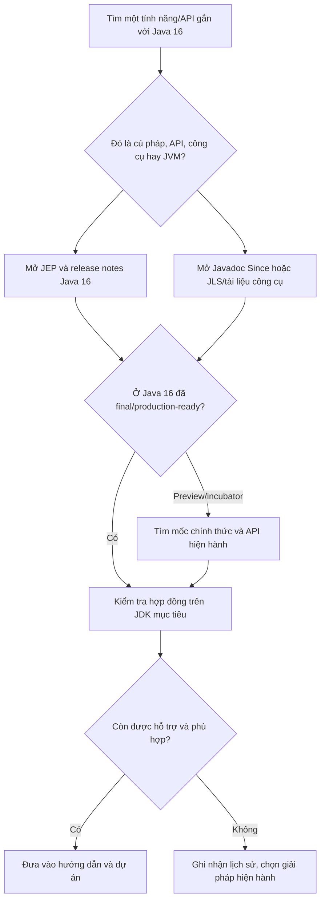

# Đọc JEP, mục Since và đặc tả API để xác định đúng phạm vi Java 16

> **Chương:** Định hướng Java 16  
> **Phạm vi:** Phương pháp tìm bằng chứng về thời điểm một tính năng hoặc API xuất hiện, khi nào trở thành chính thức và liệu còn nên áp dụng trên Java hiện đại. Đây là kỹ năng tra cứu dành cho module **JAVA_VERSION_JAVA16**, không phải danh sách để học lại các API thử nghiệm của Java 16.

## Mục tiêu học tập

Sau bài này, bạn có thể:

1. Đọc đúng các trường **Status**, **Target** và phần mô tả phạm vi của một JEP.
2. Tìm mục **Since** ở cấp **phương thức**, **lớp** hoặc **module** trong Javadoc, rồi đọc hợp đồng API thay vì chỉ nhìn số phiên bản.
3. Dùng **Java Language Specification (JLS)**, tài liệu công cụ và release notes khi chủ đề không phải một phương thức Java.
4. Phân biệt **lần đầu được thử nghiệm**, **lần đầu có thể sử dụng**, **lần đầu chính thức** và **còn phù hợp trong JDK mục tiêu**.
5. Tự kiểm chứng một khẳng định về Java 16 bằng nguồn chính thức và một phép biên dịch có kiểm soát.

## 1. Vì sao cần kiểm tra phạm vi thay vì ghi nhớ tên tính năng?

Câu “tính năng X có từ Java 16” có thể mang nhiều nghĩa:

- X **được đề xuất hoặc có bản preview/incubator** trong Java 16.
- X **trở thành tính năng chính thức** ở Java 16 dù từng có bản preview từ trước.
- Một **phương thức mới** được bổ sung vào thư viện chuẩn kể từ Java 16.
- Một **công cụ** hoặc hành vi JVM có thay đổi ở Java 16, dù công cụ/công nghệ gốc đã tồn tại trước đó.
- X **vẫn chạy** trên Java 16 nhưng thực ra xuất hiện từ Java 9, 11, 14 hoặc 15.

Những ý nghĩa này không tương đương. Ví dụ, `record` đã xuất hiện dưới dạng preview trong Java 14 nhưng chỉ trở thành tính năng ngôn ngữ chính thức ở **Java 16**. Ngược lại, `sealed` có mặt ở Java 16 dưới dạng preview và trở thành chính thức ở **Java 17**. Cả hai đều liên quan Java 16, nhưng chỉ `record` thỏa tiêu chí “ổn định ngay từ Java 16”.

Để giữ nội dung hữu ích với các JDK đang được hỗ trợ, hãy chứng minh **hai điều riêng biệt**:

1. **Nguồn gốc:** Tính năng/API thuộc bản Java nào và ở trạng thái gì tại thời điểm đó?
2. **Giá trị hiện tại:** Nó còn có trong JDK mục tiêu, còn được hỗ trợ và còn là cách dùng được khuyến nghị hay không?

Không lấy cú pháp preview cũ làm ví dụ mẫu cho dự án mới chỉ vì một JEP từng nhắm tới Java 16.

## 2. Chọn đúng nguồn cho từng loại khẳng định

| Cần kiểm tra | Nguồn nên mở trước | Điều nguồn đó trả lời |
| --- | --- | --- |
| Một thay đổi lớn của ngôn ngữ/JDK có thuộc Java 16 không? | **JEP** + bảng thay đổi theo phiên bản | Mục tiêu, mức hoàn thiện, nội dung thay đổi |
| Một phương thức như `Stream.toList()` có từ bản nào? | **Javadoc API**, xem `Since` ngay tại phương thức | Phiên bản giới thiệu API đó; chữ ký, hợp đồng và ngoại lệ |
| Cú pháp `record` hoặc `instanceof` hoạt động chính xác thế nào? | **JLS** của đúng phiên bản | Quy tắc ngữ pháp, kiểm tra kiểu, phạm vi biến, lỗi biên dịch |
| `jpackage` hay một tùy chọn của `javac`/`java` hoạt động thế nào? | Hướng dẫn công cụ và **release notes** | Cách dùng, giới hạn hệ điều hành, thay đổi hành vi |
| GC, metaspace, module encapsulation đổi ra sao? | JEP, release notes, tài liệu JVM/vận hành | Hành vi ở cấp runtime; tùy chọn và tác động có thể quan sát |
| Một API có còn phù hợp trên Java 21/25 hoặc JDK mục tiêu không? | **Javadoc và release notes của JDK đích** | Trạng thái hiện tại, deprecated/removed, thay đổi hợp đồng |

**Thứ tự ưu tiên khi có mâu thuẫn:** Lấy **đặc tả và Javadoc của phiên bản đang xét** làm căn cứ cho cú pháp/hợp đồng API; dùng JEP để hiểu lý do, phạm vi và lịch sử đưa vào JDK; dùng release notes để kiểm tra điều thực sự được phát hành, các giới hạn và thay đổi triển khai. JEP là tài liệu đề xuất/cải tiến, **không thay thế hợp đồng API hay JLS**.

### Bốn câu hỏi cần hỏi trước khi đọc tài liệu

1. **Đối tượng là gì?** Cú pháp ngôn ngữ, phương thức API, công cụ, tính năng JVM hay module?
2. **Đang hỏi phiên bản nào?** Phiên bản xuất hiện đầu tiên, phiên bản chính thức đầu tiên hay phiên bản hiện tại?
3. **Cần loại bằng chứng nào?** JEP, `Since`, JLS, hướng dẫn công cụ hoặc release notes?
4. **Có yêu cầu ổn định không?** Nếu có, loại preview/incubator trong phiên bản nguồn khỏi tập tính năng “chính thức”.

## 3. Cách đọc một JEP mà không kết luận nhầm

Một JEP (*JDK Enhancement Proposal*) thường mô tả đề xuất thay đổi cho OpenJDK. Ví dụ:

- [JEP 395 — Records](https://openjdk.org/jeps/395).
- [JEP 394 — Pattern Matching for instanceof](https://openjdk.org/jeps/394).
- [JEP 392 — Packaging Tool](https://openjdk.org/jeps/392).
- [JEP 397 — Sealed Classes (Second Preview)](https://openjdk.org/jeps/397).

Khi đọc một JEP, hãy ghi các mục sau:

| Thành phần của JEP | Nên đọc như thế nào? | Lỗi suy luận cần tránh |
| --- | --- | --- |
| **Title / Summary** | Vấn đề mà thay đổi giải quyết, phạm vi thực tế | Suy từ tiêu đề rằng toàn bộ tính năng đã ổn định |
| **Status** | Tiến độ xử lý JEP, ví dụ được giao/đã hoàn thành | Coi `Delivered` là đồng nghĩa với “không còn preview” |
| **Target** | Bản JDK mà JEP hướng tới/được giao | Coi “được nhắm tới” là bằng chứng duy nhất rằng API có trong bản phát hành |
| **Preview / Incubator** trong tiêu đề/nội dung | Mức thử nghiệm khi được phát hành | Học cú pháp thử nghiệm ấy như cú pháp chuẩn hiện tại |
| **Goals / Non-Goals / Description** | Chính xác có gì được bổ sung và điều gì nằm ngoài phạm vi | Gán cho JEP những khả năng không nêu trong mục tiêu |
| **Compatibility / Risks / Alternatives** | Hạn chế và vấn đề khi nâng cấp | Bỏ qua rủi ro tương thích vì tính năng có vẻ ngắn gọn |

**Quan trọng:** Một JEP ở trạng thái đã phát hành vẫn có thể là **preview** hoặc **incubator**. JEP 397 được phát hành cho Java 16 nhưng chính tiêu đề xác định `sealed` đang ở **second preview**. Trạng thái thực sự của **tính năng** cần được đọc cùng tiêu đề, phần mô tả và tài liệu phát hành, thay vì chỉ dựa vào `Status` của **đề xuất**.

### Ví dụ 1 — Tìm mốc chính thức của `record`

Lần theo lịch sử:

| Phiên bản | JEP | Trạng thái của `record` |
| --- | --- | --- |
| Java 14 | [JEP 359](https://openjdk.org/jeps/359) | Preview lần đầu |
| Java 15 | [JEP 384](https://openjdk.org/jeps/384) | Preview lần hai |
| **Java 16** | **[JEP 395](https://openjdk.org/jeps/395)** | **Chính thức / permanent** |

Đối chiếu thêm tài liệu [Java Language Changes — Java SE 16](https://docs.oracle.com/en/java/javase/16/language/java-language-changes.html): `record` là tính năng chính thức và không cần `--enable-preview` khi biên dịch cho Java 16.

**Kết luận chính xác:** “`record` trở thành tính năng ngôn ngữ chính thức ở Java 16; đã có các bản preview trước đó.” Không viết “`record` được phát minh lần đầu trong Java 16”.

### Ví dụ 2 — `instanceof` pattern matching không phải tính năng mới hoàn toàn ở Java 16

Lịch sử tương tự: [JEP 305](https://openjdk.org/jeps/305) (preview ở Java 14), [JEP 375](https://openjdk.org/jeps/375) (preview lần hai ở Java 15), rồi [JEP 394](https://openjdk.org/jeps/394) (chính thức ở **Java 16**). Đây là cú pháp ổn định:

```java
Object input = "hello";
if (input instanceof String text) {
    System.out.println(text.length());
}
```

Nếu muốn biết vì sao biến `text` chỉ có thể được dùng ở một số vị trí, hãy đọc quy tắc về *pattern variables* và phạm vi dựa trên luồng điều khiển trong **JLS**, không chỉ dựa vào ví dụ trong JEP.

### Ví dụ 3 — Đọc “đã phát hành” nhưng chưa “chính thức”

- [JEP 397](https://openjdk.org/jeps/397): `sealed` ở Java 16 là **preview lần hai**.
- [JEP 409](https://openjdk.org/jeps/409): `sealed` trở thành **chính thức trong Java 17**.
- [JEP 338](https://openjdk.org/jeps/338): Vector API là **incubator trong Java 16**. Khi cần dùng vector API, phải kiểm tra API và mức hỗ trợ trong JDK mục tiêu.
- [JEP 393](https://openjdk.org/jeps/393): Foreign-Memory Access API là **third incubator** trong Java 16; các API truy cập native về sau đã có những vòng thiết kế khác. Nếu cần chức năng này trên JDK hiện đại, tìm hiểu [JEP 454 — Foreign Function & Memory API](https://openjdk.org/jeps/454), chính thức từ Java 22, thay vì sao chép mã incubator của Java 16.

Tư duy cần giữ: **bản thử nghiệm và phiên bản API chính thức không nhất thiết có cùng tên gói, chữ ký hoặc cách sử dụng.**

## 4. Cách tìm và hiểu mục `Since` trong Javadoc

Truy cập [Java SE 16 API Documentation](https://docs.oracle.com/en/java/javase/16/docs/api/index.html), chọn module, package, lớp/interface và **cuộn đến phần Method Details** của phương thức muốn tra.

Ví dụ mở [`java.util.stream.Stream` (Java SE 16)](https://docs.oracle.com/en/java/javase/16/docs/api/java.base/java/util/stream/Stream.html):

1. Tìm đúng mục phương thức **`toList()`**, thay vì chỉ đọc phần mở đầu của interface `Stream`.
2. Ghi nhận chữ ký: `default List<T> toList()`.
3. Đọc **Since: 16** trong **Method Details**. Đó là bằng chứng phương thức này có từ Java 16.
4. Đọc hợp đồng: danh sách trả về **unmodifiable**; thao tác sửa sẽ gây `UnsupportedOperationException`.
5. Kiểm tra cùng phương thức trên Javadoc của **JDK đích**, nhất là khi xây dựng mã cho nhiều phiên bản.

Làm tương tự với **`mapMulti(...)`**: mục **Since: 16** xuất hiện trong mô tả phương thức. Javadoc còn mô tả nó phát **0 đến nhiều** phần tử cho mỗi phần tử đầu vào, chỉ ra những trường hợp phù hợp so với `flatMap`, cũng như yêu cầu đối với callback.

### `Since` không phải là nhãn chung cho cả trang

Một interface có thể được thêm từ rất lâu, nhưng phương thức cụ thể được bổ sung sau:

| Phạm vi tra cứu | Kết quả | Kết luận đúng |
| --- | --- | --- |
| Interface `Stream` | `Since: 1.8` (Java 8) | Stream API tồn tại từ Java 8 |
| `Stream.toList()` | `Since: 16` | Phương thức `toList()` có từ Java 16 |
| `Stream.mapMulti(...)` | `Since: 16` | Phương thức `mapMulti` có từ Java 16 |
| `Stream.takeWhile(...)` | `Since: 9` | Không phải API mới của Java 16 |

**Điều dễ mắc lỗi:** Thấy tên `Stream` xuất hiện từ Java 8 rồi kết luận `stream.toList()` dùng được trên Java 8; hoặc thấy phương thức nằm trong tài liệu Java 16 rồi kết luận nó được thêm **ở** Java 16. Cả hai cách đều sai vì cần xem `Since` của **đúng thành viên**.

Nếu một thành viên không hiển thị `Since`, **đừng tự suy ra** phiên bản đầu tiên. Hãy xem Javadoc của các phiên bản liên tiếp, phần **New API**/**API changes**, release notes và lịch sử thay đổi nguồn nếu cần. Đôi khi cần phân biệt phương thức overload cụ thể với các overload đã tồn tại.

### `Since` cho biết thời điểm ra đời, còn mô tả API cho biết cách dùng

Không dừng ở số `16`. Đối với một API, hãy đọc:

- **Signature, type parameters, Parameters, Returns:** kiểu dữ liệu và lời hứa của API.
- **Throws:** ngoại lệ được đặc tả.
- **API Note / Implementation Requirements:** lời giải thích về cách dùng hoặc yêu cầu triển khai, khi có.
- **Since:** phiên bản bắt đầu có API.
- **Deprecated / forRemoval:** cảnh báo nếu API đã không còn được khuyến nghị.

Chẳng hạn, cả `stream.toList()` và `stream.collect(Collectors.toList())` đều tạo danh sách. Tuy nhiên, **`Stream.toList()` cam kết danh sách không thể sửa**, còn `Collectors.toList()` **không cam kết** một kiểu danh sách hoặc khả năng sửa cụ thể. Đó là khác biệt về **hợp đồng**, không thể biết chỉ bằng `Since`.

> Trong Javadoc, `Since` là thông tin được tạo từ tài liệu nguồn; bản thân nó không cam kết thư viện bên thứ ba, Android hoặc mọi JDK tùy biến đều có hành vi giống Java SE chuẩn. Kiểm tra nền tảng thực tế mà ứng dụng triển khai.

## 5. Khi không có `Since`: đọc đặc tả ngôn ngữ hoặc tài liệu công cụ

### 5.1. Với cú pháp Java: tra JLS theo phiên bản

`record` và `instanceof String text` là **cú pháp ngôn ngữ**. Không có “phương thức `record()`” để mở Javadoc và tìm `Since`. Cần dùng:

- [JLS Java SE 16 — Chapter 8: Classes](https://docs.oracle.com/javase/specs/jls/se16/html/jls-8.html), trong đó có quy định về *record classes*.
- [JLS Java SE 16 — Chapter 15: Expressions](https://docs.oracle.com/javase/specs/jls/se16/html/jls-15.html), trong đó có quy tắc của biểu thức `instanceof`.
- [Java Language Changes (Java SE 16)](https://docs.oracle.com/en/java/javase/16/language/java-language-changes.html) để xác định mốc chính thức của cú pháp.

**JEP trả lời “tại sao và vào bản nào”; JLS trả lời “được phép viết những gì, ngữ nghĩa và giới hạn là gì”.** Khi gặp câu hỏi sâu như biến pattern được dùng ở nhánh nào, một lời giải đáng tin phải dựa vào JLS hoặc tài liệu ngôn ngữ đúng phiên bản.

### 5.2. Với `jpackage`: tra hướng dẫn công cụ và release notes

`jpackage` là **công cụ đóng gói**, không phải một phương thức trong `java.base`. Vì vậy đừng chỉ tra Javadoc của lớp Java.

Nguồn thích hợp:

- [JEP 392 — Packaging Tool](https://openjdk.org/jeps/392).
- [JDK 16 Release Notes](https://www.oracle.com/java/technologies/javase/16-relnote-issues.html).
- Hướng dẫn `jpackage` dành cho **JDK dùng để đóng gói**.

Release notes cho biết `jpackage` từng là incubating tool từ Java 14/15 và **trở thành công cụ chính thức ở Java 16**; đồng thời tên module được chuyển từ `jdk.incubator.jpackage` sang `jdk.jpackage`. Đây chính là kiểu khác biệt không thể xác minh bằng cách nhìn một số `Since` của API.

Với dự án hiện đại, hãy dùng cú pháp và yêu cầu đóng gói của **JDK đang build**. Các định dạng cài đặt, công cụ hệ điều hành và phương án ký ứng dụng có thể khác nhau theo nền tảng.

### 5.3. Với hành vi JVM: tra JEP, release notes và tài liệu runtime

Ví dụ:

- [JEP 387 — Elastic Metaspace](https://openjdk.org/jeps/387): cải tiến việc quản lý và hoàn trả bộ nhớ Metaspace ở JDK 16.
- [JEP 376 — ZGC: Concurrent Thread-Stack Processing](https://openjdk.org/jeps/376): chuyển một phần xử lý ngăn xếp luồng của ZGC sang thực hiện đồng thời.
- [JEP 396 — Strongly Encapsulate JDK Internals by Default](https://openjdk.org/jeps/396): thay đổi **mặc định** đóng gói API nội bộ trong Java 16; [JEP 403](https://openjdk.org/jeps/403) tiếp tục thay đổi chính sách từ Java 17.

Các JEP này nói về **hành vi hoặc chính sách nền tảng**. Không thể suy mức giảm bộ nhớ, thời gian GC hay khả năng chạy một thư viện chỉ từ trạng thái Delivered hoặc một nhãn `Since`; cần thử nghiệm ứng dụng và kiểm tra trên JDK đích.

## 6. Ma trận xác minh những chủ đề dễ nhầm với Java 16

| Chủ đề | Mốc cần ghi nhận | Bằng chứng phù hợp | Có nên xem là tính năng **ổn định từ Java 16**? |
| --- | --- | --- | --- |
| `record` | Preview Java 14/15; **final Java 16** | JEP 395 + bảng thay đổi ngôn ngữ + JLS 16 | **Có** |
| Pattern matching cho `instanceof` | Preview Java 14/15; **final Java 16** | JEP 394 + JLS 16 | **Có** |
| `Stream.toList()` | **Since: 16** | Javadoc tại phương thức | **Có** |
| `Stream.mapMulti(...)` | **Since: 16** | Javadoc tại phương thức | **Có** |
| `jpackage` | Incubator Java 14/15; **production-ready Java 16** | JEP 392 + release notes | **Có**, công cụ đóng gói |
| Unix-domain socket channels | Bổ sung vào Java 16 | JEP 380 + tài liệu NIO/API | **Có**, khi nền tảng hỗ trợ |
| Strong encapsulation của JDK | Mặc định được siết ở Java 16, tiếp tục ở Java 17 | JEP 396 + JEP 403 | **Có**, như một thay đổi cần lưu ý khi nâng cấp |
| `sealed` | **Preview Java 16**, final Java 17 | JEP 397 + JEP 409 | **Không**, nếu tiêu chí là final trong Java 16 |
| Vector API | **Incubator Java 16** | JEP 338 + trạng thái trong JDK đích | **Không** thuộc nhóm API chính thức từ 16 |
| Foreign-memory incubator | Thử nghiệm trong Java 16; API chính thức về sau | JEP 393 + JEP 454 | **Không** học bản incubator như API hiện đại |
| `jlink` | Được giới thiệu từ **Java 9** | Tài liệu công cụ/module system | **Không** phải tính năng mới của Java 16 |
| Text blocks | **Final Java 15** | JEP 378 + bảng thay đổi ngôn ngữ | **Không** phải tính năng mới của Java 16 |

Lưu ý: “Có” ở cột cuối chỉ kết luận về **thời điểm ổn định hoặc thay đổi trong Java 16**. Để biết cách triển khai trên Java hiện nay, vẫn phải đọc tài liệu của JDK mục tiêu và đánh giá tính phù hợp với hệ thống.

## 7. Tự kiểm chứng bằng `javac --release`

Đặc tả và tài liệu là nguồn chính, nhưng một phép biên dịch đơn giản giúp phát hiện lỗi gán mốc phiên bản. Tạo tệp `ApiSinceCheck.java`:

```java
import java.util.List;
import java.util.stream.Stream;

public class ApiSinceCheck {
    public static void main(String[] args) {
        List<String> result = Stream.of("alpha", "beta")
                .map(String::toUpperCase)
                .toList();
        System.out.println(result);
    }
}
```

Trên một JDK đủ mới và còn hỗ trợ đích biên dịch 15/16, chạy:

```bash
javac -version
javac --release 16 ApiSinceCheck.java
java ApiSinceCheck
```

Kết quả chương trình là `[ALPHA, BETA]`. Tiếp theo, thử:

```bash
javac --release 15 ApiSinceCheck.java
```

Lần biên dịch thứ hai phải báo lỗi do **`Stream.toList()` chưa thuộc Java SE 15 API**. Phép đối chiếu nhất quán với Javadoc `Since: 16`. Nếu tên JDK hoặc đích `--release` không được công cụ hỗ trợ, hãy chọn bản JDK có hỗ trợ các đích cần so sánh.

### `--release` kiểm tra được điều gì?

Khi biên dịch, `javac --release 16` giới hạn cú pháp và API Java SE công khai tương ứng với đích 16, đồng thời tạo bytecode tương thích với mức class file đó. Nó hữu ích hơn việc chỉ cài JDK mới rồi biên dịch mặc định và suy rằng mã sẽ chạy trên Java 16.

Tuy nhiên, `--release` **không bảo đảm**:

- Mọi phụ thuộc bên thứ ba đều tương thích với JDK đích.
- Tất cả nhánh logic và các hoạt động reflection/runtime đều chạy đúng.
- Các dịch vụ, thư viện native, module JVM hoặc công cụ vận hành tồn tại trên mọi hệ điều hành.
- Một tính năng preview của **bản Java cũ** có thể được bật lại trên một `javac` hiện đại. `--enable-preview` phải được xét theo các quy tắc của phiên bản trình biên dịch đang dùng.

Với `record` hoặc `instanceof` pattern, hãy đọc JLS/release notes cùng JEP trước; không dùng kết quả biên dịch trên một JDK duy nhất thay cho phân tích lịch sử preview.

## 8. Phân biệt “có trong JDK 16” với “nên dùng trong dự án hiện đại”

Giả sử bạn đọc tài liệu cũ nói về một module bắt đầu bằng `jdk.incubator.` hoặc một tùy chọn `--illegal-access`. Đây là dấu hiệu cần **tra lại JDK mục tiêu**. Một API thử nghiệm có thể đổi tên hoặc đổi thiết kế; một cơ chế mở quyền chuyển tiếp có thể mất tác dụng ở phiên bản sau.

Áp dụng quy trình ngắn sau:



Ví dụ với **Vector API**: việc có JEP ở Java 16 chỉ khẳng định dự án Vector API đã có phiên bản incubator trong bản phát hành đó. Bạn cần xem API và trạng thái trong **JDK đang triển khai** trước khi dùng. Với **Foreign Function & Memory API**, tham khảo phiên bản chính thức ở Java 22 trở lên thay vì ví dụ incubator của Java 16. Với **`record`**, có thể dùng cú pháp chính thức trên những JDK hiện đại có hỗ trợ.

## 9. Ghi kết quả xác minh sao cho người khác kiểm tra được

Một ghi chú tốt phải tách **khẳng định**, **bằng chứng**, **kết luận** và **phạm vi áp dụng**. Ví dụ:

| Trường ghi chú | Giá trị mẫu |
| --- | --- |
| Đối tượng | `Stream.toList()` |
| Kiểu thay đổi | Bổ sung phương thức vào Java SE API |
| Mốc được chứng minh | Java 16 |
| Nguồn chính | Javadoc `Stream`, Method Details → `toList()` → `Since: 16` |
| Hợp đồng quan trọng | Trả `List` không thể sửa |
| Kiểm chứng phụ | Biên dịch với `--release 16` thành công, `--release 15` thất bại |
| Phạm vi kết luận | API tiêu chuẩn; kiểm tra JDK khi build/chạy thực tế |

Với cú pháp `record`, thay “Javadoc Since” bằng “JEP 395 + Java Language Changes + JLS 16”. Với `jpackage`, thay bằng “JEP 392 + release notes + hướng dẫn công cụ trên JDK đích”. Mục tiêu không phải thu càng nhiều đường dẫn càng tốt; mục tiêu là **mỗi khẳng định có đúng nguồn chứng minh**.

### Các lỗi thường gặp

1. **“JEP Target 16 nên đã ổn định ở 16.”** Sai: cần phân biệt preview/incubator với final và kiểm tra bản phát hành thực tế.
2. **“Trang tài liệu Java 16 có lớp này nên lớp được thêm vào Java 16.”** Sai: xem `Since` hoặc lịch sử API.
3. **“Interface `Stream` ra đời từ Java 8 nên `toList()` có từ Java 8.”** Sai: xem `Since` tại phương thức.
4. **“Có `--enable-preview` là mã preview từ Java 16 chạy được trên mọi JDK mới.”** Sai: preview phụ thuộc phiên bản và có thể thay đổi hoặc bị loại bỏ.
5. **“API có `Since: 16` nên chắc chắn nên dùng ở mọi dự án mới.”** Sai: còn phải kiểm tra deprecated/removed, ràng buộc runtime và yêu cầu của hệ thống.
6. **“Đọc mỗi JEP là đủ để hiểu `instanceof` hoặc `record`.”** Sai: khi cần quy tắc cú pháp chính xác, phải đọc JLS.

## 10. Bài tập thực hành

### Bài 1 — Chọn đúng nguồn

Với mỗi câu hỏi, nêu **nguồn chính** bạn sẽ dùng và lý do:

a. “`Stream.mapMulti(...)` được thêm ở Java nào?”  
b. “Pattern variable của `instanceof` có thể dùng trong nhánh `else` hay không?”  
c. “`jpackage` ở Java 16 đã là công cụ chính thức chưa?”  
d. “ZGC giảm thời gian tạm dừng bao nhiêu phần trăm trong ứng dụng của tôi?”

**Gợi ý đối chiếu:** (a) Javadoc `Since` của phương thức; (b) JLS; (c) JEP 392 và release notes; (d) đo tải thực của hệ thống, dùng tài liệu GC để diễn giải kết quả.

### Bài 2 — Kiểm tra một kết luận sai

Một bài viết ghi: “Java 16 thêm `sealed class` dưới dạng tính năng ổn định, nên có thể dùng như `record` mà không cần preview.”

Hãy:

1. Đọc JEP 397 và bảng thay đổi ngôn ngữ Java 16.
2. Tìm phiên bản chính thức từ JEP 409.
3. Viết lại nhận định bằng đúng **hai mốc**: preview ở Java 16, chính thức ở Java 17.

### Bài 3 — Kiểm tra mốc API

Tra `Since` của `Stream.toList()`, `Stream.mapMulti(...)` và `Stream.takeWhile(...)`. Sau đó giải thích vì sao một chương trình dùng `takeWhile` có thể biên dịch với `--release 11`, còn `toList()` thì không.

### Bài 4 — Tạo hồ sơ bằng chứng

Chọn **một** trong `record`, `instanceof` pattern, `jpackage` hoặc Unix-domain socket channels. Ghi:

- Tính năng thuộc nhóm nào.
- Nguồn chính chứng minh mốc Java 16.
- Nó ở trạng thái nào tại Java 16.
- Nếu API/công cụ đã thay đổi sau đó, nguồn nào giúp chọn cách dùng trên JDK hiện tại.
- Một giới hạn thực tế cần kiểm tra trước khi áp dụng.

## 11. Danh mục tài liệu chính thức nên lưu

| Tài liệu | Khi nào cần |
| --- | --- |
| [Java SE 16 — API Specification](https://docs.oracle.com/en/java/javase/16/docs/api/index.html) | Tìm `Since`, chữ ký phương thức và hợp đồng API của Java 16 |
| [`Stream` API, Java SE 16](https://docs.oracle.com/en/java/javase/16/docs/api/java.base/java/util/stream/Stream.html) | Đối chiếu `toList()`, `mapMulti()`, `takeWhile()` |
| [Java Language Changes — Java SE 16](https://docs.oracle.com/en/java/javase/16/language/java-language-changes.html) | Mốc preview/final của records, pattern matching và sealed classes |
| [JLS Java SE 16](https://docs.oracle.com/javase/specs/jls/se16/html/index.html) | Quy tắc chính xác của cú pháp và ngữ nghĩa ngôn ngữ |
| [JDK 16 Release Notes](https://www.oracle.com/java/technologies/javase/16-relnote-issues.html) | Những thay đổi thực sự phát hành, công cụ và JVM |
| [JEP 394](https://openjdk.org/jeps/394), [JEP 395](https://openjdk.org/jeps/395), [JEP 392](https://openjdk.org/jeps/392), [JEP 396](https://openjdk.org/jeps/396) | Tra mốc và phạm vi của những tính năng ổn định/tác động lâu dài |
| [JEP 397](https://openjdk.org/jeps/397), [JEP 409](https://openjdk.org/jeps/409), [JEP 454](https://openjdk.org/jeps/454) | Phân biệt preview/incubator của Java 16 với mốc chính thức về sau |
| [New API list — Java SE 25](https://docs.oracle.com/en/java/javase/25/docs/api/new-list.html) | Tra thêm danh sách API mới theo phiên bản; vẫn đối chiếu Javadoc phương thức cụ thể |

**Nguyên tắc ghi nhớ:** Với Java 16, dùng **JEP + release notes** để xác định mốc phát hành, dùng **`Since`** để xác định mốc của từng API, dùng **JLS/đặc tả** để hiểu quy tắc và dùng **tài liệu JDK đích** để quyết định có nên áp dụng hiện nay. Cách tra cứu này giúp giữ lại kiến thức ổn định và tránh phụ thuộc vào các kỹ thuật thử nghiệm đã lỗi thời.
