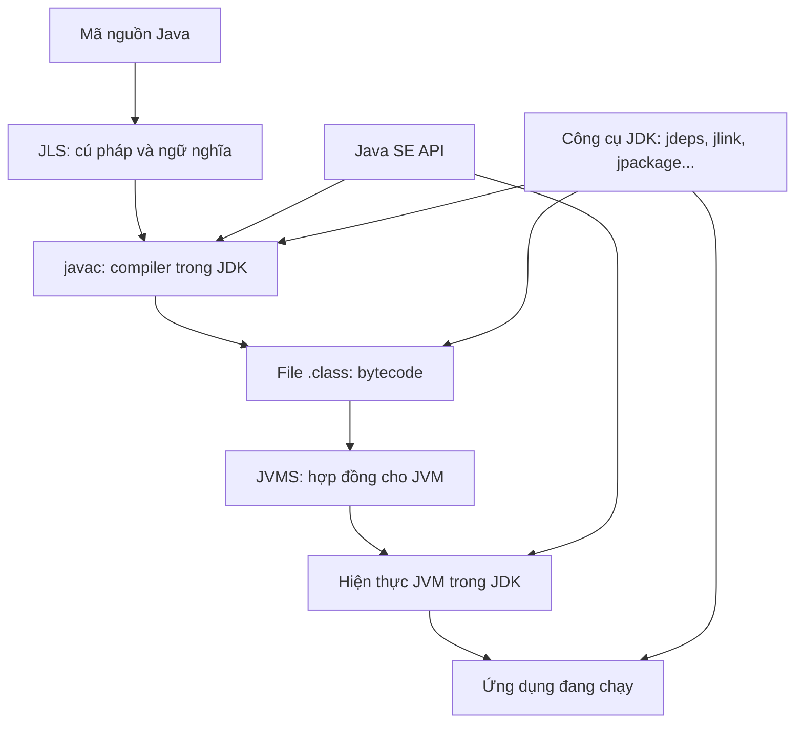

# Phân biệt phiên bản ngôn ngữ, thư viện chuẩn, JVM và công cụ JDK

> **Chương:** Định hướng Java 16  
> **Phạm vi:** Hiểu bốn lớp thường bị gọi chung là “phiên bản Java”, biết mỗi lớp được mô tả bởi tài liệu nào và chọn đúng cấu hình build/runtime. Các ví dụ dùng Java 16 để minh họa, đồng thời hướng đến cách triển khai ổn định trên JDK hiện đại.

## Mục tiêu học tập

Sau bài này, bạn có thể:

1. Phân biệt phiên bản cú pháp/ngôn ngữ, Java SE API, định dạng bytecode/JVM và bộ công cụ JDK.
2. Giải thích vì sao một chương trình có thể biên dịch được nhưng lại lỗi khi chạy trên JDK cũ.
3. Chọn đúng giữa `--source`, `--target` và `--release`.
4. Xác định phiên bản thực tế của compiler, runtime và công cụ trên máy.
5. Lập cấu hình build, kiểm thử và đóng gói phù hợp với JDK đích.

## 1. “Java 16” có thể nói đến nhiều lớp khác nhau

Khi nghe “ứng dụng dùng Java 16”, cần hỏi rõ đó là **ngôn ngữ Java 16**, **API Java 16**, **bytecode tương thích Java 16**, **JVM của JDK 16** hay **công cụ từ JDK 16**. Những khái niệm này liên quan nhưng không đồng nghĩa.

Java SE là nền tảng được mô tả bằng các đặc tả và API chuẩn. JDK là bộ phát triển cụ thể cung cấp compiler, runtime, thư viện và công cụ để xây dựng/chạy ứng dụng theo nền tảng đó. Bên trong JDK có một hiện thực JVM, nhưng đặc tả JVM không bắt buộc mọi nhà cung cấp phải dùng cùng một hiện thực hay cùng thuật toán tối ưu.

Java 16 là một **feature release không thuộc nhóm LTS**. Vì vậy, hãy học các thay đổi ổn định của nó để hiểu lịch sử và tương thích mã nguồn; khi triển khai hệ thống mới, chọn JDK còn được nhà cung cấp hỗ trợ theo chính sách của tổ chức. Một dự án có thể dùng JDK mới hơn để build và đặt baseline bằng `--release 16` khi thật sự cần tương thích Java 16.

| Lớp | Câu hỏi cần trả lời | Nguồn mô tả chính | Ví dụ gắn với Java 16 |
| --- | --- | --- | --- |
| **Ngôn ngữ Java** | Cú pháp, kiểu dữ liệu, quy tắc biên dịch nào được phép? | Java Language Specification (JLS), JEP và tài liệu thay đổi ngôn ngữ | `record`, pattern matching cho `instanceof` là chính thức từ Java 16 |
| **Thư viện chuẩn/API** | Lớp, interface, phương thức nào có thể gọi? | Java SE API Specification, Javadoc, mục `Since` | `Stream.toList()` và `Stream.mapMulti()` có từ Java 16 |
| **Bytecode và JVM** | File `.class` có cấu trúc gì, runtime phải thực hiện điều gì? | Java Virtual Machine Specification (JVMS) | Class file Java 16 có major version 60; JVM phải hiểu định dạng và bytecode tương ứng |
| **Hiện thực JVM** | JVM cụ thể quản lý bộ nhớ, JIT, GC ra sao? | Tài liệu của nhà cung cấp/JVM, release notes và số liệu vận hành | HotSpot có các collector và tối ưu riêng; Java 16 có thay đổi như Elastic Metaspace và cải tiến ZGC |
| **Công cụ JDK** | Dùng lệnh nào để biên dịch, chạy, phân tích và đóng gói? | JDK Tool Specifications, hướng dẫn công cụ và release notes | `javac`, `java`, `jlink`, `jpackage`, `jdeps` |

Sơ đồ quan hệ:



**Cách đọc sơ đồ:** JLS mô tả ngôn ngữ mà compiler phải chấp nhận; API cung cấp các kiểu và phương thức mà mã nguồn gọi; compiler tạo bytecode; JVMS mô tả môi trường thực thi bytecode; JVM cụ thể chạy chương trình. Các công cụ JDK hỗ trợ từng bước của quy trình.

## 2. Phiên bản ngôn ngữ: mã nguồn được phép viết như thế nào?

Phiên bản ngôn ngữ quy định cú pháp và ngữ nghĩa Java mà compiler chấp nhận. Ví dụ, `record` trở thành tính năng chính thức trong Java 16 theo JEP 395; pattern matching cho `instanceof` trở thành chính thức trong Java 16 theo JEP 394.

Ví dụ:

```java
class ProductExample {
    record Product(String code, int quantity) {}

    static String describe(Object value) {
        if (value instanceof Product product) {
            return product.code() + ": " + product.quantity();
        }
        return "Unknown";
    }
}
```

Đoạn mã dùng hai khả năng ngôn ngữ chính thức từ Java 16. Nếu compiler đang dùng chỉ hỗ trợ ngôn ngữ Java 15, mã trên không biên dịch theo chế độ Java 15, bất kể runtime có thể mới hay cũ.

### Ngôn ngữ không đồng nghĩa với API

JLS trả lời câu hỏi “được phép viết cú pháp nào?”. Nó không phải danh mục đầy đủ các phương thức thư viện. Một chương trình có thể dùng cú pháp cũ nhưng gọi API mới; cũng có thể dùng cú pháp mới nhưng chỉ gọi các API đã tồn tại từ lâu.

Ví dụ:

- `record Product(...)` phụ thuộc mức ngôn ngữ hỗ trợ record.
- `Stream.toList()` phụ thuộc API có phương thức đó.
- `String.length()` là API có từ rất lâu; gọi phương thức này không đòi hỏi cú pháp Java 16.

Preview features là trường hợp đặc biệt: một cú pháp ở giai đoạn preview phải được bật theo quy tắc của đúng bản JDK tương ứng. Tính năng đã trở thành chính thức như record và pattern matching cho `instanceof` không cần `--enable-preview`. Không mang cờ preview của bản cũ sang JDK mới để kỳ vọng nó giữ nguyên hành vi.

## 3. Thư viện chuẩn: chương trình được phép gọi những API nào?

Thư viện chuẩn gồm các lớp và interface có hợp đồng công khai, chẳng hạn `java.lang`, `java.util`, `java.time`, `java.nio` và `java.util.stream`. Từ Java 9, các phần của nền tảng còn được tổ chức thành module; ví dụ `java.util.stream` thuộc module `java.base`.

Một API có thể được thêm sau khi ngôn ngữ đã tồn tại nhiều phiên bản. Bởi vậy, hãy tra **mục `Since` của đúng lớp hoặc phương thức**, không suy luận từ phiên bản của package hay interface chứa nó.

Ví dụ với Java 16:

| API | Mốc có trong Java SE | Ý nghĩa |
| --- | --- | --- |
| `Stream.toList()` | `Since: 16` | Thu các phần tử thành danh sách không thể sửa |
| `Stream.mapMulti(...)` | `Since: 16` | Phát 0 đến nhiều phần tử đầu ra cho mỗi phần tử đầu vào |
| `Stream.takeWhile(...)` | `Since: 9` | API cũ hơn, không phải cải tiến mới của Java 16 |

Ví dụ:

```java
import java.util.List;
import java.util.stream.Stream;

class ApiExample {
    static List<String> normalizedNames() {
        return Stream.of(" an ", "binh", " chi ")
                .map(String::strip)
                .map(String::toUpperCase)
                .toList();
    }
}
```

Mã dùng cú pháp thông thường, nhưng phụ thuộc vào phương thức `Stream.toList()` được bổ sung ở Java 16. Nếu triển khai trên Java 11, compiler/runtime của Java 11 không có phương thức này.

### Java SE API và API riêng của JDK

Không phải mọi API đi kèm một bản phân phối JDK đều thuộc chuẩn Java SE:

- **Java SE API** là phần API được chuẩn hóa cho nền tảng Java SE. Đây là lựa chọn ưu tiên khi cần tính di động giữa các JDK tương thích.
- **JDK-specific API** thuộc các module/công cụ riêng của JDK. Một số API có tài liệu công khai và được export, nhưng không phải tất cả đều là hợp đồng của Java SE.
- **API nội bộ** không phải bề mặt công khai để ứng dụng phụ thuộc. Truy cập lớp hoặc thành viên nội bộ có thể bị chặn hoặc thay đổi khi nâng JDK.

Không nên phân loại chỉ dựa vào tiền tố package. Hãy xem module, tài liệu API, trạng thái export và cam kết hỗ trợ của nhà cung cấp. Công cụ `jdeps --jdk-internals` giúp tìm một số phụ thuộc vào API nội bộ trong ứng dụng và thư viện.

## 4. Bytecode và JVM: mã đã biên dịch được đóng gói ra sao và chạy ở đâu?

Compiler Java thường biến mã nguồn thành các file `.class` chứa **bytecode** và metadata. JVM nạp, kiểm tra, liên kết và thực thi các class này. JVM có thể diễn giải bytecode hoặc biên dịch một số phần sang mã máy trong lúc chạy bằng JIT; cách tối ưu cụ thể phụ thuộc hiện thực JVM.

### 4.1. JVMS là đặc tả, còn HotSpot là một hiện thực

JVMS quy định những phần như:

- Cấu trúc file class và constant pool.
- Kiểu dữ liệu, tập lệnh bytecode và quy tắc xác minh.
- Các vùng dữ liệu runtime như heap, stack của luồng và frame.
- Cơ chế nạp, liên kết và khởi tạo lớp.

JVMS **không yêu cầu mọi JVM dùng cùng một thuật toán garbage collection, JIT hay cách bố trí bộ nhớ vật lý**. HotSpot là hiện thực JVM phổ biến trong nhiều bản phân phối OpenJDK/Oracle JDK. Các hiện thực khác có thể có lựa chọn GC, cờ cấu hình và hành vi vận hành riêng, miễn đáp ứng đặc tả và hợp đồng tương ứng.

Vì thế, một thay đổi JVM ở Java 16 như Elastic Metaspace (JEP 387) hoặc cải tiến ZGC (JEP 376) là thông tin về runtime/hiện thực trong bản phát hành, không phải cú pháp mới hay một phương thức Java SE để gọi trực tiếp.

### 4.2. Class file có phiên bản riêng

File `.class` chứa cặp số `minor_version` và `major_version`. JVM kiểm tra phiên bản class file khi nạp. Một JVM cũ thường không hiểu class file được tạo cho phiên bản mới hơn.

| Nền tảng đích | Major version của class file |
| --- | ---: |
| Java 8 | 52 |
| Java 11 | 55 |
| Java 16 | 60 |
| Java 17 | 61 |
| Java 21 | 65 |
| Java 25 | 69 |

Ví dụ, mã được biên dịch để nhắm Java 16 tạo class file major version 60. Khi chạy bằng Java 15, JVM thường báo `UnsupportedClassVersionError` vì Java 15 không hỗ trợ class file của Java 16.

Có thể kiểm tra bằng:

```bash
javap -verbose -classpath out ApiExample
```

Trong phần đầu ra, tìm `major version`. Lệnh này kiểm tra bytecode; nó không chứng minh toàn bộ thư viện phụ thuộc hoặc môi trường runtime tương thích.

## 5. JDK: bộ phát triển gồm compiler, runtime và công cụ

**JDK (Java Development Kit)** là bộ công cụ để phát triển và vận hành ứng dụng Java. Một bản JDK thông thường cung cấp:

- Compiler `javac` để biên dịch mã nguồn.
- Launcher `java` để khởi chạy ứng dụng.
- Runtime, gồm hiện thực JVM và các module/thư viện cần thiết.
- Công cụ phát triển, kiểm tra và phân phối như `jar`, `javadoc`, `jshell`, `javap`, `jdeps`, `jlink`, `jpackage`, `jcmd` và `jfr`.

Một môi trường chỉ chạy ứng dụng có thể được gọi khái niệm là **runtime/JRE**: JVM cùng thư viện và thành phần cần để chạy. Cách nhà cung cấp đóng gói runtime thay đổi theo sản phẩm; không nên mặc định mọi nhà cung cấp đều phân phối một gói cài JRE độc lập. JDK chứa các thành phần runtime cần thiết và công cụ phát triển.

### Các công cụ thường gặp

| Công cụ | Vai trò | Không nên nhầm với |
| --- | --- | --- |
| `javac` | Biên dịch `.java` thành `.class` | JVM thực thi ứng dụng |
| `java` | Khởi chạy ứng dụng trên runtime | Compiler `javac` |
| `jar` | Tạo/xem/cập nhật file JAR | Trình cài đặt ứng dụng |
| `javadoc` | Sinh tài liệu API từ comment | Đặc tả JLS |
| `jshell` | REPL để thử câu lệnh/biểu thức Java | Một phiên bản ngôn ngữ khác |
| `javap` | Phân tích class file/bytecode | Công cụ build |
| `jdeps` | Phân tích phụ thuộc module/package và phát hiện một số API nội bộ | Runtime linker |
| `jlink` | Tạo runtime image tùy biến từ module và phụ thuộc | Compiler hoặc installer |
| `jpackage` | Tạo application image/gói cài đặt theo nền tảng | Tính năng cú pháp Java |
| `jcmd`, `jfr` | Chẩn đoán tiến trình và phân tích Java Flight Recorder | API nghiệp vụ của ứng dụng |

`jlink` được giới thiệu từ Java 9, không phải mới xuất hiện ở Java 16. Nó có thể được dùng cùng `jpackage`, nhưng không phải một tính năng ngôn ngữ hay một cải tiến mới của Java 16. `jpackage` có quá trình incubator trước đó và trở thành công cụ chính thức ở Java 16 theo JEP 392. Khi sử dụng các công cụ này, hãy đọc hướng dẫn của **JDK đang build** và kiểm tra định dạng gói được hệ điều hành đích hỗ trợ.

### JDK, runtime image và đóng gói ứng dụng

- Dùng **JDK** để biên dịch, kiểm thử và thực hiện các tác vụ phát triển.
- Dùng **`jlink`** khi muốn tạo runtime image nhỏ hơn từ các module cần thiết.
- Dùng **`jpackage`** khi muốn tạo application image hoặc gói cài đặt cho người dùng.

Runtime tùy biến phải chứa đủ module và tài nguyên mà ứng dụng thực sự cần. Phân tích bằng `jdeps` là bước hỗ trợ; các phần phụ thuộc reflection, service provider, native library và cấu hình động vẫn cần được kiểm thử. Gói cài đặt cũng phụ thuộc hệ điều hành và công cụ đóng gói tương ứng.

## 6. Cấu hình compiler: `--source`, `--target` và `--release`

Đây là nơi các lớp phiên bản dễ bị nhầm lẫn nhất.

| Tùy chọn | Kiểm soát điều gì? | Không bảo đảm điều gì? |
| --- | --- | --- |
| `--source N` | Quy tắc cú pháp/ngôn ngữ Java của phiên bản N | Không tự giới hạn đầy đủ API mà compiler nhìn thấy |
| `--target N` | Phiên bản class file mà compiler tạo ra | Không tự giới hạn API theo JDK N |
| `--release N` | Kết hợp quy tắc ngôn ngữ, class file và API Java/JDK được hỗ trợ của phiên bản N | Không bảo đảm thư viện bên thứ ba hoặc môi trường triển khai tương thích |

Với các dự án mới cần tương thích một bản Java cụ thể, ưu tiên **`--release`** thay vì chỉ đặt `--source` và `--target`.

### Ví dụ: build bằng JDK 21 nhưng nhắm Java 16

Giả sử máy build cài JDK 21 và mã dùng record cùng `Stream.toList()`:

```java
import java.util.List;
import java.util.stream.Stream;

public class CompatibilityDemo {
    record Item(String code, int quantity) {}

    public static void main(String[] args) {
        List<Item> items = Stream.of(
                new Item("A", 2),
                new Item("B", 0),
                new Item("C", 5)
        ).filter(item -> item.quantity() > 0).toList();

        System.out.println(items);
    }
}
```

Biên dịch:

```bash
javac --release 16 -d out CompatibilityDemo.java
java -cp out CompatibilityDemo
javap -verbose -classpath out CompatibilityDemo
```

Kết quả:

- Compiler áp dụng quy tắc ngôn ngữ Java 16, nên cú pháp `record` được chấp nhận.
- Compiler chỉ cho dùng API thuộc nền tảng đích Java 16; `Stream.toList()` có từ Java 16 nên hợp lệ.
- File class nhắm major version 60.
- Chạy trên Java 16 hoặc JVM mới hơn có hỗ trợ class file/API liên quan, với điều kiện các phụ thuộc và môi trường khác cũng tương thích.

### Vì sao chỉ đặt `--source 11 --target 11` có thể gây lỗi?

Giả sử compiler chạy trên JDK 16. Nếu chỉ giới hạn cú pháp ở Java 11 và class file ở Java 11, compiler vẫn có thể nhìn thấy thư viện của JDK 16. Mã gọi `Stream.toList()` vì vậy có thể biên dịch thành class file nhắm Java 11 nhưng tham chiếu đến phương thức chỉ tồn tại từ Java 16. Khi chạy trên Java 11, chương trình có thể lỗi `NoSuchMethodError`.

`--release 11` giải quyết đúng vấn đề đó bằng cách giới hạn cả API của nền tảng đích. Nếu dùng `Stream.toList()`, mã sẽ không biên dịch khi nhắm Java 11.

Không kết luận rằng `--release` bảo đảm mọi thứ: thư viện bên thứ ba có thể yêu cầu JDK mới hơn, mã reflection có thể phụ thuộc cấu trúc runtime, native library có thể không tương thích, và hành vi của JVM có thể khác theo nhà cung cấp.

## 7. Đọc đúng thông tin phiên bản trên máy

Một máy có thể cài nhiều JDK cùng lúc. Lệnh `java` và `javac` thậm chí có thể trỏ đến hai thư mục cài đặt khác nhau nếu `PATH` hoặc `JAVA_HOME` cấu hình sai.

Kiểm tra:

```bash
java --version
javac --version
javap -version
```

`java --version` cho biết runtime launcher đang được gọi; `javac --version` cho biết compiler đang được gọi. Không suy ra phiên bản compiler chỉ từ kết quả của `java --version`.

Để xem thêm thông tin runtime:

```bash
java -XshowSettings:properties -version
```

Quan sát các thuộc tính như `java.version`, `java.vendor` và `java.home`. Trên Windows, có thể dùng `where.exe java` và `where.exe javac`; trên Linux/macOS, dùng `which -a java javac` để xem đường dẫn được tìm thấy. Sau đó kiểm tra `JAVA_HOME`, cấu hình IDE và toolchain của hệ thống build.

### Những phiên bản nên ghi riêng trong cấu hình dự án

| Thuộc tính | Ví dụ | Ý nghĩa |
| --- | --- | --- |
| JDK dùng để build | JDK 21 | Compiler và công cụ được gọi khi build |
| Language/API baseline | Java 16 (`--release 16`) | Cú pháp và API mục tiêu mà mã được phép dùng |
| Class file target | Major 60 | Mức bytecode tạo ra |
| Runtime triển khai | Java 16+ theo chính sách hỗ trợ | JVM thực tế chạy ứng dụng |
| JDK tool đóng gói | JDK 21 | Phiên bản `jlink`/`jpackage` được dùng để tạo gói |

Các giá trị có thể khác nhau có chủ đích. Ví dụ, build bằng JDK 21, nhắm Java 16 và chạy trên Java 21 là một cấu hình hợp lệ nếu tất cả phụ thuộc đáp ứng yêu cầu. Không nên nhầm “đã cài JDK 21” với “mã đang dùng API Java 21”.

## 8. Kiểm tra tương thích trước khi phát hành

Khi nâng JDK hoặc thay đổi phiên bản đích, hãy xác minh từng lớp:

1. **Ngôn ngữ:** mã có dùng cú pháp hoặc preview feature không được hỗ trợ ở đích không?
2. **API:** các lớp/phương thức có mặt trong phiên bản runtime nhỏ nhất không? Kiểm tra `Since`, deprecated và removed API.
3. **Bytecode:** class file có phiên bản mà JVM đích đọc được không? Dùng `javap -verbose` để kiểm tra.
4. **JVM:** ứng dụng có phụ thuộc cờ GC, tùy chọn JVM, nội dung nội bộ hoặc hành vi riêng của nhà cung cấp không?
5. **Công cụ và đóng gói:** phiên bản `jlink`, `jpackage`, module path và định dạng gói có phù hợp hệ điều hành triển khai không?
6. **Phụ thuộc:** thư viện bên thứ ba, plugin build, agent, driver và native library có hỗ trợ runtime mục tiêu không?

Phân biệt ba dạng tương thích:

- **Source compatibility:** mã nguồn có biên dịch được theo ngôn ngữ đích không?
- **Binary compatibility:** bytecode/thư viện đã biên dịch có liên kết được với nhau và với runtime không?
- **Behavioral compatibility:** chương trình có còn hành xử đúng với dữ liệu, thời gian, charset, bảo mật, GC và môi trường thực tế không?

Build thành công chỉ trả lời một phần câu hỏi. Cần chạy test tích hợp trên **runtime nhỏ nhất được hỗ trợ** và trên runtime triển khai thực tế.

## 9. Những thay đổi Java 16 thuộc lớp nào?

Bảng sau giúp tránh gọi mọi thay đổi của Java 16 là “tính năng ngôn ngữ”:

| Cải tiến Java 16 | Lớp chính | Nguồn đối chiếu |
| --- | --- | --- |
| Records | Ngôn ngữ Java | JEP 395, JLS |
| Pattern Matching for `instanceof` | Ngôn ngữ Java | JEP 394, JLS |
| `Stream.toList()` và `Stream.mapMulti()` | Java SE API | Javadoc `Stream`, `Since: 16` |
| `jpackage` trở thành công cụ chính thức | Công cụ JDK | JEP 392, JDK Tool Specifications |
| Elastic Metaspace | Hiện thực/quản lý bộ nhớ JVM | JEP 387, release notes và số liệu runtime |
| ZGC: Concurrent Thread-Stack Processing | Hiện thực JVM/GC | JEP 376, tài liệu GC |
| Đóng gói mạnh nội bộ JDK theo mặc định | Chính sách nền tảng/module/runtime | JEP 396; thay đổi tiếp ở JEP 403 |

`jlink` là công cụ JDK có từ Java 9. Nó có thể được dùng cùng `jpackage`, nhưng không phải một tính năng ngôn ngữ hay một cải tiến mới của Java 16. Tương tự, một thay đổi GC không làm xuất hiện cú pháp Java mới và một phương thức Stream mới không đồng nghĩa JVM đã đổi định dạng bytecode.

## 10. Bài tập thực hành

### Bài 1 — Phân loại một thay đổi

Phân loại từng mục vào một trong các nhóm: **ngôn ngữ**, **Java SE API**, **JVM**, **công cụ JDK**:

- `record Product(String code) {}`
- `Stream.toList()`
- `jpackage`
- Elastic Metaspace
- Pattern matching cho `instanceof`
- `jlink`

Sau đó giải thích nguồn nào là bằng chứng phù hợp cho mỗi mục.

### Bài 2 — Tìm nguyên nhân lỗi runtime

Một ứng dụng được build bằng JDK 16 với `--source 11 --target 11`, dùng `Stream.toList()` và tạo class file major version 55. Khi chạy trên Java 11, ứng dụng gặp `NoSuchMethodError`.

Hãy giải thích:

1. Vì sao cú pháp và bytecode có vẻ phù hợp Java 11 nhưng chương trình vẫn lỗi?
2. `--release 11` sẽ phát hiện lỗi ở bước nào?
3. Nếu muốn giữ `Stream.toList()`, phiên bản runtime nhỏ nhất theo Java SE cần là bao nhiêu?

### Bài 3 — Kiểm tra môi trường

Chạy `java --version`, `javac --version`, `java -XshowSettings:properties -version` và `javap -verbose` trên một class đã biên dịch. Ghi lại:

- Nhà cung cấp và phiên bản runtime.
- Phiên bản compiler.
- Đường dẫn runtime (`java.home`).
- Major version của class file.
- Phiên bản API mục tiêu trong cấu hình build.

Giải thích vì sao các số phiên bản này không nhất thiết giống nhau.

### Bài 4 — Lập ma trận phát hành

Chọn một runtime nhỏ nhất mà ứng dụng cần hỗ trợ. Lập bảng kiểm tra cú pháp, API, bytecode, JVM, thư viện bên thứ ba và công cụ đóng gói. Đề xuất một cấu hình build dùng `--release` và nêu các test phải chạy trên runtime nhỏ nhất.

## Tài liệu chính thức để tra cứu

- [Java Language Specification, Java SE 16](https://docs.oracle.com/javase/specs/jls/se16/html/index.html) — cú pháp và ngữ nghĩa ngôn ngữ.
- [Java Virtual Machine Specification, Java SE 16](https://docs.oracle.com/javase/specs/jvms/se16/html/index.html) — class file, bytecode và hợp đồng JVM.
- [Java SE 16 API Specification](https://docs.oracle.com/en/java/javase/16/docs/api/index.html) — API chuẩn và tài liệu `Since`.
- [JDK 16 Tool Specifications](https://docs.oracle.com/en/java/javase/16/docs/specs/man/) — hướng dẫn `javac`, `java`, `jlink`, `jpackage`, `jdeps` và các công cụ.
- [The `javac` Command](https://docs.oracle.com/en/java/javase/16/docs/specs/man/javac.html) — phân biệt `--source`, `--target`, `--release`.
- [The Java SE Specifications index](https://docs.oracle.com/javase/specs/) — chọn JLS/JVMS của phiên bản Java đang mục tiêu.
- [JEP 394 — Pattern Matching for instanceof](https://openjdk.org/jeps/394) và [JEP 395 — Records](https://openjdk.org/jeps/395) — thay đổi ngôn ngữ Java 16.
- [JEP 392 — Packaging Tool](https://openjdk.org/jeps/392), [JEP 387 — Elastic Metaspace](https://openjdk.org/jeps/387), [JEP 376 — ZGC: Concurrent Thread-Stack Processing](https://openjdk.org/jeps/376) — công cụ và thay đổi runtime.

**Nguyên tắc áp dụng:** Khi nói “dự án dùng Java 16”, hãy ghi rõ mức ngôn ngữ/API, mức bytecode, JDK dùng để build, JVM dùng để chạy và bộ công cụ dùng để đóng gói. Dùng `--release` để khóa baseline Java SE/JDK, kiểm tra runtime thực tế và kiểm thử trên phiên bản nhỏ nhất cần hỗ trợ. Cách diễn đạt rõ từng lớp giúp tránh lỗi “biên dịch được nhưng chạy không được” và giữ cho dự án dễ nâng cấp.
