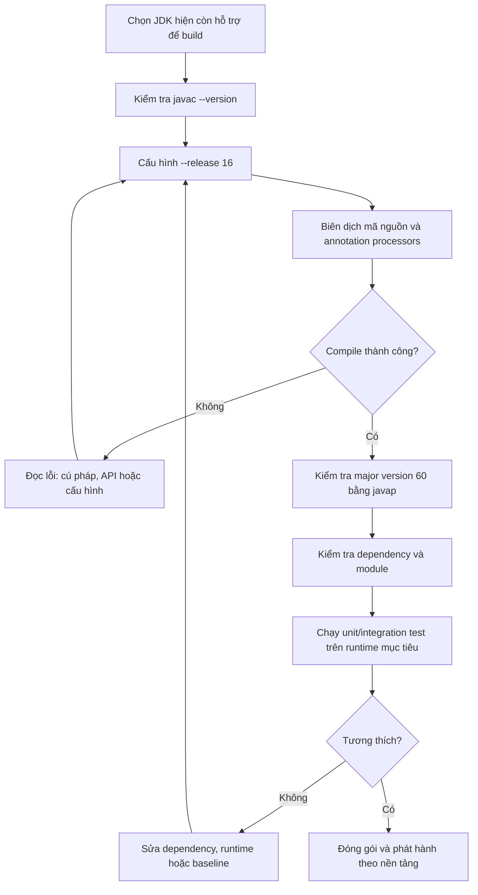

# Cấu hình javac --release 16 để kiểm tra cú pháp, API và bytecode đích

> **Chương:** Định hướng Java 16  
> **Phạm vi:** Dùng một JDK hiện đại còn được hỗ trợ để biên dịch mã theo baseline Java 16. Bài học giải thích chính xác `--release` kiểm tra điều gì, khác `--source`/`--target` ra sao, cách cấu hình build và những giới hạn cần kiểm thử thêm.

## Mục tiêu học tập

Sau bài này, bạn có thể:

1. Giải thích `javac --release 16` khóa đồng thời quy tắc ngôn ngữ, API nền tảng và phiên bản class file.
2. Phân biệt `--release` với `--source` và `--target`.
3. Biên dịch tính năng Java 16 chính thức bằng JDK LTS mới hơn.
4. Xác minh bytecode bằng `javap` và đọc lỗi khi API không thuộc baseline.
5. Cấu hình Maven, Gradle và IDE để không vô tình biên dịch bằng JDK hoặc API mới hơn mục tiêu.
6. Nhận biết những điều `--release` không kiểm tra, đặc biệt thư viện bên thứ ba và hành vi runtime.

## 1. Vì sao cần `--release`?

Một dự án có thể được biên dịch trên máy dùng JDK mới nhưng cần chạy trên một phiên bản Java thấp hơn. Ví dụ, nhóm phát triển đã cài JDK 25, nhưng ứng dụng cần duy trì khả năng chạy trên Java 16.

Nếu chỉ yêu cầu compiler tạo file class tương thích Java 16, mã nguồn vẫn có thể vô tình gọi một API mới hơn chỉ tồn tại trong JDK 25. Khi chạy trên Java 16, chương trình có thể lỗi `NoSuchMethodError` hoặc `NoClassDefFoundError`.

Tùy chọn **`javac --release 16`** giải quyết phần kiểm tra ở cấp compiler: biên dịch theo quy tắc ngôn ngữ Java 16, chỉ cho phép dùng API được hỗ trợ trong Java 16 và tạo class file nhắm đến Java 16.

Điểm quan trọng: `--release 16` **không hạ cấp JDK đang cài**. Compiler vẫn là compiler của JDK hiện đại; chỉ nền tảng đích của lần biên dịch được đặt về Java 16. Đây là cách phù hợp để học và duy trì baseline Java 16 bằng một JDK còn nhận cập nhật bảo mật.

## 2. `--release` kiểm soát ba lớp

Khi gọi:

```bash
javac --release 16 MyClass.java
```

compiler áp dụng đồng thời:

| Lớp | Điều được kiểm tra/đặt | Ví dụ |
| --- | --- | --- |
| **Ngôn ngữ** | Cú pháp và quy tắc ngôn ngữ của Java 16 | `record` và pattern matching cho `instanceof` được chấp nhận vì đã chính thức ở Java 16 |
| **API nền tảng** | API Java SE và JDK được hỗ trợ, tài liệu hóa trong release 16 | `Stream.toList()` có từ 16; API xuất hiện sau Java 16 không được gọi |
| **Bytecode** | Định dạng class file tương thích release 16 | Major version là **60** |

Vì vậy, `--release` thường là lựa chọn đúng khi dự án cần một baseline Java cụ thể. Đây cũng là khuyến nghị trong tài liệu di chuyển JDK của Oracle cho compiler từ JDK 11 trở lên.

### API nào được phép dùng?

Tài liệu `javac` của JDK 25 mô tả `--release` biên dịch theo quy tắc ngôn ngữ của Java SE release được chọn và biên dịch mã dựa trên **tập hợp API Java SE và JDK của release đó**. Với release cũ, tập API được xác định theo phiên bản cũ tương ứng.

Đây là các API công khai, được hỗ trợ và có tài liệu. `--release` không cho phép mã dựa vào lớp nội bộ của JDK, cũng không thể dùng các tùy chọn phá vỡ đóng gói để mở rộng bề mặt API của release mục tiêu. Điều này giúp mã ít phụ thuộc vào chi tiết triển khai và bền vững hơn khi nâng cấp.

Không hiểu `--release` là “chỉ cho phép package `java.*`”. Một release có các API JDK được tài liệu hóa và export theo đặc tả của release đó. Hãy dựa vào Javadoc và tài liệu `javac` chính thức để xác định API cụ thể.

## 3. Khác nhau giữa `--source`, `--target` và `--release`

Ba tùy chọn có vai trò khác nhau:

| Tùy chọn | Chức năng chính | Giới hạn nếu dùng riêng |
| --- | --- | --- |
| `--source 16` | Yêu cầu compiler chấp nhận quy tắc ngôn ngữ Java 16 | Không tự giới hạn API mà compiler nhìn thấy |
| `--target 16` | Tạo class file có định dạng đích Java 16 | Không tự giới hạn cú pháp và API |
| `--release 16` | Kết hợp mức ngôn ngữ, API nền tảng và class file của Java 16 | Không kiểm tra đầy đủ dependency, môi trường và hành vi runtime |

Ví dụ rủi ro: compiler chạy trên JDK 25, mã chỉ dùng cú pháp Java 11 nhưng gọi `Stream.toList()`. Nếu chỉ đặt `--source 11 --target 11`, compiler vẫn có thể nhìn thấy API Stream của JDK 25. Class file tạo ra có thể mang major version 55 nhưng chứa tham chiếu đến phương thức không tồn tại trong Java 11. Khi chạy trên Java 11, lỗi liên kết có thể xuất hiện dưới dạng `NoSuchMethodError`.

Với `--release 11`, compiler dùng API nền tảng Java 11 nên lời gọi `Stream.toList()` bị từ chối ngay lúc biên dịch.

### Không ghép `--release` với `--source` hoặc `--target`

Không viết:

```bash
# Sai: javac không cho dùng --release cùng --source/--target.
javac --release 16 --source 16 --target 16 MyClass.java
```

Chỉ cần:

```bash
javac --release 16 MyClass.java
```

`--release` đã thiết lập cả ba yêu cầu. Thêm `--source`/`--target` không làm kiểm tra chặt hơn mà khiến compiler báo cấu hình xung đột.

## 4. Ví dụ: dùng tính năng chính thức Java 16

Tạo file `Java16ReleaseDemo.java`:

```java
import java.util.List;
import java.util.stream.Stream;

public class Java16ReleaseDemo {
    record OrderLine(String sku, int quantity) {}

    static List<Integer> positiveQuantities(List<OrderLine> lines) {
        return lines.stream()
                .<Integer>mapMulti((line, downstream) -> {
                    if (line.quantity() > 0) {
                        downstream.accept(line.quantity());
                    }
                })
                .toList();
    }

    static String describe(Object value) {
        if (value instanceof OrderLine line) {
            return line.sku() + " x " + line.quantity();
        }
        return "Unknown value";
    }

    public static void main(String[] args) {
        var lines = List.of(
                new OrderLine("BOOK", 2),
                new OrderLine("PEN", 0),
                new OrderLine("BAG", 3)
        );

        System.out.println(positiveQuantities(lines)); // [2, 3]
        System.out.println(describe(lines.get(0)));    // BOOK x 2
    }
}
```

Ví dụ kết hợp:

- `record OrderLine(...)`: mô hình hóa dữ liệu bằng record, chính thức từ Java 16.
- `value instanceof OrderLine line`: pattern matching cho `instanceof`, chính thức từ Java 16.
- `mapMulti(...)` và `toList()`: các phương thức Stream có từ Java 16.
- `var`: cú pháp `var` cho biến cục bộ có từ Java 10; đây không phải tính năng mới của Java 16.

Giả sử JDK 25 đã được cài và `javac --version` xác nhận compiler đang dùng là JDK 25:

```bash
javac --release 16 -d out Java16ReleaseDemo.java
java -cp out Java16ReleaseDemo
```

Kết quả:

```text
[2, 3]
BOOK x 2
```

Bạn đã dùng compiler của JDK 25 để kiểm tra mã theo Java 16 và chạy class file trên runtime JDK 25. Không cần bật preview vì tất cả tính năng trong ví dụ đều là tính năng chính thức của Java 16.

## 5. Xác minh bytecode đích

Sau khi biên dịch, dùng `javap`:

```bash
javap -verbose -classpath out Java16ReleaseDemo
```

Tìm dòng:

```text
major version: 60
```

Major version 60 là định dạng class file của Java 16. Một số mốc phổ biến:

| Java | Class file major version |
| --- | ---: |
| 8 | 52 |
| 11 | 55 |
| 16 | 60 |
| 17 | 61 |
| 21 | 65 |
| 25 | 69 |

Kiểm tra major version cho biết định dạng bytecode, không chứng minh ứng dụng tương thích hoàn toàn với mọi runtime ở phiên bản đó. Một ứng dụng còn phụ thuộc API, module, thư viện bên thứ ba, native library và hành vi của JVM.

### Kiểm tra nhanh phiên bản compiler

```bash
javac --version
java --version
javac --help
```

Hai lệnh đầu có thể trỏ đến các bản JDK khác nhau nếu `PATH` cấu hình sai. `javac --help` hiển thị các release mà compiler hiện tại hỗ trợ. Tài liệu `javac` quy định giá trị `--release` được hỗ trợ là release hiện tại và một số release trước đó; danh sách cụ thể phụ thuộc phiên bản compiler. JDK 25 hỗ trợ mục tiêu Java 16.

Nếu compiler báo `release version 16 not supported`, hãy kiểm tra `javac --version` và đường dẫn compiler. Lỗi này thường có nghĩa bạn đang gọi một compiler quá cũ hoặc một JDK khác với dự định.

## 6. Kiểm chứng API bằng một ví dụ độc lập

Để tách lỗi API khỏi lỗi cú pháp, tạo `StreamApiCheck.java`:

```java
import java.util.List;
import java.util.stream.Stream;

public class StreamApiCheck {
    public static void main(String[] args) {
        List<String> names = Stream.of("an", "binh")
                .map(String::toUpperCase)
                .toList();
        System.out.println(names);
    }
}
```

Biên dịch theo Java 16:

```bash
javac --release 16 -d out16 StreamApiCheck.java
```

Lệnh phải thành công vì `Stream.toList()` có từ Java 16. Thử lại theo Java 11:

```bash
javac --release 11 -d out11 StreamApiCheck.java
```

Compiler sẽ báo không tìm thấy phương thức `toList()` trên `Stream`, bởi API này chưa tồn tại trong Java 11. Dùng phép thử độc lập này khi cần xác định chính xác một API xuất hiện ở release nào.

### Kiểm chứng cú pháp riêng

Tạo `RecordSyntaxCheck.java`:

```java
public class RecordSyntaxCheck {
    record Point(int x, int y) {}
}
```

Biên dịch:

```bash
javac --release 16 -d out16 RecordSyntaxCheck.java
```

Lệnh thành công vì record là tính năng chính thức ở Java 16. Nếu thử `--release 11`, compiler từ chối cú pháp record. Như vậy, một phép thử kiểm tra **ngôn ngữ**, phép thử còn lại kiểm tra **API**.

## 7. Cấu hình `--release 16` trong hệ thống build

Khi làm việc với Maven hoặc Gradle, hãy khai báo baseline trong cấu hình dự án để terminal, IDE và CI dùng cùng một mục tiêu.

### Maven

Với phiên bản `maven-compiler-plugin` hỗ trợ thuộc tính `maven.compiler.release`:

```xml
<properties>
    <maven.compiler.release>16</maven.compiler.release>
</properties>
```

Nếu dự án khai báo plugin tường minh, xác nhận phiên bản plugin hỗ trợ JDK dùng để build và thuộc tính `release`. JDK chạy Maven/toolchain là JDK hiện đại; thuộc tính trên đặt mức Java mục tiêu của mã nguồn. Không nhầm hai cấu hình này.

### Gradle (Kotlin DSL)

Chọn JDK 25 làm compiler toolchain, đặt release target 16:

```kotlin
java {
    toolchain {
        languageVersion = JavaLanguageVersion.of(25)
    }
}

tasks.withType<JavaCompile>().configureEach {
    options.release = 16
}
```

Toolchain xác định JDK thực hiện biên dịch; `options.release` giới hạn ngôn ngữ/API và bytecode đầu ra. Cần dùng phiên bản Gradle hỗ trợ JDK 25 và kiểm tra tài liệu DSL của phiên bản Gradle trong dự án.

### IDE

Trong IntelliJ IDEA, Eclipse hoặc VS Code với Java extensions:

1. Chọn JDK 25 làm JDK/toolchain của dự án.
2. Đặt compiler release là 16 nếu dự án cần baseline Java 16.
3. Đồng bộ cấu hình Maven/Gradle; tránh để IDE dùng một compiler khác cấu hình trong terminal.
4. Kiểm tra lệnh build thực tế trong log để xác nhận có `--release 16`.

Nếu IDE đánh dấu cú pháp là lỗi nhưng command line biên dịch thành công, kiểm tra language level và Project SDK. Nếu IDE chạy được còn CI thất bại, kiểm tra JDK, toolchain và cấu hình compiler trong pipeline.

## 8. Giới hạn của `--release`: những gì vẫn phải kiểm thử?

`--release` là kiểm tra quan trọng ở compile time, nhưng **không phải trình mô phỏng toàn bộ môi trường Java 16**.

| Hạng mục | `--release 16` kiểm tra? | Cần làm thêm |
| --- | --- | --- |
| Cú pháp/ngữ nghĩa ngôn ngữ Java 16 | Có | Kiểm tra tính năng preview riêng nếu có; ưu tiên tính năng đã final |
| API Java SE/JDK được hỗ trợ trong release 16 | Có | Đọc Javadoc để hiểu hợp đồng, ngoại lệ và hành vi |
| Class file target Java 16 | Có | Dùng `javap -verbose` xác minh major version 60 |
| API của thư viện bên thứ ba | Không | Kiểm tra phiên bản thư viện, yêu cầu JDK và release notes |
| Bytecode của dependency | Không tự hạ cấp | Kiểm tra artifact/dependency có hỗ trợ runtime mục tiêu không |
| Reflection, service loading, cấu hình động | Không đầy đủ | Chạy integration test với cấu hình thực tế |
| Native library, hệ điều hành, kiến trúc CPU | Không | Kiểm thử trên nền tảng triển khai |
| GC, JIT, hiệu năng và hành vi của JVM cụ thể | Không | Benchmark và quan sát trên runtime mục tiêu |
| Công cụ đóng gói/runtime image | Không | Kiểm thử `jlink`, `jpackage` và gói triển khai riêng |

### Dependency có thể phá vỡ baseline

Giả sử mã ứng dụng được biên dịch bằng `--release 16`, nhưng một thư viện bên thứ ba được build bằng Java 21. File class của thư viện đó có thể mang major version 65. Runtime Java 16 không đọc được class file này, dù class file của ứng dụng là major version 60.

Vì vậy:

- Kiểm tra ma trận hỗ trợ JDK của từng thư viện và framework.
- Kiểm tra bytecode/dependency khi dự án yêu cầu chạy trên Java 16.
- Đọc release notes của thư viện khi nâng phiên bản.
- Chạy integration test trên runtime nhỏ nhất được hỗ trợ.

Không kết luận “ứng dụng chạy được trên Java 16” chỉ từ việc module nguồn của ứng dụng biên dịch thành công với `--release 16`.

### Annotation processor và plugin build

Annotation processor, compiler plugin và một số công cụ build được **chạy trong JDK dùng để build**, không nhất thiết trong release đích. Chúng có thể yêu cầu JDK mới hơn, hoặc sinh mã nguồn/bytecode có yêu cầu riêng. Hãy kiểm tra phiên bản processor/plugin, cấu hình toolchain và đầu ra được sinh ra.

## 9. Preview features và API nội bộ không thuộc mục tiêu `--release 16`

Mục tiêu của bài là các tính năng chính thức của Java 16. Cần phân biệt:

- `record` và pattern matching cho `instanceof` đã chính thức trong Java 16, nên không cần `--enable-preview`.
- Sealed classes ở Java 16 vẫn là preview; chúng trở thành chính thức trong Java 17. Không dùng cú pháp preview Java 16 làm ví dụ ổn định cho baseline này.
- Vector API và Foreign-Memory Access API từng ở incubator trong Java 16; không coi API incubator cũ là hợp đồng ổn định.
- API nội bộ JDK không phải API tương thích được bảo đảm. `--release` giới hạn mã vào API được hỗ trợ/tài liệu hóa và không mở các gói nội bộ bằng tùy chọn phá vỡ encapsulation.

`--enable-preview` của một compiler hiện đại dành cho preview features của chính release compiler đó. Không thể dùng JDK 25 với `--release 16 --enable-preview` để tái kích hoạt preview của Java 16. Nếu dự án cần một tính năng đã preview trước đây, hãy tìm phiên bản chính thức hiện tại và chuyển sang API/cú pháp đã final.

## 10. Đọc và xử lý lỗi thường gặp

| Thông báo/tình huống | Nguyên nhân thường gặp | Cách xử lý |
| --- | --- | --- |
| `release version 16 not supported` | Compiler đang dùng không hỗ trợ release 16 | Kiểm tra `javac --version`, `PATH`, `JAVA_HOME`; dùng JDK hiện đại |
| `invalid flag: --release` | Compiler quá cũ | Cài và gọi JDK mới hơn; `--release` được giới thiệu từ JDK 9 |
| `cannot find symbol: method toList()` khi nhắm Java 11 | API chỉ có từ Java 16 | Nâng baseline lên 16 nếu được phép, hoặc dùng API có trong baseline cũ |
| Lỗi cú pháp tại khai báo `record` khi nhắm Java 11 | Record chưa thuộc ngôn ngữ Java 11 | Chọn baseline phù hợp; không chỉ thay `--target` |
| `class file has wrong version` hoặc `UnsupportedClassVersionError` | Runtime cũ hơn bytecode đang chạy | Nâng runtime hoặc build lại toàn bộ ứng dụng/dependency theo baseline phù hợp |
| `NoSuchMethodError` dù class file có major version đúng | Dependency/runtime thiếu API được tham chiếu hoặc xung đột phiên bản | Kiểm tra dependency tree, API runtime và chạy test trên runtime mục tiêu |
| IDE và CI cho kết quả khác nhau | JDK/toolchain hoặc `--release` không thống nhất | Đồng bộ Project SDK, Maven/Gradle toolchain và pipeline |
| `--release` xung đột với `--source`/`--target` | Cấu hình đồng thời các tùy chọn loại trừ nhau | Chỉ giữ `--release` |

Khi compiler từ chối một API, hãy đọc lỗi đầu tiên và tra Javadoc của đúng phương thức. Khi lỗi xuất hiện lúc chạy, kiểm tra cả runtime và dependency; không vội thay đổi tùy chọn compiler nếu nguyên nhân là thư viện.

## 11. Quy trình chuẩn cho một dự án có baseline Java 16



Các bước này tách rõ việc compiler kiểm tra mã nguồn với việc kiểm chứng runtime. Nếu hệ thống thực tế đã chuyển sang JDK LTS mới hơn, hãy đặt baseline theo yêu cầu thật của hệ thống; chỉ giữ `--release 16` khi còn cần tương thích Java 16.

## 12. Bài tập thực hành

### Bài 1 — Phân biệt ba tùy chọn

Giải thích vì sao `--source 16 --target 16` chưa bảo đảm API Java 16 khi compiler chạy trên JDK 25. Viết lại lệnh bằng `--release 16` và nêu ba điều được khóa.

### Bài 2 — Kiểm tra một API

Tạo chương trình dùng `Stream.toList()`. Biên dịch với `--release 16`, sau đó `--release 11`. Ghi lại lỗi và đối chiếu `Since: 16` trong Javadoc `Stream`.

### Bài 3 — Kiểm tra bytecode

Biên dịch một class bằng `--release 16`, chạy `javap -verbose`, tìm `major version`. Giải thích vì sao major version 60 chưa chứng minh dependency tương thích với Java 16.

### Bài 4 — Kiểm tra cấu hình build

Trong một dự án Maven hoặc Gradle, ghi lại JDK toolchain, release target, phiên bản compiler plugin và runtime CI. Đảm bảo IDE và CI dùng cùng baseline; giải thích cách kiểm tra lệnh compiler thực tế.

### Bài 5 — Chẩn đoán lỗi

Một ứng dụng biên dịch thành công với `--release 16` nhưng chạy trên Java 16 gặp `UnsupportedClassVersionError` khi nạp một thư viện bên thứ ba. Hãy nêu nguyên nhân và các bước kiểm tra artifact, dependency tree, ma trận hỗ trợ của thư viện.

## Tài liệu chính thức

- [The `javac` Command — JDK 25](https://docs.oracle.com/en/java/javase/25/docs/specs/man/javac.html) — mô tả `--release`, API Java SE/JDK, các tùy chọn loại trừ và release được hỗ trợ.
- [JEP 247 — Compile for Older Platform Versions](https://openjdk.org/jeps/247) — thiết kế và mục tiêu của tùy chọn `--release`.
- [Oracle JDK 25 Migration Guide](https://docs.oracle.com/en/java/javase/25/migrate/preparing-migration.html) — khuyến nghị dùng `--release` thay cho cặp `-source`/`-target` khi biên dịch bằng JDK hiện đại.
- [Preview Language and VM Features — Java SE 25](https://docs.oracle.com/en/java/javase/25/language/preview-language-vm-features.html) — quy tắc bật preview theo đúng phiên bản JDK tạo ra tính năng preview.
- [Java SE 16 API Specification](https://docs.oracle.com/en/java/javase/16/docs/api/index.html) — đối chiếu API của Java 16.
- [Java SE 16 — Stream API](https://docs.oracle.com/en/java/javase/16/docs/api/java.base/java/util/stream/Stream.html) — `Since` và hợp đồng của `toList()`/`mapMulti()`.
- [JEP 394 — Pattern Matching for instanceof](https://openjdk.org/jeps/394) và [JEP 395 — Records](https://openjdk.org/jeps/395) — hai tính năng ngôn ngữ chính thức Java 16.
- [JEP 397 — Sealed Classes (Second Preview)](https://openjdk.org/jeps/397) và [JEP 409 — Sealed Classes](https://openjdk.org/jeps/409) — phân biệt preview Java 16 với mốc final Java 17.

**Nguyên tắc áp dụng:** Dùng compiler của JDK hiện còn được hỗ trợ và đặt `--release 16` khi cần kiểm tra mã theo baseline Java 16. Tùy chọn này khóa quy tắc ngôn ngữ, API nền tảng được hỗ trợ và bytecode đích; sau đó vẫn phải kiểm tra dependency, module, runtime, hệ điều hành và hành vi thực tế trước khi phát hành.
