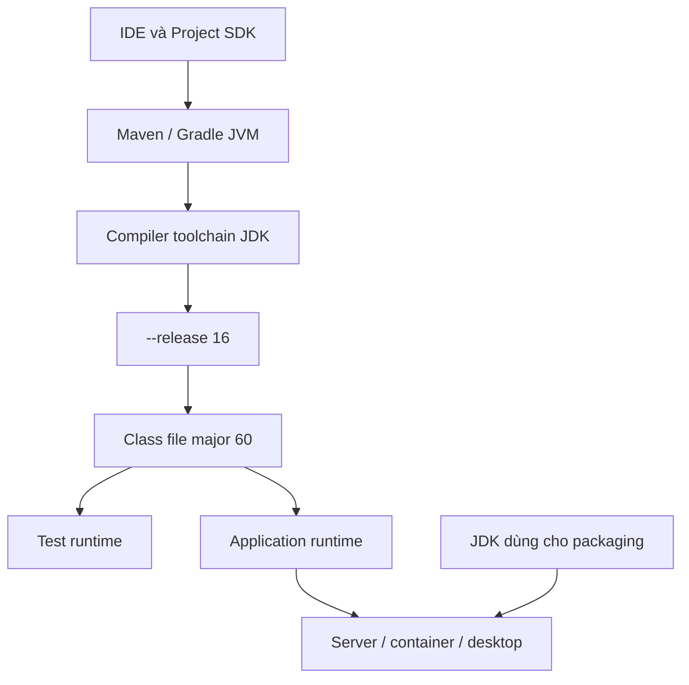
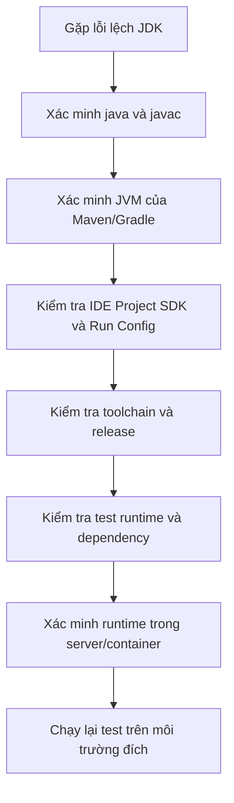

# Đồng bộ JDK của IDE, trình biên dịch và môi trường chạy

> **Chương:** Định hướng Java 16  
> **Phạm vi:** Cấu hình rõ JDK mà IDE, Maven/Gradle, compiler, test runner và ứng dụng sử dụng. Ví dụ thực hành dùng JDK LTS hiện còn được hỗ trợ để biên dịch theo baseline Java 16; không cần giữ một runtime Java 16 đã hết vòng đời cập nhật làm môi trường mặc định.

## Mục tiêu học tập

Sau bài này, bạn có thể:

1. Nhận biết IDE, build tool, compiler và runtime có thể đang dùng những JDK khác nhau.
2. Chọn một JDK LTS còn được nhà cung cấp hỗ trợ làm môi trường phát triển chính.
3. Đồng bộ Project SDK, Maven/Gradle JVM, compiler toolchain và runtime chạy ứng dụng.
4. Dùng `--release 16` để kiểm tra cú pháp, API và bytecode Java 16 bằng JDK hiện đại.
5. Xác minh phiên bản thực tế qua terminal, IDE, CI và container.
6. Chẩn đoán các lỗi thường gặp khi compiler và runtime không thống nhất.

## 1. Vì sao cùng một dự án có thể dùng nhiều JDK?

Một máy phát triển có thể cài nhiều JDK để phục vụ các dự án khác nhau. IDE cũng có thể chạy trên một Java runtime riêng, trong khi dự án được biên dịch bằng JDK khác và ứng dụng lại chạy trên runtime thứ ba.

Ví dụ, một nhóm có thể:

- Chạy IntelliJ IDEA bằng runtime mà phiên bản IDE yêu cầu.
- Mở dự án với Project SDK là JDK 25.
- Chạy Maven hoặc Gradle bằng JDK 25.
- Dùng compiler toolchain JDK 25 nhưng đặt `--release 16`.
- Chạy unit test và ứng dụng trên JDK 25.
- Đóng gói container với một JDK runtime LTS đã được phê duyệt.

Đây là cấu hình hợp lệ nếu từng lớp được khai báo rõ ràng và tương thích. **Đồng bộ JDK không có nghĩa mọi thành phần bắt buộc dùng cùng một số phiên bản**; điều cần thiết là biết thành phần nào dùng JDK nào, vì sao và kiểm tra được điều đó.

Java 16 là feature release không thuộc nhóm LTS và đã hết vòng đời cập nhật. Khi học các tính năng chính thức của Java 16, nên dùng JDK LTS còn được hỗ trợ (ví dụ JDK 25 tại thời điểm 27/11/2026) và đặt baseline bằng `--release 16`. Nếu hệ thống thật sự bắt buộc chạy trên runtime Java 16, đó là một ràng buộc di trú cần có kế hoạch xử lý; không nên chọn runtime hết hỗ trợ làm mặc định cho dự án mới.

## 2. Phân biệt các vị trí chọn JDK

| Thành phần | Nó quyết định điều gì? | Cách xác minh |
| --- | --- | --- |
| **IDE runtime** | JVM dùng để khởi động chính IDE và plugin | Thông tin runtime trong About/diagnostic của IDE |
| **Project SDK / Installed JDK** | JDK mà IDE dùng để phân tích mã, gợi ý và mặc định cho dự án | Project Structure, Java Build Path hoặc workspace settings |
| **Build tool JVM** | JVM chạy tiến trình Maven hoặc Gradle | `mvn -version`, `gradle --version` |
| **Compiler toolchain** | JDK thực sự chạy `javac` khi build | Toolchain trong Maven/Gradle và log build |
| **Language/API release** | Mức ngôn ngữ, API nền tảng và bytecode đích | `--release 16` hoặc cấu hình tương đương |
| **Test runtime** | JVM thực thi unit/integration test | Cấu hình test task/toolchain và log tiến trình test |
| **Application runtime** | JVM chạy ứng dụng local, server hoặc container | `java --version` tại đúng môi trường chạy; thuộc tính hệ thống của tiến trình |
| **Packaging JDK** | JDK chứa công cụ tạo runtime image hoặc gói ứng dụng | `jlink --version`, `jpackage --version` và pipeline đóng gói |

Hai khái niệm dễ bị nhầm:

- **Project SDK** cho IDE biết thư viện nền tảng và JDK dùng để hiểu dự án. Nó không tự bảo đảm Maven/Gradle hoặc CI dùng cùng JDK.
- **`--release`** đặt baseline cho compiler. Nó không chọn JVM sẽ chạy ứng dụng, cũng không thay thế cấu hình runtime của test hoặc production.

Sơ đồ luồng:



## 3. Chọn một JDK chuẩn cho nhóm

Trước khi cấu hình IDE, hãy xác định JDK chuẩn của dự án:

1. Chọn dòng JDK LTS đang được nhà cung cấp duy trì và có bản vá bảo mật.
2. Kiểm tra framework, plugin build, thư viện, máy chủ và môi trường triển khai hỗ trợ dòng JDK đó.
3. Ghi rõ JDK dùng để build và runtime tối thiểu mà dự án hỗ trợ.
4. Đặt mức ngôn ngữ/API bằng `--release` nếu cần baseline thấp hơn JDK build.
5. Cập nhật CI và container theo cùng chính sách.

Ví dụ cấu hình học tập:

| Thành phần | Cấu hình gợi ý |
| --- | --- |
| JDK chính trên máy | JDK 25 LTS từ nhà cung cấp được chọn |
| IDE runtime | Bản runtime được IDE hỗ trợ; có thể khác Project SDK |
| Project SDK | JDK 25 |
| Maven/Gradle JVM | JDK 25 |
| Compiler toolchain | JDK 25 |
| Java release cho bài thực hành này | `16` |
| Test runtime | JDK 25 |
| Runtime chạy ứng dụng | JDK 25 hoặc dòng LTS được hệ thống phê duyệt |

Trong cấu hình này, mã nguồn chỉ sử dụng ngôn ngữ và API Java SE có trong Java 16, class file có major version 60, còn quá trình test/chạy diễn ra trên runtime hiện đại. Điều này phù hợp để học và kiểm tra baseline Java 16 mà không phải cài runtime Java 16 đã hết hỗ trợ.

Nếu một dự án mới không cần tương thích Java 16, hãy đặt release theo baseline hiện tại của dự án thay vì giữ `16` chỉ vì đang học module này.

## 4. Xác minh JDK trong terminal

Đầu tiên kiểm tra compiler và runtime mà shell tìm thấy. Chạy các lệnh trong đúng terminal sẽ dùng để build.

### Windows PowerShell

```powershell
java --version
javac --version
javap --version
mvn -version
gradle --version

Get-Command java, javac | Select-Object Name, Source
$env:JAVA_HOME
```

`Get-Command` cho biết đường dẫn lệnh được PowerShell chọn. `mvn -version` và `gradle --version` cho biết JVM mà build tool đang sử dụng; thông tin này có thể khác `java --version` nếu cấu hình `JAVA_HOME`, wrapper hoặc daemon khác nhau.

Để đặt JDK trong cửa sổ PowerShell hiện tại (thay bằng đường dẫn thực tế):

```powershell
$env:JAVA_HOME = "C:\Program Files\Eclipse Adoptium\jdk-25"
$env:Path = "$env:JAVA_HOME\bin;$env:Path"

java --version
javac --version
```

Các lệnh trên chỉ thay đổi môi trường của cửa sổ hiện tại. Để đặt lâu dài, dùng Environment Variables của Windows hoặc quy trình quản lý máy của tổ chức, rồi mở terminal mới để xác minh.

### Linux và macOS

```bash
java --version
javac --version
javap --version
mvn -version
gradle --version

command -v java
command -v javac
printf '%s\n' "$JAVA_HOME"
```

Đặt môi trường cho shell hiện tại khi đã biết đường dẫn JDK:

```bash
export JAVA_HOME="/path/to/jdk-25"
export PATH="$JAVA_HOME/bin:$PATH"

java --version
javac --version
```

`JAVA_HOME` trỏ đến thư mục gốc JDK; `PATH` cần chứa thư mục `bin`. Nếu máy cài nhiều JDK, kiểm tra các đường dẫn được tìm thấy trước khi thay đổi cấu hình shell.

### Đọc thông tin JVM của tiến trình

```bash
java -XshowSettings:properties -version
```

Tìm các thuộc tính:

- `java.version`: phiên bản Java runtime.
- `java.vendor`: nhà cung cấp.
- `java.home`: thư mục runtime thực tế.
- `java.vm.name`: tên hiện thực JVM.
- `java.vm.version`: phiên bản hiện thực JVM.

Đây là thông tin của JVM được lệnh `java` khởi chạy. Muốn biết ứng dụng server hoặc tiến trình container đang dùng gì, cần xem thông tin **bên trong chính môi trường hoặc tiến trình đó**, không suy từ máy phát triển.

## 5. Cấu hình IDE

IDE có nhiều thiết lập liên quan JDK. Hãy đặt Project SDK và mức ngôn ngữ theo cấu hình build của dự án, đồng thời kiểm tra JVM mà IDE dùng để chạy Maven/Gradle.

### IntelliJ IDEA

Kiểm tra các mục tương đương trong cấu hình dự án:

1. **Project SDK:** chọn JDK chuẩn (ví dụ JDK 25).
2. **Project language level:** đặt theo yêu cầu mã nguồn; nếu dự án dùng `--release 16`, chọn mức ngôn ngữ phù hợp hoặc để IDE đồng bộ từ Maven/Gradle.
3. **Module SDK:** kiểm tra module không ghi đè Project SDK bằng một JDK cũ.
4. **Maven/Gradle JVM:** chọn JDK mà build tool cần dùng.
5. **Run configuration:** xác minh JRE/JDK dùng để chạy ứng dụng và test.

Nếu dự án được quản lý bằng Maven/Gradle, ưu tiên đồng bộ cấu hình từ build file. Tránh để một thiết lập riêng trong IDE làm mã biên dịch khác với CI.

IDE runtime là JVM khởi động IntelliJ và có yêu cầu riêng theo phiên bản IDE. Không thay runtime nội bộ của IDE chỉ để đổi JDK cho dự án; hãy thay Project SDK hoặc Maven/Gradle JVM đúng vị trí.

### Eclipse

Trong Eclipse, kiểm tra:

- **Installed JREs:** thêm JDK chuẩn (chọn thư mục gốc JDK).
- **Java Build Path:** chọn JRE System Library phù hợp cho project.
- **Java Compiler:** đặt mức compliance/language theo baseline của dự án.
- **Execution Environments:** ánh xạ môi trường Java mà project yêu cầu tới JDK đã cài.
- **Run Configurations:** xác minh JRE dùng khi chạy ứng dụng hoặc test.

Tên mục có thể thay đổi theo phiên bản Eclipse. Nếu project dùng Maven hoặc Gradle, hãy kiểm tra thêm cấu hình toolchain trong build file vì IDE có thể import lại thiết lập từ đó.

### Visual Studio Code

Với Java extensions, kiểm tra JDK dùng cho Java language server và các runtime được cấu hình cho dự án. Ví dụ trong workspace settings:

```json
{
  "java.configuration.runtimes": [
    {
      "name": "JavaSE-25",
      "path": "C:\\Program Files\\Eclipse Adoptium\\jdk-25",
      "default": true
    }
  ]
}
```

Đường dẫn trên chỉ là ví dụ; thay bằng thư mục JDK thực tế. Thiết lập runtime của Java extension hỗ trợ chọn JDK cho project; JDK khởi chạy language server có cấu hình riêng theo phiên bản extension. Build Maven/Gradle vẫn cần được xác minh độc lập bằng wrapper và toolchain.

## 6. Đồng bộ Maven

Có hai lớp cần phân biệt: **JDK chạy Maven** và **release mà mã nguồn được biên dịch**.

### Kiểm tra JVM chạy Maven

Chạy:

```bash
mvn -version
```

Đọc dòng Java version và Java home. Đây là JVM chạy Maven. Nếu kết quả không đúng JDK chuẩn:

1. Kiểm tra `JAVA_HOME`.
2. Kiểm tra đường dẫn Maven được gọi.
3. Mở terminal mới sau khi đổi biến môi trường.
4. Kiểm tra cấu hình Maven trong IDE và CI.

### Đặt Java release trong `pom.xml`

Với phiên bản `maven-compiler-plugin` hỗ trợ thuộc tính `maven.compiler.release`:

```xml
<properties>
    <maven.compiler.release>16</maven.compiler.release>
</properties>
```

Thuộc tính này yêu cầu compiler kiểm tra mã theo Java 16. Maven vẫn có thể chạy bằng JDK 25. Khi dùng Maven Toolchains, compiler plugin có thể được cung cấp một JDK khác với JVM chạy Maven; hãy đọc log/toolchain đã chọn để biết compiler thực tế.

Không chỉ kiểm tra `pom.xml`: plugin compiler, plugin test, annotation processor và plugin khác có thể có yêu cầu JDK riêng. Dùng phiên bản plugin tương thích với JDK build và cấu hình release đã chọn.

## 7. Đồng bộ Gradle

Gradle có thể sử dụng JDK cho daemon/build process và một toolchain riêng cho biên dịch hoặc chạy test. `gradle --version` cho biết JVM mà Gradle đang sử dụng; Java toolchain quyết định JDK cho các task hỗ trợ toolchain.

Ví dụ Gradle Kotlin DSL, chọn JDK 25 làm toolchain và Java 16 làm release:

```kotlin
java {
    toolchain {
        languageVersion = JavaLanguageVersion.of(25)
    }
}

tasks.withType<JavaCompile>().configureEach {
    options.release = 16
}

tasks.withType<Test>().configureEach {
    javaLauncher = javaToolchains.launcherFor {
        languageVersion = JavaLanguageVersion.of(25)
    }
}
```

Trong ví dụ:

- JDK 25 là toolchain cho compiler.
- `options.release = 16` khóa ngôn ngữ, API nền tảng và bytecode đích.
- Test task dùng launcher JDK 25.

Nếu có task `JavaExec`, cấu hình launcher rõ ràng khi task đó cần một runtime cụ thể. Dùng phiên bản Gradle hỗ trợ JDK 25 và kiểm tra daemon JVM; không suy ra daemon dùng JDK 25 chỉ từ việc đã khai báo Java toolchain 25.

Để kiểm tra:

```bash
./gradlew --version
./gradlew -q javaToolchains
./gradlew clean test
```

Trên Windows có thể dùng `gradlew.bat` thay cho `./gradlew`. Nếu lệnh `javaToolchains` không khả dụng trong phiên bản Gradle đang dùng, kiểm tra log task và báo cáo toolchain của Gradle theo tài liệu phiên bản đó.

## 8. Đồng bộ test runtime và runtime triển khai

Biên dịch thành công không chứng minh ứng dụng chạy đúng trên môi trường đích. Cần xác minh JVM chạy test, JVM chạy local và JVM production/container.

### Kiểm tra trong chính ứng dụng

Có thể in thông tin runtime khi khởi động trong môi trường chẩn đoán:

```java
public class RuntimeInfo {
    public static void main(String[] args) {
        System.out.println("java.version = " + System.getProperty("java.version"));
        System.out.println("java.vendor  = " + System.getProperty("java.vendor"));
        System.out.println("java.home    = " + System.getProperty("java.home"));
        System.out.println("vm.name      = " + System.getProperty("java.vm.name"));
        System.out.println("vm.version   = " + System.getProperty("java.vm.version"));
    }
}
```

Đoạn mã cho biết runtime thực sự đang chạy tiến trình. Trong ứng dụng production, chỉ ghi các thông tin này vào log khởi động hoặc diagnostic endpoint có kiểm soát; không cần công khai chi tiết hệ thống cho người dùng cuối.

### Kiểm tra container

JDK trên máy host không quyết định runtime trong container. Image có thể chứa một JRE/JDK khác hoặc tag đã được cập nhật sang phiên bản mới hơn. Hãy kiểm tra từ bên trong image:

```bash
docker run --rm --entrypoint java your-image:tag --version
```

Trong pipeline, dùng base image theo dòng JDK được phê duyệt, kiểm tra phiên bản sau khi build image và cố định digest khi cần tái lập build. Không dựa vào tag mơ hồ như `latest` cho môi trường cần kiểm soát phiên bản.

### Bảng kiểm tra đồng bộ

| Nơi kiểm tra | Kết quả mong muốn trong ví dụ |
| --- | --- |
| Project SDK | JDK 25 |
| `mvn -version` hoặc `gradle --version` | Build tool chạy trên JDK được nhóm phê duyệt |
| Compiler toolchain | JDK 25 |
| Compiler release | 16 |
| `javap -verbose` | `major version: 60` |
| Unit/integration test | JVM theo cấu hình test, ví dụ JDK 25 |
| Runtime ứng dụng/container | JDK LTS đã được phê duyệt, ví dụ JDK 25 |
| Log `java.home` của ứng dụng | Trỏ tới runtime thực tế đã chọn |

Nếu runtime production phải là một phiên bản khác, hãy ghi rõ khác biệt và chạy kiểm thử trên đúng phiên bản đó. Không coi kết quả trên JDK 25 là bằng chứng đầy đủ cho runtime khác.

## 9. Quy trình chẩn đoán khi JDK không đồng bộ

Khi gặp lỗi “IDE chạy được nhưng Maven/CI không chạy”, hoặc “build thành công nhưng production lỗi”, kiểm tra theo thứ tự:

1. Ghi nhận `java --version` và `javac --version` trong terminal đang dùng.
2. Ghi nhận Java home của `mvn -version` hoặc JVM của `gradle --version`.
3. Xác minh Project SDK, module SDK, language level và IDE run configuration.
4. Kiểm tra Maven/Gradle toolchain và release target trong build file.
5. Kiểm tra JDK mà test task thực sự sử dụng.
6. Dùng `javap -verbose` xác minh class file và đọc dependency tree để phát hiện thư viện yêu cầu JDK cao hơn.
7. Kiểm tra `java --version` và `java.home` trong đúng server/container.
8. Chạy unit/integration test trên runtime nhỏ nhất mà dự án tuyên bố hỗ trợ.

Sơ đồ xử lý:



## 10. Các lỗi thường gặp

| Hiện tượng | Nguyên nhân có thể | Hướng xử lý |
| --- | --- | --- |
| IDE nhận cú pháp mới nhưng terminal báo lỗi | Project SDK khác JDK trong `PATH` hoặc build tool | Kiểm tra `javac --version`, Project SDK và Maven/Gradle JVM |
| `java --version` và `javac --version` khác nhau | Hai executable đến từ hai JDK khác nhau | Kiểm tra `PATH`, `JAVA_HOME`, thứ tự cài đặt |
| `mvn -version` cho JDK khác terminal | Maven chạy theo `JAVA_HOME` hoặc cấu hình IDE riêng | Đồng bộ Maven JVM và toolchain |
| Gradle daemon chạy JDK khác compiler toolchain | Daemon JVM và Java toolchain là hai cấu hình khác nhau | Kiểm tra `gradle --version`, toolchain và cấu hình daemon |
| `release version 16 not supported` | Compiler quá cũ hoặc gọi nhầm `javac` | Dùng compiler từ JDK có hỗ trợ release 16 |
| `NoSuchMethodError` khi chạy | Runtime thiếu API hoặc dependency xung đột | Kiểm tra API baseline và dependency tree |
| `UnsupportedClassVersionError` | Runtime không đọc được class file của dependency | Kiểm tra major version dependency và nâng runtime/build lại |
| Local chạy nhưng container lỗi | Container dùng runtime hoặc thư viện native khác | Kiểm tra image từ bên trong và chạy test trong container |
| Test chạy trên JDK khác ứng dụng | Test launcher hoặc Run Configuration khác runtime triển khai | Khai báo rõ test launcher và kiểm tra trong log |

## 11. Quy ước nhóm để giữ cấu hình nhất quán

Với dự án Java, nên ghi rõ trong tài liệu phát triển hoặc build file:

- JDK vendor và major version được dùng để build.
- JDK JVM cần để chạy Maven/Gradle.
- Compiler toolchain và release target.
- JDK/runtime dùng để chạy unit test và integration test.
- Runtime production/container.
- Cách cập nhật patch và kiểm tra phiên bản trong CI.

Đưa cấu hình release vào build file được quản lý bằng version control. Dùng Maven Wrapper/Gradle Wrapper để chuẩn hóa phiên bản build tool; wrapper không tự cài hoặc đảm bảo JDK, nên vẫn cần cấu hình JDK toolchain và môi trường CI.

Không buộc IDE runtime, compiler, test và production phải cùng một JDK nếu có lý do kỹ thuật để tách. Hãy ghi rõ vai trò từng phiên bản và xác minh bằng lệnh/log thay vì chỉ dựa vào thiết lập giao diện.

## 12. Bài tập thực hành

### Bài 1 — Tìm JDK đang được gọi

Trên máy của bạn, chạy `java --version`, `javac --version`, `mvn -version` hoặc `gradle --version`. Ghi lại đường dẫn và phiên bản; giải thích vì sao các kết quả có thể khác nhau.

### Bài 2 — Cấu hình baseline Java 16

Chọn JDK LTS hiện được hỗ trợ. Tạo một chương trình dùng `record`, pattern matching cho `instanceof` và `Stream.toList()`. Cấu hình `--release 16`, biên dịch và xác minh major version 60 bằng `javap`.

### Bài 3 — Đồng bộ IDE và build tool

Mở dự án Maven hoặc Gradle trong IDE. Ghi lại Project SDK, Maven/Gradle JVM, compiler toolchain, release target và runtime chạy test. Sửa thiết lập nếu có giá trị không rõ ràng.

### Bài 4 — Kiểm tra runtime trong container

Chạy lệnh kiểm tra `java --version` bên trong image ứng dụng. So sánh với JDK trên máy host và giải thích vì sao hai môi trường có thể khác nhau.

### Bài 5 — Phân tích lỗi

Một dự án biên dịch bằng JDK 25 với `--release 16`, nhưng CI chạy test bằng JDK 11 và gặp lỗi khi nạp class. Hãy xác định phần cấu hình nào chưa thống nhất, kiểm tra bytecode/dependency và đề xuất thay đổi phù hợp.

## Tài liệu chính thức

- [The `javac` Command — JDK 25](https://docs.oracle.com/en/java/javase/25/docs/specs/man/javac.html) — compiler, `--release`, `--source` và `--target`.
- [Oracle JDK 25 Migration Guide](https://docs.oracle.com/en/java/javase/25/migrate/preparing-migration.html) — hướng dẫn chuyển JDK và biên dịch cho nền tảng cũ.
- [Maven Compiler Plugin — Setting the `--release` of the Java Compiler](https://maven.apache.org/plugins/maven-compiler-plugin/examples/set-compiler-release.html) — đặt release trong Maven.
- [Maven Toolchains Guide](https://maven.apache.org/guides/mini/guide-using-toolchains.html) — chọn JDK toolchain cho plugin Maven.
- [Gradle Java Toolchains](https://docs.gradle.org/current/userguide/toolchains.html) — JDK cho compiler, test và task chạy Java.
- [IntelliJ IDEA — SDKs](https://www.jetbrains.com/help/idea/sdk.html) — cấu hình SDK cho IDE/project.
- [Eclipse — Java Build Path](https://help.eclipse.org/latest/index.jsp?topic=%2Forg.eclipse.jdt.doc.user%2Freference%2Fref-properties-build-path.htm) — cấu hình JRE System Library và đường dẫn build.
- [VS Code Java Runtime Configuration](https://code.visualstudio.com/docs/java/java-project) — cấu hình runtime cho dự án Java.
- [Eclipse Temurin Downloads](https://adoptium.net/temurin/releases/) — tải JDK LTS theo hệ điều hành và kiến trúc.

**Nguyên tắc áp dụng:** Chọn một JDK LTS còn được hỗ trợ làm chuẩn, khai báo riêng Project SDK, build tool JVM, compiler toolchain, release target và runtime. Với bài học Java 16, dùng JDK hiện đại cùng `--release 16`; sau đó xác minh class file, test runtime và môi trường triển khai để bảo đảm mọi thành phần đang chạy đúng phiên bản đã định.
