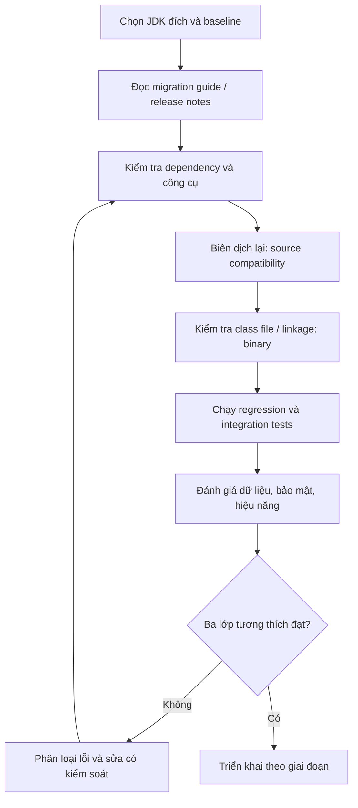

# Phân biệt tương thích mã nguồn, nhị phân và hành vi khi nâng JDK

> **Chương:** Định hướng Java 16  
> **Phạm vi:** Hiểu ba lớp tương thích quan trọng khi nâng JDK hoặc cập nhật thư viện: source compatibility, binary compatibility và behavioral compatibility. Các ví dụ dùng tính năng Java 16 đã chính thức và những thay đổi nền tảng vẫn có ý nghĩa trên JDK hiện đại.

## Mục tiêu học tập

Sau bài này, bạn có thể:

1. Phân biệt mã nguồn còn biên dịch được, bytecode còn liên kết được và ứng dụng còn giữ đúng hành vi.
2. Nhận biết thay đổi API nào có thể phá vỡ mã nguồn, binary hoặc cả hai.
3. Giải thích vì sao biên dịch thành công với JDK mới chưa chứng minh ứng dụng tương thích runtime.
4. Nhận diện các rủi ro khi nâng JDK, như đóng gói mạnh API nội bộ, thay đổi charset mặc định và khác biệt dependency.
5. Thiết kế quy trình kiểm tra tương thích bằng compiler, `jdeps`, `javap` và test trên runtime mục tiêu.

## 1. “Tương thích” có nhiều nghĩa

Khi nói một ứng dụng “tương thích với JDK mới”, cần làm rõ điều gì vẫn hoạt động:

- **Tương thích mã nguồn (source compatibility):** mã nguồn cũ có thể được biên dịch lại bằng compiler mới theo cấu hình ngôn ngữ/API đã chọn.
- **Tương thích nhị phân (binary compatibility):** class file và thư viện đã biên dịch trước đó vẫn liên kết và chạy được với phiên bản API/runtime mới mà không cần biên dịch lại tất cả mã gọi.
- **Tương thích hành vi (behavioral compatibility):** chương trình vẫn tạo ra kết quả, tác dụng phụ, ngoại lệ và đặc tính vận hành mà người dùng hoặc hệ thống phụ thuộc mong đợi.

Ba lớp này có liên quan nhưng không thay thế cho nhau. Mã nguồn có thể không biên dịch lại vì một overload mới làm lời gọi trở nên mơ hồ, trong khi bytecode cũ vẫn liên kết được. Ngược lại, bytecode có thể liên kết thành công nhưng kết quả chương trình thay đổi do charset mặc định hoặc dữ liệu múi giờ được cập nhật.

| Loại tương thích | Câu hỏi chính | Kiểm tra tiêu biểu |
| --- | --- | --- |
| Source | Có biên dịch lại được không? | Biên dịch toàn bộ mã nguồn bằng compiler/JDK đích và release phù hợp |
| Binary | Class file cũ có liên kết với API mới không? | Kiểm tra descriptor, dependency, class file và chạy test với artifact đã biên dịch |
| Behavioral | Chạy có còn đúng nghiệp vụ và vận hành không? | Unit, integration, regression, security và performance tests trên runtime đích |

**Một lần build xanh chỉ là một phần bằng chứng.** Quy trình nâng JDK cần kiểm tra cả ba lớp.

## 2. Tương thích mã nguồn (source compatibility)

Source compatibility nói về khả năng biên dịch lại mã nguồn. Khi nâng compiler hoặc đổi mức ngôn ngữ, một số thay đổi có thể làm mã cũ không biên dịch được, dù thư viện runtime vẫn giữ method cũ.

Các nguyên nhân thường gặp:

- Cú pháp hoặc từ khóa mới thay đổi cách compiler phân tích mã cũ.
- Một overload mới làm lời gọi cũ trở nên mơ hồ hoặc chọn overload khác.
- Thay đổi kiểu generic hoặc chữ ký làm lộ lỗi type-checking trước đây chưa được phát hiện.
- Một phương thức thêm checked exception khiến caller phải xử lý hoặc khai báo ngoại lệ.
- Mã nguồn dựa vào API đã bị loại bỏ hoặc không còn được cung cấp trong JDK mục tiêu.

### Ví dụ: overload mới làm mã nguồn cũ mơ hồ

Giả sử thư viện phiên bản đầu có:

```java
public class MessageParser {
    public static void parse(String text) {
        System.out.println(text);
    }
}
```

Ứng dụng gọi:

```java
MessageParser.parse(null);
```

Mã nguồn này biên dịch được khi chỉ có overload nhận `String`. Sau đó thư viện bổ sung:

```java
public static void parse(java.nio.file.Path path) {
    System.out.println(path);
}
```

Khi biên dịch lại ứng dụng, lời gọi `parse(null)` trở nên mơ hồ vì `null` phù hợp với cả `String` và `Path`. Đây là **source incompatibility**.

Một ứng dụng cũ đã biên dịch trước đó vẫn tham chiếu đến descriptor của `parse(String)`; nếu thư viện vẫn giữ phương thức này, bytecode cũ có thể tiếp tục liên kết. Cách sửa mã nguồn là nêu kiểu rõ ràng:

```java
MessageParser.parse((String) null);
```

Ví dụ cho thấy một thay đổi có thể làm source compatibility thất bại mà binary compatibility vẫn được giữ.

### Ví dụ: thay đổi checked exception

Nếu một phương thức trước đây không khai báo checked exception, sau đó thêm `throws IOException`, mã gọi được biên dịch lại có thể phải bắt hoặc khai báo `IOException`. Khai báo `throws` không nằm trong method descriptor của JVM, vì vậy thay đổi này có thể ảnh hưởng source compatibility mà không nhất thiết làm descriptor nhị phân đổi.

Khi thiết kế API thư viện, hãy xem xét cả caller đang biên dịch lại lẫn caller đã được biên dịch từ trước.

## 3. Tương thích nhị phân (binary compatibility)

Binary compatibility liên quan đến việc bytecode đã biên dịch có tiếp tục tìm thấy đúng lớp, phương thức, trường và quan hệ kiểu khi chạy với phiên bản thư viện/JDK mới hay không.

JVM liên kết tham chiếu trong bytecode bằng tên lớp, tên thành viên và descriptor. Descriptor của phương thức bao gồm kiểu tham số và kiểu trả về; nó không bao gồm tên tham số hoặc mệnh đề `throws`.

Một số thay đổi có nguy cơ phá vỡ binary compatibility:

- Xóa hoặc đổi tên lớp, phương thức hay trường được caller sử dụng.
- Đổi kiểu tham số hoặc kiểu trả về làm descriptor thay đổi.
- Đổi phương thức instance thành static hoặc ngược lại.
- Thu hẹp khả năng truy cập của thành viên mà caller cần truy cập.
- Thay đổi quan hệ kế thừa/interface theo cách làm tham chiếu cũ không còn hợp lệ.
- Nâng bytecode của một dependency lên mức mà JVM triển khai không đọc được.

### Ví dụ: đổi kiểu trả về của phương thức

Phiên bản thư viện ban đầu:

```java
public class PriceService {
    public java.math.BigDecimal total() {
        return new java.math.BigDecimal("12.50");
    }
}
```

Caller đã biên dịch tham chiếu đến descriptor tương đương:

```text
PriceService.total:()Ljava/math/BigDecimal;
```

Nếu thư viện mới đổi phương thức thành:

```java
public class PriceService {
    public long total() {
        return 1250L;
    }
}
```

descriptor đã thay đổi. Caller cũ vẫn tìm phương thức trả về `BigDecimal`; khi liên kết với thư viện mới, JVM có thể ném `NoSuchMethodError`. Đây là **binary incompatibility** và mã nguồn cũ cũng cần được điều chỉnh nếu biên dịch lại.

Muốn giữ binary compatibility, có thể duy trì phương thức cũ và bổ sung phương thức mới với tên khác, sau đó chuyển caller dần theo một kế hoạch phiên bản rõ ràng.

### Records cũng có hợp đồng nhị phân

Record là tính năng chính thức từ Java 16. Thành phần của record tạo ra canonical constructor, accessor và ảnh hưởng `equals()`, `hashCode()` cùng `toString()`.

Ví dụ ban đầu:

```java
public record Customer(String id, String name) {}
```

Caller đã biên dịch có thể gọi constructor descriptor nhận hai `String`. Nếu phiên bản thư viện đổi thành:

```java
public record Customer(String id, String name, String email) {}
```

canonical constructor giờ nhận ba thành phần. Caller cũ tìm constructor hai tham số và có thể gặp `NoSuchMethodError`. Đồng thời, ngữ nghĩa giá trị của record cũng thay đổi vì `email` tham gia so sánh và biểu diễn.

Không xem việc thêm một record component là thay đổi “chỉ thêm dữ liệu”. Với public API, hãy đánh giá tác động source, binary và behavioral trước khi phát hành.

### Bytecode dependency phải tương thích với runtime

Class file được biên dịch cho Java mới hơn có thể không được JVM cũ nạp. Ví dụ major version 60 tương ứng Java 16, major version 65 tương ứng Java 21. Nếu ứng dụng target Java 16 nhưng một dependency được build bằng Java 21, runtime Java 16 có thể báo `UnsupportedClassVersionError`.

`javac --release 16` giới hạn mã nguồn của module đang biên dịch; nó **không hạ cấp bytecode của thư viện bên thứ ba**. Cần kiểm tra dependency tree và mức bytecode của các artifact.

## 4. Tương thích hành vi (behavioral compatibility)

Behavioral compatibility hỏi chương trình có còn thực hiện đúng điều mà caller và người dùng mong đợi không. Chữ ký API có thể không đổi, bytecode vẫn liên kết được, nhưng kết quả hoặc tác dụng phụ có thể thay đổi.

Các nguồn thay đổi hành vi khi nâng JDK:

- Giá trị mặc định của charset, locale, timezone hoặc dữ liệu Unicode.
- Chính sách TLS, thuật toán mật mã và kiểm tra chứng chỉ.
- Quyền truy cập reflection, module và API nội bộ JDK.
- Hành vi file system, network, process, serialization hoặc thứ tự xử lý.
- Cập nhật dữ liệu timezone, locale và quy tắc của nền tảng.
- GC/JIT, thời điểm thực hiện cleanup, độ trễ và mức dùng bộ nhớ.

Một chương trình “không lỗi” nhưng xuất dữ liệu khác định dạng hoặc thay đổi cách xác thực vẫn là lỗi tương thích hành vi.

### Ví dụ: charset mặc định thay đổi khi nâng JDK

Java 18 chuẩn hóa charset mặc định của Java SE thành UTF-8 theo JEP 400. Trước đó, charset mặc định có thể phụ thuộc môi trường. Vì vậy, mã dựa vào charset ngầm định có thể đọc/ghi dữ liệu khác nhau khi chuyển sang JDK mới.

Mã dễ gây phụ thuộc môi trường:

```java
import java.nio.file.Files;
import java.nio.file.Path;

String content = new String(Files.readAllBytes(Path.of("data.txt")));
```

Nếu định dạng file của ứng dụng quy định UTF-8, hãy ghi rõ charset:

```java
import java.nio.charset.StandardCharsets;
import java.nio.file.Files;
import java.nio.file.Path;

String content = new String(
        Files.readAllBytes(Path.of("data.txt")),
        StandardCharsets.UTF_8
);
```

Ghi rõ charset khiến hợp đồng dữ liệu độc lập với cấu hình máy và phiên bản JDK. Khi nâng JDK, hãy kiểm tra encoding của file, giao thức và dữ liệu trao đổi; đừng dựa vào giá trị mặc định nếu định dạng đã quy định một charset cụ thể.

### Ví dụ: `Stream.toList()` trả danh sách không thể sửa

Java 16 bổ sung `Stream.toList()`. Phương thức này trả về danh sách không thể sửa qua các thao tác thêm, xóa hoặc thay thế:

```java
import java.util.List;

List<String> names = List.of("An", "Binh", "Chi")
        .stream()
        .map(String::toUpperCase)
        .toList();

// names.add("DUNG"); // UnsupportedOperationException
```

Nếu nghiệp vụ cần danh sách có thể cập nhật, hãy tạo bản sao mutable:

```java
import java.util.ArrayList;
import java.util.List;

List<String> editableNames = new ArrayList<>(names);
editableNames.add("DUNG");
```

Đây là ví dụ về việc phải hiểu **hợp đồng hành vi** của API mới. Không suy ra rằng mọi phương thức trả về `List` đều trả về `ArrayList` hoặc có thể sửa được.

## 5. Rủi ro đặc biệt khi nâng JDK

### 5.1. Đóng gói mạnh API nội bộ

Java 16 thay đổi mặc định theo hướng đóng gói mạnh các thành phần nội bộ của JDK (JEP 396); Java 17 tiếp tục siết chặt theo JEP 403. Thư viện cũ dựa vào reflection để truy cập trường hoặc phương thức nội bộ có thể gặp `InaccessibleObjectException` khi chạy trên JDK mới.

Hướng xử lý hiện hành:

1. Nâng thư viện lên phiên bản hỗ trợ JDK mục tiêu.
2. Thay truy cập nội bộ bằng API công khai, có tài liệu.
3. Dùng `jdeps --jdk-internals` để phát hiện một số phụ thuộc tĩnh vào API nội bộ.
4. Nếu có lý do vận hành rõ ràng, chỉ mở package cụ thể bằng cơ chế module có phạm vi hẹp trong giai đoạn chuyển tiếp; ghi nhận và loại bỏ phụ thuộc đó khi có thể.

Không coi việc ứng dụng chạy được nhờ mở rộng quyền truy cập toàn cục là bằng chứng đã tương thích lâu dài. Phụ thuộc vào nội bộ JDK có thể thay đổi giữa các bản phát hành.

### 5.2. API mới và API bị thay đổi

Một JDK mới thường bổ sung API và có thể deprecate hoặc loại bỏ một số thành phần qua các bản phát hành. Hãy tra Javadoc của **JDK mục tiêu**, các mục `Since`, `Deprecated` và `forRemoval`, cùng migration guide/release notes.

Không chỉ tìm tên lớp đã bị xóa. Một thay đổi trong hành vi, hợp đồng ngoại lệ, thuật toán mặc định hoặc quyền truy cập cũng có thể ảnh hưởng ứng dụng mà không làm chữ ký phương thức đổi.

### 5.3. Thư viện, framework và agent

Ứng dụng thường phụ thuộc nhiều hơn Java SE: framework, driver, agent giám sát, bytecode instrumentation, annotation processor và native library.

Một thư viện có thể:

- Chưa hỗ trợ JDK mới dù mã ứng dụng biên dịch được.
- Dùng reflection hoặc API nội bộ bị đóng gói.
- Mang class file mới hơn runtime nhỏ nhất.
- Có thay đổi hành vi giữa các phiên bản thư viện.
- Cần phiên bản plugin hoặc agent khác để hoạt động với JVM mới.

Kiểm tra ma trận tương thích của nhà cung cấp và cập nhật theo từng dependency có kiểm soát. Không nâng toàn bộ dependency cùng lúc nếu chưa có bằng chứng về nguyên nhân lỗi.

## 6. Ma trận ví dụ: một thay đổi ảnh hưởng lớp tương thích nào?

| Thay đổi | Source | Binary | Behavioral | Giải thích |
| --- | --- | --- | --- | --- |
| Thêm overload khiến `parse(null)` mơ hồ | Có thể phá vỡ | Thường giữ nếu method cũ còn | Có thể thay đổi khi caller biên dịch lại | Compiler phân giải overload khác nhau |
| Đổi kiểu trả về `total()` | Phá vỡ khi biên dịch lại | Phá vỡ descriptor | Có thể đổi ngữ nghĩa | Caller cũ tìm descriptor cũ |
| Thêm component vào public record | Phá vỡ constructor/caller liên quan | Có thể phá vỡ constructor/accessor | Thay đổi equality và dữ liệu | Record component tạo thành hợp đồng công khai |
| Dùng charset mặc định khi đọc file, sau đó nâng JDK | Vẫn biên dịch | Vẫn liên kết | Có thể đổi kết quả | Charset mặc định chuẩn hóa thành UTF-8 từ Java 18 |
| Truy cập reflection vào nội bộ JDK | Vẫn biên dịch trong một số trường hợp | Có thể liên kết | Có thể lỗi lúc chạy | Strong encapsulation hạn chế truy cập sâu |
| Dependency có bytecode mới hơn runtime | Mã ứng dụng có thể biên dịch | Không tương thích khi nạp class | Ứng dụng không chạy | JVM không đọc được class file version |
| `Stream.toList()` rồi gọi `add()` | Vẫn biên dịch | Vẫn liên kết | Ném `UnsupportedOperationException` | Danh sách trả về không thể sửa |

Ma trận này là hướng dẫn phân loại, không phải quy tắc tuyệt đối cho mọi thay đổi API. Hãy đọc JLS, Javadoc và tài liệu migration của đúng JDK/thư viện đang nâng cấp.

## 7. Dùng công cụ nào để kiểm tra?

### 7.1. Biên dịch lại theo baseline

Nếu cần giữ khả năng chạy trên Java 16, dùng compiler JDK hiện được hỗ trợ và `--release 16`:

```bash
javac --release 16 -d out src/example/*.java
```

`--release` kiểm tra cú pháp/ngữ nghĩa ngôn ngữ, API Java SE/JDK được hỗ trợ và class file target. Nó không kiểm tra API thư viện bên thứ ba, không hạ cấp dependency và không mô phỏng runtime Java 16.

### 7.2. Kiểm tra bytecode

```bash
javap -verbose -classpath out example.Customer
```

Tìm `major version` để xác minh mức class file. Java 16 tương ứng major version 60. Khi cần điều tra dependency, kiểm tra class file của chính artifact đó, không chỉ class file của ứng dụng.

### 7.3. Tìm phụ thuộc API nội bộ

```bash
jdeps --jdk-internals application.jar
```

`jdeps` có thể phát hiện một số tham chiếu tĩnh đến API nội bộ JDK. Kết quả không bao quát mọi truy cập reflection, tên lớp được nạp động, service loading hoặc hành vi native. Hãy kết hợp phân tích tĩnh với integration test.

### 7.4. Quét API deprecated

Có thể dùng `jdeprscan` trên artifact để phát hiện một số tham chiếu tới API deprecated trong JDK:

```bash
jdeprscan --release 16 application.jar
```

Chọn release tương ứng với baseline đang đánh giá và kiểm tra `jdeprscan --help` của JDK đang dùng để xác nhận các tùy chọn hỗ trợ. Deprecated không đồng nghĩa API đã bị xóa; cần xem tài liệu API để đánh giá mức độ ảnh hưởng và lộ trình thay thế.

### 7.5. Chạy test trên runtime thật

Thiết lập ma trận kiểm thử theo runtime nhỏ nhất và runtime dự định triển khai. Ví dụ:

| Mục tiêu | Build | Runtime test | Mục đích |
| --- | --- | --- | --- |
| Duy trì baseline Java 16 | JDK LTS hiện đại với `--release 16` | Runtime Java 16 chỉ trong môi trường kiểm thử cô lập nếu thật sự cần xác minh tương thích lịch sử | Kiểm tra ứng dụng/dependency thực tế có chạy trên runtime cũ không |
| Triển khai hiện đại | JDK LTS được phê duyệt | Cùng dòng runtime LTS | Kiểm tra hành vi ở môi trường triển khai chính |
| Chuẩn bị nâng JDK tiếp theo | JDK đích mới | Runtime JDK đích | Phát hiện thay đổi source, binary và behavior trước khi phát hành |

Nếu runtime Java 16 đã hết hỗ trợ trong chính sách của tổ chức, đừng đưa nó vào production chỉ vì mã đang target 16. Hãy lập kế hoạch nâng runtime và kiểm tra compatibility theo baseline mới.

## 8. Quy trình nâng JDK có kiểm soát

1. **Chốt mục tiêu:** xác định JDK nguồn, JDK đích, runtime tối thiểu cần hỗ trợ và nhà cung cấp.
2. **Kiểm tra nền tảng:** đọc release notes, migration guide, JEP liên quan và thay đổi API của JDK đích.
3. **Kiểm kê dependency:** lập danh sách framework, driver, agent, plugin build và native library; kiểm tra ma trận hỗ trợ.
4. **Kiểm tra source:** biên dịch lại toàn bộ mã nguồn bằng compiler đích; xử lý overload, generic, checked exception và API bị loại bỏ.
5. **Kiểm tra binary:** xác minh class file, descriptor, dependency tree và các thư viện đã biên dịch trước.
6. **Kiểm tra runtime:** xử lý reflection/API nội bộ, module, charset, locale, timezone, TLS và cấu hình hệ điều hành.
7. **Chạy test:** unit, integration, regression, security và performance tests trên runtime đích.
8. **Triển khai có quan sát:** phát hành theo từng môi trường, theo dõi log, lỗi liên kết, dữ liệu đầu ra, latency và mức sử dụng bộ nhớ.
9. **Chốt baseline mới:** cập nhật toolchain, `--release`, CI, container và tài liệu vận hành sau khi các kiểm tra đạt yêu cầu.



## 9. Những câu hỏi cần trả lời trước khi phát hành

| Câu hỏi | Bằng chứng cần có |
| --- | --- |
| Mã nguồn có biên dịch lại trên JDK đích không? | Build sạch bằng compiler/toolchain và release đã chọn |
| API được gọi có tồn tại ở baseline không? | `--release`, Javadoc và dependency analysis |
| Thư viện đã biên dịch có được runtime nạp không? | Bytecode version, dependency tree và integration test |
| Có truy cập API nội bộ JDK không? | `jdeps`, kiểm tra reflection và log runtime |
| Dữ liệu có giữ nguyên encoding/format không? | Regression tests với dữ liệu thật và charset rõ ràng |
| TLS, quyền truy cập và xác thực còn đúng không? | Security/integration tests trên cấu hình triển khai |
| Hiệu năng có thay đổi đáng kể không? | Benchmark và số liệu trước/sau trên tải đại diện |
| Có thể rollback không? | Artifact, cấu hình và dữ liệu có phương án quay lại rõ ràng |

## 10. Bài tập thực hành

### Bài 1 — Phân loại lỗi source/binary

Một thư viện thêm overload `parse(Path)` trong khi vẫn giữ `parse(String)`. Caller cũ gọi `parse(null)`.

1. Vì sao caller biên dịch lại có thể thất bại?
2. Vì sao bytecode cũ vẫn có thể liên kết?
3. Sửa lời gọi để compiler chọn đúng overload.

### Bài 2 — Phân tích thay đổi record

Một thư viện đổi `record Customer(String id, String name)` thành `record Customer(String id, String name, String email)`.

Hãy xác định tác động lên canonical constructor, accessor, `equals()`, caller đã biên dịch và mã nguồn được biên dịch lại.

### Bài 3 — Phát hiện lỗi hành vi

Một ứng dụng dùng `new String(Files.readAllBytes(path))` nhưng file dữ liệu quy định UTF-8. Giải thích vì sao nên truyền `StandardCharsets.UTF_8` tường minh và cách viết test phát hiện lỗi encoding khi nâng JDK.

### Bài 4 — Kiểm tra dependency

Biên dịch ứng dụng với `--release 16`, nhưng một thư viện có class file major version 65. Giải thích vì sao compile ứng dụng thành công chưa chứng minh runtime Java 16 có thể chạy toàn bộ ứng dụng; đề xuất các bước kiểm tra dependency và runtime.

### Bài 5 — Lập kế hoạch nâng JDK

Chọn một dự án Java có thật hoặc ví dụ. Ghi lại JDK hiện tại, JDK đích, framework/dependency, các kiểm tra source/binary/behavioral và bộ test cần chạy. Nêu tiêu chí quyết định có thể phát hành.

## Tài liệu chính thức

- [Java Language Specification — Chapter 13: Binary Compatibility](https://docs.oracle.com/javase/specs/jls/se16/html/jls-13.html) — quy tắc tương thích nhị phân của ngôn ngữ Java.
- [Oracle JDK Migration Guide](https://docs.oracle.com/en/java/javase/25/migrate/preparing-migration.html) — chuẩn bị mã nguồn, dependency và môi trường khi nâng JDK.
- [JEP 396 — Strongly Encapsulate JDK Internals by Default](https://openjdk.org/jeps/396) — thay đổi đóng gói mạnh mặc định ở Java 16.
- [JEP 403 — Strongly Encapsulate JDK Internals](https://openjdk.org/jeps/403) — tiếp tục đóng gói API nội bộ trong Java 17.
- [JEP 400 — UTF-8 by Default](https://openjdk.org/jeps/400) — thay đổi charset mặc định từ Java 18.
- [Java SE 16 — Stream API](https://docs.oracle.com/en/java/javase/16/docs/api/java.base/java/util/stream/Stream.html) — hợp đồng của `Stream.toList()` và `mapMulti()`.
- [The `jdeps` Command — JDK 25](https://docs.oracle.com/en/java/javase/25/docs/specs/man/jdeps.html) — phân tích dependency và tham chiếu API nội bộ.
- [The `jdeprscan` Command — JDK 25](https://docs.oracle.com/en/java/javase/25/docs/specs/man/jdeprscan.html) — phát hiện tham chiếu API deprecated.

**Nguyên tắc áp dụng:** Khi nâng JDK, kiểm tra riêng source compatibility, binary compatibility và behavioral compatibility. Dùng compiler/release để kiểm tra mã nguồn và API nền tảng, kiểm tra bytecode cùng dependency để đánh giá liên kết, rồi chạy regression/integration/security/performance tests trên runtime thật. Chỉ kết luận tương thích khi cả ba lớp đều có bằng chứng phù hợp.
