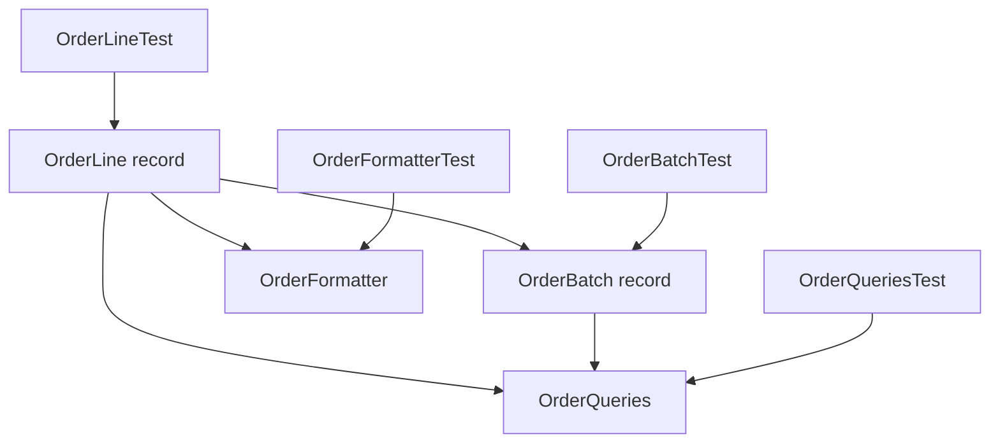
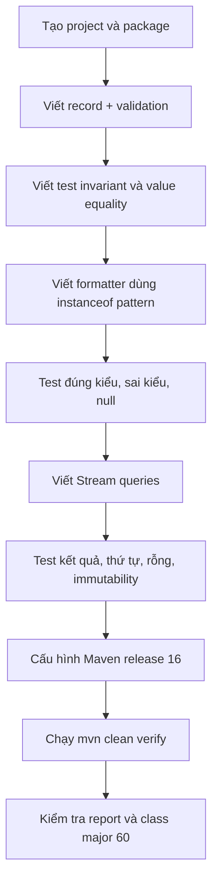

# Tổ chức ví dụ và kiểm thử cho record, pattern matching và Stream

> **Chương:** Định hướng Java 16  
> **Phạm vi:** Xây dựng một ví dụ nhỏ có cấu trúc như dự án thật, dùng các tính năng đã chính thức ở Java 16 và kiểm thử hợp đồng công khai bằng JUnit. Các ví dụ không cần preview hoặc incubator API; có thể biên dịch theo Java 16 bằng JDK LTS hiện được hỗ trợ.

## Mục tiêu học tập

Sau bài này, bạn có thể:

1. Tách mã nghiệp vụ và mã kiểm thử theo cấu trúc dự án Java phổ biến.
2. Viết record có kiểm tra dữ liệu, ngữ nghĩa giá trị và bản sao phòng vệ cho thành phần mutable.
3. Kiểm thử pattern matching cho `instanceof`, bao gồm trường hợp `null` và kiểu không phù hợp.
4. Kiểm thử Stream pipeline về kết quả, thứ tự, trường hợp rỗng và tính không thể sửa của `toList()`.
5. Dùng `mapMulti()` để phát ra 0 đến nhiều phần tử và kiểm tra hành vi đó.
6. Cấu hình build để kiểm tra đúng các tính năng chính thức Java 16.

## 1. Nguyên tắc tổ chức ví dụ và test

Một bài thực hành tốt nên có:

- **Mã nhỏ, một trách nhiệm:** mỗi record mô tả một kiểu dữ liệu; mỗi lớp xử lý một nhóm hành vi.
- **Hợp đồng rõ ràng:** xác định dữ liệu hợp lệ, kết quả mong đợi, trường hợp lỗi và khả năng sửa đổi của collection.
- **Test hành vi công khai:** kiểm tra constructor, accessor, kết quả hàm và ngoại lệ đã cam kết; tránh phụ thuộc vào chi tiết triển khai.
- **Dữ liệu kiểm thử có chủ đích:** có giá trị hợp lệ, biên, rỗng, `null` nếu API cho phép và kiểu đầu vào không phù hợp.
- **Kết quả tái lập:** test không phụ thuộc thời gian hệ thống, locale, thứ tự không được bảo đảm, mạng hoặc trạng thái dùng chung.

Với Java 16, `record`, pattern matching cho `instanceof`, `Stream.toList()` và `Stream.mapMulti()` đều đã là tính năng/API chính thức. Không cần bật `--enable-preview` để biên dịch hoặc kiểm thử chúng.

## 2. Cấu trúc dự án mẫu

Ta xây dựng ví dụ quản lý các dòng hàng trong đơn đặt hàng. Cấu trúc Maven:

```text
java16-testing-lab/
├── pom.xml
└── src/
    ├── main/
    │   └── java/
    │       └── vn/example/orders/
    │           ├── OrderLine.java
    │           ├── OrderBatch.java
    │           ├── OrderFormatter.java
    │           └── OrderQueries.java
    └── test/
        └── java/
            └── vn/example/orders/
                ├── OrderLineTest.java
                ├── OrderBatchTest.java
                ├── OrderFormatterTest.java
                └── OrderQueriesTest.java
```

`src/main/java` chứa mã ứng dụng; `src/test/java` chứa test có cùng package để kiểm tra API công khai. Tên test kết thúc bằng `Test` giúp Maven Surefire nhận diện theo quy ước mặc định. Không đặt test hoặc dữ liệu giả lập trong `src/main/java`.

### Sơ đồ quan hệ



## 3. Tạo record có hợp đồng dữ liệu rõ ràng

Tạo `OrderLine.java`:

```java
package vn.example.orders;

import java.math.BigDecimal;
import java.util.Objects;

public record OrderLine(String sku, int quantity, BigDecimal unitPrice) {
    public OrderLine {
        sku = Objects.requireNonNull(sku, "sku").strip();
        unitPrice = Objects.requireNonNull(unitPrice, "unitPrice");

        if (sku.isEmpty()) {
            throw new IllegalArgumentException("sku must not be blank");
        }
        if (quantity < 0) {
            throw new IllegalArgumentException("quantity must not be negative");
        }
        if (unitPrice.signum() < 0) {
            throw new IllegalArgumentException("unitPrice must not be negative");
        }
    }

    public BigDecimal subtotal() {
        return unitPrice.multiply(BigDecimal.valueOf(quantity));
    }
}
```

Record này có ba thành phần dữ liệu. Compact constructor kiểm tra và chuẩn hóa đầu vào; compiler tự tạo canonical constructor, accessor, `equals()`, `hashCode()` và `toString()`.

Các quyết định trong ví dụ:

- Chuẩn hóa `sku` bằng `strip()` để dữ liệu không mang khoảng trắng thừa ở hai đầu.
- `null` ở `sku` hoặc `unitPrice` bị từ chối bằng `NullPointerException` có thông điệp rõ.
- SKU rỗng, số lượng âm và giá âm bị từ chối bằng `IllegalArgumentException`.
- Số lượng bằng 0 được phép biểu diễn; lớp truy vấn quyết định có giữ dòng hàng đó trong kết quả hay không.
- `BigDecimal` được dùng cho tiền thay vì `double`.

### Kiểm thử invariant và ngữ nghĩa giá trị

Tạo `OrderLineTest.java`:

```java
package vn.example.orders;

import static org.junit.jupiter.api.Assertions.assertAll;
import static org.junit.jupiter.api.Assertions.assertEquals;
import static org.junit.jupiter.api.Assertions.assertNotEquals;
import static org.junit.jupiter.api.Assertions.assertThrows;

import java.math.BigDecimal;
import org.junit.jupiter.api.Test;

class OrderLineTest {
    @Test
    void normalizesSkuAndCalculatesSubtotal() {
        var line = new OrderLine("  BOOK-01  ", 2, new BigDecimal("19.50"));

        assertEquals("BOOK-01", line.sku());
        assertEquals(2, line.quantity());
        assertEquals(new BigDecimal("39.00"), line.subtotal());
    }

    @Test
    void rejectsInvalidValues() {
        assertAll(
                () -> assertThrows(
                        IllegalArgumentException.class,
                        () -> new OrderLine("  ", 1, BigDecimal.ONE)),
                () -> assertThrows(
                        IllegalArgumentException.class,
                        () -> new OrderLine("BOOK", -1, BigDecimal.ONE)),
                () -> assertThrows(
                        IllegalArgumentException.class,
                        () -> new OrderLine("BOOK", 1, new BigDecimal("-0.01"))),
                () -> assertThrows(
                        NullPointerException.class,
                        () -> new OrderLine(null, 1, BigDecimal.ONE))
        );
    }

    @Test
    void recordsCompareTheirComponentsByValue() {
        var first = new OrderLine("BOOK", 2, new BigDecimal("10.00"));
        var sameValue = new OrderLine("BOOK", 2, new BigDecimal("10.00"));
        var differentQuantity = new OrderLine("BOOK", 3, new BigDecimal("10.00"));

        assertEquals(first, sameValue);
        assertEquals(first.hashCode(), sameValue.hashCode());
        assertNotEquals(first, differentQuantity);
    }
}
```

Test tập trung vào hợp đồng: SKU đã chuẩn hóa, subtotal, dữ liệu bị từ chối và equality theo thành phần. Với `BigDecimal`, `equals()` có xét scale (`10.0` khác `10.00`); nếu nghiệp vụ xem hai giá trị này bằng nhau về số học, hãy chuẩn hóa scale hoặc so sánh bằng `compareTo()` theo quy tắc miền dữ liệu.

## 4. Kiểm tra bản sao phòng vệ trong record chứa collection

Record không tự tạo bất biến sâu. Nếu một thành phần trỏ đến `List` có thể thay đổi, người gọi vẫn có thể sửa nội dung qua tham chiếu bên ngoài.

Tạo `OrderBatch.java`:

```java
package vn.example.orders;

import java.util.List;
import java.util.Objects;

public record OrderBatch(String id, List<OrderLine> lines) {
    public OrderBatch {
        id = Objects.requireNonNull(id, "id").strip();
        if (id.isEmpty()) {
            throw new IllegalArgumentException("id must not be blank");
        }
        lines = List.copyOf(Objects.requireNonNull(lines, "lines"));
    }
}
```

`List.copyOf()` tạo danh sách không thể sửa và từ chối phần tử `null`. Nó là bản sao phòng vệ cho cấu trúc danh sách; nếu phần tử bên trong có thể thay đổi, vẫn cần xem xét tính bất biến của từng phần tử. Trong ví dụ, `OrderLine` chỉ chứa `String`, `int` và `BigDecimal` nên các thành phần đó phù hợp với mục tiêu dữ liệu bất biến.

Tạo `OrderBatchTest.java`:

```java
package vn.example.orders;

import static org.junit.jupiter.api.Assertions.assertEquals;
import static org.junit.jupiter.api.Assertions.assertThrows;

import java.math.BigDecimal;
import java.util.ArrayList;
import java.util.List;
import org.junit.jupiter.api.Test;

class OrderBatchTest {
    @Test
    void copiesInputListAndExposesUnmodifiableContents() {
        var line = new OrderLine("BOOK", 1, new BigDecimal("5.00"));
        var source = new ArrayList<>(List.of(line));

        var batch = new OrderBatch(" B-01 ", source);
        source.clear();

        assertEquals("B-01", batch.id());
        assertEquals(List.of(line), batch.lines());
        assertThrows(
                UnsupportedOperationException.class,
                () -> batch.lines().add(line));
    }
}
```

Test này chứng minh hai hành vi quan trọng: thay đổi danh sách nguồn không làm thay đổi record đã tạo; người gọi không thể thêm phần tử vào danh sách trả về. Không kiểm tra lớp triển khai cụ thể như `ImmutableCollections`, vì chi tiết đó không thuộc hợp đồng API.

## 5. Dùng pattern matching cho `instanceof` và kiểm thử mọi nhánh

Tạo `OrderFormatter.java`:

```java
package vn.example.orders;

public final class OrderFormatter {
    private OrderFormatter() {}

    public static String describe(Object value) {
        if (value instanceof OrderLine line) {
            return line.sku() + " x " + line.quantity();
        }
        return "Unknown value";
    }
}
```

Pattern `OrderLine line` kết hợp kiểm tra kiểu và tạo biến `line`. Biến chỉ có hiệu lực ở những vị trí mà luồng điều khiển đảm bảo kiểm tra đã thành công (*flow scoping*). Khi `value` là `null`, `instanceof` trả về `false`; khi là một kiểu khác, nhánh record cũng không được thực hiện.

Tạo `OrderFormatterTest.java`:

```java
package vn.example.orders;

import static org.junit.jupiter.api.Assertions.assertEquals;

import java.math.BigDecimal;
import org.junit.jupiter.api.Test;

class OrderFormatterTest {
    @Test
    void formatsAnOrderLine() {
        var line = new OrderLine("BOOK", 2, new BigDecimal("8.50"));

        assertEquals("BOOK x 2", OrderFormatter.describe(line));
    }

    @Test
    void handlesAnUnrelatedType() {
        assertEquals("Unknown value", OrderFormatter.describe("BOOK"));
    }

    @Test
    void handlesNull() {
        assertEquals("Unknown value", OrderFormatter.describe(null));
    }
}
```

Ba test bao phủ trường hợp đúng kiểu, kiểu không liên quan và `null`. Không cần test biến pattern bằng reflection hoặc kiểm tra cấu trúc bytecode; điều quan trọng là hợp đồng hàm được giữ.

## 6. Tổ chức Stream pipeline để dễ kiểm thử

Tạo `OrderQueries.java`:

```java
package vn.example.orders;

import java.math.BigDecimal;
import java.util.List;
import java.util.Objects;

public final class OrderQueries {
    private OrderQueries() {}

    public static List<OrderLine> positiveLines(List<?> values) {
        Objects.requireNonNull(values, "values");

        return values.stream()
                .<OrderLine>mapMulti((value, downstream) -> {
                    if (value instanceof OrderLine line && line.quantity() > 0) {
                        downstream.accept(line);
                    }
                })
                .toList();
    }

    public static List<OrderLine> flatten(List<OrderBatch> batches) {
        Objects.requireNonNull(batches, "batches");

        return batches.stream()
                .<OrderLine>mapMulti((batch, downstream) ->
                        batch.lines().forEach(downstream::accept))
                .toList();
    }

    public static BigDecimal total(List<OrderLine> lines) {
        Objects.requireNonNull(lines, "lines");

        return lines.stream()
                .map(OrderLine::subtotal)
                .reduce(BigDecimal.ZERO, BigDecimal::add);
    }
}
```

Ba phương thức thể hiện ba mục đích riêng:

- `positiveLines`: kiểm tra kiểu bằng pattern matching, chỉ phát dòng hàng có số lượng dương. Mỗi đầu vào tạo ra 0 hoặc 1 kết quả.
- `flatten`: mỗi batch có thể chứa 0 hoặc nhiều dòng hàng; `mapMulti()` phát từng dòng vào stream kết quả.
- `total`: ánh xạ từng dòng thành subtotal rồi cộng bằng `reduce`.

`mapMulti()` phù hợp khi callback có thể phát 0, 1 hoặc nhiều phần tử trực tiếp qua `downstream.accept()`. `flatMap()` phù hợp khi logic tự nhiên trả về một `Stream` con. Không mặc định `mapMulti()` luôn nhanh hơn; chọn cách diễn đạt dễ đọc trước, chỉ tối ưu sau khi đo trên dữ liệu thực.

`Stream.toList()` trả về danh sách không thể sửa. Vì stream từ `List` là ordered stream, kết quả giữ encounter order của các phần tử được phát ra. Không dựa vào thứ tự này nếu nguồn dữ liệu hoặc pipeline đã chuyển sang một nguồn không có thứ tự.

## 7. Kiểm thử Stream: kết quả, thứ tự, rỗng và tính không thể sửa

Tạo `OrderQueriesTest.java`:

```java
package vn.example.orders;

import static org.junit.jupiter.api.Assertions.assertEquals;
import static org.junit.jupiter.api.Assertions.assertThrows;

import java.math.BigDecimal;
import java.util.Arrays;
import java.util.List;
import org.junit.jupiter.api.Test;

class OrderQueriesTest {
    @Test
    void keepsOnlyPositiveOrderLinesInEncounterOrder() {
        var first = new OrderLine("BOOK", 2, new BigDecimal("10.00"));
        var zero = new OrderLine("PEN", 0, new BigDecimal("1.00"));
        var second = new OrderLine("BAG", 3, new BigDecimal("5.00"));
        List<?> input = Arrays.asList(first, "not an order line", zero, null, second);

        var result = OrderQueries.positiveLines(input);

        assertEquals(List.of(first, second), result);
        assertThrows(
                UnsupportedOperationException.class,
                () -> result.add(zero));
    }

    @Test
    void flattenEmitsZeroOrManyLinesAndKeepsBatchOrder() {
        var first = new OrderLine("BOOK", 1, new BigDecimal("10.00"));
        var second = new OrderLine("BAG", 2, new BigDecimal("5.00"));
        var batches = List.of(
                new OrderBatch("A", List.of(first, second)),
                new OrderBatch("EMPTY", List.of()),
                new OrderBatch("B", List.of(first))
        );

        assertEquals(
                List.of(first, second, first),
                OrderQueries.flatten(batches));
    }

    @Test
    void totalSumsSubtotals() {
        var lines = List.of(
                new OrderLine("BOOK", 2, new BigDecimal("10.00")),
                new OrderLine("BAG", 1, new BigDecimal("5.50"))
        );

        assertEquals(new BigDecimal("25.50"), OrderQueries.total(lines));
    }

    @Test
    void emptyStreamProducesEmptyListAndZeroTotal() {
        assertEquals(List.of(), OrderQueries.positiveLines(List.of()));
        assertEquals(List.of(), OrderQueries.flatten(List.of()));
        assertEquals(BigDecimal.ZERO, OrderQueries.total(List.of()));
    }
}
```

Những điều test đang xác minh:

1. Đầu vào hỗn hợp được lọc đúng; kiểu không phù hợp và `null` không tạo kết quả.
2. Dòng hàng số lượng 0 bị loại theo quy tắc nghiệp vụ của truy vấn.
3. Thứ tự phần tử được giữ với nguồn `List` có thứ tự.
4. `flatten()` xử lý batch rỗng và batch nhiều dòng.
5. `toList()` không cho phép sửa danh sách kết quả.
6. Stream rỗng tạo danh sách rỗng và tổng bằng `BigDecimal.ZERO`.

Không viết test dựa vào số lần lambda được gọi hoặc cách JVM tối ưu stream. Các chi tiết này có thể thay đổi; test nên xác minh kết quả và hợp đồng đã công bố.

## 8. Cấu hình Maven để biên dịch theo Java 16

Ví dụ `pom.xml` dùng compiler release 16 và JUnit Jupiter 5:

```xml
<project xmlns="http://maven.apache.org/POM/4.0.0"
         xmlns:xsi="http://www.w3.org/2001/XMLSchema-instance"
         xsi:schemaLocation="http://maven.apache.org/POM/4.0.0 https://maven.apache.org/xsd/maven-4.0.0.xsd">
    <modelVersion>4.0.0</modelVersion>

    <groupId>vn.example</groupId>
    <artifactId>java16-testing-lab</artifactId>
    <version>1.0-SNAPSHOT</version>

    <properties>
        <project.build.sourceEncoding>UTF-8</project.build.sourceEncoding>
        <maven.compiler.release>16</maven.compiler.release>
    </properties>

    <dependencies>
        <dependency>
            <groupId>org.junit.jupiter</groupId>
            <artifactId>junit-jupiter</artifactId>
            <version>5.13.4</version>
            <scope>test</scope>
        </dependency>
    </dependencies>

    <build>
        <plugins>
            <plugin>
                <groupId>org.apache.maven.plugins</groupId>
                <artifactId>maven-compiler-plugin</artifactId>
                <version>3.14.0</version>
            </plugin>
            <plugin>
                <groupId>org.apache.maven.plugins</groupId>
                <artifactId>maven-surefire-plugin</artifactId>
                <version>3.5.3</version>
            </plugin>
        </plugins>
    </build>
</project>
```

Các phiên bản dependency/plugin trong ví dụ là mốc minh họa có thể tái lập; khi bắt đầu dự án mới, kiểm tra phiên bản còn được duy trì, yêu cầu JDK và ghi lại trong dependency management của nhóm. JUnit Jupiter 5 phù hợp nếu cần chạy test trên Java 16; khi chọn một major version test framework mới hơn, hãy kiểm tra JDK tối thiểu mà chính framework yêu cầu.

JDK chạy Maven có thể là JDK LTS mới hơn. `maven.compiler.release` đặt baseline ngôn ngữ/API/bytecode cho mã nguồn. Nếu cần test trên runtime khác, cấu hình test toolchain riêng và chạy test trên runtime đó; không suy ra runtime test chỉ từ `maven.compiler.release`.

## 9. Chạy test và đọc kết quả

Từ thư mục có `pom.xml`, kiểm tra JDK và chạy:

```bash
java --version
mvn -version
mvn clean test
```

Chạy riêng một lớp test:

```bash
mvn -Dtest=OrderLineTest test
mvn -Dtest=OrderQueriesTest test
```

Chạy toàn bộ vòng xác minh trước khi đóng gói:

```bash
mvn clean verify
```

Khi build thành công, Maven báo số test chạy, số lỗi assertion, số test thất bại và số test bị bỏ qua. Không chỉ kiểm tra exit code; hãy đọc báo cáo trong `target/surefire-reports` để biết test nào thất bại và assertion nào không đạt.

Để xác nhận class file của mã ứng dụng được tạo theo Java 16, dùng `javap -verbose` trên một lớp trong `target/classes`; tìm `major version: 60`. Nếu cần xác nhận runtime thực sự chạy test, kiểm tra JVM của Maven bằng `mvn -version` và log/diagnostic trong test process.

## 10. Cách thiết kế test tốt cho từng tính năng

| Tính năng | Nên kiểm thử | Tránh kiểm thử |
| --- | --- | --- |
| Record | Constructor validation, chuẩn hóa dữ liệu, accessor, equality/hash code theo thành phần, defensive copy nếu có collection | Tên lớp triển khai collection nội bộ, thứ tự field trong bytecode |
| Pattern matching `instanceof` | Nhánh đúng kiểu, sai kiểu, `null`, kết quả khi biến pattern được dùng sau kiểm tra | Cách compiler đặt biến cục bộ trong bytecode |
| `Stream.toList()` | Nội dung, encounter order của ordered source, danh sách không thể sửa | Kiểu concrete của danh sách, giả định nó là `ArrayList` |
| `Stream.mapMulti()` | Phát 0/1/nhiều kết quả, thứ tự, nhóm rỗng, điều kiện lọc | Số lần callback nội bộ được gọi hoặc giả định hiệu năng tuyệt đối |
| Stream reduction | Tổng/giá trị tổng hợp, đầu vào rỗng, phép toán và kiểu số phù hợp | So sánh `double` tiền tệ bằng `==` |

### Dữ liệu test nên bao phủ

- **Giá trị bình thường:** một dòng hàng hợp lệ, một batch có nhiều dòng.
- **Biên:** chuỗi chỉ có khoảng trắng, số lượng 0, tổng bằng 0.
- **Dữ liệu không hợp lệ:** `null` ở trường bắt buộc, số lượng âm, giá âm.
- **Đầu vào rỗng:** danh sách rỗng, batch rỗng.
- **Đầu vào hỗn hợp:** kiểu đúng, kiểu sai và `null` khi API chấp nhận danh sách hỗn hợp.
- **Tính không thể sửa:** thử thao tác thay đổi trên danh sách do `toList()`/`List.copyOf()` trả về.

Không nhất thiết tạo test cho mọi tổ hợp dữ liệu. Chọn trường hợp đại diện cho từng quy tắc nghiệp vụ và nhánh điều khiển, đồng thời giữ test nhỏ để lỗi dễ xác định.

## 11. Các lỗi thường gặp khi viết ví dụ và test

| Lỗi | Vì sao không tốt? | Cách tổ chức tốt hơn |
| --- | --- | --- |
| Dùng `record` chứa `List` mutable mà không sao chép | Caller có thể thay đổi dữ liệu bên trong record | Dùng `List.copyOf()` nếu hợp đồng yêu cầu collection không thể sửa |
| Kiểm thử `record` chỉ bằng `toString()` | Bỏ sót validation, equality và tính bất biến | Test constructor, accessor, equality và defensive copy |
| Không test `null` cho `instanceof` | Bỏ sót nhánh thực tế: `null instanceof Type` là `false` | Có test riêng cho `null` và kiểu không phù hợp |
| Gọi `add()` lên kết quả `Stream.toList()` rồi coi lỗi là bug của JDK | Danh sách được cam kết là không thể sửa | Tạo `new ArrayList<>(result)` nếu nghiệp vụ cần cập nhật |
| Dùng side effect để thu kết quả Stream | Khó kiểm soát, dễ lỗi khi chạy song song | Dùng collector hoặc `mapMulti`/`map`/`filter` trả kết quả rõ ràng |
| Test dựa vào thứ tự của unordered source | Kết quả không được bảo đảm theo thứ tự đó | Chọn ordered source hoặc so sánh như tập hợp khi thứ tự không quan trọng |
| Dùng `double` cho tiền | Sai số dấu phẩy động làm test khó ổn định | Dùng `BigDecimal` và quy tắc scale/rounding rõ ràng |
| Chạy test bằng JDK khác compiler mà không biết | Có thể che giấu hoặc tạo lỗi tương thích | In phiên bản compiler/runtime và cấu hình toolchain rõ ràng |
| Bật preview cho record/`instanceof` pattern | Hai tính năng này đã final từ Java 16 | Dùng `--release 16`, không bật preview |

## 12. Quy trình thực hành đề xuất



Đi theo từng lớp giúp xác định lỗi ở đúng nơi: lỗi dữ liệu thuộc record, lỗi phân nhánh thuộc formatter, lỗi biến đổi/tổng hợp thuộc query, còn lỗi môi trường thuộc cấu hình build/runtime.

## 13. Bài tập tự luyện

### Bài 1 — Bổ sung kiểm thử cho record

Thêm một thành phần `discountRate` kiểu `BigDecimal` vào một record mới. Xác định miền giá trị hợp lệ, viết compact constructor và test cho giá trị biên. Nếu record chứa collection, kiểm thử bản sao phòng vệ.

### Bài 2 — Mở rộng pattern matching

Viết `describe(Object value)` hỗ trợ `OrderLine`, `OrderBatch`, `String` và kiểu không xác định. Với mỗi nhánh, viết một test; thêm trường hợp `null`. Không dùng ép kiểu thủ công sau `instanceof`.

### Bài 3 — So sánh `mapMulti()` và `flatMap()`

Viết hai hàm làm phẳng danh sách batch thành danh sách dòng hàng, một hàm dùng `mapMulti()` và một hàm dùng `flatMap()`. Viết test để xác minh hai hàm trả cùng kết quả với batch rỗng, batch một phần tử và batch nhiều phần tử. Không kết luận hàm nào nhanh hơn nếu chưa benchmark.

### Bài 4 — Kiểm thử danh sách đầu ra

Tạo stream trả danh sách kết quả bằng `toList()`. Kiểm tra nội dung, thứ tự và ngoại lệ khi thêm/xóa. Sau đó tạo `ArrayList` từ kết quả và kiểm tra phiên bản mutable.

### Bài 5 — Tích hợp vào build

Đưa các lớp và test vào project Maven. Dùng JDK LTS hiện được hỗ trợ, cấu hình `maven.compiler.release` là 16, chạy `mvn clean verify` và xác minh major version 60. Ghi lại JDK chạy Maven và JDK runtime của test.

## Tài liệu chính thức

- [JEP 395 — Records](https://openjdk.org/jeps/395) — record trở thành tính năng ngôn ngữ chính thức ở Java 16.
- [JEP 394 — Pattern Matching for instanceof](https://openjdk.org/jeps/394) — pattern matching cho `instanceof` trở thành chính thức ở Java 16.
- [Java SE 16 — Stream API](https://docs.oracle.com/en/java/javase/16/docs/api/java.base/java/util/stream/Stream.html) — hợp đồng `mapMulti()` và `toList()`.
- [Java SE 16 — Record Classes](https://docs.oracle.com/javase/specs/jls/se16/html/jls-8.html) — quy tắc ngôn ngữ của record.
- [JUnit 5 User Guide](https://junit.org/junit5/docs/current/user-guide/) — JUnit Jupiter, assertions và test lifecycle.
- [Maven Compiler Plugin — Setting the `--release` of the Java Compiler](https://maven.apache.org/plugins/maven-compiler-plugin/examples/set-compiler-release.html) — đặt Java release trong Maven.
- [Maven Surefire Plugin](https://maven.apache.org/surefire/maven-surefire-plugin/) — khám phá và thực thi test trong Maven.

**Nguyên tắc áp dụng:** Tổ chức ví dụ theo trách nhiệm, kiểm thử hợp đồng công khai và bao phủ các trường hợp đúng, sai, rỗng cùng giới hạn sửa đổi. Dùng record để mô tả dữ liệu có giá trị, pattern matching để xử lý kiểu an toàn và Stream để biến đổi dữ liệu theo pipeline rõ ràng. Giữ cấu hình build ở baseline Java 16 khi cần, đồng thời dùng JDK còn được hỗ trợ để phát triển và chạy test.
