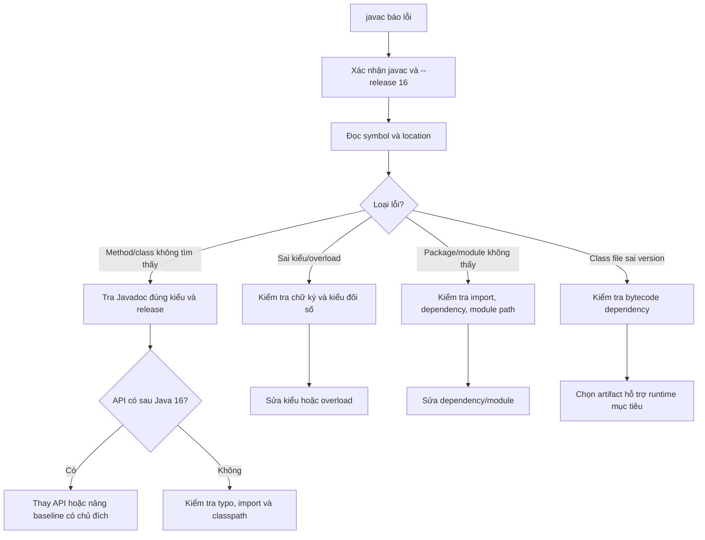

# Đọc thông báo biên dịch để phát hiện API vượt quá mức Java 16

> **Chương:** Định hướng Java 16  
> **Phạm vi:** Dùng thông báo của `javac` để tìm lời gọi API không có trong Java 16, phân biệt lỗi phiên bản với lỗi kiểu, import, dependency hoặc module. Bài học tập trung vào cách xử lý ổn định: khóa baseline bằng `--release 16`, tra Javadoc đúng phiên bản và chọn phương án thay thế phù hợp.

## Mục tiêu học tập

Sau bài này, bạn có thể:

1. Đọc các phần `symbol`, `location`, kiểu dữ liệu và thông điệp lỗi trong output của `javac`.
2. Nhận biết dấu hiệu mã đang gọi API được thêm sau Java 16.
3. Phân biệt API vượt baseline với lỗi viết sai tên, import, classpath, module path hoặc dependency.
4. Dùng `--release 16` để tái hiện lỗi một cách đáng tin cậy.
5. Tra `Since` trong Javadoc để xác nhận phiên bản xuất hiện của API.
6. Chọn giải pháp tương thích Java 16 hoặc điều chỉnh baseline một cách có chủ đích.

## 1. Vì sao cần đọc đúng thông báo compiler?

Một dự án có thể được phát triển bằng JDK mới, trong khi ứng dụng vẫn phải hỗ trợ Java 16. Khi đó, mã nguồn vô tình gọi một phương thức mới hơn có thể biên dịch thành công nếu build không khóa API mục tiêu. Ứng dụng chỉ bộc lộ lỗi khi chạy trên runtime cũ, thường dưới dạng `NoSuchMethodError` hoặc `NoClassDefFoundError`.

Compiler có thể phát hiện phần lớn trường hợp này ngay lúc build nếu cấu hình `--release 16`. Tuy nhiên, thông báo thường chỉ nói rằng compiler không tìm thấy symbol hoặc phương thức. `javac` không nhất thiết ghi rõ “API này được thêm ở Java 21”; người phát triển phải đọc kiểu được báo, xác định API và tra tài liệu phiên bản.

Ví dụ, `List.getFirst()` có từ Java 21. Nếu mã gọi phương thức này nhưng dự án đặt baseline Java 16, compiler sẽ từ chối. Khi hiểu đúng thông báo, ta có thể xác định đây là API mới hơn baseline thay vì sửa nhầm import hoặc thay đổi JDK một cách tùy tiện.

## 2. Luôn tái hiện lỗi với đúng baseline

Trước khi đọc sâu thông báo, xác nhận compiler thực tế và cấu hình release:

```bash
javac --version
java --version
javac --help
```

Nếu dùng JDK mới (ví dụ JDK 25), biên dịch với:

```bash
javac --release 16 -Xdiags:verbose -d out src/example/*.java
```

Ý nghĩa:

- `--release 16`: giới hạn quy tắc ngôn ngữ, API Java SE/JDK được hỗ trợ và class file ở mức Java 16.
- `-Xdiags:verbose`: yêu cầu compiler hiển thị dạng chẩn đoán chi tiết hơn khi có thể.
- `-d out`: đặt file `.class` vào thư mục `out`.

Không dùng riêng `--source 16` hoặc `--target 16` để kiểm tra API. Hai tùy chọn này không khóa tập API của nền tảng đích như `--release`.

Nếu build bằng Maven hoặc Gradle, hãy kiểm tra lệnh và toolchain thực tế. Một IDE có thể biên dịch bằng JDK khác với terminal hoặc CI. Cần xác định compiler nào phát ra thông báo lỗi trước khi kết luận.

## 3. Cách đọc cấu trúc một diagnostic

Một thông báo `javac` thường chứa vị trí lỗi trong file, dòng mã liên quan, dấu `^` chỉ vị trí, loại lỗi và thông tin về symbol mà compiler không phân giải được.

Ví dụ minh họa:

```text
ApiLevelDemo.java:6: error: cannot find symbol
        return values.getFirst();
                     ^
  symbol:   method getFirst()
  location: variable values of type List<String>
```

Đọc từ dưới lên hoặc theo các trường sau:

| Phần | Cần đọc gì? | Câu hỏi để chẩn đoán |
| --- | --- | --- |
| `ApiLevelDemo.java:6` | File và số dòng | Lỗi nằm ở lời gọi nào? |
| `cannot find symbol` | Compiler không phân giải được tên | Thiếu lớp, phương thức, trường hay biến? |
| `symbol: method getFirst()` | Tên và chữ ký mà compiler đang tìm | Có phải API được thêm sau Java 16? |
| `location: variable values of type List<String>` | Kiểu khai báo của receiver | Compiler đang tìm phương thức trên đúng kiểu nào? |
| Dòng mã và dấu `^` | Vị trí biểu thức gây lỗi | Có lời gọi hoặc import nào khác liên quan? |

**`location` đặc biệt quan trọng.** Nếu compiler ghi `type List<String>`, hãy tra API của `java.util.List` trong Java 16. Nếu receiver thực tế là một kiểu khác hoặc một kiểu generic, cần kiểm tra kiểu khai báo và kiểu suy luận trước khi kết luận phiên bản API.

Thông điệp lỗi là bằng chứng về điều compiler không phân giải được; nó chưa tự chứng minh nguyên nhân là API quá mới. Hãy kiểm tra release, kiểu, import và dependency.

## 4. Ví dụ: phát hiện `List.getFirst()` vượt quá Java 16

Tạo `ApiLevelDemo.java`:

```java
import java.util.List;

public class ApiLevelDemo {
    static String first(List<String> values) {
        return values.getFirst();
    }
}
```

`List.getFirst()` thuộc API `SequencedCollection` được bổ sung từ Java 21. Vì `List` của Java 16 chưa có phương thức này, biên dịch với baseline 16:

```bash
javac --release 16 -Xdiags:verbose -d out16 ApiLevelDemo.java
```

Compiler sẽ báo lỗi tương tự:

```text
error: cannot find symbol
        return values.getFirst();
                     ^
  symbol:   method getFirst()
  location: variable values of type List<String>
```

Nội dung chi tiết có thể khác đôi chút giữa phiên bản JDK và cách gọi compiler, nhưng điểm cần nhận ra là:

1. Symbol cần tìm là method `getFirst()`.
2. Receiver có kiểu `List<String>`.
3. Build đang dùng `--release 16`.
4. API `List.getFirst()` được thêm từ Java 21 nên không thuộc tập API mục tiêu.

Đối chiếu Javadoc:

- Java SE 16 `List`: không có `getFirst()`.
- Java SE 21 `List`: có `getFirst()`; tài liệu ghi `Since: 21`.

Đây là trường hợp điển hình của API vượt mức Java 16. Nếu bỏ `--release 16` và biên dịch mặc định bằng JDK 21 trở lên, lời gọi có thể thành công, nhưng class file và API được tham chiếu không còn đáp ứng baseline Java 16.

## 5. Phân biệt API quá mới với các lỗi thường gặp khác

Không phải mọi lỗi `cannot find symbol` đều là do API mới. Dùng `symbol` và `location` để khoanh vùng:

| Diagnostic | Nguyên nhân có thể | Cách xác minh |
| --- | --- | --- |
| `cannot find symbol: method getFirst()` trên `List<String>` | Phương thức không có trong API của release mục tiêu; cũng có thể gọi sai tên | Tra Javadoc `List` đúng release và kiểm tra tên method |
| `cannot find symbol: class SomeType` | Thiếu import, sai package, lớp chưa có trong release hoặc dependency chưa được thêm | Kiểm tra import, package, API `Since` và classpath |
| `package some.api does not exist` | Package không có trong nền tảng mục tiêu hoặc dependency/module chưa được đưa vào build | Kiểm tra API JDK, dependency và module path |
| `no suitable method found` | Có method cùng tên nhưng không overload nào nhận kiểu đối số hiện tại | Đọc các overload compiler liệt kê, kiểm tra kiểu và generic |
| `method ... cannot be applied to given types` | Sai số lượng hoặc kiểu tham số, hoặc overload không phù hợp | So sánh chữ ký method với kiểu đối số |
| `incompatible types` | Kiểu trả về/đối số không tương thích | Kiểm tra generic, phép gán và kiểu suy luận |
| `class file has wrong version` | Dependency được biên dịch bằng mức Java mới hơn compiler/runtime đang xử lý | Kiểm tra major version và phiên bản artifact |
| `module not found` hoặc package không được export | Thiếu module hoặc module không export package cần dùng | Kiểm tra `module-info.java`, module path và module graph |

### Phép thử đối chứng

Khi nghi API quá mới, thử biên dịch cùng một file bằng hai cấu hình:

```bash
# Kiểm tra baseline cần hỗ trợ.
javac --release 16 -Xdiags:verbose -d out16 ApiLevelDemo.java

# Kiểm tra compiler JDK mới có nhận diện API này không.
javac -Xdiags:verbose -d outCurrent ApiLevelDemo.java
```

Nếu lệnh thứ nhất thất bại còn lệnh thứ hai thành công, đây là dấu hiệu mạnh cho thấy mã đang dùng cú pháp hoặc API mới hơn baseline. Nhưng phép thử này vẫn chưa đủ: hãy tra Javadoc và xác minh kiểu thực tế để loại trừ sự khác nhau về classpath hoặc dependency.

Không dùng kết quả biên dịch mặc định trên JDK mới làm bằng chứng rằng ứng dụng chạy được trên Java 16.

## 6. Tra Javadoc để xác nhận API xuất hiện ở phiên bản nào

Khi diagnostic chỉ ra một method hoặc class không tìm thấy, đừng đoán phiên bản từ tên API. Mở Javadoc của đúng lớp và đúng phiên bản Java:

1. Xác định kiểu receiver từ `location` trong thông báo.
2. Mở Javadoc của kiểu đó ở Java SE 16.
3. Tìm method hoặc lớp cần dùng; nếu không có, kiểm tra API ở các phiên bản sau.
4. Đọc thẻ `Since` trên đúng thành viên hoặc lớp được thêm.
5. Kiểm tra kiểu tham số, kiểu trả về, ngoại lệ và hợp đồng hành vi.

Ví dụ với `List.getFirst()`:

| Tài liệu | Kết quả tra cứu |
| --- | --- |
| [Java SE 16 `List`](https://docs.oracle.com/en/java/javase/16/docs/api/java.base/java/util/List.html) | Không có `getFirst()` |
| [Java SE 21 `List`](https://docs.oracle.com/en/java/javase/21/docs/api/java.base/java/util/List.html) | Có phương thức kế thừa từ `SequencedCollection` |
| [JEP 431 — Sequenced Collections](https://openjdk.org/jeps/431) | Giới thiệu các collection có thứ tự và thao tác đầu/cuối ở Java 21 |

Thẻ `Since` giúp xác nhận mốc API được đưa vào nền tảng. Nếu phương thức được kế thừa, hãy mở tài liệu interface cha như `SequencedCollection` để đọc hợp đồng đầy đủ.

### Phân biệt `Since` với phiên bản compiler

`Since: 21` nói API có từ Java 21. Nó không có nghĩa compiler của Java 16 bị lỗi, cũng không có nghĩa phải bật một flag đặc biệt. Khi target Java 16, API đó đơn giản là không thuộc bề mặt API mà compiler được phép dùng.

Một phương thức có thể có cùng tên ở một thư viện bên thứ ba hoặc một kiểu khác. Vì vậy luôn tra đúng lớp được hiển thị trong `location`, không tìm tên method một cách độc lập rồi kết luận.

## 7. Chọn cách sửa tương thích Java 16

Sau khi xác nhận API vượt baseline, có ba hướng xử lý:

1. Dùng API tương đương đã có trong Java 16.
2. Viết một adapter nhỏ để giữ hợp đồng nghiệp vụ cần thiết.
3. Nâng baseline tối thiểu của dự án nếu hệ sinh thái và môi trường triển khai cho phép.

Với ví dụ `List.getFirst()`, Java 16 đã có `List.get(0)`. Tuy nhiên, hai phương thức có hành vi khác nhau khi danh sách rỗng: `getFirst()` ném `NoSuchElementException`, còn `get(0)` ném `IndexOutOfBoundsException`. Nếu cần giữ hành vi của `getFirst()`, phải xử lý trường hợp rỗng:

```java
import java.util.List;
import java.util.NoSuchElementException;

public class ApiLevelDemo {
    static String first(List<String> values) {
        if (values.isEmpty()) {
            throw new NoSuchElementException();
        }
        return values.get(0);
    }
}
```

Nếu hợp đồng nghiệp vụ cho phép biểu diễn trường hợp rỗng rõ ràng, có thể đổi kiểu trả về thành `Optional<String>` và dùng `values.stream().findFirst()`. Đây là thay đổi API của chính ứng dụng, vì caller phải xử lý `Optional`; hãy cập nhật test và tài liệu hợp đồng.

Không thay API mới bằng một lời gọi “gần giống” mà không kiểm tra:

- Hành vi với collection rỗng.
- Cách xử lý phần tử `null`.
- Thứ tự phần tử.
- Ngoại lệ được ném.
- Khả năng sửa đổi của kết quả.
- Độ phức tạp hoặc chi phí thực thi nếu nghiệp vụ nhạy hiệu năng.

### Khi nào nên nâng baseline?

Nếu ứng dụng thực sự cần API mới, framework hoặc dependency đã yêu cầu Java mới hơn, có thể nâng phiên bản Java tối thiểu. Trước khi quyết định:

- Kiểm tra runtime ở production, container và môi trường khách hàng có hỗ trợ không.
- Kiểm tra ma trận tương thích của framework, build tool và dependency.
- Chạy test trên runtime đích.
- Cập nhật `--release`, CI, Docker/base image và tài liệu vận hành.
- Thông báo rõ yêu cầu runtime mới cho người dùng hoặc nhóm triển khai.

Không nâng baseline chỉ để làm biến mất thông báo compiler khi API mới không mang lại giá trị cần thiết.

## 8. Những diagnostic khác và cách khoanh vùng

### Lớp hoặc package không tìm thấy

Ví dụ:

```text
error: cannot find symbol
import java.util.SequencedCollection;
                ^
  symbol:   class SequencedCollection
  location: package java.util
```

Nếu package hoặc kiểu chỉ được thêm ở release mới hơn, `--release 16` sẽ không cung cấp nó. Nhưng lỗi tương tự cũng xuất hiện khi dependency chưa được khai báo hoặc module chưa nằm trên module path.

Kiểm tra theo thứ tự:

1. Package có thuộc Java SE/JDK không, hay thuộc thư viện ngoài?
2. Nếu thuộc JDK, nó có trong Javadoc Java 16 không?
3. Nếu thuộc thư viện ngoài, dependency có trong classpath/module path không?
4. Nếu dùng module, module có yêu cầu đúng module và package được export không?

### `no suitable method found`

Thông báo này thường có nghĩa method cùng tên tồn tại nhưng không overload nào nhận được các kiểu đối số đang truyền. Đọc phần compiler liệt kê các overload và kiểu cần thiết. Nguyên nhân có thể là:

- Truyền nhầm kiểu đối số.
- Generic type bị suy luận khác mong đợi.
- Overload phù hợp chỉ xuất hiện ở release mới hơn.
- Một dependency đang được compiler nhìn thấy khác với dependency dự định.

Không tự động coi đây là API vượt Java 16. Tra Javadoc và kiểm tra chữ ký ở release mục tiêu.

### `class file has wrong version`

Đây thường là dấu hiệu một dependency đã được biên dịch bằng phiên bản Java mới hơn mức compiler/runtime có thể đọc. Ví dụ class file major version 65 là Java 21, trong khi Java 16 dùng major version 60.

Phân biệt:

- **Compiler đọc dependency:** có thể báo class file có phiên bản không hỗ trợ.
- **Runtime nạp dependency:** có thể ném `UnsupportedClassVersionError`.
- **Method không tồn tại ở runtime:** có thể ném `NoSuchMethodError`.

`--release 16` kiểm tra mã nguồn đang biên dịch; nó không chuyển bytecode của dependency Java 21 thành bytecode Java 16. Cần chọn phiên bản dependency có hỗ trợ runtime mục tiêu.

### `module not found` hoặc package không được export

Khi dự án dùng module system, kiểm tra:

- Module cần thiết đã có trong module path chưa?
- Tên module trong `requires` có chính xác không?
- Package có được module cung cấp export không?
- Đang dùng đúng JDK/module descriptor cho release mục tiêu không?

Lỗi module thường cần sửa cấu hình module path hoặc descriptor; nâng release không phải lúc nào cũng là cách giải quyết.

## 9. Đọc lỗi trong Maven và Gradle

Trong build tool, lỗi compiler thường nằm sâu trong log. Hãy tìm diagnostic đầu tiên của `javac`, sau đó xác minh JDK/toolchain và release được truyền vào compiler.

### Maven

Đặt baseline trong `pom.xml`:

```xml
<properties>
    <maven.compiler.release>16</maven.compiler.release>
</properties>
```

Chạy build:

```bash
mvn -version
mvn -e -DskipTests compile
```

`mvn -version` cho biết JVM đang chạy Maven. Nếu cần xem thêm chi tiết cấu hình compiler, dùng log debug:

```bash
mvn -X -DskipTests compile
```

Log debug có thể dài và chứa thông tin môi trường. Khi chia sẻ log, chỉ gửi đoạn liên quan đến compiler và xóa thông tin nhạy cảm của máy hoặc repository.

### Gradle

Đặt toolchain và release trong Gradle Kotlin DSL:

```kotlin
java {
    toolchain {
        languageVersion = JavaLanguageVersion.of(25)
    }
}

tasks.withType<JavaCompile>().configureEach {
    options.release = 16
}
```

Chạy compile với log thông tin:

```bash
./gradlew --version
./gradlew compileJava --info
```

Trên Windows dùng `gradlew.bat`. `--info` giúp xem thông tin task và toolchain; nếu cần thêm chi tiết, dùng `--debug` có chọn lọc và không chia sẻ log thô chứa đường dẫn hoặc thông tin nội bộ.

Trong cả Maven và Gradle, cần xác minh:

- JDK đang chạy build tool.
- JDK toolchain thực hiện compile.
- Giá trị release được truyền cho compiler.
- Classpath/module path có đúng dependency dự kiến.
- Diagnostic đầu tiên có trỏ tới API, kiểu hoặc dependency nào.

## 10. Quy trình chẩn đoán nhanh



Thực hiện theo thứ tự:

1. Ghi lại `javac --version` và release mục tiêu.
2. Đọc diagnostic đầu tiên; ghi `symbol` và `location`.
3. Xác định kiểu receiver hoặc lớp bị thiếu.
4. Tra Javadoc đúng phiên bản và đọc `Since`.
5. Kiểm tra import, classpath, module path và dependency nếu API có vẻ tồn tại.
6. Chọn API tương thích hoặc quyết định nâng baseline.
7. Build sạch và chạy test trên runtime nhỏ nhất mà dự án hỗ trợ.

Sửa lỗi đầu tiên rồi biên dịch lại. Một lỗi kiểu hoặc import ban đầu có thể tạo ra nhiều diagnostic thứ cấp; không nên xử lý tất cả thông báo như các lỗi độc lập.

## 11. Bài tập thực hành

### Bài 1 — API vượt baseline

Tạo chương trình gọi `List.getFirst()`. Biên dịch bằng JDK mới với `--release 16`, ghi lại `symbol` và `location`, rồi tra Javadoc để xác nhận `Since: 21`.

### Bài 2 — Phân biệt lỗi API và lỗi kiểu

Thử gọi một method có thật với kiểu đối số sai. So sánh `no suitable method found` với `cannot find symbol`. Giải thích vì sao hai diagnostic yêu cầu cách xử lý khác nhau.

### Bài 3 — Sửa tương thích Java 16

Viết lại ví dụ `List.getFirst()` bằng API Java 16. Kiểm thử danh sách có phần tử và danh sách rỗng; xác minh ngoại lệ hoặc kiểu kết quả phù hợp với hợp đồng bạn chọn.

### Bài 4 — Lỗi dependency

Tạo tình huống dependency được biên dịch bằng Java mới hơn. Đọc thông báo `class file has wrong version`, tìm major version và đề xuất phiên bản artifact phù hợp.

### Bài 5 — Chẩn đoán build tool

Trong Maven hoặc Gradle, cố ý dùng API vượt Java 16, chạy compile và tìm diagnostic đầu tiên trong log. Xác nhận JDK/toolchain và release; sau đó thay API hoặc điều chỉnh baseline rồi chạy lại test.

## Tài liệu chính thức

- [The `javac` Command — JDK 25](https://docs.oracle.com/en/java/javase/25/docs/specs/man/javac.html) — tùy chọn `--release` và `-Xdiags`.
- [Java SE 16 API Specification](https://docs.oracle.com/en/java/javase/16/docs/api/index.html) — tra API đúng baseline.
- [Java SE 21 — `List`](https://docs.oracle.com/en/java/javase/21/docs/api/java.base/java/util/List.html) — API `List` có các phương thức kế thừa mới.
- [JEP 431 — Sequenced Collections](https://openjdk.org/jeps/431) — mốc Java 21 cho collection có thứ tự.
- [Java Language Specification — Chapter 13](https://docs.oracle.com/javase/specs/jls/se16/html/jls-13.html) — liên kết và tương thích nhị phân.
- [Maven Compiler Plugin — Setting the `--release` of the Java Compiler](https://maven.apache.org/plugins/maven-compiler-plugin/examples/set-compiler-release.html) — khóa API và bytecode đích trong Maven.
- [Gradle Java Toolchains](https://docs.gradle.org/current/userguide/toolchains.html) — xác định JDK thực hiện compile.

**Nguyên tắc áp dụng:** Khi gặp lỗi compiler, đọc `symbol` và `location` trước, xác nhận đúng `--release 16`, rồi tra Javadoc của đúng kiểu. Chỉ kết luận API vượt baseline sau khi đã loại trừ lỗi tên, kiểu, import, dependency và module. Chọn phương án tương thích hoặc nâng baseline có kiểm soát, sau đó build sạch và kiểm thử trên runtime mục tiêu.
