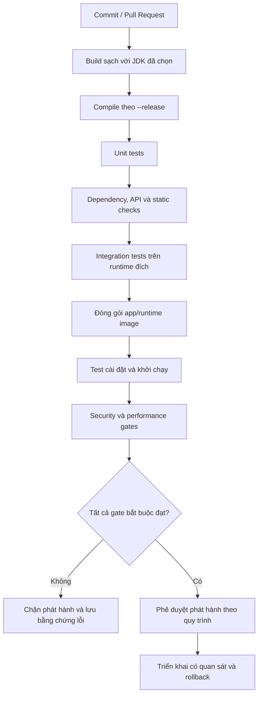

# Lập tiêu chí nghiệm thu khi áp dụng tính năng Java 16 vào ứng dụng

> **Chương:** Định hướng Java 16  
> **Phạm vi:** Chuyển các tính năng Java 16 đã chính thức thành tiêu chí nghiệm thu có thể kiểm chứng trước khi phát hành. Nội dung tập trung vào record, pattern matching cho instanceof, Stream API, đóng gói ứng dụng và thay đổi nền tảng vẫn có ý nghĩa trên JDK hiện đại.

## Mục tiêu học tập

Sau bài này, bạn có thể:

1. Viết tiêu chí nghiệm thu có điều kiện, hành động và kết quả quan sát được.
2. Đặt tiêu chí riêng cho record, pattern matching và Stream API.
3. Xác minh baseline Java, tương thích mã nguồn/nhị phân/hành vi và runtime được hỗ trợ.
4. Đánh giá đóng gói bằng jpackage và runtime image theo nhu cầu triển khai.
5. Kiểm tra truy cập API nội bộ, bảo mật, hiệu năng và khả năng vận hành.
6. Tạo release gate trong CI để chỉ phát hành khi các tiêu chí quan trọng đều đạt.

## 1. Nghiệm thu tính năng có nghĩa là gì?

Một tính năng được áp dụng thành công khi nó giải quyết đúng nhu cầu, giữ đúng hợp đồng của ứng dụng và có thể vận hành an toàn trong môi trường đích. Việc mã nguồn biên dịch được chỉ là một điều kiện ban đầu.

Với một thay đổi dựa trên Java 16, cần trả lời:

- **Đúng chức năng:** kết quả và ngoại lệ có khớp yêu cầu nghiệp vụ không?
- **Đúng nền tảng:** JDK, ngôn ngữ, API và runtime tối thiểu có được xác định rõ không?
- **Tương thích:** mã nguồn, thư viện đã biên dịch và hành vi ứng dụng có còn phù hợp không?
- **Đóng gói được:** artifact cài đặt có chứa đúng ứng dụng, runtime và tài nguyên cần thiết không?
- **An toàn:** không dựa vào API nội bộ hoặc cấu hình mở quyền truy cập không cần thiết?
- **Vận hành được:** có log, health check, khả năng cập nhật và rollback không?

Tiêu chí nghiệm thu nên viết sao cho một người khác có thể thực hiện và kết luận PASS/FAIL mà không cần đoán ý định của tác giả.

### Mẫu viết tiêu chí

Một tiêu chí rõ ràng có ba phần:

1. **Điều kiện:** trạng thái hoặc dữ liệu đầu vào.
2. **Hành động:** thao tác người dùng hoặc hệ thống thực hiện.
3. **Kết quả quan sát:** giá trị trả về, trạng thái, ngoại lệ hoặc bằng chứng kiểm tra.

Ví dụ:

```text
Given: Một OrderLine có sku hợp lệ, quantity = 2 và unitPrice = 10.00.
When: Ứng dụng tạo record và tính subtotal.
Then: sku được chuẩn hóa, subtotal bằng 20.00 và dữ liệu không bị thay đổi ngoài ý muốn.
```

Tránh tiêu chí như “record hoạt động tốt” hoặc “Stream chạy nhanh”. Các câu này không xác định dữ liệu, hành vi hay ngưỡng để nghiệm thu.

## 2. Xác định phạm vi và baseline trước khi áp dụng

Java 16 là feature release không thuộc nhóm LTS và đã hết vòng đời cập nhật. Những tính năng chính thức của nó vẫn hữu ích trên JDK mới, nhưng không nên chọn runtime Java 16 làm mặc định cho hệ thống mới.

Trước khi triển khai:

1. Ghi rõ JDK LTS và nhà cung cấp được tổ chức hỗ trợ.
2. Ghi rõ baseline ngôn ngữ/API và runtime nhỏ nhất mà ứng dụng thực sự cần hỗ trợ.
3. Nếu cần kiểm tra mã theo Java 16, dùng compiler JDK hiện đại với `--release 16`.
4. Xác minh framework, thư viện, agent, build tool và môi trường triển khai hỗ trợ JDK đã chọn.
5. Không bật preview hoặc incubator API để nghiệm thu những tính năng đã final ở Java 16.

### Bảng xác định môi trường

| Thành phần | Thông tin cần ghi | Bằng chứng |
| --- | --- | --- |
| JDK dùng để build | Vendor, major version, bản cập nhật | `java --version`, `javac --version` |
| Baseline compile | Java release mục tiêu | Log compiler có `--release` |
| Bytecode | Major version tương ứng baseline | `javap -verbose` |
| Test runtime | JDK thực thi unit/integration test | Log JVM của test process |
| Production runtime | JDK thực tế trên server/container/desktop | `java.home`, `java.version` khi ứng dụng khởi động |
| Dependencies | Phiên bản và JDK tối thiểu | Dependency tree, release notes, ma trận hỗ trợ |
| Đóng gói | Runtime image hoặc gói cài đặt | Kiểm thử artifact trên môi trường đích |

Không mặc định rằng `--release 16` chứng minh ứng dụng chạy được trên mọi runtime Java 16. Tùy chọn này kiểm tra ngôn ngữ, API nền tảng và class file của mã nguồn đang biên dịch; dependency, native library, reflection và hành vi JVM vẫn cần được kiểm tra riêng.

## 3. Tiêu chí nghiệm thu cho record

Record phù hợp với kiểu dữ liệu mô tả giá trị, có thành phần dữ liệu xác định và không cần danh tính thay đổi theo thời gian. Record đã chính thức từ Java 16.

### Tiêu chí thiết kế

- Thành phần record thể hiện đúng dữ liệu tạo nên giá trị của đối tượng.
- Compact constructor xác thực các invariant ngay khi tạo đối tượng.
- Dữ liệu bắt buộc được kiểm tra null; dữ liệu chuỗi được chuẩn hóa theo quy tắc nghiệp vụ.
- Không dùng record cho entity cần identity và trạng thái thay đổi liên tục chỉ vì cú pháp ngắn.
- Nếu thành phần chứa collection mutable, tạo defensive copy khi hợp đồng yêu cầu tính bất biến.
- Không giả định record tự tạo deep immutability cho mọi object được tham chiếu.

### Ví dụ

```java
import java.math.BigDecimal;
import java.util.Objects;

public record OrderLine(String sku, int quantity, BigDecimal unitPrice) {
    public OrderLine {
        sku = Objects.requireNonNull(sku, "sku").strip();
        unitPrice = Objects.requireNonNull(unitPrice, "unitPrice");

        if (sku.isEmpty()) {
            throw new IllegalArgumentException("sku must not be blank");
        }
        if (quantity < 0) {
            throw new IllegalArgumentException("quantity must not be negative");
        }
        if (unitPrice.signum() < 0) {
            throw new IllegalArgumentException("unitPrice must not be negative");
        }
    }

    public BigDecimal subtotal() {
        return unitPrice.multiply(BigDecimal.valueOf(quantity));
    }
}
```

### Tiêu chí nghiệm thu record

| ID | Tiêu chí PASS | Cách kiểm chứng |
| --- | --- | --- |
| REC-01 | Mọi thành phần biểu diễn dữ liệu thuộc hợp đồng của record | Review tên, kiểu và tài liệu thành phần |
| REC-02 | Dữ liệu null/không hợp lệ bị từ chối theo hợp đồng đã công bố | Unit test constructor với dữ liệu hợp lệ, null và biên |
| REC-03 | Giá trị được chuẩn hóa nhất quán | Test accessor sau khi tạo record |
| REC-04 | Hai record có cùng thành phần theo quy tắc miền dữ liệu so sánh bằng nhau | Test equals/hashCode |
| REC-05 | Collection đầu vào không thể bị caller sửa để thay đổi trạng thái record | Test defensive copy và danh sách đầu ra |
| REC-06 | Không vô tình thay đổi public constructor/accessor gây lỗi caller hiện có | Compile caller và kiểm tra binary compatibility khi record là API công khai |
| REC-07 | Quy tắc số học và scale tiền tệ được xác định rõ | Test BigDecimal theo chính sách scale/rounding |

### Lưu ý về tương thích

Thêm, xóa hoặc đổi thứ tự/kiểu record component có thể ảnh hưởng constructor, accessor, equality và caller đã biên dịch. Nếu record là public API hoặc được serialize qua ranh giới hệ thống, cần có tiêu chí riêng cho schema, phiên bản dữ liệu và chiến lược chuyển đổi. Không xem việc thêm một component là thay đổi nội bộ vô hại.

## 4. Tiêu chí nghiệm thu cho pattern matching với instanceof

Pattern matching cho `instanceof` đã chính thức ở Java 16. Nó kết hợp kiểm tra kiểu và khai báo biến pattern, giúp giảm ép kiểu thủ công.

Ví dụ:

```java
public final class OrderFormatter {
    private OrderFormatter() {}

    public static String describe(Object value) {
        if (value instanceof OrderLine line) {
            return line.sku() + " x " + line.quantity();
        }
        return "Unknown value";
    }
}
```

### Tiêu chí nghiệm thu

| ID | Tiêu chí PASS | Cách kiểm chứng |
| --- | --- | --- |
| PAT-01 | Nhánh đúng kiểu sử dụng biến pattern và trả kết quả chính xác | Unit test với instance của kiểu đích |
| PAT-02 | Kiểu không phù hợp đi vào nhánh dự phòng | Test với String hoặc object khác |
| PAT-03 | Giá trị null được xử lý đúng; `null instanceof Type` cho kết quả false | Unit test null |
| PAT-04 | Biến pattern chỉ được dùng ở vùng flow scope hợp lệ | Biên dịch với release 16 |
| PAT-05 | Điều kiện phức hợp có ngoặc và thứ tự logic rõ ràng | Review và test từng nhánh boolean |
| PAT-06 | Không giữ cast thủ công dư thừa sau pattern matching | Static review hoặc kiểm tra code |
| PAT-07 | Hành vi với subtype/interface đúng theo hợp đồng | Test các lớp triển khai thực tế |

Khi kết hợp `&&`, `||` hoặc phủ định, cần đọc kỹ flow scoping và đặt ngoặc để điều kiện không nhập nhằng. Pattern matching cho `instanceof` không đồng nghĩa với pattern matching trong `switch`; không đưa preview switch pattern của Java 16 vào tiêu chí ổn định.

## 5. Tiêu chí nghiệm thu cho Stream API

Java 16 bổ sung `Stream.toList()` và `Stream.mapMulti()`. Khi dùng chúng, tiêu chí quan trọng nhất là hợp đồng kết quả, thứ tự, khả năng sửa đổi và xử lý dữ liệu biên.

### Tiêu chí cho `Stream.toList()`

- Danh sách kết quả chứa đúng các phần tử mong đợi.
- Nếu nguồn có encounter order, kết quả giữ thứ tự đó.
- Kết quả không thể sửa qua các thao tác thêm, xóa hoặc thay thế.
- Nếu nghiệp vụ cần danh sách mutable, tạo bản sao như `new ArrayList<>(stream.toList())`.
- Không kiểm tra lớp triển khai nội bộ của danh sách.

### Tiêu chí cho `Stream.mapMulti()`

- Callback phát đúng 0, 1 hoặc nhiều phần tử cho mỗi phần tử đầu vào.
- Không phát phần tử khi điều kiện lọc không đạt.
- Thứ tự phát phần tử đúng với quy tắc nghiệp vụ và ordered source.
- Đầu vào rỗng, nhóm rỗng và dữ liệu biên được kiểm thử.
- Không dùng side effect hoặc state dùng chung để thu thập kết quả.
- Chọn `mapMulti()` hay `flatMap()` theo tính dễ đọc; chỉ tuyên bố cải thiện hiệu năng sau benchmark có kiểm soát.

### Ví dụ pipeline

```java
import java.util.List;

public final class OrderQueries {
    private OrderQueries() {}

    public static List<OrderLine> positiveLines(List<?> values) {
        return values.stream()
                .<OrderLine>mapMulti((value, downstream) -> {
                    if (value instanceof OrderLine line && line.quantity() > 0) {
                        downstream.accept(line);
                    }
                })
                .toList();
    }
}
```

### Tiêu chí nghiệm thu Stream

| ID | Tiêu chí PASS | Cách kiểm chứng |
| --- | --- | --- |
| STR-01 | Tập phần tử đầu ra chính xác | Unit test so sánh nội dung |
| STR-02 | Ordered source giữ encounter order | Test với danh sách có thứ tự |
| STR-03 | Mỗi input phát đúng 0..n output | Test trường hợp không phát, một phần tử, nhiều phần tử |
| STR-04 | Stream rỗng cho kết quả theo hợp đồng | Test empty list và phép reduce |
| STR-05 | Kết quả từ `toList()` không thể sửa | Test UnsupportedOperationException |
| STR-06 | Không có side effect làm sai kết quả khi chạy song song | Review pipeline và test nếu dùng parallel |
| STR-07 | Hiệu năng đạt ngưỡng đã xác định trên dữ liệu đại diện | Benchmark có warmup, nhiều lần đo và môi trường ghi nhận |

Không mặc định mọi Stream là ordered. Nếu nguồn hoặc pipeline không bảo đảm thứ tự, tiêu chí cần so sánh nội dung theo tập hợp hoặc định nghĩa thứ tự đầu ra riêng.

## 6. Tiêu chí nghiệm thu đóng gói ứng dụng

Java 16 đưa `jpackage` thành công cụ đóng gói chính thức (JEP 392). Công cụ này có thể tạo application image hoặc gói cài đặt native phù hợp nền tảng. `jlink` tạo runtime image tùy biến và đã có từ Java 9; không nhầm hai công cụ này là cùng một tính năng mới của Java 16.

Trước khi chọn cách đóng gói, xác định ứng dụng cần:

- Chạy trên máy đã cài JDK/JRE được quản trị tập trung.
- Mang theo runtime image riêng để giảm phụ thuộc vào Java cài trên máy.
- Cài đặt như ứng dụng desktop/native package theo hệ điều hành.
- Phân phối container image cho môi trường server.

### Tiêu chí cho jpackage

| ID | Tiêu chí PASS | Cách kiểm chứng |
| --- | --- | --- |
| PKG-01 | Gói chứa đúng phiên bản ứng dụng và tài nguyên cần thiết | Cài trên máy sạch và mở ứng dụng |
| PKG-02 | Runtime đi kèm hoặc runtime prerequisite được khai báo rõ | Kiểm tra image và chạy khi máy đích không có JDK toàn cục nếu gói tự chứa runtime |
| PKG-03 | Gói được tạo cho đúng hệ điều hành/kiến trúc | Build và test trên từng nền tảng mục tiêu |
| PKG-04 | Điểm vào, tên ứng dụng, version, icon và metadata đúng | Kiểm tra installer/app image sau khi tạo |
| PKG-05 | Cài đặt, khởi chạy, nâng cấp và gỡ cài đặt thành công | Test lifecycle trên máy thử sạch |
| PKG-06 | File cấu hình, log và dữ liệu người dùng nằm đúng vị trí | Kiểm tra quyền và đường dẫn sau cài đặt |
| PKG-07 | Gói được ký theo chính sách phân phối của nền tảng khi cần | Xác minh chữ ký và cảnh báo hệ điều hành |
| PKG-08 | Có thể xác định runtime và phiên bản ứng dụng khi chẩn đoán | Log phiên bản lúc khởi động |

### Phân biệt application image và installer

- **Application image:** thư mục ứng dụng có launcher và thành phần cần để chạy; phù hợp để kiểm thử hoặc phân phối theo cách tổ chức quản lý.
- **Native installer:** gói cài đặt theo định dạng của nền tảng, ví dụ định dạng installer tương ứng trên Windows, macOS hoặc Linux.
- **Runtime image:** tập thành phần runtime được tạo bằng `jlink` hoặc được cung cấp cho công cụ đóng gói; cần có đúng module ứng dụng sử dụng.

`jpackage` tạo đầu ra theo nền tảng đích. Hãy build trên hệ điều hành/kiến trúc phù hợp và kiểm thử gói trên môi trường sạch tương ứng; không giả định một installer native có thể tạo một lần rồi chạy nguyên trạng trên mọi hệ điều hành.

### Ví dụ lệnh đóng gói

Ví dụ tạo application image từ JAR:

```bash
jpackage \
  --type app-image \
  --name OrderDesk \
  --input target \
  --main-jar order-desk.jar \
  --main-class vn.example.orders.Main
```

Ví dụ tạo runtime image tối thiểu trước:

```bash
jlink \
  --add-modules java.base,java.desktop \
  --output runtime-image
```

Danh sách module ở đây chỉ là ví dụ; cần xác định module thực tế từ ứng dụng và dependency. Nếu dùng runtime image riêng, cấu hình đóng gói để sử dụng đúng image đó, rồi test toàn bộ luồng khởi động và chức năng. Không thêm hoặc bỏ module chỉ dựa trên ví dụ.

### Tiêu chí cho jlink/runtime image

- Tất cả module cần thiết của ứng dụng và dependency đều có trong image.
- Không loại module đang được nạp động, dùng qua service loading hoặc reflection.
- Kích thước image đạt ngân sách đã đặt nhưng vẫn giữ đầy đủ chức năng.
- Ứng dụng khởi chạy trên máy sạch không dựa vào JDK khác ngoài runtime đã đóng gói.
- Cập nhật JDK/runtime image được thực hiện theo quy trình vá bảo mật.

Không xem runtime image nhỏ nhất là mục tiêu duy nhất. Ưu tiên tính đầy đủ, khả năng cập nhật và khả năng chẩn đoán.

## 7. Tiêu chí nghiệm thu thay đổi nền tảng và đóng gói mạnh

Java 16 thay đổi mặc định về đóng gói mạnh các thành phần nội bộ JDK theo JEP 396; Java 17 tiếp tục siết chặt theo JEP 403. Ứng dụng và thư viện nên dựa vào API công khai, có tài liệu thay vì truy cập nội bộ.

### Tiêu chí

| ID | Tiêu chí PASS | Cách kiểm chứng |
| --- | --- | --- |
| JVM-01 | Không còn phụ thuộc ngoài ý muốn vào API nội bộ JDK | Chạy `jdeps --jdk-internals` trên artifact |
| JVM-02 | Reflection vào package của module khác chỉ diễn ra khi có hợp đồng và quyền rõ ràng | Integration test trên JDK đích, kiểm tra `InaccessibleObjectException` |
| JVM-03 | Không cần mở rộng quyền truy cập toàn cục để ứng dụng hoạt động | Kiểm tra JVM arguments và cấu hình module |
| JVM-04 | Các dependency/agent hỗ trợ JDK mục tiêu | Ma trận tương thích và test với agent bật |
| JVM-05 | Không phụ thuộc cờ mở khóa truy cập đã lỗi thời hoặc chỉ dùng tạm | Kiểm tra script khởi chạy và cấu hình deployment |

Chạy:

```bash
jdeps --jdk-internals application.jar
```

`jdeps` giúp phát hiện một số phụ thuộc tĩnh vào API nội bộ. Nó không tìm được mọi truy cập reflection, tên lớp được tạo động hoặc hành vi native. Vì vậy, cần kết hợp kiểm tra tĩnh với integration test và log trên runtime thực tế.

Nếu một thư viện cũ yêu cầu mở package bằng tùy chọn module, hãy xác định package và module cụ thể, ghi lại lý do, giới hạn phạm vi, kiểm thử trên JDK đích và có kế hoạch nâng thư viện. Không coi việc thêm nhiều cờ mở quyền truy cập là tiêu chí nghiệm thu đạt.

### Charset và dữ liệu

JEP 400 chuẩn hóa charset mặc định thành UTF-8 từ Java 18. Ứng dụng cần định dạng dữ liệu ổn định nên chỉ rõ charset thay vì phụ thuộc môi trường.

```java
import java.nio.charset.StandardCharsets;
import java.nio.file.Files;
import java.nio.file.Path;

String content = Files.readString(
        Path.of("orders.csv"),
        StandardCharsets.UTF_8
);
```

Tiêu chí nghiệm thu:

- Encoding của file, giao thức và dữ liệu được ghi rõ trong hợp đồng.
- Test có ký tự tiếng Việt và ký tự ngoài ASCII.
- Đọc/ghi trên môi trường Windows, Linux và macOS cho kết quả nhất quán nếu ứng dụng hỗ trợ các nền tảng đó.
- Không thay đổi dữ liệu cũ khi nâng JDK hoặc thay đổi môi trường triển khai.

## 8. Tiêu chí bảo mật, hiệu năng và khả năng vận hành

Tính năng ngôn ngữ có thể đúng nhưng ứng dụng vẫn không đạt yêu cầu sản phẩm nếu tạo rủi ro bảo mật, hiệu năng hoặc vận hành.

### Bảo mật

- Không log dữ liệu nhạy cảm từ record hoặc `toString()` nếu record chứa thông tin cá nhân, token hay bí mật.
- Kiểm tra đầu vào và invariant trước khi đưa dữ liệu vào Stream pipeline.
- Không dùng side effect không kiểm soát trong pipeline, đặc biệt khi chuyển sang parallel stream.
- Dependency và JDK runtime nhận bản vá theo chính sách hỗ trợ.
- Gói cài đặt và artifact được lưu trữ, ký và phân phối theo quy trình tin cậy của tổ chức.
- Quyền file, thư mục dữ liệu và quyền tiến trình ở mức tối thiểu cần thiết.

### Hiệu năng

Đặt ngưỡng dựa trên workload thật, không dựa trên nhận định rằng cú pháp mới chắc chắn nhanh hơn.

| Chỉ số | Tiêu chí mẫu | Bằng chứng |
| --- | --- | --- |
| Latency | P95/P99 không vượt ngân sách của endpoint | Benchmark/load test trước và sau |
| Throughput | Đạt tải mục tiêu với dữ liệu đại diện | Load test có ghi nhận cấu hình |
| Memory | Heap và allocation không vượt ngân sách | Profiling/JFR hoặc công cụ quan sát phù hợp |
| Startup | Thời gian khởi động đạt SLO | Đo nhiều lần trong môi trường tương đương |
| Package size | Runtime image nằm trong giới hạn phân phối | Đo artifact cuối, không chỉ JAR |

Khi benchmark `mapMulti()` so với `flatMap()`, dùng cùng dữ liệu, cùng JDK, cùng cấu hình, warmup phù hợp và nhiều lần đo. Không biến một microbenchmark đơn lẻ thành cam kết hiệu năng sản phẩm.

### Khả năng vận hành

- Log phiên bản ứng dụng, vendor/JDK version và runtime location khi khởi động.
- Có health check phản ánh trạng thái phụ thuộc quan trọng.
- Có hướng dẫn cập nhật runtime và ứng dụng.
- Có phương án rollback artifact và cấu hình.
- Có dashboard hoặc log đủ để phát hiện lỗi khởi động, lỗi liên kết và suy giảm hiệu năng.
- Gói cài đặt không ghi đè dữ liệu người dùng khi nâng cấp hoặc gỡ cài đặt.

## 9. Release gate trong CI

Đưa tiêu chí quan trọng vào pipeline để kết quả nghiệm thu có thể lặp lại. Mỗi gate cần có lệnh hoặc báo cáo cụ thể; không đánh dấu PASS chỉ vì một bước build kết thúc thành công.

### Các gate đề xuất

| Gate | Kiểm tra | Điều kiện PASS |
| --- | --- | --- |
| GATE-01 — Compile | Build sạch với JDK/toolchain đã phê duyệt và release mục tiêu | Không có lỗi compiler; release được ghi nhận trong log |
| GATE-02 — Unit tests | Test record, pattern matching và Stream | Tất cả test bắt buộc đạt; không có test bị bỏ qua ngoài kế hoạch |
| GATE-03 — Compatibility | API baseline, dependency bytecode, source/binary compatibility | Không có dependency vượt runtime tối thiểu; thay đổi public API được đánh giá |
| GATE-04 — Static checks | `jdeps`, cảnh báo compiler, dependency/security scan | Không còn vi phạm blocker hoặc có ngoại lệ được phê duyệt và theo dõi |
| GATE-05 — Integration | Chạy với database, filesystem, network, reflection và agent thực tế | Hợp đồng tích hợp đạt trên JDK runtime mục tiêu |
| GATE-06 — Packaging | Tạo app image/installer/runtime image | Cài, khởi chạy, cập nhật và gỡ cài đặt đạt trên nền tảng hỗ trợ |
| GATE-07 — Security | Kiểm tra dependency, chữ ký artifact, quyền file và cấu hình runtime | Không còn lỗ hổng blocker; artifact được phát hành từ nguồn tin cậy |
| GATE-08 — Performance | Benchmark/load test theo SLO | Latency, throughput, memory và startup nằm trong ngân sách |
| GATE-09 — Operations | Kiểm tra log, health check, rollback và cập nhật runtime | Có thể chẩn đoán, triển khai và quay lui theo runbook |

### Sơ đồ pipeline



Nếu một gate không áp dụng, ghi rõ lý do và người chịu trách nhiệm chấp nhận rủi ro. Không xóa gate chỉ vì nó đang làm pipeline thất bại.

### Ví dụ cấu hình release trong Maven

Với phiên bản `maven-compiler-plugin` hỗ trợ thuộc tính release:

```xml
<properties>
    <maven.compiler.release>16</maven.compiler.release>
</properties>
```

Build và test:

```bash
mvn clean verify
javap -verbose -classpath target/classes vn.example.orders.OrderLine
jdeps --jdk-internals target/java16-application.jar
```

Các lệnh cuối là bước kiểm tra bổ sung sau khi artifact tương ứng đã được tạo. Thay tên JAR và lớp bằng artifact thực tế của dự án. Nếu JAR không được tạo ở lifecycle đang chạy, thực hiện package trước khi phân tích artifact.

### Bằng chứng cần lưu cho mỗi lần nghiệm thu

- Commit/revision và phiên bản build tool.
- JDK vendor, version và toolchain thực tế.
- Giá trị release và major version class file.
- Báo cáo unit/integration test.
- Dependency tree và kết quả phân tích API nội bộ.
- Artifact đóng gói, checksum/chữ ký và nền tảng build.
- Kết quả cài đặt, smoke test, security scan và performance test.
- Người phê duyệt ngoại lệ cùng thời hạn xử lý.

## 10. Ma trận nghiệm thu tổng hợp

Bảng này có thể dùng làm checklist review cho một thay đổi Java 16. Điều chỉnh ngưỡng theo yêu cầu sản phẩm và runtime thực tế.

| Nhóm | Tiêu chí bắt buộc | Bằng chứng tối thiểu |
| --- | --- | --- |
| Phạm vi | Tính năng được chọn đã final và phù hợp nhu cầu | JEP/API specification và mô tả thay đổi |
| Baseline | JDK build, release và runtime tối thiểu được ghi rõ | Build log và cấu hình CI |
| Record | Invariant, equality, collection semantics và compatibility được kiểm tra | Unit tests và review API |
| Pattern matching | Nhánh đúng kiểu, sai kiểu, null và flow scope được kiểm tra | Unit tests và compile |
| Stream | Nội dung, order, empty, zero-to-many và mutability được kiểm tra | Unit tests; benchmark nếu có yêu cầu hiệu năng |
| Dependency | Mọi dependency hỗ trợ JDK/runtime mục tiêu | Dependency tree và vendor compatibility matrix |
| JVM/module | Không phụ thuộc API nội bộ không được hỗ trợ | `jdeps`, integration test, JVM arguments review |
| Charset/dữ liệu | Encoding được xác định rõ; dữ liệu không đổi ngoài ý muốn | Test dữ liệu đa ngôn ngữ và regression |
| Packaging | Runtime/module/resource đầy đủ; lifecycle cài đặt đạt | App image/installer được test trên máy sạch |
| Security | Dependency và artifact đạt chính sách bảo mật | Scan, chữ ký, quyền file và cấu hình |
| Performance | Đạt SLO đã định | Benchmark/load test có thể tái lập |
| Operations | Log, health check, cập nhật và rollback sẵn sàng | Runbook và diễn tập triển khai |

## 11. Quyết định GO / NO-GO

### GO khi

- Các tính năng được sử dụng đã chính thức và không phụ thuộc preview/incubator.
- Build dùng JDK còn được hỗ trợ; baseline và runtime được ghi rõ.
- Unit, integration và regression tests đạt.
- Không có dependency bytecode vượt runtime nhỏ nhất được hỗ trợ.
- Các thay đổi public API có đánh giá tương thích.
- Gói ứng dụng chạy trên môi trường đích và có runtime/module/resource cần thiết.
- Security, performance và operations gates đạt ngưỡng đã thống nhất.
- Có artifact, log và báo cáo đủ để tái lập quyết định nghiệm thu.

### NO-GO khi

- Chỉ build thành công trên máy lập trình viên nhưng CI hoặc runtime đích chưa được xác minh.
- Còn lỗi test, lỗi liên kết, truy cập API nội bộ không được kiểm soát hoặc dependency không hỗ trợ JDK mục tiêu.
- Gói cài đặt thiếu runtime/module/tài nguyên hoặc chưa kiểm thử cài đặt trên nền tảng hỗ trợ.
- Dữ liệu thay đổi encoding/format ngoài hợp đồng.
- Hiệu năng hoặc bảo mật vượt ngưỡng chặn.
- Chưa có phương án cập nhật runtime, quan sát sau phát hành hoặc rollback.

Ngoại lệ chỉ được chấp nhận khi có phạm vi, lý do, người chịu trách nhiệm, biện pháp giảm thiểu và thời hạn xử lý. Một ngoại lệ không được biến thành mặc định không thời hạn.

## 12. Bài tập thực hành

### Bài 1 — Viết tiêu chí cho record

Chọn một record trong ứng dụng. Viết ít nhất năm tiêu chí nghiệm thu cho validation, equality, defensive copy, dữ liệu biên và tương thích constructor/accessor.

### Bài 2 — Viết tiêu chí cho pattern matching

Chọn một hàm nhận `Object`. Viết test cho kiểu đúng, kiểu sai, null và các nhánh điều kiện. Ghi rõ kết quả mong đợi cho từng trường hợp.

### Bài 3 — Viết tiêu chí cho Stream

Tạo pipeline dùng `mapMulti()` và `toList()`. Xác định trường hợp phát 0, 1 và nhiều phần tử; kiểm tra thứ tự, stream rỗng và việc sửa danh sách đầu ra.

### Bài 4 — Nghiệm thu gói ứng dụng

Tạo application image bằng `jpackage`. Viết checklist cho máy sạch, runtime, launcher, tài nguyên, chữ ký, cập nhật và gỡ cài đặt. Nếu ứng dụng không phải desktop, giải thích vì sao cách đóng gói khác phù hợp hơn.

### Bài 5 — Tạo release gate

Đưa build, unit test, dependency scan, integration test và packaging test vào CI. Xác định gate nào chặn phát hành và báo cáo nào phải được lưu.

### Bài 6 — Ra quyết định

Một dự án biên dịch với `--release 16` và toàn bộ unit test đạt, nhưng dependency có class file Java 21 và installer chưa được thử trên máy sạch. Hãy đưa ra quyết định GO/NO-GO và liệt kê bằng chứng còn thiếu.

## Tài liệu chính thức

- [JEP 395 — Records](https://openjdk.org/jeps/395) — record trở thành tính năng ngôn ngữ chính thức ở Java 16.
- [JEP 394 — Pattern Matching for instanceof](https://openjdk.org/jeps/394) — pattern matching cho `instanceof` trở thành chính thức ở Java 16.
- [Java SE 16 — Stream API](https://docs.oracle.com/en/java/javase/16/docs/api/java.base/java/util/stream/Stream.html) — hợp đồng `mapMulti()` và `toList()`.
- [JEP 392 — Packaging Tool](https://openjdk.org/jeps/392) — `jpackage` trở thành công cụ chính thức ở Java 16.
- [JEP 396 — Strongly Encapsulate JDK Internals by Default](https://openjdk.org/jeps/396) và [JEP 403 — Strongly Encapsulate JDK Internals](https://openjdk.org/jeps/403) — thay đổi đóng gói API nội bộ.
- [JEP 400 — UTF-8 by Default](https://openjdk.org/jeps/400) — charset mặc định UTF-8 từ Java 18.
- [The `jpackage` Command — JDK 25](https://docs.oracle.com/en/java/javase/25/docs/specs/man/jpackage.html) — tùy chọn đóng gói ứng dụng.
- [The `jlink` Command — JDK 25](https://docs.oracle.com/en/java/javase/25/docs/specs/man/jlink.html) — tạo runtime image tùy biến.
- [The `jdeps` Command — JDK 25](https://docs.oracle.com/en/java/javase/25/docs/specs/man/jdeps.html) — phân tích dependency và API nội bộ.
- [The `javac` Command — JDK 25](https://docs.oracle.com/en/java/javase/25/docs/specs/man/javac.html) — `--release` và compiler options.

**Nguyên tắc áp dụng:** Chỉ nghiệm thu khi có bằng chứng cho chức năng, baseline, tương thích, đóng gói, bảo mật, hiệu năng và vận hành. Dùng các tính năng Java 16 đã final trên JDK hiện được hỗ trợ; đưa tiêu chí vào CI để kết quả có thể lặp lại và quyết định phát hành có căn cứ.
