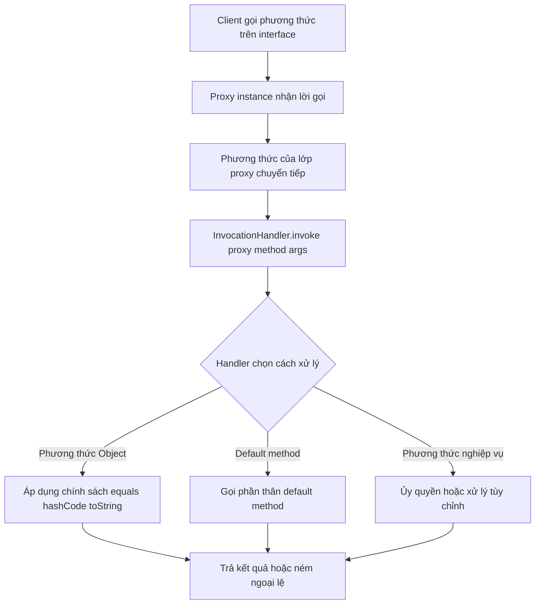

# Đường đi của lời gọi từ dynamic proxy đến InvocationHandler

Java dynamic proxy cho phép tạo một đối tượng triển khai các interface tại thời điểm chạy. Khi chương trình gọi một phương thức instance trên đối tượng proxy, lời gọi được chuyển đến `InvocationHandler.invoke`. Handler nhận thông tin về proxy, phương thức và đối số, sau đó quyết định cách xử lý và trả kết quả cho bên gọi.

Hiểu rõ luồng này giúp xây dựng proxy để ghi log, kiểm tra quyền, đo thời gian, bổ sung cache hoặc ủy quyền lời gọi đến một đối tượng thật. Cơ chế dynamic proxy vẫn được hỗ trợ trên các JDK hiện đại; từ Java 16, handler còn có API chuẩn `InvocationHandler.invokeDefault` để gọi phần thân default method của interface.

## 1. Các thành phần tham gia

Một dynamic proxy thường có ba thành phần:

- **Interface:** khai báo các phương thức mà mã gọi có thể sử dụng.
- **Proxy instance:** đối tượng được tạo bởi `Proxy.newProxyInstance`, có thể được ép kiểu về interface đã đăng ký.
- **InvocationHandler:** bộ xử lý nhận mọi lời gọi phương thức instance mà proxy ủy quyền.

Handler được cung cấp khi tạo proxy. JDK tạo hoặc sử dụng lớp proxy phù hợp với class loader và các interface đã truyền vào. Các phương thức được gọi trên proxy sẽ chuyển thông tin đến handler.

```java
OrderService proxy = (OrderService) Proxy.newProxyInstance(
        OrderService.class.getClassLoader(),
        new Class<?>[]{OrderService.class},
        handler);
```

Đối tượng `proxy` là đối tượng mà ứng dụng sử dụng. Handler không tự động có một đối tượng nghiệp vụ đích; nếu muốn ủy quyền đến implementation thật, ứng dụng phải giữ đối tượng đó trong handler hoặc trong một đối tượng được handler tham chiếu.

## 2. Luồng xử lý từ lúc gọi đến lúc trả kết quả

Luồng tổng quát có thể hình dung như sau:



Các bước diễn ra theo thứ tự:

1. Client gọi phương thức thông qua biến có kiểu interface, ví dụ `proxy.findOrder("A-17")`.
2. Đối tượng thực tế là proxy. Phương thức tương ứng trên lớp proxy chuyển lời gọi đến handler đã đăng ký.
3. JDK gọi `InvocationHandler.invoke(proxy, method, args)`.
4. Handler kiểm tra `method` và `args`, rồi chọn chính sách: xử lý trực tiếp, gọi default method hoặc ủy quyền đến đối tượng đích.
5. Handler trả về một giá trị tương thích với kiểu trả về của phương thức, hoặc ném ngoại lệ.
6. Proxy chuyển kết quả về client. Nếu kiểu trả về là kiểu nguyên thủy, mã proxy sẽ chuyển đổi giá trị wrapper phù hợp về kiểu nguyên thủy.

Chữ ký của handler là:

```java
Object invoke(Object proxy, Method method, Object[] args) throws Throwable;
```

Ba tham số có ý nghĩa riêng:

| Tham số | Ý nghĩa |
|---|---|
| `proxy` | Chính đối tượng proxy đang nhận lời gọi. |
| `method` | Đối tượng reflection mô tả phương thức được chuyển đến handler. |
| `args` | Các đối số truyền vào phương thức; có thể là `null` nếu phương thức không có tham số. |

`method` là metadata về phương thức, không phải đối tượng chứa implementation để handler tự động thực thi. Handler phải chủ động gọi đối tượng đích, gọi default method hoặc tạo kết quả theo chính sách của ứng dụng.

## 3. Ví dụ theo dõi lời gọi và ủy quyền đến đối tượng thật

Ví dụ sau tạo proxy cho `OrderService`. Handler ghi tên phương thức, gọi default method bằng API Java 16, và chuyển phương thức nghiệp vụ đến đối tượng `OrderServiceImpl`.

```java
import java.lang.reflect.InvocationHandler;
import java.lang.reflect.InvocationTargetException;
import java.lang.reflect.Method;
import java.lang.reflect.Proxy;

public class ProxyCallFlowDemo {
    public interface OrderService {
        String findOrder(String id);

        default String describe(String id) {
            return findOrder(id) + " - READY";
        }
    }

    public static final class OrderServiceImpl implements OrderService {
        @Override
        public String findOrder(String id) {
            return "Order " + id;
        }
    }

    public static void main(String[] args) {
        OrderService target = new OrderServiceImpl();

        InvocationHandler handler = (proxy, method, arguments) -> {
            // equals, hashCode và toString cũng được chuyển đến handler.
            if (method.getDeclaringClass() == Object.class) {
                return switch (method.getName()) {
                    case "toString" -> "OrderService proxy";
                    case "hashCode" -> System.identityHashCode(proxy);
                    case "equals" -> proxy == arguments[0];
                    default -> throw new UnsupportedOperationException(
                            method.toString());
                };
            }

            System.out.println("[proxy] " + method.getName());

            // Chạy default method với proxy làm đối tượng nhận lời gọi.
            if (method.isDefault()) {
                Object[] actualArguments = arguments == null
                        ? new Object[0]
                        : arguments;
                return InvocationHandler.invokeDefault(
                        proxy, method, actualArguments);
            }

            // Ủy quyền phương thức nghiệp vụ đến implementation thật.
            try {
                return method.invoke(target, arguments);
            } catch (InvocationTargetException exception) {
                // Chuyển tiếp nguyên nhân gốc của phương thức đích.
                throw exception.getCause();
            }
        };

        OrderService proxy = (OrderService) Proxy.newProxyInstance(
                OrderService.class.getClassLoader(),
                new Class<?>[]{OrderService.class},
                handler);

        System.out.println(proxy.describe("A-17"));
    }
}
```

Kết quả:

```text
[proxy] describe
[proxy] findOrder
Order A-17 - READY
```

Lời gọi `describe` đi vào handler trước. Vì `describe` là default method, handler gọi `InvocationHandler.invokeDefault`. Phần thân `describe` chạy với proxy làm `this`; do đó lời gọi `findOrder` bên trong nó tiếp tục đi qua proxy và vào handler lần thứ hai. Lần này `findOrder` là phương thức nghiệp vụ nên handler gọi `method.invoke(target, arguments)` để thực thi trên đối tượng thật.

Đây là điểm quan trọng của luồng gọi: một phương thức có thể tạo ra lời gọi lồng nhau quay lại handler. Vì thế log hoặc kiểm tra quyền có thể xuất hiện nhiều lần trong cùng một thao tác.

## 4. Những phương thức nào đi qua handler?

Các phương thức instance được proxy triển khai từ những interface đã đăng ký sẽ được chuyển đến handler, bao gồm cả default method. Một số điểm cần phân biệt:

- **Phương thức trừu tượng của interface:** handler phải tự xử lý hoặc ủy quyền đến đối tượng đích.
- **Default method:** vẫn đi qua handler. Trên Java 16 trở lên, có thể gọi phần thân mặc định bằng `InvocationHandler.invokeDefault(proxy, method, args)`.
- **`equals`, `hashCode`, `toString`:** các phương thức này được proxy chuyển đến handler; đối tượng `Method` tương ứng được khai báo bởi `Object`.
- **Phương thức `static` của interface:** được gọi trên interface, không phải lời gọi instance trên proxy nên không đi qua handler.
- **Phương thức `final` của `Object`:** chẳng hạn `getClass`, `wait`, `notify` và `notifyAll`, không thể bị lớp proxy ghi đè nên không được chuyển đến handler.

Handler nên xử lý rõ `equals`, `hashCode` và `toString` nếu ứng dụng sử dụng chúng. Ví dụ trên chọn quy tắc định danh: proxy chỉ bằng chính nó và hash code dựa trên identity. Nếu proxy đại diện cho một đối tượng đích và cần ngữ nghĩa bằng nhau theo đối tượng đích, hãy thiết kế cả `equals` lẫn `hashCode` theo cùng một chính sách.

## 5. Method và thứ tự interface

Tham số `method` cho biết phương thức mà lớp proxy chuyển đến handler. Tuy nhiên, khi nhiều interface khai báo phương thức có cùng tên và cùng danh sách kiểu tham số, handler không thể luôn suy ra biến client đã gọi thông qua kiểu interface nào.

Ví dụ:

```java
public interface Readable {
    String value();
}

public interface Describable {
    String value();
}
```

Nếu tạo proxy theo thứ tự:

```java
new Class<?>[]{Readable.class, Describable.class}
```

và client gọi `value()` thông qua biến kiểu `Describable`, `Method` được chuyển đến handler là phương thức được khai báo bởi `Readable`, interface xuất hiện trước trong danh sách. Đây là quy tắc của dynamic proxy đối với các phương thức trùng chữ ký; không nên dựa vào kiểu tham chiếu phía client để phân biệt nhánh xử lý.

Nếu hai interface có cùng chữ ký nhưng khai báo các kiểu ngoại lệ checked khác nhau, handler cũng cần tuân theo quy tắc ngoại lệ của proxy: ngoại lệ checked được ném ra phải tương thích với khai báo `throws` áp dụng cho phương thức proxy. Nếu không, proxy có thể bọc ngoại lệ đó trong `UndeclaredThrowableException`.

## 6. Đường đi của kết quả và ngoại lệ

Handler phải trả về giá trị phù hợp với kiểu trả về của phương thức interface. Nếu phương thức trả về kiểu nguyên thủy, handler phải cung cấp wrapper tương ứng, ví dụ `Integer` cho `int`. Trả về `null` cho kiểu nguyên thủy hoặc trả về đối tượng sai kiểu có thể khiến lời gọi thất bại khi proxy chuyển kết quả về client.

Ngoại lệ được xử lý theo các quy tắc sau:

- `RuntimeException` và `Error` có thể được truyền về client.
- Ngoại lệ checked được khai báo trong `throws` của phương thức interface có thể được truyền về client.
- Ngoại lệ checked không được khai báo phù hợp có thể bị proxy bọc trong `UndeclaredThrowableException`.
- Khi dùng `Method.invoke` để gọi đối tượng đích, ngoại lệ do chính phương thức đích ném ra được bọc trong `InvocationTargetException`. Handler thường nên ném tiếp `getCause()` để giữ nguyên nguyên nhân gốc.

Vì `InvocationHandler.invoke` khai báo `throws Throwable`, handler có thể chuyển tiếp ngoại lệ gốc. Dù vậy, proxy vẫn áp dụng các quy tắc ngoại lệ của phương thức interface trước khi trả lỗi về client.

## 7. Ranh giới của proxy và đối tượng đích

Dynamic proxy chỉ kiểm soát lời gọi đi qua đối tượng proxy. Khi handler gọi `method.invoke(target, args)`, phương thức được thực thi trên `target`. Nếu phương thức của target gọi một phương thức khác bằng `this`, lời gọi nội bộ đó diễn ra trực tiếp trên target và không tự quay lại proxy.

Điều này khác với default method được gọi bằng `InvocationHandler.invokeDefault(proxy, method, args)`: phần thân default method chạy trên proxy, nên các lời gọi instance tiếp theo trên `this` có thể quay lại handler.

Vì vậy, khi thiết kế proxy, cần xác định rõ lời gọi nào chạy trên proxy và lời gọi nào chạy trên đối tượng đích. Dynamic proxy không tự động chặn mọi lời gọi nội bộ của đối tượng nghiệp vụ; nó chỉ xử lý các lời gọi đi qua tham chiếu proxy.

## 8. Điều kiện tạo proxy và công cụ kiểm tra

`Proxy.newProxyInstance` nhận class loader, danh sách interface và handler. Các interface phải được class loader chỉ định nhìn thấy và phải là interface hợp lệ. Nếu danh sách có kiểu không phải interface, chứa interface trùng lặp hoặc vi phạm các ràng buộc về khả năng truy cập và kiểu phương thức, thao tác tạo proxy có thể thất bại bằng `IllegalArgumentException` hoặc ngoại lệ liên quan đến class loading.

Hai API hữu ích khi kiểm tra ở runtime:

```java
boolean isProxy = Proxy.isProxyClass(proxy.getClass());
InvocationHandler currentHandler = Proxy.getInvocationHandler(proxy);
```

`Proxy.isProxyClass` kiểm tra một lớp có phải lớp proxy do JDK tạo hay không. `Proxy.getInvocationHandler` lấy handler gắn với một proxy; nếu đối tượng truyền vào không phải proxy hợp lệ, API sẽ ném `IllegalArgumentException`.

Không nên phụ thuộc vào tên lớp proxy do JDK sinh ra hoặc giả định chi tiết bytecode nội bộ. Hãy dùng các API `Proxy` và `InvocationHandler` công khai để tạo và kiểm tra proxy.

## 9. Lưu ý khi triển khai trong ứng dụng

- Handler thường được nhiều luồng cùng sử dụng nếu proxy được chia sẻ. Trạng thái mutable bên trong handler cần có cơ chế đồng bộ phù hợp.
- Tránh gọi lại cùng một phương thức proxy theo cách không có điều kiện dừng, vì handler có thể bị gọi đệ quy vô hạn.
- Không dùng riêng `method.getName()` để phân biệt các overload. Khi cần chọn nhánh cụ thể, kiểm tra thêm `method.getParameterTypes()`, kiểu trả về hoặc interface khai báo.
- Nếu handler ủy quyền đến đối tượng đích, cần xử lý `InvocationTargetException` để giữ nguyên nguyên nhân lỗi.
- Nếu cần chạy default method trên proxy, dùng API chuẩn `InvocationHandler.invokeDefault` có từ Java 16; không gọi `method.invoke(proxy, args)` vì cách đó quay lại chính proxy và có thể lặp handler vô hạn.

Luồng xử lý của dynamic proxy luôn tập trung tại `InvocationHandler.invoke`. Nắm được ý nghĩa của `proxy`, `method`, `args`, cách kết quả và ngoại lệ quay về client, cùng ranh giới giữa proxy và đối tượng đích, sẽ giúp triển khai các chính sách cross-cutting rõ ràng và dễ kiểm soát trên Java hiện đại.
