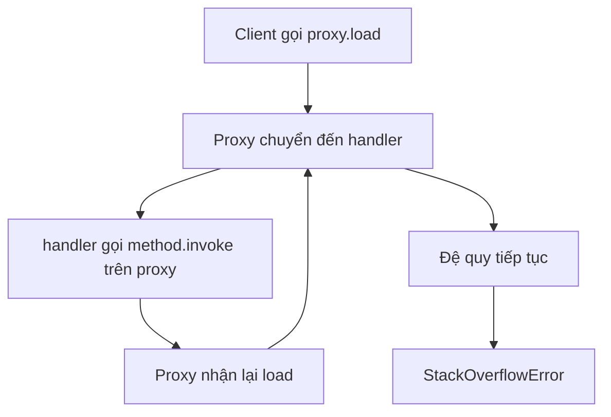

# Tránh gọi Method.invoke trên proxy gây đệ quy về handler

Khi một phương thức được gọi trên Java dynamic proxy, JDK chuyển lời gọi đến `InvocationHandler.invoke`. Nếu handler lại dùng `method.invoke(proxy, args)` để thực thi chính phương thức đó, lời gọi reflection quay trở lại phương thức của proxy và tiếp tục gọi handler. Vòng lặp này có thể lặp vô hạn cho đến khi chương trình gặp `StackOverflowError`.

Với default method, Java 16 cung cấp `InvocationHandler.invokeDefault(proxy, method, args)` để chạy trực tiếp phần thân mặc định trên proxy. Khi cần ủy quyền một phương thức nghiệp vụ đến đối tượng thật, hãy gọi `method.invoke(target, args)` với target là implementation thực tế, không phải proxy đang được xử lý.

## 1. Vì sao Method.invoke(proxy, args) gây đệ quy?

Dynamic proxy là một đối tượng do JDK tạo để triển khai các interface được chỉ định. Các phương thức instance trên lớp proxy chuyển lời gọi đến `InvocationHandler` đã đăng ký.

Giả sử handler nhận lời gọi `service.load()` với:

- `proxy`: đối tượng dynamic proxy đang nhận lời gọi.
- `method`: `Method` mô tả `load()`.
- `args`: các đối số của lời gọi.

Nếu handler thực hiện:

```java
return method.invoke(proxy, args);
```

`Method.invoke` gọi `load()` trên chính proxy. Phương thức `load()` của lớp proxy lại chuyển lời gọi vào cùng handler. Handler tiếp tục gọi `method.invoke(proxy, args)`, tạo ra chuỗi lặp:



Vấn đề không phụ thuộc phương thức có phải default method hay không. Bất kỳ lời gọi nào mà handler phản chiếu lại cùng phương thức trên chính proxy đều có nguy cơ quay về handler.

## 2. Ví dụ sai: gọi lại chính proxy

```java
import java.lang.reflect.InvocationHandler;
import java.lang.reflect.Proxy;

public class RecursiveProxyDemo {
    public interface Greeting {
        default String message() {
            return "Hello";
        }
    }

    public static void main(String[] args) {
        InvocationHandler handler = (proxy, method, arguments) ->
                method.invoke(proxy, arguments); // Sai: gọi lại proxy.

        Greeting greeting = (Greeting) Proxy.newProxyInstance(
                Greeting.class.getClassLoader(),
                new Class<?>[]{Greeting.class},
                handler);

        System.out.println(greeting.message());
    }
}
```

Khi gọi `greeting.message()`, handler nhận `Method` mô tả `message`. Lệnh `method.invoke(proxy, arguments)` gọi lại `message()` trên đối tượng proxy. Handler lại được gọi và thực hiện đúng lệnh đó. Chương trình không đi đến phần thân default method; chuỗi gọi tiếp tục cho đến khi tràn stack.

Không nên cố khắc phục bằng một cờ boolean hoặc biến trạng thái để chặn lần gọi lặp nếu nguyên nhân thực sự là đang gọi nhầm trên proxy. Cách xử lý đúng là chọn đối tượng nhận lời gọi phù hợp với mục đích: proxy cho `invokeDefault`, target thật cho `Method.invoke`.

## 3. Cách đúng cho default method: InvocationHandler.invokeDefault

`InvocationHandler.invokeDefault` có từ Java 16. API này yêu cầu proxy và `Method` đại diện cho default method thuộc một interface mà proxy triển khai trực tiếp hoặc thông qua kế thừa.

```java
InvocationHandler handler = (proxy, method, args) -> {
    if (method.isDefault()) {
        return InvocationHandler.invokeDefault(proxy, method, args);
    }

    throw new UnsupportedOperationException(method.toString());
};
```

API gọi phần thân default method trên proxy mà không thực hiện lại lời gọi thông qua phương thức proxy được tạo. Vì vậy, nó không tạo vòng đệ quy giống `method.invoke(proxy, args)`.

Nếu default method gọi một phương thức khác qua `this`, lời gọi tiếp theo vẫn đi qua proxy và handler. Đây là hành vi bình thường, có thể được dùng để phối hợp default method với các phương thức trừu tượng mà handler cung cấp.

Với phương thức không có tham số, `args` mà handler nhận có thể là `null`; `invokeDefault` cho phép `null` khi phương thức không có tham số. Có thể chuẩn hóa thành mảng rỗng để code thể hiện rõ trường hợp này:

```java
Object[] actualArgs = args == null ? new Object[0] : args;
return InvocationHandler.invokeDefault(proxy, method, actualArgs);
```

Với phương thức có tham số, phải truyền đúng số lượng, thứ tự và kiểu đối số. Với varargs, giữ nguyên cấu trúc mảng đối số nhận được từ handler.

## 4. Cách đúng khi ủy quyền đến implementation thật: Method.invoke(target, args)

Nếu proxy bọc một đối tượng nghiệp vụ thật, handler có thể lưu đối tượng đó trong biến `target` rồi gọi phương thức trên target:

```java
Object result = method.invoke(target, args);
```

`target` phải là đối tượng implementation thật, không phải proxy. Khi `Method.invoke` gọi phương thức trên target, lời gọi được thực hiện trên đối tượng đó. Nếu phương thức target gọi phương thức khác bằng `this`, lời gọi nội bộ diễn ra trên target và không tự quay lại proxy.

Ví dụ handler có thể phân nhánh như sau:

```java
InvocationHandler handler = (proxy, method, args) -> {
    if (method.isDefault()) {
        return InvocationHandler.invokeDefault(proxy, method, args);
    }

    try {
        return method.invoke(target, args);
    } catch (InvocationTargetException exception) {
        throw exception.getCause();
    }
};
```

Trong đoạn code này:

- Default method được chạy trên proxy bằng `invokeDefault`.
- Phương thức nghiệp vụ được gọi trên implementation thật bằng `Method.invoke`.
- `InvocationTargetException` được mở để chuyển tiếp nguyên nhân do phương thức target ném ra.

Nếu `target` lại chính là proxy hiện tại hoặc một proxy có handler quay về cùng luồng xử lý, nguy cơ đệ quy vẫn còn. Cần bảo đảm target thực sự là đối tượng có implementation mà handler muốn ủy quyền đến.

## 5. Ví dụ hoàn chỉnh: default method và phương thức nghiệp vụ

Ví dụ sau cho thấy default method có thể gọi phương thức trừu tượng trên proxy. Handler chạy default method bằng `invokeDefault`, còn phương thức trừu tượng được xử lý bằng dữ liệu do handler cung cấp.

```java
import java.lang.reflect.InvocationHandler;
import java.lang.reflect.Proxy;

public class SafeDefaultInvocationDemo {
    public interface OrderService {
        int netPrice();

        default int tax() {
            return 10;
        }

        default int totalPrice() {
            return netPrice() + tax();
        }
    }

    public static void main(String[] args) {
        InvocationHandler handler = (proxy, method, arguments) -> {
            if (method.isDefault()) {
                return InvocationHandler.invokeDefault(
                        proxy,
                        method,
                        arguments == null ? new Object[0] : arguments);
            }

            if (method.getName().equals("netPrice")
                    && method.getParameterCount() == 0) {
                return 100;
            }

            throw new UnsupportedOperationException(method.toString());
        };

        OrderService service = (OrderService) Proxy.newProxyInstance(
                OrderService.class.getClassLoader(),
                new Class<?>[]{OrderService.class},
                handler);

        System.out.println(service.totalPrice());
    }
}
```

Kết quả:

```text
110
```

Luồng gọi:

1. Client gọi `totalPrice()` trên proxy.
2. Handler nhận default method và gọi `InvocationHandler.invokeDefault`.
3. Phần thân `totalPrice()` chạy trên proxy, gọi `netPrice()` và `tax()` qua `this`.
4. Mỗi lời gọi tiếp theo được chuyển về handler. `netPrice()` được handler xử lý trực tiếp; `tax()` được chạy bằng `invokeDefault`.
5. `totalPrice()` nhận `100 + 10` và trả về `110`.

Không có lời gọi `Method.invoke(proxy, args)`, nên handler không tự gọi lại cùng phương thức theo cách đệ quy vô hạn.

## 6. Xử lý InvocationTargetException khi gọi target

`Method.invoke(target, args)` có thể ném `InvocationTargetException` nếu phương thức target ném ngoại lệ. Ngoại lệ gốc nằm trong `getCause()`.

```java
try {
    return method.invoke(target, args);
} catch (InvocationTargetException exception) {
    throw exception.getCause();
}
```

Handler có thể chuyển tiếp nguyên nhân gốc vì `InvocationHandler.invoke` cho phép ném `Throwable`. Dynamic proxy sau đó vẫn áp dụng quy tắc checked exception của phương thức interface; checked exception không được khai báo phù hợp có thể bị bọc trong `UndeclaredThrowableException` khi trả về client.

`InvocationHandler.invokeDefault` không dùng `Method.invoke`, vì vậy ngoại lệ do default method ném ra được truyền trực tiếp ra khỏi lời gọi `invokeDefault`, không được bọc trong `InvocationTargetException` theo cách của `Method.invoke`.

## 7. Chọn cách gọi theo mục đích

| Mục đích | Cách gọi | Đối tượng nhận lời gọi |
|---|---|---|
| Chạy phần thân default method trên dynamic proxy | `InvocationHandler.invokeDefault(proxy, method, args)` | Proxy hiện tại |
| Ủy quyền phương thức đến implementation thật | `method.invoke(target, args)` | Target thật |
| Gọi lại cùng phương thức qua `method.invoke(proxy, args)` | Tránh sử dụng trong handler | Proxy, dẫn đến handler được gọi lại |

Trước khi dùng reflection trong handler, hãy xác định rõ đối tượng nhận lời gọi. Nếu mục tiêu là chạy default method, dùng API chuyên biệt của `InvocationHandler`. Nếu mục tiêu là ủy quyền, dùng đối tượng target đã được lưu và kiểm soát. Đừng dùng proxy như một cách để tìm implementation gốc.

## 8. Những nguyên tắc cần nhớ

- Không gọi `method.invoke(proxy, args)` để thực thi phương thức mà handler đang xử lý; lời gọi sẽ quay lại proxy và handler.
- Dùng `InvocationHandler.invokeDefault` từ Java 16 để gọi default method trên proxy.
- Dùng `method.invoke(target, args)` khi target là implementation thật cần được ủy quyền.
- Bắt `InvocationTargetException` khi dùng `Method.invoke` và cân nhắc chuyển tiếp `getCause()`.
- Nhớ rằng lời gọi nội bộ trên `this` của default method chạy trên proxy và có thể quay lại handler.
- Tránh giữ target là chính proxy hiện tại hoặc một proxy tạo vòng ủy quyền quay lại handler.

Khi phân biệt đúng proxy và target, handler có thể chạy default method, ủy quyền nghiệp vụ và xử lý ngoại lệ mà không tạo vòng đệ quy ngoài ý muốn. Đây là cách dùng API reflection và dynamic proxy ổn định trên các JDK hiện đại.
