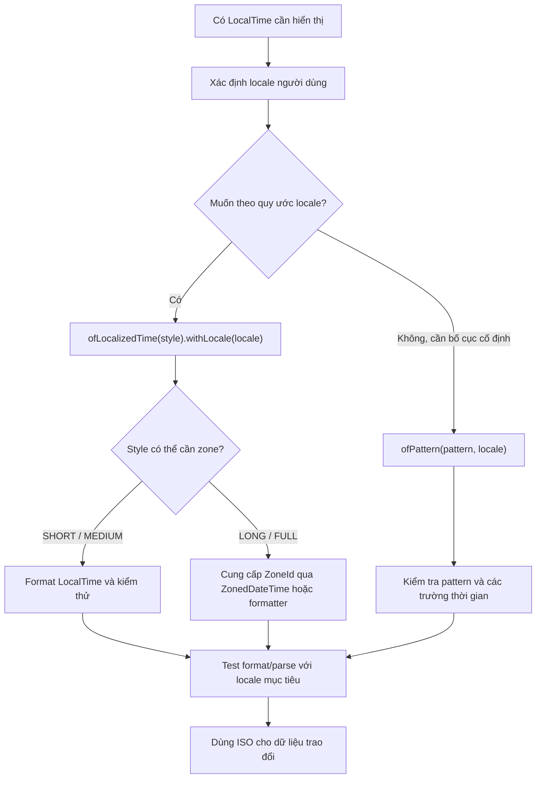

# Định dạng LocalTime bằng locale tường minh

> **Chương:** Định dạng day period  
> **Phạm vi:** Dùng `DateTimeFormatter` để trình bày `LocalTime` theo locale người dùng đã chọn. Bài học phân biệt formatter theo kiểu địa phương hóa với pattern tự định nghĩa, cách chọn `FormatStyle`, và giới hạn khi dữ liệu chỉ có giờ mà không có ngày hoặc múi giờ.

## Mục tiêu học tập

Sau bài này, bạn có thể:

1. Giải thích vì sao cần truyền `Locale` tường minh khi định dạng giờ.
2. Tạo formatter bằng `ofLocalizedTime()` và `withLocale()`.
3. Chọn `FormatStyle` phù hợp với không gian và mức chi tiết của giao diện.
4. Dùng `ofPattern()` khi sản phẩm cần cấu trúc hiển thị cụ thể.
5. Phân biệt `Locale` với `ZoneId` và hiểu giới hạn của `LocalTime`.
6. Viết test format/parse ổn định cho nhiều locale.

## 1. Vì sao phải chọn locale tường minh?

`LocalTime` lưu giờ, phút, giây và nano giây. Bản thân nó không chứa ngôn ngữ, khu vực hay cách trình bày. Cùng một giá trị `15:30` có thể được hiển thị theo nhiều quy ước:

- Giao diện dùng đồng hồ 24 tiếng có thể hiển thị `15:30`.
- Giao diện dùng đồng hồ 12 tiếng có thể hiển thị `3:30 PM`.
- Một locale có thể thêm day period như buổi chiều.
- Dấu phân cách, thứ tự thành phần và văn bản có thể thay đổi theo locale.

Nếu ứng dụng để formatter tự lấy locale mặc định của máy, kết quả có thể phụ thuộc cấu hình máy chủ, container hoặc máy của người dùng. Điều này gây khó kiểm thử và có thể tạo giao diện không nhất quán.

Với ứng dụng đa ngôn ngữ, hãy lấy locale từ lựa chọn người dùng hoặc cấu hình giao diện, sau đó truyền locale đó cho formatter. Không thay đổi locale mặc định toàn JVM chỉ để định dạng cho một request.

## 2. Locale là gì và chọn như thế nào?

`Locale` mô tả ngôn ngữ và có thể bao gồm khu vực, script hoặc biến thể. Java hỗ trợ tạo locale từ language tag theo chuẩn BCP 47.

Ví dụ:

```java
import java.util.Locale;

Locale vietnamese = Locale.forLanguageTag("vi-VN");
Locale englishUS = Locale.US;
Locale englishUK = Locale.UK;
Locale french = Locale.forLanguageTag("fr-FR");
```

Các locale này đại diện cho lựa chọn ngôn ngữ/khu vực. Chúng không tự xác định múi giờ. Ví dụ `vi-VN` không bắt buộc thời điểm phải nằm ở `Asia/Ho_Chi_Minh`; người dùng nói tiếng Việt có thể đang ở một múi giờ khác.

Nên:

- Dùng language tag đã được sản phẩm hỗ trợ.
- Giữ lựa chọn locale của người dùng trong cấu hình hồ sơ hoặc request.
- Có locale dự phòng được xác định rõ khi đầu vào thiếu hoặc không hợp lệ.
- Kiểm thử từng locale mà sản phẩm cam kết hỗ trợ.

Tránh tự tạo locale bằng cách nối chuỗi không chuẩn hoặc suy ra ngôn ngữ từ múi giờ.

## 3. Dùng ofLocalizedTime với locale tường minh

`DateTimeFormatter.ofLocalizedTime(FormatStyle)` tạo formatter dựa trên quy ước thời gian của locale. Formatter tạo trực tiếp sẽ dùng default FORMAT locale; có thể chọn locale rõ ràng bằng `withLocale(Locale)`.

Ví dụ:

```java
import java.time.LocalTime;
import java.time.format.DateTimeFormatter;
import java.time.format.FormatStyle;
import java.util.Locale;

LocalTime meetingTime = LocalTime.of(15, 30);

DateTimeFormatter vietnameseTime =
        DateTimeFormatter.ofLocalizedTime(FormatStyle.SHORT)
                .withLocale(Locale.forLanguageTag("vi-VN"));

DateTimeFormatter usTime =
        DateTimeFormatter.ofLocalizedTime(FormatStyle.SHORT)
                .withLocale(Locale.US);

System.out.println(vietnameseTime.format(meetingTime));
System.out.println(usTime.format(meetingTime));
```

Hai formatter nhận cùng một `LocalTime`, nhưng cách hiển thị có thể khác vì locale áp dụng quy ước riêng. Ví dụ minh họa không khẳng định chuỗi đầu ra cố định cho mọi bản dựng JDK.

### Vì sao dùng withLocale?

- Làm rõ locale mà giao diện cần sử dụng.
- Tránh phụ thuộc vào locale mặc định của tiến trình.
- Dùng cùng một formatter cho tất cả request có cùng locale.
- Dễ viết test cho từng locale mà không thay đổi cấu hình toàn JVM.

`DateTimeFormatter` là immutable và thread-safe. Sau khi tạo formatter với locale và style cần thiết, có thể tái sử dụng nó giữa các luồng.

## 4. Chọn FormatStyle phù hợp

`FormatStyle` có bốn mức:

| Style | Mức chi tiết | Khi thường dùng |
| --- | --- | --- |
| `SHORT` | Ngắn gọn, thường chỉ giờ và phút | Danh sách, lịch, nhãn nhỏ |
| `MEDIUM` | Thường có thêm giây | Màn hình cần độ chính xác cao hơn |
| `LONG` | Có thể thêm thông tin múi giờ | Ngữ cảnh hiển thị có vùng thời gian |
| `FULL` | Chi tiết nhất, thường có tên múi giờ | Văn bản đầy đủ khi có ngữ cảnh múi giờ |

Ví dụ tạo các formatter:

```java
Locale locale = Locale.US;

DateTimeFormatter shortTime =
        DateTimeFormatter.ofLocalizedTime(FormatStyle.SHORT)
                .withLocale(locale);
DateTimeFormatter mediumTime =
        DateTimeFormatter.ofLocalizedTime(FormatStyle.MEDIUM)
                .withLocale(locale);
DateTimeFormatter longTime =
        DateTimeFormatter.ofLocalizedTime(FormatStyle.LONG)
                .withLocale(locale);
DateTimeFormatter fullTime =
        DateTimeFormatter.ofLocalizedTime(FormatStyle.FULL)
                .withLocale(locale);
```

Không phải mọi style đều phù hợp với mọi kiểu temporal. `LONG` và `FULL` thường yêu cầu thông tin múi giờ. Nếu formatter được áp dụng cho `LocalTime` không có zone, thao tác format có thể ném `UnsupportedTemporalTypeException` tùy pattern locale được tra cứu.

Với `LocalTime`, thường nên bắt đầu từ `SHORT` hoặc `MEDIUM`. Nếu yêu cầu `LONG`/`FULL` có tên múi giờ, hãy định dạng một giá trị có ngữ cảnh vùng thời gian như `ZonedDateTime`, hoặc gắn zone vào formatter khi dữ liệu đầu vào và ý nghĩa nghiệp vụ cho phép.

### Style không phải pattern cố định

`SHORT` không có nghĩa mọi locale đều dùng `h:mm a`; có locale dùng đồng hồ 24 tiếng, locale khác dùng 12 tiếng. `MEDIUM`, `LONG` và `FULL` cũng có cấu trúc khác nhau.

Formatter tra pattern địa phương hóa một cách lazy theo locale. Vì vậy, không nên giả định `toString()` hoặc một chuỗi pattern cụ thể của formatter là hợp đồng đầu ra cho mọi locale.

## 5. Dùng pattern tự định nghĩa khi cần kiểm soát bố cục

Nếu sản phẩm yêu cầu cấu trúc cụ thể, dùng `DateTimeFormatter.ofPattern(pattern, locale)`.

Ví dụ dùng giờ 24 tiếng:

```java
DateTimeFormatter twentyFourHour =
        DateTimeFormatter.ofPattern("HH:mm", Locale.forLanguageTag("vi-VN"));

System.out.println(twentyFourHour.format(LocalTime.of(15, 30)));
```

Ví dụ dùng giờ 12 tiếng với AM/PM:

```java
DateTimeFormatter twelveHour =
        DateTimeFormatter.ofPattern("h:mm a", Locale.US);

System.out.println(twelveHour.format(LocalTime.of(15, 30)));
```

Ví dụ dùng day period từ Java 16:

```java
DateTimeFormatter dayPeriod =
        DateTimeFormatter.ofPattern(
                "h:mm B",
                Locale.forLanguageTag("vi-VN")
        );

System.out.println(dayPeriod.format(LocalTime.of(15, 30)));
```

Pattern `B` dùng dữ liệu day period theo locale. Bản dịch và ranh giới khoảng trong ngày không phải hằng số do ứng dụng tự định nghĩa.

### So sánh hai cách tạo formatter

| Nhu cầu | Cách phù hợp |
| --- | --- |
| Muốn tuân theo toàn bộ quy ước giờ của locale | `ofLocalizedTime(style).withLocale(locale)` |
| Cần luôn hiển thị giờ 24 tiếng `HH:mm` | `ofPattern("HH:mm", locale)` |
| Cần AM/PM | `ofPattern("h:mm a", locale)` |
| Cần day period linh hoạt | `ofPattern("h:mm B", locale)` |
| Cần cấu trúc nhiều phần tùy chọn | `DateTimeFormatterBuilder` |

Chọn localized style khi giao diện nên tuân theo quy ước locale. Chọn pattern tường minh khi sản phẩm có yêu cầu bố cục cụ thể và đã xác định rõ ý nghĩa hiển thị.

## 6. LocalTime không chứa ngày hoặc múi giờ

`LocalTime` chỉ mô tả giờ trên đồng hồ. Nó không cho biết:

- Ngày cụ thể mà giờ đó xảy ra.
- Múi giờ hoặc độ lệch UTC.
- Thời điểm tuyệt đối trên trục thời gian.
- Quy tắc giờ mùa hè (DST) của một khu vực.

Vì vậy, không thể dùng riêng `LocalTime` để xác định một sự kiện xảy ra lúc nào trên toàn cầu. Kiểu này phù hợp với giờ mở cửa lặp hằng ngày, giờ bắt đầu ca làm hoặc một thời điểm trong ngày chưa gắn ngày/múi giờ.

### Lấy giờ hiện tại theo múi giờ cụ thể

Nếu cần giờ đồng hồ tại một khu vực, truyền `ZoneId` rõ ràng:

```java
import java.time.LocalTime;
import java.time.ZoneId;

ZoneId zone = ZoneId.of("Asia/Ho_Chi_Minh");
LocalTime localTime = LocalTime.now(zone);
```

`LocalTime.now()` không có tham số sử dụng múi giờ mặc định của hệ thống. Khi kết quả cần đại diện cho người dùng hoặc một địa điểm cụ thể, nên truyền zone rõ ràng.

### Định dạng một sự kiện có Instant

Nếu dữ liệu gốc là `Instant`, chuyển sang múi giờ người dùng trước khi định dạng:

```java
import java.time.Instant;
import java.time.ZoneId;
import java.time.ZonedDateTime;
import java.time.format.DateTimeFormatter;
import java.time.format.FormatStyle;
import java.util.Locale;

Instant eventTime = Instant.parse("2026-11-27T08:30:00Z");
ZoneId userZone = ZoneId.of("Asia/Ho_Chi_Minh");
Locale userLocale = Locale.forLanguageTag("vi-VN");

ZonedDateTime localEvent = eventTime.atZone(userZone);

DateTimeFormatter formatter =
        DateTimeFormatter.ofLocalizedTime(FormatStyle.FULL)
                .withLocale(userLocale);

System.out.println(formatter.format(localEvent));
```

Ở đây `ZonedDateTime` cung cấp thông tin vùng thời gian mà style `FULL` thường cần. Cùng một `Instant` có thể được hiển thị thành giờ và day period khác nhau ở các zone khác nhau.

Nếu chỉ có `LocalTime`, đừng tự gán zone để biến nó thành một sự kiện tuyệt đối khi chưa có ngày và quy tắc xử lý DST. Hãy xác định rõ nghiệp vụ cần giờ địa phương lặp lại hay một thời điểm cụ thể.

## 7. Phân biệt locale và zone

`Locale` quyết định ngôn ngữ, quy ước văn bản và cách diễn đạt day period. `ZoneId` quyết định giờ địa phương tương ứng với một thời điểm.

| Thành phần | Ví dụ | Tác động |
| --- | --- | --- |
| Locale | `vi-VN`, `en-US`, `fr-FR` | Cách viết, nhãn thời gian, day period |
| ZoneId | `Asia/Ho_Chi_Minh`, `Europe/Paris` | Chuyển thời điểm thành giờ địa phương |
| LocalTime | `15:30` | Chỉ giờ trên đồng hồ, không chứa locale/zone |
| Instant | `2026-11-27T08:30:00Z` | Một thời điểm tuyệt đối |

Ví dụ, người dùng có thể chọn locale `vi-VN` nhưng đang ở Paris. Khi đó, ứng dụng dùng locale tiếng Việt để trình bày và `Europe/Paris` để xác định giờ địa phương. Không suy ra zone từ locale.

## 8. Parse LocalTime với locale tương ứng

Formatter dùng để hiển thị cũng có thể dùng để phân tích chuỗi. Hãy dùng cùng locale và cùng kiểu pattern mà chuỗi được tạo ra.

Ví dụ localized style:

```java
import java.time.LocalTime;
import java.time.format.DateTimeFormatter;
import java.time.format.FormatStyle;
import java.util.Locale;

Locale locale = Locale.US;
DateTimeFormatter formatter =
        DateTimeFormatter.ofLocalizedTime(FormatStyle.SHORT)
                .withLocale(locale);

String text = formatter.format(LocalTime.of(15, 30));
LocalTime parsed = LocalTime.parse(text, formatter);

System.out.println(parsed);
```

Với localized style, cấu trúc văn bản phụ thuộc locale. Không parse chuỗi đã định dạng bằng một formatter có locale khác rồi kỳ vọng kết quả luôn đúng.

### Độ chính xác khi round-trip

Round-trip chỉ khôi phục được các trường mà pattern biểu diễn. Nếu `SHORT` chỉ chứa giờ và phút, giây và nano giây ban đầu sẽ không được giữ lại.

Ví dụ:

- Giá trị gốc: `15:30:45`.
- Pattern chỉ hiển thị giờ/phút: văn bản không chứa `45` giây.
- Parse lại: kết quả không thể khôi phục phần giây đã mất.

Nếu cần giữ giây, chọn style hoặc pattern có trường giây, rồi xác minh trên locale mục tiêu. Nếu cần giữ toàn bộ độ chính xác để lưu trữ hoặc trao đổi, dùng định dạng máy như `ISO_LOCAL_TIME`.

### Parse với pattern tường minh

Khi pattern do ứng dụng kiểm soát, truyền locale vào cả lúc tạo formatter:

```java
DateTimeFormatter parser =
        DateTimeFormatter.ofPattern("h:mm B", Locale.US);

LocalTime parsed =
        LocalTime.parse("3:30 in the afternoon", parser);
```

Văn bản day period phải khớp dữ liệu locale của parser. Với đầu vào do người dùng nhập, cần xác định resolver style và xử lý `DateTimeParseException` để phản hồi lỗi dễ hiểu.

## 9. Dùng ISO_LOCAL_TIME cho dữ liệu máy

Localized style phục vụ hiển thị. Khi cần dữ liệu có thể trao đổi ổn định giữa hệ thống, ưu tiên định dạng ISO thay vì chuỗi dịch theo locale.

Ví dụ:

```java
import java.time.LocalTime;
import java.time.format.DateTimeFormatter;

LocalTime time = LocalTime.of(15, 30, 45, 123_000_000);

String wireValue = DateTimeFormatter.ISO_LOCAL_TIME.format(time);
LocalTime restored = LocalTime.parse(
        wireValue,
        DateTimeFormatter.ISO_LOCAL_TIME
);
```

ISO local time có thể chứa phần giây và phần thập phân khi cần. Nó không mang múi giờ hoặc offset; nếu dữ liệu là thời điểm tuyệt đối, dùng `Instant`/ISO instant hoặc định dạng có offset phù hợp.

Không lưu chuỗi như `3:30 in the afternoon` làm timestamp trong database hoặc message queue. Chuỗi này phụ thuộc locale và không xác định được một thời điểm duy nhất nếu thiếu ngày/zone.

## 10. Kiểm thử ổn định với Locale và Clock

Test nên chọn locale tường minh và kiểm soát thời gian đầu vào. Tránh dùng `LocalTime.now()` trực tiếp trong assertion vì kết quả thay đổi theo thời điểm chạy.

### Test format/parse với localized style

```java
import static org.junit.jupiter.api.Assertions.assertEquals;
import static org.junit.jupiter.api.Assertions.assertFalse;

import java.time.LocalTime;
import java.time.format.DateTimeFormatter;
import java.time.format.FormatStyle;
import java.util.Locale;
import org.junit.jupiter.api.Test;

class LocalTimeLocaleTest {
    @Test
    void formatsAndParsesUsingTheSelectedLocale() {
        Locale locale = Locale.US;
        LocalTime original = LocalTime.of(15, 30);
        DateTimeFormatter formatter =
                DateTimeFormatter.ofLocalizedTime(FormatStyle.SHORT)
                        .withLocale(locale);

        String text = formatter.format(original);
        LocalTime parsed = LocalTime.parse(text, formatter);

        assertFalse(text.isBlank());
        assertEquals(original, parsed);
    }
}
```

Test dùng giá trị không có giây vì `SHORT` thường chỉ hiển thị giờ và phút. Không so sánh chuỗi đầu ra cố định nếu sản phẩm không cam kết chính xác dấu phân cách, AM/PM hoặc bản dịch.

### Test giờ hiện tại bằng Clock cố định

```java
import java.time.Clock;
import java.time.Instant;
import java.time.LocalTime;
import java.time.ZoneId;

Clock fixedClock = Clock.fixed(
        Instant.parse("2026-11-27T08:30:00Z"),
        ZoneId.of("Asia/Ho_Chi_Minh")
);

LocalTime stableTime = LocalTime.now(fixedClock);
```

`Clock.fixed()` giúp test có cùng kết quả mỗi lần chạy. Khi kiểm thử lịch hoặc giờ theo zone, truyền `Clock` vào lớp nghiệp vụ thay vì đọc trực tiếp đồng hồ hệ thống.

### Ma trận locale nên kiểm tra

| Nhóm test | Điều cần xác minh |
| --- | --- |
| Locale chính của sản phẩm | Formatter tạo được văn bản và parse được theo hợp đồng |
| Locale có đồng hồ 12 tiếng | AM/PM hoặc day period được hiển thị đúng |
| Locale có đồng hồ 24 tiếng | Không xuất hiện marker AM/PM ngoài mong muốn |
| Locale dùng ngôn ngữ khác | Văn bản không rỗng, không lỗi parse |
| Locale sau khi nâng JDK | Snapshot hoặc kết quả giao diện được xem lại |

Không bắt buộc mọi locale phải tạo cùng một kiểu giờ. Chính sự khác biệt đó là lý do cần kiểm thử theo locale.

## 11. Những lỗi thường gặp

| Hiện tượng | Nguyên nhân | Cách xử lý |
| --- | --- | --- |
| Kết quả khác giữa máy phát triển và production | Formatter dùng default FORMAT locale khác nhau | Gọi `withLocale(locale)` hoặc `ofPattern(pattern, locale)` |
| Gọi `withLocale()` nhưng kết quả không đổi | Không gán lại formatter được trả về | Dùng formatter mới do `withLocale()` trả về |
| `UnsupportedTemporalTypeException` khi format | Pattern localized yêu cầu trường mà `LocalTime` không có, thường là zone | Dùng style phù hợp hoặc định dạng `ZonedDateTime` |
| Parse thất bại với chuỗi đã nhận từ nơi khác | Chuỗi được tạo bằng locale/style khác | Trao đổi dữ liệu chuẩn hóa hoặc truyền locale/pattern đúng |
| Round-trip mất giây | Pattern `SHORT` không chứa giây | Chọn pattern có giây hoặc giữ dữ liệu ISO |
| Giờ hiển thị sai khu vực | Dùng zone mặc định của máy thay vì zone người dùng | Chuyển `Instant` bằng `atZone(userZone)` |
| Test thỉnh thoảng thất bại | Dùng `LocalTime.now()` và so sánh kết quả chính xác | Dùng `Clock.fixed()` hoặc thời gian đầu vào cố định |
| Chuỗi hiển thị thay đổi sau khi nâng JDK | Dữ liệu locale/CLDR hoặc nhà cung cấp JDK được cập nhật | Kiểm tra lại locale và cập nhật snapshot có chủ đích |

### Không thay đổi default locale toàn JVM

Không dùng `Locale.setDefault()` để định dạng riêng cho một người dùng. Đây là cấu hình toàn tiến trình; trong server xử lý nhiều request, một request có thể làm ảnh hưởng request khác.

Thay vào đó, truyền locale theo từng formatter:

```java
DateTimeFormatter formatter =
        DateTimeFormatter.ofLocalizedTime(FormatStyle.SHORT)
                .withLocale(userLocale);
```

Đồng thời lưu formatter theo locale nếu cần tái sử dụng. Không cần tạo formatter mới cho mọi lần format nếu locale và style đã cố định.

## 12. Quy trình chọn formatter



Thực hiện theo thứ tự:

1. Xác định dữ liệu là giờ địa phương lặp lại (`LocalTime`) hay thời điểm tuyệt đối (`Instant`).
2. Chọn locale từ hồ sơ hoặc request.
3. Chọn localized style nếu muốn tuân theo quy ước của locale.
4. Chọn pattern tường minh nếu sản phẩm cần bố cục cụ thể.
5. Xác định style/pattern có yêu cầu zone hoặc trường ngày hay không.
6. Kiểm thử format/parse và độ chính xác các trường.
7. Dùng định dạng ISO hoặc kiểu thời gian phù hợp khi trao đổi/lưu dữ liệu.

## 13. Checklist trước khi phát hành

| Hạng mục | Câu hỏi cần xác nhận |
| --- | --- |
| Locale | Locale được lấy từ người dùng hay default của server? |
| Formatter | Đã dùng `withLocale()` hoặc overload có locale chưa? |
| Style | `SHORT`, `MEDIUM`, `LONG`, `FULL` có phù hợp với dữ liệu temporal không? |
| Zone | Nếu style cần zone, đã cung cấp zone phù hợp chưa? |
| LocalTime | Dữ liệu có thực sự chỉ là giờ địa phương hay cần ngày và zone? |
| Pattern | Các ký hiệu giờ/phút/AM-PM/day period đúng mục tiêu chưa? |
| Parse | Parser dùng đúng locale và resolver style chưa? |
| Precision | Pattern có giữ đủ giây/nano giây mà nghiệp vụ cần không? |
| Test | Test dùng dữ liệu cố định và bao phủ locale sản phẩm hỗ trợ chưa? |
| Wire format | Dữ liệu trao đổi có dùng ISO/kiểu thời gian thay vì chuỗi bản địa hóa không? |

## 14. Bài tập thực hành

### Bài 1 — So sánh localized time

Tạo formatter `SHORT` cho `Locale.US` và `vi-VN`. Định dạng cùng một `LocalTime` và ghi nhận sự khác biệt về đồng hồ 12/24 tiếng.

### Bài 2 — So sánh style

Thử `SHORT`, `MEDIUM`, `LONG` và `FULL` trên một giá trị `ZonedDateTime`. Quan sát mức chi tiết và thông tin zone. Sau đó thử `LocalTime` để nhận biết style nào cần thêm thông tin.

### Bài 3 — Pattern cố định

Tạo formatter `HH:mm` và `h:mm a` với locale tường minh. Chọn kiểu phù hợp cho một giao diện cụ thể và giải thích lý do.

### Bài 4 — Day period

Tạo formatter `h:mm B` với hai locale khác nhau. Định dạng một giờ buổi chiều và giải thích vì sao không hard-code bản dịch hoặc ranh giới.

### Bài 5 — Test Clock

Dùng `Clock.fixed()` để tạo `LocalTime` có thể lặp lại trong test. Viết test format/parse và kiểm tra không phụ thuộc đồng hồ hệ thống.

### Bài 6 — Dữ liệu trao đổi

Định dạng một `LocalTime` bằng localized style và `ISO_LOCAL_TIME`. Giải thích vì sao chuỗi localized phù hợp với giao diện còn ISO phù hợp hơn cho dữ liệu máy.

## Tài liệu chính thức

- [Java SE 16 — `DateTimeFormatter`](https://docs.oracle.com/en/java/javase/16/docs/api/java.base/java/time/format/DateTimeFormatter.html) — `ofLocalizedTime`, `ofPattern`, `withLocale` và các formatter theo locale.
- [Java SE 16 — `FormatStyle`](https://docs.oracle.com/en/java/javase/16/docs/api/java.base/java/time/format/FormatStyle.html) — bốn mức `FULL`, `LONG`, `MEDIUM`, `SHORT`.
- [Java SE 16 — `LocalTime`](https://docs.oracle.com/en/java/javase/16/docs/api/java.base/java/time/LocalTime.html) — phạm vi dữ liệu giờ địa phương và các trường được hỗ trợ.
- [Java SE 16 — `Clock`](https://docs.oracle.com/en/java/javase/16/docs/api/java.base/java/time/Clock.html) — đồng hồ có thể thay thế để kiểm thử thời gian.
- [Java SE 25 — `DateTimeFormatter`](https://docs.oracle.com/en/java/javase/25/docs/api/java.base/java/time/format/DateTimeFormatter.html) — xác nhận API locale formatting tiếp tục được hỗ trợ trong JDK hiện đại.
- [Unicode CLDR — Dates and Times](https://www.unicode.org/reports/tr35/tr35-dates.html) — quy ước định dạng ngày giờ và dữ liệu locale.

**Nguyên tắc áp dụng:** Chọn locale tường minh cho từng formatter, dùng localized style khi muốn tuân theo quy ước địa phương và pattern cố định khi sản phẩm cần bố cục xác định. Giữ riêng `Locale` và `ZoneId`, hiểu giới hạn của `LocalTime`, kiểm thử bằng thời gian cố định và dùng ISO cho dữ liệu trao đổi.
