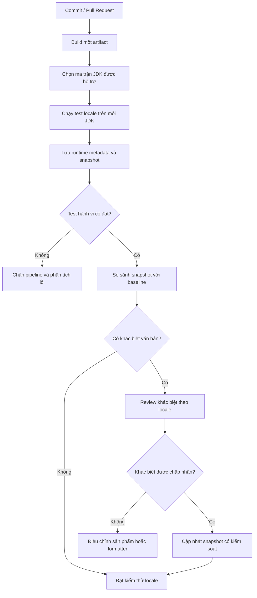

# Kiểm thử nhiều locale và thay đổi dữ liệu CLDR giữa các JDK

> **Chương:** Định dạng day period  
> **Phạm vi:** Xây dựng chiến lược kiểm thử cho các formatter phụ thuộc locale, đặc biệt pattern day period `B`, khi ứng dụng chạy trên nhiều locale và nhiều phiên bản JDK. Nội dung tập trung vào kiểm thử hành vi, phát hiện thay đổi dữ liệu CLDR, cấu hình locale provider hiện hành và cách xử lý khác biệt trước khi phát hành.

## Mục tiêu học tập

Sau bài này, bạn có thể:

1. Giải thích vì sao cùng một formatter có thể tạo văn bản khác nhau giữa locale hoặc JDK.
2. Thiết kế ma trận kiểm thử locale và JDK cho chức năng ngày giờ.
3. Phân biệt kiểm thử hợp đồng định dạng với kiểm thử snapshot bản dịch.
4. Phát hiện thay đổi dữ liệu CLDR khi nâng JDK.
5. Ghi nhận cấu hình runtime và locale provider để tái hiện lỗi.
6. Loại bỏ phụ thuộc vào dữ liệu locale legacy đã bị loại khỏi JDK hiện đại.

## 1. Vì sao cần kiểm thử nhiều locale và nhiều JDK?

`DateTimeFormatter` không tự chứa toàn bộ bản dịch và quy tắc hiển thị. Với các formatter localized hoặc pattern có văn bản như `a`, `B`, tên tháng, tên thứ và tên múi giờ, Java tra dữ liệu locale của runtime.

Kết quả có thể khác vì:

- Hai locale dùng quy ước giờ 12 tiếng và 24 tiếng khác nhau.
- Tên day period và ranh giới khoảng trong ngày khác theo locale.
- Dữ liệu CLDR được cập nhật giữa các phiên bản JDK.
- Locale provider hoặc cấu hình chạy khác nhau.
- Parser của JDK mới có thể chấp nhận hoặc từ chối văn bản khác trước đó.

Một thay đổi dữ liệu locale có thể làm chuỗi hiển thị thay đổi mà mã nguồn không đổi. Với chức năng parse, khác biệt còn có thể làm dữ liệu đầu vào cũ không còn được chấp nhận.

Vì vậy, kiểm thử chỉ trên máy lập trình viên hoặc chỉ với một locale không đủ để đánh giá một ứng dụng đa ngôn ngữ.

## 2. CLDR và dữ liệu locale trong JDK

CLDR (Common Locale Data Repository) là kho dữ liệu locale do Unicode Consortium duy trì. Dữ liệu này bao gồm quy ước định dạng ngày giờ, số, tiền tệ, tên ngôn ngữ, khu vực, múi giờ và các văn bản liên quan.

JDK đã tích hợp CLDR từ trước, và CLDR trở thành nguồn dữ liệu locale mặc định từ JDK 9 theo JEP 252. Các API như `DateTimeFormatter`, `NumberFormat` và nhiều API trong `java.text`/`java.util` sử dụng dữ liệu locale của runtime.

### CLDR thay đổi theo phiên bản JDK

Oracle JDK công bố phiên bản CLDR đi kèm từng dòng JDK. Bảng dưới đây minh họa các mốc có ích khi phân tích thay đổi:

| Dòng JDK | Phiên bản CLDR |
| --- | --- |
| JDK 16 | CLDR 38 |
| JDK 17 | CLDR 39 |
| JDK 21 | CLDR 43 |
| JDK 23 | CLDR 45 |
| JDK 25 | CLDR 47 |
| JDK 26 | CLDR 48 |
| JDK 27 | CLDR 48.2 |

Các bản cập nhật trong cùng một dòng JDK thường dùng cùng phiên bản CLDR, trừ khi tài liệu của nhà cung cấp nêu khác. Nhà cung cấp JDK khác có thể đóng gói hoặc cập nhật dữ liệu khác nhau; hãy xác minh bản phân phối thực tế thay vì chỉ suy ra từ số phiên bản Java.

Java 16 là mốc giới thiệu pattern day period `B`, nhưng không nên dùng JDK 16 đã hết vòng đời cập nhật làm runtime production hiện nay. Khi kiểm thử nâng cấp, hãy chạy trên các JDK còn được tổ chức hoặc nhà cung cấp hỗ trợ.

### Điều gì có thể thay đổi?

Ví dụ với `DateTimeFormatter`:

- Văn bản của `B` hoặc `BBBB` có thể được cập nhật.
- Ranh giới giữa các khoảng day period có thể thay đổi theo CLDR.
- Tên tháng, thứ, múi giờ và cách viết số có thể đổi.
- Mẫu localized `FormatStyle` có thể đổi dấu phân cách hoặc thứ tự thành phần.
- Một chuỗi từng parse được có thể không còn khớp dữ liệu locale mới.

Không xem thay đổi văn bản locale là lỗi JDK mặc định. Trước tiên cần xác định sản phẩm có cam kết chuỗi chính xác hay chỉ cam kết ý nghĩa và khả năng sử dụng.

## 3. Locale provider hiện hành

JDK dùng locale provider để lấy dữ liệu cho các dịch vụ định dạng và tên gọi. Các provider được Oracle JDK hiện đại công bố gồm:

| Provider | Vai trò |
| --- | --- |
| `CLDR` | Dữ liệu từ Unicode Common Locale Data Repository |
| `SPI` | Dịch vụ locale do ứng dụng hoặc thư viện cài qua Service Provider Interface |
| `HOST` | Một số tùy chỉnh locale của hệ điều hành; khả năng hỗ trợ phụ thuộc JDK và nền tảng |

Nếu không cấu hình `java.locale.providers`, hành vi mặc định hiện hành tương đương `CLDR`. Khi có cấu hình, danh sách provider được xét theo thứ tự đã khai báo.

Ví dụ xem cấu hình lúc chạy:

```java
import java.util.Locale;

System.out.println("Java version: " + Runtime.version());
System.out.println("Vendor: " + System.getProperty("java.vendor"));
System.out.println("Locale providers: "
        + System.getProperty("java.locale.providers", "<default>"));
System.out.println("Default FORMAT locale: "
        + Locale.getDefault(Locale.Category.FORMAT));
```

Giá trị `<default>` ở đây có nghĩa ứng dụng không đặt property; không có nghĩa provider không tồn tại. Với JDK hiện đại, mặc định là CLDR.

### Cấu hình provider phải được đặt lúc khởi động

`java.locale.providers` được đọc và cache khi lớp `LocaleServiceProvider` được khởi tạo. Nếu ứng dụng cần provider order riêng, hãy cấu hình ở lệnh khởi chạy JVM:

```bash
java -Djava.locale.providers=CLDR -jar application.jar
```

`CLDR` là mặc định nên ví dụ trên chỉ minh họa cách truyền cấu hình rõ ràng. Không dùng `System.setProperty()` sau khi ứng dụng đã khởi tạo dịch vụ locale để mong thay đổi provider order; cách đó không bảo đảm có hiệu lực.

Trong kiểm thử đa locale, ưu tiên truyền `Locale` tường minh vào formatter. Chỉ cấu hình provider riêng khi đó thực sự là một phần của môi trường sản phẩm cần kiểm thử.

### Không dựa vào provider legacy

JDK 23 đã loại bỏ dữ liệu locale legacy `JRE` (còn được gọi bằng tên `COMPAT`). Nếu ứng dụng còn đặt `JRE` hoặc `COMPAT` trong `java.locale.providers`, cấu hình đó không còn cung cấp dữ liệu tương thích cũ trên JDK 23 trở lên.

Không thêm `JRE`/`COMPAT` làm giải pháp cho test hoặc production mới. Nếu sản phẩm phải giữ một chuỗi hiển thị cụ thể, hãy xác định pattern và nội dung theo hợp đồng của sản phẩm, hoặc quản lý dữ liệu tùy chỉnh bằng cơ chế SPI được hỗ trợ sau khi đánh giá phạm vi triển khai.

## 4. Xây dựng ma trận locale cần kiểm thử

Không cần chạy mọi locale mà JDK biết. Hãy chọn tập locale theo cam kết sản phẩm và nhóm hành vi có rủi ro.

Ví dụ một sản phẩm hỗ trợ:

| Locale | Mục tiêu kiểm tra |
| --- | --- |
| `vi-VN` | Văn bản tiếng Việt và quy ước giờ của locale |
| `en-US` | Quy ước đồng hồ 12 tiếng phổ biến |
| `en-GB` | So sánh cùng ngôn ngữ nhưng khu vực khác |
| `fr-FR` | Một ngôn ngữ khác với quy tắc văn bản riêng |
| `ar-EG` | Locale có thể có hệ chữ và quy tắc số khác |

Danh sách này chỉ là ví dụ. Chọn locale theo người dùng thực tế, thị trường, nội dung sản phẩm và yêu cầu hỗ trợ.

### Kiểm tra locale được runtime hỗ trợ

Có thể kiểm tra locale mà runtime công bố:

```java
import java.util.Arrays;
import java.util.Locale;

Locale requested = Locale.forLanguageTag("vi-VN");
boolean listed = Arrays.asList(Locale.getAvailableLocales())
        .contains(requested);

System.out.println("Locale listed: " + listed);
```

Việc locale xuất hiện trong danh sách không bảo đảm mọi dịch vụ đều có đầy đủ mọi tên hoặc mẫu văn bản. Dịch vụ locale có thể fallback theo candidate locale. Vì vậy, hãy kiểm tra trực tiếp chức năng mà ứng dụng sử dụng.

### Nhóm dữ liệu nên bao phủ

- Locale chính và locale phụ của sản phẩm.
- Locale dùng đồng hồ 12 tiếng và 24 tiếng.
- Locale có day period linh hoạt.
- Locale có thể fallback về cách hiển thị AM/PM.
- Locale có script hoặc hệ chữ khác nếu sản phẩm hỗ trợ.
- Locale có tùy chọn numbering system hoặc calendar nếu ứng dụng dùng các extension đó.

## 5. Xây dựng ma trận JDK cần kiểm thử

Chọn JDK theo ma trận hỗ trợ và kế hoạch nâng cấp của ứng dụng. Một ví dụ cho dự án đang chuyển từ runtime cũ sang các dòng LTS mới:

| Môi trường | Vai trò |
| --- | --- |
| JDK production hiện tại | Baseline để so sánh hành vi |
| JDK LTS tiếp theo được phê duyệt | Xác nhận tương thích trước nâng cấp |
| JDK LTS mới nhất được tổ chức hỗ trợ | Kiểm tra thay đổi locale và runtime mới |
| JDK mới hơn trong giai đoạn đánh giá | Phát hiện sớm thay đổi trước khi đưa vào production |

Nếu cần phân tích lịch sử, có thể lưu kết quả JDK 16 để hiểu thay đổi từ lúc tính năng `B` xuất hiện. Không tiếp tục duy trì JDK 16 làm mục tiêu triển khai nếu nó không còn nằm trong chính sách hỗ trợ.

### Ma trận locale × JDK

Ví dụ:

| JDK / Locale | `vi-VN` | `en-US` | `en-GB` | `fr-FR` |
| --- | --- | --- | --- | --- |
| JDK production | PASS/Review | PASS/Review | PASS/Review | PASS/Review |
| JDK LTS tiếp theo | PASS/Review | PASS/Review | PASS/Review | PASS/Review |
| JDK LTS mới nhất | PASS/Review | PASS/Review | PASS/Review | PASS/Review |

Mỗi ô cần lưu kết quả test và môi trường thực tế. Đánh dấu `Review` khi chuỗi khác baseline nhưng chưa xác định đó là thay đổi được chấp nhận hay lỗi sản phẩm.

## 6. Chọn các thời điểm đại diện cho day period

Để kiểm thử `B`, không chỉ dùng một giờ giữa buổi chiều. Nên chọn thời điểm trải trên cả ngày và quanh những ranh giới mà sản phẩm quan tâm.

Ví dụ tập dữ liệu:

```java
import java.time.LocalTime;
import java.util.List;

List<LocalTime> samples = List.of(
        LocalTime.MIDNIGHT,
        LocalTime.of(5, 59),
        LocalTime.of(6, 0),
        LocalTime.of(11, 59),
        LocalTime.NOON,
        LocalTime.of(15, 30),
        LocalTime.of(17, 59),
        LocalTime.of(18, 0),
        LocalTime.of(21, 0),
        LocalTime.of(23, 59)
);
```

Các mốc trên là tập đầu vào mẫu để quan sát, không phải ranh giới day period chung cho mọi locale. Nếu sản phẩm cần kiểm tra ranh giới cụ thể, xác định kỳ vọng theo locale được hỗ trợ và tài liệu CLDR tương ứng.

Với mỗi thời điểm, nên kiểm tra:

- Format bằng `h:mm B`.
- Format bằng `h:mm BBBB` nếu giao diện dùng dạng đầy đủ.
- Format bằng `h:mm a` để so sánh với AM/PM khi cần.
- Parse lại chuỗi do chính formatter tạo ra.
- Kiểm tra hiển thị ở locale khác mà sản phẩm cam kết.

Không suy luận rằng một locale phải trả về morning lúc 06:00 hoặc afternoon lúc 12:00. Ranh giới là dữ liệu locale.

## 7. Kiểm thử hợp đồng thay vì khóa cứng mọi chuỗi

Trước khi viết assertion, phân loại điều sản phẩm thực sự cam kết:

| Loại hợp đồng | Ví dụ | Cách kiểm thử |
| --- | --- | --- |
| Hành vi | Formatter không lỗi và tạo văn bản | Assert không rỗng |
| Round-trip | Chuỗi do formatter tạo parse lại được thành cùng giờ | Format rồi parse bằng cùng formatter |
| Locale | Request dùng đúng locale đã chọn | Truyền locale tường minh, kiểm tra locale đầu vào |
| Hiển thị chính xác | Một câu chữ cụ thể phải xuất hiện theo thiết kế | Snapshot/expected text được quản lý theo môi trường |
| Nghiệp vụ | Ca làm bắt đầu lúc 06:00 | Test domain rule riêng, không suy ra từ `B` |

Với formatter có day period, test chức năng chung nên ưu tiên:

- Kết quả không rỗng.
- Cùng một formatter và locale có thể parse lại dữ liệu đã định dạng.
- Các trường giờ/phút quan trọng được giữ lại.
- Các locale được sản phẩm hỗ trợ không gây exception ngoài dự kiến.

Không nên assert rằng:

- Mọi locale phải có đủ morning, afternoon, evening và night.
- Chuỗi của `B` phải bằng một câu tiếng Anh hoặc tiếng Việt cố định.
- `BBBB` luôn dài hơn `B`.
- Mọi JDK phải tạo ra byte-for-byte cùng một chuỗi.

### Ví dụ JUnit: round-trip theo locale

```java
import static org.junit.jupiter.api.Assertions.assertEquals;
import static org.junit.jupiter.api.Assertions.assertFalse;

import java.time.LocalTime;
import java.time.format.DateTimeFormatter;
import java.util.Locale;
import org.junit.jupiter.api.Test;

class DayPeriodLocaleTest {
    @Test
    void formatsAndParsesForEachSupportedLocale() {
        Locale[] locales = {
                Locale.US,
                Locale.UK,
                Locale.forLanguageTag("vi-VN"),
                Locale.forLanguageTag("fr-FR")
        };
        LocalTime original = LocalTime.of(15, 30);

        for (Locale locale : locales) {
            DateTimeFormatter formatter =
                    DateTimeFormatter.ofPattern("h:mm B", locale);

            String text = formatter.format(original);
            LocalTime parsed = LocalTime.parse(text, formatter);

            assertFalse(text.isBlank(), locale.toLanguageTag());
            assertEquals(original, parsed, locale.toLanguageTag());
        }
    }
}
```

Test trên xác minh hợp đồng format/parse cho các locale mẫu trên JDK đang chạy. Trong CI, chạy cùng test trên từng JDK mục tiêu để phát hiện khác biệt giữa runtime.

### Kiểm thử nhiều thời điểm

Mở rộng test bằng danh sách giờ đại diện, bao gồm nửa đêm, gần sáng, buổi trưa, buổi chiều và tối. Dùng cùng danh sách đầu vào trên mọi JDK để so sánh hành vi có thể tái lập.

Nếu ứng dụng có chức năng nhận chuỗi do người dùng nhập, thêm test cho:

- Chuỗi hợp lệ được tạo bởi formatter hiện tại.
- Chuỗi sai locale.
- Giờ và day period mâu thuẫn.
- Chuỗi cũ đã lưu từ phiên bản ứng dụng trước, nếu hệ thống từng lưu văn bản localized.

Không biến chuỗi localized thành định dạng lưu trữ mới. Nếu có dữ liệu lịch sử như vậy, cần kế hoạch chuyển đổi rõ ràng.

## 8. Khi nào cần snapshot đầu ra?

Snapshot hữu ích khi nội dung hiển thị là một phần của hợp đồng sản phẩm, ví dụ:

- Chuỗi trên hóa đơn hoặc tài liệu người dùng tải xuống.
- Thông báo có yêu cầu pháp lý hoặc nội dung được phê duyệt.
- Thiết kế UI yêu cầu chính xác dấu câu, khoảng trắng hoặc thứ tự thành phần.
- Hệ thống cần phát hiện thay đổi bản dịch trước khi phát hành.

Snapshot không nên được dùng để bắt mọi khác biệt locale thành lỗi tự động. Một chuỗi khác có thể là cập nhật đúng của CLDR.

### Quy trình review snapshot

1. Tạo snapshot theo từng locale và JDK baseline.
2. Lưu metadata cùng snapshot: vendor, runtime version, locale, provider order và pattern.
3. Khi nâng JDK, tạo snapshot mới trong cùng điều kiện đầu vào.
4. So sánh khác biệt về nội dung và phân loại từng thay đổi.
5. Xác nhận với nhóm sản phẩm/ngôn ngữ nếu thay đổi ảnh hưởng trải nghiệm.
6. Chỉ cập nhật snapshot sau khi khác biệt được chấp nhận.

Ví dụ bảng review:

| Locale | Baseline | JDK mới | Kết luận |
| --- | --- | --- | --- |
| `en-US` | `3:30 PM` | `3:30 PM` | Không đổi |
| `en-US` với `B` | Chuỗi baseline | Chuỗi mới | Review nội dung day period |
| `vi-VN` | Chuỗi baseline | Chuỗi mới | Review bản dịch và ngữ cảnh |

Các giá trị trong bảng chỉ minh họa cách tổ chức review; không phải đầu ra được cam kết của JDK.

### Không tự động cập nhật snapshot khi test thất bại

Không dùng chế độ “accept all changes” ngay sau khi nâng JDK. Trước tiên cần xem thay đổi có ảnh hưởng:

- Ý nghĩa ngôn ngữ.
- Khả năng parse dữ liệu cũ.
- Chiều rộng và xuống dòng của giao diện.
- Hợp đồng API hoặc định dạng file.
- Nội dung đã được người dùng lưu hoặc chia sẻ.

Nếu khác biệt chỉ là bản dịch hiển thị và phù hợp locale mới, cập nhật snapshot sau review. Nếu thay đổi phá vỡ hợp đồng sản phẩm, xử lý ở lớp format riêng hoặc điều chỉnh dữ liệu sản phẩm.

## 9. Ghi nhận môi trường để tái hiện lỗi

Khi test thất bại, log tối thiểu các thông tin sau:

- `Runtime.version()`.
- `java.vendor`.
- `java.vm.name`.
- `java.locale.providers` nếu được đặt.
- `Locale.getDefault(Locale.Category.FORMAT)`.
- Locale đầu vào thực tế của formatter.
- Pattern hoặc `FormatStyle` được dùng.
- `ZoneId` nếu định dạng một thời điểm có múi giờ.
- Giá trị thời gian đầu vào và văn bản đầu ra.

Ví dụ helper chẩn đoán:

```java
import java.time.ZoneId;
import java.util.Locale;

static void logLocaleEnvironment(Locale requestedLocale, ZoneId zone) {
    System.out.println("Runtime: " + Runtime.version());
    System.out.println("Vendor: " + System.getProperty("java.vendor"));
    System.out.println("VM: " + System.getProperty("java.vm.name"));
    System.out.println("Provider order: "
            + System.getProperty("java.locale.providers", "<default>"));
    System.out.println("Default FORMAT locale: "
            + Locale.getDefault(Locale.Category.FORMAT));
    System.out.println("Requested locale: " + requestedLocale.toLanguageTag());
    System.out.println("Zone: " + zone);
}
```

Không có một system property công khai, ổn định để mọi vendor trả về chính xác phiên bản CLDR đang dùng. Với Oracle JDK, có thể đối chiếu dòng JDK với bảng phiên bản CLDR trong tài liệu `LocaleServiceProvider`. Với vendor khác, dùng thông tin phát hành của vendor.

Không dựa vào reflection tới lớp nội bộ như `sun.util.locale.provider.*` để đọc CLDR version. Đây là chi tiết triển khai nội bộ, không phải API công khai ổn định.

## 10. Kiểm tra cấu hình locale provider

Trong CI và production, hãy xác minh ứng dụng không vô tình phụ thuộc vào cấu hình provider riêng trên máy lập trình viên.

### Mặc định hiện hành

Với Oracle JDK hiện đại, provider mặc định là CLDR. Nếu không đặt `java.locale.providers`, có thể ghi log `<default>` và đối chiếu với tài liệu runtime.

Nếu ứng dụng chủ động sử dụng provider order:

```bash
java -Djava.locale.providers=CLDR -jar application.jar
```

Hãy đặt property ở command line hoặc cấu hình JVM của container/service. Property được đọc và cache khi dịch vụ locale khởi tạo; không thay đổi nó sau khi ứng dụng bắt đầu.

### Khi có custom SPI provider

Chỉ dùng `SPI` khi sản phẩm thực sự sở hữu một locale service provider tùy chỉnh. Khi đó cần kiểm thử:

- Provider được đóng gói và phát hiện đúng trong classpath/module path.
- Thứ tự `SPI,CLDR` đúng với chủ đích.
- Provider trả dữ liệu nhất quán cho locale mà nó tuyên bố hỗ trợ.
- Hành vi fallback sang CLDR được kiểm tra.
- Mỗi phiên bản provider có test và quy trình phát hành riêng.

Đối với ứng dụng thông thường, ưu tiên CLDR mặc định và truyền locale rõ ràng. Không thêm provider tùy chỉnh chỉ để giữ một snapshot cũ mà chưa đánh giá chi phí bảo trì.

## 11. Kiểm thử nâng cấp JDK trong CI

Một pipeline có thể chạy cùng bộ test locale trên nhiều JDK:



### Nguyên tắc chạy ma trận

- Dùng cùng artifact và cùng dữ liệu đầu vào trên các JDK nếu mục tiêu là so sánh runtime.
- Nếu build riêng cho từng JDK, ghi lại khác biệt build tool và dependency.
- Truyền locale tường minh trong test.
- Không để `HOST` hoặc default locale của agent CI làm thay đổi kết quả ngoài ý muốn.
- Lưu báo cáo riêng cho từng JDK/vendor.
- Chạy test trên runtime thực tế mà production sẽ dùng, không chỉ compiler JDK.

Ví dụ cấu hình Maven/Surefire có thể chạy trong các job JDK riêng:

```bash
mvn -B clean verify
```

Lệnh này cần được chạy một lần trong mỗi job với `JAVA_HOME`/toolchain trỏ tới JDK tương ứng. Cấu hình ma trận cụ thể tùy hệ thống CI của dự án.

## 12. Xử lý thay đổi khi nâng JDK

Khi test locale thay đổi sau nâng cấp, xử lý theo thứ tự:

1. Xác nhận vendor, runtime version và provider order của hai môi trường.
2. Xác nhận cùng locale, pattern, `ZoneId` và dữ liệu đầu vào.
3. Xác định khác biệt đến từ CLDR, provider, default locale hay thay đổi mã ứng dụng.
4. Kiểm tra thay đổi ảnh hưởng format, parse hay cả hai.
5. Xem dữ liệu đã lưu có chứa chuỗi localized hay chỉ chứa kiểu thời gian chuẩn.
6. Phân loại khác biệt là cập nhật hợp lệ, regression hoặc thay đổi hợp đồng.
7. Cập nhật test/snapshot hoặc sửa sản phẩm theo kết luận đã review.

### Nếu chuỗi localized cũ không parse được

Đừng giả định rằng một chuỗi hiển thị từ JDK cũ sẽ parse ổn định bằng JDK mới. Dữ liệu locale có thể thay đổi tên, dấu phân cách và quy tắc.

Thiết kế bền vững:

- Lưu `Instant`, `LocalDate`, `LocalTime`, `LocalDateTime` hoặc `ZonedDateTime` tùy ý nghĩa dữ liệu.
- Nếu cần giữ ngôn ngữ lúc tạo văn bản, lưu locale tag như metadata riêng.
- Dùng pattern/format đã xác định khi trao đổi giữa hệ thống.
- Chỉ parse chuỗi localized ở biên giao diện, nơi locale đầu vào đã biết.

Nếu hệ thống cũ đã lưu chuỗi localized, xây dựng migration có dữ liệu mẫu và quy tắc rõ ràng. Không đổi locale provider toàn JVM để né lỗi parse.

## 13. Checklist trước khi phát hành

| Hạng mục | Câu hỏi cần xác nhận |
| --- | --- |
| JDK | Đã kiểm thử trên tất cả JDK production được hỗ trợ chưa? |
| Vendor | Đã ghi nhận vendor và version của runtime chưa? |
| CLDR | Đã đánh giá khác biệt dữ liệu locale giữa baseline và JDK mới chưa? |
| Locale | Đã bao phủ mọi locale sản phẩm cam kết chưa? |
| Provider | Có phụ thuộc cấu hình provider không còn hỗ trợ không? |
| Legacy | Đã loại `JRE`/`COMPAT` khỏi cấu hình hiện đại chưa? |
| Day period | Đã kiểm tra các thời điểm đại diện và các ranh giới liên quan chưa? |
| Parse | Có test chuỗi hợp lệ, sai locale và xung đột không? |
| Snapshot | Mọi khác biệt văn bản đều được review trước khi cập nhật chưa? |
| Metadata | Log có runtime, locale, provider, pattern và zone cần thiết chưa? |
| Lưu trữ | Database/API lưu kiểu thời gian chuẩn thay vì văn bản localized chưa? |
| CI | Ma trận JDK × locale có chạy tự động và lưu báo cáo chưa? |

## 14. Bài tập thực hành

### Bài 1 — Tạo ma trận locale

Chọn bốn locale mà ứng dụng cần hỗ trợ. Định dạng cùng một `LocalTime` bằng `h:mm a`, `h:mm B` và `h:mm BBBB`. Ghi lại khác biệt trên JDK đang dùng.

### Bài 2 — So sánh JDK

Chạy cùng bộ test trên hai dòng JDK được tổ chức hỗ trợ. Lưu vendor, runtime version, provider order và đầu ra cho từng locale. Phân loại khác biệt.

### Bài 3 — Test round-trip

Viết JUnit test format/parse cho nhiều locale và nhiều thời điểm. Kiểm tra dữ liệu giờ được giữ lại mà không yêu cầu chuỗi bản dịch giống nhau giữa các JDK.

### Bài 4 — Review snapshot

Tạo snapshot cho một locale. Thay JDK, tạo snapshot mới và xác định thay đổi nào là cập nhật dữ liệu locale, thay đổi nào là lỗi sản phẩm.

### Bài 5 — Kiểm tra provider

Chạy ứng dụng với cấu hình provider mặc định. Kiểm tra log runtime và `java.locale.providers`; xác nhận test không phụ thuộc vào provider legacy `JRE`/`COMPAT`.

### Bài 6 — Thiết kế lưu trữ

Một hệ thống lưu chuỗi `3:30 in the afternoon` trong database rồi parse lại sau khi nâng JDK. Đề xuất cách lưu trữ và migration để tránh phụ thuộc dữ liệu locale.

## Tài liệu chính thức

- [Java SE 27 — `LocaleServiceProvider`](https://docs.oracle.com/en/java/javase/27/docs/api/java.base/java/util/spi/LocaleServiceProvider.html) — provider hiện hành, cấu hình `java.locale.providers`, thời điểm property được đọc và bảng CLDR theo JDK.
- [Java SE 25 — Internationalization Overview](https://docs.oracle.com/en/java/javase/25/intl/internationalization-overview.html) — CLDR là dữ liệu locale mặc định và các provider `CLDR`, `HOST`, `SPI`.
- [JEP 252 — Use CLDR Locale Data by Default](https://openjdk.org/jeps/252) — CLDR trở thành dữ liệu locale mặc định từ JDK 9.
- [Oracle JDK Migration Guide — Migrate Away From the COMPAT Locale Data Provider](https://docs.oracle.com/en/java/javase/23/migrate/preparing-migration.html) — legacy `JRE`/`COMPAT` provider bị loại khỏi JDK 23.
- [Oracle JDK Migration Guide — Be Aware of Changes to Locale Data](https://docs.oracle.com/en/java/javase/25/migrate/migrating-jdk-8-later-jdk-releases.html) — khác biệt dữ liệu locale và ảnh hưởng đến format/parse.
- [Unicode CLDR — Releases](https://cldr.unicode.org/index/downloads) — thông tin phát hành và thay đổi dữ liệu CLDR.

**Nguyên tắc áp dụng:** Kiểm thử theo ma trận JDK và locale, truyền locale rõ ràng, ghi lại runtime/provider, review snapshot khi dữ liệu CLDR thay đổi và lưu thời gian bằng kiểu dữ liệu chuẩn. Dùng CLDR hiện hành; không dựa vào provider legacy đã bị loại bỏ.
