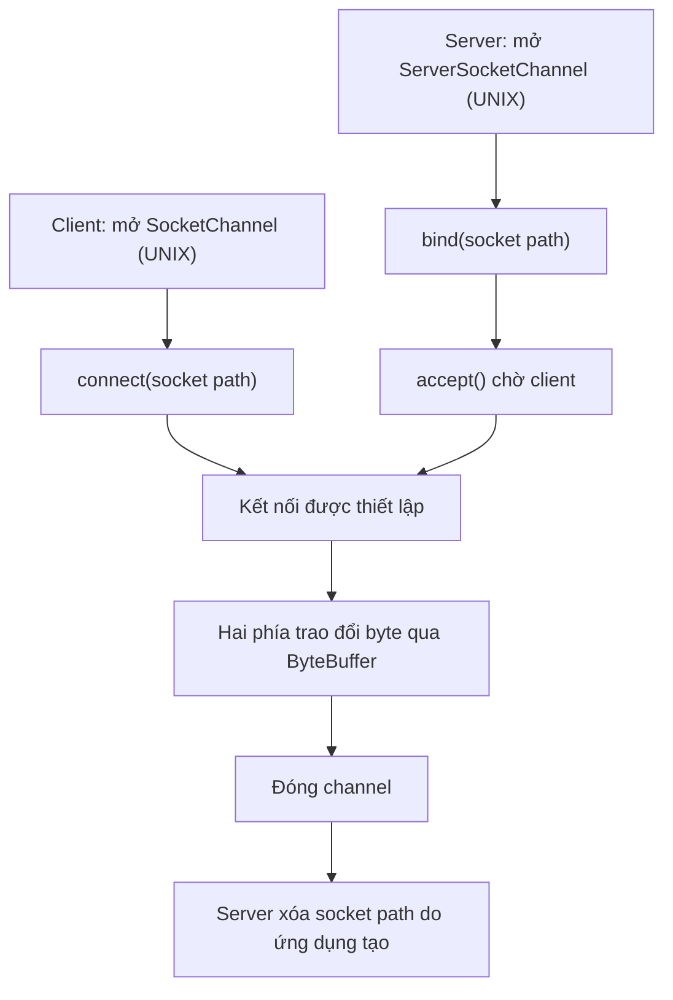

# Unix-domain socket từ Java 16 và giao tiếp giữa tiến trình cùng máy

> **Chương:** Unix-domain socket  
> **Học phần:** `JAVA_VERSION_JAVA16` — khám phá những cải tiến từ Java 16 vẫn hữu ích trong Java hiện đại, cùng cách sử dụng API ổn định trong ứng dụng thực tế. Java 16 hoàn thiện hỗ trợ Unix-domain socket trong NIO, giúp các tiến trình trên cùng máy trao đổi dữ liệu qua socket của hệ điều hành mà không cần địa chỉ IP hay cổng TCP.

## Mục tiêu học tập

Sau bài này, bạn có thể:

- Giải thích Unix-domain socket và trường hợp nên dùng cho giao tiếp liên tiến trình (IPC).
- Phân biệt Unix-domain socket với TCP loopback.
- Dùng `StandardProtocolFamily.UNIX`, `UnixDomainSocketAddress`, `ServerSocketChannel` và `SocketChannel`.
- Viết chương trình server và client trao đổi dữ liệu qua socket path.
- Hiểu cách xử lý framing, đọc/ghi từng phần và đóng tài nguyên.
- Quản lý socket file, quyền truy cập, stale path và lỗi thường gặp.
- Nhận biết giới hạn nền tảng và chọn Unix-domain socket hoặc TCP phù hợp.

## 1. Unix-domain socket là gì?

Unix-domain socket (UDS), còn gọi là local-domain socket, là cơ chế giao tiếp giữa các tiến trình do hệ điều hành cung cấp. Hai tiến trình trên cùng máy có thể mở kết nối socket và trao đổi dữ liệu qua kernel.

Khác với TCP, địa chỉ UDS chuẩn trong Java được biểu diễn bằng một đường dẫn trong hệ thống tệp, ví dụ:

```text
/run/my-service/control.sock
/tmp/my-service.sock
```

Đường dẫn này được gọi là *socket path*. Nó xác định điểm kết nối trong namespace của hệ thống tệp; nó không phải tệp dữ liệu thông thường mà ứng dụng đọc/ghi như một tệp văn bản.

Java hỗ trợ UDS qua API NIO từ Java 16, được hoàn thiện trong JEP 380. Các API này cho phép dùng channel để tạo server, chấp nhận kết nối, kết nối client và truyền byte.

UDS phù hợp khi:

- Hai tiến trình chạy trên cùng một máy cần trao đổi dữ liệu.
- Một daemon cung cấp API nội bộ cho nhiều ứng dụng cục bộ.
- Một dịch vụ cần giao tiếp với proxy, agent hoặc worker trên cùng host.
- Muốn giới hạn điểm kết nối bằng quyền truy cập của hệ thống tệp.
- Không cần định tuyến qua mạng hoặc truy cập từ máy khác.

UDS không thay thế TCP cho giao tiếp từ xa. Nếu client và server có thể chạy trên các host khác nhau, TCP hoặc giao thức mạng phù hợp vẫn là lựa chọn cần thiết.

## 2. Unix-domain socket khác TCP loopback như thế nào?

Cả UDS và TCP loopback đều có thể kết nối hai tiến trình trên cùng máy, nhưng địa chỉ và cơ chế kiểm soát truy cập khác nhau.

| Tiêu chí | Unix-domain socket | TCP loopback |
| --- | --- | --- |
| Địa chỉ | Socket path trong hệ thống tệp | Địa chỉ IP loopback và cổng |
| Phạm vi | Cùng hệ điều hành/máy | Có thể mở rộng thành kết nối mạng khi dùng địa chỉ phù hợp |
| Giao thức | Giao tiếp local qua socket domain | TCP/IP |
| Kiểm soát truy cập ban đầu | Quyền truy cập socket path và thư mục cha theo hệ điều hành | Firewall, địa chỉ bind, xác thực ở tầng ứng dụng |
| Khám phá endpoint | Biết đường dẫn socket | Biết địa chỉ IP và cổng |
| Triển khai đa nền tảng | Phụ thuộc OS và JDK provider | Được hỗ trợ rộng rãi hơn |
| Hiệu năng | Có thể giảm chi phí so với TCP/IP cho IPC local | Có chi phí xử lý TCP/IP; hiệu năng thực tế tùy tải và hệ thống |

UDS thường tránh một số bước xử lý của ngăn xếp TCP/IP, nhưng không nên mặc định nó luôn nhanh hơn trong mọi tình huống. Kích thước thông điệp, số kết nối, cách buffer, context switching và tải hệ thống đều ảnh hưởng. Hãy benchmark trong workload thật nếu hiệu năng là tiêu chí quyết định.

Quyền truy cập filesystem giúp giới hạn tiến trình có thể kết nối, nhưng không tự thay thế xác thực nghiệp vụ. Nếu client cần danh tính hoặc quyền hạn riêng, giao thức ứng dụng vẫn cần cơ chế xác thực và phân quyền thích hợp.

## 3. Các API Unix-domain socket trong Java 16

JEP 380 bổ sung khả năng sử dụng Unix-domain socket trong API NIO. Những lớp và hằng số chính gồm:

Đây là API chuẩn trong JDK, không phải tính năng preview và không cần bật cờ preview khi biên dịch hoặc chạy. Chương trình dùng trực tiếp các package `java.net` và `java.nio.channels`.

| API | Vai trò |
| --- | --- |
| `StandardProtocolFamily.UNIX` | Chọn protocol family UNIX khi mở channel |
| `UnixDomainSocketAddress` | Biểu diễn địa chỉ bằng một `Path` |
| `ServerSocketChannel.open(StandardProtocolFamily.UNIX)` | Mở server channel cho UDS |
| `SocketChannel.open(StandardProtocolFamily.UNIX)` | Mở client channel cho UDS |
| `ServerSocketChannel.bind(...)` | Gắn server vào socket path |
| `ServerSocketChannel.accept()` | Chấp nhận kết nối từ client |
| `SocketChannel.connect(...)` | Kết nối đến socket path |
| `SocketChannel.read(...)` và `write(...)` | Nhận và gửi dữ liệu qua `ByteBuffer` |

Các import thường dùng:

```java
import java.net.StandardProtocolFamily;
import java.net.UnixDomainSocketAddress;
import java.nio.channels.ServerSocketChannel;
import java.nio.channels.SocketChannel;
import java.nio.file.Path;
```

Địa chỉ được tạo từ `Path`:

```java
Path socketPath = Path.of("/tmp/my-service.sock");
UnixDomainSocketAddress address =
        UnixDomainSocketAddress.of(socketPath);
```

Đường dẫn phải hợp lệ trên hệ điều hành đang chạy. Độ dài tối đa, quy tắc đặt tên và quyền của socket path phụ thuộc nền tảng; không nên giả định một giới hạn độ dài giống nhau trên mọi hệ thống.

## 4. Mô hình kết nối

Server tạo `ServerSocketChannel` thuộc protocol family UNIX, bind vào một địa chỉ UDS rồi gọi `accept()`. Client mở `SocketChannel` cùng family và connect đến đúng địa chỉ đó.



Hai phía phải dùng cùng socket path. Nếu server bind vào `/run/app/service.sock` nhưng client kết nối `/tmp/service.sock`, chúng đang trỏ đến hai địa chỉ khác nhau.

## 5. Viết server nhận một dòng dữ liệu

Ví dụ server dưới đây:

- Nhận socket path từ tham số dòng lệnh.
- Mở `ServerSocketChannel` với `StandardProtocolFamily.UNIX`.
- Bind vào socket path và chờ một client.
- Đọc đến ký tự xuống dòng, giới hạn request 4096 byte.
- Gửi phản hồi `ACK`.
- Đóng channel và xóa socket path sau khi server đã bind thành công.

```java
import java.io.ByteArrayOutputStream;
import java.io.EOFException;
import java.io.IOException;
import java.net.StandardProtocolFamily;
import java.net.UnixDomainSocketAddress;
import java.nio.ByteBuffer;
import java.nio.channels.ServerSocketChannel;
import java.nio.channels.SocketChannel;
import java.nio.charset.StandardCharsets;
import java.nio.file.Files;
import java.nio.file.Path;

public class UnixSocketServer {

    private static final int MAX_REQUEST_BYTES = 4096;

    public static void main(String[] args) throws IOException {
        if (args.length != 1) {
            throw new IllegalArgumentException(
                    "Usage: UnixSocketServer <socket-path>"
            );
        }

        Path socketPath = Path.of(args[0]).toAbsolutePath();
        boolean bound = false;

        try {
            try (ServerSocketChannel server =
                         ServerSocketChannel.open(StandardProtocolFamily.UNIX)) {

                server.bind(UnixDomainSocketAddress.of(socketPath));
                bound = true;

                System.out.println("Listening on " + socketPath);

                try (SocketChannel peer = server.accept()) {
                    String request = readLine(peer);
                    System.out.println("Received: " + request);

                    ByteBuffer response = ByteBuffer.wrap(
                            "ACK\n".getBytes(StandardCharsets.UTF_8)
                    );

                    while (response.hasRemaining()) {
                        peer.write(response);
                    }
                }
            }
        } finally {
            // Chỉ xóa path nếu lần chạy này đã bind thành công.
            if (bound) {
                Files.deleteIfExists(socketPath);
            }
        }
    }

    private static String readLine(SocketChannel peer) throws IOException {
        ByteArrayOutputStream request = new ByteArrayOutputStream();
        ByteBuffer chunk = ByteBuffer.allocate(256);
        boolean lineComplete = false;

        while (!lineComplete) {
            int count = peer.read(chunk);

            if (count == -1) {
                break;
            }

            if (count == 0) {
                continue;
            }

            chunk.flip();

            while (chunk.hasRemaining()) {
                byte value = chunk.get();

                if (value == (byte) '\n') {
                    lineComplete = true;
                    break;
                }

                if (request.size() >= MAX_REQUEST_BYTES) {
                    throw new IOException("Request line is too long");
                }

                request.write(value);
            }

            chunk.clear();
        }

        if (!lineComplete) {
            throw new EOFException("Client closed before sending a complete line");
        }

        return new String(request.toByteArray(), StandardCharsets.UTF_8);
    }
}
```

Đây là server minh họa xử lý một kết nối rồi kết thúc. Ứng dụng phục vụ nhiều client thường đặt `accept()` trong vòng lặp và quyết định xử lý mỗi kết nối tuần tự hoặc giao cho worker riêng.

Server không xóa một socket path cũ trước khi bind. Nếu path đã tồn tại, `bind` có thể thất bại. Cách xử lý stale path được trình bày ở phần quản lý vòng đời; xóa tùy tiện một path đang được server khác sử dụng có thể làm mất endpoint của tiến trình đó.

## 6. Viết client kết nối và gửi dữ liệu

Client dùng cùng socket path với server, gửi một dòng UTF-8 và đọc phản hồi đến khi server đóng kết nối.

```java
import java.io.IOException;
import java.net.StandardProtocolFamily;
import java.net.UnixDomainSocketAddress;
import java.nio.ByteBuffer;
import java.nio.channels.SocketChannel;
import java.nio.charset.StandardCharsets;
import java.nio.file.Path;

public class UnixSocketClient {

    public static void main(String[] args) throws IOException {
        if (args.length != 1) {
            throw new IllegalArgumentException(
                    "Usage: UnixSocketClient <socket-path>"
            );
        }

        Path socketPath = Path.of(args[0]).toAbsolutePath();
        UnixDomainSocketAddress address =
                UnixDomainSocketAddress.of(socketPath);

        try (SocketChannel channel =
                     SocketChannel.open(StandardProtocolFamily.UNIX)) {

            channel.connect(address);

            ByteBuffer request = ByteBuffer.wrap(
                    "ping\n".getBytes(StandardCharsets.UTF_8)
            );

            while (request.hasRemaining()) {
                channel.write(request);
            }

            ByteBuffer response = ByteBuffer.allocate(32);

            while (true) {
                int count = channel.read(response);

                if (count == -1 || !response.hasRemaining()) {
                    break;
                }
            }

            response.flip();
            System.out.print(StandardCharsets.UTF_8.decode(response));
        }
    }
}
```

Client ghi đến khi buffer được tiêu thụ hết, vì một lần `write` không được bảo đảm ghi toàn bộ dữ liệu. Tương tự, server đọc theo từng phần và tìm ký tự xuống dòng để xác định ranh giới thông điệp.

## 7. Chạy thử server và client

Dùng một thư mục runtime riêng mà cả hai tiến trình đều có quyền truy cập. Ví dụ trên hệ thống POSIX:

```bash
mkdir -p /tmp/uds-demo
```

Biên dịch hai lớp bằng JDK 16 trở lên:

```bash
javac UnixSocketServer.java UnixSocketClient.java
```

Chạy server ở terminal thứ nhất:

```bash
java UnixSocketServer /tmp/uds-demo/service.sock
```

Chạy client ở terminal thứ hai:

```bash
java UnixSocketClient /tmp/uds-demo/service.sock
```

Client nhận:

```text
ACK
```

Server hiển thị request đã nhận:

```text
Listening on /tmp/uds-demo/service.sock
Received: ping
```

Sau khi xử lý xong kết nối, server đóng channel và xóa socket path do lần chạy đó tạo. Ví dụ dùng một request để tập trung vào API kết nối; trong ứng dụng thực tế, cần định nghĩa giao thức, thời hạn chờ, giới hạn kích thước và cách xử lý nhiều client.

## 8. Vì sao cần framing cho dữ liệu?

Unix-domain stream socket cung cấp luồng byte. Nó không bảo đảm một lần `write` ở phía gửi tương ứng đúng một lần `read` ở phía nhận.

Ví dụ client gửi ba lần:

```java
channel.write(ByteBuffer.wrap("HEL".getBytes(StandardCharsets.UTF_8)));
channel.write(ByteBuffer.wrap("LO".getBytes(StandardCharsets.UTF_8)));
channel.write(ByteBuffer.wrap("\n".getBytes(StandardCharsets.UTF_8)));
```

Server có thể nhận dữ liệu thành một lần đọc, nhiều lần đọc hoặc các đoạn có kích thước khác. Ứng dụng cần quy định ranh giới thông điệp (message framing).

Một số cách phổ biến:

| Cách framing | Cách hoạt động | Phù hợp khi |
| --- | --- | --- |
| Dấu phân cách | Kết thúc thông điệp bằng newline hoặc delimiter đã chọn | Dữ liệu văn bản, giao thức dòng |
| Tiền tố độ dài | Gửi số byte trước, rồi gửi đúng số byte payload | Dữ liệu nhị phân hoặc thông điệp có delimiter bất kỳ |
| Đóng luồng đầu ra | Client gọi `shutdownOutput()` để báo đã gửi xong | Trao đổi một chiều hoặc request-response đơn giản |
| Định dạng tự mô tả | Dùng parser cho JSON, protobuf hoặc định dạng có framing riêng | Giao thức ứng dụng đã định nghĩa |

Không nên giả định `read()` sẽ trả về toàn bộ request trong một lần. Cũng không nên giả định `write()` luôn tiêu thụ hết buffer. Với channel blocking, vẫn cần vòng lặp khi ghi và cần logic đọc cho đến khi đủ thông điệp.

## 9. Quản lý vòng đời socket path

UDS dùng socket path trong hệ thống tệp. Ứng dụng phải quản lý vòng đời path cùng vòng đời server.

Các điểm cần nhớ:

- Thư mục cha phải tồn tại và tiến trình server phải có quyền bind.
- Khi path đã tồn tại, bind có thể thất bại.
- Đóng `ServerSocketChannel` không tự động bảo đảm xóa socket file trên mọi hệ điều hành.
- Trên các hệ thống POSIX thông dụng, socket file thường còn lại sau khi server đóng; ứng dụng cần xóa path do mình sở hữu.
- Nếu tiến trình bị dừng đột ngột, khối `finally` có thể không chạy và stale socket path có thể còn lại.

Ví dụ server ở mục 5 chỉ gọi `Files.deleteIfExists` sau khi chính lần chạy đó bind thành công. Điều này tránh xóa nhầm một path mà bind đã thất bại vì endpoint khác đang sở hữu.

### Xử lý stale socket path an toàn

Khi khởi động lại, nếu path cũ còn tồn tại, hãy:

1. Dùng thư mục runtime riêng cho ứng dụng hoặc instance.
2. Xác nhận tiến trình server cũ đã dừng và path thực sự là socket do ứng dụng quản lý.
3. Chỉ xóa path cũ khi chắc chắn không làm gián đoạn server khác.
4. Bind socket mới.
5. Khi shutdown bình thường, đóng server rồi xóa socket path của instance.

Không nên luôn chạy `Files.deleteIfExists(socketPath)` trước `bind` mà không xác minh. Nếu một server đang hoạt động sử dụng path đó, việc unlink có thể làm client mới không tìm thấy endpoint dù server cũ vẫn còn chạy.

Đối với dịch vụ có nhiều instance, hãy dùng path riêng theo instance hoặc một cơ chế quản lý lock/ownership phù hợp.

## 10. Quyền truy cập và bảo mật

UDS path nằm trong hệ thống tệp, nên quyền của thư mục cha và socket file có vai trò quan trọng. Trên hệ thống POSIX, quyền truy cập thường chịu ảnh hưởng của owner, group, mode và chính sách hệ điều hành.

Một số nguyên tắc:

- Đặt socket trong thư mục runtime chỉ user hoặc group được phép mới truy cập.
- Hạn chế quyền ghi vào thư mục cha để user không tin cậy không thể thay thế hoặc tạo path giả.
- Không đặt socket có quyền truy cập rộng trong thư mục dùng chung nếu endpoint điều khiển dịch vụ nhạy cảm.
- Nếu cần xác thực client theo danh tính ứng dụng, thực hiện thêm ở giao thức hoặc lớp bảo mật phù hợp.
- Không ghi payload nhạy cảm vào log chỉ để chẩn đoán kết nối.

Java NIO chuẩn cung cấp địa chỉ và channel, còn cách đặt permission chính xác phụ thuộc hệ điều hành, filesystem và cấu hình runtime. Nếu triển khai POSIX, có thể cấu hình quyền của thư mục bằng API file attribute phù hợp; hãy kiểm thử quyền thực tế sau khi bind trên môi trường triển khai.

UDS không tự mã hóa payload. Vì giao tiếp diễn ra local không có nghĩa mọi tiến trình trên máy đều đáng tin cậy.

## 11. Hỗ trợ non-blocking và Selector

`SocketChannel` và `ServerSocketChannel` thuộc NIO, nên có thể tích hợp vào mô hình non-blocking và `Selector` trên các provider hỗ trợ UDS.

Ví dụ một channel có thể được chuyển sang non-blocking:

```java
SocketChannel channel =
        SocketChannel.open(StandardProtocolFamily.UNIX);

channel.configureBlocking(false);
```

Trong chế độ non-blocking:

- `connect` có thể chưa hoàn tất ngay; cần hoàn tất kết nối theo trạng thái channel.
- `read` có thể trả về 0 khi hiện chưa có dữ liệu.
- `write` có thể chỉ ghi một phần buffer.
- Selector giúp một thread theo dõi nhiều channel mà không phải chờ blocking trên từng kết nối.

Khi dùng non-blocking, cần quản lý trạng thái kết nối, buffer còn lại và các interest operation như connect, read, write. Không nên chuyển channel sang non-blocking rồi giữ vòng lặp blocking của ví dụ đơn giản ở trên mà không thay đổi logic.

## 12. Giới hạn nền tảng và API

Java 16 đưa UDS vào API chuẩn NIO, nhưng khả năng chạy thực tế vẫn phụ thuộc hệ điều hành và JDK provider.

Các lưu ý:

- Nền tảng phải hỗ trợ Unix-domain socket và provider phải triển khai protocol family UNIX.
- Nếu không hỗ trợ, thao tác mở channel có thể ném `UnsupportedOperationException`.
- Địa chỉ Java chuẩn dùng `UnixDomainSocketAddress` và `Path`; không nên giả định mọi namespace đặc thù của hệ điều hành đều được biểu diễn giống nhau.
- Độ dài socket path và quy tắc tên phụ thuộc hệ điều hành.
- Đường dẫn tương đối được phân giải theo working directory của tiến trình; nên dùng path tuyệt đối trong cấu hình dịch vụ.
- Cả server và client cần nhìn thấy cùng một socket path trong namespace filesystem tương ứng. Container hoặc mount namespace khác nhau có thể không nhìn thấy cùng endpoint dù chạy trên cùng host.

API chuẩn Java 16 tập trung vào stream socket qua `SocketChannel` và `ServerSocketChannel`. Nếu cần tính năng đặc thù như truyền file descriptor hoặc lấy credential peer theo API native, hãy kiểm tra khả năng của nền tảng và giải pháp tương ứng; không giả định API NIO chuẩn cung cấp mọi extension của Unix socket.

Với channel UDS, hãy sử dụng trực tiếp `read`, `write`, `connect` và `bind`. Không nên giả định mọi thao tác của `java.net.Socket` truyền thống đều có sẵn qua phương thức `socket()` của channel UNIX; một số thao tác socket wrapper không được hỗ trợ cho loại channel này.

## 13. Xử lý lỗi thường gặp

| Tình huống | Nguyên nhân có thể | Hướng xử lý |
| --- | --- | --- |
| `UnsupportedOperationException` khi mở channel | OS hoặc provider không hỗ trợ UNIX protocol family | Kiểm tra JDK, OS và môi trường chạy thực tế |
| Bind thất bại | Socket path đã tồn tại, thư mục cha không hợp lệ hoặc không có quyền | Kiểm tra path, ownership và stale socket theo quy trình an toàn |
| Client không kết nối được | Server chưa bind, path sai hoặc quyền truy cập bị từ chối | Xác nhận server đang chạy và hai phía dùng cùng path |
| `AccessDeniedException` hoặc lỗi I/O | Quyền thư mục/socket hoặc chính sách hệ thống không cho phép | Kiểm tra owner, group, mode và quyền truy cập thư mục cha |
| Client đọc EOF sớm | Server đóng kết nối hoặc giao thức không hoàn tất | Kiểm tra framing, thứ tự shutdown và xử lý lỗi phía server |
| Dữ liệu bị chia thành nhiều lần đọc | Stream không giữ ranh giới lần ghi | Đọc theo delimiter hoặc length prefix |
| Server restart nhưng bind không thành công | Stale socket path từ lần chạy trước | Xác minh ownership và dọn path cũ an toàn |

Không nên chỉ bắt `IOException` rồi bỏ qua. Hãy ghi log đủ thông tin về thao tác và socket path (nếu path không nhạy cảm), đồng thời giữ nguyên cause để chẩn đoán. Tránh ghi payload bí mật vào log.

## 14. Kiểm thử ứng dụng dùng Unix-domain socket

Kiểm thử IPC nên kiểm tra cả giao tiếp và vòng đời tài nguyên.

Một số tình huống hữu ích:

- Server bind thành công vào path trong thư mục test riêng.
- Client kết nối đến đúng path và nhận phản hồi mong đợi.
- Client dùng path sai hoặc server chưa chạy thì kết nối thất bại có kiểm soát.
- Server đóng channel và dọn path sau shutdown bình thường.
- Path đã tồn tại được xử lý mà không xóa nhầm endpoint của tiến trình khác.
- Dữ liệu dài hơn giới hạn giao thức bị từ chối.
- Dữ liệu gửi thành nhiều chunk vẫn được ghép theo framing đúng.

Nên tạo thư mục tạm riêng cho mỗi test, tránh dùng một socket path cố định chung giữa các test chạy song song. Dọn thư mục sau khi đóng server/client và chỉ xóa tài nguyên mà test sở hữu.

Ví dụ kiểm tra địa chỉ được tạo từ path:

```java
import static org.junit.jupiter.api.Assertions.assertEquals;

import java.net.UnixDomainSocketAddress;
import java.nio.file.Path;

import org.junit.jupiter.api.Test;

class UnixDomainSocketAddressTest {

    @Test
    void createsAddressFromPath() {
        Path path = Path.of("/tmp/uds-test.sock");

        UnixDomainSocketAddress address =
                UnixDomainSocketAddress.of(path);

        assertEquals(path, address.getPath());
    }
}
```

Đây là test nhỏ cho API địa chỉ. Test tích hợp server-client cần chạy trên nền tảng có hỗ trợ UNIX protocol family và nên dùng thư mục tạm được cấp riêng cho test.

## 15. Khi nào nên chọn UDS, khi nào nên chọn TCP?

| Nhu cầu | Lựa chọn phù hợp |
| --- | --- |
| Hai tiến trình trên cùng host, endpoint nội bộ | Unix-domain socket |
| Client có thể chạy ở máy khác | TCP hoặc giao thức mạng |
| Cần tích hợp với dịch vụ local vốn cung cấp socket path | Unix-domain socket |
| Cần địa chỉ IP, cổng và hạ tầng mạng quen thuộc | TCP |
| Muốn quyền truy cập endpoint gắn với filesystem | Unix-domain socket, kết hợp kiểm tra quyền |
| Cần khả năng triển khai nhất quán trên nhiều OS không đồng nhất | TCP thường dễ dự đoán hơn |
| Chưa biết workload có lợi về hiệu năng hay không | Đo benchmark UDS và TCP loopback |

UDS đặc biệt hữu ích cho daemon và dịch vụ local, nhưng hãy tính đến container, quyền filesystem, quản lý socket path và khả năng hỗ trợ của OS trong kiến trúc triển khai.

## 16. Các lỗi thiết kế thường gặp

| Lỗi | Hệ quả | Cách khắc phục |
| --- | --- | --- |
| Coi UDS như kết nối TCP có cổng | Dùng sai mô hình địa chỉ và API | Dùng `UnixDomainSocketAddress` và protocol family UNIX |
| Giả định một lần read nhận trọn request | Dữ liệu bị thiếu hoặc parse sai | Thiết kế framing và đọc đến khi đủ thông điệp |
| Giả định một lần write gửi hết buffer | Phần cuối thông điệp có thể chưa được gửi | Lặp đến khi `hasRemaining()` là false |
| Xóa socket path trước bind một cách vô điều kiện | Có thể làm mất endpoint của server đang hoạt động | Xác minh stale path và ownership trước khi xóa |
| Không dọn socket file sau shutdown | Lần chạy sau có thể không bind được | Xóa path do ứng dụng sở hữu sau khi đóng server |
| Đặt socket trong thư mục dùng chung có quyền rộng | Tiến trình không mong muốn có thể kết nối hoặc thay thế path | Dùng thư mục runtime có quyền hạn chế |
| Cho rằng UDS tự xác thực hoặc mã hóa | Có thể mở endpoint nội bộ quá rộng | Kiểm soát permission và xác thực ở tầng ứng dụng khi cần |
| Giả định mọi OS đều hỗ trợ | Ứng dụng lỗi khi triển khai ở nền tảng khác | Kiểm tra hỗ trợ và có phương án TCP khi cần |
| Giả định socket path giống nhau trong mọi container | Client không tìm thấy endpoint | Chia sẻ mount/namespace phù hợp hoặc cấu hình path tương ứng |
| Đo hiệu năng bằng suy đoán | Chọn sai transport cho workload | Benchmark với tải và cấu hình triển khai thực tế |

## 17. Bài tập tự luyện

### Bài 1: Chọn địa chỉ

Một server local lắng nghe ở `/run/reporting/report.sock`. API Java nào biểu diễn địa chỉ này?

**Đáp án tham khảo:**

```java
UnixDomainSocketAddress address =
        UnixDomainSocketAddress.of(
                Path.of("/run/reporting/report.sock")
        );
```

### Bài 2: Chọn channel family

Hãy viết lệnh mở server và client channel cho Unix-domain socket.

**Đáp án tham khảo:**

```java
ServerSocketChannel server =
        ServerSocketChannel.open(StandardProtocolFamily.UNIX);

SocketChannel client =
        SocketChannel.open(StandardProtocolFamily.UNIX);
```

Trong ứng dụng thực tế, đặt các channel trong try-with-resources để đóng tài nguyên đúng cách.

### Bài 3: Vì sao phải có framing?

Client gọi `write` ba lần cho ba đoạn của một thông điệp. Server có thể nhận chúng như thế nào?

**Đáp án:** Server có thể nhận tất cả trong một lần read hoặc nhận thành nhiều đoạn với kích thước khác nhau. Stream socket không giữ ranh giới giữa các lần write. Hãy dùng delimiter, length prefix hoặc quy tắc framing khác.

### Bài 4: Socket path còn tồn tại sau khi server đóng

Một server đã đóng channel nhưng lần khởi động sau bind thất bại vì path cũ còn tồn tại. Cần xử lý ra sao?

**Đáp án:** Xác minh server cũ đã dừng và path thuộc ứng dụng trước khi xóa. Dùng thư mục runtime riêng, chỉ dọn stale path có ownership rõ ràng và xóa path do chính lần chạy tạo sau shutdown bình thường.

### Bài 5: Chọn UDS hay TCP

Một ứng dụng có worker chạy trong container khác host cần gọi service. Có nên dùng UDS không?

**Đáp án:** Không, UDS chỉ kết nối qua namespace local của hệ điều hành. Với các host khác nhau, dùng TCP hoặc giao thức mạng. Nếu các container cùng host và chia sẻ socket path qua volume/mount phù hợp, UDS có thể là lựa chọn cho IPC local.

## Ghi nhớ

Java 16 hoàn thiện Unix-domain socket trong NIO qua `StandardProtocolFamily.UNIX`, `UnixDomainSocketAddress`, `ServerSocketChannel` và `SocketChannel`. UDS dùng socket path để kết nối các tiến trình cùng máy, phù hợp với daemon và IPC local. Stream socket không giữ ranh giới thông điệp, vì vậy ứng dụng phải tự định nghĩa framing và xử lý đọc/ghi từng phần. Hãy quản lý socket path, quyền filesystem, stale endpoint và vòng đời channel cẩn thận. UDS không tự mã hóa hay xác thực payload; nếu cần bảo vệ ở mức ứng dụng, hãy bổ sung cơ chế phù hợp. Chọn UDS hay TCP dựa trên phạm vi triển khai, khả năng hỗ trợ nền tảng và benchmark thực tế.

## Tài liệu tham khảo

- [JEP 380 — Unix-Domain Socket Channels](https://openjdk.org/jeps/380).
- [Java API — StandardProtocolFamily](https://docs.oracle.com/en/java/javase/26/docs/api/java.base/java/net/StandardProtocolFamily.html).
- [Java API — UnixDomainSocketAddress](https://docs.oracle.com/en/java/javase/26/docs/api/java.base/java/net/UnixDomainSocketAddress.html).
- [Java API — ServerSocketChannel](https://docs.oracle.com/en/java/javase/26/docs/api/java.base/java/nio/channels/ServerSocketChannel.html).
- [Java API — SocketChannel](https://docs.oracle.com/en/java/javase/26/docs/api/java.base/java/nio/channels/SocketChannel.html).
- [Java API — Selector](https://docs.oracle.com/en/java/javase/26/docs/api/java.base/java/nio/channels/Selector.html).
