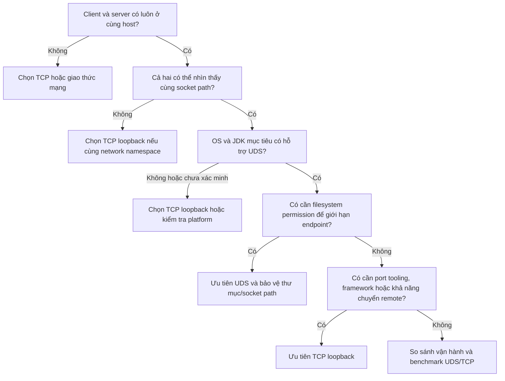

# Chọn Unix-domain socket hay TCP loopback theo yêu cầu triển khai

> **Chương:** Unix-domain socket  
> **Học phần:** `JAVA_VERSION_JAVA16` — khám phá những cải tiến từ Java 16 vẫn hữu ích trong Java hiện đại, cùng cách lựa chọn API và mô hình triển khai ổn định. Bài này giúp quyết định khi nào nên dùng Unix-domain socket (UDS) và khi nào nên dùng TCP loopback cho giao tiếp giữa các tiến trình trên cùng máy.

## Mục tiêu học tập

Sau bài này, bạn có thể:

- Phân biệt phạm vi và đặc điểm endpoint của UDS với TCP loopback.
- Chọn transport theo topology triển khai, khả năng hỗ trợ hệ điều hành và cách quản lý endpoint.
- Đánh giá quyền truy cập filesystem, port binding, xác thực và ranh giới bảo mật.
- Hiểu tác động của container, network namespace và mount namespace.
- Nhận diện trường hợp cần giữ TCP để hỗ trợ khả năng mở rộng sang máy khác.
- Viết cấu hình channel cơ bản cho UDS và TCP loopback bằng Java NIO.
- Thiết kế fallback rõ ràng và benchmark dựa trên workload thực tế.

## 1. Bắt đầu từ topology: hai tiến trình sẽ chạy ở đâu?

Unix-domain socket và TCP loopback đều có thể dùng để giao tiếp giữa hai tiến trình trên cùng máy. Điểm quyết định đầu tiên là vị trí thực tế của client và server trong môi trường triển khai.

**Unix-domain socket (UDS)** dùng địa chỉ gắn với socket path trong namespace hệ thống tệp. Hai tiến trình phải nhìn thấy cùng endpoint path và hệ điều hành/JDK phải hỗ trợ UNIX protocol family.

**TCP loopback** dùng địa chỉ loopback và cổng TCP. Server chỉ nhận kết nối local khi bind vào địa chỉ loopback cụ thể như `127.0.0.1` hoặc `::1`. Client kết nối đến cùng địa chỉ và cổng.

Một quy tắc khởi đầu:

- Chọn UDS khi cả hai tiến trình luôn ở cùng host, có thể chia sẻ socket path và cần endpoint local gắn với quyền filesystem.
- Chọn TCP loopback khi cần tính tương thích rộng, dùng port/service discovery sẵn có hoặc có khả năng chuyển client/server sang các host khác.
- Nếu chưa chắc topology sẽ giữ nguyên, hãy tính chi phí chuyển đổi transport ngay từ đầu và tránh để domain logic phụ thuộc trực tiếp vào một loại địa chỉ.

UDS không thể kết nối trực tiếp đến tiến trình trên máy khác. TCP loopback cũng chỉ local nếu bind đúng địa chỉ loopback; TCP có thể chuyển sang kết nối từ xa bằng cách thay đổi địa chỉ bind và cấu hình mạng, nhưng điều đó kéo theo yêu cầu bảo mật khác.

## 2. So sánh hai lựa chọn

| Tiêu chí | Unix-domain socket | TCP loopback |
| --- | --- | --- |
| Phạm vi kết nối | Các tiến trình nhìn thấy cùng socket path trên một hệ điều hành | Các tiến trình kết nối qua địa chỉ loopback trên cùng network namespace |
| Địa chỉ | `UnixDomainSocketAddress` dựa trên `Path` | `InetSocketAddress` gồm IP và port |
| Endpoint discovery | Cấu hình hoặc thỏa thuận một socket path | Cấu hình port; có thể dùng port động và công bố port thực tế |
| Kiểm soát truy cập ban đầu | Quyền thư mục cha và socket path theo hệ điều hành | Bind loopback giới hạn phạm vi mạng; vẫn cần xác thực ở tầng ứng dụng khi cần |
| Port collision | Không có TCP port; có thể xung đột socket path | Có thể xung đột port; port 0 yêu cầu cơ chế công bố port được cấp |
| Container | Cần chia sẻ path qua mount/volume phù hợp | Phụ thuộc network namespace và cấu hình mạng container |
| Khả năng kết nối từ xa | Không | Có thể mở rộng thành TCP network endpoint |
| Hệ sinh thái tooling | Công cụ và cách quan sát phụ thuộc nền tảng | Công cụ TCP, proxy, client và framework phổ biến |
| Khả năng hỗ trợ | Phụ thuộc OS và JDK provider | Được hỗ trợ rộng rãi trên các nền tảng Java |
| Hiệu năng | Có thể giảm overhead cho IPC local; phải đo thực tế | Có chi phí TCP/IP; hiệu năng phụ thuộc tải và hệ thống |

Không có lựa chọn thắng trong mọi tiêu chí. Hãy xem endpoint, quyền truy cập, vận hành và khả năng mở rộng là các yêu cầu của hệ thống, rồi mới cân nhắc hiệu năng.

## 3. Cây quyết định chọn transport



Cây quyết định là điểm bắt đầu, không thay thế yêu cầu bảo mật và kiểm thử trên môi trường đích. Đặc biệt, container có thể khiến hai tiến trình cùng host nhưng không nhìn thấy cùng filesystem path hoặc không dùng chung network namespace.

## 4. Chọn UDS khi endpoint local và filesystem là ranh giới phù hợp

UDS thường là lựa chọn hợp lý cho daemon, agent và service nội bộ khi các tiến trình chạy trên cùng host.

Ví dụ:

- Một ứng dụng desktop giao tiếp với background daemon.
- Web server local giao tiếp với process quản lý worker.
- Agent giám sát gửi lệnh đến service cùng host.
- Reverse proxy trên máy chuyển request đến application server local.
- Một service chỉ dành cho các process có quyền truy cập vào thư mục runtime riêng.

UDS cho endpoint dạng path, ví dụ `/run/my-app/control.sock`. Việc sở hữu hoặc có quyền truy cập thư mục chứa socket có thể được dùng như một lớp kiểm soát truy cập của hệ điều hành.

Điều này có ích khi quy trình triển khai đã quản lý được:

- Thư mục runtime và quyền owner/group.
- Tên socket path duy nhất cho mỗi instance.
- Dọn socket path khi service dừng.
- Xử lý stale path sau khi process bị crash.
- Chia sẻ socket path nếu client và server ở trong container khác nhau.

Nếu đội vận hành đã có quy trình quản lý port và TCP endpoint tốt, lợi ích của UDS có thể không đủ để bù chi phí quản lý path và khác biệt nền tảng.

## 5. Chọn TCP loopback khi cần khả năng tương thích và công cụ mạng

TCP loopback phù hợp khi hai tiến trình vẫn chạy cùng máy nhưng hệ thống đã dựa vào TCP port hoặc cần khả năng mở rộng linh hoạt.

Ví dụ:

- Framework hoặc thư viện chỉ cấu hình endpoint qua host và port.
- Công cụ vận hành hiện có giám sát, health check hoặc proxy qua TCP.
- Các tiến trình chạy trong container có network namespace riêng và không chia sẻ socket path.
- Client có thể chuyển sang máy khác trong một giai đoạn triển khai sau.
- Cần một giao thức client-server có thể dùng cùng cấu hình cho môi trường local và remote.

Khi chỉ muốn nhận kết nối local, bind rõ địa chỉ loopback. Tránh bind vào wildcard address như `0.0.0.0` hoặc `::` nếu endpoint không được phép truy cập từ interface mạng khác.

Ví dụ TCP loopback không tự động trở thành endpoint remote chỉ vì dùng TCP. Phạm vi kết nối phụ thuộc địa chỉ bind, routing, firewall và cấu hình mạng.

## 6. Cấu hình endpoint UDS trong Java 16

Java 16 hoàn thiện UDS trong NIO qua JEP 380. Các API chuẩn gồm `StandardProtocolFamily.UNIX`, `UnixDomainSocketAddress`, `ServerSocketChannel` và `SocketChannel`. Đây là API chuẩn, không phải preview feature.

Server bind vào socket path:

```java
import java.io.IOException;
import java.net.StandardProtocolFamily;
import java.net.UnixDomainSocketAddress;
import java.nio.channels.ServerSocketChannel;
import java.nio.channels.SocketChannel;
import java.nio.file.Path;

public class LocalUdsServer {

    public static void main(String[] args) throws IOException {
        Path socketPath = Path.of("/run/my-app/control.sock");

        try (ServerSocketChannel server =
                     ServerSocketChannel.open(StandardProtocolFamily.UNIX)) {

            server.bind(UnixDomainSocketAddress.of(socketPath));

            try (SocketChannel client = server.accept()) {
                // Đọc và ghi ByteBuffer theo giao thức ứng dụng.
            }
        }
    }
}
```

Client kết nối đến cùng path:

```java
import java.io.IOException;
import java.net.StandardProtocolFamily;
import java.net.UnixDomainSocketAddress;
import java.nio.channels.SocketChannel;
import java.nio.file.Path;

public class LocalUdsClient {

    public static void main(String[] args) throws IOException {
        Path socketPath = Path.of("/run/my-app/control.sock");

        try (SocketChannel client =
                     SocketChannel.open(StandardProtocolFamily.UNIX)) {

            client.connect(UnixDomainSocketAddress.of(socketPath));

            // Gửi và nhận ByteBuffer theo giao thức ứng dụng.
        }
    }
}
```

Hai process phải sử dụng cùng một path trong filesystem namespace mà chúng cùng nhìn thấy. Nên dùng path tuyệt đối lấy từ cấu hình runtime thay vì phụ thuộc working directory.

Đoạn mã minh họa phần mở và kết nối channel. Ứng dụng thực tế còn cần framing, timeout, xử lý nhiều client và dọn socket path theo ownership.

## 7. Cấu hình TCP loopback trong Java 16

TCP dùng cùng abstraction NIO channel nhưng địa chỉ là `InetSocketAddress`. Để giới hạn server ở local host, bind vào loopback address:

```java
import java.io.IOException;
import java.net.InetAddress;
import java.net.InetSocketAddress;
import java.nio.channels.ServerSocketChannel;
import java.nio.channels.SocketChannel;

public class LocalTcpServer {

    public static void main(String[] args) throws IOException {
        InetAddress loopback = InetAddress.getLoopbackAddress();
        InetSocketAddress endpoint =
                new InetSocketAddress(loopback, 7070);

        try (ServerSocketChannel server = ServerSocketChannel.open()) {
            server.bind(endpoint);

            try (SocketChannel client = server.accept()) {
                // Đọc và ghi ByteBuffer theo giao thức ứng dụng.
            }
        }
    }
}
```

Client dùng cùng loopback address và port:

```java
import java.io.IOException;
import java.net.InetAddress;
import java.net.InetSocketAddress;
import java.nio.channels.SocketChannel;

public class LocalTcpClient {

    public static void main(String[] args) throws IOException {
        InetAddress loopback = InetAddress.getLoopbackAddress();
        InetSocketAddress endpoint =
                new InetSocketAddress(loopback, 7070);

        try (SocketChannel client = SocketChannel.open()) {
            client.connect(endpoint);

            // Gửi và nhận ByteBuffer theo giao thức ứng dụng.
        }
    }
}
```

`InetAddress.getLoopbackAddress()` trả về một địa chỉ loopback. Nếu cấu hình hệ thống cần cố định IPv4 hoặc IPv6, hãy cấu hình địa chỉ rõ ràng và bảo đảm server/client dùng cùng family. Không bind wildcard nếu yêu cầu chỉ cho phép kết nối local.

Port `7070` chỉ là ví dụ. Trong ứng dụng thật, nên quản lý port qua cấu hình và xử lý trường hợp port đã được process khác sử dụng.

## 8. Cả UDS và TCP đều là stream: vẫn cần framing

Một khác biệt về địa chỉ không làm thay đổi bản chất stream của các channel. UDS stream và TCP đều truyền luồng byte; một lần `write` không tương ứng một-một với một lần `read` ở phía nhận.

Với cả hai transport:

- Một thông điệp có thể đến qua nhiều lần read.
- Một lần read có thể chứa nhiều thông điệp nếu giao thức gửi liên tiếp.
- Một lần write có thể chỉ ghi một phần buffer.
- Ứng dụng phải định nghĩa ranh giới thông điệp.

Các phương pháp framing phổ biến:

| Phương pháp | Cách làm | Ghi chú |
| --- | --- | --- |
| Delimiter | Kết thúc mỗi thông điệp bằng newline hoặc ký tự phân cách | Cần quy định cách escape delimiter trong payload |
| Length prefix | Gửi độ dài trước payload | Phù hợp dữ liệu nhị phân và thông điệp tùy ý |
| Fixed length | Mỗi frame có độ dài cố định | Đơn giản nhưng có thể lãng phí |
| End-of-stream | Dùng đóng luồng đầu ra để báo kết thúc request | Chỉ phù hợp một số giao thức request-response |

Nếu cùng một giao thức ứng dụng chạy trên UDS và TCP, giữ framing và encoding giống nhau. Khi đó có thể thay transport mà không cần viết lại parser hoặc business logic.

## 9. Endpoint discovery và quản lý xung đột

UDS và TCP có hai loại tên endpoint khác nhau, nên quy trình triển khai cũng khác.

| Công việc | UDS | TCP loopback |
| --- | --- | --- |
| Cấu hình endpoint | Socket path tuyệt đối | Loopback address và port |
| Phát hiện xung đột | Path đã tồn tại hoặc không bind được | Port đã được process khác bind |
| Endpoint động | Path duy nhất theo instance | Bind port 0 rồi đọc port thực tế từ local address |
| Dọn dẹp | Xóa socket path thuộc instance sau khi đóng server | Đóng channel để giải phóng port |
| Nhiều instance | Dùng path riêng cho mỗi instance | Dùng port riêng hoặc port động |
| Quan sát vận hành | Kiểm tra filesystem và process sở hữu endpoint | Dùng công cụ TCP và kiểm tra port/listener |

### UDS path

Không xóa path cũ một cách vô điều kiện trước khi bind. Path có thể thuộc một server còn hoạt động. Hãy dùng thư mục runtime riêng, xác định ownership và chỉ dọn stale path khi chắc chắn endpoint cũ không còn được sử dụng.

### TCP port

Port cố định dễ cấu hình và quan sát nhưng có thể xung đột. Bind port `0` cho phép hệ điều hành cấp một port khả dụng; server phải công bố port thực tế cho client qua một kênh discovery khác.

Ví dụ lấy port sau khi bind:

```java
import java.net.InetSocketAddress;
import java.nio.channels.ServerSocketChannel;

try (ServerSocketChannel server = ServerSocketChannel.open()) {
    server.bind(new InetSocketAddress(
            java.net.InetAddress.getLoopbackAddress(), 0
    ));

    InetSocketAddress actual =
            (InetSocketAddress) server.getLocalAddress();

    int assignedPort = actual.getPort();
}
```

Port động hữu ích cho test và process con do supervisor khởi chạy. Với service được các process độc lập tìm đến, cần cơ chế công bố endpoint rõ ràng.

## 10. Bảo mật: filesystem permission và loopback binding không phải xác thực hoàn chỉnh

UDS và TCP loopback có các ranh giới tiếp cận khác nhau, nhưng không transport nào tự động xác thực mọi client theo nghiệp vụ.

### Với UDS

Quyền truy cập thư mục cha và socket path trên hệ điều hành có thể giới hạn process nào được kết nối. Hãy:

- Tạo thư mục runtime do service sở hữu, không cho user không tin cậy ghi vào.
- Đặt socket trong thư mục có quyền phù hợp với owner/group.
- Kiểm tra quyền thực tế sau khi bind trên hệ điều hành triển khai.
- Tránh cho phép bên không tin cậy thay thế socket path hoặc tạo symlink trong thư mục cha.
- Chỉ xóa socket path mà process hiện tại sở hữu.

Cách áp dụng permission lên socket file và hành vi filesystem phụ thuộc OS. API NIO chuẩn không cung cấp một mô hình permission hoàn toàn giống nhau trên mọi nền tảng.

### Với TCP loopback

Bind vào loopback khiến listener chỉ nhận kết nối đến địa chỉ loopback tương ứng. Điều này giới hạn phạm vi mạng nhưng không ngăn process khác trên cùng máy kết nối đến port đó.

Không nhầm loopback binding với authentication. Nếu endpoint điều khiển thao tác nhạy cảm, vẫn cần xác thực client hoặc kiểm tra quyền ở tầng ứng dụng. Nếu TCP được mở rộng ra mạng, phải đánh giá TLS, xác thực, firewall và threat model của kết nối remote.

### Cả hai transport

UDS không tự mã hóa payload; TCP loopback cũng không tự mã hóa payload. Nếu dữ liệu cần bảo mật trước process khác hoặc threat model yêu cầu bảo vệ nội dung, hãy thiết kế cơ chế mã hóa và xác thực phù hợp. Không ghi credential hoặc payload nhạy cảm vào log.

## 11. Container và namespace có thể thay đổi quyết định

"Chạy cùng host" không luôn có nghĩa hai process nhìn thấy cùng endpoint.

### UDS trong container

Hai container chỉ có thể dùng chung UDS path nếu socket nằm trong một volume hoặc mount được chia sẻ phù hợp và quyền filesystem cho phép. Cùng một chuỗi path bên trong hai container có thể trỏ đến hai filesystem khác nhau nếu không chia sẻ mount.

### TCP loopback trong container

Loopback thường thuộc network namespace của process. `127.0.0.1` bên trong một container trỏ về chính network namespace đó; nó không mặc nhiên trỏ đến host hoặc container khác.

Nếu hai container dùng network namespace riêng, TCP loopback của container A không phải endpoint loopback của container B. Nếu chia sẻ network namespace, chúng có thể nhìn thấy cùng loopback interface và port space.

| Triển khai | UDS | TCP loopback |
| --- | --- | --- |
| Hai process trên host, cùng filesystem | Dễ dùng nếu quyền path phù hợp | Dễ dùng qua loopback và port |
| Hai container chia sẻ volume socket | Có thể dùng cùng socket path | Vẫn phụ thuộc network namespace |
| Hai container dùng network namespace riêng | Cần chia sẻ socket qua mount/volume | Loopback của mỗi container tách biệt |
| Process trong container gọi service trên host | Cần mount socket host vào container | Cần địa chỉ gateway/host phù hợp; loopback trong container không tự trỏ đến host |
| Hai process ở hai host | Không dùng UDS path thông thường | Dùng TCP hoặc giao thức mạng |

Trước khi chọn transport, hãy xác định mount namespace, network namespace và cách orchestrator cấp endpoint. Đừng suy luận chỉ từ việc các container chạy trên cùng máy vật lý.

## 12. Khả năng mở rộng sang remote

Nếu có khả năng client và server sẽ chuyển sang các host khác nhau, TCP thường giảm chi phí thay đổi kiến trúc hơn.

Một hệ thống có thể bắt đầu bằng TCP loopback rồi chuyển sang bind một interface mạng hoặc địa chỉ service discovery khi có nhu cầu remote. Giao thức ứng dụng vẫn giữ nguyên, nhưng cần bổ sung xác thực, TLS, firewall và cấu hình mạng phù hợp.

UDS có phạm vi local. Nếu sau này cần remote, ứng dụng phải thêm transport khác hoặc thay đổi cách kết nối. Có thể thiết kế một abstraction nhỏ để domain logic không phụ thuộc trực tiếp vào `UnixDomainSocketAddress` hay `InetSocketAddress`.

Không cần tạo abstraction phức tạp cho một service nhỏ chỉ có một transport. Hãy cân nhắc mức độ có khả năng thay đổi thực tế và số lượng implementation cần hỗ trợ.

## 13. Hiệu năng: benchmark thay vì phỏng đoán

UDS có thể giảm một số overhead so với TCP/IP trong giao tiếp local, nhưng kết quả phụ thuộc workload và hệ điều hành. TCP loopback cũng được tối ưu tốt trên nhiều nền tảng.

Khi benchmark, giữ các điều kiện giống nhau:

- Cùng payload và encoding.
- Cùng framing và kích thước buffer.
- Cùng số client đồng thời và mô hình thread.
- Cùng thời gian warm-up và thời gian đo.
- Cùng mức logging và xử lý nghiệp vụ.
- Cùng máy, JDK và cấu hình hệ điều hành.

Đo ít nhất:

| Chỉ số | Ý nghĩa |
| --- | --- |
| Throughput | Số request hoặc byte xử lý mỗi giây |
| Latency p50/p95/p99 | Độ trễ điển hình và tail latency |
| CPU usage | Chi phí xử lý trên mỗi request |
| Allocation/GC | Chi phí buffer và garbage collection |
| Error/timeout rate | Độ ổn định khi tải tăng |
| Connection setup time | Chi phí tạo kết nối mới nếu ứng dụng thường xuyên mở/đóng channel |

Benchmark cả trường hợp một kết nối dài và trường hợp nhiều kết nối ngắn nếu chúng phản ánh workload thực tế. Đừng kết luận từ một microbenchmark chỉ đo vòng lặp read/write mà không có framing và tải tương tự ứng dụng.

## 14. Chiến lược cấu hình và fallback

Nếu ứng dụng hỗ trợ cả UDS và TCP loopback, hãy chọn transport bằng cấu hình tường minh, ví dụ:

```properties
ipc.transport=unix
ipc.unix.path=/run/my-app/control.sock
ipc.tcp.host=127.0.0.1
ipc.tcp.port=7070
```

Cấu hình này chỉ minh họa tên thuộc tính. Ứng dụng cần xác định rõ giá trị hợp lệ, mặc định, quyền truy cập và cách client/server nhận cùng endpoint.

Một chiến lược hợp lý:

1. Đọc transport đã cấu hình.
2. Kiểm tra khả năng hỗ trợ của môi trường trước khi khởi động listener.
3. Khởi tạo đúng loại channel và endpoint.
4. Nếu không hỗ trợ, báo lỗi cấu hình rõ ràng hoặc chuyển fallback chỉ khi policy cho phép.
5. Ghi log transport và endpoint không nhạy cảm để vận hành có thể chẩn đoán.
6. Client và server phải thống nhất transport và endpoint.

Không nên âm thầm chuyển từ UDS sang TCP nếu cấu hình yêu cầu UDS. Việc fallback có thể thay đổi ranh giới bảo mật, cách cấp quyền và endpoint discovery. Nếu muốn fallback, hãy bật bằng policy rõ ràng và bảo đảm client cũng biết endpoint TCP mới.

Nếu chỉ cần UDS và nền tảng mục tiêu không hỗ trợ, fail fast thường dễ chẩn đoán hơn việc tạo một listener TCP ngoài dự kiến.

## 15. Khả năng hỗ trợ nền tảng

UDS được đưa vào API chuẩn NIO trong Java 16 qua JEP 380, nhưng khả năng chạy vẫn phụ thuộc hệ điều hành và JDK provider. Tên protocol family là `UNIX`; đừng suy ra mọi OS, phiên bản OS hoặc filesystem đều có cùng giới hạn path và permission.

Trước khi phát hành:

- Kiểm tra JDK vendor và phiên bản thực tế trên môi trường đích.
- Kiểm tra UDS channel có mở và bind được trên OS mục tiêu.
- Kiểm tra giới hạn socket path, quyền thư mục và cách dọn stale path.
- Kiểm tra cách mount socket vào container nếu có.
- Kiểm tra TCP loopback bind đúng IPv4/IPv6 family mà cấu hình yêu cầu.
- Kiểm tra cả khởi động bình thường, restart và process crash.

Nếu cần hỗ trợ nhiều hệ điều hành và không có yêu cầu riêng gắn với filesystem, TCP loopback thường có độ tương thích triển khai rộng hơn.

## 16. Các tình huống lựa chọn thực tế

| Tình huống | Lựa chọn gợi ý | Lý do |
| --- | --- | --- |
| Desktop app nói chuyện với daemon cùng user | UDS nếu OS và quyền path phù hợp | Endpoint local, quản lý bằng thư mục runtime |
| Hai service trong cùng host, có sẵn TCP health check và proxy | TCP loopback | Tái sử dụng tooling và port discovery |
| Reverse proxy và application server cùng host, triển khai trên Linux | UDS thường phù hợp | Nhiều hệ thống triển khai hỗ trợ socket path và permission |
| Worker chạy trong container network namespace riêng | Không mặc định chọn TCP loopback; đánh giá shared UDS mount hoặc network endpoint phù hợp | Loopback mỗi container có thể tách biệt |
| Client có thể chuyển sang host khác | TCP | Có thể mở rộng qua mạng |
| Cần endpoint chỉ process có quyền thư mục truy cập | UDS | Filesystem permission có thể giới hạn kết nối |
| Cần tương thích đơn giản trên nhiều OS/JDK | TCP loopback | Hệ sinh thái và hỗ trợ rộng hơn |
| Chưa rõ transport nào nhanh hơn | Benchmark cả hai | Không giả định UDS luôn nhanh hơn |

Các gợi ý này cần xác nhận với kiến trúc, quyền và nền tảng thực tế. Ví dụ Linux phổ biến không đảm bảo mọi bản phân phối, container runtime hoặc chính sách bảo mật có cùng cấu hình.

## 17. Xử lý lỗi thường gặp khi chọn sai transport

| Triệu chứng | Nguyên nhân có thể | Hướng xử lý |
| --- | --- | --- |
| UDS bind thất bại dù server đã dừng | Stale socket path còn tồn tại | Xác minh ownership rồi dọn path cũ |
| Client UDS không tìm thấy server trong container | Không chia sẻ mount chứa socket path | Chia sẻ volume/mount và kiểm tra quyền |
| TCP client trong container không kết nối được host service qua 127.0.0.1 | Loopback trỏ vào container hiện tại | Dùng endpoint host/gateway được cấu hình cho nền tảng |
| TCP server vô tình lộ ra interface mạng | Bind wildcard thay vì loopback | Bind địa chỉ loopback cụ thể |
| TCP bind thất bại | Port đã được process khác sử dụng | Chọn port cấu hình khác hoặc dùng port động và discovery |
| UDS hoạt động trên máy dev nhưng lỗi trên máy triển khai | OS/JDK provider hoặc path/permission khác nhau | Kiểm tra môi trường đích và test tích hợp |
| Hiệu năng UDS không tốt hơn TCP | Workload không bị chi phối bởi transport hoặc cách dùng buffer khác | Benchmark workload tương đương và đo CPU/latency |
| Fallback mở TCP ngoài dự kiến | Policy fallback không rõ | Yêu cầu cấu hình tường minh và đồng bộ endpoint client/server |

Không chỉ log câu `connection failed`. Hãy ghi loại transport, thao tác, endpoint không nhạy cảm và cause của lỗi để phân biệt vấn đề path, port, permission, namespace hay protocol.

## 18. Checklist trước khi quyết định

Trước khi chốt transport, trả lời các câu hỏi sau:

- [ ] Client và server có luôn chạy trong cùng host không?
- [ ] Nếu dùng UDS, cả hai process có nhìn thấy cùng socket path không?
- [ ] OS và JDK mục tiêu có hỗ trợ UNIX protocol family không?
- [ ] Ai sở hữu thư mục runtime và socket path?
- [ ] Nếu dùng TCP, server có bind đúng loopback address không?
- [ ] Port có được quản lý và công bố nhất quán không?
- [ ] Container có network namespace hoặc mount namespace riêng không?
- [ ] Transport có cần hỗ trợ remote trong tương lai không?
- [ ] Có xác thực và phân quyền phù hợp với threat model không?
- [ ] Đã kiểm thử restart, stale endpoint, timeout và lỗi kết nối chưa?
- [ ] Có benchmark tương đương nếu hiệu năng là lý do chọn transport không?

Nếu các câu hỏi về topology, endpoint và quyền chưa rõ, hãy làm rõ chúng trước khi tối ưu hiệu năng.

## 19. Bài tập tự luyện

### Bài 1: Chọn transport cho daemon local

Một daemon và một ứng dụng desktop luôn chạy trên cùng máy. Ứng dụng chỉ được phép kết nối khi có quyền truy cập thư mục runtime của daemon. Nên cân nhắc transport nào?

**Đáp án:** UDS là lựa chọn phù hợp nếu OS/JDK hỗ trợ và quyền thư mục/socket được cấu hình đúng. Quyền filesystem có thể giới hạn process được tiếp cận endpoint. Vẫn cần xác thực ở tầng ứng dụng nếu threat model yêu cầu.

### Bài 2: TCP loopback trong container

Một process trong container gọi `127.0.0.1:7070` để kết nối service chạy trên host. Vì sao kết nối có thể thất bại?

**Đáp án:** Loopback trong container thường trỏ đến network namespace của chính container, không phải host. Cần dùng endpoint host/gateway phù hợp với nền tảng container hoặc chia sẻ network namespace theo thiết kế.

### Bài 3: Bind TCP chỉ local

Viết đoạn Java NIO mở server channel và bind vào loopback address với port 7070.

**Đáp án tham khảo:**

```java
InetAddress loopback = InetAddress.getLoopbackAddress();
ServerSocketChannel server = ServerSocketChannel.open();

server.bind(new InetSocketAddress(loopback, 7070));
```

Trong ứng dụng thực tế, dùng try-with-resources và xử lý trường hợp port đã được sử dụng.

### Bài 4: Port động

Một integration test khởi chạy TCP server và không muốn hard-code port. Có thể bind port 0 rồi lấy port thực tế như thế nào?

**Đáp án:** Bind server vào loopback với port 0, sau đó lấy `server.getLocalAddress()`, ép kiểu thành `InetSocketAddress` và đọc `getPort()`. Test truyền port này cho client qua kênh điều phối của test.

### Bài 5: Có nên fallback tự động từ UDS sang TCP?

Một service được cấu hình bắt buộc dùng UDS nhưng OS không hỗ trợ. Có nên âm thầm mở TCP loopback không?

**Đáp án:** Không nên tự chuyển nếu policy chưa cho phép. Fallback làm thay đổi endpoint, quyền truy cập và ranh giới bảo mật. Hãy báo lỗi rõ ràng hoặc chỉ fallback khi cấu hình tường minh và client/server được đồng bộ endpoint.

## Ghi nhớ

Chọn Unix-domain socket khi client và server chạy local, chia sẻ được socket path và muốn tận dụng quyền filesystem để giới hạn endpoint. Chọn TCP loopback khi cần tính tương thích rộng, tooling TCP, port discovery hoặc có khả năng mở rộng sang remote. Với container, phải xét riêng mount namespace và network namespace; loopback trong container không mặc nhiên là loopback của host. Cả UDS và TCP đều là stream nên vẫn cần framing và xử lý partial read/write. Không transport nào tự thay thế xác thực hay mã hóa. Đừng giả định UDS luôn nhanh hơn; hãy benchmark workload tương đương và chọn theo topology, bảo mật cùng yêu cầu vận hành.

## Tài liệu tham khảo

- [JEP 380 — Unix-Domain Socket Channels](https://openjdk.org/jeps/380).
- [Java API — StandardProtocolFamily](https://docs.oracle.com/en/java/javase/26/docs/api/java.base/java/net/StandardProtocolFamily.html).
- [Java API — UnixDomainSocketAddress](https://docs.oracle.com/en/java/javase/26/docs/api/java.base/java/net/UnixDomainSocketAddress.html).
- [Java API — InetAddress](https://docs.oracle.com/en/java/javase/26/docs/api/java.base/java/net/InetAddress.html).
- [Java API — InetSocketAddress](https://docs.oracle.com/en/java/javase/26/docs/api/java.base/java/net/InetSocketAddress.html).
- [Java API — ServerSocketChannel](https://docs.oracle.com/en/java/javase/26/docs/api/java.base/java/nio/channels/ServerSocketChannel.html).
- [Java API — SocketChannel](https://docs.oracle.com/en/java/javase/26/docs/api/java.base/java/nio/channels/SocketChannel.html).
