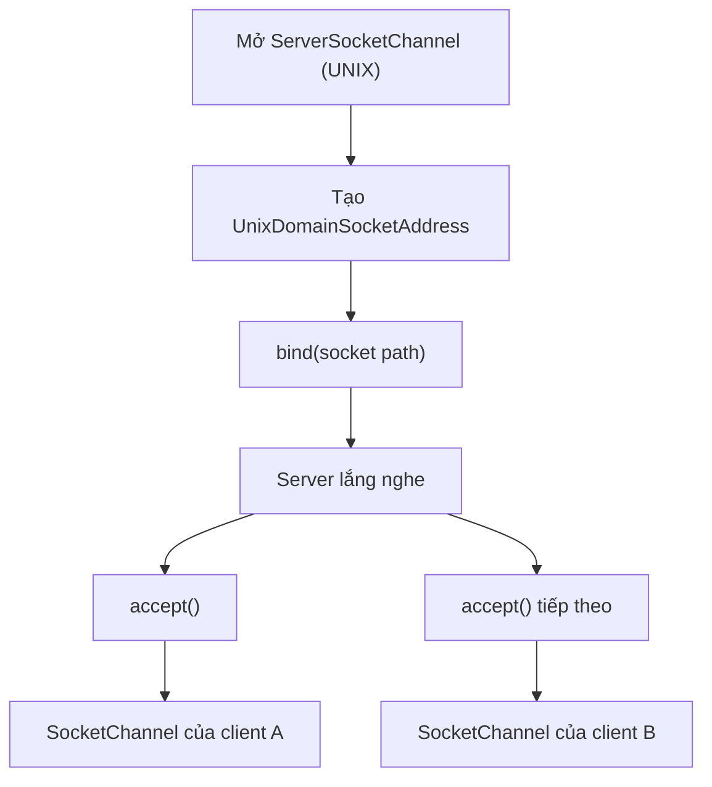

# Bind địa chỉ và chấp nhận kết nối bằng accept

> **Chương:** Unix-domain socket  
> **Học phần:** `JAVA_VERSION_JAVA16` — khám phá các cải tiến từ Java 16 vẫn hữu ích trong Java hiện đại, đặc biệt là Unix-domain socket trong NIO. Bài này tập trung vào hai thao tác phía server: bind một socket path bằng `ServerSocketChannel.bind` và chấp nhận kết nối đến bằng `accept`.

## Mục tiêu học tập

Sau bài này, bạn có thể:

- Mở `ServerSocketChannel` với `StandardProtocolFamily.UNIX`.
- Tạo `UnixDomainSocketAddress` từ socket path và bind server vào địa chỉ đó.
- Hiểu vai trò của backlog khi bind.
- Phân biệt server channel với channel đại diện cho từng client.
- Giải thích hành vi blocking và non-blocking của `accept()`.
- Xây dựng server chấp nhận một hoặc nhiều kết nối.
- Quản lý vòng đời channel và socket path an toàn.
- Xử lý các lỗi thường gặp khi bind và accept.

## 1. Vai trò của bind và accept

Một Unix-domain socket server cần thực hiện hai bước chính trước khi trao đổi dữ liệu:

1. **Bind:** gắn `ServerSocketChannel` vào một địa chỉ UDS, thường được biểu diễn bằng socket path.
2. **Accept:** chờ một client kết nối và nhận về `SocketChannel` riêng cho kết nối đó.

Server channel là endpoint lắng nghe. Nó không trực tiếp mang dữ liệu ứng dụng của từng client. Mỗi lần `accept()` thành công, server nhận một connected channel mới để đọc và ghi dữ liệu với client tương ứng.



Server giữ `ServerSocketChannel` mở để tiếp tục nhận kết nối. Đóng một channel của client không làm server channel tự đóng.

## 2. Mở server channel cho UNIX protocol family

Java 16 hoàn thiện hỗ trợ Unix-domain socket trong NIO qua JEP 380. Mở server channel bằng overload nhận `ProtocolFamily`:

```java
import java.net.StandardProtocolFamily;
import java.nio.channels.ServerSocketChannel;

ServerSocketChannel server =
        ServerSocketChannel.open(StandardProtocolFamily.UNIX);
```

`StandardProtocolFamily.UNIX` yêu cầu provider tạo server channel cho Unix-domain socket. API này là API chuẩn, không phải preview feature.

Nếu provider hoặc môi trường không hỗ trợ thao tác được yêu cầu, việc mở channel có thể thất bại. Vì vậy, ứng dụng triển khai UDS cần kiểm tra khả năng hỗ trợ trên JDK và hệ điều hành mục tiêu.

Sau khi mở channel, server chưa lắng nghe tại một endpoint cụ thể. Cần bind channel vào địa chỉ trước khi gọi `accept()`.

## 3. Tạo địa chỉ từ socket path

UDS sử dụng `UnixDomainSocketAddress` để biểu diễn địa chỉ. Địa chỉ được tạo từ `Path`:

```java
import java.net.UnixDomainSocketAddress;
import java.nio.file.Path;

Path socketPath = Path.of("/run/report-service/report.sock")
        .toAbsolutePath()
        .normalize();

UnixDomainSocketAddress address =
        UnixDomainSocketAddress.of(socketPath);
```

Một số nguyên tắc khi chọn path:

- Dùng path tuyệt đối để không phụ thuộc working directory.
- Đảm bảo thư mục cha đã tồn tại trước khi bind.
- Dùng thư mục runtime có quyền truy cập phù hợp.
- Chọn tên riêng cho từng service hoặc instance.
- Giữ path ngắn vì giới hạn độ dài phụ thuộc hệ điều hành.
- Tránh thư mục mà user không tin cậy có thể thay thế endpoint.

`UnixDomainSocketAddress.of` chỉ tạo đối tượng địa chỉ. Việc tạo socket endpoint trên hệ điều hành diễn ra khi gọi `bind`.

## 4. Bind server vào địa chỉ

Phương thức bind cơ bản:

```java
server.bind(address);
```

Sau khi bind thành công, server channel đã gắn với socket path và có thể chấp nhận kết nối. Có thể kiểm tra địa chỉ local đã bind:

```java
System.out.println(server.getLocalAddress());
```

Một server channel chỉ bind một lần trong vòng đời của nó. Gọi bind lại trên channel đã bind sẽ thất bại với `AlreadyBoundException`.

Ví dụ đầy đủ phần mở và bind:

```java
import java.io.IOException;
import java.net.StandardProtocolFamily;
import java.net.UnixDomainSocketAddress;
import java.nio.channels.ServerSocketChannel;
import java.nio.file.Path;

public class BindUnixSocket {

    public static void main(String[] args) throws IOException {
        Path socketPath = Path.of("/run/report-service/report.sock")
                .toAbsolutePath()
                .normalize();

        UnixDomainSocketAddress address =
                UnixDomainSocketAddress.of(socketPath);

        try (ServerSocketChannel server =
                     ServerSocketChannel.open(StandardProtocolFamily.UNIX)) {

            server.bind(address);

            System.out.println("Bound to: " + server.getLocalAddress());

            // Server đã bind; có thể gọi accept() để nhận kết nối.
        }
    }
}
```

Thư mục `/run/report-service` phải được chuẩn bị trước với quyền phù hợp. Đóng channel kết thúc endpoint đang lắng nghe, nhưng socket path có thể vẫn còn trong filesystem và cần được dọn theo chính sách của ứng dụng.

## 5. Bind với backlog

`ServerSocketChannel` cung cấp hai dạng bind:

```java
server.bind(address);
server.bind(address, 64);
```

Tham số `backlog` là số lượng kết nối đến đang chờ được chấp nhận mà hệ điều hành được yêu cầu duy trì. Nó liên quan đến hàng đợi kết nối pending, không phải số client đang được server xử lý đồng thời.

Ví dụ:

```java
server.bind(address, 64);
```

Ý nghĩa cần hiểu đúng:

- Backlog là yêu cầu/hint gửi đến implementation của hệ điều hành.
- Số lượng thực tế có thể bị hệ điều hành giới hạn hoặc điều chỉnh.
- Giá trị backlog không tạo ra 64 worker và không có nghĩa server xử lý 64 request song song.
- Nếu backlog nhỏ, kết nối đến trong lúc server không accept kịp có thể bị trì hoãn hoặc thất bại tùy hệ điều hành.
- Giá trị bằng hoặc nhỏ hơn 0 yêu cầu implementation dùng giá trị mặc định của hệ thống.

Overload không có backlog:

```java
server.bind(address);
```

tương đương việc để implementation chọn backlog mặc định. Không nên chọn một con số lớn chỉ vì muốn server có vẻ chịu tải tốt hơn. Hãy đo số kết nối đến, tốc độ accept, thời gian xử lý và giới hạn của OS trong môi trường thực tế.

## 6. Điều kiện cần trước khi bind

Bind có thể thất bại dù đối tượng địa chỉ đã được tạo thành công. Trước khi bind, cần kiểm tra các điều kiện của endpoint:

| Điều kiện | Vì sao cần |
| --- | --- |
| Thư mục cha tồn tại | Hệ điều hành cần tạo socket path trong thư mục đó |
| Process có quyền truy cập phù hợp | Bind có thể bị từ chối nếu thiếu quyền |
| Socket path chưa bị endpoint khác chiếm | Không thể tùy tiện dùng lại path đang hoạt động |
| Path nằm trong giới hạn nền tảng | OS có thể giới hạn độ dài pathname |
| Runtime hỗ trợ UNIX family | Provider phải triển khai server channel tương ứng |
| Thư mục được bảo vệ | Tránh user không tin cậy thay thế socket path |

Không nên tự động xóa path trước khi bind. Path đang tồn tại có thể thuộc một server khác vẫn hoạt động. Hãy xác minh ownership và trạng thái process cũ trước khi dọn stale socket.

## 7. Chấp nhận kết nối bằng accept()

Sau khi bind, server gọi:

```java
SocketChannel client = server.accept();
```

`accept()` chờ một kết nối đến và trả về `SocketChannel` mới đại diện cho kết nối đã được chấp nhận. Client sử dụng channel của mình để trao đổi dữ liệu với channel này.

Trong chế độ blocking mặc định:

- Nếu chưa có kết nối pending, lời gọi `accept()` sẽ chờ.
- Khi client kết nối, lời gọi trả về channel tương ứng.
- Server có thể đọc/ghi dữ liệu qua channel mới.
- Server channel vẫn mở để tiếp tục chấp nhận kết nối khác.

Ví dụ:

```java
try (SocketChannel client = server.accept()) {
    System.out.println("Accepted a client");

    // Đọc/ghi dữ liệu qua client.
}
```

Đoạn code trên xử lý một client rồi đóng channel của client. Server channel vẫn có thể tiếp tục gọi `accept()` nếu chưa đóng.

Trong chế độ blocking, `accept()` không trả về `null` khi đang chờ; nó chờ đến khi có kết nối hoặc xảy ra lỗi I/O.

## 8. Server channel và accepted channel là hai tài nguyên khác nhau

Sau khi accept thành công, ứng dụng có hai loại channel với vai trò riêng:

| Channel | Vai trò | Đóng channel có tác động gì? |
| --- | --- | --- |
| `ServerSocketChannel` | Lắng nghe kết nối mới trên socket path | Ngừng nhận kết nối mới |
| `SocketChannel` được accept | Trao đổi dữ liệu với một client cụ thể | Đóng kết nối với client đó |

Không dùng server channel để đọc payload. Dữ liệu được truyền qua `SocketChannel` trả về từ `accept()`.

Một server có thể giữ server channel mở trong thời gian dài, trong khi từng accepted channel được mở và đóng theo vòng đời request hoặc session.

## 9. Ví dụ server bind và accept một kết nối

Ví dụ sau bind vào socket path, chấp nhận một client, đọc một dòng kết thúc bằng newline và gửi phản hồi. Thư mục runtime cần tồn tại trước khi chạy.

```java
import java.io.ByteArrayOutputStream;
import java.io.EOFException;
import java.io.IOException;
import java.net.StandardProtocolFamily;
import java.net.UnixDomainSocketAddress;
import java.nio.ByteBuffer;
import java.nio.channels.ServerSocketChannel;
import java.nio.channels.SocketChannel;
import java.nio.charset.StandardCharsets;
import java.nio.file.Files;
import java.nio.file.Path;

public class OneClientUnixServer {

    private static final int MAX_LINE_BYTES = 4096;

    public static void main(String[] args) throws IOException {
        if (args.length != 1) {
            throw new IllegalArgumentException(
                    "Usage: OneClientUnixServer <socket-path>"
            );
        }

        Path socketPath = Path.of(args[0]).toAbsolutePath().normalize();
        boolean bound = false;

        try (ServerSocketChannel server =
                     ServerSocketChannel.open(StandardProtocolFamily.UNIX)) {

            server.bind(UnixDomainSocketAddress.of(socketPath), 32);
            bound = true;

            System.out.println("Listening at " + server.getLocalAddress());

            try (SocketChannel client = server.accept()) {
                String request = readLine(client);
                System.out.println("Request: " + request);

                ByteBuffer response = ByteBuffer.wrap(
                        "accepted\n".getBytes(StandardCharsets.UTF_8)
                );

                while (response.hasRemaining()) {
                    client.write(response);
                }
            }
        } finally {
            // Chỉ dọn socket path nếu lần chạy này bind thành công.
            if (bound) {
                Files.deleteIfExists(socketPath);
            }
        }
    }

    private static String readLine(SocketChannel client) throws IOException {
        ByteArrayOutputStream bytes = new ByteArrayOutputStream();
        ByteBuffer buffer = ByteBuffer.allocate(256);

        while (true) {
            int count = client.read(buffer);

            if (count == -1) {
                throw new EOFException("Client closed before newline");
            }

            if (count == 0) {
                continue;
            }

            buffer.flip();

            while (buffer.hasRemaining()) {
                byte value = buffer.get();

                if (value == (byte) '\n') {
                    return bytes.toString(StandardCharsets.UTF_8);
                }

                if (bytes.size() >= MAX_LINE_BYTES) {
                    throw new IOException("Request line is too long");
                }

                bytes.write(value);
            }

            buffer.clear();
        }
    }
}
```

Các điểm quan trọng:

- Bind hoàn tất trước khi server gọi accept.
- Backlog 32 là yêu cầu cho hàng đợi pending, không phải giới hạn số client tổng cộng.
- Accepted channel được đóng bằng try-with-resources sau khi xử lý client.
- Vòng lặp đọc tìm newline vì một lần read không nhất thiết nhận đủ một thông điệp.
- Path chỉ được dọn nếu lần chạy này bind thành công.

Ví dụ chỉ xử lý một client để minh họa vòng đời. Server thực tế thường accept trong vòng lặp.

## 10. Chấp nhận nhiều kết nối tuần tự

Để phục vụ nhiều client, server gọi `accept()` lặp lại:

```java
try (ServerSocketChannel server =
             ServerSocketChannel.open(StandardProtocolFamily.UNIX)) {

    server.bind(address, 64);

    while (true) {
        SocketChannel client = server.accept();

        try (client) {
            handleClient(client);
        }
    }
}
```

Mỗi lần accept tạo một channel riêng. Trong ví dụ tuần tự, server chỉ xử lý client hiện tại xong rồi mới accept client tiếp theo.

Cách này dễ hiểu và phù hợp với service có ít kết nối hoặc handler ngắn. Nếu handler chờ client gửi dữ liệu lâu, server có thể không accept kết nối mới trong khoảng thời gian đó, khiến hàng đợi pending tăng.

Khi cần xử lý đồng thời, có thể giao accepted channel cho executor hoặc event loop. Cần giới hạn số worker, quản lý hàng đợi công việc và đóng channel nếu không thể chuyển giao xử lý.

## 11. Chấp nhận kết nối trong mô hình nhiều worker

Ví dụ dưới đây minh họa việc chuyển mỗi accepted channel cho worker pool. Handler phải tự đóng channel của client và xử lý lỗi I/O.

```java
import java.io.IOException;
import java.net.StandardProtocolFamily;
import java.nio.channels.ServerSocketChannel;
import java.nio.channels.SocketChannel;
import java.nio.file.Path;
import java.util.concurrent.ExecutorService;
import java.util.concurrent.Executors;
import java.util.concurrent.RejectedExecutionException;

public class WorkerUnixServer {

    public static void main(String[] args) throws IOException {
        Path socketPath = Path.of(args[0]).toAbsolutePath().normalize();
        ExecutorService workers = Executors.newFixedThreadPool(4);
        boolean bound = false;

        try (ServerSocketChannel server =
                     ServerSocketChannel.open(StandardProtocolFamily.UNIX)) {

            server.bind(
                    java.net.UnixDomainSocketAddress.of(socketPath),
                    64
            );
            bound = true;

            while (true) {
                SocketChannel client = server.accept();

                try {
                    workers.execute(() -> handleAndClose(client));
                } catch (RejectedExecutionException ex) {
                    client.close();
                    throw ex;
                }
            }
        } finally {
            workers.shutdownNow();

            if (bound) {
                java.nio.file.Files.deleteIfExists(socketPath);
            }
        }
    }

    private static void handleAndClose(SocketChannel client) {
        try (client) {
            // Đọc request và ghi response cho client này.
        } catch (IOException ex) {
            System.err.println("Client I/O failed: " + ex.getMessage());
        }
    }
}
```

Đây là khung minh họa mô hình worker, không phải server hoàn chỉnh có giao thức. Trong ứng dụng thực tế:

- Handler phải giới hạn kích thước request và thời gian xử lý.
- Không để một client giữ worker vô thời hạn.
- Khi shutdown, cần ngừng nhận client mới rồi đóng hoặc hoàn tất các client đang xử lý theo policy.
- Nếu executor từ chối task, accepted channel phải được đóng để tránh rò rỉ tài nguyên.
- Dùng pool có giới hạn để tránh tạo số thread không kiểm soát khi tải tăng.

Vòng lặp blocking ở ví dụ sẽ dừng khi server channel bị đóng hoặc có lỗi. Chỉ đặt cờ interrupt trên thread đang chờ trong `accept()` không bảo đảm đánh thức lời gọi đó. Bộ điều khiển vòng đời cần giữ tham chiếu đến server channel và đóng nó khi shutdown; khi đó `accept()` đang chờ sẽ kết thúc bằng lỗi đóng channel. Ứng dụng có thể nhận diện tín hiệu đóng dự kiến, chờ worker hoàn tất trong thời hạn quy định và đóng các client còn hoạt động.

## 12. Hành vi của accept trong non-blocking mode

`ServerSocketChannel` có thể được chuyển sang non-blocking:

```java
server.configureBlocking(false);
```

Trong chế độ non-blocking, `accept()` không chờ kết nối. Nếu hiện chưa có kết nối pending, phương thức trả về `null`.

Ví dụ:

```java
SocketChannel client = server.accept();

if (client == null) {
    // Chưa có kết nối mới; tiếp tục công việc khác.
} else {
    // Đã accept được client.
}
```

Điều này khác với blocking mode:

| Chế độ | Khi không có kết nối pending |
| --- | --- |
| Blocking | `accept()` chờ |
| Non-blocking | `accept()` trả về `null` |

Non-blocking phù hợp khi server dùng `Selector` để theo dõi nhiều channel. Không nên viết vòng lặp quay liên tục gọi accept mà không có selector hoặc cơ chế chờ, vì có thể làm CPU tăng cao dù không có client.

## 13. Kết hợp accept với Selector

Với NIO non-blocking, server có thể đăng ký `OP_ACCEPT` để selector thông báo khi có kết nối chờ.

Ví dụ khung xử lý:

```java
import java.net.StandardProtocolFamily;
import java.net.UnixDomainSocketAddress;
import java.nio.channels.SelectionKey;
import java.nio.channels.Selector;
import java.nio.channels.ServerSocketChannel;
import java.nio.channels.SocketChannel;
import java.nio.file.Path;
import java.util.Iterator;

Path socketPath = Path.of("/run/report-service/report.sock");

try (ServerSocketChannel server =
             ServerSocketChannel.open(StandardProtocolFamily.UNIX);
     Selector selector = Selector.open()) {

    server.bind(UnixDomainSocketAddress.of(socketPath), 64);
    server.configureBlocking(false);
    server.register(selector, SelectionKey.OP_ACCEPT);

    while (true) {
        selector.select();

        Iterator<SelectionKey> iterator =
                selector.selectedKeys().iterator();

        while (iterator.hasNext()) {
            SelectionKey key = iterator.next();
            iterator.remove();

            if (key.isAcceptable()) {
                SocketChannel client = server.accept();

                if (client != null) {
                    client.configureBlocking(false);
                    // Đăng ký client với OP_READ và quản lý buffer riêng.
                }
            }
        }
    }
}
```

Một số điểm cần nhớ:

- Server channel phải ở non-blocking mode khi đăng ký với selector.
- `OP_ACCEPT` báo server có thể chấp nhận kết nối.
- Sau khi nhận readiness, vẫn cần gọi `accept()`; trong một số tình huống phương thức có thể trả về `null`.
- Accepted `SocketChannel` mới ban đầu ở blocking mode, kể cả khi server channel là non-blocking. Nếu dùng selector cho client channel, hãy chuyển nó sang non-blocking trước khi đăng ký.
- Sau accept, ứng dụng còn phải đăng ký `OP_READ`, quản lý buffer và xử lý `OP_WRITE` khi cần.

Ví dụ là khung accept loop. Phần đọc/ghi non-blocking cần state machine riêng để không giả định một lần read hoặc write hoàn thành toàn bộ thông điệp.

## 14. Quản lý shutdown và socket path

Server cần đóng channel và dọn socket path theo ownership.

Trình tự thông thường:

1. Ngừng nhận kết nối mới.
2. Đóng `ServerSocketChannel` để giải phóng endpoint lắng nghe.
3. Hoàn tất hoặc đóng các accepted channel đang xử lý theo policy.
4. Xóa socket path do chính instance đã bind.
5. Giải phóng worker pool và tài nguyên liên quan.

Nếu một thread khác đóng server channel trong lúc thread đang chờ ở `accept()`, lời gọi blocking có thể kết thúc bằng ngoại lệ đóng bất đồng bộ. Ứng dụng nên phân biệt tình huống shutdown dự kiến với lỗi I/O bất ngờ.

Không xóa socket path trước khi xác nhận instance hiện tại sở hữu path. Nếu bind thất bại vì path thuộc server khác, việc dọn path trong finally có thể làm gián đoạn endpoint của server đó.

Ví dụ một biến cờ đơn giản:

```java
boolean bound = false;

try (ServerSocketChannel server =
             ServerSocketChannel.open(StandardProtocolFamily.UNIX)) {

    server.bind(address);
    bound = true;

    // Accept và xử lý client.
} finally {
    if (bound) {
        Files.deleteIfExists(socketPath);
    }
}
```

Trong mã production, cần bảo toàn ngoại lệ chính nếu thao tác cleanup cũng thất bại, ghi log lỗi dọn path và dùng thư mục runtime có quyền hạn chế để tránh race với process khác.

## 15. Các lỗi thường gặp khi bind và accept

| Lỗi hoặc tình huống | Nguyên nhân có thể | Cách xử lý |
| --- | --- | --- |
| `UnsupportedOperationException` khi mở channel | Provider không hỗ trợ UNIX protocol family | Kiểm tra JDK và OS mục tiêu |
| Bind thất bại vì path đã tồn tại | Stale socket hoặc server khác đang dùng endpoint | Xác minh ownership trước khi dọn |
| Bind thất bại vì quyền | Process không có quyền truy cập thư mục cha hoặc socket path | Kiểm tra owner, group, ACL và runtime directory |
| `AlreadyBoundException` | Gọi bind trên channel đã được bind | Chỉ bind một lần cho mỗi server channel |
| `accept()` chờ lâu | Blocking mode và chưa có client pending | Đây là hành vi bình thường; dùng selector nếu cần non-blocking |
| `accept()` trả về `null` | Server channel ở non-blocking mode và chưa có kết nối sẵn sàng | Chờ readiness qua selector hoặc tiếp tục xử lý việc khác |
| `AsynchronousCloseException` | Channel bị đóng trong lúc thread đang chờ accept | Kiểm tra đây có phải tín hiệu shutdown dự kiến không |
| Client kết nối được nhưng không có dữ liệu | Server chưa đọc accepted channel hoặc framing không khớp | Xử lý dữ liệu qua channel được accept và thống nhất giao thức |
| Socket path còn sau shutdown | Process bị dừng đột ngột hoặc cleanup không chạy | Dùng quy trình stale-path có ownership rõ ràng |

Không nên bắt mọi exception rồi tiếp tục vòng accept như thể không có lỗi. Hãy phân loại lỗi có thể phục hồi, lỗi cấu hình và tín hiệu shutdown để tránh vòng lặp lỗi liên tục.

## 16. Kiểm thử bind và accept

Test tích hợp nên dùng thư mục tạm riêng cho mỗi lần chạy và kiểm tra cả endpoint lẫn channel được accept.

Các trường hợp hữu ích:

- Bind thành công vào socket path mới.
- Không thể bind khi path đang được sử dụng.
- Client connect và server accept thành công.
- Server chấp nhận nhiều kết nối liên tiếp.
- Accepted channel trao đổi dữ liệu độc lập với server channel.
- Non-blocking accept trả về null khi chưa có kết nối.
- Đóng server channel trong lúc accept đang chờ kết thúc vòng chờ theo đúng cách ứng dụng xử lý.
- Socket path được dọn sau shutdown bình thường.
- Lỗi xử lý client không làm rò rỉ accepted channel.

Ví dụ test nhỏ cho trạng thái bind và địa chỉ local:

```java
import static org.junit.jupiter.api.Assertions.assertEquals;
import static org.junit.jupiter.api.Assertions.assertTrue;

import java.net.StandardProtocolFamily;
import java.net.UnixDomainSocketAddress;
import java.nio.channels.ServerSocketChannel;
import java.nio.file.Files;
import java.nio.file.Path;

import org.junit.jupiter.api.Test;
import org.junit.jupiter.api.io.TempDir;

class UnixServerBindTest {

    @TempDir
    Path directory;

    @Test
    void bindsToConfiguredSocketPath() throws Exception {
        Path socketPath = directory.resolve("server.sock");
        UnixDomainSocketAddress address =
                UnixDomainSocketAddress.of(socketPath);

        try (ServerSocketChannel server =
                     ServerSocketChannel.open(StandardProtocolFamily.UNIX)) {

            server.bind(address);

            assertTrue(server.isOpen());
            assertEquals(address, server.getLocalAddress());
            assertTrue(Files.exists(socketPath));
        } finally {
            Files.deleteIfExists(socketPath);
        }
    }
}
```

Test trên xác nhận bind vào đúng địa chỉ. Integration test cho accept cần chạy server và client ở hai channel riêng, đồng bộ thời điểm connect/accept bằng latch hoặc executor thay vì dựa vào thời gian sleep cố định.

UDS có thể không được hỗ trợ trên một số runtime mục tiêu. Hãy chạy test tích hợp trên từng OS/JDK được sản phẩm hỗ trợ và chỉ skip có lý do trên nền tảng không nằm trong phạm vi hỗ trợ.

## 17. Bài tập tự luyện

### Bài 1: Tạo địa chỉ và bind

Viết đoạn mã mở server channel cho UNIX và bind vào `/run/report/report.sock`.

**Đáp án tham khảo:**

```java
Path path = Path.of("/run/report/report.sock");

ServerSocketChannel server =
        ServerSocketChannel.open(StandardProtocolFamily.UNIX);

server.bind(UnixDomainSocketAddress.of(path));
```

Trong ứng dụng thực tế, đặt channel trong try-with-resources và chuẩn bị thư mục runtime với quyền phù hợp.

### Bài 2: Vai trò của backlog

Bind server với backlog 100 có nghĩa server xử lý đồng thời tối đa 100 client không?

**Đáp án:** Không. Backlog liên quan đến hàng đợi kết nối đang chờ accept. Số client được xử lý đồng thời phụ thuộc cách server xử lý accepted channel và giới hạn worker.

### Bài 3: Phân biệt server channel và client channel

Sau khi gọi `SocketChannel client = server.accept()`, channel nào dùng để đọc request?

**Đáp án:** Dùng `client`, tức accepted `SocketChannel`. `ServerSocketChannel` tiếp tục lắng nghe kết nối mới.

### Bài 4: Blocking và non-blocking

Server channel ở non-blocking mode và chưa có kết nối pending. `accept()` trả về gì?

**Đáp án:** Trả về `null`. Với blocking mode, accept chờ cho đến khi có kết nối hoặc xảy ra lỗi.

### Bài 5: Dọn socket path

Bind thất bại vì socket path đã tồn tại. Có nên xóa path đó trong finally không?

**Đáp án:** Không. Chỉ xóa path nếu instance hiện tại đã bind thành công và sở hữu endpoint. Nếu bind thất bại, path có thể thuộc server khác đang hoạt động.

## Ghi nhớ

Server UDS mở `ServerSocketChannel` với `StandardProtocolFamily.UNIX`, tạo `UnixDomainSocketAddress` và bind vào socket path. Backlog điều chỉnh hàng đợi kết nối pending theo cách implementation của OS áp dụng; nó không quyết định số worker. `accept()` trả về một `SocketChannel` riêng cho mỗi client. Blocking accept chờ kết nối, còn non-blocking accept trả về `null` nếu chưa có kết nối pending. Hãy đóng accepted channel độc lập, quản lý shutdown và chỉ dọn socket path khi instance đã bind thành công. Khi cần nhiều client, chọn xử lý tuần tự, worker pool hoặc Selector theo tải và mô hình I/O của ứng dụng.

## Tài liệu tham khảo

- [Java API — ServerSocketChannel](https://docs.oracle.com/en/java/javase/26/docs/api/java.base/java/nio/channels/ServerSocketChannel.html).
- [Java API — SocketChannel](https://docs.oracle.com/en/java/javase/26/docs/api/java.base/java/nio/channels/SocketChannel.html).
- [Java API — UnixDomainSocketAddress](https://docs.oracle.com/en/java/javase/26/docs/api/java.base/java/net/UnixDomainSocketAddress.html).
- [Java API — StandardProtocolFamily](https://docs.oracle.com/en/java/javase/26/docs/api/java.base/java/net/StandardProtocolFamily.html).
- [Java API — Selector and SelectionKey](https://docs.oracle.com/en/java/javase/26/docs/api/java.base/java/nio/channels/Selector.html).
- [JEP 380 — Unix-Domain Socket Channels](https://openjdk.org/jeps/380).
