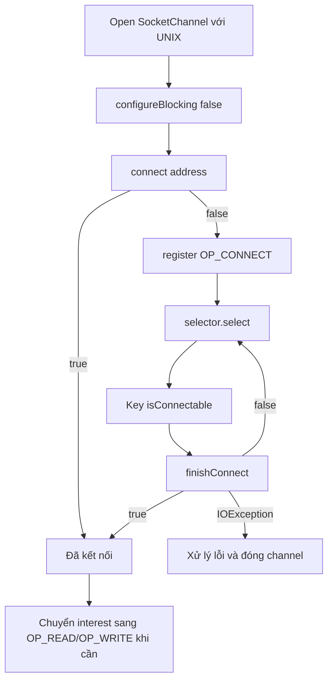

# Non-blocking connect và `finishConnect()` khi dùng Selector

Java 16 bổ sung Unix-domain socket cho NIO thông qua `StandardProtocolFamily.UNIX`, `SocketChannel` và `ServerSocketChannel`. Vì `SocketChannel` là selectable channel, client có thể kết nối ở chế độ non-blocking rồi dùng `Selector` để chờ kết quả kết nối mà không giữ một thread chờ riêng cho từng socket.

Quy trình cốt lõi là: chuyển channel sang non-blocking, gọi `connect(address)`, đăng ký `OP_CONNECT` nếu kết nối còn pending, chờ selector báo connectable, rồi gọi `finishConnect()`. Chỉ khi `finishConnect()` trả `true` mới xem channel đã kết nối hoàn tất và chuyển interest sang các thao tác tiếp theo như `OP_READ`.

## 1. Blocking connect và non-blocking connect

Ở chế độ blocking mặc định, `connect()` chờ cho đến khi kết nối thành công hoặc thất bại:

```java
import java.io.IOException;
import java.net.StandardProtocolFamily;
import java.net.UnixDomainSocketAddress;
import java.nio.channels.SocketChannel;
import java.nio.file.Path;

class BlockingUnixClient {
    static void connect(Path socketPath) throws IOException {
        UnixDomainSocketAddress address = UnixDomainSocketAddress.of(socketPath);

        try (SocketChannel channel = SocketChannel.open(StandardProtocolFamily.UNIX)) {
            channel.connect(address); // Chờ cho tới khi kết nối xong hoặc lỗi.
            System.out.println("Đã kết nối");
        }
    }
}
```

Ở chế độ non-blocking, `connect()` khởi động thao tác kết nối và trả về ngay:

- Trả `true`: kết nối hoàn tất ngay trong lời gọi này.
- Trả `false`: thao tác kết nối đang pending; cần chờ readiness và gọi `finishConnect()`.

Non-blocking connect hữu ích khi một thread quản lý nhiều kết nối bằng `Selector`, hoặc khi ứng dụng cần tiếp tục xử lý công việc khác trong lúc kết nối đang được thiết lập.

## 2. Trình tự `connect()` → `OP_CONNECT` → `finishConnect()`



Các bước có ý nghĩa cụ thể:

1. Mở `SocketChannel` với `StandardProtocolFamily.UNIX`.
2. Gọi `configureBlocking(false)` trước khi đăng ký channel với selector.
3. Gọi `connect(address)` đúng một lần để bắt đầu kết nối.
4. Nếu kết quả là `false`, đăng ký `SelectionKey.OP_CONNECT`.
5. Khi selector báo key connectable, gọi `finishConnect()`.
6. Nếu `finishConnect()` trả `true`, kết nối đã hoàn tất; thay `OP_CONNECT` bằng interest phù hợp như `OP_READ`.
7. Nếu `finishConnect()` trả `false`, kết nối vẫn pending; tiếp tục chờ `OP_CONNECT`.

Không gọi lặp lại `connect()` để kiểm tra trạng thái. `finishConnect()` là phương thức hoàn tất thao tác connect đã bắt đầu trước đó.

## 3. Ví dụ non-blocking connect với Selector

Ví dụ sau mở một Unix-domain `SocketChannel`, kết nối non-blocking, chờ `OP_CONNECT`, gọi `finishConnect()` và sau khi kết nối thành công thì chuyển key sang `OP_READ`:

```java
import java.io.IOException;
import java.net.StandardProtocolFamily;
import java.net.UnixDomainSocketAddress;
import java.nio.ByteBuffer;
import java.nio.channels.SelectionKey;
import java.nio.channels.Selector;
import java.nio.channels.SocketChannel;
import java.nio.charset.StandardCharsets;
import java.nio.file.Path;
import java.util.Iterator;

class NonBlockingUnixClient {
    static void connectAndRead(Path socketPath) throws IOException {
        UnixDomainSocketAddress address = UnixDomainSocketAddress.of(socketPath);

        try (Selector selector = Selector.open();
             SocketChannel channel = SocketChannel.open(StandardProtocolFamily.UNIX)) {

            channel.configureBlocking(false);
            boolean connected = channel.connect(address);

            SelectionKey key = channel.register(
                selector,
                connected ? SelectionKey.OP_READ : SelectionKey.OP_CONNECT
            );

            ByteBuffer buffer = ByteBuffer.allocate(1024);

            while (key.isValid()) {
                selector.select();

                Iterator<SelectionKey> selected = selector.selectedKeys().iterator();
                while (selected.hasNext()) {
                    SelectionKey selectedKey = selected.next();
                    selected.remove();

                    if (!selectedKey.isValid()) {
                        continue;
                    }

                    if (selectedKey.isConnectable()) {
                        if (channel.finishConnect()) {
                            // Chỉ đăng ký đọc sau khi connect hoàn tất.
                            selectedKey.interestOps(SelectionKey.OP_READ);
                        }
                    }

                    if (selectedKey.isValid() && selectedKey.isReadable()) {
                        int bytesRead = channel.read(buffer);

                        if (bytesRead == -1) {
                            selectedKey.cancel();
                            return; // Peer đã đóng kết nối.
                        }

                        if (bytesRead > 0) {
                            buffer.flip();
                            System.out.print(StandardCharsets.UTF_8.decode(buffer));
                            buffer.compact();
                        }
                    }
                }
            }
        }
    }
}
```

Để chạy ví dụ, cần có server Unix-domain socket đang bind đúng `socketPath` và gửi dữ liệu cho client. Vòng lặp tiếp tục chờ dữ liệu cho đến khi peer đóng hoặc channel bị hủy. Phần đọc dùng `flip()` rồi `compact()` để giữ lại các byte chưa xử lý nếu buffer có dữ liệu tồn dư.

Nếu `connect()` trả `true` ngay, key được đăng ký trực tiếp với `OP_READ`; không cần chờ `OP_CONNECT` hoặc gọi `finishConnect()`. Nếu trả `false`, key bắt đầu ở `OP_CONNECT` và chỉ chuyển sang `OP_READ` sau khi `finishConnect()` trả `true`.

## 4. `finishConnect()` có thể trả `false`

Sự kiện `OP_CONNECT` cho biết thao tác kết nối có thể được tiếp tục kiểm tra; nó không phải bằng chứng rằng kết nối chắc chắn đã thành công. Vì vậy phải kiểm tra kết quả `finishConnect()`:

```java
if (key.isConnectable()) {
    if (channel.finishConnect()) {
        key.interestOps(SelectionKey.OP_READ);
    } else {
        // Vẫn pending: giữ OP_CONNECT và chờ selector lần tiếp theo.
    }
}
```

Không chuyển sang `OP_READ` khi `finishConnect()` còn trả `false`. Channel chưa sẵn sàng cho giao thức trao đổi dữ liệu của ứng dụng.

Nếu connect thất bại, `finishConnect()` ném `IOException` (ví dụ server không tồn tại, pathname không có listener hoặc kết nối bị từ chối). Hãy xử lý lỗi ở tầng quản lý kết nối, hủy key và đóng channel. Đừng tiếp tục chờ `OP_CONNECT` mãi sau khi đã nhận lỗi cuối cùng.

`finishConnect()` chỉ cần thiết khi một connect đang pending. Nếu channel chưa kết nối và chưa có thao tác connect đang chờ, phương thức ném `NoConnectionPendingException`; nếu channel đã kết nối, nó trả `true` ngay. `AlreadyConnectedException` là lỗi có thể gặp khi gọi `connect()` lần nữa trên channel đã kết nối.

## 5. Thêm timeout cho giai đoạn kết nối

Selector có thể chờ vô thời hạn nếu không có timeout. Với client cần giới hạn thời gian kết nối, hãy tính deadline bằng `System.nanoTime()` và gọi `select(timeoutMillis)` với thời gian còn lại. Dùng đồng hồ monotonic tránh việc thay đổi giờ hệ thống làm sai thời hạn:

```java
import java.io.IOException;
import java.net.SocketTimeoutException;
import java.net.StandardProtocolFamily;
import java.net.UnixDomainSocketAddress;
import java.nio.channels.SelectionKey;
import java.nio.channels.Selector;
import java.nio.channels.SocketChannel;
import java.nio.file.Path;
import java.util.Iterator;
import java.util.concurrent.TimeUnit;

class ConnectWithTimeout {
    static SocketChannel connect(Path socketPath, long timeout, TimeUnit unit)
            throws IOException {
        if (timeout <= 0) {
            throw new IllegalArgumentException("timeout phải lớn hơn 0");
        }

        UnixDomainSocketAddress address = UnixDomainSocketAddress.of(socketPath);
        SocketChannel channel = SocketChannel.open(StandardProtocolFamily.UNIX);
        boolean connected = false;

        try {
            channel.configureBlocking(false);
            if (channel.connect(address)) {
                connected = true;
                return channel; // Caller sở hữu và phải đóng channel.
            }

            try (Selector selector = Selector.open()) {
                channel.register(selector, SelectionKey.OP_CONNECT);
                long timeoutNanos = unit.toNanos(timeout);
                long deadline = System.nanoTime() + timeoutNanos;

                while (true) {
                    long remaining = deadline - System.nanoTime();
                    if (remaining <= 0) {
                        throw new SocketTimeoutException("Unix-domain connect timeout");
                    }

                    long waitMillis = Math.max(
                        1L, TimeUnit.NANOSECONDS.toMillis(remaining)
                    );
                    selector.select(waitMillis);

                    Iterator<SelectionKey> selected = selector.selectedKeys().iterator();
                    while (selected.hasNext()) {
                        SelectionKey selectedKey = selected.next();
                        selected.remove();

                        if (selectedKey.isValid() && selectedKey.isConnectable()
                                && channel.finishConnect()) {
                            connected = true;
                            return channel;
                        }
                    }
                }
            }
        } finally {
            if (!connected) {
                channel.close();
            }
        }
    }
}
```

Khi kết nối thành công, selector được đóng và key được deregister, còn channel vẫn mở để caller tiếp tục dùng hoặc đăng ký với selector của event loop chính. Caller chịu trách nhiệm đóng channel. Khi timeout hoặc có lỗi, khối `finally` đóng channel để không rò rỉ tài nguyên.

Lưu ý `TimeUnit.toNanos()` có thể bão hòa ở giá trị rất lớn; với timeout cấu hình thực tế, hãy giới hạn giá trị đầu vào hợp lý. Nếu cần timeout chính xác theo đơn vị nhỏ hơn millisecond, dùng API chờ phù hợp hoặc tính toán cẩn thận vì `Selector.select(long)` nhận millisecond.

## 6. Vì sao phải chuyển từ `OP_CONNECT` sang `OP_READ`?

`SelectionKey` mô tả những sự kiện mà ứng dụng muốn selector thông báo:

| Interest op | Ý nghĩa với client `SocketChannel` |
| --- | --- |
| `OP_CONNECT` | Connect non-blocking có thể hoàn tất và cần gọi `finishConnect()`. |
| `OP_READ` | Channel đã kết nối và có dữ liệu có thể đọc hoặc peer đã đóng. |
| `OP_WRITE` | Channel có thể ghi thêm dữ liệu mà không block. |

Sau khi connect hoàn tất, giữ `OP_CONNECT` không còn cần thiết. Hãy thay bằng `OP_READ` khi ứng dụng muốn nhận dữ liệu. Chỉ thêm `OP_WRITE` khi còn dữ liệu trong outbound buffer cần gửi; socket thường xuyên writable, nên đăng ký `OP_WRITE` liên tục có thể khiến selector đánh thức liên tục và gây busy loop.

Ví dụ chuyển interest sau khi hoàn tất connect:

```java
if (channel.finishConnect()) {
    key.interestOps(SelectionKey.OP_READ);
}
```

Khi có dữ liệu cần gửi:

```java
key.interestOps(key.interestOps() | SelectionKey.OP_WRITE);
```

Sau khi outbound buffer đã được ghi hết, bỏ `OP_WRITE`:

```java
key.interestOps(key.interestOps() & ~SelectionKey.OP_WRITE);
```

Các thao tác thay đổi `interestOps` nên được thực hiện trong event loop sở hữu selector hoặc phối hợp bằng `selector.wakeup()` khi thread khác cần cập nhật đăng ký.

## 7. Channel phải non-blocking trước khi đăng ký Selector

`SelectableChannel.register()` yêu cầu channel ở chế độ non-blocking. Nếu channel vẫn blocking, đăng ký sẽ ném `IllegalBlockingModeException`.

Thứ tự đúng:

```java
SocketChannel channel = SocketChannel.open(StandardProtocolFamily.UNIX);
channel.configureBlocking(false);
boolean connected = channel.connect(address);
int initialOps = connected ? SelectionKey.OP_READ : SelectionKey.OP_CONNECT;
channel.register(selector, initialOps);
```

Không gọi `configureBlocking(true)` trong khi channel vẫn còn đăng ký với selector. Muốn chuyển về blocking mode, trước hết phải hủy các key và bảo đảm channel không còn đăng ký với selector nào; với event-driven client, thường nên giữ non-blocking trong toàn bộ vòng đời I/O.

## 8. Quản lý selected keys và tránh vòng lặp bận

`selector.selectedKeys()` là tập key đã được chọn từ lần select gần nhất. Sau khi xử lý từng key, phải gọi `Iterator.remove()` để xóa key khỏi selected-key set. Nếu không, key cũ có thể tiếp tục xuất hiện và logic xử lý bị lặp.

Một số nguyên tắc:

- Luôn xóa selected key sau khi lấy ra xử lý.
- Kiểm tra `key.isValid()` trước khi truy cập trạng thái readiness.
- Không giả định một lần `select()` chỉ trả đúng một loại readiness.
- Đọc/ghi non-blocking có thể trả `0`; điều đó có nghĩa hiện tại chưa tiến triển, không phải EOF.
- `read()` trả `-1` nghĩa peer đã đóng output hoặc kết nối đã kết thúc theo giao thức.
- Hủy key khi đóng channel hoặc không còn quan tâm tới sự kiện đó.
- Không giữ `OP_WRITE` khi không còn dữ liệu cần gửi.

## 9. Lỗi thường gặp khi non-blocking connect Unix-domain socket

| Lỗi | Nguyên nhân | Cách xử lý |
| --- | --- | --- |
| Gọi `register()` khi channel blocking | Quên `configureBlocking(false)`. | Chuyển non-blocking trước khi register. |
| Xem `connect() == false` là thất bại | `false` nghĩa là kết nối đang pending. | Đăng ký `OP_CONNECT` và chờ `finishConnect()`. |
| Xem `isConnectable()` là đã kết nối | Readiness chỉ cho biết có thể tiếp tục hoàn tất. | Gọi `finishConnect()` và kiểm tra kết quả. |
| Bỏ qua trường hợp `finishConnect() == false` | Kết nối vẫn pending. | Giữ `OP_CONNECT`, tiếp tục chờ. |
| Chuyển sang `OP_READ` quá sớm | Connect chưa hoàn tất. | Chỉ đổi interest sau khi `finishConnect()` trả `true`. |
| Gọi `connect()` nhiều lần | Không theo dõi trạng thái pending. | Gọi một lần, sau đó dùng `finishConnect()`. |
| Chờ selector vô hạn | Không đặt timeout cho giai đoạn connect. | Dùng deadline monotonic và `select(timeout)`. |
| Không remove selected key | Key cũ tiếp tục nằm trong selected-key set. | Gọi `iterator.remove()` khi xử lý. |
| Luôn đăng ký `OP_WRITE` | Socket thường xuyên writable, gây wakeup liên tục. | Chỉ bật khi outbound buffer còn dữ liệu. |

## 10. Kiểm thử các trạng thái kết nối

Kiểm thử tích hợp nên chạy server Unix-domain socket trên một pathname tạm, rồi xác minh client xử lý được cả kết nối hoàn tất ngay và kết nối pending. Thời điểm `connect()` trả `true` hay `false` phụ thuộc nền tảng và trạng thái server; không viết test giả định mọi lần gọi đều phải trả một giá trị cụ thể.

Các trường hợp nên kiểm tra:

- Server đã bind và đang lắng nghe: client hoàn tất connect, sau đó đọc/ghi được dữ liệu.
- Server chưa tồn tại hoặc pathname không có listener: connect/finishConnect báo lỗi phù hợp.
- Server đóng trong quá trình thiết lập: client xử lý `IOException` và đóng channel.
- Timeout cấu hình ngắn: client hủy kết nối pending và giải phóng selector/channel.
- Channel được đăng ký selector sau khi chuyển non-blocking.
- Khi connect xong, `OP_CONNECT` được bỏ và interest chuyển sang `OP_READ` hoặc trạng thái cần thiết.

Unix-domain socket phụ thuộc nền tảng. Dùng JUnit assumptions hoặc điều kiện môi trường khi hệ điều hành không hỗ trợ, nhưng vẫn cần CI trên các nền tảng mà ứng dụng tuyên bố hỗ trợ.

## 11. Những điểm cần nhớ

- Unix-domain `SocketChannel` được mở bằng `SocketChannel.open(StandardProtocolFamily.UNIX)`.
- Gọi `configureBlocking(false)` trước khi đăng ký selector.
- `connect()` trả `true` nếu hoàn tất ngay, `false` nếu đang pending.
- Chỉ khi `connect()` trả `false` mới cần chờ `OP_CONNECT` và gọi `finishConnect()`.
- `finishConnect()` có thể trả `false`; tiếp tục chờ khi thao tác vẫn pending.
- Chỉ chuyển sang `OP_READ` sau khi `finishConnect()` trả `true`.
- Lỗi kết nối được xử lý qua `IOException`; timeout nên dùng deadline dựa trên `System.nanoTime()`.
- Xóa selected keys sau khi xử lý và chỉ bật `OP_WRITE` khi có dữ liệu chờ gửi.
- Selector giúp một thread quản lý nhiều channel, nhưng event loop vẫn phải xử lý partial read/write và đóng tài nguyên đúng cách.

Hãy xem non-blocking connect là một state transition: bắt đầu kết nối, chờ readiness, hoàn tất bằng `finishConnect()`, rồi mới chuyển sang đọc/ghi dữ liệu ứng dụng. Selector chỉ thông báo khi có thể tiếp tục thao tác; `finishConnect()` mới xác nhận kết quả kết nối.

## Tài liệu tham khảo

- [SocketChannel – Java SE 16 API](https://docs.oracle.com/en/java/javase/16/docs/api/java.base/java/nio/channels/SocketChannel.html)
- [SocketChannel – Java SE 26 API](https://docs.oracle.com/en/java/javase/26/docs/api/java.base/java/nio/channels/SocketChannel.html)
- [SelectionKey – Java SE 26 API](https://docs.oracle.com/en/java/javase/26/docs/api/java.base/java/nio/channels/SelectionKey.html)
- [Selector – Java SE 26 API](https://docs.oracle.com/en/java/javase/26/docs/api/java.base/java/nio/channels/Selector.html)
- [JEP 380: Unix-Domain Socket Channels](https://openjdk.org/jeps/380)
