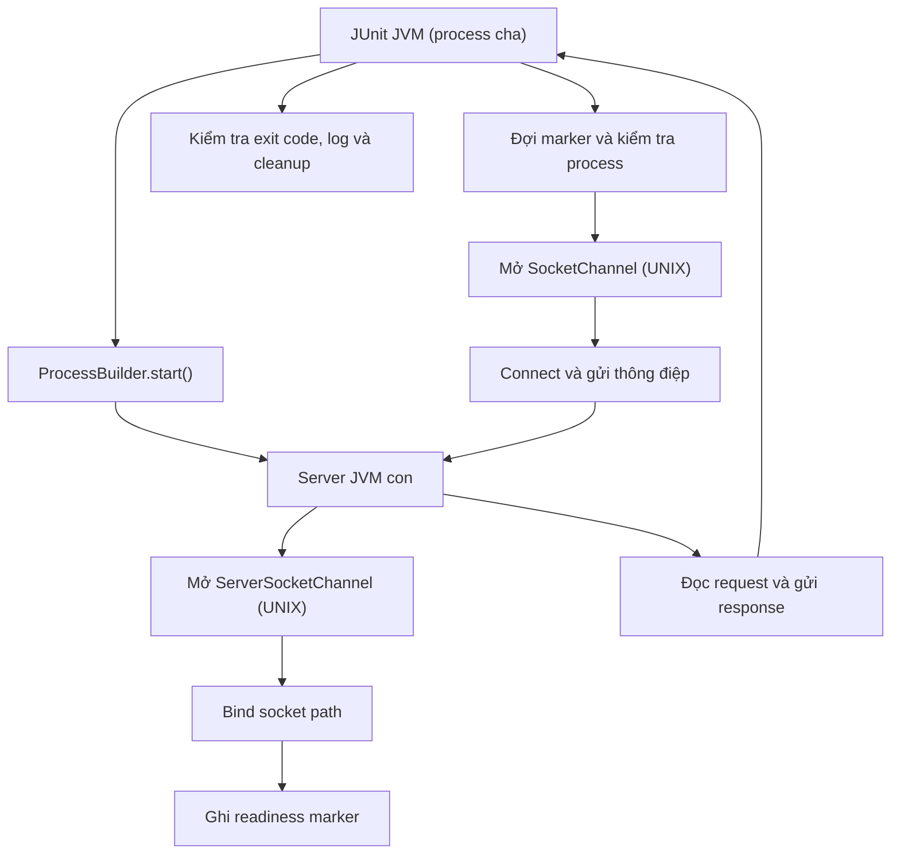

# Kiểm thử trao đổi thông điệp giữa hai tiến trình Java

> **Chương:** Unix-domain socket  
> **Học phần:** `JAVA_VERSION_JAVA16` — khám phá những cải tiến từ Java 16 vẫn hữu ích trong Java hiện đại, đặc biệt là Unix-domain socket trong NIO. Bài này hướng dẫn kiểm thử tích hợp để xác nhận hai JVM độc lập có thể kết nối qua socket path, trao đổi thông điệp đúng giao thức và dọn tài nguyên an toàn.

## Mục tiêu học tập

Sau bài này, bạn có thể:

- Phân biệt unit test cho một channel với integration test giữa hai tiến trình Java.
- Khởi chạy server JVM con bằng `ProcessBuilder` từ JUnit.
- Đồng bộ test với server bằng tín hiệu readiness sau khi bind.
- Gửi và nhận thông điệp UTF-8 qua `SocketChannel`.
- Kiểm thử framing khi dữ liệu được ghi thành nhiều phần.
- Xác minh exit code, log, timeout và socket path sau khi process kết thúc.
- Dừng process con an toàn khi test thành công hoặc thất bại.
- Tổ chức CI để kiểm thử UDS trên các JDK và hệ điều hành mục tiêu.

## 1. Vì sao cần kiểm thử giữa hai tiến trình?

Một unit test có thể mở server và client channel trong cùng JVM. Cách đó hữu ích để kiểm tra API và giao thức, nhưng chưa mô phỏng đầy đủ cách ứng dụng vận hành khi server và client là hai process độc lập.

Integration test giữa hai JVM kiểm tra thêm:

- JVM server có khởi động được trên runtime mục tiêu không.
- Server có bind được vào socket path được cấu hình không.
- Client process khác có nhìn thấy cùng socket path và connect được không.
- Hai phía có trao đổi dữ liệu đúng encoding và framing không.
- Server có thoát đúng sau khi xử lý request không.
- Socket path có được dọn sau shutdown không.
- Lỗi startup hoặc lỗi giao tiếp có được phát hiện với thông tin hữu ích không.

Trong bài này, JUnit chạy ở process cha. Test khởi chạy một JVM server con bằng `ProcessBuilder`, sau đó JUnit process đóng vai trò client. Như vậy, dữ liệu thực sự đi qua ranh giới process của hệ điều hành.



## 2. Phân biệt unit test và process integration test

| Loại test | Cách chạy | Điều kiểm chứng chính |
| --- | --- | --- |
| Unit test giao thức | Tạo channel trong cùng JVM | Framing, encoding, xử lý buffer |
| Integration test channel | Server/client channel trong cùng JVM | Bind, connect, accept và I/O |
| Process integration test | Server chạy ở JVM con, client ở JVM cha | Startup, endpoint, IPC thật, exit code và cleanup |
| Deployment test | Chạy trên OS/container giống production | Provider, filesystem, quyền và namespace thực tế |

Không cần biến mọi test thành process integration test. Unit test vẫn phù hợp để kiểm tra parser, encoder và logic xử lý request. Process integration test nên tập trung vào các ranh giới mà test cùng JVM không thể xác nhận.

## 3. Thiết kế giao thức nhỏ cho bài kiểm thử

Ví dụ sử dụng giao thức dòng văn bản UTF-8:

- Client gửi một dòng kết thúc bằng byte newline (`\n`).
- Server đọc đến newline.
- Server phản hồi bằng `ACK:` cộng nội dung request và newline.
- Mỗi kết nối chỉ trao đổi một request và một response.

Ví dụ:

```text
Request: Xin chào 🌱\n
Response: ACK:Xin chào 🌱\n
```

Stream socket không giữ ranh giới giữa các lần `write`. Vì vậy, server phải tích lũy byte cho đến khi gặp delimiter. Client cũng cần đọc đến newline thay vì giả định một lần `read` nhận toàn bộ response.

Trong ví dụ này, giới hạn request là 4096 byte để tránh client gửi một dòng không giới hạn. Giới hạn được tính theo byte sau UTF-8 encoding, không phải số ký tự Unicode hiển thị.

## 4. Viết server chạy trong JVM con

Tạo lớp `IpcServerMain`. Server nhận hai tham số: socket path và readiness marker path.

Server chỉ tạo readiness marker sau khi bind thành công. Test process có thể đợi marker để biết server đã sẵn sàng nhận kết nối.

```java
import java.io.ByteArrayOutputStream;
import java.io.EOFException;
import java.net.StandardProtocolFamily;
import java.net.UnixDomainSocketAddress;
import java.nio.ByteBuffer;
import java.nio.channels.ServerSocketChannel;
import java.nio.channels.SocketChannel;
import java.nio.charset.StandardCharsets;
import java.nio.file.Files;
import java.nio.file.Path;
import java.nio.file.StandardOpenOption;

public final class IpcServerMain {

    private static final int MAX_REQUEST_BYTES = 4096;

    private IpcServerMain() {
    }

    public static void main(String[] args) throws IOException {
        if (args.length != 2) {
            throw new IllegalArgumentException(
                    "Usage: IpcServerMain <socket-path> <ready-file>"
            );
        }

        Path socketPath = Path.of(args[0]).toAbsolutePath().normalize();
        Path readyFile = Path.of(args[1]).toAbsolutePath().normalize();
        boolean bound = false;

        try (ServerSocketChannel server =
                     ServerSocketChannel.open(StandardProtocolFamily.UNIX)) {

            server.bind(UnixDomainSocketAddress.of(socketPath));
            bound = true;

            Files.writeString(
                    readyFile,
                    "READY",
                    StandardCharsets.UTF_8,
                    StandardOpenOption.CREATE_NEW,
                    StandardOpenOption.WRITE
            );

            System.out.println("Server ready: " + socketPath);

            try (SocketChannel client = server.accept()) {
                String request = readLine(client);

                System.out.println("Received: " + request);

                byte[] responseBytes = (
                        "ACK:" + request + "\n"
                ).getBytes(StandardCharsets.UTF_8);

                writeFully(client, ByteBuffer.wrap(responseBytes));
            }
        } finally {
            if (bound) {
                Files.deleteIfExists(socketPath);
            }

            Files.deleteIfExists(readyFile);
        }
    }

    private static String readLine(SocketChannel channel)
            throws IOException {

        ByteArrayOutputStream bytes = new ByteArrayOutputStream();
        ByteBuffer buffer = ByteBuffer.allocate(256);

        while (true) {
            int count = channel.read(buffer);

            if (count == -1) {
                throw new EOFException(
                        "Client closed before sending newline"
                );
            }

            if (count == 0) {
                continue;
            }

            buffer.flip();

            while (buffer.hasRemaining()) {
                byte value = buffer.get();

                if (value == (byte) '\n') {
                    return bytes.toString(StandardCharsets.UTF_8);
                }

                if (bytes.size() >= MAX_REQUEST_BYTES) {
                    throw new IOException("Request is too large");
                }

                bytes.write(value);
            }

            buffer.clear();
        }
    }

    private static void writeFully(
            SocketChannel channel,
            ByteBuffer buffer
    ) throws IOException {

        while (buffer.hasRemaining()) {
            channel.write(buffer);
        }
    }
}
```

Điểm quan trọng là marker chỉ xuất hiện sau `server.bind(...)`. Nếu test chỉ đợi socket path xuất hiện, có thể gặp khác biệt về thời điểm tạo path giữa các hệ điều hành. Marker do chính server ghi sau bind thể hiện trạng thái sẵn sàng rõ hơn.

Khối `finally` chỉ xóa socket path nếu lần chạy này bind thành công. Nếu bind thất bại vì path thuộc server khác, process không được xóa endpoint của process đó.

## 5. Khởi chạy JVM con bằng ProcessBuilder

Test cần xác định executable Java đang chạy JUnit. Có thể lấy từ `java.home`:

```java
import java.nio.file.Path;
import java.util.Locale;

static Path javaExecutable() {
    boolean windows = System.getProperty("os.name")
            .toLowerCase(Locale.ROOT)
            .contains("win");

    String executable = windows ? "java.exe" : "java";

    return Path.of(
            System.getProperty("java.home"),
            "bin",
            executable
    );
}
```

Sau đó tạo process command:

```java
Path java = javaExecutable();

ProcessBuilder builder = new ProcessBuilder(
        java.toString(),
        "-cp",
        System.getProperty("java.class.path"),
        IpcServerMain.class.getName(),
        socketPath.toString(),
        readyFile.toString()
);
```

Dùng `ProcessBuilder` với từng đối số riêng giúp tránh lỗi quoting khi path chứa khoảng trắng. Không ghép toàn bộ command thành một chuỗi shell.

`System.getProperty("java.class.path")` phù hợp với nhiều cấu hình classpath đơn giản. Với Maven Surefire, Gradle worker, executable JAR hoặc ứng dụng modular, classpath của process con có thể cần được lấy từ cấu hình test/build tool tương ứng. Hãy bảo đảm JVM con có thể tải được lớp `IpcServerMain`.

## 6. Ghi output của server vào file log

Không nên để process con ghi ra pipe mà test không đọc. Nếu pipe đầy, server có thể bị chặn khi ghi log và test chờ mãi.

Có thể chuyển stdout và stderr vào cùng một file:

```java
Path logFile = tempDir.resolve("server.log");

Process process = new ProcessBuilder(
        javaExecutable().toString(),
        "-cp",
        System.getProperty("java.class.path"),
        IpcServerMain.class.getName(),
        socketPath.toString(),
        readyFile.toString()
)
        .redirectErrorStream(true)
        .redirectOutput(logFile.toFile())
        .start();
```

Sau khi process kết thúc, test đọc file log để chẩn đoán:

```java
String serverLog = Files.exists(logFile)
        ? Files.readString(logFile, StandardCharsets.UTF_8)
        : "";
```

Không ghi credential hoặc payload nhạy cảm vào log trong ứng dụng thực tế. Với test fixture, thông điệp giả lập không nhạy cảm giúp xác định request đã đến server hay chưa.

## 7. Đồng bộ bằng readiness marker thay vì sleep cố định

Ngay sau `ProcessBuilder.start()`, JVM con có thể chưa khởi tạo xong. Nếu client connect ngay lập tức, test có thể thất bại do server chưa bind.

Không nên giải quyết bằng `Thread.sleep(1000)` cố định. Máy nhanh có thể chờ thừa; CI chậm có thể vẫn chưa đủ thời gian.

Thay vào đó, server ghi marker sau bind. Test chờ marker với deadline và đồng thời kiểm tra process còn sống:

```java
import java.io.IOException;
import java.nio.charset.StandardCharsets;
import java.nio.file.Files;
import java.nio.file.Path;
import java.util.concurrent.TimeUnit;

static void awaitReady(
        Process process,
        Path readyFile,
        Path logFile
) throws Exception {

    long deadline = System.nanoTime()
            + TimeUnit.SECONDS.toNanos(10);

    while (System.nanoTime() < deadline) {
        if (Files.exists(readyFile)) {
            return;
        }

        if (!process.isAlive()) {
            String log = Files.exists(logFile)
                    ? Files.readString(logFile, StandardCharsets.UTF_8)
                    : "";

            throw new AssertionError(
                    "Server exited before readiness. Log:\n" + log
            );
        }

        Thread.sleep(10);
    }

    String log = Files.exists(logFile)
            ? Files.readString(logFile, StandardCharsets.UTF_8)
            : "";

    throw new AssertionError(
            "Timed out waiting for server readiness. Log:\n" + log
    );
}
```

Đây là polling có deadline ngắn, không phải một khoảng sleep cố định để đoán thời gian startup. Test kết thúc sớm khi marker xuất hiện hoặc process chết, và có giới hạn tổng thời gian chờ.

Nếu hệ thống test có cơ chế readiness/lifecycle riêng, có thể dùng cơ chế đó. Nguyên tắc là tín hiệu sẵn sàng phải phát ra sau khi server thực sự bind thành công.

## 8. Viết helper gửi đủ buffer và đọc một dòng

Một lần `SocketChannel.write` có thể chỉ ghi một phần buffer. Helper cần tiếp tục cho đến khi buffer được tiêu thụ hết:

```java
static void writeFully(
        SocketChannel channel,
        ByteBuffer buffer
) throws IOException {

    while (buffer.hasRemaining()) {
        channel.write(buffer);
    }
}
```

Client đọc đến newline:

```java
import java.io.ByteArrayOutputStream;
import java.io.EOFException;
import java.io.IOException;
import java.nio.ByteBuffer;
import java.nio.channels.SocketChannel;
import java.nio.charset.StandardCharsets;

static String readLine(SocketChannel channel) throws IOException {
    ByteArrayOutputStream bytes = new ByteArrayOutputStream();
    ByteBuffer buffer = ByteBuffer.allocate(128);

    while (true) {
        int count = channel.read(buffer);

        if (count == -1) {
            throw new EOFException(
                    "Server closed before sending newline"
            );
        }

        if (count == 0) {
            continue;
        }

        buffer.flip();

        while (buffer.hasRemaining()) {
            byte value = buffer.get();

            if (value == (byte) '\n') {
                return bytes.toString(StandardCharsets.UTF_8);
            }

            bytes.write(value);
        }

        buffer.clear();
    }
}
```

Helper trên phục vụ giao thức test một dòng. Giao thức production cần thêm giới hạn kích thước response và xử lý nhiều frame trong cùng kết nối.

## 9. Viết JUnit test trao đổi thông điệp giữa hai JVM

Test sau sử dụng `@TempDir` để tạo socket path, marker và log riêng. JUnit process khởi chạy server JVM con, đợi marker, sau đó connect bằng UDS và trao đổi thông điệp.

```java
import static org.junit.jupiter.api.Assertions.assertEquals;
import static org.junit.jupiter.api.Assertions.assertFalse;
import static org.junit.jupiter.api.Assertions.assertNotEquals;
import static org.junit.jupiter.api.Assertions.assertTrue;

import java.io.IOException;
import java.net.StandardProtocolFamily;
import java.net.UnixDomainSocketAddress;
import java.nio.ByteBuffer;
import java.nio.channels.SocketChannel;
import java.nio.charset.StandardCharsets;
import java.nio.file.Files;
import java.nio.file.Path;
import java.util.Arrays;
import java.util.concurrent.TimeUnit;

import org.junit.jupiter.api.Test;
import org.junit.jupiter.api.Timeout;
import org.junit.jupiter.api.io.TempDir;

class IpcProcessIntegrationTest {

    @TempDir
    Path tempDir;

    @Test
    @Timeout(value = 20, unit = TimeUnit.SECONDS)
    void exchangesUtf8MessageAcrossJavaProcesses() throws Exception {
        Path socketPath = tempDir.resolve("service.sock");
        Path readyFile = tempDir.resolve("server.ready");
        Path logFile = tempDir.resolve("server.log");

        Process process = new ProcessBuilder(
                javaExecutable().toString(),
                "-cp",
                System.getProperty("java.class.path"),
                IpcServerMain.class.getName(),
                socketPath.toString(),
                readyFile.toString()
        )
                .redirectErrorStream(true)
                .redirectOutput(logFile.toFile())
                .start();

        try {
            assertNotEquals(
                    ProcessHandle.current().pid(),
                    process.pid(),
                    "Server must run in a separate process"
            );

            awaitReady(process, readyFile, logFile);

            try (SocketChannel client =
                         SocketChannel.open(StandardProtocolFamily.UNIX)) {

                client.connect(
                        UnixDomainSocketAddress.of(socketPath)
                );

                byte[] request =
                        "Xin chào 🌱\n".getBytes(StandardCharsets.UTF_8);

                // Tách write thành hai phần, kể cả giữa một UTF-8 sequence.
                int splitAt = 7;

                writeFully(
                        client,
                        ByteBuffer.wrap(
                                Arrays.copyOfRange(request, 0, splitAt)
                        )
                );

                writeFully(
                        client,
                        ByteBuffer.wrap(
                                Arrays.copyOfRange(
                                        request,
                                        splitAt,
                                        request.length
                                )
                        )
                );

                assertEquals(
                        "ACK:Xin chào 🌱",
                        readLine(client)
                );
            }

            assertTrue(
                    process.waitFor(5, TimeUnit.SECONDS),
                    "Server did not exit after the request"
            );

            String serverLog = Files.readString(
                    logFile,
                    StandardCharsets.UTF_8
            );

            assertEquals(0, process.exitValue(), serverLog);
            assertTrue(serverLog.contains("Received: Xin chào 🌱"));
            assertFalse(Files.exists(socketPath));
            assertFalse(Files.exists(readyFile));

        } finally {
            stopProcess(process);
        }
    }

    // Đặt các helper javaExecutable, awaitReady, writeFully,
    // readLine và stopProcess trong cùng test class.
}
```

Test chứng minh server chạy ở PID khác với JUnit process, request UTF-8 đến được server và response quay lại đúng nội dung. Hai lần write cố ý chia payload thành các phần; hệ điều hành vẫn có thể gộp các lần ghi thành một lần đọc, vì vậy test xác nhận parser xử lý stream đúng mà không phụ thuộc ranh giới read cụ thể.

Trong dự án thực tế, đặt `IpcServerMain` ở test fixture hoặc ứng dụng server được build riêng. Đảm bảo classpath của process con chứa lớp đó.

## 10. Dừng process con an toàn

Test phải dừng server process ngay cả khi assertion thất bại hoặc client không connect được.

Helper:

```java
import java.util.concurrent.TimeUnit;

static void stopProcess(Process process) throws InterruptedException {
    if (!process.isAlive()) {
        return;
    }

    process.destroy();

    if (!process.waitFor(2, TimeUnit.SECONDS)) {
        process.destroyForcibly();
        process.waitFor(2, TimeUnit.SECONDS);
    }
}
```

`destroy()` yêu cầu process kết thúc theo cơ chế của nền tảng. Nếu process không thoát trong thời hạn, `destroyForcibly()` yêu cầu kết thúc mạnh hơn.

Server nên có shutdown hook hoặc cơ chế đóng channel phù hợp nếu ứng dụng production cần graceful shutdown. Test fixture đơn giản có thể dừng process trong `finally`, nhưng không nên xem đó là thiết kế lifecycle hoàn chỉnh của service.

Nếu test tạo thêm child process, hãy quản lý cả process tree theo chính sách của ứng dụng. Không để test kết thúc nhưng server JVM vẫn còn chạy nền.

## 11. Kiểm tra timeout và lỗi startup

Một integration test tốt cần phân biệt các trường hợp:

- JVM con không khởi động được.
- Server mở channel thất bại vì provider không hỗ trợ UDS.
- Bind thất bại vì socket path hoặc quyền.
- Server chết trước khi ghi readiness marker.
- Client không connect được sau khi server báo ready.
- Server nhận request nhưng không gửi response.
- Server không thoát sau khi xử lý request.

Readiness timeout giúp phát hiện server không sẵn sàng. `Process.waitFor(timeout, unit)` giúp giới hạn thời gian chờ process kết thúc. Với các thao tác client có thể bị treo, cần thiết kế timeout riêng cho giao thức hoặc dùng mô hình non-blocking có deadline.

Không nên dùng một timeout cực lớn để che lỗi đồng bộ. Chọn timeout dựa trên thời gian startup và phản hồi hợp lý trong CI, đồng thời in log server khi thất bại.

## 12. Kiểm thử framing và dữ liệu UTF-8

Với giao thức dòng, cần kiểm tra ít nhất:

| Trường hợp | Điều cần xác nhận |
| --- | --- |
| ASCII đơn giản | Server nhận đúng chuỗi cơ bản |
| Tiếng Việt có dấu | UTF-8 được giải mã đúng |
| Ký tự ngoài BMP như emoji | Không cắt chuỗi theo số ký tự UTF-16 sai cách |
| Payload chia thành nhiều lần write | Server tích lũy byte đến delimiter |
| Payload thiếu newline rồi client đóng | Server báo EOF/incomplete frame |
| Payload vượt giới hạn | Server từ chối request quá lớn |
| Nhiều frame trên một kết nối | Parser giữ lại byte sau delimiter nếu giao thức cho phép |

Ví dụ hiện tại chỉ xử lý một dòng trên mỗi kết nối. Nếu mở rộng giao thức thành nhiều frame, parser cần giữ lại byte còn dư sau newline thay vì bỏ phần còn lại trong buffer.

Khi chia payload UTF-8 thành nhiều write, ranh giới có thể nằm giữa các byte của một code point. Server phải tích lũy byte trước rồi giải mã hoàn chỉnh; không nên tạo `String` riêng từ từng chunk.

## 13. Kiểm thử nhiều client hoặc nhiều server instance

Nếu server production chấp nhận nhiều client, cần bổ sung process integration test cho các trường hợp:

- Hai client kết nối tuần tự và nhận response độc lập.
- Nhiều client kết nối đồng thời theo giới hạn worker đã cấu hình.
- Một client gửi dữ liệu không hoàn chỉnh nhưng không làm server ngừng nhận client khác nếu kiến trúc yêu cầu concurrency.
- Client đóng sớm hoặc gửi request quá lớn.
- Server shutdown trong lúc có client đang hoạt động.
- Hai server instance dùng socket path riêng.
- Hai server cùng bind một path: instance thứ hai phải nhận lỗi và không xóa endpoint của instance thứ nhất.

Không nên chạy nhiều server test dùng cùng một socket path cố định. Dùng `@TempDir` và path riêng cho từng test giúp test có thể chạy song song an toàn hơn.

## 14. Kiểm tra socket path và cleanup

Sau khi server bind, socket path thường tồn tại trong filesystem. Khi server đóng, ứng dụng cần dọn path do chính instance sở hữu theo hành vi của nền tảng.

Test nên kiểm tra:

- Path xuất hiện sau readiness marker.
- Client connect được vào path đó.
- Server đóng channel sau khi xử lý request.
- Server xóa path do nó tạo.
- Nếu bind thất bại vì path đã tồn tại, process không xóa path của server khác.
- Nếu process bị kill cưỡng bức, stale path được xử lý bởi quy trình startup riêng.

Không nên chỉ dùng `Files.deleteIfExists(socketPath)` trong `finally` mà không theo dõi bind thành công. Một process có thể xóa nhầm socket path do process khác sở hữu.

`@TempDir` giúp test dọn thư mục tạm khi hoàn tất, nhưng cleanup của test không thay thế cleanup đúng trong server. Test vẫn nên xác nhận server tự quản lý endpoint theo hợp đồng của nó.

## 15. Chạy test trên các nền tảng mục tiêu

Unix-domain socket được đưa vào NIO chuẩn từ Java 16, nhưng khả năng thực tế phụ thuộc JDK provider, OS và môi trường triển khai.

Một CI matrix hữu ích có thể gồm:

| Môi trường | Mục tiêu |
| --- | --- |
| Linux với JDK mục tiêu | Kiểm tra UDS end-to-end |
| macOS với JDK mục tiêu | Kiểm tra provider và socket path |
| Windows có AF_UNIX phù hợp | Kiểm tra đúng build OS và JDK |
| Container giống production | Kiểm tra mount, quyền và namespace |
| JDK vendor/version được hỗ trợ | Xác nhận runtime thực tế của sản phẩm |

Nếu UDS là tính năng bắt buộc trên một môi trường, integration test phải chạy và pass trên môi trường đó. Nếu UDS là tính năng tùy chọn, có thể đánh dấu test skip có lý do sau khi xác định runtime thực sự không hỗ trợ. Không skip chỉ vì tên OS hoặc một lỗi permission.

Với ứng dụng modular, hãy khởi chạy JVM con bằng module path và tên module thay cho classpath. Cách lấy đường dẫn module phụ thuộc cấu hình build; không giả định `java.class.path` đại diện cho module path.

## 16. Các lỗi thường gặp khi kiểm thử process-to-process

| Lỗi | Hệ quả | Cách khắc phục |
| --- | --- | --- |
| Connect ngay sau `ProcessBuilder.start()` | Server chưa bind nên client thất bại ngẫu nhiên | Dùng readiness marker sau bind |
| Dùng `Thread.sleep` cố định dài | Test chậm và vẫn không ổn định trên CI chậm | Poll readiness với deadline |
| Không kiểm tra process còn sống | Chờ marker đến timeout dù server đã crash | Kiểm tra `process.isAlive()` và log |
| Không redirect output của child | Pipe đầy có thể chặn server | Redirect stdout/stderr vào file hoặc đọc liên tục |
| Dùng socket path cố định | Test song song xung đột endpoint | Dùng `@TempDir` và path riêng |
| Giả định một write tương ứng một read | Test phụ thuộc cách OS chia chunk | Kiểm thử framing trên byte stream |
| Giải mã từng chunk UTF-8 riêng | Có thể làm hỏng code point bị chia giữa chunk | Tích lũy byte rồi giải mã frame hoàn chỉnh |
| Không dừng process trong `finally` | Để lại JVM server chạy nền | Dùng destroy, wait và destroyForcibly có giới hạn |
| Không kiểm tra exit code | Server có thể lỗi sau khi gửi response | Kiểm tra `waitFor` và `exitValue` |
| Xóa path dù bind thất bại | Có thể xóa endpoint process khác | Chỉ cleanup khi instance đã bind thành công |
| Chỉ chạy test cùng JVM | Bỏ sót startup, classpath và process lifecycle | Thêm process integration test |

## 17. Bài tập tự luyện

### Bài 1: Vì sao cần readiness marker?

Test gọi `ProcessBuilder.start()` rồi connect ngay đến socket path. Vì sao test có thể thất bại không ổn định?

**Đáp án:** `start()` chỉ cho biết process con đã được tạo, không có nghĩa server đã mở channel và bind. Hãy để server ghi readiness marker sau bind và cho test chờ marker với deadline.

### Bài 2: Chia thông điệp UTF-8

Client gửi một chuỗi tiếng Việt và chia byte thành hai lần write, trong đó ranh giới nằm giữa một code point. Server nên giải mã thế nào?

**Đáp án:** Server tích lũy byte đến khi nhận đủ frame, sau đó mới giải mã UTF-8. Không tạo `String` độc lập từ từng chunk.

### Bài 3: Process con thoát trước readiness

Test đợi marker 10 giây nhưng server process đã thoát sau 100 ms. Nên làm gì?

**Đáp án:** Kiểm tra `process.isAlive()` trong vòng chờ. Nếu process đã thoát, đọc log và báo lỗi ngay thay vì chờ hết timeout.

### Bài 4: Test chạy song song

Nhiều test cùng bind vào `/tmp/service.sock`. Có thể xảy ra vấn đề gì?

**Đáp án:** Các test tranh chấp cùng endpoint, dẫn đến bind thất bại hoặc xóa nhầm socket path. Dùng thư mục tạm và socket path riêng cho từng test.

### Bài 5: Cleanup sau bind thất bại

Server bind thất bại vì path thuộc process khác. Có nên xóa path trong `finally` không?

**Đáp án:** Không. Chỉ xóa socket path nếu process hiện tại bind thành công và sở hữu endpoint. Nếu bind thất bại, path có thể thuộc server khác đang hoạt động.

## Ghi nhớ

Process integration test kiểm chứng toàn bộ đường đi giữa hai JVM: khởi chạy server, bind socket path, báo readiness, client connect, trao đổi thông điệp và cleanup. Dùng `ProcessBuilder` với đối số riêng, redirect log, chờ readiness bằng marker có deadline và kiểm tra process còn sống. Giao thức stream phải xử lý partial read/write, framing và UTF-8 theo byte. Luôn dừng process con trong `finally`, kiểm tra exit code và chỉ xóa socket path do server test sở hữu. Chạy test trên các JDK, OS và container thực sự nằm trong phạm vi hỗ trợ.

## Tài liệu tham khảo

- [JEP 380 — Unix-Domain Socket Channels](https://openjdk.org/jeps/380).
- [Java API — ProcessBuilder](https://docs.oracle.com/en/java/javase/26/docs/api/java.base/java/lang/ProcessBuilder.html).
- [Java API — Process](https://docs.oracle.com/en/java/javase/26/docs/api/java.base/java/lang/Process.html).
- [Java API — SocketChannel](https://docs.oracle.com/en/java/javase/26/docs/api/java.base/java/nio/channels/SocketChannel.html).
- [Java API — ServerSocketChannel](https://docs.oracle.com/en/java/javase/26/docs/api/java.base/java/nio/channels/ServerSocketChannel.html).
- [JUnit Jupiter User Guide — Temporary Directory](https://junit.org/junit5/docs/current/user-guide/#writing-tests-built-in-extensions-TempDirectory).
- [JUnit Jupiter User Guide — Assertions](https://junit.org/junit5/docs/current/user-guide/#writing-tests-assertions).
