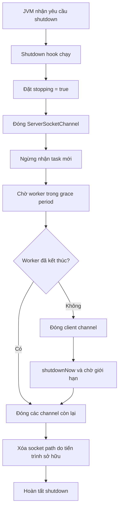

# Graceful shutdown và đóng tài nguyên khi tiến trình nhận tín hiệu dừng

Một server dùng Unix-domain socket cần dừng theo thứ tự để không nhận thêm kết nối mới, cho các request đang xử lý cơ hội hoàn tất và đóng channel cùng socket path an toàn. Trong Java, cách portable để phản ứng khi JVM bắt đầu shutdown là đăng ký `Runtime.addShutdownHook()`. Hook phối hợp việc dừng server; nó không thay thế việc quản lý vòng đời kết nối trong ứng dụng.

Với `ServerSocketChannel` và `SocketChannel` dùng `StandardProtocolFamily.UNIX`, một quy trình graceful shutdown thường gồm: đánh dấu server đang dừng, đóng server channel để giải phóng `accept()` đang block, ngừng nhận task mới, chờ worker hoàn tất trong một khoảng thời gian hữu hạn, rồi đóng các client còn hoạt động và giải phóng tài nguyên. Socket path chỉ được xóa nếu tiến trình đã bind và sở hữu path đó.

Bài học thuộc chương **Vận hành socket** của module **JAVA_VERSION_JAVA16**. Unix-domain socket channels là API chính thức từ Java 16 và vẫn áp dụng trong Java hiện đại. Nội dung sử dụng shutdown hook chuẩn của JVM, executor và NIO channels; không dựa vào signal handler nội bộ hoặc API thử nghiệm.

## 1. Graceful shutdown là gì?

Graceful shutdown là quá trình kết thúc dịch vụ có kiểm soát. Server ngừng nhận công việc mới, xử lý hoặc hoàn tất công việc đang chạy trong giới hạn thời gian, sau đó đóng tài nguyên.

Với Unix-domain socket server, các bước chính là:

1. Chuyển trạng thái sang `stopping` để vòng lặp accept không nhận thêm kết nối.
2. Đóng `ServerSocketChannel`; thao tác này làm `accept()` đang block kết thúc.
3. Ngừng nhận task mới trong `ExecutorService`.
4. Chờ các kết nối đang xử lý hoàn tất trong thời gian grace period.
5. Nếu hết thời gian, đóng client channel còn mở và yêu cầu worker dừng.
6. Xóa socket path do chính tiến trình bind tạo ra sau khi server channel đã đóng.

Sơ đồ:



Graceful shutdown không bảo đảm mọi request đều thành công. Nó cung cấp một khoảng thời gian hữu hạn để hoàn tất công việc và một đường kết thúc có kiểm soát nếu peer hoặc worker không phản hồi.

## 2. JVM shutdown hook và tín hiệu dừng

Đăng ký hook bằng API chuẩn:

```java
Thread hook = new Thread(() -> {
    System.out.println("JVM is shutting down");
}, "application-shutdown");

Runtime.getRuntime().addShutdownHook(hook);
```

JVM chạy shutdown hooks khi bắt đầu quá trình shutdown bình thường, ví dụ khi tiến trình nhận yêu cầu kết thúc như `SIGTERM`, người dùng nhấn Ctrl+C trong terminal hoặc ứng dụng gọi `System.exit()`.

Các giới hạn cần hiểu:

- `SIGKILL` không thể được bắt hoặc xử lý bằng shutdown hook.
- `Runtime.halt()` bỏ qua shutdown hooks.
- JVM crash, mất điện hoặc hệ điều hành bị dừng đột ngột không bảo đảm hook chạy.
- Nhiều shutdown hook có thể chạy đồng thời; không dựa vào thứ tự giữa các hook.
- Hook nên có thời gian chờ hữu hạn và không chờ vô thời hạn vào một dịch vụ bên ngoài.

Không dùng `sun.misc.Signal` hoặc API nội bộ để cài signal handler riêng cho `SIGTERM`. Những cách đó không phải giao diện portable được Java SE bảo đảm. Hãy để JVM xử lý yêu cầu shutdown của hệ điều hành rồi dùng `Runtime.addShutdownHook()` để dọn tài nguyên.

## 3. Vì sao cần đóng ServerSocketChannel khi shutdown?

Server thường chờ kết nối mới tại:

```java
try (SocketChannel client = server.accept()) {
    handle(client);
}
```

Ở blocking mode, `accept()` có thể chờ vô thời hạn nếu chưa có client mới. Chỉ đặt biến `running = false` không đánh thức thread đang chờ trong `accept()`.

Đóng `ServerSocketChannel` từ shutdown hook làm thao tác I/O đang block trên channel đó kết thúc bằng exception đóng channel. Server cần nhận biết trường hợp này là shutdown bình thường để thoát vòng lặp, thay vì ghi nhận như một lỗi dịch vụ.

Mẫu xử lý:

```java
while (!stopping.get()) {
    try {
        SocketChannel client = server.accept();
        // Đưa client vào xử lý nếu server chưa dừng.
    } catch (ClosedChannelException e) {
        if (stopping.get()) {
            break;
        }
        throw e;
    }
}
```

`ClosedChannelException` trong lúc server đang dừng là đường thoát dự kiến. Nếu channel đóng khi server chưa có trạng thái stopping, lỗi cần được xử lý như một sự cố I/O.

## 4. Mẫu server có shutdown hook và worker pool

Ví dụ sau dùng blocking Unix-domain socket server, một worker pool cố định và tập hợp client channel đang hoạt động. Các worker minh họa giao thức echo đơn giản; trong ứng dụng thực tế, thay phần xử lý byte bằng parser/frame protocol của dịch vụ.

```java
import java.io.IOException;
import java.nio.ByteBuffer;
import java.nio.channels.ClosedChannelException;
import java.nio.channels.ServerSocketChannel;
import java.nio.channels.SocketChannel;
import java.net.StandardProtocolFamily;
import java.net.UnixDomainSocketAddress;
import java.nio.file.Files;
import java.nio.file.Path;
import java.util.Set;
import java.util.concurrent.ConcurrentHashMap;
import java.util.concurrent.ExecutorService;
import java.util.concurrent.Executors;
import java.util.concurrent.RejectedExecutionException;
import java.util.concurrent.TimeUnit;
import java.util.concurrent.atomic.AtomicBoolean;

public final class UnixSocketServer {
    private final Path socketPath;
    private final ServerSocketChannel server;
    private final ExecutorService workers =
            Executors.newFixedThreadPool(8);
    private final Set<SocketChannel> clients =
            ConcurrentHashMap.newKeySet();
    private final AtomicBoolean stopping = new AtomicBoolean(false);
    private volatile boolean bound;

    private UnixSocketServer(Path socketPath,
                             ServerSocketChannel server) {
        this.socketPath = socketPath;
        this.server = server;
    }

    public static void main(String[] args) throws IOException {
        Path socketPath = Path.of("/tmp/orders.sock");
        ServerSocketChannel server =
                ServerSocketChannel.open(StandardProtocolFamily.UNIX);
        UnixSocketServer app = new UnixSocketServer(socketPath, server);

        try {
            server.bind(UnixDomainSocketAddress.of(socketPath));
            app.bound = true;

            Runtime.getRuntime().addShutdownHook(
                    new Thread(app::shutdown, "unix-socket-shutdown"));

            app.serve();
        } finally {
            // Cũng dọn tài nguyên nếu serve kết thúc do lỗi.
            app.shutdown();
        }
    }

    private void serve() throws IOException {
        while (!stopping.get()) {
            final SocketChannel client;
            try {
                client = server.accept();
            } catch (ClosedChannelException e) {
                if (stopping.get()) {
                    break;
                }
                throw e;
            }

            // Shutdown có thể bắt đầu ngay sau khi accept trả về.
            if (stopping.get()) {
                client.close();
                break;
            }

            clients.add(client);
            try {
                workers.execute(() -> handleClient(client));
            } catch (RejectedExecutionException e) {
                clients.remove(client);
                client.close();
                if (!stopping.get()) {
                    throw e;
                }
            }
        }
    }

    private void handleClient(SocketChannel client) {
        try (client) {
            echoUntilEof(client);
        } catch (IOException e) {
            if (!stopping.get()) {
                System.err.println("Client I/O failed: " + e.getMessage());
            }
        } finally {
            clients.remove(client);
        }
    }

    private static void echoUntilEof(SocketChannel client)
            throws IOException {
        ByteBuffer buffer = ByteBuffer.allocate(8192);
        while (true) {
            int count = client.read(buffer);
            if (count == -1) {
                return;
            }
            if (count == 0) {
                continue;
            }

            buffer.flip();
            while (buffer.hasRemaining()) {
                client.write(buffer);
            }
            buffer.clear();
        }
    }

    private void shutdown() {
        if (!stopping.compareAndSet(false, true)) {
            return; // Idempotent: hook và finally có thể cùng gọi.
        }

        closeQuietly(server); // Đánh thức accept() đang block.
        workers.shutdown();   // Không nhận thêm task mới.

        boolean interrupted = false;
        try {
            if (!workers.awaitTermination(10, TimeUnit.SECONDS)) {
                closeClients();
                workers.shutdownNow();
                if (!workers.awaitTermination(2, TimeUnit.SECONDS)) {
                    System.err.println("Some workers did not terminate");
                }
            }
        } catch (InterruptedException e) {
            interrupted = true;
            closeClients();
            workers.shutdownNow();
        } finally {
            closeClients();
            cleanupSocketPath();
            if (interrupted) {
                Thread.currentThread().interrupt();
            }
        }
    }

    private void closeClients() {
        for (SocketChannel client : clients) {
            closeQuietly(client);
        }
    }

    private static void closeQuietly(
            java.nio.channels.Channel channel) {
        try {
            channel.close();
        } catch (IOException e) {
            System.err.println("Error closing channel: " + e.getMessage());
        }
    }

    private void cleanupSocketPath() {
        if (!bound) {
            return;
        }
        try {
            Files.deleteIfExists(socketPath);
            bound = false;
        } catch (IOException e) {
            System.err.println(
                    "Could not remove socket path: " + e.getMessage());
        }
    }
}
```

Các điểm chính trong ví dụ:

- `stopping` là cờ dùng chung, được cập nhật nguyên tử và giúp shutdown có tính idempotent.
- Đóng server channel trước để giải phóng thread đang chờ `accept()`.
- `workers.shutdown()` ngăn nhận task mới nhưng cho task đã nhận cơ hội hoàn tất.
- `awaitTermination()` giới hạn thời gian drain worker.
- Nếu hết grace period, đóng client channel để giải phóng các worker đang chờ I/O, sau đó gọi `shutdownNow()`.
- `clients` là concurrent set vì accept thread, worker và shutdown hook cùng truy cập.
- `bound` chỉ được đặt sau khi bind thành công; chỉ khi đó mới xóa socket path.

## 5. Vì sao cần grace period hữu hạn?

Nếu chỉ gọi `workers.shutdown()` rồi chờ vô thời hạn, một client không gửi EOF hoặc một handler bị kẹt có thể giữ tiến trình sống mãi. Grace period đặt giới hạn cho việc hoàn tất request đang chạy.

Ví dụ dùng hai mốc:

| Giai đoạn | Thời gian ví dụ | Hành động |
| --- | ---: | --- |
| Drain bình thường | 10 giây | Chờ các worker đang xử lý hoàn tất |
| Dừng cưỡng bức có kiểm soát | 2 giây | Đóng client channel, gọi `shutdownNow()` và chờ thêm |

Các con số chỉ là ví dụ. Chọn thời gian phù hợp với SLA, thời gian xử lý request và thời hạn shutdown của service manager. Nếu service manager chỉ cho tiến trình vài giây trước khi gửi `SIGKILL`, grace period của ứng dụng phải ngắn hơn thời hạn đó.

Đóng client channel đang hoạt động là tín hiệu rõ ràng để các thao tác I/O bị chặn kết thúc. `shutdownNow()` gửi interrupt tới worker; tuy nhiên, code xử lý vẫn cần phản ứng đúng với interrupt và exception đóng channel.

`shutdownNow()` chỉ yêu cầu thread dừng bằng interrupt; Java không cưỡng bức kết thúc một thread đang chạy. Handler cần tôn trọng interrupt, đặt timeout cho thao tác tới database hoặc dịch vụ bên ngoài và đóng resource trong `finally`. Nếu `awaitTermination()` vẫn trả `false`, ghi log để vận hành biết worker chưa kết thúc; service manager có thể áp dụng thời hạn dừng cuối cùng của nó.

## 6. Ngăn nhận task mới và xử lý race condition

Shutdown có thể bắt đầu đúng lúc server vừa nhận một client. Chỉ kiểm tra cờ một lần trước `accept()` là chưa đủ:

1. Thread server gọi `accept()`.
2. Một client kết nối và `accept()` trả channel.
3. Shutdown hook đặt `stopping = true` và đóng executor.
4. Thread server cố submit client vào executor đã shutdown.

Ví dụ xử lý race này bằng hai lớp bảo vệ:

- Kiểm tra `stopping` ngay sau `accept()`; nếu đang dừng, đóng client vừa nhận.
- Bắt `RejectedExecutionException` khi submit; loại client khỏi set và đóng channel.

Không để client bị bỏ quên khi executor từ chối task. Nếu không đóng channel trong nhánh này, server có thể rò rỉ file descriptor dù đã ngừng nhận kết nối.

## 7. Phân biệt đóng server, đóng client và shutdown output

Các thao tác có phạm vi khác nhau:

| Thao tác | Tác động |
| --- | --- |
| `ServerSocketChannel.close()` | Ngừng nhận kết nối mới và giải phóng server channel |
| `SocketChannel.close()` | Đóng cả channel client và hai chiều I/O của kết nối đó |
| `SocketChannel.shutdownOutput()` | Kết thúc chiều gửi của channel nhưng vẫn có thể đọc phản hồi |
| `SocketChannel.shutdownInput()` | Ngừng nhận dữ liệu ở chiều vào |

Khi server graceful shutdown, thường cần đóng server channel trước, sau đó cho client channel đang xử lý hoàn tất. Không đóng tất cả client ngay lập tức nếu muốn drain request. Khi hết grace period, đóng client còn mở để bảo đảm tiến trình không chờ vô hạn.

Nếu giao thức yêu cầu client báo đã gửi xong request nhưng vẫn chờ response, client có thể dùng `shutdownOutput()` rồi tiếp tục đọc. Server không nên hiểu EOF ở chiều nhận request là yêu cầu đóng ngay chiều gửi response.

## 8. Xóa Unix socket path an toàn

Khi bind server vào địa chỉ dạng pathname, hệ điều hành tạo socket entry trong filesystem. Sau khi server đóng, ứng dụng cần quản lý entry này theo vòng đời triển khai. Chỉ xóa path nếu tiến trình đã bind thành công và biết đó là path mình sở hữu.

Không làm như sau khi startup:

```java
Files.deleteIfExists(socketPath); // Không xóa mù path trước khi bind.
server.bind(UnixDomainSocketAddress.of(socketPath));
```

Path có thể thuộc về instance khác hoặc thậm chí là file thường. Nếu bind thất bại vì path đã tồn tại, hãy xác minh server cũ còn hoạt động hay không và áp dụng quy trình recovery có kiểm soát.

Nên đặt socket trong thư mục riêng có quyền truy cập phù hợp thay vì dùng trực tiếp một thư mục chia sẻ rộng như `/tmp`. Nếu dùng thư mục tạm, tạo thư mục riêng cho service và giới hạn quyền truy cập. Việc này giảm nguy cơ tiến trình khác thay thế hoặc xóa socket path.

Nếu tiến trình bị `SIGKILL` hoặc crash, shutdown hook không chạy và socket path có thể còn lại. Khi khởi động lại, xử lý stale socket path như một bước recovery riêng; không mặc định xóa bất kỳ file nào cùng tên.

## 9. Xử lý shutdown hook đúng cách

Shutdown hook nên thực hiện các thao tác cần thiết để giải phóng tài nguyên và có giới hạn thời gian. Tránh các hành vi sau:

- Gọi `System.exit()` bên trong shutdown hook.
- Chờ vô hạn một client, thread hoặc service bên ngoài.
- Bắt đầu thêm tác vụ nền mới trong lúc executor đã dừng.
- Dựa vào thứ tự chạy giữa nhiều shutdown hook.
- Giữ lock mà một thread khác cần để kết thúc shutdown.
- Ghi dữ liệu quan trọng lần đầu tiên vào hook mà không có cơ chế lưu định kỳ.

Đăng ký hook sau khi tài nguyên cốt lõi đã được tạo và bind thành công, trước khi bước vào vòng lặp phục vụ dài hạn. Đồng thời gọi cùng phương thức shutdown trong `finally` để xử lý trường hợp server kết thúc do exception hoặc luồng điều khiển bình thường. Cờ nguyên tử giúp hai đường gọi không cleanup lặp.

## 10. Kiểm thử graceful shutdown

Không nên chỉ kiểm tra rằng tiến trình đã thoát. Hãy kiểm tra các hành vi trong lúc dừng:

1. Khởi động server và xác nhận socket path được tạo.
2. Kết nối một hoặc nhiều client.
3. Giữ một client đang gửi request hoặc đang chờ phản hồi.
4. Gửi yêu cầu dừng bình thường, ví dụ `SIGTERM`.
5. Xác nhận server không nhận thêm client mới.
6. Xác nhận request đang chạy được hoàn tất trong grace period nếu có thể.
7. Xác nhận kết nối còn treo bị đóng sau khi hết thời gian.
8. Xác nhận worker pool kết thúc và socket path do server sở hữu được cleanup.
9. Khởi động lại server và xác nhận bind được path.

Trên Linux có thể gửi tín hiệu bằng:

```bash
kill -TERM <pid>
```

Không dùng `kill -9` để kiểm tra shutdown hook: `SIGKILL` được thiết kế để kết thúc tiến trình mà không chạy cleanup code.

Các trường hợp kiểm thử bổ sung:

| Trường hợp | Kết quả mong đợi |
| --- | --- |
| Dừng khi không có client | `accept()` được giải phóng, server thoát gọn |
| Dừng khi client đang idle | Worker được chờ trong grace period rồi channel được đóng nếu quá hạn |
| Dừng khi request đang xử lý | Request có cơ hội hoàn tất trước deadline |
| Hai đường gọi shutdown cùng lúc | Cleanup chỉ chạy một lần |
| Bind thất bại | Không xóa path không thuộc tiến trình |
| Bị kill cưỡng bức | Không kỳ vọng hook chạy; startup cần xử lý stale path an toàn |

## 11. Checklist vận hành

- [ ] Đăng ký một shutdown hook chuẩn bằng `Runtime.addShutdownHook()`.
- [ ] Dùng cờ nguyên tử để biểu diễn trạng thái stopping.
- [ ] Đóng `ServerSocketChannel` để giải phóng `accept()` đang block.
- [ ] Ngăn submit task mới và xử lý `RejectedExecutionException`.
- [ ] Cho worker đang chạy một grace period hữu hạn.
- [ ] Đóng client channel còn hoạt động nếu hết thời gian.
- [ ] Gọi `shutdownNow()` sau khi đã yêu cầu dừng mềm.
- [ ] Đóng channel bằng `try-with-resources` và cleanup idempotent.
- [ ] Chỉ xóa socket path nếu bind thành công và tiến trình sở hữu path.
- [ ] Không dựa vào shutdown hook cho `SIGKILL`, crash hoặc mất điện.
- [ ] Kiểm thử shutdown khi không có client, có client idle và có request đang chạy.

## Ghi nhớ

**Graceful shutdown của Unix-domain socket server bắt đầu bằng việc ngừng nhận kết nối mới, đóng server channel để đánh thức `accept()`, rồi drain worker trong một khoảng thời gian hữu hạn.** Nếu worker không hoàn tất, đóng các client channel còn mở và dừng executor; dùng shutdown hook chuẩn của JVM để phản ứng với yêu cầu kết thúc bình thường, đồng thời gọi cùng logic trong `finally`. Chỉ xóa socket path do tiến trình đã bind sở hữu. Shutdown hook không chạy khi nhận `SIGKILL`, JVM crash hoặc máy mất điện.

## Tài liệu tham khảo

- [Oracle Java SE 26 — Runtime.addShutdownHook](https://docs.oracle.com/en/java/javase/26/docs/api/java.base/java/lang/Runtime.html#addShutdownHook(java.lang.Thread))
- [Oracle Java SE 26 — ServerSocketChannel](https://docs.oracle.com/en/java/javase/26/docs/api/java.base/java/nio/channels/ServerSocketChannel.html)
- [Oracle Java SE 26 — SocketChannel](https://docs.oracle.com/en/java/javase/26/docs/api/java.base/java/nio/channels/SocketChannel.html)
- [Oracle Java SE 26 — ExecutorService](https://docs.oracle.com/en/java/javase/26/docs/api/java.base/java/util/concurrent/ExecutorService.html)
- [JEP 380 — Unix-Domain Socket Channels](https://openjdk.org/jeps/380)
