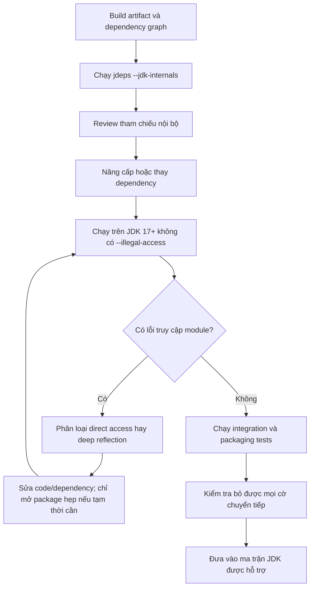

# Đối chiếu quy tắc Java 16 với strong encapsulation trên JDK hiện đại

> **Chương:** Đóng gói JDK  
> **Phạm vi:** Hiểu quá trình siết chặt quyền truy cập các thành phần nội bộ của JDK từ Java 16, sự thay đổi dứt điểm ở Java 17 và cách xử lý trên các JDK hiện đại. Bài tập trung vào ranh giới module, khác biệt giữa exports và opens, hai tùy chọn --add-exports/--add-opens, công cụ tìm phụ thuộc nội bộ và lộ trình di chuyển an toàn.

## Mục tiêu học tập

Sau bài này, bạn có thể:

1. So sánh quy tắc truy cập nội bộ của JDK 9–15, JDK 16 và JDK 17 trở lên.
2. Giải thích vai trò của JEP 396 và JEP 403.
3. Phân biệt truy cập API công khai, truy cập nội bộ và deep reflection.
4. Chọn đúng giữa exports, opens, --add-exports và --add-opens.
5. Nhận biết lỗi InaccessibleObjectException và IllegalAccessError.
6. Dùng jdeps --jdk-internals để phát hiện phụ thuộc tĩnh vào API nội bộ.
7. Lập kế hoạch loại bỏ các cờ tương thích và thư viện phụ thuộc vào JDK internals.

## 1. Strong encapsulation giải quyết vấn đề gì?

JDK có các API công khai được mô tả trong Java SE API Specification và có những lớp, phương thức, trường chỉ phục vụ việc triển khai bên trong JDK. Thành phần nội bộ có thể thay đổi hoặc bị loại bỏ khi JDK được nâng cấp.

Trong các bản Java cũ, một số ứng dụng và thư viện vẫn truy cập các thành phần nội bộ bằng import trực tiếp hoặc reflection. Cách làm này tạo ra các vấn đề:

- Ứng dụng phụ thuộc vào chi tiết triển khai không có cam kết tương thích.
- JDK khó thay đổi cấu trúc bên trong mà không làm hỏng thư viện bên ngoài.
- Reflection sâu có thể vượt qua ranh giới đóng gói của module.
- Thư viện có thể hoạt động trên một bản JDK nhưng lỗi khi nâng cấp.
- Các thành phần nội bộ không được thiết kế như API ổn định cho ứng dụng.

Strong encapsulation giới hạn quyền truy cập vào các package của module. Ứng dụng chỉ truy cập được API mà module công khai hoặc mở theo đúng cơ chế module.

Mục tiêu là giữ ranh giới rõ ràng giữa API được hỗ trợ và chi tiết triển khai. Đây là một phần quan trọng của hệ thống module được đưa vào từ Java 9.

## 2. Diễn tiến từ JDK 9 đến JDK hiện đại

Các quy tắc đã thay đổi qua nhiều phiên bản. Khi nâng cấp ứng dụng, cần phân biệt rõ mốc Java 16 và Java 17.

| Phiên bản | Quy tắc chính | Ý nghĩa khi di chuyển |
| --- | --- | --- |
| JDK 9–15 | Strong encapsulation được nới lỏng mặc định cho một số package tồn tại từ JDK 8; có cảnh báo truy cập reflection bất hợp pháp | Ứng dụng cũ có thể vẫn chạy nhưng cần xử lý cảnh báo |
| JDK 16 | JEP 396 đặt strong encapsulation làm mặc định; --illegal-access mặc định là deny | Có thể tạm dùng --illegal-access=permit để hỗ trợ một số ứng dụng cũ trong giai đoạn chuyển tiếp |
| JDK 17 trở lên | JEP 403 siết chặt strong encapsulation; --illegal-access không còn điều khiển cơ chế nới lỏng | Cờ permit/warn/debug/deny bị bỏ qua và phát cảnh báo; cần sửa thư viện hoặc mở đúng package có chủ đích |

### JDK 16: JEP 396

JEP 396 (Strongly Encapsulate JDK Internals by Default) thay đổi giá trị mặc định của tùy chọn --illegal-access từ permit sang deny.

Trên JDK 16, tùy chọn:

```bash
java --illegal-access=permit -jar legacy-app.jar
```

có thể tạm khôi phục cơ chế truy cập được nới lỏng cho code trong unnamed modules đối với các package của JDK đã tồn tại trong JDK 8. Cơ chế này cho phép cả truy cập tĩnh đã biên dịch và deep reflection vào các package được mở. Đây là cầu nối tương thích, không phải hợp đồng lâu dài.

Tùy chọn --illegal-access đã bị deprecated từ JDK 16 và tài liệu JDK 16 đã nêu rằng nó sẽ bị loại bỏ trong bản phát hành sau.

### JDK 17 trở lên: JEP 403

JEP 403 (Strongly Encapsulate JDK Internals) hoàn tất quá trình chuyển đổi. Các thành phần nội bộ của JDK được đóng gói mạnh; ngoại lệ dành cho một số API nội bộ quan trọng như sun.misc.Unsafe không biến chúng thành API Java SE ổn định.

Trên JDK 17 trở lên, ví dụ sau không mở lại quyền truy cập:

```bash
java --illegal-access=permit -jar legacy-app.jar
```

Launcher phát cảnh báo rằng tùy chọn đã obsolete và không còn tác dụng. Không dùng cờ này làm cách khắc phục trên JDK hiện đại.

### Bảng lựa chọn khi nâng cấp

| Tình huống | Hướng xử lý |
| --- | --- |
| Ứng dụng cũ chạy trên JDK 16 và cần thời gian chuyển đổi | Có thể đánh giá --illegal-access=permit như biện pháp tạm thời có thời hạn |
| Ứng dụng chạy trên JDK 17+ | Không dựa vào --illegal-access; cập nhật thư viện hoặc cấp quyền cụ thể nếu thật sự cần |
| Code truy cập trực tiếp public type trong package nội bộ | Đánh giá --add-exports như giải pháp chuyển tiếp |
| Framework cần reflection vào member không public của package JDK | Đánh giá --add-opens ở phạm vi package tối thiểu |
| Ứng dụng mới | Chỉ dùng API công khai được hỗ trợ; tránh phụ thuộc vào package nội bộ |

## 3. Hiểu ranh giới module: exports và opens

Trong hệ thống module, package thuộc một module. Module có thể công khai package cho module khác bằng exports hoặc cho phép reflection sâu bằng opens.

Hai directive có mục đích khác nhau:

| Directive trong module-info.java | Tác dụng |
| --- | --- |
| exports p; | Cho phép module khác truy cập các type và member public được công khai trong package p, khi có quan hệ readability phù hợp |
| exports p to m; | Chỉ công khai package p cho module m |
| opens p; | Cho phép reflection sâu vào các type/member trong package p ở runtime |
| opens p to m; | Chỉ mở package p cho reflection từ module m |
| open module m { ... } | Mở tất cả package của module cho reflection sâu; phạm vi rộng nên cần cân nhắc kỹ |

### exports không đồng nghĩa với opens

Một package được export cho phép code module khác dùng public API của package đó theo quy tắc truy cập Java. Điều này không tự động cho phép framework dùng reflection để truy cập trường private hoặc constructor không public.

Một package được open cho phép reflection sâu tại runtime. Nó không làm cho các type trong package trở thành API public để code khác import và gọi trực tiếp ở thời điểm biên dịch.

### Ví dụ module ứng dụng

Giả sử module ứng dụng tên com.example.model:

```java
module com.example.model {
    exports com.example.model.api;
    opens com.example.model.dto to framework.module;
}
```

- Module khác có thể gọi các type public trong com.example.model.api.
- Framework có tên module framework.module có thể dùng deep reflection trong com.example.model.dto.
- Các package khác vẫn được đóng gói theo mặc định.

Đây là cách mở đúng phần cần thiết của module do ứng dụng sở hữu. Directive trong module-info của ứng dụng không thể tự thay đổi descriptor của module JDK như java.base.

## 4. Phân biệt --add-exports và --add-opens

Hai tùy chọn dòng lệnh cho phép điều chỉnh quyền truy cập khi cần tương thích. Chúng có cú pháp gần giống nhau nhưng giải quyết hai tình huống khác nhau.

| Tùy chọn | Mục đích | Dùng lúc compile? | Dùng lúc runtime? |
| --- | --- | --- | --- |
| --add-exports | Công khai các type/member public của package cho module đích | Có | Có |
| --add-opens | Mở package để reflection sâu vào member không public | Không | Có |

### --add-exports

Cú pháp:

```text
--add-exports source.module/package=target.module
```

Có thể liệt kê nhiều module đích bằng dấu phẩy. Dùng ALL-UNNAMED để chỉ tất cả unnamed module, thường là code trên classpath.

Ví dụ cấp quyền truy cập public type trong package nội bộ:

```bash
javac --add-exports java.base/sun.nio.ch=ALL-UNNAMED -cp "lib/*" App.java
java --add-exports java.base/sun.nio.ch=ALL-UNNAMED -cp ".;lib/*" App
```

Ví dụ chỉ minh họa cú pháp cho giai đoạn di chuyển. Package sun.nio.ch là chi tiết triển khai của JDK; mở export không biến nó thành API được Java SE bảo đảm ổn định.

Nếu ứng dụng là named module, thay ALL-UNNAMED bằng tên module đích, ví dụ com.example.app. Tùy chọn phải được áp dụng ở bước biên dịch và runtime tương ứng khi cả hai bước đều cần quyền truy cập.

### --add-opens

Cú pháp:

```text
--add-opens source.module/package=target.module
```

Ví dụ cho ứng dụng chạy trên classpath cần một framework reflection vào package java.lang:

```bash
java --add-opens java.base/java.lang=ALL-UNNAMED -jar legacy-app.jar
```

Đối với ứng dụng dạng named module, nên chỉ định module đích cụ thể thay vì ALL-UNNAMED:

```bash
java --add-opens java.base/java.lang=com.example.app -m com.example.app/com.example.Main
```

--add-opens là tùy chọn runtime. Nó không cho phép javac biên dịch code gọi trực tiếp một type nội bộ.

### Cách nhớ nhanh

- Cần code gọi public type trong package không được export? Xem xét --add-exports.
- Cần reflection vào private/protected/package-private member của package không được mở? Xem xét --add-opens.
- Cần cả truy cập trực tiếp lẫn reflection sâu? Đánh giá riêng từng quyền; một cờ không thay thế cờ còn lại.

## 5. Nhận biết lỗi khi strong encapsulation chặn truy cập

Lỗi xuất hiện tùy cách ứng dụng truy cập package.

| Cách truy cập | Biểu hiện thường gặp | Ý nghĩa |
| --- | --- | --- |
| Code gọi trực tiếp type nội bộ nhưng package không export | Lỗi biên dịch hoặc IllegalAccessError lúc runtime | Module không công khai package cho module gọi |
| Reflection sâu vào private member của package không open | InaccessibleObjectException hoặc trySetAccessible() trả false | Module không mở package cho module gọi |
| Dùng reflection và member không tồn tại | NoSuchFieldException hoặc NoSuchMethodException | Chi tiết triển khai đã đổi hoặc tên member sai |
| Truy cập package/type không tồn tại trong JDK đang chạy | ClassNotFoundException hoặc NoClassDefFoundError | Phụ thuộc nội bộ không có trên runtime hiện tại |

### Ví dụ deep reflection

Ví dụ sau chỉ dùng để minh họa ranh giới truy cập. Trường value của String là chi tiết triển khai, không phải API ứng dụng nên phụ thuộc:

```java
import java.lang.reflect.Field;

public class ReflectionCheck {
    public static void main(String[] args) throws Exception {
        Field value = String.class.getDeclaredField("value");

        boolean opened = value.trySetAccessible();
        System.out.println("Deep reflection allowed: " + opened);
    }
}
```

Trên JDK hiện đại, khi chạy trên classpath mà không có quyền mở java.lang, trySetAccessible() thường trả về false. Nếu dùng setAccessible(true) thay thế, thao tác có thể ném InaccessibleObjectException.

Chạy với quyền mở package:

```bash
java --add-opens java.base/java.lang=ALL-UNNAMED ReflectionCheck
```

Khi đó, reflection sâu có thể được cho phép đối với module không tên. Không nên biến ví dụ này thành kỹ thuật đọc hoặc sửa nội dung nội bộ của String trong ứng dụng.

### MethodHandles.privateLookupIn

Một số framework dùng MethodHandles thay cho reflection truyền thống. Cơ chế này cũng tôn trọng ranh giới module. privateLookupIn cần caller có quyền phù hợp và package đích phải được mở cho module gọi; nó không phải đường vòng để bỏ qua strong encapsulation.

## 6. Không nhầm JDK internals với API công khai

Không phải mọi lớp nằm trong module java.base đều là API nội bộ. Module java.base chứa phần lớn API cốt lõi của Java, bao gồm cả API công khai như java.lang.String và chi tiết triển khai nội bộ.

Tương tự, không thể xác định API ổn định chỉ bằng tên package có tiền tố sun hoặc com.sun. Cần kiểm tra tài liệu Java SE API và descriptor module.

Một số nguyên tắc:

- Ưu tiên type được tài liệu Java SE công khai hỗ trợ.
- Không coi package nội bộ là hợp đồng tương thích giữa các JDK.
- --add-exports chỉ mở quyền truy cập, không tạo bảo đảm API.
- --add-opens chỉ cho phép reflection sâu, không biến member private thành API được hỗ trợ.
- Các ngoại lệ lịch sử như sun.misc.Unsafe không phải lời khuyên để bắt đầu phụ thuộc vào API đó.

Nếu thư viện cần thao tác bộ nhớ hoặc truy cập dữ liệu ở mức thấp, hãy đánh giá các API chuẩn phù hợp với phiên bản JDK mục tiêu, chẳng hạn ByteBuffer, VarHandle hoặc Foreign Function & Memory API đã được hoàn thiện trong JDK hiện đại.

## 7. Dùng jdeps để tìm phụ thuộc tĩnh vào JDK internals

JDK cung cấp công cụ jdeps để phân tích phụ thuộc giữa các class, package và module. Tùy chọn --jdk-internals giúp tìm tham chiếu tĩnh tới API nội bộ của JDK và đưa ra gợi ý thay thế khi có.

Ví dụ:

```bash
jdeps --jdk-internals app.jar
```

Nếu ứng dụng có dependency trên classpath, cung cấp classpath để công cụ phân tích thêm:

```bash
jdeps --jdk-internals --recursive --class-path "lib/*" app.jar
```

Với multi-release JAR, có thể chỉ định phiên bản bytecode cần phân tích:

```bash
jdeps --multi-release 17 --jdk-internals --recursive app.jar
```

Hãy chọn phiên bản phù hợp với runtime mà sản phẩm triển khai. jdeps là công cụ phân tích tĩnh; kết quả cần được xem cùng dependency graph và cách ứng dụng thực sự chạy.

### jdeps có thể và không thể phát hiện điều gì?

| Trường hợp | Khả năng phát hiện |
| --- | --- |
| Bytecode có tham chiếu trực tiếp tới type nội bộ | Có thể phát hiện |
| Tham chiếu nằm trong dependency JAR được đưa vào phân tích | Có thể phát hiện nếu dependency được cung cấp cho jdeps |
| Tên class nội bộ chỉ xuất hiện trong chuỗi reflection | Không bảo đảm phát hiện |
| Class được nạp động bằng tên do cấu hình cung cấp | Không bảo đảm phát hiện |
| Bytecode được sinh ra lúc runtime | Không thể dựa vào jdeps tĩnh để bao phủ đầy đủ |
| Native code gọi vào JVM hoặc truy cập cấu trúc nội bộ | Cần đánh giá bằng công cụ và test riêng |

Vì vậy, jdeps là bước rà soát hữu ích nhưng không phải chứng minh rằng ứng dụng không còn truy cập nội bộ.

### Kiểm tra cả dependency bắc cầu

Không chỉ quét mã nguồn của ứng dụng. Framework, ORM, thư viện serialization, mocking, bytecode instrumentation và agent có thể truy cập nội bộ thay mặt ứng dụng.

Quy trình nên:

1. Quét artifact chính.
2. Quét các JAR runtime dependencies.
3. Xem báo cáo để xác định thư viện và phiên bản tạo tham chiếu.
4. Kiểm tra release note của thư viện để tìm bản đã loại bỏ truy cập nội bộ.
5. Chạy integration test trên JDK mục tiêu để phát hiện đường reflection động.

## 8. Lộ trình di chuyển từ JDK 16 sang JDK 17+

Khi nâng ứng dụng từ Java 16 lên JDK hiện đại, hãy xem strong encapsulation là một thay đổi tương thích cần xử lý ở cấp ứng dụng và dependency.

### Bước 1: Xác định runtime thực tế

Ghi lại phiên bản JDK, nhà cung cấp, cách khởi chạy, module path/classpath và toàn bộ cờ JVM. Kiểm tra cả cấu hình trong script, container, service manager và môi trường triển khai.

Tìm và loại bỏ các cờ:

```text
--illegal-access=permit
--illegal-access=warn
--illegal-access=debug
--illegal-access=deny
```

Trên JDK 17+, các cờ này không còn là cơ chế sửa lỗi truy cập. Nếu còn xuất hiện, hãy xử lý cấu hình thay vì để cảnh báo bị bỏ qua.

### Bước 2: Quét API nội bộ

Chạy jdeps --jdk-internals trên artifact và dependencies. Lưu báo cáo làm baseline cho quá trình migration.

Đối với reflection, tìm các điểm dùng:

- getDeclaredField(), getDeclaredMethod(), getDeclaredConstructor().
- setAccessible(true) hoặc trySetAccessible().
- Class.forName() với tên lớp nội bộ.
- MethodHandles.privateLookupIn().
- Framework tự động quét hoặc serialize private field.

Không phải mọi lời gọi reflection đều sai. Vấn đề là truy cập vào package/module mà ứng dụng không có quyền theo quy tắc module.

### Bước 3: Cập nhật thư viện trước

Nếu framework hoặc dependency đã phát hành phiên bản tương thích JDK mới, nâng cấp thư viện trước khi thêm cờ mở. Các thư viện hiện đại thường đã thay thế truy cập nội bộ bằng API chuẩn hoặc cơ chế module phù hợp.

Nếu một dependency chưa tương thích:

- Xác định chính xác module nguồn và package bị chặn.
- Xác định module đích cần quyền.
- Xác định đó là truy cập trực tiếp hay deep reflection.
- Liên hệ maintainer hoặc thay dependency nếu không có bản sửa.
- Chỉ dùng cờ mở hẹp làm cầu nối có thời hạn nếu có lý do vận hành rõ ràng.

### Bước 4: Thay thế API nội bộ bằng API chuẩn

Ưu tiên API Java SE có hợp đồng công khai. Ví dụ:

| Nhu cầu cũ | Hướng thay thế cần đánh giá |
| --- | --- |
| Mã hóa Base64 bằng lớp nội bộ | java.util.Base64 |
| Thao tác bit/atomic trên field | java.lang.invoke.VarHandle hoặc Atomic* API phù hợp |
| Đọc/ghi dữ liệu nhị phân | ByteBuffer và API I/O chuẩn |
| Truy cập vùng nhớ native | Foreign Function & Memory API trong JDK hiện đại, theo đúng yêu cầu nền tảng |
| Reflection vào private field JDK | API công khai, extension point hoặc SPI được thư viện hỗ trợ |

Không thay một API nội bộ bằng một API nội bộ khác chỉ vì API mới tình cờ vẫn tồn tại trong một bản JDK.

### Bước 5: Chỉ mở package cụ thể khi không thể loại bỏ ngay

Nếu dependency cũ thực sự cần deep reflection và chưa thể cập nhật ngay, dùng --add-opens cho đúng package và module đích. Ghi rõ:

- Dependency nào cần quyền.
- Package nào được mở.
- Vì sao chưa thể cập nhật thư viện.
- Ai chịu trách nhiệm nâng cấp.
- Điều kiện và thời hạn gỡ cờ.

Không dùng ALL-UNNAMED nếu ứng dụng có thể chỉ định module đích cụ thể. Không mở toàn bộ module java.base.

### Bước 6: Kiểm thử khi không còn cờ mở

Chạy unit test, integration test, test serialization/ORM, startup test và kiểm thử đóng gói trên JDK mục tiêu sau khi bỏ các cờ chuyển tiếp. Nếu ứng dụng chỉ chạy được khi mở hàng loạt package, migration chưa hoàn tất.

## 9. Mở package của module ứng dụng cho framework

Strong encapsulation không chỉ liên quan đến module JDK. Ứng dụng modular cũng có thể cần cho framework truy cập DTO hoặc entity bằng reflection.

Giả sử module ứng dụng:

```java
module com.example.orders {
    exports com.example.orders.api;
    opens com.example.orders.model to framework.module;
}
```

Package API được export cho code khác gọi public member. Package model được mở có chọn lọc cho framework thực hiện reflection sâu khi cần.

Nếu framework chạy trên classpath và thuộc unnamed module, có thể cần cơ chế mở tương ứng khi chạy. Tuy nhiên, trước tiên hãy kiểm tra tài liệu framework: nhiều framework hỗ trợ module path bằng module name cụ thể.

### Tránh open module không cần thiết

Khai báo:

```java
open module com.example.orders {
    // Tất cả package được mở cho deep reflection.
}
```

có phạm vi rộng hơn một directive opens có tên package. Nó mở package cho deep reflection nhưng không tự export các package đó để module khác gọi public API trực tiếp. Chỉ dùng khi toàn bộ module thực sự cần khả năng reflection sâu và phạm vi đó đã được đánh giá. Với ứng dụng thông thường, mở đúng package và đúng module đích dễ kiểm soát hơn.

## 10. Phạm vi và rủi ro của các cờ mở

Các cờ --add-exports và --add-opens là công cụ tương thích, không phải cách thiết kế module lâu dài.

| Cách cấu hình | Phạm vi | Rủi ro |
| --- | --- | --- |
| --add-opens java.base/java.lang=ALL-UNNAMED | Mọi code trong unnamed modules có thể deep-reflect package java.lang | Rất rộng, ảnh hưởng toàn bộ classpath |
| --add-opens java.base/java.lang=com.example.app | Chỉ module com.example.app được mở package | Hẹp hơn, nhưng vẫn phụ thuộc chi tiết nội bộ |
| opens com.example.model to framework.module | Mở package ứng dụng cho một framework module | Có kiểm soát nếu package chỉ chứa dữ liệu cần reflection |
| open module com.example.app | Mở mọi package của module ứng dụng | Phạm vi rộng, làm giảm tính đóng gói |

Một cờ mở package JDK không bảo đảm ứng dụng sẽ tương thích ở JDK tiếp theo. Tên field, method hoặc cấu trúc nội bộ vẫn có thể thay đổi.

### Nguyên tắc quản lý cờ chuyển tiếp

- Chỉ thêm cờ khi đã có lỗi tái hiện và xác định đúng package.
- Dùng target module cụ thể nếu có thể.
- Đặt cờ ở cấu hình khởi chạy của ứng dụng cần quyền, tránh cấu hình toàn máy.
- Ghi lý do, dependency và người chịu trách nhiệm.
- Có test chứng minh ứng dụng vẫn chạy sau khi gỡ cờ.
- Xóa cờ ngay khi dependency đã được cập nhật.

## 11. Kiểm thử và quan sát trong CI

Một pipeline migration nên kiểm tra cả truy cập tĩnh lẫn hành vi runtime:



### Những test nên có

- Ứng dụng khởi động mà không cần --illegal-access.
- Các framework có reflection hoạt động trên module path/classpath mục tiêu.
- Serialization/deserialization, ORM, dependency injection và proxy hoạt động đúng.
- Không phát sinh InaccessibleObjectException hoặc IllegalAccessError ngoài dự kiến.
- Artifact chạy trong môi trường đóng gói giống production.
- Không còn cờ --add-opens/--add-exports thừa.

Nên giữ log cảnh báo JVM trong CI. Không lọc bỏ cảnh báo truy cập module vì chúng thường chỉ ra dependency chưa được cập nhật.

## 12. Các lỗi thường gặp khi di chuyển

| Hiện tượng | Nguyên nhân | Hướng xử lý |
| --- | --- | --- |
| --illegal-access=permit không sửa được lỗi trên JDK 17+ | Tùy chọn đã obsolete và bị bỏ qua | Gỡ cờ; cập nhật dependency hoặc cấp quyền cụ thể tạm thời |
| InaccessibleObjectException | Reflection sâu vào package chưa open cho module gọi | Dùng API công khai, cập nhật framework hoặc mở đúng package |
| trySetAccessible() trả false | Module không cho phép deep reflection | Kiểm tra module nguồn/đích và opens |
| IllegalAccessError | Code trực tiếp dùng type trong package không được export | Loại phụ thuộc nội bộ hoặc đánh giá --add-exports |
| javac không truy cập type nội bộ | Package không được export cho module compile | Nếu chưa thể thay thế, cấp --add-exports ở compile và runtime |
| Framework hoạt động trên classpath nhưng lỗi module path | Module đích hoặc opens chưa được cấu hình | Xác định module name và mở package cần thiết |
| Mở java.base nhưng vẫn lỗi package khác | Chỉ một package cụ thể đã được mở | Xác định đúng module/package trong thông báo lỗi |
| Thêm ALL-UNNAMED vẫn lỗi ứng dụng named module | Module đích không phải unnamed module | Dùng tên module thực tế |
| Ứng dụng chạy trên JDK hiện tại nhưng lỗi sau nâng cấp | Phụ thuộc vào tên/kiểu member nội bộ đã thay đổi | Thay API nội bộ bằng API chuẩn và kiểm thử JDK mục tiêu |

## 13. Checklist trước khi phát hành

| Hạng mục | Câu hỏi xác nhận |
| --- | --- |
| JDK baseline | Đã xác định JDK production và JDK mục tiêu chưa? |
| JEP 396/403 | Đã hiểu khác biệt giữa JDK 16 và JDK 17+ chưa? |
| Legacy flag | Đã loại --illegal-access khỏi cấu hình JDK hiện đại chưa? |
| Static scan | Đã chạy jdeps --jdk-internals cho app và dependencies chưa? |
| Reflection | Đã rà các đường reflection động và framework chưa? |
| Dependency | Đã cập nhật thư viện có bản sửa tương thích chưa? |
| Exports | Có phân biệt truy cập public API với deep reflection không? |
| Opens | Có mở đúng package và đúng module đích không? |
| Classpath | Có tránh ALL-UNNAMED khi target module cụ thể có thể dùng không? |
| Module descriptor | Có chỉ export/open package ứng dụng thật sự cần không? |
| Runtime test | Đã chạy integration test trên JDK 17+ không có --illegal-access chưa? |
| Cleanup | Có chủ sở hữu và thời hạn gỡ mọi cờ chuyển tiếp không? |

## 14. Bài tập thực hành

### Bài 1 — So sánh JDK 16 và JDK 17

Chạy một chương trình reflection thử truy cập member private của một lớp thuộc java.base. Quan sát JDK 16 khi không có cờ, JDK 16 với --illegal-access=permit và JDK 17+ với cùng cờ. Ghi lại khác biệt.

### Bài 2 — Phân biệt exports và opens

Tạo hai module nhỏ. Export một package có public class và thử gọi từ module khác. Sau đó thêm private field và thử deep reflection. Thay exports bằng opens và giải thích kết quả biên dịch/runtime.

### Bài 3 — Thử --add-exports

Dùng một type nội bộ chỉ trong môi trường thử nghiệm. Thử biên dịch và chạy khi thiếu cờ, sau đó thêm --add-exports. Giải thích vì sao chương trình vẫn phụ thuộc API không được bảo đảm.

### Bài 4 — Thử --add-opens

Viết chương trình dùng trySetAccessible() với một private member của lớp JDK. Chạy không có cờ và với --add-opens cho đúng package. Giải thích khác biệt giữa reflection và truy cập trực tiếp.

### Bài 5 — Rà soát dependency

Chạy jdeps --jdk-internals trên một JAR ứng dụng và các dependency. Phân loại kết quả theo thư viện, xác định phiên bản có thể nâng cấp và đề xuất API thay thế.

### Bài 6 — Kế hoạch migration

Lập checklist chuyển một ứng dụng từ JDK 16 sang JDK hiện đại. Ghi lại cờ chuyển tiếp đang dùng, module/package cần mở, test cần chạy và điều kiện gỡ từng cờ.

## Tài liệu chính thức

- [JEP 396 — Strongly Encapsulate JDK Internals by Default](https://openjdk.org/jeps/396) — thay đổi mặc định trên JDK 16 và cơ chế chuyển tiếp --illegal-access.
- [JEP 403 — Strongly Encapsulate JDK Internals](https://openjdk.org/jeps/403) — strong encapsulation từ JDK 17 và việc loại bỏ khả năng nới lỏng bằng --illegal-access.
- [Oracle JDK 16 Release Notes](https://www.oracle.com/java/technologies/javase/16all-relnotes.html) — mô tả JEP 396 và mặc định deny của JDK 16.
- [Oracle JDK 17 Release Notes](https://www.oracle.com/java/technologies/javase/17-relnote-issues.html) — --illegal-access trở thành tùy chọn obsolete và không còn tác dụng.
- [Oracle Migration Guide — Strong Encapsulation in the JDK](https://docs.oracle.com/en/java/javase/26/migrate/migrating-from-jdk-8-later-jdk-releases.html) — InaccessibleObjectException, --add-exports và --add-opens.
- [Java SE 25 — Module System](https://docs.oracle.com/en/java/javase/25/docs/api/java.base/java/lang/Module.html) — exports, opens và trạng thái module ở runtime.
- [Java SE 25 — jdeps](https://docs.oracle.com/en/java/javase/25/docs/specs/man/jdeps.html) — phân tích phụ thuộc và tùy chọn --jdk-internals.

**Nguyên tắc áp dụng:** Từ JDK 17 trở lên, coi strong encapsulation là ranh giới mặc định. Loại bỏ --illegal-access, cập nhật dependency, thay API nội bộ bằng API chuẩn và chỉ dùng --add-exports hoặc --add-opens cho package cụ thể như một biện pháp chuyển tiếp có kiểm soát.
