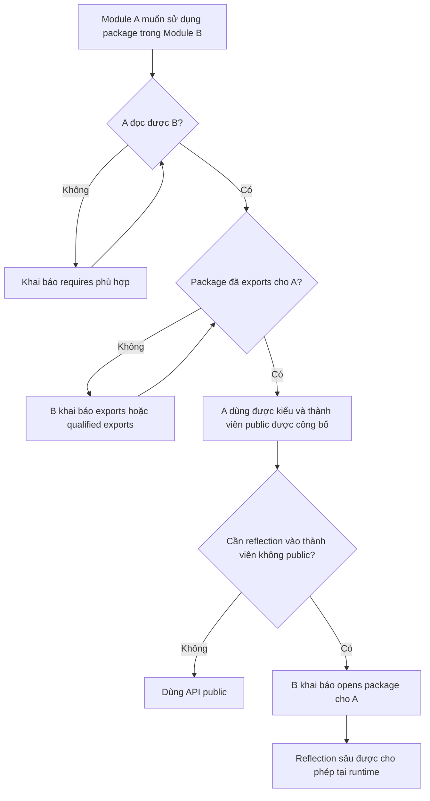

# Readability, exports và opens trong Java Platform Module System

> **Chương:** Đóng gói JDK  
> **Học phần:** `JAVA_VERSION_JAVA16` — khám phá các thay đổi của nền tảng Java vẫn hữu ích trong Java hiện đại. Bài này giải thích cách Java Platform Module System (JPMS) kiểm soát quan hệ phụ thuộc, quyền truy cập package và reflection thông qua `requires`, `exports` và `opens`, đồng thời áp dụng các quy tắc đóng gói mạnh của JDK hiện nay.

## Mục tiêu học tập

Sau bài này, bạn có thể:

- Phân biệt readability của module với quyền truy cập package.
- Khai báo `requires`, `requires transitive` và `requires static` đúng mục đích.
- Dùng `exports` để công bố API công khai cho module khác.
- Dùng qualified exports để giới hạn module được phép truy cập package.
- Dùng `opens` và qualified opens cho reflection lúc runtime.
- Phân biệt `exports`, `opens` và `open module`.
- Chẩn đoán lỗi `InaccessibleObjectException` và xử lý bằng module descriptor.
- Hiểu vai trò giới hạn của `--add-exports` và `--add-opens` trong quá trình chuyển đổi.
- Tránh phụ thuộc vào JDK internals và các tùy chọn đã lỗi thời.

## 1. Vì sao JPMS cần readability, exports và opens?

Java Platform Module System được giới thiệu trong Java 9 để tổ chức ứng dụng và JDK thành các module có ranh giới rõ ràng. Mỗi module có thể khai báo:

- Nó phụ thuộc vào module nào.
- Package nào được công bố cho module khác.
- Package nào cho phép framework hoặc thư viện truy cập sâu bằng reflection.

Ba khái niệm thường bị nhầm lẫn:

1. **Readability:** module hiện tại có đọc được module khác trong đồ thị phụ thuộc hay không.
2. **Exports:** package có được công bố để module đọc nó sử dụng các kiểu và thành viên public hay không.
3. **Opens:** package có cho phép truy cập sâu bằng reflection tại runtime hay không.

Một module có thể đọc được module khác nhưng vẫn không truy cập được một package chưa được export. Tương tự, package được export không có nghĩa các trường private được mở cho deep reflection.

JPMS tách các quyền này để module có thể công bố API cần thiết, giữ phần triển khai nội bộ được đóng gói và chỉ mở reflection ở những package thật sự cần.

## 2. Mô hình ba lớp: readability, exports và opens

Có thể hình dung quy trình truy cập giữa hai module như sau:



Các bước này trả lời những câu hỏi khác nhau:

- `requires` thiết lập quan hệ đọc module.
- `exports` công bố package cho truy cập Java thông thường.
- `opens` cho phép framework hoặc mã reflection truy cập sâu vào package tại runtime.

Không thể dùng `requires` để thay thế `exports`, cũng không thể dùng `exports` để thay thế `opens`.

## 3. Readability: requires khai báo module phụ thuộc

Một module có tên được khai báo trong `module-info.java`. Chỉ thị `requires` cho biết module hiện tại phụ thuộc và cần đọc module khác.

Ví dụ:

```java
module com.example.billing {
    requires java.sql;
    requires com.example.customer;
}
```

Module `com.example.billing` đọc được `java.sql` và `com.example.customer` theo đồ thị module. Vì vậy, mã trong billing có thể tham chiếu các kiểu public thuộc package mà các module đó export cho billing.

`java.base` được mọi module tự động đọc; không cần khai báo `requires java.base`.

Readability không tự động mở toàn bộ package của module phụ thuộc. Nếu module billing đọc được module customer nhưng package chứa API chưa được export, mã billing vẫn không thể import và sử dụng API trong package đó.

### 3.1. requires transitive

Dùng `requires transitive` khi API public của module hiện tại để lộ kiểu thuộc một module phụ thuộc và module sử dụng API đó cũng cần đọc module phụ thuộc.

Ví dụ:

```java
module com.example.customer.api {
    requires transitive com.example.shared.types;
    exports com.example.customer.api;
}
```

Giả sử public API của `com.example.customer.api` trả về `CustomerId` thuộc module `com.example.shared.types`, và package chứa `CustomerId` được module shared types export. Module ứng dụng chỉ cần khai báo:

```java
module com.example.application {
    requires com.example.customer.api;
}
```

Vì quan hệ phụ thuộc được khai báo là transitive, module application cũng đọc được `com.example.shared.types`.

Không dùng `requires transitive` chỉ để làm cho dependency dễ dùng hơn. Chỉ dùng khi kiểu từ dependency thực sự xuất hiện trong API mà consumer cần truy cập. Nếu không, hãy dùng `requires` thông thường để tránh làm đồ thị readability lan rộng không cần thiết.

### 3.2. requires static

`requires static` khai báo dependency cần có khi biên dịch nhưng có thể không hiện diện ở runtime.

Ví dụ thường gặp là annotation hoặc kiểu chỉ dùng trong quá trình biên dịch:

```java
module com.example.domain {
    requires static com.example.annotations;
    exports com.example.domain.api;
}
```

Chỉ thị này không có nghĩa module có thể sử dụng dependency tùy ý khi dependency vắng mặt. Nếu đường chạy thực tế cần nạp hoặc gọi kiểu của module đó, module vẫn phải được cung cấp ở runtime.

Hãy dùng `requires static` cho dependency thực sự chỉ cần ở compile-time hoặc có điều kiện; đừng dùng nó để che giấu một dependency runtime bắt buộc.

## 4. Exports: công bố package cho module khác

Chỉ thị `exports` cho phép module khác đọc và sử dụng các kiểu public trong package được công bố.

Ví dụ:

```java
module com.example.customer {
    exports com.example.customer.api;
}
```

Trong package `com.example.customer.api`, một kiểu public có thể được consumer sử dụng:

```java
package com.example.customer.api;

public record CustomerView(
        String id,
        String displayName
) {}
```

Module consumer khai báo dependency:

```java
module com.example.report {
    requires com.example.customer;
}
```

Sau đó có thể import và dùng API:

```java
package com.example.report;

import com.example.customer.api.CustomerView;

public class CustomerReport {

    public String title(CustomerView customer) {
        return customer.displayName();
    }
}
```

`exports` không làm mọi thành viên trong package trở thành public. Quy tắc truy cập Java thông thường vẫn áp dụng: consumer sử dụng được các kiểu và thành viên mà ngôn ngữ cho phép truy cập, chẳng hạn kiểu public và public member của kiểu đó.

Các package khác của module customer vẫn được đóng gói nếu không export. Consumer không thể import một lớp implementation chỉ vì lớp đó có modifier `public` nhưng nằm trong package chưa được export.

## 5. Qualified exports: chỉ công bố cho module được chọn

Nếu API chỉ dành cho một số module cụ thể, dùng qualified exports:

```java
module com.example.customer {
    exports com.example.customer.api;
    exports com.example.customer.spi to com.example.billing,
            com.example.reporting;
}
```

Trong ví dụ:

- Mọi module đọc được `com.example.customer` có thể sử dụng package `com.example.customer.api`.
- Chỉ `com.example.billing` và `com.example.reporting` được sử dụng package `com.example.customer.spi` qua truy cập Java thông thường.
- Module khác không nhận quyền truy cập package SPI chỉ vì nó đọc được module customer.

Qualified exports giúp giữ API nội bộ giữa các module trong cùng một ứng dụng, đồng thời hạn chế việc vô tình biến package hỗ trợ thành API công khai cho toàn hệ sinh thái.

Nếu một package cần trở thành API ổn định cho nhiều consumer độc lập, hãy cân nhắc export không giới hạn và quản lý tương thích API rõ ràng.

## 6. Opens: cho phép deep reflection tại runtime

Một số framework cần truy cập trường hoặc constructor không public để thực hiện dependency injection, binding, serialization hoặc ánh xạ dữ liệu.

`opens` cho phép reflection sâu vào package tại runtime:

```java
module com.example.customer {
    exports com.example.customer.api;
    opens com.example.customer.model;
}
```

Chỉ thị trên mở package `com.example.customer.model` cho reflection từ các module khác. Nó không công bố package này như API Java thông thường để module khác import kiểu của nó khi biên dịch.

Ví dụ một entity có trường private:

```java
package com.example.customer.model;

public class CustomerEntity {

    private String internalCode;

    public CustomerEntity(String internalCode) {
        this.internalCode = internalCode;
    }
}
```

Một framework có thể lấy trường và yêu cầu quyền truy cập sâu:

```java
import java.lang.reflect.Field;

public class EntityInspector {

    public Object readInternalCode(Object entity)
            throws ReflectiveOperationException {

        Field field = entity.getClass()
                .getDeclaredField("internalCode");

        if (!field.trySetAccessible()) {
            throw new IllegalAccessException(
                    "Package is not open to this module"
            );
        }

        return field.get(entity);
    }
}
```

Để chỉ mở cho framework cụ thể, dùng qualified opens thay vì mở package cho mọi module.

## 7. Qualified opens: giới hạn module được reflection truy cập

Ví dụ module domain chỉ mở package model cho module persistence:

```java
module com.example.customer {
    exports com.example.customer.api;

    opens com.example.customer.model
            to com.example.persistence;
}
```

Module `com.example.persistence` có thể thực hiện deep reflection trong package model tại runtime. Module khác không nhận quyền này.

Qualified opens thường phù hợp khi:

- Chỉ một framework hoặc module mapper cần truy cập field private.
- Các package khác của module vẫn cần đóng gói.
- Muốn giảm phạm vi truy cập reflection.
- Ứng dụng có nhiều module và cần thể hiện rõ quan hệ tin cậy.

Tên module ở vế `to` phải khớp tên module thực tế của thư viện hoặc framework. Khi dùng thư viện bên thứ ba, kiểm tra tên module được khai báo hoặc tên automatic module mà thư viện cung cấp.

## 8. Phân biệt exports và opens

| Đặc điểm | `exports` | `opens` |
| --- | --- | --- |
| Mục đích | Công bố API cho truy cập Java thông thường | Cho phép deep reflection tại runtime |
| Thời điểm | Compile-time và runtime | Runtime |
| Import kiểu từ package | Có thể, nếu module đọc được module nguồn và kiểu được phép truy cập | Không tạo quyền import package lúc biên dịch |
| Truy cập public API | Có | Không thay thế exports |
| Reflection vào private member | Không tự cấp quyền | Có thể, trong phạm vi package được mở |
| Có thể giới hạn module nhận quyền | Có, bằng qualified exports | Có, bằng qualified opens |

Hai chỉ thị này giải quyết hai nhu cầu khác nhau. Một package có thể vừa export vừa open nếu thiết kế thật sự cần cả API công khai và deep reflection. Tuy nhiên, không nên mở rộng quyền chỉ để làm framework ngừng báo lỗi mà chưa hiểu package nào cần thiết.

## 9. Open module: mở mọi package cho reflection

Java hỗ trợ khai báo module dạng `open module`:

```java
open module com.example.reflection.integration {
    requires com.example.framework;
    exports com.example.integration.api;
}
```

`open module` làm mọi package trong module được mở cho deep reflection tại runtime. Các package vẫn không tự động được export cho truy cập Java thông thường.

Dạng này có thể hữu ích với ứng dụng hoặc thư viện có thiết kế phụ thuộc reflection trên gần như toàn bộ package. Tuy nhiên, nó mở rộng phạm vi truy cập đáng kể.

Nếu chỉ một vài package cần framework truy cập sâu, hãy dùng qualified `opens` cho từng package. Module được khai báo bằng `open module` không khai báo thêm các chỉ thị `opens` riêng; chọn một cơ chế mở package phù hợp ngay trong module descriptor.

## 10. Ví dụ thiết kế module đầy đủ

Một ứng dụng có ba module:

- `com.example.customer`: cung cấp API domain.
- `com.example.persistence`: cần reflection vào model để ánh xạ dữ liệu.
- `com.example.report`: chỉ dùng API công khai.

Cấu trúc module descriptor của domain:

```java
module com.example.customer {
    exports com.example.customer.api;

    opens com.example.customer.model
            to com.example.persistence;
}
```

Module persistence:

```java
module com.example.persistence {
    requires com.example.customer;
}
```

Module report:

```java
module com.example.report {
    requires com.example.customer;
}
```

Kết quả:

- Cả persistence và report đều đọc được module customer.
- Cả hai đều sử dụng được package API đã export.
- Chỉ persistence được deep reflection vào package model.
- Report không thể import kiểu trong model nếu package đó chưa export.
- `requires` không tự mở package model cho reflection.

Cách tổ chức này giữ public contract nhỏ, trong khi vẫn cho phép framework persistence thực hiện công việc nội bộ cần thiết.

## 11. Reflection và lỗi InaccessibleObjectException

Khi một framework gọi `setAccessible(true)` trên thành viên không public của package chưa được mở, JVM có thể ném `InaccessibleObjectException`.

Thông báo thường cho biết module nguồn không mở package cho module gọi reflection.

Ví dụ tình huống:

```java
Field field = SomeJdkType.class.getDeclaredField("value");
field.setAccessible(true);
```

Nếu package chứa field không mở cho module của ứng dụng, lời gọi có thể thất bại. Đây là biểu hiện của encapsulation đang được thực thi, không phải lỗi cần tắt cơ chế bảo vệ toàn cục.

Với mã do ứng dụng sở hữu:

1. Xác định package thực sự cần reflection.
2. Xác định module gọi reflection.
3. Thêm qualified `opens package to caller.module;` vào module descriptor của module sở hữu package.
4. Chạy lại test tích hợp trên runtime mục tiêu.

Nếu package thuộc JDK, ứng dụng không thể sửa `module-info.java` của JDK. Hãy ưu tiên API công khai được hỗ trợ hoặc nâng cấp thư viện không còn dựa vào implementation nội bộ.

## 12. MethodHandles.privateLookupIn cũng chịu quy tắc module

Reflection không phải cơ chế duy nhất cần quyền truy cập sâu. `MethodHandles.privateLookupIn` cũng tuân theo ranh giới module.

Ví dụ:

```java
import java.lang.invoke.MethodHandles;
import java.lang.invoke.MethodHandles.Lookup;

Lookup privateLookup = MethodHandles.privateLookupIn(
        targetClass,
        MethodHandles.lookup()
);
```

Để thao tác này thành công giữa hai module khác nhau:

- Module gọi phải đọc module chứa `targetClass`.
- Package chứa class mục tiêu phải được mở cho module gọi.
- Lookup hiện tại phải có quyền phù hợp theo quy tắc `MethodHandles`.

Vì vậy, khi chuyển từ reflection sang method handles, không nên giả định có thể bỏ qua encapsulation của JPMS. Cả hai đều phải tuân theo quyền truy cập được module descriptor cho phép.

## 13. Module descriptor và cấu hình runtime

Các quyền `exports` và `opens` nên được khai báo ngay trong `module-info.java` của module sở hữu package.

Ví dụ:

```java
module com.example.application {
    requires com.example.customer;
    requires com.example.persistence;
}
```

Khi chạy ứng dụng modular, JVM xây dựng module graph từ module path và các chỉ thị trong descriptor.

Có thể dùng launcher option để xem quá trình phân giải module:

```bash
java --show-module-resolution \
     --module-path mods \
     --module com.example.application/com.example.Main
```

Thông tin này giúp kiểm tra module nào được tìm thấy và quan hệ phụ thuộc nào được giải quyết. Nếu module không được tìm thấy, hãy kiểm tra module path và tên module trước khi thay đổi quyền export hoặc open.

Không dùng `opens` để xử lý lỗi `ModuleNotFoundException`; đó là vấn đề phân giải module, khác với vấn đề truy cập package.

## 14. --add-exports và --add-opens là cầu nối chuyển đổi có giới hạn

Trong một số trường hợp, ứng dụng cần chạy tạm với dependency cũ trong khi chờ nâng cấp. Launcher có thể bổ sung quyền export hoặc open cho một package cụ thể.

Ví dụ `--add-exports`:

```bash
java --add-exports java.base/sun.nio.ch=ALL-UNNAMED \
     -jar application.jar
```

Tùy chọn này bổ sung quyền truy cập Java thông thường đến package được chỉ định cho module đích. Nó không cấp quyền deep reflection vào private member.

Ví dụ `--add-opens`:

```bash
java --add-opens java.base/java.lang=ALL-UNNAMED \
     -jar application.jar
```

Tùy chọn này mở package cho deep reflection lúc runtime. Nó không làm package trở thành API có thể import khi biên dịch.

`ALL-UNNAMED` chỉ các classpath code thuộc unnamed module. Nếu ứng dụng là named module, hãy chỉ rõ tên module đích thay vì dùng `ALL-UNNAMED`.

Một số giới hạn cần nhớ:

- `--add-exports` có thể dùng khi biên dịch và runtime.
- `--add-opens` là quyền mở cho reflection tại runtime; nó không thay thế export lúc biên dịch.
- Mỗi tùy chọn chỉ nên cấp cho đúng package và đúng module cần thiết.
- Không đưa các quyền rộng vào cấu hình production mà không đánh giá tác động đóng gói.
- Với module do ứng dụng sở hữu, ưu tiên chỉnh `module-info.java`.
- Với thư viện bên thứ ba, ưu tiên nâng cấp hoặc thay thế thư viện.

## 15. Không dựa vào --illegal-access trong Java hiện đại

`--illegal-access` từng là tùy chọn chuyển tiếp trong các bản Java đầu tiên có JPMS để hỗ trợ phát hiện và di chuyển khỏi một số truy cập nội bộ JDK.

Trong Java 17 trở lên, tùy chọn này đã obsolete và không còn mở rộng quyền truy cập như cách dùng trong giai đoạn chuyển tiếp. Không dùng `--illegal-access=permit` hoặc các biến thể của nó để khắc phục lỗi trên JDK hiện đại.

Java 16 đã đặt mặc định đóng gói mạnh hơn đối với nhiều API nội bộ của JDK; JEP 403 hoàn thiện việc đóng gói mạnh các internals trong Java 17. Các ứng dụng nên dùng API Java SE được hỗ trợ và xử lý rõ các package cần mở cho framework.

Nếu log vẫn hướng dẫn thêm `--illegal-access`, hãy kiểm tra thư viện phát ra thông báo và nâng cấp nó. Đừng coi hướng dẫn dành cho runtime cũ là giải pháp cho JDK hiện tại.

## 16. Đóng gói mạnh và JDK internals

Các package nội bộ như một số package `sun.*` hoặc `com.sun.*` không phải API Java SE ổn định. Tên class và hành vi của chúng có thể thay đổi giữa các phiên bản JDK.

Không nên:

- Import JDK internals chỉ vì chúng giải quyết được vấn đề nhanh.
- Dùng reflection để truy cập field hoặc method private của JDK.
- Duy trì danh sách `--add-opens` rộng để che lỗi của nhiều dependency.
- Giả định một package nội bộ vẫn tồn tại ở JDK kế tiếp.
- Tắt đóng gói mạnh chỉ để một framework cũ tiếp tục hoạt động.

Nên:

- Tìm API công khai trong Java SE thay thế.
- Nâng cấp framework và thư viện lên phiên bản hỗ trợ JPMS/JDK hiện tại.
- Nếu cần, thay dependency cũ bằng thư viện duy trì API công khai.
- Chỉ thêm qualified `opens` cho package của ứng dụng khi framework thật sự cần deep reflection.
- Kiểm tra dependency bằng công cụ `jdeps`.

## 17. Dùng jdeps để phát hiện phụ thuộc JDK internals

`jdeps` là công cụ phân tích dependency đi kèm JDK. Có thể dùng `--jdk-internals` để tìm các tham chiếu đến API nội bộ JDK trong artifact:

```bash
jdeps --jdk-internals application.jar
```

Kết quả giúp xác định class hoặc dependency nào đang tham chiếu JDK internals. Đây là bước rà soát tĩnh; nó không thay thế kiểm thử runtime vì reflection có thể tạo phụ thuộc mà phân tích bytecode không nhận diện đầy đủ.

Khi tìm thấy dependency có tham chiếu internals:

1. Xác định dependency trực tiếp hoặc gián tiếp tạo tham chiếu.
2. Kiểm tra phiên bản mới có dùng API công khai hay không.
3. Thay thế hoặc nâng cấp dependency.
4. Chạy test trên JDK mục tiêu.
5. Chỉ dùng `--add-exports`/`--add-opens` tạm thời nếu có lý do rõ ràng và phạm vi hẹp.

## 18. Quy trình chẩn đoán lỗi truy cập module

Khi ứng dụng báo lỗi module access, hãy xác định chính xác loại lỗi trước khi thay đổi cấu hình.

| Triệu chứng | Nguyên nhân thường gặp | Hướng xử lý |
| --- | --- | --- |
| `package ... is not visible` khi biên dịch | Module không đọc được dependency hoặc package chưa export | Kiểm tra `requires` và `exports` |
| `NoClassDefFoundError` hoặc `ClassNotFoundException` | Module hoặc dependency không có trong runtime path | Kiểm tra module path/classpath và module resolution |
| `IllegalAccessError` | Truy cập Java thông thường bị module boundary chặn tại runtime | Kiểm tra readability và package exports |
| `InaccessibleObjectException` | Deep reflection vào package chưa được mở | Thêm qualified `opens` nếu package thuộc ứng dụng; nâng cấp dependency nếu thuộc JDK |
| `trySetAccessible()` trả về `false` | Runtime không cho phép mở quyền truy cập sâu | Kiểm tra package có được mở cho caller module không |
| `IllegalAccessException` khi reflection | Caller không có quyền truy cập thành viên theo quy tắc Java hoặc module | Kiểm tra modifier, readability và package có được mở cho caller không |

Không dùng `opens` để sửa lỗi thiếu dependency. Không dùng `requires` để sửa lỗi deep reflection. Xác định đúng lớp quyền bị thiếu sẽ giúp module descriptor vẫn giữ được ranh giới đóng gói cần thiết.

## 19. Checklist thiết kế module

Trước khi công bố hoặc mở package, hãy kiểm tra:

- [ ] Module có khai báo đúng dependency bằng `requires` không?
- [ ] Có cần `requires transitive`, hay `requires` thông thường là đủ?
- [ ] Public API có chỉ nằm trong package cần export không?
- [ ] Package SPI có cần qualified exports không?
- [ ] Framework có thực sự cần deep reflection không?
- [ ] Có thể dùng qualified opens thay cho mở toàn module không?
- [ ] Package được mở có thuộc module ứng dụng hay thuộc JDK?
- [ ] Dependency có phiên bản hỗ trợ JDK hiện tại không?
- [ ] Có tham chiếu JDK internals cần thay thế không?
- [ ] Các module access test đã chạy trên JDK mục tiêu chưa?

Mỗi `exports` hoặc `opens` đều là một phần của hợp đồng module. Hãy cấp đúng quyền mà consumer cần, không mở rộng chỉ để tránh một thông báo lỗi.

## 20. Bài tập tự luyện

### Bài 1: Readability có đủ không?

Module `com.example.report` khai báo `requires com.example.customer`, nhưng compiler báo package `com.example.customer.internal` không visible. Nguyên nhân có thể là gì?

**Đáp án:** `requires` chỉ thiết lập readability. Package `internal` chưa được module customer export cho report. Nếu đó là API cần dùng, hãy thiết kế export phù hợp; nếu là implementation detail, report không nên phụ thuộc trực tiếp vào nó.

### Bài 2: Chọn exports hay opens?

Một thư viện cần import kiểu public trong package API. Nên dùng `exports` hay `opens`?

**Đáp án:** Dùng `exports`. `opens` chỉ cấp quyền deep reflection tại runtime, không làm package có thể import khi biên dịch.

### Bài 3: Framework cần đọc field private

Module persistence dùng reflection để đọc field private trong package model của module domain. Nên khai báo gì?

**Đáp án tham khảo:**

```java
module com.example.domain {
    exports com.example.domain.api;
    opens com.example.domain.model to com.example.persistence;
}
```

Module persistence cũng cần khai báo dependency phù hợp để sử dụng module domain.

### Bài 4: requires transitive có cần thiết không?

Module API public trả về kiểu `Money` từ module `com.example.money`. Consumer cần đọc cả hai module để biên dịch. Module API có thể khai báo `requires transitive com.example.money` không?

**Đáp án:** Có, nếu kiểu `Money` là một phần của API public và consumer cần đọc module money. Chỉ dùng khi dependency thực sự được phơi ra qua API.

### Bài 5: Xử lý lỗi trên JDK hiện đại

Một thư viện cũ yêu cầu chạy với `--illegal-access=permit` trên JDK 21. Nên làm gì?

**Đáp án:** Không dựa vào tùy chọn đó vì nó không còn mở quyền truy cập trên JDK hiện đại. Nâng cấp hoặc thay thư viện. Nếu cần mở package của module ứng dụng cho reflection, khai báo qualified `opens`; nếu phụ thuộc JDK internals, tìm API công khai thay thế.

## Ghi nhớ

Readability, exports và opens là ba lớp quyền khác nhau trong JPMS. `requires` xác định module có thể đọc dependency; `exports` công bố package cho truy cập Java thông thường; `opens` cho phép deep reflection tại runtime. Dùng qualified exports và qualified opens để giới hạn module nhận quyền. `open module` mở tất cả package cho reflection và nên được cân nhắc kỹ. Khi gặp `InaccessibleObjectException`, xác định module gọi và package đích trước khi sửa descriptor. Trên JDK hiện đại, tránh phụ thuộc JDK internals và không dùng `--illegal-access`; ưu tiên API công khai, nâng cấp dependency và chỉ dùng `--add-exports` hoặc `--add-opens` như cầu nối chuyển đổi có phạm vi hẹp.

## Tài liệu tham khảo

- [Java Language Specification — Java SE 26, Module Declarations](https://docs.oracle.com/javase/specs/jls/se26/html/jls-7.html#jls-7.7).
- [Java Platform Module System — JEP 261](https://openjdk.org/jeps/261).
- [JEP 396 — Strongly Encapsulate JDK Internals by Default](https://openjdk.org/jeps/396).
- [JEP 403 — Strongly Encapsulate JDK Internals](https://openjdk.org/jeps/403).
- [Java API — Module](https://docs.oracle.com/en/java/javase/26/docs/api/java.base/java/lang/Module.html).
- [Java API — AccessibleObject](https://docs.oracle.com/en/java/javase/26/docs/api/java.base/java/lang/reflect/AccessibleObject.html).
- [Java API — MethodHandles.privateLookupIn](https://docs.oracle.com/en/java/javase/26/docs/api/java.base/java/lang/invoke/MethodHandles.html#privateLookupIn(java.lang.Class,java.lang.invoke.MethodHandles.Lookup)).
- [JDK Tools — jdeps](https://docs.oracle.com/en/java/javase/26/docs/specs/man/jdeps.html).
