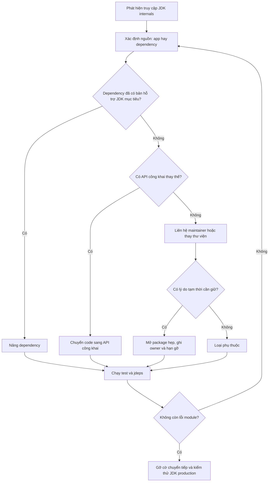

# Ưu tiên nâng thư viện và chuyển sang API công khai được hỗ trợ

> **Chương:** Đóng gói JDK  
> **Phạm vi:** Lập kế hoạch loại bỏ phụ thuộc vào package và lớp nội bộ của JDK khi ứng dụng chạy trên Java 16 trở lên. Bài tập trung vào cách đánh giá và nâng cấp thư viện trước, chọn API công khai thay thế, xử lý reflection có chủ đích và gỡ các cờ tương thích sau khi migration hoàn tất.

## Mục tiêu học tập

Sau bài này, bạn có thể:

1. Xác định phụ thuộc nội bộ đến từ mã ứng dụng hay thư viện bên thứ ba.
2. Ưu tiên nâng cấp thư viện trước khi tự mở package của JDK.
3. Chọn API Java SE hoặc API JDK được tài liệu hóa phù hợp với từng nhu cầu.
4. Phân biệt API công khai, API JDK-specific và chi tiết triển khai nội bộ.
5. Xử lý reflection bằng extension point, SPI hoặc module descriptor của ứng dụng.
6. Quản lý `--add-exports` và `--add-opens` như biện pháp chuyển tiếp có thời hạn.
7. Xác minh migration bằng phân tích tĩnh, integration test và kiểm thử trên JDK mục tiêu.

## 1. Vì sao nên nâng thư viện trước?

Khi ứng dụng gặp lỗi strong encapsulation trên JDK 16 hoặc JDK mới hơn, nguyên nhân thường không chỉ nằm trong mã nguồn của ứng dụng. Một framework, thư viện serialization, ORM, dependency injection, mocking hoặc bytecode instrumentation có thể truy cập package nội bộ thay mặt ứng dụng.

Nếu ứng dụng tự thêm nhiều cờ `--add-opens` hoặc `--add-exports`, vấn đề ban đầu có thể tạm biến mất nhưng dependency vẫn phụ thuộc vào chi tiết triển khai JDK. Điều đó làm tăng chi phí nâng cấp và mở rộng bề mặt truy cập của tiến trình.

Thứ tự xử lý nên là:

1. Xác định chính xác thư viện và package gây truy cập.
2. Kiểm tra phiên bản thư viện có hỗ trợ JDK mục tiêu hay chưa.
3. Nâng cấp hoặc thay thư viện bằng phiên bản dùng API công khai.
4. Chỉ mở package cụ thể nếu còn một phụ thuộc chưa thể thay thế ngay và có kế hoạch gỡ.
5. Chạy lại kiểm thử trên runtime production dự kiến.

Nâng cấp dependency thường giải quyết được cả vấn đề tương thích lẫn lỗi đã biết trong thư viện. Nó cũng giúp ứng dụng tránh tự duy trì các workaround phụ thuộc vào tên trường, method hoặc package nội bộ.

## 2. Phân loại nguồn phụ thuộc nội bộ

Trước khi sửa, cần biết ai đang thực hiện truy cập.

| Nguồn | Ví dụ | Hướng xử lý đầu tiên |
| --- | --- | --- |
| Mã ứng dụng | Import `sun.*`, `jdk.internal.*` hoặc `com.sun.*` không được tài liệu hóa | Thay bằng API công khai phù hợp |
| Framework | Framework dùng reflection vào private field của JDK | Nâng framework và đọc hướng dẫn tương thích module |
| Thư viện bắc cầu | Một dependency nhỏ cũ được framework kéo vào | Nâng dependency trực tiếp hoặc dependency quản lý |
| Plugin/agent | Agent instrumentation truy cập class loader hoặc compiler internals | Nâng agent, kiểm tra phiên bản tương thích JDK |
| Mã sinh động | Reflection theo tên class lấy từ cấu hình | Tìm trong cấu hình, plugin và test runtime |
| Native code | JNI hoặc thư viện native phụ thuộc cấu trúc JVM nội bộ | Cập nhật native library theo giao diện được hỗ trợ |

Không nên chỉ tìm chuỗi `sun.` trong source code rồi kết luận đã rà soát xong. Tên lớp nội bộ có thể nằm trong dependency JAR, cấu hình, service provider hoặc được tạo trong runtime.

## 3. Lập danh sách phụ thuộc trước khi thay đổi

### Phân tích bytecode bằng jdeps

`jdeps --jdk-internals` tìm tham chiếu tĩnh tới API nội bộ trong class và JAR:

```bash
jdeps --jdk-internals --recursive --class-path "lib/*" app.jar
```

Với multi-release JAR, chọn phiên bản bytecode cần kiểm tra:

```bash
jdeps --multi-release 17 --jdk-internals --recursive app.jar
```

Chạy công cụ trên artifact triển khai thực tế và các dependency runtime. Lưu kết quả làm baseline để theo dõi tiến triển.

`jdeps` không thể chứng minh ứng dụng không còn truy cập nội bộ. Reflection theo tên chuỗi, class được nạp động, bytecode sinh trong runtime và native code cần được kiểm tra bằng cách khác.

### Kiểm tra dependency graph

Với Maven:

```bash
mvn dependency:tree
```

Với Gradle:

```bash
./gradlew dependencies
```

Nếu đã biết một thư viện cụ thể:

```bash
./gradlew dependencyInsight --dependency library-name --configuration runtimeClasspath
```

Mục tiêu là xác định phiên bản thực tế được đóng gói, dependency nào kéo nó vào và có thể nâng cấp mà không phá vỡ tương thích hay không. Không chỉ nâng một thư viện trong file khai báo mà bỏ qua dependency mediation khiến runtime vẫn dùng phiên bản cũ.

### Tìm truy cập reflection trong mã nguồn

Rà soát những điểm sau trong mã ứng dụng và cấu hình:

- `setAccessible(true)` và `trySetAccessible()`.
- `getDeclaredField()`, `getDeclaredMethod()` và `getDeclaredConstructor()`.
- `MethodHandles.privateLookupIn()`.
- `Class.forName()` với tên lớp lấy từ cấu hình.
- Framework tự quét private field hoặc constructor.
- Agent, plugin và thư viện sinh bytecode.

Reflection không mặc nhiên là sai. Cần xác định package đích có phải API công khai và module có mở package cho module gọi theo đúng thiết kế hay không.

## 4. Chọn API công khai thay thế

Ưu tiên API thuộc Java SE được mô tả trong tài liệu chính thức. API này có hợp đồng tương thích rõ hơn so với package nội bộ.

| Nhu cầu thường gặp | Hướng thay thế được hỗ trợ |
| --- | --- |
| Mã hóa/giải mã Base64 | `java.util.Base64` |
| Dọn tài nguyên khi object không còn được tham chiếu | `java.lang.ref.Cleaner` hoặc cơ chế `AutoCloseable`/try-with-resources phù hợp |
| Truy cập biến và thao tác atomic ở mức thấp | `VarHandle` hoặc các lớp `java.util.concurrent.atomic` |
| Đọc/ghi dữ liệu nhị phân | `ByteBuffer`, `ReadableByteChannel`, `WritableByteChannel` |
| Quản lý vùng nhớ native | Foreign Function & Memory API trong JDK 22 trở lên, khi phù hợp |
| Phân tích hoặc tạo XML | JAXP: `javax.xml.parsers`, `javax.xml.transform`, `javax.xml.validation` |
| Lấy thời gian, múi giờ và định dạng | `java.time` và `java.time.format` |
| Nạp dịch vụ mở rộng | `ServiceLoader` và Service Provider Interface |
| Biên dịch mã Java trong ứng dụng | `javax.tools.JavaCompiler` và `javax.lang.model` |
| Mã hóa, chữ ký và quản lý khóa | JCA/JCE, `KeyStore`, `Signature`, `Cipher` |

Bảng này là điểm bắt đầu để chọn API, không phải ánh xạ một-một cho mọi cách dùng nội bộ. Cần đối chiếu yêu cầu thực tế, semantics và phiên bản JDK mục tiêu trước khi thay.

### Ví dụ: Base64

Nếu mã cũ dùng encoder nội bộ của JDK, chuyển sang `java.util.Base64`:

```java
import java.nio.charset.StandardCharsets;
import java.util.Base64;

String original = "Java module migration";
String encoded = Base64.getEncoder().encodeToString(
        original.getBytes(StandardCharsets.UTF_8)
);

byte[] decoded = Base64.getDecoder().decode(encoded);
String restored = new String(decoded, StandardCharsets.UTF_8);
```

`java.util.Base64` là API Java SE từ Java 8. Nó có encoder/decoder cho Basic, URL-safe và MIME mà không cần truy cập lớp nội bộ.

### Ví dụ: Cleaner và quản lý tài nguyên

Nếu một lớp cần giải phóng tài nguyên native khi đối tượng bị thu gom, `java.lang.ref.Cleaner` là API công khai phù hợp trong các trường hợp cần cleanup dự phòng:

```java
import java.lang.ref.Cleaner;

final class NativeHandle implements AutoCloseable {
    private static final Cleaner CLEANER = Cleaner.create();

    private static final class State implements Runnable {
        private long handle;

        State(long handle) {
            this.handle = handle;
        }

        @Override
        public void run() {
            if (handle != 0) {
                releaseNative(handle);
                handle = 0;
            }
        }
    }

    private final State state;
    private final Cleaner.Cleanable cleanable;

    NativeHandle(long handle) {
        this.state = new State(handle);
        this.cleanable = CLEANER.register(this, state);
    }

    @Override
    public void close() {
        cleanable.clean();
    }

    private static void releaseNative(long handle) {
        // Gọi hàm giải phóng native phù hợp với thư viện của ứng dụng.
    }
}
```

Ví dụ minh họa cấu trúc, không phải một triển khai native resource hoàn chỉnh. Tác vụ cleanup không nên giữ tham chiếu mạnh tới đối tượng được đăng ký, nếu không Cleaner không thể nhận biết đối tượng đã đủ điều kiện thu gom.

Nếu tài nguyên có thể đóng một cách xác định, ưu tiên `AutoCloseable` và try-with-resources. Cleaner chỉ là cơ chế dự phòng; không dùng nó thay cho việc đóng tài nguyên đúng lúc.

### Ví dụ: VarHandle thay cho truy cập field bằng Unsafe

Khi cần thao tác biến có semantics bộ nhớ rõ ràng, đánh giá `VarHandle`:

```java
import java.lang.invoke.MethodHandles;
import java.lang.invoke.VarHandle;

final class Counter {
    private volatile int value;

    private static final VarHandle VALUE;

    static {
        try {
            VALUE = MethodHandles.lookup()
                    .findVarHandle(Counter.class, "value", int.class);
        } catch (ReflectiveOperationException e) {
            throw new ExceptionInInitializerError(e);
        }
    }

    int incrementAndGet() {
        return (int) VALUE.getAndAdd(this, 1) + 1;
    }
}
```

`VarHandle` là API công khai từ Java 9. Nó cung cấp các chế độ truy cập và atomic operation có semantics được mô tả rõ. Chọn đúng chế độ truy cập theo yêu cầu đồng bộ; không thay máy móc mọi thao tác Unsafe bằng một lệnh VarHandle bất kỳ.

Nếu chỉ cần counter hoặc atomic reference thông thường, `AtomicInteger`, `AtomicLong` hoặc `AtomicReference` thường đơn giản và dễ bảo trì hơn.

### Ví dụ: ByteBuffer cho dữ liệu nhị phân

Không cần truy cập buffer nội bộ của JDK để thao tác byte:

```java
import java.nio.ByteBuffer;
import java.nio.ByteOrder;

ByteBuffer buffer = ByteBuffer.allocate(8)
        .order(ByteOrder.BIG_ENDIAN);

buffer.putInt(42);
buffer.putInt(2026);
buffer.flip();

int id = buffer.getInt();
int year = buffer.getInt();
```

`ByteBuffer` và các channel chuẩn là lựa chọn công khai cho thao tác dữ liệu nhị phân và I/O. Chú ý position/limit, byte order, quyền truy cập và vòng đời buffer.

### Ví dụ: XML bằng JAXP

Thay vì import parser nội bộ của JDK, dùng API JAXP:

```java
import javax.xml.parsers.DocumentBuilder;
import javax.xml.parsers.DocumentBuilderFactory;

DocumentBuilderFactory factory = DocumentBuilderFactory.newInstance();
DocumentBuilder builder = factory.newDocumentBuilder();
```

JAXP hỗ trợ provider và cấu hình chuẩn. Với XML không tin cậy, cần cấu hình bảo mật phù hợp như hạn chế external entities và external DTD theo yêu cầu của ứng dụng; chuyển sang API công khai không tự động làm dữ liệu đầu vào an toàn.

## 5. Phân biệt Java SE API và API riêng của JDK

Không phải mọi API được tài liệu hóa trong JDK đều thuộc Java SE Platform Specification. Một số API thuộc module JDK-specific có thể được tài liệu hóa và export nhưng không được mọi implementation Java SE cung cấp.

| Loại API | Đặc điểm | Cách lựa chọn |
| --- | --- | --- |
| Java SE API | Được mô tả trong Java SE API Specification | Ưu tiên cho thư viện dùng trên nhiều JDK |
| API JDK-specific được tài liệu hóa | Có tài liệu và package export trong một JDK/vendor cụ thể | Chỉ dùng khi ứng dụng khóa nhà cung cấp hoặc chấp nhận phụ thuộc đó |
| API nội bộ | Không phải API được hỗ trợ; có thể bị đóng gói hoặc thay đổi | Không dùng trong code mới; lập kế hoạch loại bỏ nếu đang phụ thuộc |

Ví dụ, `java.lang.management` là API Java SE. Một số phần mở rộng quản trị trong module `jdk.management` có thể hữu ích nhưng cần xem chính sách hỗ trợ và tính di động của runtime mục tiêu.

Đừng suy luận rằng một package ổn định chỉ vì nó có tên `com.sun.*`, nằm trong JDK hoặc được export trong một bản runtime. Kiểm tra Javadoc, module descriptor và cam kết của nhà cung cấp.

## 6. Framework cần reflection: dùng extension point trước

Nhiều framework dùng reflection để ánh xạ object, tạo proxy, inject dependency hoặc serialize dữ liệu. Khi nâng JDK, lỗi có thể đến từ việc framework truy cập private member của chính JDK, hoặc truy cập package của ứng dụng chưa được mở.

Hai trường hợp cần xử lý khác nhau:

1. Framework truy cập private field của một lớp JDK: nâng framework để dùng API được hỗ trợ; nếu chưa thể thay ngay, đánh giá một `--add-opens` cụ thể làm cầu nối.
2. Framework truy cập package model do ứng dụng sở hữu: dùng `opens package to framework.module` trong `module-info.java` nếu kiến trúc modular yêu cầu deep reflection.

### Ưu tiên constructor, accessor và annotation công khai

Nếu framework hỗ trợ constructor binding, record hoặc accessor, hãy dùng extension point đó thay vì buộc framework truy cập private field. Với ứng dụng mới, thiết kế DTO và model theo hợp đồng framework công khai.

Ví dụ module ứng dụng:

```java
module com.example.billing {
    exports com.example.billing.api;
    opens com.example.billing.dto to com.example.json;
}
```

Ở đây API public được export cho module gọi; DTO chỉ được mở cho module serialization cụ thể. Không cần mở toàn bộ module.

### ServiceLoader cho plugin

Nếu ứng dụng đang tìm class plugin bằng tên và tự truy cập constructor nội bộ, cân nhắc `ServiceLoader`:

```java
import java.util.ServiceLoader;

ServiceLoader<PaymentProvider> providers =
        ServiceLoader.load(PaymentProvider.class);

for (PaymentProvider provider : providers) {
    System.out.println(provider.name());
}
```

Với named module, khai báo `uses` và `provides` trong module descriptor. SPI tạo extension point có hợp đồng rõ ràng, giúp ứng dụng không cần truy cập class loader hoặc cấu trúc nội bộ của framework.

## 7. Xử lý tạm thời bằng --add-opens hoặc --add-exports

Sau khi đã xác định dependency chưa thể nâng cấp ngay, có thể cần một quyền truy cập cụ thể để giữ dịch vụ hoạt động trong giai đoạn migration.

### Chọn đúng loại quyền

| Nhu cầu của dependency | Cơ chế cần đánh giá |
| --- | --- |
| Gọi public type trong package chưa export | `--add-exports` |
| Deep reflection vào private field/method/constructor | `--add-opens` |
| Mở package của chính ứng dụng cho framework | `opens` trong `module-info.java` |
| Dùng public API đã được export sẵn | Không cần thêm cờ |

Ví dụ một framework trên classpath cần deep reflection vào package của JDK:

```bash
java --add-opens java.base/java.lang=ALL-UNNAMED -jar application.jar
```

Đây là quyền khá rộng vì `ALL-UNNAMED` áp dụng cho mọi unnamed module trong tiến trình. Nếu framework chạy trong named module, chỉ định module đích cụ thể.

### Ghi nhận lý do và thời hạn

Mỗi cờ chuyển tiếp nên có hồ sơ:

- Tên dependency và phiên bản đang cần quyền.
- Module nguồn và package được mở/export.
- Module đích được cấp quyền.
- Lỗi tái hiện khi bỏ cờ.
- Phiên bản thư viện dự kiến thay thế.
- Người chịu trách nhiệm và mốc gỡ cờ.

Không thêm hàng loạt package vào lệnh khởi chạy chỉ để làm mất cảnh báo. Không dùng `--illegal-access` trên JDK 17 trở lên; tùy chọn này không còn mở lại quyền truy cập.

## 8. Quy trình nâng cấp thư viện có kiểm soát

### Bước 1: Chốt runtime mục tiêu

Ghi rõ JDK vendor, version, module path/classpath, cách đóng gói và các JVM option. Kiểm tra runtime thật trong container hoặc service, không chỉ JDK dùng để compile.

### Bước 2: Chụp dependency graph

Lưu báo cáo dependency tree và kết quả `jdeps --jdk-internals`. Phân loại từng tham chiếu theo module, package và dependency sở hữu.

### Bước 3: Đọc ma trận tương thích của thư viện

Kiểm tra tài liệu phát hành của framework, ORM, JSON/XML mapper, agent, mocking library và plugin. Chọn phiên bản có tuyên bố hỗ trợ JDK mục tiêu.

### Bước 4: Nâng từng nhóm dependency

Nâng theo nhóm có quan hệ gần nhau, chẳng hạn framework nền tảng trước plugin mở rộng. Sau mỗi nhóm:

- Build lại artifact.
- Chạy unit test.
- Chạy integration test.
- Kiểm tra log cảnh báo truy cập module.
- Chạy lại `jdeps`.

Không nâng hàng loạt thư viện không liên quan nếu điều đó khiến khó xác định nguồn regression.

### Bước 5: Thay code nội bộ

Dùng API Java SE hoặc extension point được hỗ trợ. Viết test cho semantics cần giữ lại, không chỉ test rằng chương trình không còn ném exception.

### Bước 6: Giảm dần cờ mở

Gỡ từng `--add-opens` và `--add-exports`, sau đó chạy test tương ứng. Nếu lỗi quay lại, xác định dependency chưa được xử lý thay vì thêm lại cờ rộng hơn.

### Bước 7: Xác minh trên JDK production

Chạy smoke test, startup test, integration test và test đóng gói trên đúng JDK/vendor sẽ triển khai. Kiểm tra không còn `--illegal-access` và không có cờ mở không được giải thích.

## 9. Kiểm thử sau khi thay thư viện hoặc API

Một dependency mới có thể biên dịch thành công nhưng thay đổi hành vi ở runtime. Chọn test theo vai trò của thư viện.

| Khu vực | Kiểm thử nên có |
| --- | --- |
| ORM và persistence | Mapping entity, lazy loading, transaction, migration schema |
| Serialization | Format tương thích, constructor binding, dữ liệu cũ |
| Dependency injection | Constructor/field injection, proxy, lifecycle |
| Logging | Khởi tạo provider, cấu hình và output |
| Bytecode agent | Instrumentation, class loading và startup |
| Reflection/module | Classpath và module path đúng với production |
| I/O và native | Đóng tài nguyên, partial I/O, quyền native và lỗi hệ điều hành |

### Kiểm tra không còn truy cập nội bộ tĩnh

Chạy lại:

```bash
jdeps --jdk-internals --recursive --class-path "lib/*" app.jar
```

Mục tiêu là không còn tham chiếu nội bộ chưa được chấp nhận. Nếu báo cáo còn tham chiếu, ghi rõ dependency, phiên bản và lý do tồn tại; không bỏ qua kết quả chỉ vì test hiện tại chạy qua.

### Kiểm tra hành vi reflection động

`jdeps` không phát hiện đầy đủ reflection động. Chạy integration test cho các đường code sử dụng:

- `trySetAccessible()` hoặc `setAccessible()`.
- `MethodHandles.privateLookupIn()`.
- Tên lớp lấy từ cấu hình hoặc plugin.
- Framework scan private field/constructor.
- Agent và thư viện sinh bytecode.

Giữ log cảnh báo JVM trong CI để phát hiện truy cập bất hợp pháp còn sót lại.

## 10. Tránh thay thế nội bộ bằng một phụ thuộc không ổn định khác

Một số thư viện có thể cung cấp wrapper quanh JDK internals. Wrapper không tự động biến phần triển khai bên dưới thành API được hỗ trợ.

Trước khi chọn giải pháp thay thế, hãy kiểm tra:

1. API có được tài liệu hóa và có cam kết tương thích không?
2. API có thuộc Java SE hay phụ thuộc một JDK/vendor cụ thể?
3. Dự án có chính sách hỗ trợ phiên bản JDK phù hợp không?
4. API có yêu cầu mở module hoặc native access không?
5. Thư viện có duy trì test trên các JDK mục tiêu không?
6. Có thể dùng API tiêu chuẩn đơn giản hơn không?

Ví dụ, nếu nhu cầu chỉ là đọc/ghi byte, không cần thêm một thư viện low-level chỉ để truy cập buffer nội bộ. Nếu cần gọi native function, hãy đánh giá Foreign Function & Memory API đã hoàn thiện từ JDK 22 thay vì tự dựa vào cấu trúc JVM không công khai.

## 11. Sơ đồ quyết định



## 12. Những lỗi thường gặp

| Hiện tượng | Nguyên nhân | Cách xử lý |
| --- | --- | --- |
| Thêm `--add-opens` nhưng lỗi vẫn còn | Cần export cho truy cập trực tiếp, hoặc mở sai package/module đích | Phân loại direct access và deep reflection |
| Nâng framework nhưng runtime vẫn nạp bản cũ | Dependency mediation hoặc plugin giữ phiên bản cũ | Kiểm tra dependency tree và artifact thực tế |
| `jdeps` không báo lỗi nhưng runtime vẫn lỗi reflection | Reflection theo tên chuỗi hoặc code sinh động | Chạy integration test và rà cấu hình |
| Dùng API JDK-specific nhưng build ở vendor khác thất bại | API không thuộc Java SE hoặc module không có | Chọn Java SE API hoặc khóa vendor có chủ đích |
| `Cleaner` không giải phóng tài nguyên đúng lúc | Trông chờ cleanup chạy ngay hoặc action giữ tham chiếu tới object | Dùng `close()`/try-with-resources; Cleaner chỉ là dự phòng |
| Thay Unsafe bằng VarHandle nhưng sai semantics | Chọn sai access mode hoặc memory ordering | Đọc hợp đồng VarHandle và test concurrency |
| Chuyển sang FFM nhưng lỗi native access | Chưa cấu hình native access theo yêu cầu của runtime | Đọc hướng dẫn FFM và chỉ cấp quyền cho module cần |
| Xóa toàn bộ cờ mở cùng lúc, khó tìm lỗi | Nhiều dependency chưa được xử lý độc lập | Gỡ từng cờ và chạy test theo nhóm |

## 13. Checklist trước khi hoàn tất migration

| Hạng mục | Câu hỏi cần xác nhận |
| --- | --- |
| Nguồn phụ thuộc | Đã xác định code ứng dụng, framework và dependency bắc cầu chưa? |
| Dependency graph | Đã kiểm tra phiên bản thực tế được đóng gói chưa? |
| Tương thích | Thư viện đã tuyên bố hỗ trợ JDK mục tiêu chưa? |
| API thay thế | Đã ưu tiên Java SE API hoặc extension point được hỗ trợ chưa? |
| JDK-specific | Nếu dùng API riêng của JDK, đã chấp nhận phụ thuộc vendor rõ ràng chưa? |
| Reflection | Có phân biệt truy cập package JDK với package ứng dụng không? |
| Module | Chỉ export/open đúng package và module đích chưa? |
| Cờ tạm thời | Mỗi `--add-opens`/`--add-exports` có owner và hạn gỡ chưa? |
| Static scan | `jdeps --jdk-internals` đã được chạy lại sau nâng cấp chưa? |
| Dynamic test | Framework, plugin và reflection paths đã được kiểm thử chưa? |
| Runtime | Đã chạy trên đúng JDK/vendor production chưa? |
| Cleanup | Đã loại `--illegal-access` và cờ chuyển tiếp không còn cần thiết chưa? |

## 14. Bài tập thực hành

### Bài 1 — Rà soát một dependency

Chọn một thư viện trong ứng dụng. Xác định phiên bản, JDK hỗ trợ, release note và các tham chiếu nội bộ nếu có. Đề xuất phiên bản nâng cấp.

### Bài 2 — Thay API nội bộ

Viết ví dụ mã hóa Base64 bằng API cũ trong một nhánh thử nghiệm, sau đó chuyển sang `java.util.Base64`. Viết test chứng minh dữ liệu encode/decode giữ nguyên.

### Bài 3 — Phân biệt exports và opens

Tạo một module ứng dụng có public API và DTO cần framework reflection. Export package API và mở riêng package DTO cho module framework. Thử bỏ từng directive để quan sát lỗi.

### Bài 4 — Dùng jdeps

Chạy `jdeps --jdk-internals` trên artifact và runtime dependencies. Phân loại kết quả theo ứng dụng, framework và thư viện bắc cầu.

### Bài 5 — Gỡ cờ chuyển tiếp

Chọn một `--add-opens` đang dùng. Xác định dependency sở hữu truy cập, nâng cấp dependency, chạy integration test và thử bỏ cờ. Ghi lại bằng chứng rằng cờ không còn cần thiết.

### Bài 6 — Lập kế hoạch migration

Viết bảng theo dõi gồm dependency, API nội bộ, API thay thế, test cần chạy, owner và điều kiện hoàn tất. Sắp xếp thứ tự nâng cấp để giảm rủi ro.

## Tài liệu chính thức

- [JEP 396 — Strongly Encapsulate JDK Internals by Default](https://openjdk.org/jeps/396) — mốc thay đổi mặc định trên Java 16.
- [JEP 403 — Strongly Encapsulate JDK Internals](https://openjdk.org/jeps/403) — strong encapsulation trên Java 17 trở lên.
- [Java SE 25 API Specification](https://docs.oracle.com/en/java/javase/25/docs/api/index.html) — tra cứu API công khai được hỗ trợ.
- [Java SE 25 — jdeps](https://docs.oracle.com/en/java/javase/25/docs/specs/man/jdeps.html) — phân tích phụ thuộc và `--jdk-internals`.
- [Java SE 25 — VarHandle](https://docs.oracle.com/en/java/javase/25/docs/api/java.base/java/lang/invoke/VarHandle.html) — truy cập biến với memory semantics được mô tả.
- [Java SE 25 — Cleaner](https://docs.oracle.com/en/java/javase/25/docs/api/java.base/java/lang/ref/Cleaner.html) — cleanup tài nguyên dự phòng.
- [Java SE 25 — Base64](https://docs.oracle.com/en/java/javase/25/docs/api/java.base/java/util/Base64.html) — API mã hóa Base64.
- [JEP 454 — Foreign Function & Memory API](https://openjdk.org/jeps/454) — API native memory và native function hoàn thiện từ JDK 22.

**Nguyên tắc áp dụng:** Nâng cấp thư viện trước, thay truy cập nội bộ bằng API công khai có hợp đồng ổn định và kiểm thử trên JDK mục tiêu. Chỉ dùng quyền mở module hẹp như cầu nối có owner và hạn gỡ; hoàn tất migration khi ứng dụng chạy được mà không phụ thuộc vào các cờ tương thích cũ.
