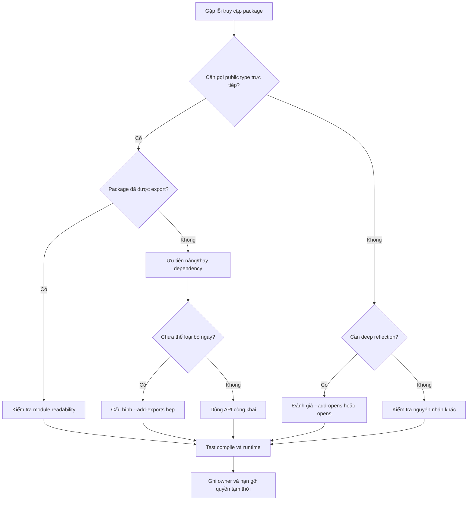

# Cấu hình --add-exports có phạm vi hẹp khi cần truy cập API bị đóng gói

> **Chương:** Đóng gói JDK  
> **Phạm vi:** Hiểu khi nào cần dùng --add-exports, cách xác định module nguồn, package và module đích, cách cấu hình ở bước biên dịch và runtime, cùng các giới hạn của quyền export. Đây là biện pháp tương thích có phạm vi hẹp cho trường hợp dependency chưa thể loại bỏ ngay; API nội bộ vẫn không trở thành hợp đồng ổn định của Java.

## Mục tiêu học tập

Sau bài này, bạn có thể:

1. Giải thích --add-exports làm thay đổi quyền truy cập nào trong hệ thống module.
2. Viết đúng cú pháp source.module/package=target.module.
3. Chỉ định module đích cụ thể thay vì mở cho toàn bộ unnamed modules khi có thể.
4. Cấu hình quyền export ở cả compile time và runtime khi cần.
5. Phân biệt --add-exports, --add-opens, exports và opens.
6. Nhận biết trường hợp cần --add-reads hoặc quyền khác.
7. Đánh giá rủi ro và đặt thời hạn gỡ cờ sau khi nâng dependency.

## 1. Vì sao package bị đóng gói?

Từ Java 9, JDK được tổ chức thành các module. Một module chỉ công khai các package mà nó export. Package không được export không thể được module khác sử dụng như API trực tiếp, kể cả khi class bên trong có modifier public.

Ví dụ, một class có thể được khai báo public nhưng nằm trong package không được module chứa nó export. Modifier public của class không tự vượt qua ranh giới module.

Java 16 đặt strong encapsulation làm mặc định theo JEP 396. Java 17 tiếp tục siết chặt theo JEP 403; tùy chọn --illegal-access không còn là cách mở lại quyền truy cập trên JDK 17 trở lên.

Trong một số tình huống chuyển tiếp, dependency cũ có thể cần gọi public type trong package mà module JDK không export. --add-exports cho phép bổ sung một export có mục tiêu cụ thể ở thời điểm chạy hoặc biên dịch.

Đây là quyền truy cập kỹ thuật. Nó không biến package nội bộ thành API Java SE được bảo đảm tương thích qua các phiên bản JDK.

## 2. --add-exports cấp quyền gì?

Cú pháp tổng quát:

```text
--add-exports source.module/package=target.module
```

Trong đó:

- source.module: module sở hữu package cần export.
- package: tên package đầy đủ, dùng dấu chấm và không có dấu / ở đầu.
- target.module: module được phép truy cập package đó.
- ALL-UNNAMED: đại diện cho tất cả unnamed modules, thường là các thư viện và ứng dụng chạy trên classpath.

Ví dụ cấu hình cho một thư viện trên classpath cần truy cập package sun.nio.ch trong java.base:

```bash
java --add-exports=java.base/sun.nio.ch=ALL-UNNAMED -jar app.jar
```

Đây là ví dụ về cú pháp cho một tình huống tương thích. sun.nio.ch là package triển khai nội bộ; việc export nó không tạo cam kết rằng các class hoặc hành vi trong đó sẽ được giữ nguyên ở JDK tương lai.

### Quyền được cấp có giới hạn

--add-exports cho phép module đích truy cập các type và member public trong package được chỉ định theo quy tắc truy cập Java. Nó không:

- Export tất cả package trong module nguồn.
- Cấp quyền truy cập vào package khác.
- Làm class hoặc member không public trở thành public.
- Cho phép deep reflection vào private field hoặc private method.
- Làm API nội bộ trở thành API Java SE ổn định.
- Tự động thay thế mọi yêu cầu về readability giữa các module.

Chỉ định chính xác một package và một module đích là phần quan trọng của cấu hình có phạm vi hẹp.

## 3. Xác định đúng module nguồn và package

Không đoán module chỉ từ tên class. Trước tiên cần xác định package và module sở hữu nó.

Có thể dùng:

- Thông báo lỗi biên dịch hoặc runtime để lấy tên module/package.
- Tài liệu API và module descriptor của JDK mục tiêu.
- jdeps để phân tích tham chiếu tĩnh trong bytecode.
- jar --describe-module để xem module descriptor của một JAR.
- Tài liệu của dependency để biết package nào nó cần truy cập.

Ví dụ lỗi có thể cho biết package sun.nio.ch thuộc module java.base nhưng không được export cho module gọi. Từ đó xác định dạng cấu hình cần đánh giá là:

```text
--add-exports java.base/sun.nio.ch=target.module
```

Không mở cả java.base chỉ vì một package bị chặn. Module java.base chứa rất nhiều API và package khác nhau; export một package cụ thể giới hạn phạm vi quyền hơn nhiều.

### Kiểm tra module của JAR

Với JAR có module descriptor:

```bash
jar --describe-module --file library.jar
```

Nếu JAR không có module descriptor tường minh, nó có thể được xử lý như automatic module trên module path hoặc unnamed module trên classpath, tùy cách ứng dụng khởi chạy.

Đừng nhầm tên artifact Maven/Gradle với tên module Java. Tên module có thể khác tên artifact.

## 4. Chọn module đích cụ thể

### Named module

Nếu ứng dụng chạy trên module path và module đích có tên com.example.app, có thể cấu hình:

```bash
java --add-exports=java.base/sun.nio.ch=com.example.app -m com.example.app/com.example.Main
```

Quyền chỉ được cấp cho module com.example.app. Các module khác trong tiến trình không tự động nhận quyền đó.

Nếu module đích có tên khác với package hoặc tên JAR, dùng đúng tên module được runtime nhận diện.

### Unnamed module

Nếu ứng dụng hoặc dependency chạy trên classpath, module đích là unnamed module. Khi đó dùng:

```bash
java --add-exports=java.base/sun.nio.ch=ALL-UNNAMED -cp "app.jar:lib/*" com.example.Main
```

ALL-UNNAMED áp dụng cho tất cả unnamed modules trong tiến trình, không chỉ một JAR. Nếu có thể chuyển dependency sang named module và chỉ định module đích cụ thể, phạm vi sẽ dễ kiểm soát hơn.

### Không dùng ALL-UNNAMED theo thói quen

Chỉ dùng ALL-UNNAMED khi dependency thực sự chạy trong unnamed module và không có cách chỉ định module đích hẹp hơn. Cờ này mở quyền cho toàn bộ code trên classpath trong tiến trình, kể cả thư viện không liên quan.

## 5. Cấu hình ở bước biên dịch

Nếu mã nguồn trực tiếp tham chiếu public type trong package chưa export, compiler cũng cần biết quyền export.

Ví dụ minh họa:

```bash
javac --add-exports=java.base/sun.nio.ch=ALL-UNNAMED -d out src/com/example/Main.java
```

Khi compile với named module, thay ALL-UNNAMED bằng tên module đích phù hợp:

```bash
javac --add-exports=java.base/sun.nio.ch=com.example.app --module-path mods -d out src/module-info.java src/com/example/Main.java
```

Cú pháp và tập nguồn thực tế phụ thuộc cấu trúc dự án. Nếu compiler báo module đích không đọc module nguồn, cần kiểm tra quan hệ readability và khai báo requires phù hợp; --add-exports chỉ giải quyết quyền export package, không nên được xem là cách thay thế toàn bộ module graph.

### Runtime cũng phải có quyền

Cấu hình ở bước biên dịch không tự động đảm bảo runtime có cùng quyền. Nếu bytecode vẫn truy cập package đó khi chạy, truyền tùy chọn tương ứng cho lệnh java:

```bash
java --add-exports=java.base/sun.nio.ch=ALL-UNNAMED -cp "out:lib/*" com.example.Main
```

Trong CI, hãy cấu hình cả compile job và test/runtime job. Nếu chỉ cấu hình compiler, chương trình có thể biên dịch thành công nhưng thất bại khi chạy.

## 6. Phân biệt exports với opens

Hai cơ chế giải quyết hai loại truy cập khác nhau.

| Cơ chế | Mục đích | Dùng khi |
| --- | --- | --- |
| exports trong module-info.java | Công khai package cho module khác gọi public API | Module do ứng dụng sở hữu |
| --add-exports | Bổ sung quyền truy cập public type/member của package cho module đích | Cần tương thích với package chưa export |
| opens trong module-info.java | Cho phép deep reflection vào package của module ứng dụng | Framework cần reflection vào DTO/entity của ứng dụng |
| --add-opens | Mở package tại runtime cho deep reflection | Framework cần truy cập member không public |

Ví dụ: code gọi trực tiếp một public class trong package chưa export là trường hợp cần xem xét --add-exports. Framework dùng reflection để gọi setAccessible trên private field là trường hợp cần xem xét --add-opens.

--add-exports không phải cách sửa lỗi InaccessibleObjectException khi nguyên nhân là deep reflection. Ngược lại, --add-opens không làm cho code nguồn có thể import và gọi trực tiếp một public type ở package chưa export tại compile time.

## 7. Không nhầm quyền export với quyền readability

Trong hệ thống module có hai câu hỏi riêng:

1. Module đích có đọc module nguồn không?
2. Module nguồn có export package cho module đích không?

--add-exports giải quyết câu hỏi thứ hai. Với named module, quan hệ readability thường được khai báo bằng requires trong module-info.java.

Ví dụ:

```java
module com.example.app {
    requires java.sql;
}
```

Nếu cần bổ sung readability tạm thời cho một module cụ thể trong quá trình chuyển đổi, có tùy chọn --add-reads. Chỉ dùng khi thông báo lỗi và module graph chứng minh đó là vấn đề; không thêm cờ này một cách máy móc cùng với --add-exports.

Trước khi cấu hình, phân loại chính xác lỗi: package chưa export, module chưa readable, hay cần deep reflection. Mỗi nguyên nhân có cơ chế giải quyết riêng.

## 8. Cấu hình trong script và môi trường triển khai

Đặt cờ tại nơi khởi chạy ứng dụng để có thể review cùng cấu hình deployment.

Ví dụ script Linux:

```bash
#!/usr/bin/env bash
exec java --add-exports=java.base/sun.nio.ch=com.example.app -m com.example.app/com.example.Main
```

Với container hoặc service manager, đặt cờ trong cấu hình command/entrypoint của đúng service. Tránh đặt cờ toàn cục cho mọi tiến trình Java trên máy vì những ứng dụng khác không nhất thiết cần quyền này.

Không dựa vào JAVA_TOOL_OPTIONS để cấp quyền rộng cho mọi tiến trình nếu chỉ một ứng dụng cần. Biến môi trường đó có thể ảnh hưởng cả công cụ build, agent hoặc tiến trình Java khác trong cùng môi trường.

## 9. Kiểm tra cấu hình có tác dụng đúng phạm vi

Sau khi thêm cờ, kiểm thử ba tình huống:

1. Dependency hoặc module cần truy cập hoạt động đúng.
2. Module không được chỉ định không nhận thêm quyền ngoài ý muốn.
3. Ứng dụng vẫn hoạt động khi bỏ cờ sau khi nâng dependency hoặc thay code.

Giữ log đầy đủ của lệnh khởi chạy. Với named module, xác minh tên module đích thực tế. Với classpath, nhớ rằng ALL-UNNAMED rộng hơn một thư viện đơn lẻ.

Không chỉ kiểm tra rằng lỗi đã biến mất. Cần xác nhận quyền đã được cấp cho đúng package và đúng target module.

## 10. Rủi ro khi dùng API nội bộ

--add-exports thay đổi quyền truy cập, không thay đổi cam kết tương thích của API.

Một package nội bộ có thể:

- Đổi tên class hoặc method.
- Thay đổi chữ ký và kiểu dữ liệu.
- Thay đổi semantics hoặc invariant.
- Chuyển sang package khác.
- Bị loại bỏ hoặc không còn được cung cấp ở runtime mới.

Vì vậy, cờ export nên được ghi nhận như một khoản nợ kỹ thuật. Mỗi cờ cần có dependency sở hữu, lý do, người phụ trách, phiên bản thay thế dự kiến và thời hạn review/gỡ.

Nếu ứng dụng mới cần một tính năng tương tự, hãy tìm API Java SE hoặc API được nhà cung cấp công bố hỗ trợ trước khi chọn package nội bộ.

## 11. Quy trình xử lý có kiểm soát

1. **Tái hiện lỗi:** giữ nguyên stack trace và lệnh khởi chạy thực tế.
2. **Xác định package:** lấy tên module nguồn và package từ lỗi hoặc phân tích bytecode.
3. **Xác định caller:** tìm module đích và dependency sở hữu lời gọi.
4. **Phân loại quyền:** direct access tới public type, deep reflection hay readability.
5. **Ưu tiên sửa dependency:** kiểm tra phiên bản đã hỗ trợ JDK mục tiêu.
6. **Nếu cần cầu nối:** thêm một --add-exports cho đúng package và module đích.
7. **Cấu hình cả compile/runtime:** khi code trực tiếp tham chiếu package đó.
8. **Kiểm thử:** chạy test trên đúng JDK/vendor và đúng cách đóng gói production.
9. **Lập kế hoạch gỡ:** nâng hoặc thay dependency, bỏ cờ và chạy lại test.
10. **Giữ kiểm soát trong CI:** rà soát cờ JVM và tham chiếu nội bộ sau mỗi lần nâng JDK.

### Sơ đồ lựa chọn



## 12. Những lỗi thường gặp

| Hiện tượng | Nguyên nhân | Cách xử lý |
| --- | --- | --- |
| Compiler vẫn báo package không được export | Chỉ thêm cờ ở runtime | Thêm quyền ở bước javac nếu source trực tiếp cần |
| Biên dịch thành công nhưng runtime lỗi | Runtime chưa nhận cờ tương ứng | Thêm cờ vào lệnh khởi chạy đúng service |
| --add-exports không sửa được InaccessibleObjectException | Framework cần deep reflection | Xem xét cập nhật framework hoặc mở package phù hợp bằng --add-opens |
| IllegalAccessError vẫn xuất hiện | Export sai module nguồn, package hoặc target | Đọc thông báo lỗi và xác minh module graph |
| Dùng ALL-UNNAMED nhưng code chạy trên module path | Module đích là named module | Dùng đúng tên module đích |
| Dùng tên JAR làm target module | Tên artifact khác tên module | Kiểm tra module name bằng jar --describe-module |
| Cờ hoạt động trên JDK này nhưng lỗi sau nâng cấp | API nội bộ thay đổi hoặc bị loại bỏ | Thay dependency/API; không tăng số package mở |
| Thêm --add-exports nhưng reflection vẫn thất bại | Export không cấp deep reflection | Phân biệt public access và reflective access |

## 13. Checklist trước khi phát hành

| Hạng mục | Câu hỏi xác nhận |
| --- | --- |
| Nguồn | Đã xác định module nguồn và package chính xác chưa? |
| Target | Đã dùng tên module đích cụ thể khi có thể chưa? |
| Classpath | Nếu dùng ALL-UNNAMED, có thực sự cần áp dụng cho mọi unnamed module không? |
| Loại quyền | Đã phân biệt public access, deep reflection và readability chưa? |
| Compile | Compiler có cần nhận --add-exports không? |
| Runtime | Lệnh chạy production có cờ tương ứng khi cần không? |
| Dependency | Đã kiểm tra bản thư viện tương thích JDK mục tiêu chưa? |
| API | Đã đánh giá API công khai thay thế chưa? |
| Phạm vi | Chỉ export một package cần thiết, không mở cả module chưa? |
| Theo dõi | Có owner, lý do và thời hạn gỡ cờ không? |
| Kiểm thử | Đã chạy test trên đúng JDK/vendor và cách đóng gói chưa? |
| Cleanup | Có kế hoạch chứng minh ứng dụng chạy được sau khi bỏ cờ không? |

## 14. Bài tập thực hành

### Bài 1 — Đọc cú pháp

Với --add-exports=java.base/sun.nio.ch=com.example.app, xác định module nguồn, package và module đích. Giải thích vì sao tên sun.nio.ch không chứng minh đây là API Java SE.

### Bài 2 — Named module và unnamed module

Viết hai lệnh khởi chạy: một ứng dụng trên module path với target com.example.app, và một ứng dụng trên classpath dùng ALL-UNNAMED. So sánh phạm vi quyền được cấp.

### Bài 3 — Compile và runtime

Tạo ví dụ thử nghiệm tham chiếu một public type trong package không export. Cấp quyền ở bước biên dịch, sau đó chạy không có cờ và có cờ runtime. Ghi nhận khác biệt.

### Bài 4 — Phân biệt exports và opens

Tạo tình huống code gọi public member và tình huống framework truy cập private field. Chọn --add-exports hoặc --add-opens, giải thích vì sao hai quyền không thay thế nhau.

### Bài 5 — Tìm target module

Dùng jar --describe-module để xác định tên module của một thư viện. So sánh tên module với tên artifact và cấu hình đúng target.

### Bài 6 — Gỡ cờ

Chọn một dependency đang cần --add-exports. Tìm bản nâng cấp hoặc API thay thế, chạy test khi bỏ cờ và ghi bằng chứng rằng cấu hình có thể được loại bỏ.

## Tài liệu chính thức

- [JEP 396 — Strongly Encapsulate JDK Internals by Default](https://openjdk.org/jeps/396) — strong encapsulation mặc định trên Java 16.
- [JEP 403 — Strongly Encapsulate JDK Internals](https://openjdk.org/jeps/403) — quy tắc đóng gói trên Java 17 trở lên.
- [Java SE 25 — java launcher](https://docs.oracle.com/en/java/javase/25/docs/specs/man/java.html) — cú pháp --add-exports, --add-opens và các tùy chọn module.
- [Java SE 25 — javac](https://docs.oracle.com/en/java/javase/25/docs/specs/man/javac.html) — tùy chọn export package khi biên dịch.
- [Java SE 25 — Module](https://docs.oracle.com/en/java/javase/25/docs/api/java.base/java/lang/Module.html) — exports, opens và trạng thái module.
- [Java SE 25 — jdeps](https://docs.oracle.com/en/java/javase/25/docs/specs/man/jdeps.html) — phân tích phụ thuộc và tham chiếu JDK internals.

**Nguyên tắc áp dụng:** Chỉ dùng --add-exports khi đã xác định package và module đích, cần truy cập public type trong package chưa export và chưa thể loại bỏ dependency ngay. Cấp quyền hẹp ở đúng bước compile/runtime, ghi nhận thời hạn gỡ và thay API nội bộ bằng API công khai được hỗ trợ càng sớm càng tốt.

