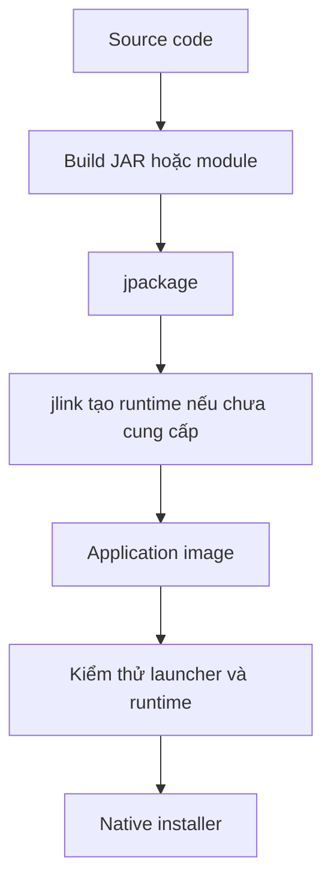

# jpackage chính thức từ Java 16 và ứng dụng tự chứa runtime

Khi phân phối ứng dụng Java cho người dùng cuối, yêu cầu thường gặp là người dùng có thể cài đặt và mở ứng dụng như một chương trình thông thường mà không phải tự cài JDK hoặc cấu hình lệnh `java`. Từ JDK 16, công cụ **`jpackage`** trở thành tính năng chính thức, giúp đóng gói ứng dụng Java cùng Java runtime thành application image hoặc bộ cài đặt native phù hợp với hệ điều hành.

`jpackage` phù hợp cho ứng dụng desktop, tiện ích nội bộ, công cụ dòng lệnh và các ứng dụng Java cần phân phối theo từng nền tảng. Công cụ hỗ trợ cả ứng dụng modular lẫn non-modular, có thể tạo runtime bằng `jlink`, tùy chỉnh launcher, icon, thông tin ứng dụng và định dạng cài đặt.

Bài học thuộc chương **jpackage cơ bản** của module **JAVA_VERSION_JAVA16**. Trọng tâm là cách dùng `jpackage` ổn định từ Java 16 và các lưu ý vẫn quan trọng trên JDK hiện đại; không dùng cách gọi module incubator của các bản JDK thử nghiệm trước đó.

## 1. `jpackage` chính thức từ JDK 16

`jpackage` được giới thiệu dưới dạng incubator ở JDK 14 và tiếp tục incubator ở JDK 15. Trong JDK 16, JEP 392 đưa công cụ này ra khỏi giai đoạn incubator và trở thành tính năng production-ready.

Tên module cũng thay đổi khi công cụ được chuẩn hóa:

| Giai đoạn | Module |
| --- | --- |
| JDK 14 và JDK 15 (incubator) | `jdk.incubator.jpackage` |
| JDK 16 trở đi | `jdk.jpackage` |

Khi dùng JDK 16 trở lên, gọi trực tiếp lệnh `jpackage` từ thư mục `bin` của JDK hoặc thông qua `PATH`. Không cần thêm module incubator bằng `--add-modules jdk.incubator.jpackage`.

Kiểm tra môi trường:

```powershell
java --version
javac --version
jpackage --version
jpackage --help
```

Nên xác nhận `java`, `javac` và `jpackage` đến từ JDK mà bạn dự định dùng để đóng gói. `jpackage` là công cụ thuộc JDK; một runtime chỉ dành cho chạy ứng dụng không thay thế được môi trường đóng gói.

## 2. `jpackage` tạo ra những gì?

`jpackage` có thể tạo hai loại đầu ra chính:

1. **Application image (app-image):** thư mục ứng dụng có launcher, payload của ứng dụng và runtime đi kèm.
2. **Native installer/package:** bộ cài đặt theo định dạng của hệ điều hành, giúp người dùng cài đặt, gỡ cài đặt hoặc tạo shortcut theo khả năng của nền tảng.

Các định dạng phổ biến:

| Hệ điều hành đích | Định dạng `jpackage` |
| --- | --- |
| Windows | `exe`, `msi` |
| macOS | `pkg`, `dmg` |
| Linux | `deb`, `rpm` |
| Mọi nền tảng hỗ trợ | `app-image` cho application image trên chính nền tảng đang build |

`app-image` không phải installer. Đây là đầu ra hữu ích để chạy thử, kiểm tra launcher và runtime trước khi tạo bộ cài đặt. Một installer native có thể được tạo từ application image đã có.

## 3. Ứng dụng tự chứa runtime nghĩa là gì?

Thông thường, khi chạy JAR:

```powershell
java -jar hello-app.jar
```

máy người dùng phải có một Java runtime tương thích và lệnh `java` phải được tìm thấy. Khi đóng gói bằng `jpackage`, ứng dụng được phân phối cùng một runtime image phù hợp với ứng dụng.

Một application image thường chứa:

- Launcher để mở ứng dụng.
- JAR hoặc module cùng tài nguyên của ứng dụng.
- Thư mục runtime chứa Java runtime image.
- Cấu hình do `jpackage` tạo cho launcher.

Nhờ đó, người dùng không cần cài một JDK riêng chỉ để chạy ứng dụng đã đóng gói. Tuy nhiên, **tự chứa runtime không đồng nghĩa ứng dụng không còn phụ thuộc hệ thống**: ứng dụng vẫn cần hệ điều hành và kiến trúc CPU tương thích, các thư viện native hoặc thành phần hệ thống mà ứng dụng sử dụng.

Đường dẫn và cấu trúc nội bộ của application image khác nhau giữa Windows, macOS và Linux. Không nên viết script phụ thuộc vào các file nội bộ mà tài liệu `jpackage` không cam kết ổn định; hãy dùng launcher được tạo và các tùy chọn chính thức.

## 4. `jpackage` kết hợp với `jlink`

`jlink` tạo runtime image tùy chỉnh từ các module của JDK. `jpackage` sử dụng `jlink` khi bạn không cung cấp runtime image riêng.

Quy trình tổng quát:

1. Build ứng dụng thành JAR hoặc module.
2. Xác định module cần có trong runtime.
3. Để `jpackage` tạo runtime tự động, hoặc tự tạo runtime bằng `jlink`.
4. Đóng gói ứng dụng và runtime thành application image hoặc installer.

Sơ đồ:



Nếu muốn kiểm soát chính xác runtime, tạo image riêng bằng `jlink`, rồi truyền đường dẫn cho `jpackage` qua `--runtime-image`.

Không nên mặc định runtime tạo ra chứa toàn bộ JDK. `jpackage` dùng `jlink` để tạo runtime theo module cần thiết; runtime image không phải một bản JDK đầy đủ để tiếp tục biên dịch hoặc phát triển ứng dụng.

## 5. Chuẩn bị ứng dụng trước khi đóng gói

Trước khi chạy `jpackage`, hãy chuẩn bị:

| Thành phần | Mục đích |
| --- | --- |
| JAR hoặc module đã build | Mã thực thi của ứng dụng |
| Main class hoặc main module | Điểm bắt đầu của launcher |
| Dependency và tài nguyên | Các file ứng dụng cần khi chạy |
| Tên, phiên bản, vendor, mô tả | Metadata hiển thị trong package/installer |
| Icon và license (nếu cần) | Tùy chỉnh trải nghiệm cài đặt |
| JVM options và application arguments (nếu cần) | Cấu hình launcher |

Với ứng dụng non-modular, thư mục `--input` chứa JAR chính và các file cần đóng gói. `--main-jar` là đường dẫn tương đối từ thư mục input. Có thể chỉ rõ main class bằng `--main-class`.

Với ứng dụng modular, các module cần nằm trên `--module-path`; chỉ rõ module chính bằng `--module moduleName/mainClass`.

Không đưa toàn bộ thư mục build, mã nguồn, file log hoặc dữ liệu phát triển vào `--input` nếu ứng dụng không cần các file đó. `jpackage` đóng gói các file trong input directory, vì vậy thư mục đầu vào nên được chuẩn bị có chủ đích.

## 6. Đóng gói ứng dụng non-modular từ JAR

Giả sử ứng dụng đã được build:

```text
build/
  libs/
    hello-app.jar
    dependency-a.jar
    config/
      application.properties
```

Trong PowerShell trên Windows, tạo application image:

```powershell
jpackage --type app-image --name HelloApp --input build\libs --main-jar hello-app.jar --main-class com.example.Main --dest build\packages --app-version 1.0.0 --vendor "Example Company"
```

Giải thích các tùy chọn:

| Tùy chọn | Ý nghĩa |
| --- | --- |
| `--type app-image` | Chỉ tạo application image |
| `--name HelloApp` | Tên ứng dụng và launcher |
| `--input build\libs` | Thư mục chứa JAR và tài nguyên cần đóng gói |
| `--main-jar hello-app.jar` | JAR chính, đường dẫn tương đối từ input |
| `--main-class com.example.Main` | Lớp chứa phương thức `main` |
| `--dest build\packages` | Thư mục chứa kết quả |
| `--app-version 1.0.0` | Phiên bản ứng dụng/package |
| `--vendor` | Tên nhà cung cấp |

Kết quả là một application image trong thư mục đích. Trên Windows, launcher thường có tên `HelloApp.exe`; chạy launcher này để kiểm tra ứng dụng:

```powershell
& "build\packages\HelloApp\HelloApp.exe"
```

Đường dẫn cụ thể phụ thuộc tên ứng dụng và cấu trúc output trên nền tảng đích. Hãy kiểm tra launcher thực tế trong application image sau khi đóng gói.

## 7. Đóng gói ứng dụng modular

Nếu ứng dụng có `module-info.java` và đã được build thành module, sử dụng `--module-path` cùng `--module`.

Ví dụ:

```text
build/
  mods/
    com.example.app/
      module-info.class
      com/
        example/
          Main.class
```

Tạo application image:

```powershell
jpackage --type app-image --name HelloMod --module-path build\mods --module com.example.app/com.example.Main --dest build\packages --app-version 1.0.0
```

Với ứng dụng modular, runtime image chứa module chính và các dependency bắc cầu của nó. Nếu ứng dụng cần thêm module JDK không được kéo vào từ dependency graph, có thể chỉ định bằng `--add-modules`.

Ví dụ thêm `java.logging`:

```powershell
jpackage --type app-image --name HelloMod --module-path build\mods --module com.example.app/com.example.Main --add-modules java.logging --dest build\packages
```

Không truyền đồng thời `--main-jar` và `--module`: đây là hai cách xác định điểm vào ứng dụng khác nhau.

## 8. Tạo native installer từ application image

Sau khi đã kiểm thử application image, có thể tạo installer từ chính image đó. Ví dụ trên Windows:

```powershell
jpackage --type msi --name HelloApp --app-image build\packages\HelloApp --dest build\installers --app-version 1.0.0 --vendor "Example Company"
```

Trên Windows, có thể chọn `msi` hoặc `exe`. Trên macOS, chọn `pkg` hoặc `dmg`; trên Linux, chọn `deb` hoặc `rpm` tùy hệ phân phối và cách phát hành.

Khi dùng `--app-image`, `jpackage` lấy application image đã tạo làm đầu vào. Không kết hợp `--app-image` với `--runtime-image`, `--input`, `--main-jar` hoặc `--module` trong cùng lệnh tạo package; các tùy chọn đó thuộc quy trình tạo image từ ứng dụng và runtime đầu vào.

## 9. Cung cấp runtime image tùy chỉnh

Trong phần lớn trường hợp, để `jpackage` tự gọi `jlink` là đủ. Nếu cần chọn module chính xác, dùng runtime riêng cho nhiều ứng dụng hoặc cần runtime từ một JDK khác, có thể tạo runtime bằng `jlink` trước.

Ví dụ PowerShell trên Windows với ứng dụng modular:

```powershell
jlink --module-path "$env:JAVA_HOME\jmods;build\mods" --add-modules com.example.app --output build\runtime
```

Sau đó đóng gói với runtime đã tạo:

```powershell
jpackage --type app-image --name HelloMod --module-path build\mods --module com.example.app/com.example.Main --runtime-image build\runtime --dest build\packages
```

`--runtime-image` yêu cầu một runtime image đã được tạo trước, ví dụ từ `jlink`. Runtime phải phù hợp với nền tảng và kiến trúc đích. Nếu ứng dụng sử dụng module hoặc provider bổ sung, hãy bảo đảm chúng có mặt trong runtime image.

## 10. Lưu ý hiện đại về ServiceLoader và service binding

`ServiceLoader` cho phép ứng dụng tìm implementation của một service thông qua provider. Khi runtime được tạo bằng `jlink`, các service binding có thể ảnh hưởng đến module provider được đưa vào image.

Có một thay đổi cần lưu ý khi dùng JDK hiện đại: **từ JDK 25, runtime image do `jpackage` tạo không còn tự động bao gồm service bindings như các bản trước đó**. Nếu ứng dụng dựa vào provider được tìm thấy qua service binding, cần yêu cầu `jlink` liên kết service bằng `--bind-services`.

Ví dụ với JDK 25 trở lên:

```powershell
jpackage --type app-image --name ServiceApp --input build\libs --main-jar service-app.jar --main-class com.example.Main --jlink-options "--strip-native-commands --strip-debug --no-man-pages --no-header-files --bind-services" --dest build\packages
```

Các tùy chọn `--strip-native-commands`, `--strip-debug`, `--no-man-pages` và `--no-header-files` là các tùy chọn mặc định mà `jpackage` truyền cho `jlink` khi không có cấu hình khác. Khi tự chỉ định `--jlink-options`, cần truyền lại các tùy chọn muốn giữ cùng với `--bind-services`.

Không phải ứng dụng nào cũng cần `--bind-services`. Chỉ thêm khi ứng dụng thực sự phụ thuộc vào service provider được phát hiện qua cơ chế này; sau khi đóng gói, hãy kiểm thử chức năng dùng `ServiceLoader` trên runtime đã tạo.

## 11. Các tùy chọn thường dùng để tùy chỉnh ứng dụng

`jpackage` hỗ trợ nhiều tùy chọn để hoàn thiện trải nghiệm phân phối:

| Tùy chọn | Mục đích |
| --- | --- |
| `--app-version` | Phiên bản ứng dụng |
| `--vendor` | Nhà cung cấp |
| `--description` | Mô tả ứng dụng |
| `--copyright` | Thông tin bản quyền |
| `--icon` | Icon của ứng dụng/package |
| `--license-file` | File license đi kèm package |
| `--java-options` | JVM options cho launcher |
| `--arguments` | Đối số mặc định truyền cho ứng dụng |
| `--add-launcher` | Tạo launcher phụ với cấu hình riêng |
| `--file-associations` | Liên kết loại file với ứng dụng |
| `--resource-dir` | Thay thế resource/template của `jpackage` |
| `--install-dir` | Chọn thư mục cài đặt |

Các tùy chọn cụ thể còn phụ thuộc hệ điều hành. Ví dụ, Windows có tùy chọn shortcut và menu; Linux có tùy chọn shortcut; macOS có identifier và tùy chọn ký ứng dụng/package.

Ví dụ thêm JVM option và metadata:

```powershell
jpackage --type app-image --name ReportTool --input build\libs --main-jar report-tool.jar --main-class com.example.Main --app-version 2.1.0 --vendor "Example Company" --description "Internal report utility" --java-options "-Xms128m" --java-options "-Xmx512m" --dest build\packages
```

Chỉ thêm JVM option khi có yêu cầu vận hành rõ ràng. Không nên đóng cứng các giá trị heap hoặc system property chỉ vì chúng phù hợp với máy phát triển; cấu hình phải phù hợp với môi trường người dùng.

## 12. Yêu cầu build theo nền tảng

Các installer native phải được tạo trên nền tảng đích. `jpackage` không phải công cụ cross-compiler để tạo MSI trên Linux hoặc DEB trên Windows.

| Muốn phát hành cho | Nên chạy đóng gói trên | Đầu ra |
| --- | --- | --- |
| Windows | Windows | `exe`, `msi` |
| macOS | macOS | `pkg`, `dmg` |
| Linux | Linux | `deb`, `rpm` |

Để phát hành nhiều nền tảng, cấu hình pipeline build riêng cho Windows, macOS và Linux. Mỗi job cần JDK, artifact ứng dụng và công cụ hệ thống cần thiết cho định dạng package.

Một số định dạng có yêu cầu bổ sung theo nền tảng và môi trường build. Ví dụ, đóng gói MSI/EXE trên Windows cần WiX Toolset; đóng gói RPM hoặc DEB có thể cần công cụ của hệ phân phối; ký package macOS cần công cụ dòng lệnh Xcode và signing identity phù hợp. Hãy kiểm tra `jpackage --help` và tài liệu JDK tương ứng trên chính hệ điều hành build.

## 13. Kiểm thử application image và installer

Không nên chỉ xác nhận lệnh `jpackage` chạy thành công. Trước khi phát hành, kiểm tra ứng dụng được tạo có hoạt động trong điều kiện gần với máy người dùng:

1. Chạy launcher từ application image, không gọi `java -jar`.
2. Xác nhận runtime đi kèm có thể khởi động ứng dụng.
3. Kiểm tra dependency, resource, file cấu hình và đường dẫn dữ liệu.
4. Kiểm tra JVM options và application arguments.
5. Kiểm tra chức năng dùng native library, service provider hoặc file association nếu có.
6. Cài đặt package trên máy thử nghiệm sạch, kiểm tra shortcut và khả năng gỡ cài đặt.
7. Kiểm tra package trên đúng hệ điều hành và kiến trúc dự kiến phát hành.

Application image và installer là artifact nền tảng cụ thể. Một image tạo trên Windows không thể dùng thay image macOS hoặc Linux.

## 14. Quản lý cập nhật runtime và bảo mật

Runtime được đóng gói cùng ứng dụng không tự động nhận bản cập nhật từ JDK cài trên máy người dùng. Khi cần cập nhật bảo mật hoặc sửa lỗi runtime, đội phát triển phải:

- Chọn bản JDK đã được cập nhật phù hợp.
- Build lại runtime image hoặc để `jpackage` tạo runtime từ JDK mới.
- Tạo lại application image và installer.
- Kiểm thử lại trên nền tảng đích.
- Phát hành phiên bản ứng dụng/package mới theo quy trình cập nhật của sản phẩm.

Vì vậy, nên ghi nhận phiên bản JDK dùng để build, lưu lệnh đóng gói trong pipeline và có lịch cập nhật runtime. Không giả định runtime đi kèm ứng dụng sẽ được hệ điều hành cập nhật thay cho nhà phát hành.

## 15. Các lỗi thường gặp

| Vấn đề | Nguyên nhân có thể gặp | Cách xử lý |
| --- | --- | --- |
| Không tìm thấy `jpackage` | Đang dùng JRE hoặc `PATH` trỏ sai JDK | Kiểm tra `java`, `javac`, `jpackage` và `JAVA_HOME` |
| Không tìm thấy main JAR | `--main-jar` không tương đối với `--input` | Kiểm tra thư mục input và đường dẫn JAR |
| Launcher không khởi động | Sai main class, thiếu dependency hoặc tài nguyên | Chạy thử ứng dụng gốc, kiểm tra input và cấu hình launcher |
| Thiếu module runtime | Module cần thiết chưa được đưa vào runtime | Bổ sung `--add-modules` hoặc tạo runtime bằng `jlink` |
| Không tìm thấy service provider | Runtime thiếu service bindings trên JDK hiện đại | Kiểm tra `ServiceLoader`, cân nhắc `--bind-services` |
| Không tạo được native installer | Build trên sai nền tảng hoặc thiếu công cụ hệ thống | Build trên OS đích và cài prerequisite phù hợp |
| Không chạy trên máy khác | Sai kiến trúc, thiếu thư viện native hoặc phụ thuộc hệ thống | Kiểm tra nền tảng, runtime và native dependency |
| Runtime cũ có lỗ hổng | Ứng dụng vẫn đóng gói runtime từ JDK cũ | Cập nhật JDK, đóng gói và phát hành lại |

Khi gặp lỗi, chạy `jpackage --help` trên đúng JDK và hệ điều hành để xem các tùy chọn khả dụng. Tùy chọn theo nền tảng có thể không tồn tại khi chạy trên hệ điều hành khác.

## 16. Khi nào nên dùng `jpackage`?

| Nhu cầu | Hướng tiếp cận |
| --- | --- |
| Muốn người dùng chạy ứng dụng mà không cài Java riêng | Tạo application image có runtime bằng `jpackage` |
| Muốn phát hành installer theo OS | Chọn `msi`/`exe`, `pkg`/`dmg`, `deb`/`rpm` |
| Muốn thử launcher trước khi tạo installer | Tạo `--type app-image` |
| Muốn kiểm soát module runtime | Tạo runtime bằng `jlink` hoặc chỉ định `--add-modules` |
| Muốn dùng runtime đã chuẩn bị sẵn | Truyền `--runtime-image` |
| Muốn nhiều launcher hoặc icon riêng | Dùng `--add-launcher`, `--icon` và tùy chọn nền tảng |
| Muốn phân phối cùng một mã nguồn cho nhiều OS | Build package riêng trên từng nền tảng đích |

Nếu ứng dụng là service chạy trên máy chủ, container hoặc môi trường cloud, application image/installer không phải lúc nào cũng là hình thức triển khai tối ưu. Hãy chọn cách phân phối theo môi trường vận hành; `jpackage` đặc biệt hữu ích khi cần launcher và trải nghiệm cài đặt native cho người dùng cuối.

## Ghi nhớ

**`jpackage` trở thành công cụ đóng gói chính thức từ Java 16, tạo application image hoặc native installer cho ứng dụng Java kèm runtime tự chứa.** Công cụ hỗ trợ ứng dụng modular và non-modular, dùng `jlink` để tạo runtime nếu không cung cấp `--runtime-image`, và phải build package trên nền tảng đích. Hãy thử `app-image` trước, kiểm thử launcher thực tế, quản lý cập nhật runtime đi kèm và lưu ý thay đổi service binding từ JDK 25 khi ứng dụng dùng `ServiceLoader`.

## Tài liệu tham khảo

- [JDK 16 Release Notes — JEP 392: Packaging Tool](https://www.oracle.com/java/technologies/javase/16-relnote-issues.html)
- [Oracle Java SE 25 — The jpackage Command](https://docs.oracle.com/en/java/javase/25/docs/specs/man/jpackage.html)
- [Oracle Java SE 25 — Packaging Overview](https://docs.oracle.com/en/java/javase/25/jpackage/packaging-overview.html)
- [Oracle Java SE 25 — Image and Runtime Modifications](https://docs.oracle.com/en/java/javase/25/jpackage/image-and-runtime-modifications.html)
- [JEP 392 — Packaging Tool](https://openjdk.org/jeps/392)
