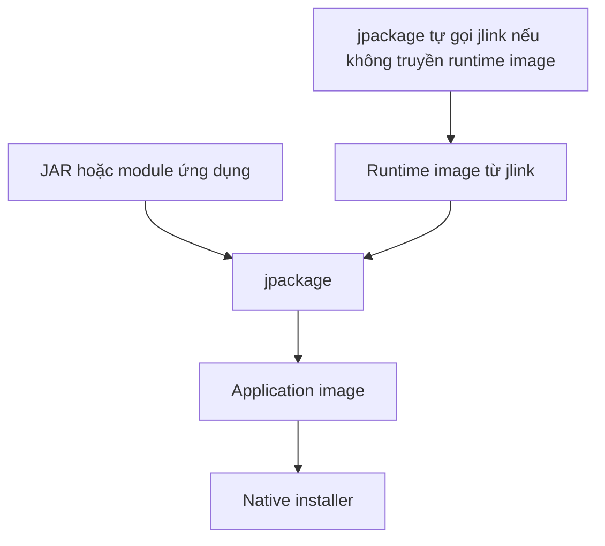

# Phân biệt JAR, runtime image, application image và native installer

Khi phân phối một ứng dụng Java, bốn loại artifact thường được nhắc đến là **JAR**, **runtime image**, **application image** và **native installer**. Chúng liên quan với nhau nhưng giải quyết các nhu cầu khác nhau: JAR chứa ứng dụng, runtime image chứa môi trường chạy Java, application image kết hợp ứng dụng với runtime và launcher, còn native installer đóng gói application image theo cách cài đặt quen thuộc của hệ điều hành.

Hiểu rõ sự khác nhau giúp chọn đúng đầu ra cho từng tình huống. Nếu chỉ cần chia sẻ thư viện hoặc ứng dụng Java cho môi trường đã có Java, JAR thường là đủ. Nếu muốn người dùng chạy ứng dụng mà không cài Java riêng, cần runtime đi kèm. Nếu muốn có launcher riêng, application image phù hợp; nếu cần cài đặt, shortcut và gỡ cài đặt theo hệ điều hành, hãy tạo native installer bằng `jpackage`.

Bài học thuộc chương **jpackage cơ bản** của module **JAVA_VERSION_JAVA16**. Các khái niệm dựa trên `jpackage` chính thức từ Java 16 và tài liệu đóng gói của JDK hiện đại. Trọng tâm là phân biệt artifact và cách chúng kết hợp, không dựa vào cấu trúc file nội bộ có thể thay đổi giữa các nền tảng.

## 1. Bốn artifact giải quyết bốn nhu cầu

| Artifact | Chứa gì? | Có Java runtime đi kèm? | Mục đích chính |
| --- | --- | :---: | --- |
| JAR | Bytecode, metadata, tài nguyên và có thể cả dependency | Không | Phân phối ứng dụng hoặc thư viện Java |
| Runtime image | Java runtime và các module được chọn | Chính là runtime | Cung cấp môi trường chạy Java |
| Application image | Launcher, payload ứng dụng và runtime image | Có, theo cấu hình đóng gói thông thường | Phân phối ứng dụng dạng thư mục tự chạy |
| Native installer | Gói cài đặt chứa application image và metadata cài đặt | Thông thường có, thông qua application image | Cài đặt, tích hợp và gỡ cài đặt theo hệ điều hành |

Có thể hình dung mối quan hệ như sau:



Đây là luồng khái niệm. Khi gọi `jpackage` trực tiếp để tạo installer, công cụ có thể tạo runtime và application image trong cùng một lần chạy; bạn không bắt buộc phải tạo thủ công từng bước.

## 2. JAR: artifact chứa ứng dụng Java

JAR (Java ARchive) là file archive dùng để đóng gói class, resource, metadata và đôi khi cả dependency của ứng dụng. Về bản chất, JAR không phải Java runtime và không tự cung cấp JVM để chạy bytecode.

Một JAR ứng dụng đơn giản có thể có cấu trúc:

```text
hello-app.jar
  META-INF/
    MANIFEST.MF
  com/
    example/
      Main.class
  config/
    application.properties
```

Nếu manifest khai báo `Main-Class`, có thể chạy JAR bằng:

```bash
java -jar hello-app.jar
```

Lệnh trên cần một Java runtime tương thích trên máy chạy. Nếu JAR không có `Main-Class`, hoặc ứng dụng cần dependency ngoài chưa được đưa vào classpath/module path, không thể mặc định chạy nó bằng `java -jar` đơn giản.

JAR có thể là:

- **JAR thư viện:** cung cấp class và resource để ứng dụng khác sử dụng.
- **Executable JAR:** có điểm vào ứng dụng, thường khai báo `Main-Class` trong manifest.
- **Modular JAR:** có `module-info.class` và được sử dụng như một module trên module path.
- **JAR gộp dependency:** đóng gói thêm thư viện cần thiết theo cách build của dự án.

Ưu điểm của JAR là gọn, dễ lưu trữ và có tính di động cao giữa các môi trường Java tương thích. Giới hạn là người nhận cần tự chuẩn bị runtime, dependency và cách khởi chạy phù hợp.

## 3. Runtime image: môi trường chạy Java được chọn module

Runtime image là một cây thư mục chứa Java runtime và các module cần thiết để chạy ứng dụng. Công cụ `jlink` tạo runtime image từ các module của JDK:

```bash
jlink --add-modules java.base,java.logging --output build/runtime
```

Runtime image không chứa JAR ứng dụng. Nó chỉ cung cấp môi trường chạy; muốn chạy ứng dụng, vẫn phải đưa JAR hoặc module ứng dụng vào lệnh khởi chạy.

Ví dụ trên Windows:

```powershell
build\runtime\bin\java.exe -jar hello-app.jar
```

Trên Linux hoặc macOS:

```bash
build/runtime/bin/java -jar hello-app.jar
```

Runtime image thường nhỏ hơn một JDK đầy đủ vì chỉ chứa các module đã chọn và thành phần runtime cần thiết. Runtime image được tạo bằng `jlink` không mặc nhiên có `javac`, `javadoc`, `jshell` hay toàn bộ công cụ phát triển. Không nên xem nó như một bản JDK thay thế cho môi trường build.

### Runtime image có phụ thuộc nền tảng không?

Có. Runtime image được tạo cho hệ điều hành và kiến trúc cụ thể. Runtime image tạo trên Windows x64 không phải runtime image có thể đem chạy nguyên trạng trên macOS ARM64.

Runtime image có thể được tái sử dụng cho nhiều ứng dụng nếu các ứng dụng tương thích với cùng runtime và tập module. Đây là lựa chọn hữu ích khi đội phát triển muốn quản lý runtime riêng, kiểm soát module hoặc dùng một phiên bản Java cụ thể.

### `jpackage` tạo runtime như thế nào?

Nếu không truyền `--runtime-image`, `jpackage` gọi `jlink` để tạo runtime cho ứng dụng. Với ứng dụng modular, runtime được tạo từ module chính và các dependency bắc cầu của nó. Với ứng dụng non-modular gồm JAR, `jpackage` sử dụng tập module JDK mặc định dành cho ứng dụng class path, có thể không nhỏ bằng runtime được tối ưu từ một đồ thị module tường minh.

Có thể bổ sung module bằng `--add-modules`. Nếu đã tự tạo runtime bằng `jlink`, truyền nó cho `jpackage` qua `--runtime-image`.

## 4. Application image: ứng dụng cùng launcher và runtime

Application image là thư mục ứng dụng do `jpackage` tạo. Nó kết hợp:

- Launcher để khởi động ứng dụng.
- Payload ứng dụng, chẳng hạn JAR, module, cấu hình và resource.
- Java runtime image.
- Cấu hình launcher và metadata cần thiết.

Ví dụ tạo application image từ executable JAR:

```bash
jpackage --type app-image --name Notes --input build/input --main-jar notes.jar --main-class com.example.Main --dest build/dist
```

Thư mục `build/input` chứa `notes.jar` và các file ứng dụng cần đóng gói. Application image được tạo trong thư mục đích với tên ứng dụng.

Sau khi tạo, chạy launcher do `jpackage` sinh ra. Đường dẫn launcher khác nhau theo nền tảng; ví dụ trên Windows thường có file `.exe`, trên Linux có launcher trong thư mục `bin`, còn macOS sử dụng application bundle `.app`.

Application image có thể được kiểm thử trước khi tạo installer. Bạn cũng có thể phân phối application image như một thư mục hoặc archive phù hợp với hệ điều hành đích. Người dùng chạy launcher từ image và không cần cài một Java runtime riêng.

Tuy nhiên, application image không phải native installer:

- Nó không tự thực hiện quy trình cài đặt của hệ điều hành.
- Nó không mặc nhiên đăng ký shortcut, menu, file association hoặc quy trình gỡ cài đặt như một installer.
- Nó vẫn gắn với nền tảng và kiến trúc đã đóng gói.

Không nên phụ thuộc vào tên hoặc vị trí mọi file nội bộ trong application image. Tài liệu JDK xem một số file trong cấu trúc image là chi tiết triển khai có thể thay đổi; hãy khởi chạy bằng launcher được tạo và dùng các tùy chọn công khai của `jpackage`.

## 5. Native installer: bộ cài đặt theo hệ điều hành

Native installer là gói cài đặt có định dạng mà hệ điều hành hoặc hệ sinh thái package tương ứng nhận biết. `jpackage` có thể tạo installer từ ứng dụng và runtime, hoặc từ một application image đã có.

Các định dạng phổ biến:

| Nền tảng | Định dạng installer/package |
| --- | --- |
| Windows | `msi`, `exe` |
| macOS | `pkg`, `dmg` (`dmg` có thể chứa application bundle `.app`) |
| Linux | `deb`, `rpm` |

Native installer thường cung cấp trải nghiệm cài đặt và gỡ cài đặt quen thuộc. Tùy nền tảng và tùy chọn đóng gói, có thể cấu hình thư mục cài đặt, shortcut, menu, file association, metadata nhà phát hành và ký gói.

Ví dụ tạo MSI từ application image trên Windows:

```powershell
jpackage --type msi --name Notes --app-image build\dist\Notes --dest build\installers --app-version 1.0.0
```

Ở đây, `--app-image` chỉ định application image đã được tạo và kiểm thử. `jpackage` đóng gói image đó thành MSI.

Native installer không đồng nghĩa với việc biên dịch mã Java thành mã máy riêng. Ứng dụng vẫn chạy trên Java runtime được đóng gói; installer chỉ cung cấp hình thức phân phối và cài đặt phù hợp với hệ điều hành.

## 6. So sánh chi tiết theo vòng đời chạy ứng dụng

| Tiêu chí | JAR | Runtime image | Application image | Native installer |
| --- | --- | --- | --- | --- |
| Chứa bytecode ứng dụng | Có | Không | Có, trong payload | Có, thông qua application image |
| Chứa Java runtime | Không | Có | Có theo cấu hình thông thường | Thông thường có thông qua application image |
| Có launcher riêng | Không mặc định | Có lệnh `java` của runtime | Có launcher ứng dụng | Cài launcher từ application image |
| Cần Java cài riêng trên máy người dùng | Có, nếu chỉ phân phối JAR | Không cần JDK riêng để chạy runtime image, nhưng vẫn cần ứng dụng | Không cần runtime riêng | Không cần runtime riêng nếu runtime được đóng gói |
| Có quy trình cài/gỡ của OS | Không | Không | Không | Có, theo định dạng package |
| Có tính di động giữa OS | Cao ở mức bytecode, nếu runtime tương thích | Không | Không | Không |
| Dùng khi | Phát hành thư viện hoặc ứng dụng cho môi trường Java sẵn có | Tự quản lý runtime hoặc dùng chung runtime | Phát hành ứng dụng dạng thư mục tự chạy | Phân phối ứng dụng qua bộ cài đặt |

Lưu ý: runtime image có thể chạy nhiều ứng dụng bằng cách truyền JAR/module tương ứng cho lệnh `java` bên trong image. Nó không tự chứa các ứng dụng đó.

## 7. Từ JAR đến application image

Với ứng dụng non-modular, có thể đóng gói JAR trực tiếp:

```bash
jpackage --type app-image --name Notes --input build/input --main-jar notes.jar --main-class com.example.Main --dest build/dist
```

Trong quy trình này:

1. `notes.jar` là payload ứng dụng.
2. `jpackage` đọc các file trong `--input`.
3. Nếu không truyền `--runtime-image`, `jpackage` dùng `jlink` để tạo runtime.
4. Công cụ tạo launcher và application image.

Nếu JAR là modular, dùng `--module-path` và `--module` thay cho `--main-jar`:

```bash
jpackage --type app-image --name Notes --module-path build/mods --module com.example.notes/com.example.Main --dest build/dist
```

Không truyền đồng thời `--main-jar` và `--module`; hai tùy chọn này đại diện cho hai cách chỉ định điểm vào ứng dụng.

## 8. Từ runtime image tùy chỉnh đến application image

Nếu muốn tự chọn module runtime, tạo runtime bằng `jlink` trước:

```powershell
jlink --module-path "$env:JAVA_HOME\jmods;build\mods" --add-modules com.example.notes --output build\runtime
```

Sau đó truyền runtime vào `jpackage`:

```powershell
jpackage --type app-image --name Notes --module-path build\mods --module com.example.notes/com.example.Main --runtime-image build\runtime --dest build\dist
```

`--runtime-image` phải trỏ tới runtime image đã được tạo cho nền tảng đích. Khi đã truyền runtime riêng, `jpackage` dùng runtime đó thay vì tự gọi `jlink` để tạo một runtime mới.

## 9. Tạo installer trực tiếp hay qua application image?

Có hai quy trình đều hợp lệ:

| Quy trình | Cách thực hiện | Khi phù hợp |
| --- | --- | --- |
| Tạo installer trực tiếp | Gọi `jpackage` với JAR/module và `--type msi`, `--type deb`, v.v. | Muốn đóng gói nhanh, không cần chỉnh sửa image trung gian |
| Tạo image rồi tạo installer | Chạy `--type app-image`, kiểm thử hoặc chỉnh sửa image, sau đó chạy với `--app-image` | Muốn kiểm tra launcher/runtime hoặc bổ sung resource trước khi tạo installer |

Ví dụ tạo installer trực tiếp từ JAR trên Windows:

```powershell
jpackage --type msi --name Notes --input build\input --main-jar notes.jar --main-class com.example.Main --dest build\installers
```

Ví dụ tạo installer từ application image:

```powershell
jpackage --type msi --name Notes --app-image build\dist\Notes --dest build\installers
```

Trong cả hai trường hợp, đầu ra MSI là package để cài đặt. Khác biệt là ở quy trình thứ hai, bạn có thể kiểm thử application image trước và có cơ hội chỉnh sửa image theo nhu cầu được hỗ trợ.

Khi dùng `--app-image`, không truyền lại `--input`, `--main-jar`, `--module` hoặc `--runtime-image` trong cùng lệnh tạo package. Các tùy chọn này thuộc quy trình tạo application image từ ứng dụng và runtime đầu vào.

## 10. Lưu ý về runtime image từ JDK 25 trở lên

Runtime image do `jpackage` tạo không phải bản JDK đầy đủ. Tài liệu Oracle nêu runtime image này không chứa debug symbols, các lệnh phát triển JDK thông thường, man pages và `src.zip`.

Một thay đổi quan trọng: từ JDK 25, runtime image do `jpackage` tạo không còn tự động bao gồm service bindings như các bản trước đó. Nếu ứng dụng phụ thuộc vào provider được tìm thấy qua `ServiceLoader` và cơ chế service binding, cần cân nhắc thêm `--bind-services` cho `jlink`.

Ví dụ:

```powershell
jpackage --type app-image --name ServiceApp --input build\input --main-jar service-app.jar --main-class com.example.Main --jlink-options "--strip-native-commands --strip-debug --no-man-pages --no-header-files --bind-services" --dest build\dist
```

Khi tự đặt `--jlink-options`, cần liệt kê cả các tùy chọn mặc định muốn giữ cùng `--bind-services`. Chỉ bật service binding khi ứng dụng cần; sau đóng gói, hãy kiểm thử chức năng tải provider trên runtime thực tế.

## 11. Build theo nền tảng đích

JAR bytecode có tính di động cao giữa các môi trường Java tương thích. Runtime image, application image và native installer lại gắn với hệ điều hành và kiến trúc đích.

`jpackage` không hỗ trợ tạo native installer chéo nền tảng. Muốn phát hành cho nhiều hệ điều hành, chạy đóng gói trên từng nền tảng:

| Nền tảng phát hành | Nền tảng build package |
| --- | --- |
| Windows | Windows |
| macOS | macOS |
| Linux | Linux |

Ví dụ, không thể tạo MSI Windows bằng cách chạy `jpackage` trên Linux. Pipeline phát hành đa nền tảng nên có job build riêng cho Windows, macOS và Linux, sử dụng JDK và công cụ hệ thống tương ứng.

## 12. Chọn artifact theo nhu cầu

| Nhu cầu | Artifact phù hợp | Lý do |
| --- | --- | --- |
| Phát hành thư viện Java cho dự án khác | JAR | Dễ thêm vào dependency hoặc module path |
| Gửi ứng dụng cho máy đã cài Java tương thích | Executable JAR | Người nhận có thể chạy bằng `java -jar` |
| Cần runtime tùy chỉnh cho môi trường riêng | Runtime image | Chủ động chọn module và phiên bản runtime |
| Phân phối ứng dụng thành thư mục tự chạy, không yêu cầu người dùng cài Java | Application image | Có launcher, ứng dụng và runtime |
| Muốn cài đặt, shortcut, gỡ cài đặt theo hệ điều hành | Native installer | Tích hợp với cơ chế package của nền tảng |
| Cần kiểm thử runtime/launcher trước khi đóng gói | Application image | Có thể chạy thử trước khi tạo installer |

Không phải ứng dụng nào cũng cần cả bốn artifact được phát hành riêng. Một ứng dụng desktop cho người dùng cuối thường chỉ cần native installer hoặc application image. Một thư viện Java thường chỉ cần JAR. Runtime image thường là thành phần trung gian hoặc artifact được quản lý riêng khi có yêu cầu vận hành cụ thể.

## 13. Những nhầm lẫn thường gặp

**Cho rằng JAR đã bao gồm Java runtime**

JAR chứa ứng dụng và tài nguyên. Máy chạy vẫn cần một Java runtime tương thích, trừ khi JAR được đặt trong một application image có runtime riêng.

**Cho rằng runtime image đã chứa ứng dụng**

Runtime image cung cấp môi trường chạy Java. Muốn chạy ứng dụng, cần truyền JAR hoặc module cho lệnh `java` bên trong runtime đó.

**Cho rằng application image là installer**

Application image là thư mục ứng dụng tự chạy. Native installer mới là gói cài đặt theo định dạng hệ điều hành.

**Cho rằng native installer biến Java thành chương trình native không cần JVM**

Installer đóng gói ứng dụng cùng runtime và tạo trải nghiệm cài đặt. Ứng dụng vẫn chạy trên Java runtime đi kèm.

**Cho rằng mọi artifact đều dùng được trên mọi hệ điều hành**

JAR có tính di động ở mức bytecode. Runtime image, application image và native installer cần được tạo cho nền tảng đích.

**Cho rằng runtime image là JDK đầy đủ**

Runtime image được tạo để chạy ứng dụng, không phải môi trường phát triển. Các công cụ như `javac` và `javadoc` không có trong runtime image thông thường do `jpackage` tạo.

## 14. Bài tập tự kiểm tra

Một nhóm phát triển có ứng dụng `inventory.jar`, muốn phân phối cho người dùng Windows không cài Java. Họ cũng muốn có MSI để cài đặt và gỡ cài đặt.

Hãy trả lời:

1. `inventory.jar` đã chứa Java runtime chưa?
2. Nếu chỉ có runtime image, có thể chạy ứng dụng mà không cung cấp JAR/module không?
3. Artifact nào có launcher, payload ứng dụng và runtime?
4. Artifact nào cung cấp quy trình cài đặt Windows?
5. Có thể tạo MSI từ application image đã kiểm thử bằng tùy chọn nào?
6. Nếu muốn phát hành cùng ứng dụng cho macOS, có thể dùng lại nguyên application image Windows không?

**Đáp án:**

1. Chưa. JAR chứa mã ứng dụng và tài nguyên, không chứa runtime.
2. Không. Runtime image chỉ cung cấp môi trường chạy; cần có ứng dụng.
3. Application image.
4. Native installer, ví dụ MSI.
5. Dùng `jpackage --type msi --app-image <application-image>`.
6. Không. Cần tạo application image và package riêng trên macOS.

## Ghi nhớ

**JAR chứa ứng dụng; runtime image chứa môi trường Java; application image kết hợp ứng dụng, launcher và runtime; native installer đóng gói application image theo định dạng cài đặt của hệ điều hành.** `jpackage` có thể tạo application image hoặc installer trực tiếp, và dùng `jlink` để tạo runtime nếu bạn không cung cấp `--runtime-image`. Hãy chọn artifact theo cách người dùng sẽ chạy hoặc cài đặt ứng dụng, kiểm thử trên nền tảng đích và quản lý cập nhật runtime đi kèm.

## Tài liệu tham khảo

- [Oracle Java SE 26 — Packaging Overview](https://docs.oracle.com/en/java/javase/26/jpackage/packaging-overview.html)
- [Oracle Java SE 26 — The jpackage Command](https://docs.oracle.com/en/java/javase/26/docs/specs/man/jpackage.html)
- [Oracle Java SE 25 — Image and Runtime Modifications](https://docs.oracle.com/en/java/javase/25/jpackage/image-and-runtime-modifications.html)
- [Oracle Java SE API — jlink Tool](https://docs.oracle.com/en/java/javase/26/docs/specs/man/jlink.html)
- [JEP 392 — Packaging Tool](https://openjdk.org/jeps/392)
