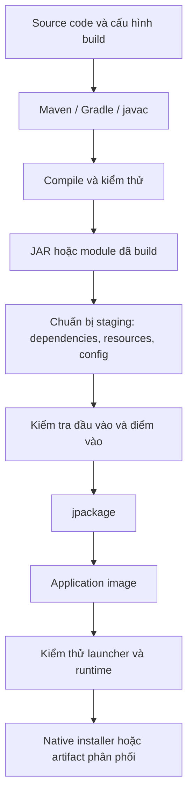

# Đầu vào của jpackage và trách nhiệm build ứng dụng trước khi đóng gói

`jpackage` nhận một ứng dụng Java **đã được build** cùng các tài nguyên cần thiết rồi tạo application image hoặc native installer. Công cụ không thay thế Maven, Gradle, `javac` hay quy trình build của dự án: nó không biên dịch mã nguồn, không tự giải quyết dependency từ repository và không quyết định tài nguyên nghiệp vụ nào phải được đưa vào ứng dụng.

Trước khi đóng gói, đội phát triển phải tạo JAR hoặc module hoàn chỉnh, chuẩn bị dependency, resource, cấu hình mặc định và xác định điểm vào ứng dụng. Với ứng dụng non-modular, thư mục `--input` là vùng staging chứa các file sẽ được đóng gói; với ứng dụng modular, các module đã build phải sẵn sàng trên `--module-path`. `jpackage` sau đó dùng những đầu vào này để tạo launcher, runtime và package theo lựa chọn.

Bài học thuộc chương **jpackage cơ bản** của module **JAVA_VERSION_JAVA16**. Nội dung sử dụng quy trình đóng gói chính thức từ Java 16 và các tùy chọn vẫn được hỗ trợ trên JDK hiện đại. Mục tiêu là phân định rõ trách nhiệm build ứng dụng và trách nhiệm đóng gói, tránh đưa mã nguồn hoặc một thư mục build chưa được chuẩn bị vào `jpackage`.

## 1. jpackage làm gì và không làm gì?

`jpackage` nhận đầu vào là ứng dụng Java đã chuẩn bị và Java runtime image hoặc thông tin để tạo runtime. Công cụ tạo application image có launcher và các dependency cần thiết; từ đó có thể tạo native package như MSI, EXE, PKG, DMG, DEB hoặc RPM.

| Công việc | Công cụ hoặc bộ phận chịu trách nhiệm |
| --- | --- |
| Biên dịch `.java` thành `.class` | `javac` hoặc build tool |
| Chạy unit test, integration test, static analysis | Maven, Gradle và công cụ kiểm thử |
| Giải quyết dependency từ repository | Maven, Gradle hoặc hệ thống build |
| Đóng gói class và resource thành JAR | `jar` hoặc build tool |
| Tạo module output và `module-info.class` | `javac` hoặc build tool |
| Chuẩn bị dependency, resource, config và native library | Build pipeline và nhóm phát triển ứng dụng |
| Tạo runtime image từ module JDK | `jlink`; `jpackage` có thể gọi công cụ này |
| Tạo launcher, application image và installer | `jpackage` |
| Ký, kiểm thử cài đặt và phát hành package | Pipeline release theo nền tảng |

`jpackage` không tự tải dependency từ Maven Central, không chạy test thay build tool và không biên dịch source code. Nếu JAR thiếu thư viện hoặc resource, việc đóng gói vẫn có thể tạo artifact nhưng ứng dụng có thể lỗi khi khởi động hoặc khi thực hiện chức năng cần thành phần bị thiếu.

Luồng công việc tổng quát:



Với quy trình tạo installer trực tiếp, `jpackage` có thể thực hiện bước tạo application image bên trong cùng lệnh. Dù chọn cách nào, phần chuẩn bị ứng dụng vẫn phải hoàn tất trước khi đóng gói.

## 2. Xác định đầu vào theo loại ứng dụng

Có hai cách chính để chỉ định ứng dụng:

| Loại ứng dụng | Đầu vào chính | Tùy chọn điểm vào |
| --- | --- | --- |
| Non-modular, chạy trên class path | Thư mục file ứng dụng qua `--input` | `--main-jar` và tùy chọn `--main-class` |
| Modular, chạy trên module path | Các module đã build qua `--module-path` | `--module moduleName/mainClass` |

Không dùng đồng thời `--main-jar` và `--module` trong cùng một lần đóng gói. Đây là hai cách xác định điểm vào ứng dụng khác nhau.

Ngoài file thực thi, đầu vào còn có thể cần:

- Các JAR dependency ở runtime.
- Resource nằm ngoài JAR, ví dụ template, file dữ liệu tĩnh hoặc chứng thư công khai.
- Cấu hình mặc định cần đi cùng ứng dụng.
- Native library tương ứng với hệ điều hành và kiến trúc đích.
- File icon, license, metadata và properties dùng để cấu hình launcher hoặc installer.

Các thành phần này phải được tạo hoặc thu thập bởi build/release pipeline. `jpackage` chỉ đóng gói những gì được chỉ định; công cụ không biết file nào trong repository là cần thiết cho runtime.

## 3. Chuẩn bị đầu vào non-modular với --input

Với ứng dụng non-modular, `--input` trỏ tới thư mục chứa các file sẽ được đưa vào application image. Tất cả file trong thư mục input được đóng gói vào payload ứng dụng.

Ví dụ cấu trúc staging:

```text
build/
  jpackage-input/
    inventory.jar
    jackson-core.jar
    jackson-databind.jar
    config/
      application.properties
    templates/
      invoice.html
```

Đóng gói:

```powershell
jpackage --type app-image --name Inventory --input build\jpackage-input --main-jar inventory.jar --main-class com.example.inventory.Main --dest build\packages
```

Các điểm cần nhớ:

- `--input` là thư mục staging đã chuẩn bị, không phải thư mục source code.
- `--main-jar` là tên hoặc đường dẫn tương đối từ thư mục input tới JAR chứa điểm vào.
- JAR chính và JAR dependency cần có mặt trong input.
- Tất cả file trong input được đóng gói, kể cả file không phải JAR.
- Các JAR trong input được đưa vào class path mặc định của launcher.

`--main-class` là tên đầy đủ của lớp có `public static void main(String[] args)`. Nếu manifest của JAR chính đã khai báo `Main-Class`, tùy chọn này có thể được bỏ qua; khai báo rõ giúp lệnh đóng gói dễ đọc và kiểm soát điểm vào.

Không nên trỏ `--input` vào một thư mục quá rộng như toàn bộ repository hoặc thư mục build tổng hợp. File test report, mã nguồn, log, file tạm hoặc secret có thể bị đưa vào package ngoài ý muốn.

## 4. Vai trò của JAR chính và dependency JAR

Trong ứng dụng non-modular:

- JAR chính chứa lớp main và thường chứa class, resource của ứng dụng.
- JAR dependency chứa thư viện mà ứng dụng cần khi chạy.
- `--main-jar` xác định JAR chính.
- Class path mặc định của launcher do `jpackage` tạo bao gồm các JAR trong thư mục `--input`.

Ví dụ:

```text
jpackage-input/
  inventory.jar
  jackson-core.jar
  jackson-databind.jar
  slf4j-api.jar
```

Với cấu trúc này, có thể chỉ định:

```powershell
jpackage --name Inventory --input build\jpackage-input --main-jar inventory.jar --main-class com.example.inventory.Main --type app-image
```

Không đặt dependency vào một thư mục con như `lib` rồi mặc định cho rằng launcher sẽ tự thêm tất cả JAR lồng nhau vào class path. Cách an toàn cho class path mặc định là đặt các JAR runtime trực tiếp trong input directory, hoặc chủ động cấu hình class path launcher theo tài liệu.

Nếu dùng `--java-options` để ghi đè class path bằng `-cp`, `-classpath` hoặc `-Djava.class.path`, class path mặc định sẽ bị thay thế. Khi đó, phải đưa tất cả JAR cần thiết vào class path mới. Ví dụ trên shell Unix:

```bash
jpackage --name Inventory --input build/jpackage-input --main-jar inventory.jar --java-options "-cp \$APPDIR/inventory.jar:\$APPDIR/jackson-core.jar:\$APPDIR/jackson-databind.jar"
```

Chỉ ghi đè class path khi có lý do rõ ràng. Nếu không cần cấu trúc class path tùy chỉnh, hãy để `jpackage` tạo class path mặc định từ các JAR trong input.

## 5. Resource trong JAR và file tài nguyên bên ngoài

Build pipeline cần quyết định tài nguyên nào được đóng gói vào JAR và tài nguyên nào được đặt thành file riêng trong application payload.

### Resource bên trong JAR

Resource như template dùng chung, ảnh mặc định hoặc file properties không nhạy cảm có thể được đặt trong resource directory của dự án và build tool đóng gói vào JAR.

Ví dụ đọc resource từ class path:

```java
try (var input = Main.class.getResourceAsStream("/templates/invoice.html")) {
    if (input == null) {
        throw new IllegalStateException("Missing invoice template");
    }
    // Đọc và xử lý nội dung template.
}
```

Khi resource nằm trong JAR trên class path hoặc module path, cách đọc qua API resource của Java giúp ứng dụng ít phụ thuộc vào vị trí file trên đĩa.

### File bên ngoài JAR

File cấu hình hoặc dữ liệu cần được chỉnh sửa sau khi cài đặt thường nên nằm ngoài JAR và được đưa vào application payload bằng `--input` hoặc `--app-content`.

Ví dụ thêm thư mục resource bên ngoài:

```powershell
jpackage --type app-image --name Inventory --input build\jpackage-input --main-jar inventory.jar --app-content build\release-assets\templates,build\release-assets\defaults --dest build\packages
```

`--app-content` cho phép bổ sung file hoặc thư mục vào payload. Các file này được đóng gói, nhưng không tự động trở thành class path. Ứng dụng phải biết cách định vị và đọc chúng; có thể cấu hình đường dẫn qua JVM option hoặc thông tin launcher phù hợp.

Trên launcher, token `$APPDIR` có thể dùng để tham chiếu thư mục ứng dụng. Khi truyền token qua shell, cần escape theo cú pháp của shell đang dùng để shell không thay thế biến trước khi `jpackage` nhận được giá trị.

## 6. Cấu hình: file mặc định, file môi trường và secret

Build pipeline nên phân biệt ba nhóm dữ liệu:

| Nhóm | Ví dụ | Cách xử lý |
| --- | --- | --- |
| Cấu hình mặc định không nhạy cảm | Tên theme, locale mặc định, template | Có thể đóng gói trong JAR hoặc application payload |
| Cấu hình môi trường | URL service, đường dẫn dữ liệu, log level | Nạp từ file ngoài, environment variable hoặc tham số triển khai |
| Secret | Password, token, private key, credential production | Cấp qua secret manager hoặc cơ chế bảo mật của môi trường; không nhúng vào JAR/package |

Không đưa secret vào JAR, thư mục input hoặc file properties dùng để build package. Artifact đóng gói có thể được giải nén và kiểm tra; việc đặt credential trong package không tạo ra cơ chế bảo mật.

Nếu ứng dụng cần file cấu hình ngoài JAR, hãy thống nhất đường dẫn tìm kiếm và cách ghi đè cấu hình theo môi trường. Không giả định working directory của launcher luôn là thư mục cài đặt ứng dụng.

## 7. Chuẩn bị ứng dụng modular

Với ứng dụng modular, build pipeline phải tạo module đã biên dịch, bao gồm `module-info.class`. Module có thể được đóng gói thành modular JAR hoặc đặt trong thư mục module output.

Ví dụ cấu trúc:

```text
build/
  mods/
    com.example.inventory/
      module-info.class
      com/
        example/
          inventory/
            Main.class
```

Đóng gói:

```powershell
jpackage --type app-image --name Inventory --module-path build\mods --module com.example.inventory/com.example.inventory.Main --dest build\packages
```

Trách nhiệm của build pipeline:

- Biên dịch module với module descriptor hợp lệ.
- Đưa các module phụ thuộc lên module path.
- Bảo đảm tên module và main class chính xác.
- Xác nhận các dependency module cần thiết có sẵn cho bước đóng gói.
- Xác định module JDK bổ sung nếu ứng dụng cần module không được kéo vào từ dependency graph.

Với ứng dụng modular, `jpackage` dùng module chính và các dependency bắc cầu để tạo runtime. Có thể chỉ định module bổ sung bằng `--add-modules`. Nếu thiếu module dependency hoặc module descriptor khai báo sai, quá trình tạo runtime có thể thất bại trước khi tạo application image.

Không dùng `--main-jar` để chỉ định một modular JAR thay cho `--module`. Với ứng dụng modular, dùng `--module-path` và `--module` để giữ đúng mô hình module.

## 8. Build ứng dụng trước khi gọi jpackage

### Build thủ công bằng javac và jar

Với ứng dụng nhỏ không dùng Maven hoặc Gradle, có thể biên dịch và tạo executable JAR trước:

```powershell
New-Item -ItemType Directory -Force build\classes, build\jpackage-input | Out-Null
javac -d build\classes src\com\example\Main.java
jar --create --file build\jpackage-input\demo.jar --main-class com.example.Main -C build\classes .
```

Sau khi JAR được tạo, đóng gói:

```powershell
jpackage --type app-image --name Demo --input build\jpackage-input --main-jar demo.jar --dest build\packages
```

Ví dụ này giả định ứng dụng không có dependency ngoài JDK và resource bổ sung. Nếu có dependency, phải build hoặc thu thập các JAR runtime rồi đưa chúng vào input directory.

### Build bằng Maven

Maven chịu trách nhiệm compile, test và package ứng dụng. Ví dụ:

```powershell
mvn clean verify
```

Sau khi build thành công, tạo staging directory và sao chép JAR chính cùng runtime dependency vào đó. Ví dụ sử dụng Maven Dependency Plugin để copy dependency runtime:

```powershell
New-Item -ItemType Directory -Force target\jpackage-input | Out-Null
Copy-Item target\inventory.jar target\jpackage-input\
mvn dependency:copy-dependencies -DincludeScope=runtime -DoutputDirectory=target\jpackage-input
```

Sau đó:

```powershell
jpackage --type app-image --name Inventory --input target\jpackage-input --main-jar inventory.jar --main-class com.example.inventory.Main --dest target\packages
```

Tên JAR chính phải khớp với artifact thực tế Maven tạo ra. Có thể xác định tên bằng cấu hình `finalName` hoặc lấy đúng file build output trong pipeline; không sao chép một tên giả định nếu project đặt tên JAR khác.

`mvn clean verify` thực hiện các phase build và test đến `verify`. Lệnh `dependency:copy-dependencies` chuẩn bị dependency runtime trong staging. Nếu dự án dùng shaded/fat JAR, hãy kiểm tra dependency đã được đóng gói vào JAR chính chưa để tránh đưa trùng các JAR.

### Build bằng Gradle

Với Gradle Application Plugin, task `installDist` tạo distribution gồm launcher script và thư mục thư viện runtime. Ví dụ:

```powershell
.\gradlew clean test installDist
```

Thư mục `build\install\inventory\lib` thường chứa JAR ứng dụng và dependency. Có thể dùng thư mục này làm input cho ứng dụng non-modular:

```powershell
jpackage --type app-image --name Inventory --input build\install\inventory\lib --main-jar inventory.jar --main-class com.example.inventory.Main --dest build\packages
```

Tên JAR và cấu trúc distribution phụ thuộc cấu hình Gradle. Hãy kiểm tra artifact thực tế được tạo bởi `installDist` trước khi viết lệnh đóng gói. Nếu ứng dụng có file ngoài JAR, thêm chúng vào payload qua `--app-content` hoặc staging directory phù hợp.

Maven và Gradle là ví dụ về build tool; `jpackage` không yêu cầu một framework cụ thể. Bất kỳ quy trình nào tạo được JAR/module, dependency và resource đầy đủ đều có thể làm đầu vào.

## 9. Chuẩn bị dependency native và tài nguyên theo nền tảng

Ứng dụng có thể dùng JNI, Java Native Access hoặc thư viện native do nhà cung cấp cung cấp. Các file như `.dll`, `.so` và `.dylib` phụ thuộc hệ điều hành, kiến trúc CPU và ABI.

Build pipeline phải:

- Chọn đúng binary native cho nền tảng đích.
- Đưa binary cần thiết vào application payload hoặc vị trí phân phối được ứng dụng hỗ trợ.
- Cấu hình đường dẫn nạp thư viện phù hợp.
- Kiểm tra các dependency native gián tiếp của binary.
- Chạy thử trên máy hoặc runner cùng nền tảng đích.

`jpackage` không biên dịch C/C++ và không tự chuyển một DLL thành thư viện Linux. Một JAR có thể dùng chung giữa nhiều nền tảng, nhưng các native library phải được cung cấp riêng cho từng nền tảng.

## 10. Chọn JDK và phiên bản bytecode phù hợp

`jpackage` là công cụ của JDK. Máy build cần JDK có `jpackage` và các công cụ runtime image cần thiết; chỉ có JRE hoặc runtime image không đủ cho quy trình đóng gói.

Khi build ứng dụng, cần bảo đảm:

- Phiên bản bytecode và API mà ứng dụng sử dụng tương thích với runtime sẽ đóng gói.
- JDK dùng để tạo runtime đáp ứng yêu cầu phiên bản của ứng dụng.
- Dependency đã biên dịch không yêu cầu phiên bản Java cao hơn runtime đích.
- Các module JDK mà ứng dụng cần có trong runtime image.

Ví dụ, nếu ứng dụng cần chạy trên Java 17, build code bằng `--release 17` hoặc cấu hình tương đương của Maven/Gradle. Tùy chọn `--release` kiểm soát API và bytecode mục tiêu khi biên dịch; nó **không** buộc `jpackage` tạo runtime Java 17. Nếu dùng `jpackage` từ JDK 25 mà không truyền runtime riêng, runtime đi kèm sẽ dựa trên JDK 25. Muốn phân phối runtime Java 17, hãy dùng JDK 17 để tạo runtime/application image hoặc tự tạo runtime Java 17 bằng đúng bộ công cụ tương ứng rồi truyền qua `--runtime-image`.

Nếu cần runtime tùy chỉnh, build pipeline có thể gọi `jlink` riêng và truyền image vào `jpackage` bằng `--runtime-image`. Nếu không, `jpackage` tự gọi `jlink` dựa trên module và tùy chọn được cung cấp.

Một chi tiết cần kiểm tra với JDK hiện đại: từ JDK 25, runtime image do `jpackage` tạo không tự động bao gồm service bindings. Nếu ứng dụng dùng `ServiceLoader` và cần các provider được tìm thấy qua quá trình liên kết service, hãy cân nhắc thêm `--bind-services` qua `--jlink-options`, rồi kiểm thử provider trên runtime đã đóng gói. Không phải ứng dụng nào cũng cần tùy chọn này.

## 11. Tùy chọn jpackage liên quan trực tiếp đến đầu vào

| Tùy chọn | Trách nhiệm hoặc ý nghĩa |
| --- | --- |
| `--input` | Thư mục staging chứa file non-modular cần đóng gói; tất cả file trong đó được đưa vào payload |
| `--main-jar` | JAR chính, đường dẫn tương đối từ input directory |
| `--main-class` | Lớp main; có thể bỏ qua nếu manifest của JAR đã xác định |
| `--module-path` | Vị trí chứa module đã build |
| `--module` | Module chính và tùy chọn main class |
| `--app-content` | File/thư mục bổ sung vào application payload |
| `--runtime-image` | Runtime image đã tạo sẵn để dùng thay runtime do jpackage tạo |
| `--add-modules` | Module JDK hoặc module bổ sung cần đưa vào runtime |
| `--java-options` | Tùy chọn JVM khi launcher chạy |
| `--arguments` | Đối số mặc định truyền cho ứng dụng |

Các tùy chọn launcher không thay thế công việc build. Ví dụ, `--java-options` không tự thêm dependency JAR vào ứng dụng; `--arguments` không tạo file cấu hình; `--module-path` không biên dịch source code thành module.

## 12. Kiểm tra staging directory trước khi đóng gói

Trước khi gọi `jpackage`, nên kiểm tra đầu vào theo checklist:

- [ ] Build hoàn tất và test cần thiết đã chạy thành công.
- [ ] JAR chính hoặc module chính tồn tại đúng đường dẫn.
- [ ] Main class hoặc main module được xác định chính xác.
- [ ] Dependency runtime có đầy đủ và đúng phiên bản.
- [ ] Resource cần thiết được đóng gói trong JAR hoặc application payload.
- [ ] Không có test report, log, mã nguồn, file tạm hoặc secret trong staging.
- [ ] Native library đúng nền tảng và kiến trúc.
- [ ] Cấu hình mặc định và metadata phát hành đã sẵn sàng.
- [ ] JDK dùng để đóng gói có phiên bản tương thích với ứng dụng.

Có thể kiểm tra thủ công file trong staging bằng lệnh:

```powershell
Get-ChildItem -File build\jpackage-input
```

Sau đó chạy thử ứng dụng từ chính các artifact đã chuẩn bị, trước khi đóng gói. Với non-modular app, kiểm tra lệnh `java -cp` hoặc `java -jar` phù hợp; với modular app, chạy bằng module path và module chính. Điều này giúp tách lỗi build/dependency khỏi lỗi đóng gói.

## 13. Kiểm thử application image sau khi đóng gói

Sau khi `jpackage --type app-image` hoàn tất:

1. Chạy launcher được tạo, không chạy lại JAR bằng Java cài trên máy build.
2. Kiểm tra màn hình hoặc chức năng khởi động chính.
3. Kiểm tra resource, file cấu hình, logging và đường dẫn ghi dữ liệu.
4. Kiểm tra mọi dependency runtime và native library.
5. Kiểm tra đối số mặc định và JVM options.
6. Thử trên môi trường sạch có cấu hình gần với máy người dùng.

Nếu launcher chạy tốt trên máy phát triển nhưng lỗi trên máy sạch, hãy kiểm tra dependency bị thiếu, file ngoài JAR không được đóng gói, native library sai nền tảng hoặc cấu hình phụ thuộc vào thư mục làm việc.

## 14. Những lỗi thường gặp khi chuẩn bị đầu vào

| Triệu chứng | Nguyên nhân thường gặp | Cách xử lý |
| --- | --- | --- |
| `jpackage` không tìm thấy JAR chính | `--main-jar` không đúng tên hoặc không tương đối với input | Kiểm tra staging directory và đường dẫn |
| Launcher báo `ClassNotFoundException` | Thiếu dependency JAR hoặc class path bị ghi đè | Đưa JAR runtime vào input hoặc cấu hình class path đầy đủ |
| Lỗi `NoClassDefFoundError` khi chạy | Dependency có trong build/test nhưng không có trong package | Thu thập runtime dependencies, không chỉ compile/test dependencies |
| Không tìm thấy resource | Resource chưa được đóng gói hoặc code dùng đường dẫn file sai | Đóng gói resource trong JAR hoặc app payload và dùng cách đọc phù hợp |
| Module resolution thất bại | Thiếu module, sai module name hoặc module path | Kiểm tra module output, descriptor và dependency graph |
| Lỗi native library | Thiếu hoặc sai binary theo OS/CPU | Build/copy native dependency riêng cho nền tảng đích |
| Cấu hình không tìm thấy sau cài đặt | Ứng dụng phụ thuộc working directory của máy build | Dùng đường dẫn cấu hình rõ ràng và tách dữ liệu người dùng khỏi payload |
| Package chứa file không cần thiết | Dùng thư mục input quá rộng | Tạo staging directory riêng chỉ chứa file runtime cần thiết |

## 15. Quy trình mẫu cho pipeline release

Một pipeline phát hành có thể chia thành các giai đoạn:

| Giai đoạn | Kết quả cần có | Kiểm tra |
| --- | --- | --- |
| Build | JAR hoặc module | Compile, test, static analysis |
| Assemble | Runtime dependency và resource | Kiểm tra dependency graph, resource, native file |
| Stage | Thư mục input hoặc module path | Không thiếu file, không có secret hoặc file dư |
| Package | Application image hoặc installer | `jpackage` hoàn tất |
| Verify | Artifact chạy được | Test launcher, runtime, config và native dependency |
| Release | Package đã kiểm thử | Version, checksum, ký và lưu artifact |

Với nhiều nền tảng, mỗi job cần staging và đóng gói riêng theo OS/CPU. Không tái sử dụng runtime hoặc native library của Windows cho macOS/Linux. JAR bytecode có thể được tái sử dụng nếu không chứa thành phần phụ thuộc nền tảng, nhưng runtime image và native package phải phù hợp với hệ đích.

## Ghi nhớ

**Build tool tạo ra ứng dụng đã biên dịch; `jpackage` đóng gói ứng dụng đó.** Trước khi chạy `jpackage`, phải chuẩn bị JAR hoặc module, runtime dependency, resource, cấu hình và native library cần thiết. Với non-modular app, `--input` là thư mục staging và `--main-jar` trỏ tương đối tới JAR chính; các JAR trong input được đưa vào class path mặc định. Với modular app, dùng module đã build trên `--module-path` và xác định điểm vào bằng `--module`. Hãy kiểm tra staging directory và chạy thử application image trước khi phát hành installer.

## Tài liệu tham khảo

- [Oracle Java SE 26 — Packaging Overview](https://docs.oracle.com/en/java/javase/26/jpackage/packaging-overview.html)
- [Oracle Java SE 26 — The jpackage Command](https://docs.oracle.com/en/java/javase/26/docs/specs/man/jpackage.html)
- [Oracle Java SE 25 — Support Application Requirements](https://docs.oracle.com/en/java/javase/25/jpackage/support-application-features.html)
- [Oracle Java SE 26 — The javac Command](https://docs.oracle.com/en/java/javase/26/docs/specs/man/javac.html)
- [Oracle Java SE 26 — The jar Command](https://docs.oracle.com/en/java/javase/26/docs/specs/man/jar.html)
- [JEP 392 — Packaging Tool](https://openjdk.org/jeps/392)
