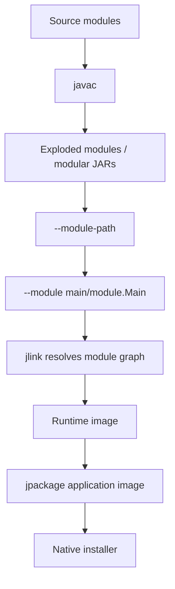

# Đóng gói ứng dụng modular với --module-path và --module

Với ứng dụng Java dùng Java Platform Module System (JPMS), `jpackage` nhận các module đã được build thông qua `--module-path` và xác định điểm vào bằng `--module`. Công cụ dùng module chính cùng đồ thị dependency để tạo runtime image bằng `jlink`, sau đó tạo application image hoặc native installer có launcher cho ứng dụng.

Quy trình này khác với ứng dụng classpath: không chỉ định `--input`, `--main-jar` hoặc `--main-class`. Thay vào đó, `--module-path` cho biết nơi tìm module và `--module module-name/main-class` chỉ định module chính cùng lớp main. Các module phải được biên dịch và chuẩn bị trước khi chạy `jpackage`.

Bài học thuộc chương **jpackage cơ bản** của module **JAVA_VERSION_JAVA16**. `jpackage` là công cụ chính thức từ Java 16; cách đóng gói modular bằng JPMS, `jlink` và các tùy chọn dưới đây vẫn áp dụng trên JDK hiện đại. Bài tập trung vào module đã build, dependency graph, runtime image và cách kiểm tra ứng dụng sau khi đóng gói.

## 1. Ứng dụng modular và module descriptor

Một ứng dụng modular có ít nhất một module descriptor `module-info.java`. Descriptor khai báo tên module, các module mà nó phụ thuộc, package được export và service mà module sử dụng hoặc cung cấp.

Ví dụ cấu trúc dự án có hai module:

```text
project/
  src/
    com.example.persistence/
      module-info.java
      com/example/persistence/InventoryRepository.java
    com.example.inventory/
      module-info.java
      com/example/inventory/Main.java
  build/
```

Module `com.example.persistence` cung cấp API cho module ứng dụng:

```java
module com.example.persistence {
    exports com.example.persistence;
}
```

Lớp API:

```java
package com.example.persistence;

public class InventoryRepository {
    public String findSummary() {
        return "Inventory data is ready";
    }
}
```

Module ứng dụng khai báo dependency:

```java
module com.example.inventory {
    requires com.example.persistence;
    requires java.logging;
}
```

Lớp main:

```java
package com.example.inventory;

import com.example.persistence.InventoryRepository;
import java.util.logging.Logger;

public class Main {
    private static final Logger LOG =
            Logger.getLogger(Main.class.getName());

    public static void main(String[] args) {
        var repository = new InventoryRepository();
        LOG.info(repository.findSummary());
    }
}
```

Ở đây:

- `com.example.inventory` là module chính, chứa lớp main.
- `com.example.persistence` là module dependency do dự án cung cấp.
- `java.logging` là module JDK được ứng dụng sử dụng.
- `exports` cho phép module khác truy cập public API của package.
- `requires` khai báo dependency module để trình biên dịch và runtime giải quyết đồ thị module.

Module descriptor là một phần của artifact đã build. `jpackage` không đọc các file `module-info.java` để tự biên dịch ứng dụng; nó cần module output hoặc modular JAR có `module-info.class`.

## 2. Phân biệt module path và classpath

Classpath và module path phục vụ hai mô hình nạp ứng dụng khác nhau:

| Tiêu chí | Classpath | Module path |
| --- | --- | --- |
| Đầu vào điển hình | JAR không có module descriptor | Modular JAR, JMOD hoặc thư mục module đã biên dịch |
| Cách xác định điểm vào trong jpackage | `--main-jar` và có thể `--main-class` | `--module module-name/main-class` |
| Tùy chọn đầu vào của jpackage | `--input` | `--module-path` |
| Dependency | Classpath và cấu hình ứng dụng | Đồ thị dependency khai báo trong module descriptor |
| Runtime image | Tập module JDK dành cho ứng dụng classpath | Module chính và các dependency bắc cầu |

Một file JAR không tự động là modular JAR. Modular JAR phải chứa `module-info.class` ở thư mục gốc hoặc descriptor hợp lệ trong multi-release JAR. Nếu JAR không có descriptor nhưng được đặt trên module path, Java có thể xem nó như automatic module; điều đó không biến nó thành explicit module.

Khi đóng gói ứng dụng modular, hãy xác nhận các module đầu vào có descriptor hợp lệ và dependency graph có thể được `jlink` liên kết. Không dùng `--input`/`--main-jar` thay cho module path chỉ vì artifact đang có đuôi `.jar`.

## 3. Build module trước khi đóng gói

Giả sử source tree có cấu trúc như phần đầu. Dùng `javac` để biên dịch đồng thời hai module:

```powershell
New-Item -ItemType Directory -Force build/mods | Out-Null
javac --module-source-path src -d build/mods -m com.example.persistence,com.example.inventory
```

Sau khi build, thư mục output có dạng:

```text
build/
  mods/
    com.example.persistence/
      module-info.class
      com/example/persistence/InventoryRepository.class
    com.example.inventory/
      module-info.class
      com/example/inventory/Main.class
```

Mỗi thư mục con trong `build/mods` là một exploded module: có `module-info.class` và các class thuộc module đó. Thư mục gốc `build/mods` là module path trong các lệnh tiếp theo.

Với Maven hoặc Gradle, build tool có thể tạo modular JAR hoặc module output tương ứng. Dù dùng build tool nào, kết quả cần có module descriptor và dependency module ở vị trí mà `--module-path` có thể tìm thấy.

## 4. Xác định module chính bằng --module

`--module` (viết tắt `-m`) nhận tên module chính và tùy chọn tên lớp main theo cú pháp:

```text
module-name/main-class
```

Ví dụ:

```powershell
--module com.example.inventory/com.example.inventory.Main
```

Trong đó:

- `com.example.inventory` là tên module khai báo trong `module-info.java`.
- `com.example.inventory.Main` là fully qualified name của lớp có phương thức `public static void main(String[] args)`.
- Module chính phải được tìm thấy trên module path.

Phần `/main-class` có thể bỏ qua nếu main class đã được ghi trong metadata của modular JAR, chẳng hạn bằng `jar --main-class` khi tạo JAR. Với exploded module hoặc khi muốn lệnh đóng gói tường minh, hãy chỉ rõ main class.

Không dùng `--main-class` cùng `--module`. Tùy chọn `--main-class` dành cho quy trình `--main-jar`; với modular app, lớp main được đặt ngay sau dấu gạch chéo trong giá trị `--module`.

## 5. Chỉ định module path bằng --module-path

`--module-path` (viết tắt `-p`) cho `jpackage` biết vị trí chứa module chính và các module dependency. Mỗi phần tử có thể là:

- Thư mục chứa các exploded module.
- Đường dẫn tới một modular JAR.
- Một vị trí module hợp lệ khác được công cụ module hỗ trợ.

Ví dụ với các exploded module:

```powershell
jpackage --type app-image --name Inventory --module-path build/mods --module com.example.inventory/com.example.inventory.Main --dest build/packages
```

Nếu module nằm ở nhiều vị trí, có thể truyền nhiều phần tử trong module path. Dấu phân cách đường dẫn phụ thuộc hệ điều hành:

| Nền tảng | Dấu phân cách các phần tử module path |
| --- | --- |
| Windows | Dấu chấm phẩy `;` |
| Linux | Dấu hai chấm `:` |
| macOS | Dấu hai chấm `:` |

Ví dụ trên Windows:

```powershell
jpackage --type app-image --name Inventory --module-path "build/mods;build/external-mods" --module com.example.inventory/com.example.inventory.Main --dest build/packages
```

Mỗi phần tử trong module path phải thực sự chứa module mà ứng dụng cần. Nếu module dependency nằm trong modular JAR ở thư mục riêng, thêm thư mục đó vào module path; không đưa thư mục source code chưa biên dịch vào.

## 6. Runtime image được tạo từ đồ thị dependency

Khi chỉ định `--module`, `jpackage` gọi `jlink` để tạo runtime image nếu bạn không truyền `--runtime-image`. Runtime image chứa:

- Module chính của ứng dụng.
- Các module dependency bắc cầu cần thiết để module chính hoạt động.
- Các module JDK được kéo vào từ dependency graph.
- Các module bổ sung được yêu cầu qua `--add-modules`.

Với ví dụ ở trên, module chính `com.example.inventory` yêu cầu `com.example.persistence` và `java.logging`. `jlink` phân giải đồ thị module để tạo runtime tương ứng; không cần tự liệt kê lại mọi dependency bắc cầu nếu module descriptor đã khai báo đúng.

Sơ đồ:



Runtime image được tạo để chạy ứng dụng. Nó không phải một JDK đầy đủ để tiếp tục biên dịch source code.

## 7. Bổ sung module bằng --add-modules

Thông thường, module chính và các dependency được khai báo bằng `requires` đã đủ để tạo runtime. Trong một số trường hợp, ứng dụng cần module bổ sung được nạp động hoặc không xuất hiện trong dependency graph tĩnh. Có thể chỉ định các module đó bằng `--add-modules`:

```powershell
jpackage --type app-image --name Inventory --module-path build/mods --module com.example.inventory/com.example.inventory.Main --add-modules java.xml --dest build/packages
```

Ví dụ này thêm module `java.xml` vào tập module gốc được truyền cho `jlink`. Chỉ thêm module khi ứng dụng thực sự cần nó; thêm nhiều module không sử dụng làm runtime lớn hơn và tăng số thành phần cần cập nhật.

`--add-modules` không thay thế `requires` trong module descriptor. Nếu mã nguồn của một module gọi trực tiếp API thuộc module khác, hãy khai báo dependency đúng bằng `requires`. `--add-modules` phục vụ việc đưa thêm module vào runtime image khi dependency không được kéo vào từ module graph thông thường.

## 8. Kiểm tra module descriptor và module path

Trước khi đóng gói, xác nhận module chính có thể được tìm thấy và dependency graph giải quyết được:

```powershell
java --module-path build/mods --describe-module com.example.inventory
java --module-path build/mods --validate-modules
```

Lệnh đầu mô tả module có tên `com.example.inventory`. Lệnh thứ hai kiểm tra tính hợp lệ của các module được tìm thấy trên module path. Sau đó chạy thử ứng dụng:

```powershell
java --module-path build/mods --module com.example.inventory/com.example.inventory.Main
```

Chạy thử bằng module launcher giúp phát hiện lỗi resolution, thiếu package export, sai tên module hoặc main class trước khi đóng gói.

Nếu đầu vào là modular JAR, có thể kiểm tra descriptor:

```powershell
jar --describe-module --file build/lib/com.example.inventory.jar
```

Kết quả cần xác nhận tên module, các directive `requires`, `exports`, `uses` và `provides` nếu ứng dụng có dùng service. Tên module trong lệnh `--module` phải khớp với tên module thực tế, không nhất thiết giống tên file JAR.

## 9. Tạo application image cho modular app

Sau khi build và kiểm tra module path, tạo application image:

```powershell
jpackage --type app-image --name Inventory --module-path build/mods --module com.example.inventory/com.example.inventory.Main --app-version 1.0.0 --dest build/packages
```

Trên Windows, launcher thường nằm tại:

```powershell
& "build/packages/Inventory/Inventory.exe"
```

Application image chứa launcher và runtime image được tạo từ module graph. Chạy launcher thực tế để kiểm tra ứng dụng sử dụng runtime đi kèm, thay vì chỉ kiểm tra bằng JDK đang cài trên máy build.

Nếu muốn tạo installer trực tiếp, có thể thay `--type app-image` bằng loại package phù hợp nền tảng, ví dụ `msi` trên Windows:

```powershell
jpackage --type msi --name Inventory --module-path build/mods --module com.example.inventory/com.example.inventory.Main --app-version 1.0.0 --dest build/installers
```

Native installer phải được tạo trên hệ điều hành đích. Windows tạo MSI/EXE, macOS tạo PKG/DMG và Linux tạo DEB/RPM theo khả năng của nền tảng cùng prerequisite tương ứng.

## 10. Tạo runtime image riêng bằng jlink

Trong phần lớn trường hợp, để `jpackage` tự gọi `jlink` là đủ. Nếu cần kiểm soát runtime rõ hơn hoặc tái sử dụng runtime đã chuẩn bị, có thể tạo runtime riêng trước.

Ví dụ trên Windows:

```powershell
jlink --module-path "$env:JAVA_HOME/jmods;build/mods" --add-modules com.example.inventory --output build/runtime
```

`jlink` lấy module chính và dependency bắc cầu để tạo runtime tại `build/runtime`. Sau đó truyền runtime này cho `jpackage`:

```powershell
jpackage --type app-image --name Inventory --module-path build/mods --module com.example.inventory/com.example.inventory.Main --runtime-image build/runtime --dest build/packages
```

Khi có `--runtime-image`, `jpackage` sao chép runtime đã tạo vào application image thay vì tự tạo runtime mới. Runtime phải được tạo bằng JDK tương thích và cho đúng hệ điều hành/kiến trúc đích.

## 11. Lưu ý về automatic module và dependency bên thứ ba

Một JAR không có `module-info.class` có thể được Java xem là automatic module khi đặt trên module path. Automatic module giúp ứng dụng chuyển dần từ classpath sang module path, nhưng không có module descriptor tường minh để `jlink` liên kết vào runtime image.

Vì `jpackage` dùng `jlink` để tạo runtime cho ứng dụng modular, dependency graph cần gồm các module có thể liên kết. Nếu `jlink` báo lỗi automatic module, hãy:

1. Kiểm tra dependency JAR nào chưa có module descriptor.
2. Ưu tiên phiên bản thư viện có explicit module descriptor do nhà phát triển thư viện cung cấp.
3. Cập nhật module path và `requires` theo tên module thực tế.
4. Chạy lại `java --validate-modules` và lệnh đóng gói.

Không chỉ thêm tên automatic module vào `--add-modules` để kỳ vọng khắc phục lỗi liên kết. `--add-modules` chọn module gốc; nó không biến automatic module thành explicit module.

Nếu dependency quan trọng chưa có bản modular và không thể chuyển đổi an toàn, hãy đánh giá lại cách đóng gói ứng dụng theo classpath bằng `--input`/`--main-jar`. Lựa chọn mô hình đóng gói cần phản ánh dependency thực tế của ứng dụng.

## 12. ServiceLoader và service binding từ JDK 25

Ứng dụng modular có thể khai báo service interface bằng `uses` và provider bằng `provides ... with ...` trong module descriptor. `jlink` có tùy chọn `--bind-services` để liên kết các module provider và dependency của chúng vào runtime image.

Từ JDK 25, runtime image do `jpackage` tạo không còn tự động bao gồm service bindings như các bản trước. Nếu ứng dụng dựa vào provider được tìm thấy qua service binding, cần cân nhắc truyền `--bind-services` cho `jlink` thông qua `--jlink-options`.

Ví dụ trên Windows:

```powershell
jpackage --type app-image --name Inventory --module-path build/mods --module com.example.inventory/com.example.inventory.Main --jlink-options "--strip-native-commands --strip-debug --no-man-pages --no-header-files --bind-services" --dest build/packages
```

Khi tự chỉ định `--jlink-options`, cần truyền lại các tùy chọn mặc định muốn giữ: `--strip-native-commands`, `--strip-debug`, `--no-man-pages` và `--no-header-files`. Chỉ thêm `--bind-services` nếu ứng dụng thực sự cần liên kết service provider; sau khi đóng gói, kiểm thử việc tải provider trên runtime đi kèm.

## 13. Những lỗi thường gặp khi đóng gói modular

| Triệu chứng | Nguyên nhân có thể gặp | Cách xử lý |
| --- | --- | --- |
| Không tìm thấy main module | Module path không chứa module chính hoặc tên module sai | Kiểm tra `module-info.class` và `--module-path` |
| Module resolution thất bại | Thiếu dependency module hoặc sai tên trong `requires` | Bổ sung module vào module path và sửa descriptor |
| Package không export | Module dependency không export package cần truy cập | Khai báo `exports` đúng phạm vi API |
| Không tìm thấy main class | Sai tên lớp sau dấu `/` hoặc module không có main class đã ghi | Xác nhận fully qualified name và metadata JAR |
| `jlink` báo automatic module | Dependency JAR chưa có explicit module descriptor | Dùng dependency modular hoặc chọn chiến lược classpath phù hợp |
| Runtime thiếu module nạp động | Module không xuất hiện trong dependency graph | Cân nhắc thêm `--add-modules` |
| Không tìm thấy service provider | Runtime thiếu service binding trên JDK 25+ | Kiểm tra `uses`/`provides` và cân nhắc `--bind-services` |
| Chạy trên máy build nhưng lỗi máy khác | Runtime hoặc native dependency không phù hợp nền tảng | Build và kiểm thử image trên đúng OS/CPU đích |

## 14. Bài tập tự kiểm tra

Một ứng dụng có hai module:

- `com.example.billing` chứa `com.example.billing.Main`.
- `com.example.storage` cung cấp API mà billing sử dụng.

Module descriptor của billing có:

```java
module com.example.billing {
    requires com.example.storage;
}
```

Các module đã build vào thư mục `build/mods`.

Hãy trả lời:

1. Tùy chọn nào chỉ định thư mục chứa module?
2. Giá trị `--module` nào xác định module chính và main class?
3. Có cần truyền `--main-jar` cùng `--module` không?
4. Runtime image có tự đưa `com.example.storage` vào không?
5. Nếu cần thêm module JDK được nạp động, dùng tùy chọn nào?
6. Nếu dependency storage là automatic module và `jlink` từ chối liên kết, chỉ thêm tên nó vào `--add-modules` có giải quyết được không?

**Đáp án:**

1. `--module-path build/mods`.
2. `com.example.billing/com.example.billing.Main`.
3. Không. `--module` và `--main-jar` là hai lựa chọn điểm vào loại trừ lẫn nhau.
4. Có, nếu module storage được khai báo bằng `requires` và có thể được phân giải trên module path; runtime image chứa module chính cùng dependency bắc cầu.
5. `--add-modules`.
6. Không. Cần dependency có explicit module descriptor hoặc chọn cách đóng gói khác phù hợp với ứng dụng.

## Ghi nhớ

**Đóng gói ứng dụng modular bằng `jpackage` dùng `--module-path` để tìm module đã build và `--module module-name/main-class` để xác định điểm vào.** `jpackage` dùng module chính cùng dependency graph để tạo runtime image bằng `jlink`; có thể thêm module gốc bằng `--add-modules` hoặc cung cấp runtime riêng qua `--runtime-image`. Module dependency phải được phân giải và liên kết hợp lệ. Từ JDK 25, nếu ứng dụng cần service binding, hãy cân nhắc `--bind-services` qua `--jlink-options` và kiểm thử provider trên runtime đã đóng gói.

## Tài liệu tham khảo

- [Oracle Java SE 26 — The jpackage Command](https://docs.oracle.com/en/java/javase/26/docs/specs/man/jpackage.html)
- [Oracle Java SE 26 — Packaging Overview](https://docs.oracle.com/en/java/javase/26/jpackage/packaging-overview.html)
- [Oracle Java SE 26 — The jlink Command](https://docs.oracle.com/en/java/javase/26/docs/specs/man/jlink.html)
- [Oracle Java SE 26 — The javac Command](https://docs.oracle.com/en/java/javase/26/docs/specs/man/javac.html)
- [Oracle Java SE 26 — Module System Specification](https://docs.oracle.com/en/java/javase/26/docs/specs/jls/jls-7.html)
- [JEP 392 — Packaging Tool](https://openjdk.org/jeps/392)
