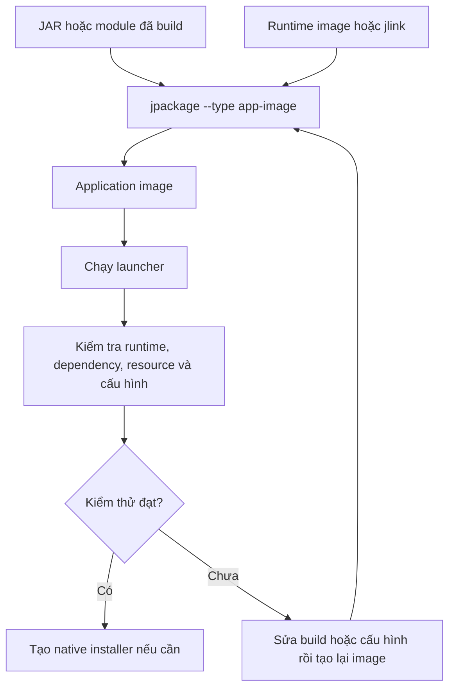

# Tạo application image bằng --type app-image để kiểm thử launcher

`jpackage` có thể tạo **application image** bằng tùy chọn `--type app-image`. Đây là thư mục hoặc application bundle chứa launcher, payload của ứng dụng và Java runtime đi kèm. Bạn có thể chạy launcher trực tiếp để kiểm tra ứng dụng trong môi trường gần với cách người dùng sẽ sử dụng, trước khi tạo native installer.

Application image phù hợp cho cả ứng dụng non-modular dùng classpath và ứng dụng modular dùng module path. Khi tạo image, `jpackage` tạo runtime bằng `jlink` nếu bạn không truyền `--runtime-image` đã chuẩn bị. Vì vậy, launcher trong image có thể khởi động ứng dụng bằng runtime đi kèm mà không yêu cầu người dùng cài JDK riêng.

Bài học thuộc chương **jpackage cơ bản** của module **JAVA_VERSION_JAVA16**. `jpackage` là công cụ đóng gói chính thức từ Java 16 và `--type app-image` vẫn là cách kiểm thử, phân phối ứng dụng Java tự chứa trên JDK hiện đại. Trọng tâm là kiểm thử launcher và runtime thật sự được đóng gói, không chỉ xác nhận lệnh tạo image đã chạy thành công.

## 1. Application image là gì?

Application image là đầu ra dạng thư mục/bundle mà `jpackage` tạo cho một ứng dụng. Nó thường gồm:

- Launcher riêng của ứng dụng để người dùng khởi chạy.
- JAR hoặc module cùng resource và dependency của ứng dụng.
- Java runtime image được tạo hoặc cung cấp cho ứng dụng.
- Cấu hình launcher và metadata cần thiết.

Application image không phải native installer. Nó không tự cài ứng dụng vào hệ điều hành, tạo quy trình gỡ cài đặt hoặc đăng ký shortcut theo cơ chế package của nền tảng. Bạn có thể chạy image trực tiếp, lưu trữ/phân phối image phù hợp với OS, hoặc dùng image làm đầu vào để tạo installer sau này.

Sơ đồ quy trình:



## 2. Chuẩn bị đầu vào

Trước khi tạo image, ứng dụng phải được build. Với ứng dụng non-modular, chuẩn bị thư mục staging có JAR chính, runtime dependency và tài nguyên ngoài JAR cần thiết:

```text
build/
  jpackage-input/
    inventory.jar
    jackson-core.jar
    jackson-databind.jar
    config/
      defaults.properties
```

Với ứng dụng classpath, `--input` trỏ tới thư mục staging, `--main-jar` chọn JAR chính và có thể dùng `--main-class` để xác định lớp main. Với ứng dụng modular, chuẩn bị các module đã build trên module path và dùng `--module-path` cùng `--module`.

Kiểm tra trước:

- JAR hoặc module chính đã build thành công.
- Runtime dependency có đầy đủ.
- Resource bên ngoài JAR được đặt vào payload và ứng dụng biết cách đọc.
- Không có test dependency, log, file tạm hoặc secret trong staging.
- Native library, nếu có, phù hợp với OS và kiến trúc đích.

`jpackage` không thay thế Maven, Gradle hoặc `javac`; nó đóng gói artifact đã được chuẩn bị.

## 3. Tạo application image cho ứng dụng classpath

Giả sử thư mục `build\jpackage-input` đã có `inventory.jar` và các JAR dependency. Trên Windows PowerShell:

```powershell
jpackage --type app-image --name Inventory --input build\jpackage-input --main-jar inventory.jar --main-class com.example.inventory.Main --app-version 1.0.0 --dest build\packages
```

Ý nghĩa:

| Tùy chọn | Ý nghĩa |
| --- | --- |
| `--type app-image` | Yêu cầu tạo application image |
| `--name Inventory` | Tên ứng dụng và launcher |
| `--input` | Thư mục chứa JAR chính, dependency và resource |
| `--main-jar inventory.jar` | JAR chính, đường dẫn tương đối từ input |
| `--main-class` | Lớp main của ứng dụng |
| `--app-version 1.0.0` | Metadata phiên bản ứng dụng |
| `--dest build\packages` | Thư mục nhận image |

Nếu manifest của JAR chính đã có `Main-Class` hợp lệ, có thể bỏ `--main-class`. Với ứng dụng modular, thay nhóm `--input`/`--main-jar`/`--main-class` bằng `--module-path` và `--module`.

## 4. Tạo application image cho ứng dụng modular

Giả sử các module đã được build vào `build\mods` và module chính là `com.example.inventory`:

```powershell
jpackage --type app-image --name Inventory --module-path build\mods --module com.example.inventory/com.example.inventory.Main --app-version 1.0.0 --dest build\packages
```

`jpackage` dùng module chính và dependency graph để tạo runtime image. Nếu cần runtime riêng đã được tạo bằng `jlink`, truyền đường dẫn bằng `--runtime-image`. Runtime image phải tương thích với hệ điều hành và kiến trúc của application image.

Hai cách đóng gói classpath và modular có thể cùng tạo ra application image; điểm khác nhau nằm ở cách cung cấp ứng dụng và xác định điểm vào.

## 5. Tìm launcher được tạo

Tên và vị trí launcher phụ thuộc hệ điều hành:

| Nền tảng | Launcher thường gặp |
| --- | --- |
| Windows | `<dest>\<name>\<name>.exe` |
| Linux | `<dest>/<name>/bin/<name>` |
| macOS | Application bundle `<dest>/<name>.app` |

Ví dụ với Windows:

```powershell
Get-ChildItem -LiteralPath "build\packages\Inventory" -Recurse -File
```

Chạy launcher:

```powershell
& "build\packages\Inventory\Inventory.exe"
```

Ví dụ trên Linux:

```bash
./build/packages/Inventory/bin/Inventory
```

Ví dụ trên macOS, mở application bundle:

```bash
open build/packages/Inventory.app
```

Nếu cần kiểm tra launcher executable trên macOS từ terminal, có thể chạy application bundle qua cơ chế launcher của bundle. Không nên hard-code đường dẫn tới các file nội bộ trong bundle vào script nghiệp vụ; dùng bundle và launcher do `jpackage` tạo.

Các đường dẫn trên là cấu trúc thường gặp của application image. Khi thay đổi tên ứng dụng, OS hoặc JDK, hãy kiểm tra output thực tế trong thư mục `--dest` trước khi viết script chạy tự động.

## 6. Chạy launcher từ terminal để quan sát lỗi

Với ứng dụng CLI hoặc ứng dụng có output console, chạy launcher từ terminal giúp quan sát stdout, stderr và mã thoát. Trên PowerShell:

```powershell
& "build\packages\Inventory\Inventory.exe" --profile test
$LASTEXITCODE
```

Trên Linux:

```bash
./build/packages/Inventory/bin/Inventory --profile test
printf 'exit code: %s\n' "$?"
```

Với ứng dụng GUI, cửa sổ có thể không hiển thị lỗi khởi động trên terminal. Hãy dùng logging của ứng dụng, file log ở vị trí dữ liệu phù hợp và cơ chế báo lỗi của ứng dụng để kiểm tra. Tùy chọn `--verbose` của `jpackage` giúp xem log chi tiết trong lúc **tạo image**, không phải bật logging runtime của ứng dụng sau này.

## 7. Kiểm thử runtime đi kèm

Một lợi ích chính của application image là runtime được đóng gói cùng ứng dụng. Để xác nhận ứng dụng không phụ thuộc vào Java cài ngoài:

1. Kiểm tra image được tạo có runtime image đi kèm theo cấu hình đóng gói.
2. Sao chép image sang máy thử nghiệm hoặc VM sạch có cùng OS/kiến trúc.
3. Thử trên máy không cài JDK/JRE riêng.
4. Khởi chạy bằng launcher trong image, không gọi `java -jar` từ terminal.
5. Kiểm tra chức năng khởi động và các chức năng dùng dependency JDK.

Không chỉ xóa Java khỏi `PATH` trên máy phát triển rồi kết luận đã kiểm thử độc lập. Máy phát triển có thể còn runtime qua đường dẫn khác hoặc thành phần native đã cài sẵn. Một VM/máy sạch là phép thử đáng tin cậy hơn.

Runtime image là runtime dành cho ứng dụng, không phải JDK đầy đủ. Người dùng không cần `javac` để chạy application image; đội phát triển vẫn cần JDK để build và đóng gói.

## 8. Kiểm thử tham số và JVM options

Launcher có thể nhận tham số khi người dùng khởi chạy. `--arguments` đặt đối số mặc định truyền cho ứng dụng; người dùng cũng có thể truyền tham số lúc chạy. `--java-options` cấu hình JVM, chẳng hạn heap hoặc system property.

Ví dụ tạo image với JVM options và đối số mặc định:

```powershell
jpackage --type app-image --name Inventory --input build\jpackage-input --main-jar inventory.jar --main-class com.example.inventory.Main --java-options "-Xms128m" --java-options "-Xmx512m" --arguments "--profile production" --dest build\packages
```

Kiểm thử ít nhất các trường hợp:

- Khởi chạy không truyền đối số.
- Khởi chạy với tham số dòng lệnh khác.
- Giá trị system property được ứng dụng đọc đúng.
- Heap và các JVM options phù hợp với môi trường dự kiến.
- Thông báo lỗi rõ ràng khi tham số không hợp lệ.

Không đưa password, token hoặc private key vào `--arguments` hay `--java-options` vì launcher configuration và package có thể được người khác kiểm tra.

## 9. Kiểm thử resource, cấu hình và thư mục làm việc

Ứng dụng thường chạy từ shortcut, menu hoặc người dùng nhấp đúp launcher. Trong các trường hợp này, working directory có thể khác thư mục cài đặt.

Kiểm tra các tình huống:

1. Chạy launcher khi working directory là thư mục khác.
2. Đọc resource đã đóng gói bên trong JAR.
3. Đọc file cấu hình ngoài JAR theo đường dẫn được xác định rõ.
4. Ghi log, cache và dữ liệu người dùng vào thư mục dữ liệu phù hợp với OS.
5. Khởi chạy image từ đường dẫn có dấu cách hoặc ký tự Unicode.

Không ghi dữ liệu thay đổi vào thư mục cài đặt nếu ứng dụng không có quyền ghi ở đó. Tách file cấu hình có thể chỉnh sửa và dữ liệu người dùng khỏi payload bất biến của ứng dụng.

## 10. Kiểm thử dependency và native library

Sau khi chạy launcher, kiểm tra các chức năng có dùng:

- Thư viện bên thứ ba và dependency runtime.
- JDBC driver hoặc provider được nạp động.
- `ServiceLoader` và service provider.
- JNI hoặc native library như `.dll`, `.so`, `.dylib`.
- File cấu hình, certificate và resource ngoài JAR.

Với ứng dụng dùng `ServiceLoader`, lưu ý thay đổi từ JDK 25: runtime image do `jpackage` tạo không còn tự động bao gồm service bindings như các bản trước. Nếu ứng dụng cần provider được tìm thấy qua service binding, cân nhắc `--bind-services` qua `--jlink-options` và kiểm thử lại trên image.

Native library phải đúng OS, kiến trúc CPU và ABI. Application image Windows không dùng thay image Linux hoặc macOS; tạo image riêng trên từng nền tảng đích.

## 11. Kiểm thử khả năng di chuyển của image

Application image thường có thể được sao chép như một thư mục hoặc bundle trên cùng nền tảng tương thích. Để phát hiện lỗi phụ thuộc đường dẫn tuyệt đối:

- Sao chép image sang một thư mục khác.
- Đặt image trong đường dẫn có dấu cách.
- Chạy từ một working directory khác.
- Kiểm tra ứng dụng có tìm đúng resource và runtime không.
- Kiểm tra file cấu hình và dữ liệu người dùng vẫn nằm đúng vị trí.

Không chỉnh sửa tùy tiện các file nội bộ của application image. Nếu cần thay đổi launcher, JVM options hoặc resource, ưu tiên tùy chọn công khai của `jpackage` và tạo lại image để có kết quả tái lập.

## 12. Tạo installer từ application image đã kiểm thử

Sau khi application image hoạt động đúng, có thể tạo native installer từ image bằng `--app-image`. Ví dụ tạo MSI trên Windows:

```powershell
jpackage --type msi --name Inventory --app-image build\packages\Inventory --app-version 1.0.0 --dest build\installers
```

`--app-image` nhận application image đã được tạo trước. Khi dùng tùy chọn này, không truyền lại `--input`, `--main-jar`, `--module` hoặc `--runtime-image` trong cùng lệnh tạo installer.

Native installer phải được build trên OS đích. Ví dụ, tạo MSI trên Windows, PKG/DMG trên macOS và DEB/RPM trên Linux. Sau khi tạo installer, vẫn cần cài đặt trên máy thử nghiệm để kiểm tra quy trình cài, launcher đã cài và gỡ cài đặt.

## 13. Các lỗi thường gặp khi kiểm thử launcher

| Triệu chứng | Nguyên nhân có thể gặp | Cách xử lý |
| --- | --- | --- |
| Launcher không khởi động | Sai main class/module, thiếu dependency hoặc runtime lỗi | Chạy launcher từ terminal, xem log và kiểm tra đầu vào |
| Chạy được trên máy build nhưng không chạy máy sạch | Ứng dụng phụ thuộc Java hoặc thư viện ngoài đã cài trên máy build | Thử image trên VM sạch và kiểm tra dependency |
| Không tìm thấy resource | Code dùng working directory hoặc đường dẫn tương đối không ổn định | Đóng gói resource trong JAR hoặc xác định đường dẫn ngoài JAR |
| Không ghi được log/dữ liệu | Ứng dụng ghi vào thư mục cài đặt không có quyền ghi | Chuyển dữ liệu thay đổi sang user data directory |
| Thiếu service provider | Runtime thiếu service binding | Kiểm tra module `uses`/`provides` và cân nhắc `--bind-services` |
| Lỗi nạp native library | Binary sai OS/CPU hoặc thiếu thư viện hệ thống | Build image riêng theo target và kiểm tra native dependencies |
| Chạy từ shortcut bị lỗi | Working directory hoặc tham số launcher khác lúc chạy terminal | Kiểm thử đúng cách khởi chạy của người dùng |
| Installer cài xong nhưng ứng dụng lỗi | Chỉ kiểm thử image, chưa kiểm thử package đã cài | Cài trên máy sạch và chạy launcher từ vị trí cài đặt |

## 14. Checklist kiểm thử application image

- [ ] Lệnh `jpackage --type app-image` hoàn tất và tạo output tại đúng `--dest`.
- [ ] Launcher đúng tên và chạy được trên OS đích.
- [ ] Ứng dụng khởi động bằng runtime đi kèm.
- [ ] Kiểm thử trên VM/máy sạch không cài JDK/JRE riêng.
- [ ] Dependency, resource và cấu hình đều được nạp đúng.
- [ ] Tham số ứng dụng và JVM options hoạt động như dự kiến.
- [ ] Logging, cache và dữ liệu người dùng ghi vào vị trí có quyền phù hợp.
- [ ] Native library và service provider hoạt động.
- [ ] Image chạy được khi được di chuyển sang thư mục khác.
- [ ] Nếu tạo installer, package đã cài được kiểm thử trên máy sạch.

## Ghi nhớ

**`--type app-image` tạo một application image có launcher, payload ứng dụng và runtime đi kèm để có thể kiểm thử trước khi phát hành.** Hãy build image cho đúng OS/kiến trúc, tìm launcher thực tế, chạy bằng runtime trong image và thử trên máy sạch không cài Java riêng. Kiểm tra dependency, resource, working directory, tham số, JVM options, native library và quyền ghi dữ liệu. Khi image đã đạt yêu cầu, có thể tạo installer từ nó bằng `--app-image` rồi kiểm thử lại package đã cài.

## Tài liệu tham khảo

- [Oracle Java SE 26 — The jpackage Command](https://docs.oracle.com/en/java/javase/26/docs/specs/man/jpackage.html)
- [Oracle Java SE 26 — Packaging Overview](https://docs.oracle.com/en/java/javase/26/jpackage/packaging-overview.html)
- [Oracle Java SE 26 — Support Application Requirements](https://docs.oracle.com/en/java/javase/26/jpackage/support-application-features.html)
- [Oracle Java SE 26 — Image and Runtime Modifications](https://docs.oracle.com/en/java/javase/26/jpackage/image-and-runtime-modifications.html)
- [JEP 392 — Packaging Tool](https://openjdk.org/jeps/392)
