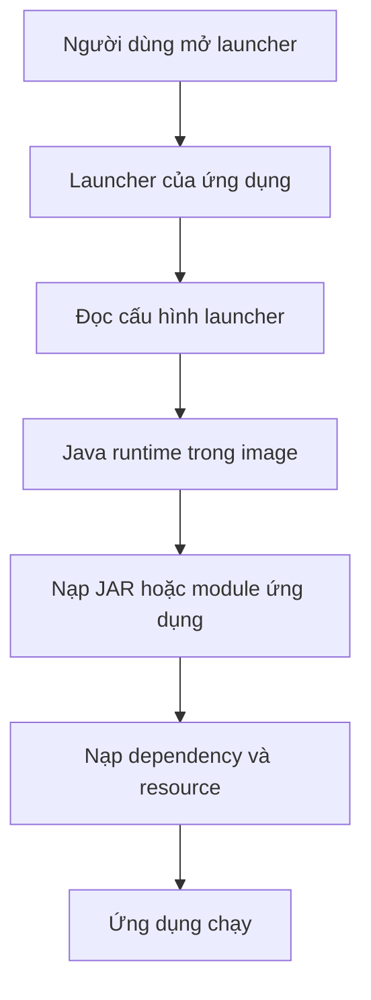

# Cấu trúc launcher, thư mục app và runtime trong image

Application image do `jpackage` tạo có ba thành phần chính: **launcher** để người dùng khởi chạy ứng dụng, **thư mục app** chứa JAR/module cùng cấu hình và tài nguyên ứng dụng, và **thư mục runtime** chứa Java runtime được đóng gói. Vị trí các thành phần này khác nhau giữa Windows, Linux và macOS, nhưng vai trò của chúng tương tự nhau.

Hiểu cấu trúc image giúp bạn tìm đúng launcher, xác định nơi đặt payload ứng dụng, phân biệt runtime đi kèm với JDK dùng để phát triển và biết phần nào có thể cấu hình bằng tùy chọn chính thức của `jpackage`. Các cấu trúc dưới đây dựa trên tài liệu Oracle Java SE 26; những file được Oracle xác định là chi tiết triển khai có thể thay đổi giữa các bản JDK.

Bài học thuộc chương **jpackage cơ bản** của module **JAVA_VERSION_JAVA16**. `jpackage` là công cụ đóng gói chính thức từ Java 16 và cấu trúc application image vẫn được dùng trong JDK hiện đại. Bài chỉ tập trung vào các thành phần và cách sử dụng còn áp dụng hiện nay.

## 1. Ba thành phần trong application image

Một application image thường có ba khu vực:

| Thành phần | Vai trò | Nội dung thường gặp |
| --- | --- | --- |
| Launcher | Điểm vào để người dùng mở ứng dụng | File thực thi hoặc launcher theo nền tảng |
| App | Payload và cấu hình của ứng dụng | JAR, module, dependency, resource và file cấu hình launcher |
| Runtime | Môi trường Java chạy ứng dụng | Runtime image được tạo bằng `jlink` hoặc cung cấp qua `--runtime-image` |

Luồng khởi chạy có thể hình dung như sau:



Launcher liên kết các thành phần này để khởi động ứng dụng bằng runtime đã đóng gói. Người dùng thường chỉ cần chạy launcher; không cần tự gọi `java -jar` hoặc tự viết classpath như khi chạy ứng dụng thủ công.

## 2. Cấu trúc application image trên Windows

Với một ứng dụng tên `HelloWorld`, cấu trúc Windows thường có dạng:

```text
HelloWorld/
  HelloWorld.exe          # Launcher của ứng dụng
  app/
    HelloWorld.cfg        # Cấu hình do jpackage tạo
    HelloWorld.jar        # JAR chính được lấy từ --input
    dependency.jar        # Ví dụ: JAR dependency
    config/
      defaults.properties
  runtime/
    bin/
    conf/
    legal/
    lib/
    release
```

**Launcher ở thư mục gốc**

`HelloWorld.exe` là file người dùng mở để chạy ứng dụng. Launcher biết vị trí payload và runtime tương ứng trong image. Đây là điểm vào cần dùng khi chạy hoặc tạo shortcut cho ứng dụng.

**Thư mục `app/`**

`app/` chứa các file ứng dụng được đóng gói từ thư mục `--input`, cùng file cấu hình launcher do `jpackage` tạo. JAR chính, dependency JAR và tài nguyên được đưa vào image theo cách chuẩn bị đầu vào. File cấu hình launcher lưu thông tin cần thiết để khởi chạy ứng dụng, ví dụ điểm vào và các tùy chọn chạy.

**Thư mục `runtime/`**

`runtime/` chứa Java runtime image. Launcher sử dụng runtime này khi chạy ứng dụng. Người dùng không cần cài một JDK riêng chỉ để khởi chạy image.

## 3. Cấu trúc application image trên Linux

Trên Linux, launcher nằm trong `bin/`, còn payload ứng dụng và runtime nằm dưới `lib/`:

```text
myapp/
  bin/
    HelloWorld             # Launcher của ứng dụng
  lib/
    app/
      HelloWorld.cfg       # Cấu hình do jpackage tạo
      HelloWorld.jar       # JAR chính
      dependency.jar
      config/
        defaults.properties
    runtime/                # Java runtime image
      bin/
      conf/
      legal/
      lib/
      release
```

**Thư mục `bin/`** chứa launcher. Người dùng có thể chạy launcher từ terminal hoặc môi trường desktop:

```bash
./myapp/bin/HelloWorld
```

**Thư mục `lib/app/`** chứa payload ứng dụng và file cấu hình launcher. Tên `lib` ở đây là một phần của cấu trúc application image; không nên nhầm toàn bộ thư mục này với một thư mục dependency classpath do dự án tự tạo.

**Thư mục `lib/runtime/`** chứa runtime Java đi kèm. Đây là runtime riêng của application image, được launcher sử dụng để chạy ứng dụng.

## 4. Cấu trúc application bundle trên macOS

Trên macOS, application image được thể hiện dưới dạng bundle `.app`. Với ứng dụng `HelloWorld`, cấu trúc thường gặp:

```text
HelloWorld.app/
  Contents/
    Info.plist
    MacOS/
      HelloWorld              # Launcher
    Resources/
      HelloWorld.icns         # Icon và tài nguyên bundle
    app/
      HelloWorld.cfg          # Cấu hình do jpackage tạo
      HelloWorld.jar
      dependency.jar
      config/
        defaults.properties
    runtime/                  # Java runtime image
      Contents/
        Home/
          bin/
          conf/
          legal/
          lib/
          release
```

**`Contents/Info.plist`** lưu metadata của application bundle để macOS nhận diện ứng dụng, ví dụ tên hiển thị và thông tin launcher.

**`Contents/MacOS/`** chứa executable launcher. Người dùng thường mở bundle bằng Finder hoặc lệnh `open`:

```bash
open HelloWorld.app
```

**`Contents/Resources/`** chứa icon và tài nguyên dành cho bundle. **`Contents/app/`** chứa payload cùng cấu hình ứng dụng; **`Contents/runtime/`** chứa Java runtime đi kèm.

Không di chuyển riêng launcher ra khỏi bundle hoặc chỉ sao chép thư mục `Contents/MacOS`. Các thành phần trong bundle cần giữ quan hệ vị trí để launcher tìm thấy cấu hình, payload và runtime.

## 5. So sánh vị trí launcher, app và runtime

| Thành phần | Windows | Linux | macOS |
| --- | --- | --- | --- |
| Launcher | **<name>/<name>.exe** | **<name>/bin/<name>** | **<name>.app/Contents/MacOS/<name>** |
| Payload và cấu hình app | **<name>/app/** | **<name>/lib/app/** | **<name>.app/Contents/app/** |
| Runtime | **<name>/runtime/** | **<name>/lib/runtime/** | **<name>.app/Contents/runtime/** |
| Metadata bundle | Không dùng Info.plist theo cấu trúc này | Không dùng Info.plist | **Contents/Info.plist** |
| Icon/tài nguyên nền tảng | Resource launcher/package theo Windows | Resource launcher/desktop theo Linux | **Contents/Resources/** |

Tên và vị trí các file phụ có thể thay đổi theo JDK, tùy chọn đóng gói và nền tảng. Oracle lưu ý một số file trong ví dụ cấu trúc là chi tiết triển khai; vì vậy, hãy dựa vào các khu vực chức năng launcher, app và runtime thay vì phụ thuộc vào mọi file nội bộ.

## 6. File cấu hình launcher trong thư mục app

Trong các ví dụ application image, jpackage tạo file cấu hình launcher có tên theo ứng dụng, chẳng hạn **HelloWorld.cfg**. File này cung cấp cấu hình cần thiết để launcher khởi chạy ứng dụng, bao gồm thông tin về điểm vào và tùy chọn chạy.

Những cấu hình thường cần khi đóng gói:

- Main JAR và main class đối với ứng dụng classpath.
- Main module đối với ứng dụng modular.
- JVM options như heap size hoặc system property.
- Arguments mặc định truyền cho ứng dụng.
- Thông tin bổ sung cho launcher được tạo bằng --add-launcher.

Hãy cấu hình các giá trị này qua tùy chọn công khai của jpackage:

```powershell
jpackage --type app-image --name HelloWorld --input build\input --main-jar HelloWorld.jar --main-class com.example.Main --java-options "-Xmx512m" --arguments "--profile desktop" --dest build\image
```

Không nên viết script phụ thuộc vào cú pháp nội bộ của file CFG hoặc sửa file này như một giao diện cấu hình ổn định. File được công cụ sinh ra; nội dung và cách biểu diễn có thể thay đổi theo phiên bản. Nếu cần đổi JVM options, arguments hoặc launcher, hãy cập nhật lệnh đóng gói hay file properties dùng với --add-launcher, sau đó tạo lại image.

## 7. Payload trong thư mục app đến từ đâu?

Đối với ứng dụng non-modular, các file từ thư mục --input được đưa vào payload của image. Ví dụ:

```text
input/
  HelloWorld.jar
  jackson-core.jar
  jackson-databind.jar
  config/
    defaults.properties
  templates/
    invoice.html
```

Các file này được đặt trong khu vực app theo cấu trúc nền tảng. JAR chính và dependency JAR được launcher đưa vào classpath mặc định. Các file như properties, template hoặc dữ liệu tĩnh được đóng gói cùng ứng dụng nhưng không tự động trở thành classpath.

Với ứng dụng modular, payload ứng dụng được tạo từ module đã build trên --module-path; điểm vào được xác định bằng --module. Runtime image được liên kết từ module chính và các dependency cần thiết.

Có thể bổ sung file hoặc thư mục vào application payload bằng --app-content. Tùy chọn này dùng khi tài nguyên cần đóng gói không nằm trong thư mục input chính. Hãy bảo đảm code ứng dụng biết cách tìm file sau khi đóng gói.

## 8. Thư mục runtime chứa gì?

Thư mục runtime là một Java runtime image được tạo bằng jlink hoặc được cung cấp sẵn qua --runtime-image. Nó thường có các khu vực như:

| Khu vực | Vai trò |
| --- | --- |
| **bin/** | Lệnh chạy Java và các executable runtime cần thiết |
| **conf/** | Cấu hình runtime |
| **legal/** | Thông tin giấy phép của các module được đóng gói |
| **lib/** | Thư viện và thành phần nội bộ của runtime |
| **release** | Metadata mô tả runtime image |

Runtime image trong application image được tối ưu cho việc chạy ứng dụng. Nó không phải một JDK phát triển đầy đủ: thông thường không có javac, source archive src.zip, man pages và các công cụ JDK không cần cho runtime. Không dùng thư mục này làm JDK để compile source hoặc chạy jlink tiếp.

Người dùng nên chạy launcher ở cấp application image. Không yêu cầu họ tìm runtime/bin/java rồi tự truyền classpath; launcher đã kết nối runtime với payload và cấu hình của ứng dụng.

## 9. Runtime được tạo bằng jlink hay được cung cấp sẵn?

Nếu không truyền --runtime-image, jpackage gọi jlink để tạo runtime phù hợp với ứng dụng. Với ứng dụng modular, runtime chứa module chính và các dependency bắc cầu có thể liên kết. Với ứng dụng non-modular dùng JAR, runtime mặc định gồm tập module JDK được cung cấp cho ứng dụng classpath trong unnamed module.

Nếu cần tự kiểm soát runtime, có thể tạo trước bằng jlink, sau đó đưa image vào jpackage:

```powershell
jlink --module-path "$env:JAVA_HOME\jmods;build\mods" --add-modules com.example.helloworld --output build\runtime
jpackage --type app-image --name HelloWorld --module-path build\mods --module com.example.helloworld/com.example.Main --runtime-image build\runtime --dest build\image
```

Khi dùng --runtime-image, jpackage sao chép runtime đã chuẩn bị vào application image. Runtime phải được tạo cho đúng hệ điều hành và kiến trúc đích, đồng thời tương thích với ứng dụng.

## 10. Service binding và thay đổi từ JDK 25

Một chi tiết ảnh hưởng tới nội dung runtime: từ JDK 25, runtime image do jpackage tạo không tự động bao gồm service bindings như các bản trước. Nếu ứng dụng dùng service provider cần được tìm thấy qua quá trình liên kết service, hãy cân nhắc tùy chọn --bind-services của jlink thông qua --jlink-options.

Ví dụ:

```powershell
jpackage --type app-image --name HelloWorld --module-path build\mods --module com.example.helloworld/com.example.Main --jlink-options "--strip-native-commands --strip-debug --no-man-pages --no-header-files --bind-services" --dest build\image
```

Khi tự chỉ định --jlink-options, cần truyền lại các tùy chọn mặc định muốn giữ, vì danh sách tùy chọn tự đặt sẽ được chuyển tới jlink. Chỉ thêm --bind-services khi ứng dụng cần provider tương ứng; sau đó kiểm thử ServiceLoader trên runtime đã đóng gói.

## 11. Launcher, runtime và cấu hình khi chạy

Launcher kết hợp cấu hình với runtime và payload để mở ứng dụng. Một số tùy chọn ảnh hưởng trực tiếp tới quá trình này:

| Tùy chọn jpackage | Tác động |
| --- | --- |
| --main-jar | Chỉ định JAR chính cho ứng dụng classpath |
| --main-class | Chỉ định lớp main khi dùng --main-jar |
| --module | Chỉ định module chính và tùy chọn main class |
| --java-options | Cấu hình tùy chọn truyền cho JVM |
| --arguments | Cấu hình đối số mặc định truyền cho ứng dụng |
| --add-launcher | Tạo launcher bổ sung với properties riêng |
| --runtime-image | Dùng runtime image đã tạo sẵn |

Ví dụ tạo thêm launcher cho một chế độ khác:

```text
admin.properties
  module=com.example.helloworld/com.example.admin.AdminMain
  arguments=--mode admin
  java-options=-Xmx768m
```

Truyền file properties qua --add-launcher:

```powershell
jpackage --type app-image --name HelloWorld --module-path build\mods --module com.example.helloworld/com.example.Main --add-launcher Admin=admin.properties --dest build\image
```

Launcher chính và launcher bổ sung có thể dùng cùng payload/runtime nhưng có điểm vào, arguments hoặc JVM options khác nhau. Chỉ khai báo các giá trị thật sự cần cho từng launcher.

## 12. Phân biệt application image với native installer

Application image là cấu trúc file có thể chạy trực tiếp trên nền tảng tương ứng. Native installer là gói cài đặt được tạo từ image hoặc từ đầu vào ứng dụng:

| Artifact | Chứa gì? | Mục đích |
| --- | --- | --- |
| Application image | Launcher, app payload, runtime | Chạy hoặc phân phối image trên cùng nền tảng tương thích |
| Native installer | Nội dung image cùng metadata và tích hợp cài đặt của OS | Cài đặt, tạo shortcut/menu, quản lý uninstall theo nền tảng |

Có thể tạo installer từ image đã chuẩn bị bằng --app-image:

```powershell
jpackage --type msi --name HelloWorld --app-image build\image\HelloWorld --dest build\installers
```

Khi đóng gói cho nhiều nền tảng, phải tạo image/package trên từng nền tảng đích. Application image Windows không thể dùng thay image Linux hoặc macOS.

## 13. Kiểm tra cấu trúc image trên máy build

Trên Windows, liệt kê các thành phần chính:

```powershell
Get-ChildItem -LiteralPath "build\image\HelloWorld" -Force
Get-ChildItem -LiteralPath "build\image\HelloWorld\app" -Force
Get-ChildItem -LiteralPath "build\image\HelloWorld\runtime" -Force
```

Trên Linux:

```bash
find build/image/HelloWorld -maxdepth 3 -type d -o -type f
```

Trên macOS:

```bash
find HelloWorld.app/Contents -maxdepth 3 -type d -o -type f
```

Kiểm tra:

- Có launcher đúng tên trong vị trí của nền tảng.
- Khu vực app chứa JAR/module và cấu hình ứng dụng cần thiết.
- Runtime image tồn tại và được đặt trong đúng khu vực của image.
- Resource bổ sung đã được đóng gói.
- Không có file build/test/log/secret không cần thiết.

Các lệnh find và Get-ChildItem chỉ dùng để quan sát cấu trúc. Không dựa vào thứ tự file hoặc tên các file triển khai nội bộ ngoài những thành phần được tài liệu chính thức mô tả.

## 14. Những lỗi thường gặp khi hiểu cấu trúc image

| Nhầm lẫn hoặc triệu chứng | Nguyên nhân | Cách xử lý |
| --- | --- | --- |
| Chạy runtime/bin/java thay launcher | Bỏ qua cấu hình launcher và cách nối với payload | Chạy launcher ở cấp application image |
| Không tìm thấy JAR/module | Payload chưa được đưa vào image hoặc điểm vào khai báo sai | Kiểm tra input/module path và cấu hình --main-jar/--module |
| Tưởng file properties ngoài JAR tự vào classpath | Mọi file trong app payload không đồng nghĩa mọi file đều là classpath | Đọc file ngoài JAR bằng đường dẫn rõ ràng |
| Tưởng runtime là JDK đầy đủ | Runtime image chỉ phục vụ chạy ứng dụng | Dùng JDK riêng cho compile và build |
| Di chuyển riêng launcher khỏi image | Launcher cần cấu hình, app và runtime cùng vị trí tương ứng | Giữ nguyên toàn bộ image hoặc bundle |
| Sửa trực tiếp file CFG rồi phụ thuộc vào cú pháp nội bộ | Cấu trúc file sinh ra là chi tiết triển khai | Cấu hình bằng tùy chọn jpackage và tạo lại image |
| Image chạy trên Windows nhưng không chạy trên Linux | Runtime/native dependency và launcher phụ thuộc nền tảng | Build image riêng trên từng OS/CPU đích |
| Thiếu provider sau khi nâng JDK | Hành vi service binding thay đổi từ JDK 25 | Kiểm tra service usage và cân nhắc --bind-services |

## Ghi nhớ

**Application image có launcher, khu vực app và runtime; vị trí cụ thể phụ thuộc hệ điều hành.** Windows đặt launcher ở thư mục gốc, Linux đặt launcher trong bin/ và payload/runtime dưới lib/, còn macOS dùng bundle .app với launcher trong Contents/MacOS. Khu vực app chứa JAR/module, resource và cấu hình launcher; runtime chứa Java runtime được jlink tạo hoặc được cung cấp qua --runtime-image. Hãy chạy launcher ở cấp image, giữ nguyên cấu trúc bundle và cấu hình qua tùy chọn công khai của jpackage.

## Tài liệu tham khảo

- [Oracle Java SE 26 — Packaging Overview: Generated Application Image](https://docs.oracle.com/en/java/javase/26/jpackage/packaging-overview.html)
- [Oracle Java SE 26 — The jpackage Command](https://docs.oracle.com/en/java/javase/26/docs/specs/man/jpackage.html)
- [Oracle Java SE 26 — The jlink Command](https://docs.oracle.com/en/java/javase/26/docs/specs/man/jlink.html)
- [Oracle Java SE 26 — Packaging Tool User's Guide](https://docs.oracle.com/en/java/javase/26/jpackage/packaging-tool-user-guide.pdf)
- [JEP 392 — Packaging Tool](https://openjdk.org/jeps/392)
