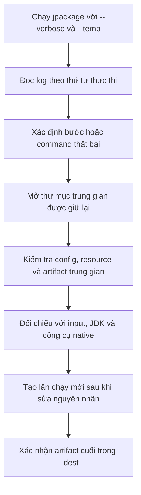

# Đọc lỗi bằng --verbose và giữ thư mục chẩn đoán bằng --temp

> **Chương:** jpackage cơ bản  
> **Học phần:** `JAVA_VERSION_JAVA16` — tìm hiểu cách đóng gói ứng dụng Java bằng công cụ jpackage đã được hoàn thiện trong Java 16, đồng thời sử dụng các tùy chọn chẩn đoán vẫn hữu ích trong JDK hiện đại. Bài này tập trung vào việc đọc log, xác định bước đóng gói thất bại và giữ lại dữ liệu trung gian để điều tra.

## Mục tiêu học tập

Sau bài này, bạn có thể:

- Giải thích vai trò của `--verbose` và `--temp` trong jpackage.
- Chạy lại lệnh đóng gói với log chi tiết và thư mục trung gian riêng.
- Phân biệt thư mục tạm chẩn đoán với thư mục kết quả `--dest`.
- Đọc log để xác định bước jpackage, jlink hoặc công cụ native gặp lỗi.
- Kiểm tra tài nguyên và file trung gian được tạo trong quá trình đóng gói.
- Phân biệt lỗi application image với lỗi tạo installer native.
- Dùng `--resource-dir` để tùy chỉnh tài nguyên sau khi đã kiểm tra bản mặc định.
- Thu thập thông tin đủ để tái hiện lỗi trên máy phát triển hoặc CI.
- Dọn dữ liệu chẩn đoán an toàn sau khi hoàn tất điều tra.

## 1. jpackage và nhu cầu chẩn đoán

`jpackage` là công cụ đóng gói ứng dụng Java thành application image hoặc gói cài đặt native phù hợp với nền tảng, chẳng hạn EXE/MSI trên Windows, DEB/RPM trên Linux hoặc PKG/DMG trên macOS.

Công cụ được hoàn thiện trong Java 16 qua JEP 392. Khi đóng gói, jpackage có thể phối hợp với `jlink` để tạo runtime image, xử lý tài nguyên launcher và gọi các công cụ đóng gói riêng của hệ điều hành.

Một lệnh đóng gói có thể đi qua nhiều bước:

- Đọc JAR, module và các tài nguyên đầu vào.
- Tạo runtime image bằng jlink nếu không cung cấp runtime image có sẵn.
- Tạo application image và launcher.
- Chuẩn bị metadata, icon, template và cấu hình installer.
- Gọi công cụ native để tạo định dạng gói của hệ điều hành.
- Ghi sản phẩm cuối vào thư mục đích.

Nếu lệnh thất bại, thông báo cuối cùng đôi khi chỉ nói thao tác đóng gói không thành công. Cần biết chính xác bước nào thất bại và tài nguyên nào được dùng. Hai tùy chọn hữu ích là:

- `--verbose`: tăng thông tin được in trong quá trình thực thi.
- `--temp`: chỉ định thư mục giữ lại các file trung gian để kiểm tra.

Hai tùy chọn bổ trợ cho nhau: log cho biết tiến trình và lệnh đã chạy; thư mục tạm cho phép kiểm tra một phần dữ liệu được tạo trong quá trình đó.

## 2. Phân biệt --verbose, --temp và --dest

Ba tùy chọn này có vai trò khác nhau:

| Tùy chọn | Vai trò | Dữ liệu nhận được |
| --- | --- | --- |
| `--verbose` | Hiển thị thông tin chi tiết hơn về quá trình đóng gói | Log trên console hoặc logger tùy phiên bản JDK |
| `--temp <directory>` | Chỉ định thư mục dùng cho file trung gian và giữ thư mục đó sau khi tác vụ kết thúc | Cấu hình, tài nguyên và sản phẩm trung gian tùy nền tảng |
| `--dest <directory>` | Chỉ định nơi đặt sản phẩm đóng gói cuối cùng | Application image hoặc installer |

`--temp` không phải thư mục output cuối cùng. Nó phục vụ điều tra quá trình đóng gói. `--dest` mới là nơi chứa artifact mà người dùng hoặc pipeline phát hành.

Nếu không chỉ định `--temp`, jpackage tự tạo thư mục tạm và xóa thư mục đó sau khi tác vụ hoàn tất. Khi chỉ định `--temp`, thư mục phải là thư mục mới hoặc thư mục đang rỗng; jpackage giữ lại thư mục sau khi tác vụ kết thúc và bạn cần tự dọn thủ công.

## 3. Chạy với --verbose để xem quá trình đóng gói

Ví dụ đóng gói một ứng dụng không modular thành application image:

```bash
jpackage \
  --type app-image \
  --input input \
  --name ReportDesk \
  --main-jar report-desk.jar \
  --main-class com.example.report.Main \
  --dest build/package \
  --verbose
```

Log chi tiết giúp quan sát các bước jpackage thực hiện. Tùy phiên bản JDK và nền tảng, log có thể cho biết:

- Tài nguyên mặc định nào đang được sử dụng.
- Tên file cần đặt trong resource directory nếu muốn override tài nguyên.
- Công cụ native nào được gọi.
- Tham số hoặc command line được chuyển cho công cụ đó.
- Giai đoạn nào kết thúc thành công và giai đoạn nào thất bại.

Khi gặp lỗi, hãy đọc log từ vị trí đầu tiên có cảnh báo hoặc lỗi liên quan, rồi lần theo command ngay trước thông báo thất bại. Dòng lỗi cuối cùng có thể chỉ là kết quả tổng hợp của một lệnh con đã thất bại trước đó.

Không nên kết luận rằng JAR lỗi chỉ vì lệnh jpackage trả về mã thoát khác 0. Lỗi có thể đến từ jlink, resource template, quyền filesystem hoặc công cụ native của hệ điều hành.

## 4. Giữ file trung gian bằng --temp

Để giữ dữ liệu trung gian, chỉ định một thư mục mới hoặc rỗng:

```bash
jpackage \
  --type app-image \
  --input input \
  --name ReportDesk \
  --main-jar report-desk.jar \
  --main-class com.example.report.Main \
  --dest build/package \
  --temp build/jpackage-debug-001 \
  --verbose
```

Thư mục `build/jpackage-debug-001` được dùng làm nơi tạo file tạm. Khi có `--temp`, jpackage không xóa thư mục này sau khi tác vụ kết thúc.

Một số lưu ý:

- Mỗi lần điều tra nên dùng một thư mục riêng, ví dụ `jpackage-debug-001`, `jpackage-debug-002`.
- Nếu dùng lại một thư mục đã có nội dung, jpackage có thể từ chối; hãy dùng thư mục mới hoặc dọn thư mục cũ sau khi đã lưu dữ liệu cần thiết.
- Dùng đường dẫn tuyệt đối nếu working directory của build agent có thể thay đổi.
- Đảm bảo process đóng gói có quyền tạo và ghi file trong thư mục.
- Thư mục tạm có thể chiếm dung lượng đáng kể, nhất là khi có runtime image và tài nguyên installer.

Nếu không chỉ định `--temp`, thư mục tạm do jpackage tự tạo sẽ được xóa khi tác vụ hoàn tất. Vì vậy, hãy thêm tùy chọn này khi cần điều tra một lỗi có thể tái hiện.

## 5. Kết hợp --verbose và --temp trong một lần chạy

Khi cần chẩn đoán đầy đủ, hãy dùng cả hai tùy chọn:

```bash
jpackage \
  --type app-image \
  --input input \
  --name ReportDesk \
  --main-jar report-desk.jar \
  --main-class com.example.report.Main \
  --dest build/package \
  --temp build/jpackage-debug-001 \
  --verbose
```

Quy trình quan sát:



Log và thư mục tạm có mục đích khác nhau:

- Log cho biết jpackage đã làm gì và gọi công cụ nào.
- Thư mục tạm cho biết dữ liệu trung gian đã được tạo hoặc chuẩn bị.
- Thư mục đích cho biết sản phẩm cuối có được tạo hay không.

Không phải mọi file trung gian đều tồn tại trên mọi nền tảng hoặc mọi kiểu package. Cấu trúc thực tế phụ thuộc JDK, hệ điều hành và loại artifact.

## 6. Đọc log để tìm đúng bước thất bại

Khi xem log verbose, nên đọc theo thứ tự:

1. **Thông tin đầu vào:** tên JAR, module, main class, resource directory và destination.
2. **Runtime image:** jpackage có gọi jlink hay sử dụng runtime image được cung cấp.
3. **Application image:** launcher, thư viện, runtime và tài nguyên có được chuẩn bị không.
4. **Native packaging:** công cụ installer của nền tảng có được gọi không.
5. **Kết quả:** file cuối đã được ghi vào destination hay chưa.

Ví dụ log giả định:

```text
Creating app package...
Using default package resource main.wxs
Running [native-packager, ...]
Error: native-packager exited with code 1
```

Trong tình huống này, hãy điều tra lệnh native packager và tài nguyên installer trước. Chạy lại ứng dụng JAR bằng java không đủ để xác nhận công cụ tạo installer hoạt động.

Một log khác có thể cho thấy jlink thất bại khi tạo runtime image. Khi đó, cần kiểm tra module path, danh sách module và các tùy chọn runtime image thay vì tập trung vào icon hoặc template installer.

## 7. Kiểm tra file trong thư mục --temp

Nội dung thư mục tạm phụ thuộc loại package và nền tảng.

Có thể gặp:

- Thư mục `config` chứa tài nguyên và template được dùng trong quá trình đóng gói.
- Thư mục `images` chứa dữ liệu hình ảnh hoặc các bước chuẩn bị application image.
- Các file trung gian của công cụ đóng gói native, ví dụ object hoặc project file.
- Metadata và cấu hình phục vụ tạo installer.

Trên Windows, tài liệu đóng gói có thể minh họa các file như `main.wxs`, `overrides.wxi` hoặc file properties của launcher. Trên Linux và macOS, cấu trúc file khác theo định dạng package.

Không giả định mọi thư mục hoặc tên file trong ví dụ tài liệu đều xuất hiện trên mọi JDK. Hãy xem cấu trúc thực tế của lần chạy và đối chiếu với log verbose.

## 8. Dùng log để tìm tài nguyên mặc định đang được sử dụng

jpackage hỗ trợ resource directory để thay thế một số tài nguyên mặc định như icon, launcher properties hoặc installer template.

Khi cần biết tài nguyên nào đang được dùng, hãy chạy với `--verbose` và xem thông báo resource. Ví dụ minh họa:

```text
Using default package resource WinLauncher.template
(add ReportDesk.properties to the resource-dir to customize).

Using default package resource main.wxs
(add main.wxs to the resource-dir to customize).
```

Tên file cụ thể tùy nền tảng, launcher và loại installer. Thông báo verbose giúp xác định tên tài nguyên override mà jpackage mong đợi.

Nếu cần tùy chỉnh, hãy dùng `--resource-dir`:

```bash
jpackage \
  --input input \
  --name ReportDesk \
  --main-jar report-desk.jar \
  --main-class com.example.report.Main \
  --resource-dir packaging/resources \
  --dest build/package \
  --verbose
```

`--resource-dir` là nơi cung cấp tài nguyên tùy chỉnh. `--temp` là nơi giữ file trung gian để xem xét. Không sửa trực tiếp file trong thư mục tạm rồi kỳ vọng jpackage dùng lại chúng ở lần chạy kế tiếp.

Khi override một template hoặc properties file, hãy bảo đảm file tùy chỉnh có đầy đủ nội dung và thuộc tính cần thiết của tài nguyên mặc định. Việc chỉ sao chép một phần có thể làm hỏng quá trình tạo installer.

## 9. Tách lỗi application image khỏi lỗi installer

Một cách chẩn đoán hữu ích là thử tạo application image trước, rồi mới tạo installer native.

Ví dụ:

```bash
jpackage \
  --type app-image \
  --input input \
  --name ReportDesk \
  --main-jar report-desk.jar \
  --main-class com.example.report.Main \
  --dest build/app-image \
  --verbose \
  --temp build/jpackage-image-debug
```

Nếu application image được tạo thành công, có thể kiểm tra launcher và runtime độc lập với bước đóng gói installer.

Sau đó, dùng application image đã tạo để xây dựng package:

```bash
jpackage \
  --type <installer-type-for-host> \
  --name ReportDesk \
  --app-image build/app-image/ReportDesk \
  --dest build/installer \
  --verbose \
  --temp build/jpackage-installer-debug
```

`<installer-type-for-host>` là placeholder cho loại package phù hợp với host, chẳng hạn `msi` hoặc `exe` trên Windows, `deb` hoặc `rpm` trên Linux, `pkg` hoặc `dmg` trên macOS. Thay placeholder bằng giá trị hợp lệ trước khi chạy.

Cách tách này giúp xác định lỗi nằm ở việc tạo application image hay ở bước tạo installer. Mỗi lần chạy dùng thư mục temp riêng để không trộn dữ liệu trung gian.

jpackage không hỗ trợ tạo native installer cho một nền tảng khác từ host hiện tại. Hãy build loại package native trên nền tảng đích tương ứng.

## 10. Chẩn đoán khi jpackage dùng jlink

Nếu không chỉ định `--runtime-image`, jpackage sử dụng jlink để tạo Java runtime image theo module cần thiết và các tùy chọn liên quan.

Khi log cho thấy lỗi xảy ra ở jlink:

- Kiểm tra module path có chứa module cần thiết không.
- Kiểm tra main module và các dependency module.
- Kiểm tra ứng dụng có tham chiếu module không được resolve không.
- Xem các tùy chọn jlink mà jpackage nhận hoặc dùng mặc định.
- Nếu đã có runtime image được tạo và kiểm thử riêng, thử cung cấp bằng `--runtime-image` để cô lập bước tạo runtime.

Ví dụ dùng runtime image đã chuẩn bị:

```bash
jpackage \
  --type app-image \
  --input input \
  --name ReportDesk \
  --main-jar report-desk.jar \
  --main-class com.example.report.Main \
  --runtime-image build/runtime-image \
  --dest build/package \
  --verbose \
  --temp build/jpackage-debug-runtime
```

Nếu lần chạy với runtime image có sẵn thành công trong khi lần chạy để jpackage gọi jlink thất bại, hãy tập trung điều tra cấu hình hoặc module graph của bước jlink.

## 11. Lỗi công cụ native theo nền tảng

jpackage tạo installer bằng cách phối hợp với công cụ của hệ điều hành. Log verbose có thể cho biết lệnh nào được gọi và lỗi trả về từ công cụ đó.

| Nền tảng | Loại package thường gặp | Hướng điều tra |
| --- | --- | --- |
| Windows | EXE, MSI | Kiểm tra công cụ đóng gói Windows mà JDK yêu cầu, quyền ghi và file WiX/resource liên quan |
| Linux | DEB, RPM | Kiểm tra công cụ tạo package của distro, quyền và metadata package |
| macOS | PKG, DMG | Kiểm tra công cụ tạo package/disk image, signing identity và entitlements nếu có ký |

Yêu cầu công cụ ngoài có thể thay đổi theo JDK và loại package. Không cài một phiên bản toolchain theo hướng dẫn cũ mà chưa đối chiếu với tài liệu của JDK đang dùng.

Nếu log có dòng chạy một executable ngoài rồi báo mã thoát khác 0, hãy:

1. Xác định executable và tham số được gọi.
2. Kiểm tra executable có trong PATH hoặc đúng vị trí mà JDK mong đợi không.
3. Chạy kiểm tra phiên bản theo tài liệu công cụ đó.
4. Đọc output của chính công cụ con trong log.
5. Kiểm tra resource và project file liên quan trong thư mục temp.
6. Tái hiện trên host cùng hệ điều hành và kiến trúc.

## 12. Khác biệt cú pháp --verbose giữa JDK 16 và JDK mới hơn

Trong JDK 16 và nhiều bản JDK tiếp theo, cách dùng cơ bản là:

```bash
jpackage --verbose [các tùy chọn đóng gói khác]
```

Ở các bản JDK mới hơn, tài liệu jpackage có thể hỗ trợ chọn nhóm thông điệp verbose. Ví dụ tài liệu JDK 27 mô tả các nhóm như `resources`, `summary`, `tools`, `trace` và `errors`.

Ví dụ trên JDK 27:

```bash
jpackage --verbose resources,summary,tools [các tùy chọn đóng gói khác]
```

Hoặc bật thông tin chi tiết về trace và lệnh công cụ:

```bash
jpackage --verbose trace,tools [các tùy chọn đóng gói khác]
```

Ý nghĩa tổng quát:

- `resources`: thông tin về tài nguyên được sử dụng.
- `summary`: thuộc tính bundle và phiên bản công cụ.
- `tools`: command line của các công cụ được gọi.
- `trace`: chi tiết thực thi và stack trace của lỗi bị lược bỏ.
- `errors`: thông tin lỗi.

Cú pháp nhóm log là khác biệt theo phiên bản. Khi chạy trên JDK 16, dùng tùy chọn `--verbose` cơ bản. Trên JDK mới hơn, kiểm tra `jpackage --help` của đúng JDK đang dùng trước khi thêm danh sách category; không sao chép cú pháp mới vào build chạy bằng JDK 16.

## 13. Ghi lại môi trường và lệnh để tái hiện lỗi

Log chỉ hữu ích khi có thể liên kết với đúng môi trường tạo ra nó. Khi lỗi xảy ra, hãy lưu:

- Lệnh jpackage đầy đủ và thứ tự tham số.
- Phiên bản JDK và đường dẫn executable jpackage.
- Hệ điều hành, phiên bản OS và kiến trúc.
- Working directory.
- Loại package đang tạo.
- Đường dẫn input, resource directory, runtime image và destination.
- Log stdout/stderr và exit code.
- Đường dẫn thư mục temp được giữ lại.
- Phiên bản công cụ native được gọi nếu log cho thấy có sử dụng.

Không chỉ lưu dòng cuối cùng như `Error: package failed`. Cần giữ phần log trước đó để thấy command hoặc bước đầu tiên thất bại.

Trước khi gửi log cho người khác, hãy kiểm tra và che thông tin nhạy cảm như username trong đường dẫn, token, thông tin ký số, vị trí file riêng tư hoặc metadata nội bộ.

## 14. Quy trình chẩn đoán có thể lặp lại

Một quy trình thực tế:

1. Chạy lệnh đóng gói gốc và lưu nguyên command cùng môi trường.
2. Thêm `--verbose` để xác định bước đang thất bại.
3. Thêm `--temp` với một thư mục mới hoặc rỗng để giữ dữ liệu trung gian.
4. Đọc log từ đầu đến lỗi đầu tiên có ý nghĩa.
5. Xác định lỗi thuộc input, jlink, application image, resource hay công cụ native.
6. Kiểm tra file liên quan trong thư mục temp.
7. Thay đổi một nguyên nhân tại một thời điểm.
8. Chạy lại với thư mục temp mới để có bằng chứng sạch.
9. Xác minh artifact trong `--dest` và chạy thử launcher/package.
10. Sau khi hoàn tất điều tra, lưu bằng chứng cần thiết rồi xóa dữ liệu temp không còn dùng.

Không sửa nhiều cấu hình cùng lúc nếu chưa biết nguyên nhân. Nếu một lần chạy mới dùng temp folder khác và một thay đổi duy nhất, việc so sánh log và artifact sẽ dễ hơn.

## 15. Các lỗi thường gặp khi dùng --verbose và --temp

| Triệu chứng | Nguyên nhân có thể | Cách xử lý |
| --- | --- | --- |
| Không thấy thông tin chi tiết | Chưa bật verbose hoặc đang xem thiếu phần log | Chạy lại với `--verbose` và lưu toàn bộ stdout/stderr |
| Không tìm thấy thư mục temp | Không chỉ định `--temp` hoặc đang kiểm tra sai working directory | Dùng path rõ ràng và xác định đúng thư mục đã truyền |
| jpackage từ chối temp directory | Thư mục đã tồn tại và không rỗng | Dùng thư mục mới hoặc làm rỗng thư mục đã chọn |
| Temp folder không tự xóa | Đây là hành vi dự kiến khi chỉ định `--temp` | Xóa thủ công sau khi đã kiểm tra và lưu dữ liệu cần thiết |
| Log cho thấy jlink thất bại | Module path, dependency hoặc tùy chọn runtime image sai | Kiểm tra module graph và thử runtime image đã tạo riêng |
| App image thành công nhưng installer thất bại | Công cụ native, template hoặc metadata package có lỗi | Kiểm tra command native và file trung gian |
| Không biết template mặc định nào được dùng | Chưa xem thông tin resource trong log | Bật verbose resource phù hợp với phiên bản JDK |
| Sửa file trong temp nhưng lần sau không thay đổi | Temp folder là dữ liệu của lần chạy trước | Dùng `--resource-dir` để cung cấp override chính thức |
| Build local thành công nhưng CI thất bại | Khác JDK, OS, PATH, quyền hoặc công cụ native | Thu thập môi trường và tái hiện trên runner tương ứng |
| Log chứa đường dẫn nội bộ | Verbose phản ánh môi trường và command thực tế | Redact trước khi chia sẻ log |

## 16. Bài tập tự luyện

### Bài 1: Khi nào cần --temp?

Một lệnh jpackage thất bại và thư mục tạm mặc định không còn sau khi lệnh kết thúc. Nên làm gì ở lần chạy chẩn đoán tiếp theo?

**Đáp án:** Thêm `--temp` và chỉ định một thư mục mới hoặc đang rỗng. jpackage sẽ giữ lại thư mục đó sau khi tác vụ kết thúc để kiểm tra dữ liệu trung gian.

### Bài 2: --temp có phải nơi chứa installer cuối cùng không?

Giải thích sự khác nhau giữa `--temp` và `--dest`.

**Đáp án:** `--temp` chứa dữ liệu trung gian dùng trong quá trình đóng gói và được giữ lại để chẩn đoán. `--dest` chứa application image hoặc installer cuối cùng.

### Bài 3: Log chỉ ra lỗi từ công cụ native

Application image đã tạo được nhưng bước tạo installer thất bại khi gọi công cụ của hệ điều hành. Nên điều tra đâu?

**Đáp án:** Kiểm tra command và output của công cụ native trong verbose log, phiên bản toolchain, quyền và resource/template trong thư mục temp. Không cần tập trung lại vào code ứng dụng nếu application image đã được tạo thành công.

### Bài 4: Có thể dùng cú pháp verbose mới trên JDK 16 không?

Một hướng dẫn cho JDK 27 dùng `--verbose trace,tools`. Có thể sao chép nguyên lệnh vào môi trường JDK 16 không?

**Đáp án:** Không nên. JDK 16 dùng dạng `--verbose` cơ bản. Danh sách category là cú pháp được tài liệu JDK mới hơn mô tả; hãy kiểm tra `jpackage --help` của đúng phiên bản.

### Bài 5: Sửa tài nguyên trong temp folder

Bạn tìm thấy template installer trong thư mục temp và muốn thay đổi nó cho lần build sau. Nên chỉnh trực tiếp file đó không?

**Đáp án:** Không. Dùng `--resource-dir` và đặt file override theo tên mà log verbose chỉ ra. Temp folder là dữ liệu chẩn đoán của lần chạy, không phải thư mục cấu hình đầu vào cho lần chạy kế tiếp.

## Ghi nhớ

`--verbose` giúp xem quá trình jpackage, tài nguyên và công cụ được gọi; `--temp` giữ lại file trung gian để điều tra sau khi tác vụ kết thúc. `--dest` vẫn là nơi đặt application image hoặc installer cuối cùng. Khi chẩn đoán, hãy dùng một temp directory mới hoặc rỗng, lưu toàn bộ log và xác định bước đầu tiên thất bại. Nếu cần tùy chỉnh template hoặc icon, dùng `--resource-dir` thay vì sửa file trung gian. Cú pháp verbose có thể mở rộng theo JDK; kiểm tra `jpackage --help` của đúng runtime và chỉ dùng nhóm log mới trên phiên bản hỗ trợ.

## Tài liệu tham khảo

- [JEP 392 — Packaging Tool](https://openjdk.org/jeps/392).
- [The jpackage Command — Java SE 16](https://docs.oracle.com/en/java/javase/16/docs/specs/man/jpackage.html).
- [The jpackage Command — Java SE 26](https://docs.oracle.com/en/java/javase/26/docs/specs/man/jpackage.html).
- [The jpackage Command — Java SE 27](https://docs.oracle.com/en/java/javase/27/docs/specs/man/jpackage.html).
- [Packaging Tool User's Guide — Java SE 26](https://docs.oracle.com/en/java/javase/26/jpackage/packaging-tool-user-guide.pdf).
- [Override jpackage Resources — Java SE 23](https://docs.oracle.com/en/java/javase/23/jpackage/override-jpackage-resources.html).
