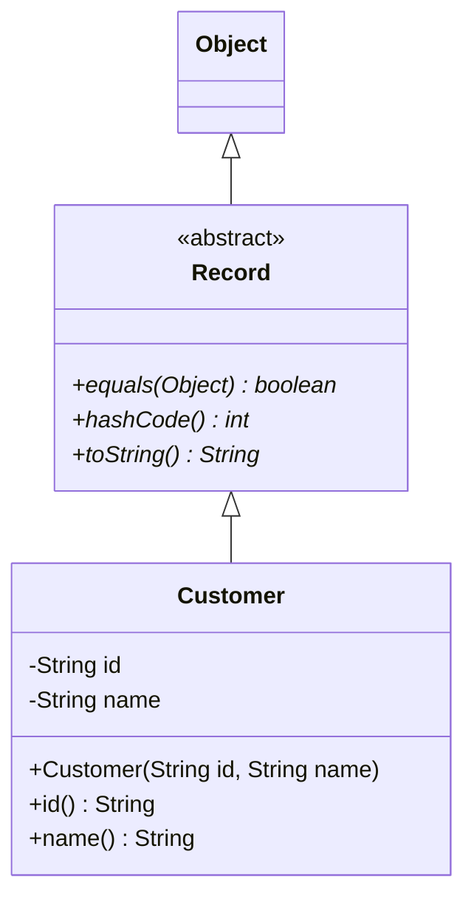

# Quan hệ giữa record, java.lang.Record và lớp final

## 1. Record là một loại lớp đặc biệt của Java

Từ Java 16, `record` là tính năng chính thức để khai báo lớp mang dữ liệu với cấu trúc được thể hiện trong record header. Record vẫn là **một class trong hệ thống kiểu Java**: có kiểu tham chiếu, tạo instance bằng `new`, có constructor, có thể khai báo phương thức và có thể triển khai interface.

Ví dụ:

```java
record Point(int x, int y) {}

Point point = new Point(10, 20);
System.out.println(point.x()); // 10
```

Điểm đặc biệt của record nằm ở các quy tắc ngôn ngữ gắn với nó:

- Mỗi record **ngầm định là final**: không thể có lớp con kế thừa record đó.
- Mọi record đều có lớp cha trực tiếp là `java.lang.Record`.
- Record không thể kế thừa một lớp tùy ý khác, nhưng có thể `implements` một hoặc nhiều interface.
- Các component trong header mô tả trạng thái instance; Java cung cấp field, canonical constructor, accessor và các phương thức giá trị tương ứng.

Vì vậy, khi học record cần phân biệt ba khái niệm có liên quan nhưng không đồng nghĩa: **record**, **lớp nền `java.lang.Record`** và **lớp được khai báo với `final`**.

Mục tiêu bài học:

- Hiểu quan hệ kế thừa giữa record và `java.lang.Record`.
- Hiểu vì sao record là final và không thể dùng làm lớp cha.
- Phân biệt record với một `final class` thông thường.
- Biết record có thể triển khai interface và được dùng qua kiểu `Record`.
- Dùng các API reflection ổn định để nhận diện record.

## 2. `java.lang.Record` là lớp cha chung của mọi record

Java cung cấp lớp trừu tượng `java.lang.Record` trong package `java.lang`. Đây là **lớp cha trực tiếp chung của tất cả record class**.

Với khai báo:

```java
record Customer(String id, String name) {}
```

Quan hệ kế thừa có thể hình dung như sau:



`Customer` không khai báo `extends Record` trong source code. Trình biên dịch xác định `java.lang.Record` là lớp cha trực tiếp theo quy tắc của ngôn ngữ. Khi xem kiểu record qua reflection hoặc thông tin lớp, ta sẽ thấy quan hệ này.

### Những phương thức của lớp nền Record

`java.lang.Record` là lớp abstract. Nó khai báo các phương thức trừu tượng:

| Phương thức | Vai trò |
| --- | --- |
| `equals(Object obj)` | Xác định hai object có bằng nhau theo ngữ nghĩa của kiểu hay không. |
| `hashCode()` | Cung cấp mã băm nhất quán với `equals()`. |
| `toString()` | Cung cấp biểu diễn dạng văn bản của object. |

Mỗi record phải có triển khai cụ thể cho ba phương thức này. Nếu người viết không tự khai báo, Java tạo triển khai dựa trên các component trong header. Nếu cần, record có thể override các phương thức đó để thực hiện quy tắc nghiệp vụ riêng, đồng thời phải giữ đúng hợp đồng Java của `equals()` và `hashCode()`.

Lớp `Record` không phải một kiểu để ta tạo instance trực tiếp, vì nó là abstract. Nó đóng vai trò lớp nền chung trong hệ thống kiểu và là điểm tham chiếu chung khi làm việc với các record không cùng kiểu cụ thể.

### Không thể tự viết một lớp thường kế thừa Record

```java
// Không hợp lệ: lớp thông thường không thể extends java.lang.Record.
// class CustomData extends Record {
// }
```

`Record` là lớp nền dành cho record class. Ta không thể dùng nó làm lớp cha tùy ý cho một class thông thường. Muốn khai báo một record, phải dùng cú pháp `record`. Không có cách biến một lớp thường thành record chỉ bằng cách kế thừa `java.lang.Record`.

## 3. Vì sao record ngầm định là final?

Một record class **implicitly final** (ngầm định final). Điều đó có nghĩa:

- Không thể khai báo một lớp khác `extends` record đó.
- Không thể khai báo record đó là `abstract`.
- Không thể dùng `sealed` hoặc `non-sealed` để mở rộng tập lớp con của record.
- Không cần thêm từ khóa `final` vào khai báo để ngăn kế thừa; tính chất này đã có sẵn.

Ví dụ:

```java
record UserId(String value) {}

// Không hợp lệ: UserId đã final ngầm định.
// class AdminUserId extends UserId {
// }
```

### Vì sao final phù hợp với mô hình record?

Record mô tả trạng thái của một giá trị thông qua danh sách component. Nếu có lớp con được phép bổ sung trạng thái hoặc thay đổi ý nghĩa so sánh, cùng một kiểu record có thể bị mở rộng theo cách làm hợp đồng dữ liệu khó dự đoán.

Tính final giữ cho cấu trúc kiểu được xác định tại nơi khai báo:

1. Header cho biết các component của record.
2. Field component là trạng thái instance được lưu.
3. Constructor thiết lập các component.
4. Accessor đọc các component.
5. `equals()`, `hashCode()` và `toString()` dựa trên cấu trúc component, trừ khi được tùy chỉnh rõ ràng.

Không có lớp con để thêm trạng thái instance hoặc thay đổi ngữ nghĩa của kiểu record. Đây là lựa chọn thiết kế phù hợp cho value carrier và value object.

**Cần phân biệt:** final ở đây nói về khả năng kế thừa của *class*. Nó không tự đảm bảo mọi object được tham chiếu bởi component đều bất biến sâu. Ví dụ record chứa `List` vẫn cần sao chép phòng vệ nếu muốn giữ snapshot không đổi.

## 4. Record không thể extends lớp tùy ý, nhưng có thể implements interface

Trong Java, một class thông thường có thể kế thừa một class khác bằng `extends` và triển khai interface bằng `implements`. Record có quan hệ đặc biệt với lớp nền `Record`: nó đã có lớp cha trực tiếp cố định và không được kế thừa một lớp khác.

```java
// Không hợp lệ: record không có mệnh đề extends tùy ý.
// class BaseEntity {}
// record Customer(String id) extends BaseEntity {}
```

Tuy nhiên, record vẫn có thể triển khai interface. Đây là cách kết hợp mô hình dữ liệu record với các hợp đồng hành vi:

```java
interface Identified {
    String id();
}

interface Describable {
    String description();
}

record Product(String id, String name) implements Identified, Describable {
    @Override
    public String description() {
        return id + " - " + name;
    }
}
```

Record `Product` có accessor `id()` được cung cấp từ component `id`, vì vậy nó đáp ứng phương thức `id()` trong interface `Identified`. Phương thức `description()` là hành vi được triển khai tường minh.

Một interface có thể cung cấp default method và record có thể thừa hưởng phương thức đó như các class khác. Record cũng có thể triển khai nhiều interface, nhưng không thể mở rộng một class nghiệp vụ làm superclass.

### Khi kiến trúc hiện tại yêu cầu kế thừa class

Nếu một kiểu dữ liệu phải kế thừa một lớp cơ sở cụ thể để dùng chung trạng thái hoặc hành vi, record không phù hợp với yêu cầu đó. Có thể xem xét:

- Dùng class thông thường (có thể là `final class` nếu không cần lớp con).
- Chuyển hợp đồng dùng chung thành interface nếu bản chất là hành vi.
- Dùng composition: record chứa một component tham chiếu đến object cung cấp chức năng hoặc dữ liệu cần thiết.

Không nên cố tạo một chuỗi kế thừa giả chỉ để biến class hiện tại thành record. Hãy chọn mô hình dựa trên quan hệ dữ liệu và hành vi của miền nghiệp vụ.

## 5. Phân biệt record với final class thông thường

Một `final class` thông thường cũng không thể bị kế thừa, nhưng nó không tự có những quy tắc dữ liệu của record.

| Đặc điểm | `record` | `final class` thông thường |
| --- | --- | --- |
| Có phải class/reference type? | Có. | Có. |
| Khả năng bị kế thừa | Không; final ngầm định. | Không; do khai báo `final`. |
| Lớp cha trực tiếp | Luôn là `java.lang.Record`. | Theo khai báo `extends`; nếu không khai báo thì là `Object`. |
| Có thể `extends` class khác? | Không. | Có thể, nếu class cha cho phép. |
| Có thể `implements` interface? | Có. | Có. |
| Trạng thái instance | Được mô tả bởi record component; field component là `private final`. | Có thể có field mutable, field final hoặc nhiều trạng thái nội bộ tùy thiết kế. |
| Constructor | Có canonical constructor theo header và có thể có constructor phụ. | Do lập trình viên thiết kế; không có canonical constructor tự sinh. |
| Accessor | Tự sinh accessor công khai cùng tên component nếu không khai báo riêng. | Tự thiết kế getter/phương thức truy cập. |
| `equals()`, `hashCode()` | Có triển khai mặc định dựa trên component nếu không tự khai báo. | Mặc định kế thừa `Object` trừ khi override hoặc kế thừa triển khai khác. |
| `toString()` | Có biểu diễn dựa trên component nếu không tự khai báo. | Mặc định kế thừa `Object.toString()` trừ khi override. |
| Reflection nhận diện | `Class.isRecord()` trả `true`. | `Class.isRecord()` trả `false`. |

### Ví dụ: hai cách mô tả cùng dữ liệu

Dùng record:

```java
record Color(int red, int green, int blue) {}

Color color = new Color(20, 100, 200);
System.out.println(color.red());
System.out.println(color);
```

Dùng final class:

```java
final class ColorClass {
    private final int red;
    private final int green;
    private final int blue;

    ColorClass(int red, int green, int blue) {
        this.red = red;
        this.green = green;
        this.blue = blue;
    }

    public int red() { return red; }
    public int green() { return green; }
    public int blue() { return blue; }
}
```

`ColorClass` không tự có bình đẳng theo giá trị. Nếu cần hai instance có cùng RGB được xem là bằng nhau, người viết phải tự cài đặt `equals()` và `hashCode()`. Record đã cung cấp quy tắc mặc định này dựa trên component.

Một final class có thể được thiết kế bất biến và có đầy đủ equals/hashCode/toString, nhưng các hành vi đó là kết quả của thiết kế/cài đặt class. Record biểu đạt trực tiếp ý định mang dữ liệu và áp dụng các ràng buộc ngôn ngữ tương ứng.

## 6. Record vẫn là object: identity và equality

Tính final và bình đẳng theo giá trị không biến record thành primitive hoặc kiểu dữ liệu không có identity. Record vẫn là object Java được tạo bằng `new`:

```java
record Money(String currency, long minorUnits) {}

Money first = new Money("VND", 50_000);
Money second = new Money("VND", 50_000);

System.out.println(first == second);       // false
System.out.println(first.equals(second));  // true
```

Hai biến tham chiếu đến hai instance khác nhau, nên `==` là `false`. Triển khai `equals()` mặc định của record so sánh các component, nên `equals()` là `true` khi giá trị component tương ứng bằng nhau.

Tính final chỉ ngăn tạo subclass. Nó không có nghĩa:

- Hai lần gọi constructor sẽ trả về cùng một object.
- Không thể dùng `null` cho component kiểu tham chiếu.
- Mọi component tham chiếu đều bất biến sâu.
- Record tự động an toàn luồng trong mọi tình huống.

Ví dụ component là danh sách:

```java
import java.util.List;

record Team(List<String> members) {}
```

Field tham chiếu `members` là final, nhưng nếu danh sách truyền vào có thể sửa thì nội dung danh sách vẫn thay đổi. Có thể bảo vệ bằng `List.copyOf()` trong constructor khi mô hình cần snapshot:

```java
import java.util.List;
import java.util.Objects;

record TeamSnapshot(List<String> members) {
    TeamSnapshot {
        members = List.copyOf(Objects.requireNonNull(members, "members"));
    }
}
```

Đây là tính bất biến nông đối với phần tử; nếu phần tử bên trong cũng mutable thì cần cân nhắc thêm cách bảo vệ.

## 7. Dùng java.lang.Record như một kiểu tham chiếu chung

Vì tất cả record đều kế thừa trực tiếp `java.lang.Record`, ta có thể dùng `Record` làm kiểu tham chiếu khi muốn nhận bất kỳ record nào mà không cần biết kiểu cụ thể:

```java
record Person(String name, int age) {}
record Order(String code, long total) {}

static void printRecord(Record value) {
    System.out.println(value);
}

printRecord(new Person("An", 20));
printRecord(new Order("OD-01", 150_000));
```

Kiểu tham số `Record` chấp nhận instance của `Person`, `Order` và các record class khác. Đây là điểm khác với việc nhận một interface cụ thể: mọi record đều có lớp nền chung này ngay cả khi chúng không triển khai cùng một interface nghiệp vụ.

Tuy nhiên, `Record` chỉ cung cấp hợp đồng chung của lớp nền, không cung cấp accessor chung cho mọi component. Không có phương thức kiểu `value.componentAt(0)`. Mỗi record có header riêng, tên và kiểu component riêng. Nếu cần đọc cấu trúc tổng quát, dùng reflection; nếu cần xử lý nghiệp vụ có kiểu rõ ràng, ưu tiên interface mà các record cùng triển khai.

### Pattern matching với instanceof

Pattern matching cho `instanceof` là tính năng chính thức từ Java 16 (JEP 394). Có thể kết hợp nó với `Record` để kiểm tra một object có phải record hay không và gán biến có kiểu `Record`:

```java
static void inspect(Object value) {
    if (value instanceof Record recordValue) {
        System.out.println("A record: " + recordValue);
    } else {
        System.out.println("Not a record");
    }
}
```

Đoạn mã trên sử dụng cú pháp pattern matching đã được hoàn thiện trong Java 16, không cần bật preview. Nó chỉ nhận diện object thuộc họ record và gọi hành vi chung `toString()`. Để truy cập các component cụ thể, cần biết kiểu record hoặc dùng reflection.

Không nhầm pattern matching `instanceof` với pattern matching cho `switch`: tính năng `switch` pattern có lịch sử preview và được hoàn thiện ở phiên bản Java sau. Bài này chỉ sử dụng `instanceof` ổn định từ Java 16.

## 8. Nhận diện record bằng reflection

API reflection cung cấp cách xác định một class có phải record và đọc danh sách component:

```java
Class<?> type = Customer.class;

System.out.println(type.isRecord()); // true
```

`Class.isRecord()` trả về `true` nếu đối tượng `Class` đại diện một record class. Đối với class thông thường, kể cả `final class`, kết quả là `false`.

Có thể đọc các component theo thứ tự khai báo:

```java
import java.lang.reflect.RecordComponent;

record Customer(String id, String name) {}

for (RecordComponent component : Customer.class.getRecordComponents()) {
    System.out.println(component.getName());
    System.out.println(component.getType().getTypeName());
    System.out.println(component.getAccessor().getName());
}
```

`getRecordComponents()` trả về mảng metadata `RecordComponent` theo thứ tự header; với class không phải record, phương thức trả về `null`. Vì vậy, nên kiểm tra `isRecord()` trước khi duyệt kết quả.

Reflection hữu ích cho framework, mapper hoặc công cụ tài liệu hóa. Trong code nghiệp vụ thông thường, accessor có kiểu tường minh hoặc interface thường dễ đọc và an toàn kiểu hơn.

## 9. Ví dụ hoàn chỉnh: record triển khai interface và được xử lý qua Record

Ví dụ sau kết hợp các ý chính. Lưu vào tệp **`Demo.java`**:

```java
import java.lang.reflect.RecordComponent;

public class Demo {
    interface Identified {
        String id();
    }

    record Customer(String id, String name) implements Identified {}
    record Invoice(String id, long total) implements Identified {}

    static void printCommon(Record value) {
        System.out.println(value);
    }

    static void printId(Identified value) {
        System.out.println("ID: " + value.id());
    }

    static void inspect(Object value) {
        if (value instanceof Record recordValue) {
            System.out.println("Record class: " + value.getClass().getName());
            for (RecordComponent component : value.getClass().getRecordComponents()) {
                System.out.println(
                    component.getName() + " : " + component.getType().getTypeName()
                );
            }
        }
    }

    public static void main(String[] args) {
        Customer customer = new Customer("C-01", "An");
        Invoice invoice = new Invoice("I-01", 250_000);

        printCommon(customer);
        printCommon(invoice);

        printId(customer);
        printId(invoice);

        inspect(customer);
        inspect(invoice);

        System.out.println(Customer.class.getSuperclass() == Record.class); // true
        System.out.println(Customer.class.isRecord()); // true
        System.out.println(Demo.class.isRecord());     // false
    }
}
```

Biên dịch và chạy trên JDK 16 trở lên:

```bash
javac --release 16 Demo.java
java Demo
```

Trong ví dụ:

1. `Customer` và `Invoice` là hai record khác kiểu nhưng cùng có lớp cha trực tiếp `Record`.
2. Cả hai triển khai interface `Identified`, do đó có thể dùng qua kiểu interface khi cần gọi `id()`.
3. Hàm `printCommon(Record value)` nhận mọi record thông qua lớp nền chung.
4. Hàm `inspect(Object value)` dùng pattern matching `instanceof Record` và reflection để đọc metadata component.
5. `Customer.class.getSuperclass()` trả về `Record.class`; `Customer.class.isRecord()` trả về `true`.
6. `Demo.class.isRecord()` trả về `false` dù `Demo` cũng có thể là một class final hay không final tùy khai báo.

## 10. Chọn record hay final class?

| Tình huống | Nên cân nhắc |
| --- | --- |
| Kiểu dữ liệu có tập component cố định, cần equality theo giá trị | `record`. |
| DTO, kết quả truy vấn, response model hoặc value object | `record` nếu framework và hợp đồng API hỗ trợ. |
| Cần kế thừa một class cơ sở hiện có | Class thông thường, vì record không thể extends class khác. |
| Cần một class không có lớp con nhưng có trạng thái nội bộ tùy ý | `final class`. |
| Cần getter/setter, vòng đời và trạng thái mutable | Class thông thường thường phù hợp hơn. |
| Nhiều kiểu dữ liệu cần dùng chung hành vi | Cân nhắc interface; record có thể implements interface. |
| Cần xử lý mọi record trong một API chung | Dùng `java.lang.Record` hoặc reflection tùy mức thông tin cần truy cập. |

Các lỗi dễ gặp:

1. Nghĩ record chỉ là cú pháp rút gọn của `final class`: record có lớp cha `Record` và các quy tắc component riêng.
2. Nghĩ record có thể extends class nghiệp vụ: record chỉ có `java.lang.Record` làm lớp cha trực tiếp.
3. Nghĩ record không thể triển khai interface: record hỗ trợ `implements` như class.
4. Nghĩ final class và record đều tự có equality theo giá trị: final class thường không tự sinh `equals()`/`hashCode()` theo field.
5. Nghĩ final class hoặc record tự động bất biến sâu: cần xem xét các object mutable được tham chiếu.
6. Nghĩ `Record` có accessor chung cho mọi component: component phải được đọc qua kiểu cụ thể hoặc reflection.

## Ghi nhớ

Mọi record class đều trực tiếp kế thừa lớp abstract `java.lang.Record` và ngầm định là `final`. Vì thế, record không thể làm lớp cha cho kiểu khác và cũng không thể extends một class nghiệp vụ; đổi lại, nó vẫn có thể implements interface. `Record` khai báo hợp đồng chung cho `equals()`, `hashCode()` và `toString()`, còn record cụ thể cung cấp triển khai dựa trên component hoặc triển khai tường minh do lập trình viên viết. Một `final class` thông thường chỉ có đặc tính không thể kế thừa; nó không tự có cấu trúc component, canonical constructor hay equality theo giá trị. Hãy chọn record khi mô hình dữ liệu có cấu trúc cố định và ngữ nghĩa giá trị phù hợp; chọn class thông thường khi cần kế thừa class, trạng thái instance tùy ý hoặc vòng đời mutable. Các quy tắc và API này là tính năng ổn định từ Java 16, vẫn áp dụng trong Java hiện đại.

**Tài liệu tham khảo chính thức:**

- [OpenJDK JEP 395 – Records](https://openjdk.org/jeps/395)
- [Java Language Specification – Record Classes, mục 8.10](https://docs.oracle.com/en/java/javase/26/docs/specs/jls/jls-8.html#jls-8.10)
- [Java API – java.lang.Record](https://docs.oracle.com/en/java/javase/26/docs/api/java.base/java/lang/Record.html)
- [Java API – java.lang.Class, isRecord/getRecordComponents](https://docs.oracle.com/en/java/javase/26/docs/api/java.base/java/lang/Class.html)
